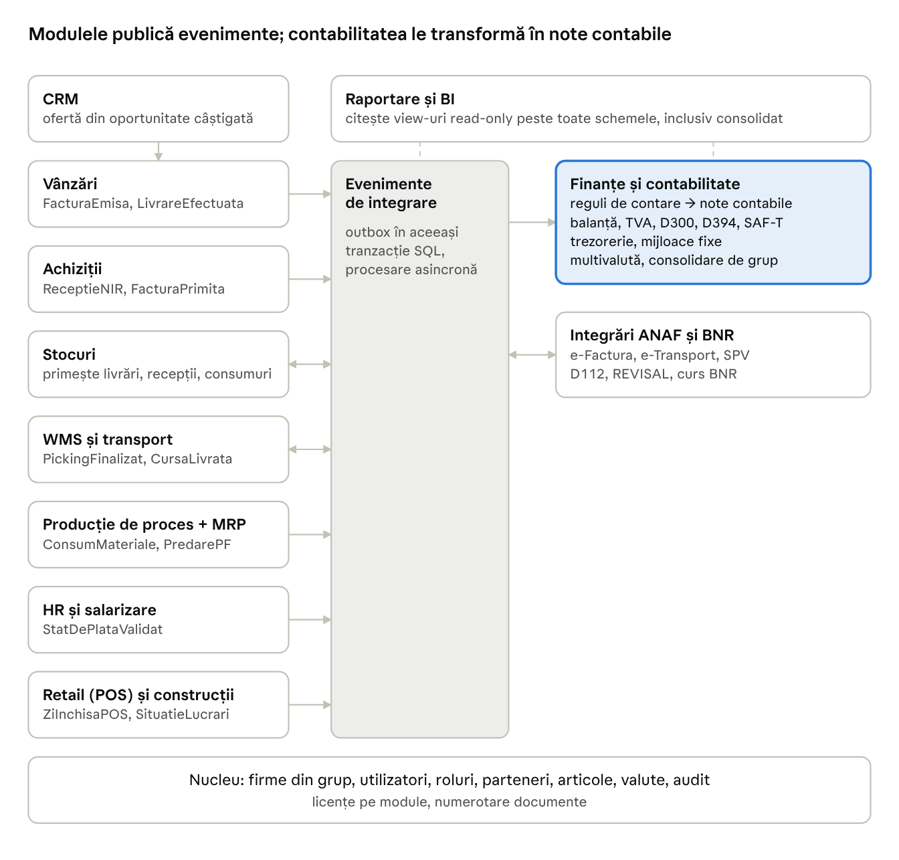
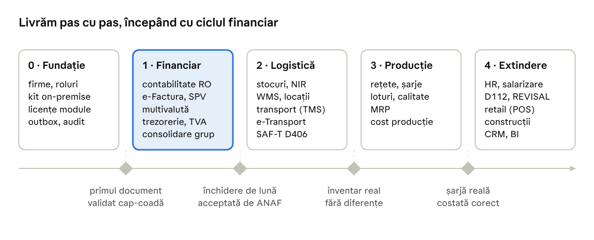

# Arhitectura sistemului ERP — schiță inițială

14 noiembrie 2026 · Aurelian

Recomandarea, revizuită după răspunsurile tale: un **produs ERP licențiat, instalat on-premise la fiecare client**, construit ca **monolit modular** în .NET, cu o bază SQL Server per instalare (scheme pe modul) și frontend React + TypeScript. Echipa e o persoană plus Claude, deci simplitatea operațională cântărește mai mult decât orice altceva.

## Scop și principii

Țintă: companii medii și mari din România, din orice industrie, cu 100 până la câteva zeci de mii de documente pe lună, adesea grupuri de firme. Sistemul e multivalutar, cu consolidare de grup, contabilitate conformă (OMFP 1802/2014), e-Factura, SAF-T (D406) și salarizare completă (D112, REVISAL). Fără entități în afara României, fără migrare de date și fără aplicație mobilă în prima fază. Principii de design:

- **Modulele sunt proprietarii datelor lor.** Niciun modul nu scrie direct în tabelele altuia; comunicarea se face prin contracte publice sau evenimente.
- **Contabilitatea e sursa de adevăr financiar.** Celelalte module generează documente; contabilitatea le transformă în note contabile prin reguli de contare configurabile.
- **Auditabil din prima zi.** Orice document validat e imutabil; corecțiile se fac prin storno, nu prin editare.
- **Simplu de operat.** Un singur deployabil la început, cu granițe clare care permit extragerea ulterioară a unui modul ca serviciu separat.
- **Specific românesc ca prim-cetățean.** ANAF, plan de conturi, TVA la încasare, cursuri BNR, nu adăugate la final.

## Module principale

Douăsprezece module de business plus un nucleu comun. Fiecare modul se poate activa prin licență, deci un client plătește doar ce folosește.

| Modul | Responsabilități principale | Specific România |
| --- | --- | --- |
| Nucleu (Platform) | Firme din grup, utilizatori, roluri, nomenclatoare comune (parteneri, articole, valute, UM), numerotare documente, audit, licențe pe module | Validare CUI/CNP, cursuri BNR zilnice |
| Finanțe și contabilitate | Plan de conturi, note contabile, jurnale, balanță, închidere de lună, trezorerie, mijloace fixe, multivalută cu reevaluare lunară, consolidare de grup cu eliminări intra-grup | OMFP 1802, jurnal TVA, D300/D394, SAF-T D406, TVA la încasare |
| Vânzări | Oferte, comenzi client, avize, facturi, încasări, liste de prețuri, discounturi | e-Factura (UBL CIUS-RO), e-Transport |
| Achiziții | Referate, comenzi furnizor, recepții (NIR), facturi furnizor, plăți | Preluare facturi primite din SPV |
| Stocuri | Gestiuni, mișcări, transferuri, inventar, loturi și serii, evaluare (CMP, FIFO) | Fișe de magazie, bonuri de consum |
| WMS (depozit) | Locații, put-away, picking, packing, valuri de comenzi, inventar pe locație | — |
| Transport (TMS) | Vehicule, șoferi, curse, rute, cost transport, livrări pe cursă | Coduri UIT e-Transport |
| Producție (proces) | Rețete cu randamente, șarje și loturi, coproduse și deșeuri, control calitate, MRP (necesar materiale și plan producție), calcul cost | Bonuri de consum, predare produse finite |
| HR și salarizare | Angajați, contracte, pontaj, concedii, calcul salarial, state de plată | REVISAL, D112, CASS/CAS/impozit, tichete |
| Vânzări retail (POS) | Case de vânzare, bonuri, încasări card/numerar, funcționare offline, închideri de zi | Case de marcat fiscale (AMEF), raport Z |
| Construcții | Proiecte și șantiere, devize, buget vs realizat, situații de lucrări, subcontractori, consum pe șantier | Taxare inversă TVA, garanții de bună execuție |
| CRM | Lead-uri, oportunități, activități, campanii, istoric client | — |
| Raportare și BI | Rapoarte operaționale, dashboard-uri, export, raportări legale, rapoarte consolidate | Bilanț, situații financiare |

## Bounded contexts și integrare

Fiecare modul e un bounded context cu limbajul lui („articol” înseamnă lucruri diferite în Vânzări și în Stocuri). Modulele operaționale publică evenimente după validarea unui document; Contabilitatea și Integrările le consumă.

Apelurile sincrone (de ex. Vânzări verifică stocul disponibil) trec prin interfețele `.Contracts`; tot ce ține de efecte secundare (notă contabilă, trimitere e-Factura, descărcare de stoc) merge prin evenimente.

Fluxul central, comandă → încasare:

1. CRM transformă oportunitatea în ofertă; Vânzări o convertește în comandă client și rezervă stoc.
2. Avizul de livrare validează ieșirea → `LivrareEfectuata` → Stocuri descarcă gestiunea și publică `MiscareStoc` cu valoarea.
3. Factura validată → `FacturaEmisa` → Integrări trimite UBL la e-Factura, Contabilitatea generează nota 4111 = 707 + 4427.
4. Extrasul bancar importă încasarea; Trezoreria o leagă de factură și închide soldul clientului.

## Stil arhitectural

Recomand **monolit modular** acum, cu opțiunea de a extrage servicii mai târziu. Un ERP are tranzacții care traversează module (factură → stoc → contabilitate), iar microserviciile de la început ar aduce consistență eventuală, sagas și costuri de operațiuni fără un câștig real la volumul inițial.

| Criteriu | Monolit modular | Microservicii |
| --- | --- | --- |
| Tranzacții între module | Simple, o singură bază de date | Sagas, compensare, outbox obligatoriu |
| Operațiuni | Un deployabil, un pipeline | N servicii, orchestrare, observabilitate distribuită |
| Viteză de livrare la început | Mare | Mică |
| Scalare independentă | Limitată (se scalează tot) | Pe serviciu |
| Echipă potrivită | 1–3 echipe | Multe echipe autonome |

Reguli care păstrează granițele curate în monolit:

1. Fiecare modul e un set de proiecte proprii (`Erp.Sales.Domain`, `.Application`, `.Infrastructure`, `.Contracts`).
2. Un modul poate referi doar proiectul `.Contracts` al altui modul; regula e verificată automat cu teste de arhitectură (NetArchTest).
3. Comunicarea sincronă trece prin interfețe din `.Contracts`; cea asincronă prin evenimente de integrare, cu **outbox** în aceeași tranzacție.
4. Fiecare modul are propria schemă SQL; nu există join-uri între scheme în codul de business (doar în raportare, pe view-uri dedicate).
5. În interiorul modulului: CQRS ușor cu MediatR (comenzi, interogări, pipeline de validare, logare, tranzacție).

Ce se schimbă față de prima variantă, după răspunsurile tale:

- **Echipă de o persoană + Claude**: microserviciile sunt excluse; un singur deployabil, un singur pipeline, convenții stricte și repetitive (același șablon de modul peste tot), ca să poată fi generat și verificat ușor.
- **Module licențiate**: fiecare modul se înregistrează la pornire doar dacă licența clientului îl include (meniuri, endpoint-uri, joburi și handler-e de evenimente).
- **POS-ul e singura excepție de la monolit**: casele de vânzare trebuie să meargă și fără rețea, deci au un client local cu bază proprie (SQLite sau SQL Express) care se sincronizează cu serverul central (nomenclatoare în jos, bonuri în sus).

## Date și multi-tenancy

Propunerea: **o instalare per client, cu o singură bază SQL Server pe server-ul lui**, în care stau toate firmele grupului, separate prin `CompanyId`. Așa, consolidarea de grup e o interogare locală, iar fiecare client își ține datele la el. Multi-tenancy-ul de tip SaaS nu mai e necesar.

| Nivel | Unitate | Ce izolează |
| --- | --- | --- |
| Instalare | Un client (grup de firme) | Server, bază de date, licență, utilizatori |
| Firmă | `CompanyId` pe fiecare document | Plan de conturi, numerotare, perioade, TVA, certificat ANAF |
| Gestiune / depozit / șantier | Dimensiuni pe document | Drepturi de acces și rapoarte |

Decizii de date:

- **SQL Server**, o schemă per modul (`core`, `fin`, `sales`, `purch`, `inv`, `wms`, `tms`, `mfg`, `hr`, `pos`, `cons`, `crm`). Volumul așteptat (zeci de mii de documente pe lună) e confortabil pentru o singură instanță; ediția Standard ajunge pentru majoritatea clienților.
- **Proceduri stocate** pentru operațiile grele și set-based (închidere de lună, evaluare stoc, MRP, calcul salarial, consolidare, rapoarte); Dapper pentru apeluri.
- **Multivalută**: RON e moneda funcțională; fiecare linie are moneda ei și cursul BNR memorat; reevaluarea soldurilor în valută la sfârșit de lună e un pas din închidere.
- **Consolidare de grup**: parteneri marcați ca intra-grup, plan de conturi de grup cu mapare din planurile firmelor, eliminări intra-grup generate automat și ajustabile manual.
- **Documente imutabile după validare**, cu coloane de audit și tabelă de audit generică; perioade contabile deschise/închise per firmă.
- **Actualizări on-premise**: migrările de schemă sunt versionate și rulate automat de installer, cu backup înainte și verificare după; nicio modificare manuală la client.
- **Raportare**: view-uri și proceduri pe baza principală; o replică read-only doar la clienții mari care o cer.

## Securitate și permisiuni

Modelul propus: **RBAC cu permisiuni fine, filtrate pe firmă și gestiune**. Un utilizator are roluri; un rol are permisiuni de forma `Modul.Resursă.Acțiune` (de ex. `Sales.Invoice.Validate`); fiecare atribuire e limitată la una sau mai multe firme, gestiuni sau centre de cost.

- **Autentificare**: ASP.NET Core Identity cu cookie securizat, în aceeași aplicație (fără server de identitate separat, gratuit, parte din .NET; Duende și OpenIddict au fost respinse pe 14.11.2026), cu opțiune de autentificare cu contul Windows (Active Directory); chei API pentru conturile tehnice și casele POS; 2FA pentru roluri financiare.
- **Autorizare**: policy-uri ASP.NET Core generate din permisiuni; verificare în pipeline-ul MediatR, nu în controllere; filtrare pe firmă, gestiune, depozit și șantier.
- **Separarea sarcinilor**: cine introduce un document nu îl poate și valida (configurabil pe tip de document); fluxuri de aprobare pe praguri valorice.
- **Date personale (GDPR)**: CNP, salarii și date medicale criptate la nivel de coloană (Always Encrypted sau criptare în aplicație), acces logat.
- **Secrete ANAF și licențe**: certificatele și token-urile OAuth pentru SPV criptate cu cheie locală (Windows DPAPI sau certificat din magazinul mașinii), niciodată în clar; fișierul de licență semnat digital, verificat la pornire.
- **Audit**: cine, ce, când, de pe ce IP, pentru orice validare, anulare, modificare de configurare și export.

## Stack tehnologic propus

Ales să se potrivească cu ce folosești deja (.NET, MediatR, SQL Server cu proceduri stocate, React + TypeScript), ca să nu plătești o curbă de învățare nouă.

| Strat | Alegere | Note |
| --- | --- | --- |
| Backend | .NET 10 (LTS), ASP.NET Core Web API | Un singur host, module încărcate după licență |
| Aplicație | MediatR, FluentValidation, Mapster | Pipeline: validare → autorizare → tranzacție → audit |
| Acces date | Dapper + proceduri stocate, fără ORM | Migrări versionate cu DbUp, rulate de installer |
| Bază de date | SQL Server 2022 (Standard sau Enterprise, la client) | Scheme pe modul |
| Mesagerie internă | Outbox în SQL + procesator în fundal | Fără broker extern: o dependență în minus de instalat la client |
| Joburi | Hangfire (stocare în SQL Server) | Sincronizare SPV, cursuri BNR, MRP, închideri, sincronizare POS |
| Frontend | React + TypeScript, Vite, TanStack Query, React Hook Form + Zod | Tabele mari: AG Grid sau TanStack Table |
| POS | Client local (React în Electron sau WPF) + SQLite | Funcționează offline, driver pentru casa de marcat fiscală |
| Rapoarte / documente | QuestPDF pentru facturi și state; export Excel cu ClosedXML | BI: Power BI Report Server sau Metabase, tot on-premise |
| Identitate | ASP.NET Core Identity cu cookie (gratuit), autentificare Windows pentru Active Directory | 2FA, login cu contul Windows în rețeaua clientului |
| Observabilitate | Serilog + OpenTelemetry, Seq local | Pachet de diagnostic exportabil pentru suport |
| Integrări RO | Adaptor ANAF (e-Factura, e-Transport, SPV), BNR, REVISAL | Izolate într-un modul `Integrations`; serverul are nevoie doar de ieșire HTTPS spre ANAF și BNR |
| Livrare | Installer (Windows Server + IIS sau serviciu Windows), opțional Docker | GitHub Actions construiește kitul; teste de arhitectură în CI |

## Instalare și actualizare

Clientul primește un **kit de instalare semnat**, îl rulează pe serverul lui și termină configurarea din browser. Nu e nevoie de niciun port deschis din internet spre server.

| Element | Decizie |
| --- | --- |
| Cerințe server | Windows Server 2019/2022, IIS + ASP.NET Core Hosting Bundle, certificat HTTPS intern, ieșire HTTPS spre ANAF și BNR |
| Bază de date | SQL Server Standard sau Enterprise (licența clientului), pe același server sau separat |
| Conținut kit | Site IIS (API .NET + UI React), serviciu Windows pentru lucrul în fundal, scripturi DbUp (autentificarea e inclusă în API) |
| Licență | Fișier semnat: module active + CUI-urile grupului; verificat local, fără internet |
| Backup | Installer-ul creează joburi SQL Agent: complet zilnic, log la 15 minute |
| POS | Installer separat per casă: client local + SQLite + driver AMEF, configurat cu adresa serverului |
| Cine instalează | Echipa noastră de la distanță (VPN / TeamViewer) sau IT-ul clientului, după ghid |

Pașii instalării:

1. Verificarea cerințelor: versiune Windows, IIS, acces SQL, spațiu pe disc, certificat.
2. Conexiunea SQL: creare bază, scheme pe module, rularea tuturor migrărilor.
3. Creare site IIS și serviciu Windows, pornire și health-check.
4. Încărcarea licenței.
5. Asistent de configurare în browser: firmele din grup, administratorul, Active Directory (opțional), certificatul pentru ANAF/SPV.
6. Configurarea joburilor de backup.

Actualizarea folosește același kit, în mod upgrade: backup automat → oprire servicii → migrare bază → repornire → health-check. La orice eșec revine automat la backup și la versiunea anterioară. Orice versiune din ultimele 12 luni se poate actualiza direct.

## Roadmap pe faze

Livrăm pas cu pas: prima versiune instalabilă la un client e ciclul financiar complet (factură → e-Factura → notă contabilă → încasare, multivalută și consolidare), pentru că toate celelalte module se sprijină pe el. Logistica vine înaintea producției, fiindcă MRP-ul are nevoie de stocuri corecte. Duratele nu sunt estimate încă.

Fiecare poartă e un criteriu verificabil, nu o dată: nu trecem la faza următoare până când fluxul fazei curente nu merge cap-coadă pe date reale.
