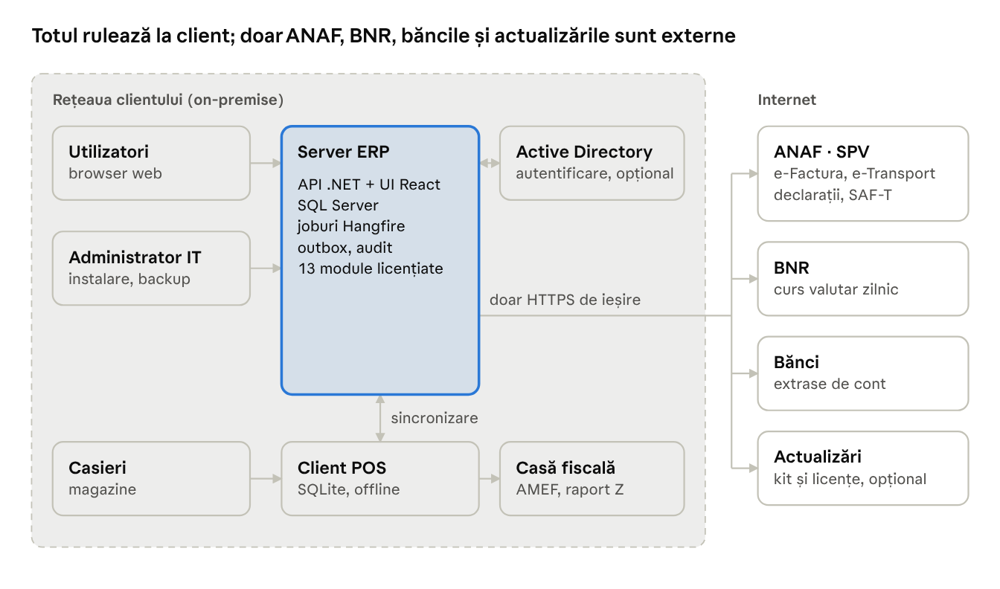

# ERP · 01 Scop și principii

14 noiembrie 2026 · Aurelian · **Validat** · Versiune editabilă: https://claude.ai/artifact/TR4QjvsTBdvETfGgozK4we

Acest document fixează ce construim, pentru cine și după ce reguli. Orice decizie din secțiunile următoare (module, date, securitate, stack, instalare, roadmap) trebuie să respecte ce e scris aici; o abatere se discută și se notează ca excepție, nu se face tăcut. Pleacă de la [schița de arhitectură](../00-schita/ARHITECTURA_ERP.md).

## Viziune și poziționare

**Un ERP românesc, complet și instalabil la client, care ține într-un singur loc contabilitatea, operațiunile și oamenii unui grup de firme mediu sau mare, conform cu ANAF din prima zi.**

Problema pe care o rezolvă:

- Companiile medii și mari din România folosesc des 3–5 aplicații separate (contabilitate, salarizare, stocuri, producție, CRM), legate prin exporturi Excel și reintroducere manuală de date.
- Obligațiile ANAF (e-Factura, e-Transport, SAF-T, D112) se schimbă frecvent și sunt tratate ca adăugiri la sisteme care nu au fost gândite pentru ele.
- ERP-urile internaționale acoperă operațiunile, dar localizarea românească e incompletă, scumpă sau dependentă de parteneri.
- Multe firme vor datele la ele (on-premise), din motive de control, securitate sau politică internă.

Poziționarea produsului:

| Dimensiune | Alegerea noastră |
| --- | --- |
| Piață | România, companii medii și mari, grupuri de firme |
| Industrie | Orizontal (orice industrie), cu verticale pentru producție de proces, logistică, retail și construcții |
| Model de livrare | Produs licențiat, instalat on-premise la client |
| Model comercial | Licență pe module activate + contract de mentenanță cu actualizări |
| Diferențiator principal | Conformitate fiscală românească nativă + toate fluxurile într-o singură bază de date |
| Ce nu suntem | Aplicație de facturare pentru microîntreprinderi, SaaS multi-tenant, ERP multinațional |

## Context de sistem

Produsul e un singur server ERP instalat în rețeaua clientului, plus clienții POS din magazine. Singurele legături spre exterior sunt cele impuse de lege (ANAF), de date de referință (BNR, bănci) și, opțional, de actualizări.

| Sistem extern | Direcție | Ce schimbăm | Mecanism |
| --- | --- | --- | --- |
| ANAF · SPV | Ambele | Facturi emise și primite, coduri UIT, declarații, SAF-T | API REST cu OAuth și certificat digital calificat |
| BNR | Intrare | Cursul valutar zilnic | Fișier XML public, job zilnic |
| Bănci | Intrare | Extrase de cont pentru reconciliere | Import fișier (MT940, CAMT.053, CSV pe bancă) |
| Active Directory | Intrare | Identitatea utilizatorilor, grupuri | Autentificare Windows (Kerberos/NTLM) prin IIS |
| Casă fiscală (AMEF) | Ieșire | Bonuri fiscale, raport Z | Driverul producătorului, din clientul POS |
| REVISAL / ITM | Ieșire | Registrul salariaților | Fișier generat, încărcat de utilizator |
| Server de actualizări | Intrare, opțional | Kituri noi, reînnoire licență | Descărcare manuală sau automată, la alegerea clientului |

O instalare trebuie să funcționeze complet și fără serverul de actualizări; doar integrările ANAF și BNR au nevoie de internet.

## Clienți țintă și roluri de utilizatori

Profilul clientului ideal: un grup de 1–10 firme românești, cu 50–1.000 de angajați, 20–300 de utilizatori ai sistemului și 100 până la câteva zeci de mii de documente pe lună. Are un departament IT sau un furnizor IT care administrează un server Windows și SQL Server. Cifrele de angajați și utilizatori sunt o ipoteză de lucru, de confirmat cu primii clienți.

Rolurile de mai jos sunt punctul de plecare pentru modelul de permisiuni; fiecare client le poate combina sau rafina.

| Rol | Ce face zilnic | Module principale | Ce așteaptă de la sistem |
| --- | --- | --- | --- |
| Director financiar (CFO) | Urmărește cash-flow, rezultate, consolidare | Finanțe, Raportare | Cifre corecte, rapide, consolidate pe grup |
| Contabil șef | Validează note, închide luna, depune declarații | Finanțe, Integrări ANAF | Închidere de lună previzibilă, D300/D394/D406 generate corect |
| Contabil / operator contabil | Introduce și verifică documente, face reconcilieri | Finanțe, Achiziții, Trezorerie | Introducere rapidă din tastatură, validări clare |
| Agent / operator vânzări | Oferte, comenzi, facturi | Vânzări, CRM | Stoc și preț vizibile instant, factură trimisă automat în e-Factura |
| Achizitor | Comenzi furnizor, urmărire livrări | Achiziții, Stocuri | Necesar calculat, facturi preluate din SPV |
| Gestionar / magazioner | Recepții, livrări, transferuri, inventar | Stocuri, WMS | Operații simple, fără contabilitate în față |
| Responsabil logistică | Planifică curse, vehicule, livrări | Transport (TMS), WMS | Rute, coduri UIT e-Transport generate automat |
| Planificator producție | Rulează MRP, lansează comenzi și șarje | Producție, Stocuri | Necesar de materiale corect, trasabilitate pe lot |
| Șef de șantier / manager de proiect | Urmărește buget, consumuri, situații de lucrări | Construcții | Buget vs realizat pe fiecare șantier |
| Casier | Vânzare la casă, închidere de zi | POS | Funcționare și fără internet, bon fiscal emis corect |
| Specialist HR / salarizare | Contracte, pontaj, calcul salarii | HR și salarizare | D112 și REVISAL generate fără retușuri manuale |
| Angajat (self-service) | Vede fluturașul, cere concediu | HR | Acces simplu, doar la datele proprii |
| Administrator de sistem | Instalează, actualizează, gestionează utilizatori și backup | Nucleu | Instalare și actualizare fără surprize, jurnale clare |
| Auditor / cenzor | Consultă documente și istoricul modificărilor | Toate, doar citire | Pistă de audit completă și exportabilă |

## Perimetru

Perimetrul e definit pe trei niveluri: ce intră în produs, ce intră mai târziu și ce nu facem deloc. Orice cerere nouă se clasifică într-una din cele trei coloane înainte de a fi estimată.

| Zonă | În produs | Mai târziu | În afara produsului |
| --- | --- | --- | --- |
| Entități | Firme românești, grupuri de firme, consolidare | — | Firme din alte țări, plan de conturi IFRS separat |
| Valute | Multivalută, RON funcțională, curs BNR, reevaluare | Cursuri de bancă configurabile | Monedă funcțională alta decât RON |
| Contabilitate | OMFP 1802, TVA, declarații ANAF, SAF-T, mijloace fixe | Contabilitate de gestiune avansată (ABC) | Contabilitate bugetară (instituții publice) |
| Operațiuni | Vânzări, achiziții, stocuri, WMS, transport | Portal B2B pentru clienți și furnizori | Marketplace, e-commerce complet |
| Producție | Proces: rețete, șarje, loturi, calitate, MRP | Producție discretă (BOM multinivel, rute de operații) | MES cu achiziție de date de la utilaje |
| Retail | POS cu funcționare offline, case fiscale | Programe de fidelitate | Self-checkout, magazin online |
| Construcții | Șantiere, devize, buget vs realizat, situații de lucrări | Integrare cu programe de devize externe | Proiectare, BIM |
| Oameni | HR, pontaj, salarizare completă, D112, REVISAL, self-service | Evaluarea performanței, recrutare | Pontaj biometric (doar import) |
| Relații clienți | CRM: lead-uri, oportunități, activități | Campanii email automatizate | Call-center, ticketing |
| Raportare | Rapoarte operaționale și legale, dashboard-uri, export Excel/PDF | Depozit de date separat | Data science, ML |
| Platformă | On-premise, Windows Server + SQL Server, interfață web | Docker / Linux | SaaS multi-tenant găzduit de noi |
| Mobil | Interfață web responsivă | Aplicație de inventar cu scanner, agenți de vânzări | Aplicații native pentru fiecare modul |
| Date existente | Import inițial din Excel/CSV (solduri, nomenclatoare) | Migrare din Saga, WinMentor, SmartBill | Migrare automată din orice sistem |

De reținut: „mai târziu” nu înseamnă „niciodată”, dar înseamnă că arhitectura actuală nu face eforturi speciale pentru ele, ci doar nu le blochează.

## Cerințe legale și fiscale din România

Conformitatea e o cerință de produs, nu o opțiune: o factură care nu ajunge în e-Factura sau un D112 respins înseamnă amenzi pentru client. Tabelul e inventarul inițial; **termenele și formatele trebuie verificate pe surse oficiale (ANAF, Monitorul Oficial) înainte de implementarea fiecărui modul**, pentru că legislația se schimbă des.

| Obligație | Ce presupune | Modul responsabil | Frecvență | Format / canal |
| --- | --- | --- | --- | --- |
| Plan de conturi și registre | Plan de conturi general, registru jurnal, registru inventar, cartea mare, balanță | Finanțe | Permanent / lunar / anual | Rapoarte PDF și Excel |
| e-Factura (emise) | Transmiterea facturilor B2B și B2C în sistemul național, în termenul legal | Vânzări + Integrări | La fiecare factură | UBL 2.1 CIUS-RO, API SPV (OAuth) |
| e-Factura (primite) | Descărcarea facturilor de la furnizori din SPV și preluarea lor în Achiziții | Achiziții + Integrări | Zilnic (job automat) | XML + semnătură ANAF |
| e-Transport | Cod UIT pentru transporturile de bunuri cu risc fiscal ridicat și cele intracomunitare | Transport + Integrări | La fiecare cursă vizată | XML, API SPV |
| D300 | Decont de TVA | Finanțe | Lunar sau trimestrial | PDF inteligent / XML |
| D394 | Declarație informativă livrări și achiziții pe teritoriul național | Finanțe | Conform perioadei fiscale | XML |
| D390 VIES | Declarație recapitulativă pentru livrări și achiziții intracomunitare | Finanțe | Lunar | XML |
| SAF-T D406 | Fișierul standard de control fiscal: contabilitate, facturi, plăți; separat active și stocuri | Finanțe + Stocuri | Lunar sau trimestrial; active anual; stocuri la cerere | XML conform schemei ANAF |
| D100 / D101 | Impozit pe profit sau pe venitul microîntreprinderilor; declarația anuală de impozit pe profit | Finanțe | Trimestrial / anual | XML |
| Situații financiare anuale | Bilanț, cont de profit și pierdere, note | Finanțe + Raportare | Anual | Formulare ANAF |
| D112 | Contribuții sociale, impozit pe venit și evidența nominală a asiguraților | Salarizare | Lunar | XML |
| REVISAL | Registrul general de evidență a salariaților: angajări, modificări, încetări | HR | La fiecare eveniment, înainte de termenul legal | Fișier pentru ITM / portal |
| Case de marcat (AMEF) | Bon fiscal, raport Z zilnic, transmiterea datelor fiscale | POS | La fiecare vânzare / zilnic | Driver producător AMEF |
| Intrastat | Declarație statistică pentru schimburile intracomunitare peste prag | Stocuri + Raportare | Lunar | Format INS |
| TVA la încasare și taxare inversă | Exigibilitate amânată, taxare inversă (inclusiv în construcții) | Finanțe, Vânzări, Construcții | Pe document | Reguli de contare |
| GDPR | Minimizarea datelor personale, drept de acces, ștergere, jurnal de acces | Nucleu + HR | Permanent | Proceduri și rapoarte |
| Arhivare | Păstrarea documentelor contabile și a statelor de plată pe termenele legale | Toate | Permanent | Documente imutabile + export |

Din acest inventar rezultă trei cerințe de arhitectură: (1) un modul `Integrations` separat, versionabil independent de logica de business, ca o schimbare de schemă ANAF să se livreze rapid; (2) fiecare declarație generată se păstrează cu datele din care a fost calculată, pentru control ulterior; (3) nomenclatoarele fiscale (cote TVA, coduri SAF-T, plafoane) sunt date configurabile cu dată de intrare în vigoare, nu constante în cod.

## Cerințe nefuncționale

Țintele de mai jos sunt **propuneri inițiale**, dimensionate pentru clientul țintă (până la 300 de utilizatori, câteva zeci de mii de documente pe lună, un server dedicat). Ele devin criterii de acceptare: fiecare are un mod de măsurare automat sau un test de verificare.

| Categorie | Cerință | Țintă propusă | Cum se verifică |
| --- | --- | --- | --- |
| Performanță | Deschiderea unui ecran de document sau a unei liste filtrate | p95 sub 1 s | Telemetrie OpenTelemetry, test de încărcare |
| Performanță | Validarea unui document (factură cu 50 de linii, inclusiv stoc și outbox) | p95 sub 2 s | Test de încărcare pe date sintetice |
| Performanță | Închiderea de lună pentru o firmă cu 50.000 de documente | Sub 30 min | Test pe bază de date de volum |
| Performanță | Rulare MRP pentru 5.000 de articole | Sub 15 min | Test pe date de volum |
| Scalabilitate | Utilizatori simultani pe un server (16 nuclee, 64 GB RAM) | 300 | Test de încărcare |
| Scalabilitate | Volum de date pe 10 ani fără degradare | ~5 milioane de documente | Test pe bază generată + planuri de execuție |
| Disponibilitate | Disponibilitate în programul de lucru al clientului | 99,5% (depinde și de infrastructura clientului) | Monitorizare health-check |
| Disponibilitate | POS fără conexiune la server | Minimum 72 de ore de vânzare offline | Test de deconectare |
| Recuperare | Pierdere maximă de date (RPO) | 15 min, cu backup de log SQL configurat la instalare | Restore de test lunar |
| Recuperare | Timp de repornire după incident (RTO) | 4 ore | Exercițiu de restore documentat |
| Corectitudine | Echilibrul notelor contabile | 100% din note echilibrate, verificat în bază | Constrângere SQL + test automat |
| Corectitudine | Rotunjiri și calcule de TVA | Identice cu regulile ANAF pe setul de test | Teste unitare pe exemple oficiale |
| Conformitate | Facturi transmise la e-Factura în termen | 100%, cu alertă la orice eșec | Dashboard de integrări + alerte |
| Securitate | Vulnerabilități critice cunoscute în dependențe | Zero la fiecare livrare | Scanare automată în CI |
| Securitate | Acțiuni sensibile auditate | 100% (validare, anulare, export, configurare) | Test automat pe lista de acțiuni |
| Actualizare | Durata unei actualizări de versiune la client | Sub 30 min, inclusiv migrarea bazei | Măsurat la fiecare release |
| Actualizare | Compatibilitate de upgrade | Orice versiune din ultimele 12 luni se poate actualiza direct | Test de upgrade în CI |
| Utilizabilitate | Introducere de documente fără mouse | Toate ecranele de document operabile doar din tastatură | Checklist de UI |
| Utilizabilitate | Limba interfeței | Română complet, cu diacritice; structură pregătită pentru engleză | Review de UI |
| Mentenabilitate | Respectarea granițelor între module | Zero încălcări | Teste de arhitectură (NetArchTest) în CI |
| Mentenabilitate | Acoperire cu teste a regulilor de business | Minimum 80% în proiectele `.Domain` și `.Application` | Raport de acoperire în CI |
| Suportabilitate | Diagnostic la client | Pachet de diagnostic exportabil cu un clic (jurnale, versiuni, config) | Test manual la release |

## Principii de design

Zece principii, fiecare cu regula concretă, motivul și felul în care o verificăm. Un principiu care nu se poate verifica e doar o intenție, așa că fiecare are un mecanism (test, constrângere, checklist de review).

| # | Principiu | Regula concretă | De ce | Cum se verifică |
| --- | --- | --- | --- | --- |
| P1 | Modulele își dețin datele | Un modul scrie doar în schema lui SQL; citește alt modul doar prin `.Contracts` sau evenimente | Schimbările rămân locale; un modul se poate rescrie sau extrage | NetArchTest în CI + permisiuni SQL pe schemă per modul |
| P2 | Contabilitatea e sursa de adevăr financiar | Niciun modul nu scrie note contabile direct; contabilitatea le generează din evenimente prin reguli de contare | Un singur loc pentru logica fiscală; reguli configurabile per firmă | Test de arhitectură + reconciliere automată document ↔ notă |
| P3 | Documentele validate sunt imutabile | După validare nu se mai modifică nimic; corecția = document de stornare + document nou | Cerință legală și de audit | Trigger SQL care blochează UPDATE pe documente validate |
| P4 | Perioadele închise sunt închise | Nicio scriere cu dată contabilă într-o perioadă închisă, indiferent de modul | Rapoartele și declarațiile depuse nu se schimbă retroactiv | Verificare centrală în pipeline-ul MediatR + constrângere SQL |
| P5 | Tot ce contează e auditat | Validare, anulare, export, modificare de configurare și de drepturi: cine, ce, când, de unde | Auditori, GDPR, investigații interne | Atribut pe comandă + test care listează comenzile neauditate |
| P6 | Fiscalul e dată, nu cod | Cote TVA, plafoane, coduri SAF-T, scheme XML sunt nomenclatoare versionate cu dată de intrare în vigoare | Legislația se schimbă des; o schimbare nu trebuie să ceară recompilare | Review de cod: nicio cotă sau plafon hardcodat |
| P7 | Banii sunt exacți | `decimal(19,6)` pentru prețuri unitare și cantități, cu număr de zecimale configurabil (0–6) pe firmă, articol și listă de prețuri; valorile de linie, TVA și totalurile se rotunjesc explicit la 2 zecimale (RON), la nivel de linie și document; monedă pe fiecare valoare | Diferențele de un ban în TVA generează respingeri și reconcilieri manuale; industrii ca energia, gazele sau utilitățile facturează prețuri unitare cu 6 zecimale | Analizor Roslyn care interzice `double`/`float` pe sume |
| P8 | Integrarea se face prin outbox | Orice efect în alt modul sau sistem extern pleacă dintr-un eveniment scris în aceeași tranzacție cu documentul | Nu pierdem facturi trimise la ANAF sau note contabile la o cădere | Test de integrare cu cădere simulată |
| P9 | Simplu de instalat și de actualizat | Dependențe externe minime (Windows Server, SQL Server; autentificarea e inclusă în aplicație); installer care face și migrarea bazei | Clientul on-premise nu are mereu specialiști; echipa noastră e mică | Test de instalare curată și de upgrade în CI |
| P10 | Același șablon peste tot | Fiecare modul are aceeași structură de proiecte, aceleași convenții de nume, același pipeline | Codul poate fi generat și verificat sistematic de o echipă de o persoană + Claude | Template de modul + teste de arhitectură |

Principii de interfață, care decurg din rolurile de mai sus:

- **Tastatura înainte de mouse** pe ecranele de introducere de documente (contabili, operatori).
- **Același tipar pentru toate documentele**: antet, linii, totaluri, acțiuni (Salvează ciornă → Validează → Stornează), istoric.
- **Erori care spun ce să faci**, nu doar ce e greșit („Perioada octombrie 2026 e închisă; alegeți o dată din noiembrie sau cereți redeschiderea”).
- **Starea integrărilor vizibilă pe document**: o factură arată dacă e trimisă, acceptată sau respinsă de e-Factura.

## Constrângeri, presupuneri și riscuri

**Constrângeri** (date, nu se negociază în proiect):

- Echipa de dezvoltare e o persoană plus Claude; orice alegere care cere operațiuni complexe sau multe tehnologii diferite e exclusă.
- Produsul rulează on-premise, pe infrastructura clientului: Windows Server și SQL Server, cu acces la internet doar spre ANAF, BNR și serverul de licențe/actualizări (opțional).
- Stack fix: .NET, MediatR, Dapper + proceduri stocate (fără ORM), SQL Server, React + TypeScript.
- Conformitatea cu ANAF și Codul Muncii e obligatorie înainte ca un modul să fie livrat unui client.

**Presupuneri** (le considerăm adevărate până la proba contrarie; fiecare are un mod de validare):

| Presupunere | Cum o validăm |
| --- | --- |
| Clienții țintă au un server Windows și licență SQL Server Standard sau pot cumpăra una | Discuții cu primii 3–5 clienți potențiali |
| Un singur server SQL ajunge pentru volumul țintă | Test de încărcare pe date sintetice în faza 0 |
| Primii clienți acceptă un produs livrat pe faze (întâi financiar) | Validare comercială înainte de faza 1 |
| API-urile ANAF rămân accesibile prin OAuth cu certificat digital | Monitorizarea anunțurilor ANAF |
| Nu e nevoie de migrare de date în prima fază | Confirmare la fiecare client nou |

**Riscuri principale**:

| Risc | Impact | Probabilitate | Reducere |
| --- | --- | --- | --- |
| Perimetrul (13 module) e foarte mare pentru o echipă de o persoană | Mare | Mare | Livrare strict pe faze, cu porți; șablon de modul reutilizabil; generare de cod cu Claude |
| Schimbări legislative frecvente (e-Factura, SAF-T, salarizare) | Mare | Mare | Modul `Integrations` separat, nomenclatoare fiscale cu dată de vigoare, release-uri mici și dese |
| Calculul salarial greșit are consecințe directe pentru angajați | Mare | Medie | Set de teste pe cazuri reale validate de un expert în salarizare |
| Instalări on-premise diferite între clienți | Mediu | Mare | Cerințe minime de sistem stricte, installer care verifică mediul, pachet de diagnostic |
| Suport și actualizări pentru mulți clienți cu echipă mică | Mare | Medie | O singură linie de versiuni, fără personalizări de cod per client; configurare în loc de cod |
| POS-ul offline introduce sincronizare și conflicte | Mediu | Medie | Model simplu: nomenclatoare doar în jos, bonuri doar în sus, fără editări concurente |
| Lipsă de expertiză de domeniu (contabilitate, salarizare, producție de proces) | Mare | Medie | Un contabil și un specialist de salarizare ca reviewer pe fiecare fază |

O regulă care decurge din riscul de suport: **nu există cod specific unui client**. Diferențele dintre clienți se acoperă prin configurare, reguli de contare, șabloane de documente și rapoarte, nu prin ramuri de cod.

## Glosar

Termenii sunt folosiți cu același sens în documente, cod și interfață. În cod, numele sunt în engleză (coloana a treia), ca să rămână consecvente cu .NET și bibliotecile folosite.

| Termen | Sens în acest proiect | Nume în cod |
| --- | --- | --- |
| Instalare | Un exemplar al produsului la un client, cu baza lui de date | `Installation` |
| Firmă | O persoană juridică din grupul clientului, cu CUI propriu | `Company` |
| Grup | Toate firmele dintr-o instalare, folosit pentru consolidare | `Group` |
| Modul | O zonă de business cu schema SQL, proiectele și contractele ei; un bounded context | `Module` |
| Document | Orice act de business cu antet și linii (factură, NIR, aviz, bon, stat) | `Document` |
| Ciornă | Document salvat dar nevalidat; se poate modifica sau șterge | `Draft` |
| Validare | Trecerea documentului în starea finală; generează evenimente și efecte | `Validate` / `Posted` |
| Stornare | Document care anulează efectele unui document validat | `Reversal` |
| Notă contabilă | Înregistrare debit/credit echilibrată, generată de contabilitate | `JournalEntry` |
| Regulă de contare | Configurare care transformă un eveniment de business în note contabile | `PostingRule` |
| Perioadă contabilă | Lună calendaristică per firmă, deschisă sau închisă | `FiscalPeriod` |
| Gestiune | Unitate de evidență a stocului, cu un responsabil | `Warehouse` |
| Locație | Poziție fizică într-un depozit (WMS) | `Location` |
| Lot / șarjă | Cantitate produsă sau primită împreună, urmărită pentru trasabilitate | `Batch` |
| Rețetă | Lista de materii prime și randamente pentru un produs de proces | `Recipe` |
| Șantier | Proiect de construcții cu buget, consumuri și situații de lucrări | `Site` / `Project` |
| Eveniment de integrare | Mesaj publicat de un modul după un fapt de business, consumat de alte module | `IntegrationEvent` |
| Outbox | Tabelă în care evenimentele se scriu în aceeași tranzacție cu documentul | `Outbox` |
| Contract de modul | Interfețele și DTO-urile publice ale unui modul | `*.Contracts` |
| SPV | Spațiul Privat Virtual ANAF, canalul pentru e-Factura, e-Transport și declarații | `Anaf.Spv` |
| UIT | Codul unic de identificare a transportului din e-Transport | `Uit` |
| AMEF | Aparat de marcat electronic fiscal | `FiscalPrinter` |
| Licență | Fișier semnat care spune ce module sunt active la o instalare | `License` |
