# ERP · 02.01 Nucleu (Platform)

14 noiembrie 2026 · Aurelian · **Validat (14.11.2026), inclusiv machetele de ecran 01–10; completat pe 14.11.2026 pentru baza case sensitive, administratorul creat la instalare și autentificarea cu ASP.NET Core Identity + cookie (validat 14.11.2026)** · Versiune editabilă: https://claude.ai/artifact/UE59RnaWRpVe5dfdJgzrqU

Nucleul e primul modul livrat (faza 0) și singurul pe care îl folosesc toate celelalte. Conține identitatea instalării și a firmelor, utilizatorii și drepturile, nomenclatoarele comune, numerotarea, precizia, audit-ul, atașamentele și licența, plus pipeline-ul comun prin care trece orice comandă. Document părinte: [02 Module principale](../MODULE_PRINCIPALE.md). Principii: [01 Scop și principii](../../01-scop-si-principii/SCOP_SI_PRINCIPII.md) (P1–P10).

## 1. Scop și perimetru

| Zonă | Ce face Nucleul | Ce NU face (și cine face) |
| --- | --- | --- |
| Instalare și firme | Datele instalării, firmele din grup (CUI, registru, adresă, regim TVA), puncte de lucru | Planul de conturi și perioadele contabile (Finanțe) |
| Utilizatori și drepturi | Utilizatori, roluri, permisiuni, atribuiri pe firmă și dimensiuni | Autentificarea propriu-zisă: o face ASP.NET Core Identity cu cookie, în aceeași aplicație (`Erp.Auth` în `Erp.Host`); Nucleul ține profilul și drepturile |
| Parteneri | Nomenclatorul unic de parteneri (persoane juridice și fizice), adrese, conturi bancare, contacte | Condițiile comerciale (Vânzări, Achiziții), soldurile (Finanțe) |
| Articole | Nomenclatorul unic de articole: cod, denumire, UM, cotă TVA implicită, tip, coduri de bare, grupe | Atributele de stoc, rețetă, preț (extensii în Stocuri, Producție, Vânzări) |
| Valute și cursuri | Valute, cursuri pe zi (BNR și manuale) | Preluarea automată BNR (Integrări), reevaluarea (Finanțe) |
| Nomenclatoare fiscale | Cote TVA, unități de măsură cu cod UN/ECE, țări, județe, localități, cu dată de intrare în vigoare (P6) | Codurile SAF-T și schemele XML (Integrări) |
| Numerotare | Serii per firmă, tip de document și an; alocare atomică la validare, fără goluri | — |
| Precizie | Politica de zecimale (0–6) pe firmă, articol și listă de prețuri; regulile de rotunjire (P7) | Aplicarea pe documente (fiecare modul folosește serviciul) |
| Dimensiuni | Centre de cost, proiecte, gestiuni ca dimensiuni generice pe documente | Semnificația de business a gestiunii (Stocuri) |
| Audit | Jurnalul de audit pentru toate modulele (P5) | — |
| Atașamente | Stocarea fișierelor atașate la orice document | Generarea PDF-urilor (fiecare modul) |
| Licență | Citirea și verificarea licenței, activarea modulelor | Emiterea licențelor (instrument intern separat) |
| Platformă comună | Pipeline MediatR, outbox și procesatorul de evenimente, joburi, configurare, health-check | Logica de business a modulelor |

Ce nu intră deloc în Nucleu: nicio regulă contabilă, fiscală de declarație sau de stoc. Dacă o regulă aparține unui singur modul, stă în acel modul, chiar dacă pare „comună”.

## 2. Model de domeniu

Entitățile Nucleului se grupează în patru zone. Firma (`Company`) e cheia: drepturile, seriile, dimensiunile și politicile de precizie sunt toate pe firmă, în timp ce partenerii și articolele sunt comune întregului grup.

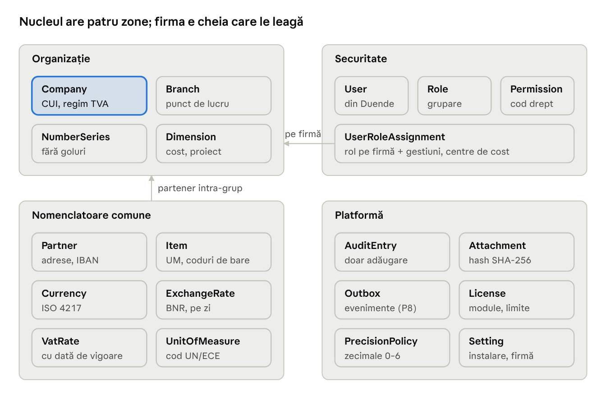

Reguli de business ale modelului:

1. **Partenerii și articolele sunt la nivel de instalare** (grup), nu de firmă, ca același client să fie recunoscut în toate firmele și la consolidare. Completare (decizia lui Aurelian din 21.11.2026): un articol sau partener e fie **comun** grupului (implicit, ca până acum), fie **propriu** unei firme, unui punct de lucru sau unei locații; codul și CUI-ul rămân unice în toată baza (vezi 3.4, „Domeniul drepturilor și proprietarul”).
2. **Drepturile sunt la nivel de firmă**: același utilizator poate fi contabil în firma A și doar consultant în firma B. Un rol se atribuie pe instalare, pe un grup de firme, pe o firmă, pe un punct de lucru sau pe o locație (21.11.2026).
3. **Seriile de numerotare aparțin unei firme și unui an**; nu există serii comune între firme.
4. **Un CUI apare o singură dată** între parteneri și o singură dată între firme.
5. **Nomenclatoarele fiscale au dată de vigoare**; un document folosește întotdeauna valoarea valabilă la data lui (P6).
6. **Audit-ul și atașamentele se leagă generic** de orice entitate din orice modul, prin `EntityType` + `EntityId`.
7. **Un partener poate fi o firmă din grup** (`IntraGroupCompanyId`); tranzacțiile cu el se elimină la consolidare.

## 3. Entități și nomenclatoare

Convenții pentru toate tabelele de mai jos: cheie primară `Id` de tip `int` (sau `bigint` pentru tabelele mari), coloane de audit `CreatedAt`, `CreatedBy`, `ModifiedAt`, `ModifiedBy`, `RowVersion` pentru concurență optimistă. Nomenclatoarele nu se șterg fizic odată folosite: se dezactivează (`IsActive = 0`).

Regula pentru chei primare (validată 14.11.2026, detaliată în secțiunea 05 Date și multi-tenancy):

- **`int IDENTITY`** pentru nomenclatoare și antete de documente; **`bigint IDENTITY`** pentru tabelele care cresc mult (linii de documente, mișcări de stoc, note contabile, audit, outbox). Cheia primară e și indexul clustered.
- **`uniqueidentifier`** doar unde datele se nasc în afara bazei: bonuri POS emise offline, `EventId` din outbox/inbox, importuri și sincronizări între instalări. Acolo GUID-ul e o coloană `UNIQUE` separată (de exemplu `ExternalId`), iar clusterul rămâne pe `bigint`, ca să evităm fragmentarea.
- Opțional, **`PublicId uniqueidentifier`** pe documentele expuse în URL sau API, ca Id-urile să nu poată fi ghicite. Drepturile se verifică oricum în pipeline.

**Baza este case sensitive** (decizia lui Aurelian, 14.11.2026): collation `Latin1_General_100_CS_AS_SC_UTF8`, setat de installer ([08 Instalare și actualizare](../../08-instalare-actualizare/INSTALARE_ACTUALIZARE.md), secțiunea 9). Pentru tabelele Nucleului asta înseamnă (regulile `SQL-21`–`SQL-25` din Bune practici):

- codurile introduse de utilizatori (`Partner.Code`, `Item.Code`, `Location.Code`, `DimensionValue.Code`, `UomSet.Code`, `ItemGroup.Code`, `NumberSeries.Prefix`) sunt unice fără diferență de majuscule, prin coloana calculată `CodeKey AS UPPER(Code) PERSISTED` cu index unic;
- căutarea după denumire (parteneri, articole, angajați) folosește coloana calculată `NameSearch AS (Name COLLATE Latin1_General_100_CI_AI_SC_UTF8) PERSISTED`, indexată, ca „brasov” să găsească „Brașov”;
- `User.UserName` se salvează doar cu litere mici; autentificarea (ASP.NET Core Identity) caută după numele normalizat, deci utilizatorul se poate loga cu orice majuscule;
- codurile tehnice (permisiuni, roluri `ADMIN`, chei de setări) se compară exact; `core.[User]` se scrie între paranteze drepte.

### 3.1 Firmă (`Company`)

| Câmp | Tip | Obligatoriu | Validare / regulă |
| --- | --- | --- | --- |
| `Code` | `nvarchar(20)` | Da | Unic în instalare; folosit în serii și rapoarte |
| `Name` | `nvarchar(200)` | Da | Denumirea legală |
| `FiscalCode` (CUI) | `nvarchar(20)` | Da | Cifră de control CUI validă; unic în instalare; trebuie să fie în licență |
| `VatPayer` | `bit` | Da | Plătitor de TVA (prefix RO) |
| `VatOnCollection` | `bit` | Da | TVA la încasare |
| `TradeRegisterNo` | `nvarchar(30)` | Da | Numărul de ordine din registrul comerțului; validarea de format acceptă atât formatul clasic (J/F/C + județ + număr + an), cât și formatul nou ONRC |
| `ShareCapital` | `decimal(19,2)` | Condiționat | Capitalul social; obligatoriu pentru societăți (SRL, SA), apare pe facturi și pe documentele firmei (Legea 31/1990) |
| `Address`, `CountyCode`, `City`, `CountryCode` | diverse | Da | Județ și localitate din nomenclatoare |
| `FunctionalCurrency` | `char(3)` | Da | Fix `RON` (perimetru) |
| `DefaultPrecisionPolicyId` | `int` | Da | Politica de zecimale implicită a firmei |
| `LogoAttachmentId` | `int` | Nu | Sigla de pe documentele tipărite și de pe ecranul de autentificare |
| `IsGroupParent` | `bit` | Nu | Firma-mamă pentru consolidare |
| `IsActive` | `bit` | Da | — |

Sub firmă: **puncte de lucru** (`Branch`: denumire, adresă, cod), folosite pe documente, în seriile de numerotare și în e-Factura, și **conturi bancare** (`CompanyBankAccount`: IBAN validat, bancă, monedă, cont implicit), tipărite pe facturi.

**Adrese ale firmei:** sediul social este unic și rămâne pe `Company` (obligatoriu). Celelalte adrese stau în `core.CompanyAddress` (migrarea `2026.11.009`), pe tip, cu cel mult o adresă implicită per firmă și tip (index unic filtrat); alegerea unui nou implicit îl dezactivează pe cel vechi. Tipurile sunt un nomenclator configurabil, `core.AddressType` (cod tehnic unic, denumire, ordine, activ; cele de sistem `DELIVERY`, `BILLING`, `CORRESPONDENCE`, `OTHER` nu se dezactivează, iar codul nu se schimbă), gestionat în Configurare › Tipuri de adrese (`usp_AddressType_Save`, `POST /address-types` și `PUT /address-types/{id}`, `CompanyManage`, auditat, `RowVersion`; erori 50029 cod duplicat, 50030 tip protejat). Un tip inactiv nu se mai poate alege pentru adrese noi. Salvare adresă: `usp_CompanyAddress_Save`, endpoint-uri `POST /companies/{companyId}/addresses` și `PUT .../{id}` (`CompanyManage`, auditat, `RowVersion`); lista vine în `usp_Company_Get`, tipurile în `usp_OrgLookups_Get`. UI: tab „Adrese” în administrarea firmelor.

**Telefon, e-mail și persoane de contact:** `core.Company`, fiecare `core.CompanyAddress`, `core.Branch` (punct de lucru) și `core.Location` au `Phone` și `Email` opționale (format validat în handler). Persoanele de contact stau în `core.CompanyContact` (nume obligatoriu, funcție, telefon, e-mail, observații, activ, `RowVersion`; cel puțin telefon sau e-mail) și pot fi mai multe pe firmă, pe punct de lucru (`BranchId`) sau pe locație (`LocationId`, cel mult unul dintre ele), salvate prin `usp_CompanyContact_Save` (`POST /companies/{companyId}/contacts`, `PUT .../{id}`, `CompanyManage`, auditat); lista firmei vine în `usp_Company_Get`, cea a punctelor de lucru și locațiilor în `usp_OrgTree_Get`. UI: secțiunea „Contact” în „Date generale”, tab „Persoane de contact” la firmă și secțiunea „Persoane de contact” sub formularul punctului de lucru și al locației.
**Structura organizatorică (arbore)**, adăugată pe 14.11.2026 la cererea lui Aurelian: firmele se organizează într-un arbore cu patru tipuri de noduri.

| Nivel | Entitate | Părinte permis | Câmpuri principale | Reguli |
| --- | --- | --- | --- | --- |
| Grup | `CompanyGroup` | Alt grup sau rădăcină | `Code`, `Name`, `ParentGroupId`, `ParentCompanyId` (firma-mamă pentru consolidare), `IsActive` | Oricâte niveluri (holding, subgrup); consolidarea se face pe grup, incluzând subgrupurile |
| Firmă | `Company` | Grup sau rădăcină | Tabelul de mai sus + `GroupId` | O firmă aparține unui singur grup; mutarea între grupuri se jurnalizează și afectează doar consolidările viitoare |
| Punct de lucru | `Branch` | Firmă | `Code`, `Name`, adresă, `IsActive` | Apare pe documente și în e-Factura; poate avea serii de numerotare proprii |
| Locație | `Location` | Punct de lucru sau direct firmă | `Code`, `Name`, `LocationType` (birou, depozit, magazin, fabrică, șantier, punct de livrare), adresă, `IsActive` | Locul fizic folosit de Stocuri, WMS, POS, Construcții și TMS; firma se deduce din părinte. Nu are sub-locații (confirmat 14.11.2026): zonele și rafturile se definesc în WMS |

Reguli: o locație nu are copii; un nod cu copii activi nu se poate dezactiva; un nod folosit pe documente nu se șterge, se dezactivează (`SQL-20`); codul e unic în cadrul firmei pentru puncte de lucru și locații și unic în instalare pentru grupuri. Drepturile se restrâng pe punct de lucru sau locație atribuind rolul pe acel nod (21.11.2026, vezi 3.4); `DimensionScope` rămâne pentru gestiuni, centre de cost și șantiere.


**Detalii de implementare (etapa 4, 15.11.2026):**

- Tabelele `core.CompanyGroup`, `Company`, `Branch`, `Location`, `CompanyBankAccount` (migrarea `2026.11.006`). CUI-ul se salvează fără prefixul RO (prefixul rezultă din `VatPayer`), validat cu cifra de control ANAF. Numărul de registrul comerțului se validează doar ca formă (clasic și formatul unic ONRC, Legea 265/2022); cifra de control a formatului nou nu se recalculează, pentru că nu am găsit o descriere oficială sigură a algoritmului. IBAN-ul se validează mod 97 (ISO 13616).
- `IsGroupParent` nu e o coloană: firma-mamă e `CompanyGroup.ParentCompanyId` și trebuie să fie în grup sau într-un subgrup. Din machetă s-a adăugat `IncludeInConsolidation`. `FunctionalCurrency` e fixă `RON` (`CHECK`).
- Firma folosește țările și județele livrate acum (`core.Country`: România, statele UE și câteva frecvente; `core.County`: cele 41 de județe și București, cod ISO 3166-2:RO) și politica de zecimale STANDARD. Localitatea se alege din nomenclatorul SIRUTA (21.11.2026, vezi 3.5). Moneda contului bancar are cheie străină spre nomenclatorul de valute (migrarea `2026.11.016`, 21.11.2026) și se alege dintre monedele active. `LogoAttachmentId` așteaptă atașamentele (etapa 10).
- O firmă activă trebuie să aibă CUI-ul în licență (4.4): altfel 409 `CORE_COMPANY_NOT_LICENSED`; în `Development`, fără licență, orice CUI e acceptat. Salvarea firmei publică `FirmaModificata`.
- Acces: arborele arată firmele cu `Core.Company.View` (pe firmă sau la nivelul instalării) și grupurile care le conțin. Firma curentă vine din antetul `X-Company-Id`, acceptat numai dacă utilizatorul are un rol pe acea firmă (altfel firma efectivă devine 0). `X-Company-Id: 0` înseamnă nivelul instalării: numai rolurile fără firmă (ADMIN). Grupurile și firmele noi se creează doar la acest nivel; punctele de lucru, locațiile, conturile bancare și seriile, numai pe firma lor.
- Ecranul: arbore (Syncfusion TreeView) cu căutare fără diacritice, filtrele „Toate”, „Doar firme”, „Arată inactive”, „Extinde tot”; fișa cu tab-urile Date generale, Conturi bancare și Serii (doar citire, cu legătură spre Configurare › Serii). Tab-urile Structură, Setări, Certificat ANAF și Istoric, precum și Export/Import, vin cu etapele care le dețin (Istoric cu auditul, etapa 10; certificatul cu Integrări). Fără `Core.Company.Manage`, fișele sunt doar pentru citire.

**Îmbunătățiri după verificare (20.11.2026):**

- Schimbarea țării golește județul dacă nu aparține țării noi (Firmă, Punct de lucru, Locație). Înainte județul vechi rămânea ascuns în formular, iar salvarea pica pe server cu „Țara sau județul nu există în nomenclator”.
- Oprirea „Plătitor de TVA” oprește și „TVA la încasare”. Înainte acesta rămânea pornit pe un comutator dezactivat, iar serverul respingea salvarea pe un câmp pe care utilizatorul nu-l mai putea schimba.
- Județul obligatoriu pentru România se verifică și în formular, cu mesajul „Alegeți județul.” pe câmp (la locație, doar dacă s-a ales România), nu doar ca eroare generică de pe server.
- Modificările nesalvate nu se mai pierd (`UI-18`): tab-urile fișei se montează la prima vizită și apoi doar se ascund, iar alegerea altui nod, butoanele „+ Adaugă”, meniul, firma curentă din antet și închiderea paginii trec prin garda comună cu „Rămân” / „Renunț la modificări”. Formularul contului bancar are prefixul de id-uri `bank-`, pentru că fișa firmei rămâne montată alături și ar fi repetat id-ul `f-isActive`.
- Accesibilitate (`UI-09`): tab-urile urmează tiparul WAI-ARIA (săgeți, Home, End, un singur tab în ordinea Tab); panoul de detaliu nu mai e regiune `aria-live`, care făcea cititorul de ecran să citească tot formularul la fiecare nod ales.
- Grila conturilor bancare primește handler-e stabile (`UI-12`), mesajele de validare stau în fișierul de traduceri (`UI-06`), iar tab-ul Serii arată eroarea de încărcare cu „Reîncearcă”, în loc să rămână gol.

### 3.2 Partener (`Partner`)

Un singur nomenclator pentru clienți și furnizori, la nivel de instalare; rolul de bază (client, furnizor sau ambele) e pe partener și e obligatoriu (cel puțin unul bifat, CHECK în bază), iar condițiile comerciale se țin per firmă în Vânzări și Achiziții. Un partener marcat doar client nu apare la căutare pe documentele de achiziție, și invers.

| Câmp | Tip | Obligatoriu | Validare / regulă |
| --- | --- | --- | --- |
| `Code` | `nvarchar(30)` | Da | Unic; generat din serie sau introdus |
| `Name` | `nvarchar(200)` | Da | — |
| `PartnerType` | `tinyint` | Da | Persoană juridică RO, juridică UE, juridică non-UE, persoană fizică |
| `IsCustomer` | `bit` | Da | Rol client; cel puțin unul dintre `IsCustomer` și `IsSupplier` e 1 (`CK_Partner_Role`) |
| `IsSupplier` | `bit` | Da | Rol furnizor; un partener poate fi și client, și furnizor |
| `PartnerGroupId` | `int` | Nu | Grupă de parteneri (distribuitori, retail, servicii), pentru filtre și rapoarte |
| `FiscalCode` | `nvarchar(30)` | Condiționat | CUI valid pentru juridică RO; cod TVA UE pentru UE; gol pentru persoană fizică (CNP-ul stă criptat în `PersonalIdEncrypted`) |
| `PersonalIdEncrypted` | `varbinary(256)` | Nu | CNP-ul persoanei fizice, criptat; citit doar cu `Core.Partner.ViewPersonalData` |
| `VatPayer` | `bit` | Da | Verificabil manual sau prin serviciul ANAF de interogare (Integrări) |
| `VatOnCollection` | `bit` | Da | Partenerul aplică TVA la încasare (registrul ANAF); contează la deducerea TVA pe achiziții |
| `AnafInactive` | `bit` | Da | Contribuabil declarat inactiv de ANAF; documentele de achiziție afișează avertizare |
| `AnafCheckedAt` | `datetime2(3)` | Nu | Momentul ultimei verificări automate la ANAF (Integrări) |
| `TradeRegisterNo` | `nvarchar(30)` | Nu | — |
| `CountryCode` | `char(2)` | Da | ISO 3166 |
| `IntraGroupCompanyId` | `int` | Nu | Legătura cu o firmă din grup, pentru eliminări la consolidare |
| `IsActive` | `bit` | Da | — |

Copii: `PartnerAddress` (sediu, livrare, facturare), `PartnerBankAccount` (IBAN validat, bancă, monedă), `PartnerContact` (nume, rol, email, telefon). Regulă: un CUI apare o singură dată în nomenclator; duplicatele se semnalează la salvare.

**Proprietăți configurabile** (adăugate pe 14.11.2026): administratorul definește câmpuri suplimentare fără modificări de cod, folosite pentru parteneri și, cu același mecanism, pentru articole.

| Entitate | Câmpuri principale | Reguli |
| --- | --- | --- |
| `PropertyDefinition` | `EntityType` (Partner / Item), `Code`, `Name`, `DataType` (text, număr, dată, da/nu, listă, listă multiplă, utilizator), `AppliesTo` (client, furnizor, ambele), `Section`, `SortOrder`, `IsRequired`, `IsFilterable`, `CompanyId` (gol = tot grupul), `IsActive` | Tipul unei proprietăți folosite nu se mai schimbă; se dezactivează și se creează alta |
| `PropertyOption` | `PropertyDefinitionId`, `Code`, `Label`, `SortOrder`, `IsActive` | Valorile pentru listele de selecție |
| `PropertyValue` | `PropertyDefinitionId`, `EntityId`, `ValueText`, `ValueNumber` `decimal(19,6)`, `ValueDate`, `ValueBool`, `ValueOptionId` | O singură coloană completată, după tip; listele multiple au câte un rând pe opțiune |

Reguli: valorile se validează după tip la salvare; o proprietate obligatorie se cere doar dacă se aplică rolului partenerului; proprietățile marcate `IsFilterable` apar ca filtre în lista de parteneri și în rapoarte; modificările se auditează ca orice câmp. Exemple livrate ca model: segment, agent de vânzări, zonă de livrare, rating furnizor, certificat ISO și data expirării, acord de marketing (GDPR).


**Detalii de implementare (parteneri, 20.11.2026; decizii confirmate de Aurelian în aceeași zi):**

- Tabelele `core.PartnerGroup`, `Partner`, `PartnerAddress`, `PartnerBankAccount`, `PartnerContact`, `PropertyDefinition`, `PropertyOption`, `PropertyValue` și tipul tabelar `core.PropertyValueList` (migrarea `2026.11.010`); cheia străină amânată `User.ExternalPartnerId` → `core.Partner`. `PartnerType`: 1 juridică RO, 2 juridică UE, 3 juridică non-UE, 4 persoană fizică.
- **Sediul social stă pe partener** (`Address`, `City`, `CountyCode`, `CountryCode`, `PostalCode`, plus `Phone`, `Email`), ca la firmă; `PartnerAddress` ține celelalte adrese, pe tipurile din `core.AddressType` (o singură adresă implicită pe partener și tip). Județul e obligatoriu pentru România (`CHECK`).
- CUI: juridica RO se salvează fără prefixul RO (cifra de control ANAF; „RO” se afișează după `VatPayer`), juridica UE ca cod de TVA cu prefixul țării (doar forma; VIES vine cu Integrări), non-UE ca text, persoana fizică fără CUI. Duplicatul dă 409 `CORE_PARTNER_DUPLICATE_FISCAL_CODE`; codul duplicat (fără majuscule) 409 `CORE_DUPLICATE_CODE`.
- **Codul lăsat gol la creare se alocă din seria tipului de document `Core.Partner` („Cod partener”) a firmei curente**, prin `INumberSeriesService` (formatul `{Prefix}-{An}-{Număr}`). Codul partenerului nu e numerotare fiscală: dacă firma nu are o serie pentru tip și an (nici una din anul anterior cu trecere automată), primul partener fără cod creează, în aceeași tranzacție, seria implicită nefiscală `P` cu 6 cifre și trecere automată la anul următor (`core.usp_NumberSeries_EnsureDefault`; auditul salvării are `CodeSeriesCreated`); prefixul și lungimea se schimbă apoi în Configurare › Serii. Codurile sunt unice în instalare, iar seriile sunt pe firmă: un număr deja folosit (de altă firmă cu același prefix sau introdus manual) se sare la alocare (`core.usp_Partner_CodeExists`; seria nu e fiscală, golurile sunt permise). La nivelul instalării (`X-Company-Id: 0`) codul trebuie introdus.
- **CNP-ul** (doar persoană fizică, validat cu cifra de control) se criptează cu inelul de chei Data Protection al instalării (scopul `Erp.Core.Partner.PersonalId.v1`; cheile în `core.DataProtectionKey`, protejate cu certificatul instalării, 08, 5.12). Fișa întoarce doar `HasPersonalId`; afișarea e comanda `RevealPartnerPersonalId` (`POST /api/core/partners/{id}/personal-id`), cu `Core.Partner.ViewPersonalData`, care lasă intrarea de audit `Core.Partner.ViewPersonalData`. Auditul salvărilor nu conține CNP-ul, numele persoanelor fizice sau datele persoanelor de contact (`NET-18`).
- Proprietățile se salvează odată cu partenerul (`SavePartner.Properties`, TVP), cu aceeași versiune; `null` le lasă neschimbate. `PropertyValue.ValueUserId` (FK `core.[User]`) completează coloanele din tabelul de mai sus, pentru tipul „utilizator”. Exemplele din machetă sunt livrate ca date (`08_PropertyDefinitions`, adăugate doar dacă lipsesc). Definițiile se administrează în Configurare › Proprietăți (macheta 07l, `Core.Property.Manage`): listă grupată pe secțiuni, cu căutare și inactive; fișa cu cod (fix după creare), tip de date (fix după prima valoare: 409 `CORE_ENTITY_IN_USE`), etichetă, secțiune, ordine, cui se aplică, obligatorie, filtru (doar liste și da/nu, cum filtrează lista partenerilor), firma (gol = grupul), activă și opțiunile listelor (TVP `core.PropertyOptionList`; nu se șterg, se dezactivează; ordinea se schimbă cu săgeți). Tab-ul Articole apare odată cu articolele.
- **Preluarea de la ANAF** (decizia lui Aurelian, 20.11.2026: clientul ANAF stă definitiv în Nucleu, nu în modulul Integrări). Butonul „ANAF ⟳” de lângă CUI (juridică RO, `Core.Partner.Manage`) apelează `GET /api/core/anaf/companies/{cui}` (interogarea `LookupAnafCompany`, în afara oricărei tranzacții) și doar completează formularul: denumire, nr. registrul comerțului, plătitor TVA (`scpTVA`), TVA la încasare (`statusTvaIncasare`), inactiv (`statusInactivi`), sediul social (stradă, număr, localitate, județul după `scod_JudetAuto`, cod poștal) și telefonul; e-Factura, plata defalcată și starea înregistrării se afișează informativ. Utilizatorul verifică și salvează; `SavePartner.AnafCheckedAt` (momentul interogării, adus la „acum” dacă e în viitor) se scrie în `Partner.AnafCheckedAt`, iar o salvare fără el păstrează data anterioară.
- Serviciul: verificarea contribuabililor ANAF, **sincron v9** (`POST https://webservicesp.anaf.ro/api/PlatitorTvaRest/v9/tva`, instrucțiunile ANAF din 04.02.2025; preferat asincronului v8, care cere a doua cerere de descărcare). Adresa e setarea instalării `Anaf.VatRegistryUrl` (seed `04_Settings`), modificabilă în Configurare › Setări (`Core.Settings.Manage`, doar `https`), ca o versiune nouă ANAF să nu ceară kit nou. Clientul trimite cel mult o cerere pe secundă pentru toată instalarea (regula ANAF), cu timeout de 30 s; un răspuns 404 cu `found` gol înseamnă CUI necunoscut (404 `CORE_ANAF_NOT_FOUND`), iar o eroare de rețea, un cod HTTP de eroare sau un răspuns cu altă formă dau 503 `CORE_ANAF_UNAVAILABLE` (tipul nou `ErpErrorKind.Unavailable`). Răspunsul real v9 (verificat pe 20.11.2026, fișierele de referință din `Erp.Core.Tests/Anaf`) diferă de instrucțiuni: nu are `cod`/`message`, `perioade_TVA` e listă, codul poștal vine fără zeroul din față (se completează la 6 cifre), diacriticele sunt cu sedilă (se corectează în ș/ț). Serverul instalării are nevoie de acces HTTPS spre `webservicesp.anaf.ro`.
- Salvarea partenerului publică `PartenerModificat`. Grupele de parteneri se administrează în Configurare › Grupe de parteneri (`Core.Nomenclature.Manage`); o grupă cu parteneri activi nu se dezactivează (409 `CORE_ENTITY_IN_USE`).
- Ecranul (meniul Nomenclatoare › Parteneri, `/nomenclatoare/parteneri`): listă paginată pe server, căutare după începutul denumirii (fără diacritice), al codului sau al CUI-ului, filtrele Toți / Clienți / Furnizori / Persoane fizice / Inactivi ANAF / Arată inactivi și o proprietate filtrabilă; fișa cu tab-urile Date generale, Proprietăți (un singur formular, o singură salvare), Adrese, Conturi, Contacte și Istoric (auditul partenerului și al copiilor lui). Nu sunt încă: verificarea automată periodică la ANAF (amânată de Aurelian, 20.11.2026), tab-ul Condiții și soldurile (Vânzări, Achiziții, Finanțe), „folosit în N firme”.
- **Export Excel** (butonul din lista partenerilor, `Core.Partner.View`): lista filtrată întreagă (`core.usp_Partner_Export`, aceleași filtre ca lista), cu ClosedXML (07, Stack), în coloanele șablonului de import, ca un export să poată fi corectat și reimportat.
- **Import din Excel** (fluxul 4.8, Configurare › Import, macheta 07g, `Core.Import.Run`; deciziile lui Aurelian din 20.11.2026): șablonul are doar datele generale (cod, denumire, tip, client, furnizor, CUI, registru, plătitor TVA, TVA la încasare, inactiv ANAF, grupă, sediu, telefon, e-mail, activ), fără CNP, conturi, contacte sau proprietăți, cu foaia „Liste” și liste derulante. Validarea folosește `SavePartnerValidator` (aceleași reguli ca fișa), plus tipul, Da/Nu, grupa, județul (cod, `RO-xx` sau denumire) și țara, dublurile din fișier și potrivirea cu nomenclatorul. **Un rând cu același cod sau CUI actualizează partenerul existent** (4.8 pasul 5, apare ca avertizare; macheta arăta „doar adăugare”, decizia a ales specificația); codul și CUI-ul la parteneri diferiți sunt eroare. Opțional, **verificarea ANAF** completează câmpurile goale și ia de la ANAF plătitor TVA, TVA la încasare și inactiv, în loturi de 100 de CUI-uri (o cerere pe secundă); un CUI negăsit sau ANAF indisponibil e avertizare. Analiza e o interogare (în afara tranzacției, din cauza apelurilor ANAF); jobul `core.ImportJob` (migrarea `2026.11.011`) păstrează raportul și rândurile valide până la confirmare. Confirmarea salvează în **loturi de 500, fiecare în tranzacția lui** (macheta spunea „o singură tranzacție”; s-a urmat 4.8), cu audit pe fiecare partener (`Core.Partner.Import`) și `PartenerModificat`; un lot eșuat lasă importul „parțial”, iar reîncărcarea fișierului nu dublează. Codurile goale se alocă din seria firmei curente. Rândurile cu erori se descarcă ca Excel cu coloana „Eroare”. A18 e acoperit de un test de integrare: 10.000 de rânduri, 5% greșite, apoi reimportul aceluiași fișier, fără dubluri.

### 3.3 Articol (`Item`)

| Câmp | Tip | Obligatoriu | Validare / regulă |
| --- | --- | --- | --- |
| `Code` | `nvarchar(50)` | Da | Unic |
| `Name` | `nvarchar(250)` | Da | — |
| `ItemType` | `tinyint` | Da | Marfă, materie primă, material, produs finit, semifabricat, serviciu, ambalaj, mijloc fix |
| `UomSetId` | `int` | Da | Setul de UM folosit (de ex. Băuturi 0,5 L); UM de bază e cea cu factor 1 din set |
| `BaseUomId` | `int` | Da | Copiat din set la salvare, pentru interogări rapide; stocul și costul se țin mereu în UM de bază |
| `DefaultVatRateId` | `int` | Da | Din nomenclatorul de cote TVA |
| `ItemGroupId` | `int` | Nu | Arbore de grupe pe mai multe niveluri |
| `PricePrecision` | `tinyint` | Nu | 0–6; suprascrie politica firmei pentru acest articol (P7) |
| `QuantityPrecision` | `tinyint` | Nu | 0–6 |
| `IsStockable` | `bit` | Da | Fals pentru servicii |
| `CnCode` | `nvarchar(10)` | Nu | Cod NC pentru Intrastat și e-Transport |
| `DepositItemId` | `int` | Nu | Ambalajul cu garanție SGR (sistemul de garanție-returnare), adăugat automat pe documente lângă articol |
| `NetWeightKg`, `GrossWeightKg` | `decimal(19,6)` | Nu | Pe UM de bază; folosite la e-Transport, avize și TMS |
| `VolumeM3` | `decimal(19,6)` | Nu | Pe UM de bază; folosit la WMS și TMS |
| `IsActive` | `bit` | Da | — |

Copii: `ItemUom` (excepții de la set), `ItemBarcode` (EAN, intern, opțional legat de o UM), `ItemAttribute` (atribute libere cheie/valoare). Proprietățile configurabile ale articolului folosesc `PropertyDefinition` cu `EntityType = Item`.

**Seturi de UM** (adăugate pe 14.11.2026): conversiile se definesc o dată pe set și se refolosesc la toate articolele cu același ambalaj.

| Entitate | Câmpuri | Reguli |
| --- | --- | --- |
| `UomSet` | `Code`, `Name`, `IsActive` | Comun grupului |
| `UomSetLine` | `UomSetId`, `UomId`, `FactorToBase` `decimal(19,6)`, `IsBase`, `IsDefaultSales`, `IsDefaultPurchase`, `IsDefaultPos`, `SortOrder` | O singură linie `IsBase` cu factor 1; cel mult o linie implicită pe fiecare circuit; factor > 0 |
| `ItemUom` | `ItemId`, `UomId`, `FactorToBase`, implicitele ca mai sus | Excepție doar pentru articol (de ex. bax de 12 în loc de 6), fără a schimba setul; are prioritate față de linia din set |

Reguli: documentele păstrează UM și cantitatea introduse plus cantitatea în UM de bază (de ex. 3 paleți + 2 baxuri = 1.452 buc). Factorii unui articol, din set sau din excepție, se pot modifica doar dacă articolul nu are stoc și nici documente; altfel se creează alt set. Codul de bare se poate lega de o UM, ca scanarea unui bax să aducă direct 6 buc.

**Setări pe firmă.** Articolul e comun grupului, dar conturile contabile și gestiunea sunt ale fiecărei firme și aparțin modulelor care le folosesc. Pe fișa articolului apar pentru firma curentă, ca tab-uri adăugate de module:

| Extensie (modul) | Câmpuri | Reguli |
| --- | --- | --- |
| `fin.ItemAccounting` (Finanțe) | `CompanyId`, `ItemId`, `StockAccount`, `ExpenseAccount`, `RevenueAccount`, `VatAccountOverride` | Lipsă = contul din grupa de articole, apoi din tipul articolului |
| `inv.ItemStockSettings` (Stocuri) | `CompanyId`, `ItemId`, `DefaultWarehouseId` (gestiunea implicită), `ValuationMethod` (FIFO, CMP), `TrackingMode` (fără, lot, serie, lot și termen de valabilitate), `MinQty`, `MaxQty` | Doar pentru articole stocabile; metoda de evaluare nu se schimbă în timpul unei perioade deschise cu stoc |

Alte extensii (de ex. `mfg.ItemRecipeSettings`) stau tot în schema modulului, cu cheie pe `CompanyId` + `ItemId`.

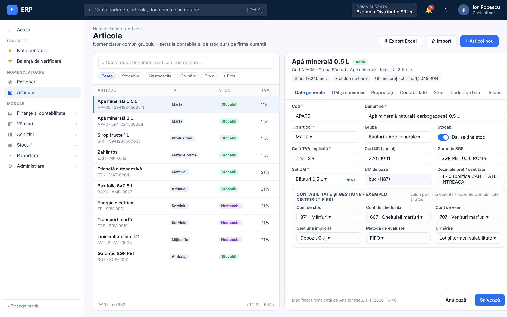

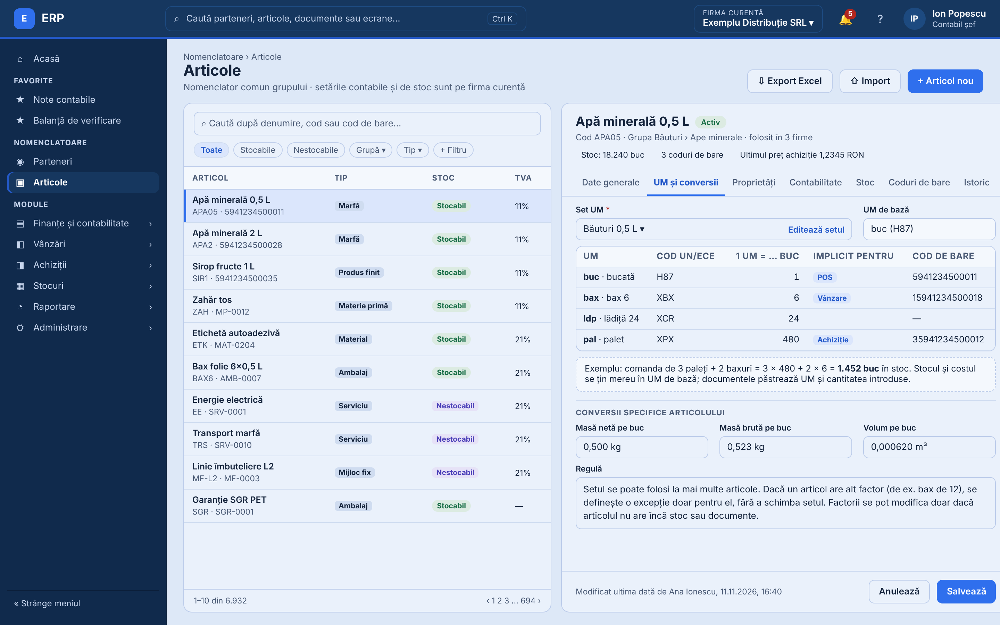

**Detalii de implementare (articole, 20.11.2026; decizii confirmate de Aurelian în aceeași zi):**

- Tabelele `core.VatRate`, `UnitOfMeasure`, `UomSet`, `UomSetLine`, `ItemGroup`, `Item`, `ItemUom`, `ItemBarcode` și tipurile tabelare `core.VatRateList`, `UnitOfMeasureList`, `UomLineList` (migrarea `2026.11.012`). `ItemType`: 1 marfă, 2 materie primă, 3 material, 4 produs finit, 5 semifabricat, 6 serviciu (nestocabil, `CHECK`), 7 ambalaj, 8 mijloc fix. `ItemAttribute` (atribute libere) nu s-a făcut: proprietățile configurabile ale articolului îl acoperă.
- **Date livrate** (adăugate doar dacă lipsesc): cotele TVA verificate pe 20.11.2026 (Legea 141/2025): `S21` 21% și `R11` 11% din 01.08.2025; `S19`, `R9`, `R5` istorice până la 31.07.2025; `Z0`, `E0`, `AE`, `K0`, `G0`, `O0` (categoriile UBL S, Z, E, AE, K, G, O; doar S are procent diferit de zero). UM-urile uzuale cu codurile UN/ECE (Recomandările 20 și 21: H87, KGM, LTR, XBX, XCR, XPX …) și seturile `BUC`, `KG`, `L`, `M`, `H`, `BAUT05` (buc / bax 6 / lădiță 24 / palet 480).
- **Codul** lăsat gol se alocă din seria `Core.Item` („Cod articol”) a firmei curente, creată automat (`A-{An}-{000001}`, nefiscală), cu numerele deja folosite sărite, ca la parteneri. Codul de articol duplicat dă 409 `CORE_ITEM_DUPLICATE_CODE`, codul de bare duplicat 409 `CORE_ITEM_DUPLICATE_BARCODE`.
- **UM**: `BaseUomId` se copiază din linia de bază a setului; schimbarea bazei setului o mută și la articolele lui. Excepțiile articolului (`ItemUom`) se salvează odată cu fișa și au prioritate față de linia din set. Regula „factorii nu se schimbă dacă articolul are stoc sau documente” se aplică odată cu modulele Stocuri și Vânzări (acum nu există stoc sau documente).
- **Coduri de bare**: EAN-13, EAN-8, GTIN-14 (cifra de control GS1 verificată) sau intern; opțional legate de o UM a articolului (scanarea unui bax aduce baxul). Căutarea listei găsește articolul și după codul de bare exact.
- Garanția SGR (`DepositItemId`) e un articol activ de tip ambalaj; un ambalaj folosit ca garanție nu se dezactivează. Codul NC se salvează fără spații (4–10 cifre). Greutățile și volumul sunt pe UM de bază, ca șiruri zecimale în API.
- Proprietățile articolelor folosesc `PropertyDefinition` cu `EntityType = Item` (Configurare › Proprietăți, tab-ul Articole); toate se aplică oricărui articol.
- Salvarea publică `ArticolModificat`; cotele TVA și UM-urile publică `NomenclatorFiscalModificat`.
- **Ecranul** (Nomenclatoare › Articole): listă paginată pe server, căutare după denumire (fără diacritice), cod sau cod de bare, filtrele Toate / Stocabile / Nestocabile, grupă (cu subgrupele ei), tip, inactive și o proprietate filtrabilă; fișa cu Date generale, UM și conversii (liniile setului, excepțiile articolului, exemplul de conversie, masă și volum) și Proprietăți (un singur formular, o singură salvare), Coduri de bare și Istoric. Export Excel și Import (Configurare › Import, entitatea Articole) cu coloanele datelor generale, setul de UM, cota TVA și grupa după cod și un cod de bare; un rând cu același cod actualizează articolul. Nu sunt încă: tab-urile Contabilitate și Stoc (modulele Finanțe și Stocuri), „stoc / ultimul preț de achiziție / folosit în N firme”.
- **Configurare › Nomenclatoare** (macheta 07, `Core.Nomenclature.Manage`): cotele TVA și UM-urile editate direct în tabel, salvate împreună (o cotă folosită nu își schimbă codul, procentul, categoria sau data de început, doar primește „valabil până la”; perioadele aceluiași cod nu se suprapun; o UM folosită nu își schimbă codurile), seturile de UM cu liniile lor și arborele grupelor de articole (fără cicluri; o grupă cu subgrupe sau articole active nu se dezactivează). Valutele, țările, județele și localitățile din machetă vin cu etapele lor.

### 3.4 Utilizatori, roluri și permisiuni

| Entitate | Câmpuri principale | Reguli |
| --- | --- | --- |
| `User` | `SubjectId` (din `ids.UserAccount`), `UserName`, `DisplayName`, `Email`, `IsActive`, `IsSystem`, `LastLoginAt`, `LastCompanyId`, `Language`, `NotificationPreferences` (JSON) | Parola și 2FA sunt în serverul de identitate (schema `ids`), nu în Nucleu; `LastCompanyId` e firma propusă la autentificare; `UserName` doar cu litere mici (`CK_User_UserNameLower`, `SQL-24`) |
| `Role` | `Code`, `Name`, `Description`, `IsSystem` | Rolurile de sistem (de ex. Administrator) nu se pot șterge |
| `Permission` | `Code` (de ex. `Sales.Invoice.Validate`), `Module`, `Description` | Lista e generată din cod la pornire; nu se editează manual |
| `RolePermission` | `RoleId`, `PermissionId` | — |
| `UserRoleAssignment` | `UserId`, `RoleId`, `CompanyGroupId`, `CompanyId`, `BranchId`, `LocationId`, `DimensionScope` (JSON: gestiuni, centre de cost, șantiere) | Un rol se atribuie pe un nod (21.11.2026): toate nule = toată instalarea (toate firmele, și cele create ulterior), permis doar pentru rolul de sistem `ADMIN` (50034); `CompanyGroupId` = grupul de firme cu subgrupurile lui (orice rol); `CompanyId` = firma; `CompanyId` + `BranchId` sau `LocationId` = punctul de lucru sau locația (verificat în `core.usp_UserRoleAssignment_Save`, `CK_UserRoleAssignment_Scope`) |
| `UserPermissionOverride` | `UserId`, `PermissionId`, `CompanyId`, `Effect` (`G` adăugat / `R` revocat), `Reason` | Excepție față de drepturile moștenite din roluri (21.11.2026, vezi „Roluri și excepții pe utilizator” mai jos). `CompanyId = NULL` = toate firmele; un drept adăugat cere motivul |
| `Employee` | `CompanyId`, `BranchId`, `EmployeeNo` (marca), `FirstName`, `LastName`, `Department`, `JobTitle`, `WorkEmail`, `Phone`, `HireDate`, `LeaveDate`, `IsActive` | Fișa minimă de angajat, în Nucleu ca utilizatorii să se poată lega de ea și fără modulul HR; HR o extinde în schema `hr` (contract, salarizare, CNP). UQ `(CompanyId, EmployeeNo)` |

**Utilizator angajat sau extern** (adăugat pe 14.11.2026). Pe `User` se adaugă `IsEmployee` `bit`, `EmployeeId` `int` (FK `core.Employee`), `ExternalPartnerId` `int` (organizația, FK `core.Partner`), `SponsorUserId` (responsabilul intern), `AccessReason`, `ValidFrom`, `ValidUntil` `date`, `FirstName`, `LastName`. Constrângerea `CK_User_Kind` cere: angajat ⇒ `EmployeeId` completat; extern ⇒ `EmployeeId` gol și `ValidUntil`, `SponsorUserId`, `AccessReason` completate.

| Regulă | Detaliu |
| --- | --- |
| Un angajat, un cont | UQ filtrat pe `EmployeeId`; numele, emailul și funcția se iau din fișa angajatului, nu se editează pe utilizator |
| Plecarea angajatului | La `LeaveDate` (completată în HR sau în Nucleu), un job zilnic Hangfire dezactivează contul și închide sesiunile (`ids.UserSession`, `SecurityStamp` nou) |
| Acces extern limitat în timp | `ValidUntil` obligatoriu, cel mult 12 luni (configurabil); notificare la responsabil cu 14 zile înainte; la expirare contul se dezactivează automat; prelungirea se trece în audit |
| 2FA | Obligatoriu pentru externi și pentru rolul Administrator |
| Conturi tehnice | Externi cu `AccessReason` = integrare (de ex. Power BI), fără parolă interactivă |

**Conturi de sistem și administratorul creat la instalare** (adăugat pe 14.11.2026, la cererea lui Aurelian ca installer-ul să creeze un utilizator cu drepturi de administrator). Pe `User` se adaugă `IsSystem` `bit`; `CK_User_Kind` admite trei tipuri: angajat, extern sau cont de sistem (`IsSystem = 1`, fără `EmployeeId` și fără câmpurile de extern).

| Cont | Detaliu |
| --- | --- |
| `system` (`Id = 1`) | Utilizator tehnic creat de prima migrare, `IsActive = 0`, fără cont în `ids`; e `CreatedBy` pentru datele livrate și pentru joburi |
| Administratorul integrat | Creat de installer (08, secțiunea 5.10): nume implicit `administrator`, rolul `ADMIN` la nivel de instalare (`CompanyId = NULL`), parolă temporară cu schimbare obligatorie, 2FA obligatoriu, intrare de audit `Core.User.CreateInitialAdmin`. Nu se poate șterge; se poate dezactiva doar dacă rămâne alt Administrator activ (50015). Accesul de urgență se reface cu `ErpSetup.exe reset-admin` |

Codurile rolurilor de sistem sunt fixe și se scriu exact: `ADMIN`, `NOMENCLATOARE`, `AUDITOR`, `STANDARD`.

**Domeniul drepturilor și proprietarul** (deciziile lui Aurelian din 21.11.2026). Un utilizator X poate avea drepturi pe o firmă Y din grup (și atunci pe toate punctele ei de lucru și locațiile), doar pe un punct de lucru sau doar pe o locație. Adaugă articole, parteneri etc. doar unde are drepturi, iar înregistrarea adăugată aparține acelui nod. Administratorul se adaugă pe o firmă, pe mai multe sau pe grup (firma-mamă: toate firmele, punctele de lucru și locațiile grupului).

| Regulă | Detaliu |
| --- | --- |
| Atribuirea | Pe instalare (doar `ADMIN`), pe grup (firmele grupului și ale subgrupurilor, orice rol), pe firmă, pe punct de lucru (cu locațiile lui) sau pe locație. Funcția `core.fn_AssignmentScope` desface atribuirile pe firmele acoperite; drepturile efective pe o firmă (`usp_User_GetPermissions`) și lista firmelor (`fn_UserCompanies`) le folosesc pe toate. Un rol pe un punct de lucru dă permisiunile lui pe firmă; restrângerea pe nod se aplică datelor care au proprietar |
| Proprietarul | `Item` și `Partner` au `OwnerCompanyId`, `OwnerBranchId`, `OwnerLocationId`: toate nule = comun grupului; altfel firma, cu punctul de lucru sau locația ei. Proprietarul nu se alege (decizia lui Aurelian din 21.11.2026): o înregistrare nouă aparține nodului din antet — firma („Toată firma”), punctul de lucru sau locația curentă —, iar „Aparține” din fișă e doar pentru citire și nu se mai schimbă. Comunele vin din import și din datele existente |
| Antetul | Lângă firmă, selectorul „Punct de lucru / locație”: „Toată firma” (doar cu rol pe toată firma) și nodurile firmei pe care utilizatorul are un rol (`/me`: `WholeCompany`, `Nodes`, din `core.usp_User_GetNodes`). Alegerea se ține în browser, pe firmă. Listele de articole și parteneri se filtrează după acest nod (`ContextBranchId` / `ContextLocationId`, `core.fn_UserOwnerNodesInContext`: ca și cum ar fi singurul nod al utilizatorului; un nod care nu e al lui se ignoră), iar filtrul „Aparține” doar restrânge |
| Vizibilitate | Comunele, cele ale firmei curente și ale nodurilor de deasupra nodului utilizatorului (firma, punctul de lucru al locației lui) și tot ce e în nodul lui sau dedesubt. Cine are dreptul pe toată firma vede tot ce aparține firmei. Înregistrările altor firme nu se văd (se schimbă firma curentă). Listele pornesc de la nodul din antet; filtrul „Aparține” restrânge la comune, ale firmei, ale unui punct de lucru (cu locațiile lui) sau ale unei locații. O înregistrare nevăzută răspunde 404 |
| Modificare | Doar în nodul utilizatorului și dedesubt (`core.usp_OwnerAccess_Check`, 50037; serverul verifică și proprietarul trimis de antet). Comunele și cele ale firmei cer dreptul pe toată firma. Adresele, conturile bancare, contactele partenerului și codurile de bare ale articolului urmează proprietarul. Importul Excel creează înregistrări comune, deci cere dreptul pe toată firma |
| CUI | Unic în toată baza: la al doilea partener cu același CUI, mesajul (50002) spune partenerul existent și unde există (comun sau în ce firmă / punct de lucru / locație) și că poate fi folosit pe facturi, NIR și celelalte documente. Modulele cu documente caută partenerul după CUI indiferent de proprietar (de implementat odată cu ele) |
| Limite actuale | Restrângerea pe nod se aplică articolelor și partenerilor. Celelalte ecrane ale Nucleului (fișa firmei, seriile, setările) folosesc încă permisiunea pe firmă; documentele modulelor vor folosi `core.fn_UserNodeAccess` / `fn_UserOwnerNodes` |

Implementare: migrarea `2026.11.015` (nodul atribuirii, tipul `core.UserRoleAssignmentList` cu nodul, proprietarul pe `core.Item` și `core.Partner`, `UQ_Location_Id_CompanyId` pentru cheile compuse), funcțiile `core.fn_AssignmentScope`, `fn_UserNodeAccess` (unde are utilizatorul o permisiune în firmă), `fn_UserOwnerAccess` (accesul pe un proprietar), `fn_UserOwnerNodes` (nodurile vizibile / modificabile), procedurile `core.usp_OwnerAccess_Check`, `usp_OwnerOptions_Get` (`GET /owner-options/{Item|Partner}`); căutările, exportul, fișele și salvările articolelor și partenerilor primesc utilizatorul și firma curentă. UI: fișa utilizatorului alege nodul fiecărui rol (grup / firmă / punct de lucru / locație); fișa firmei are tab-ul „Utilizatori” (cine are roluri care acoperă firma, pe ce nod, cu matricea de drepturi doar pentru citire, `GET /companies/{id}/access`, `Core.User.Manage`).

**Roluri și excepții pe utilizator** (deciziile lui Aurelian din 21.11.2026). Grupul de utilizatori este rolul: în interfață și în cod se folosește consecvent termenul „rol” (`Role`). Un utilizator moștenește drepturile tuturor rolurilor lui de pe firmă (poate avea mai multe roluri) și poate primi excepții: un drept **adăugat** (`G`) peste roluri sau un drept **revocat** (`R`) dintre cele moștenite.

| Regulă | Detaliu |
| --- | --- |
| Calcul | Drepturi efective pe firmă = reuniunea drepturilor rolurilor + drepturile adăugate − drepturile revocate (`core.usp_User_GetPermissions`). Revocarea câștigă, chiar dacă alt rol sau o excepție pentru toate firmele dă dreptul |
| Domeniu | Excepția e pe firmă sau pe toate firmele (`CompanyId = NULL`); pe o firmă se aplică ambele. Unic pe `(UserId, PermissionId, CompanyId)` |
| Motiv | Obligatoriu pentru un drept adăugat (50036, `CK_UserPermissionOverride_GrantReason`); opțional la revocare |
| Administrator | Cine are rolul `ADMIN` pe firmă are toate drepturile și nu primește excepții (50036); rolul `ADMIN` nu se editează (50035) |
| Separare | Nimeni nu-și schimbă propriile excepții (`CORE_USER_SELF_ROLES`); excepțiile cer `Core.Role.Manage` |
| Audit | Salvarea excepțiilor unui utilizator: `Core.User.PermissionOverride` pe `Core.User`, vizibilă în istoricul fișei; rolurile: `Core.Role.Save` / `Core.Role.Delete` pe `Core.Role` |

Implementare: migrarea `2026.11.014` (`core.UserPermissionOverride`, tipurile `core.PermissionIdList`, `core.UserPermissionOverrideList`, `core.IdList`), procedurile `core.usp_RoleMatrix_Get`, `usp_Role_Save` (lista înlocuiește permisiunile; codul unui rol de sistem nu se schimbă), `usp_Role_Delete` (doar rolurile clientului, neatribuite: 50010), `usp_UserPermissionOverride_Save` (lista înlocuiește excepțiile utilizatorului pe firma aleasă; cele neschimbate își păstrează autorul și data). API: `GET /roles/matrix?companyId=`, `POST /roles`, `PUT /roles/{id}`, `POST /roles/{id}/delete`, `PUT /users/{id}/permission-overrides`. Drepturile se recalculează la fiecare cerere, deci o schimbare se aplică imediat, fără închiderea sesiunilor.

**Detalii de implementare (administrarea utilizatorilor, 21.11.2026).** Deciziile lui Aurelian din 21.11.2026: parola inițială a unui utilizator nou e o parolă temporară generată de server, arătată o singură dată administratorului (schimbare obligatorie la prima autentificare), până când invitația pe email devine posibilă (notificările, etapa 10); fișa minimă de angajat rămâne `core.Employee` în Nucleu, cu ecran propriu „Angajați” (listă și fișă, fără machetă aprobată; macheta se face odată cu modulul HR); utilizatorul extern primește coloanele `ExternalAccessType` (`AUDITOR`, `CONSULTANT`, `ACCOUNTANT`, `TECHNICAL` = cont tehnic, fără parolă interactivă) și `Phone`, din macheta 06c.

- Migrarea `2026.11.013`: `core.Employee` (marca unică pe firmă fără diferență de majuscule, `EmployeeNoKey`; căutare după „prenume nume” și „nume prenume” fără diacritice; punctul de lucru al firmei prin cheia compusă `(BranchId, CompanyId)`), `FK_User_Employee`, `User.ExternalAccessType`, `User.Phone`, `User.NameSearch`, indexul unic `(UserId, RoleId, CompanyId)` pe atribuiri și tipul `core.UserRoleAssignmentList`. Permisiuni noi: `Core.Employee.View` / `.Manage` (Auditorul primește `View`).
- Proceduri: `core.usp_User_Search` (filtrele machetei 06 și indicatorii; „Fără 2FA” = activ, cu parolă, fără aplicația de autentificare), `usp_User_Get`, `usp_User_GetAccount`, `usp_User_Save`, `usp_UserRoleAssignment_Save` (înlocuiește lista; păstrează restricțiile atribuirilor neschimbate), `usp_UserLookups_Get`, `usp_User_History`, `usp_User_DeactivateExpired`; `usp_Employee_Search`, `usp_Employee_Get`, `usp_Employee_Save`, `usp_EmployeeLookups_Get`, `usp_Employee_History`. În `ids`: view-ul `ids.v_UserAccountSecurity` (fără hash-uri, citit de listă și de tab-ul Securitate) și procedurile `ids.usp_UserAccount_Create`, `usp_UserAccount_AdminUpdate`, `usp_UserAccount_AdminReset` (resetare parolă, deblocare, resetare 2FA, închiderea sesiunilor), `usp_UserSession_List`.
- Contul din `core` și cel din `ids` se scriu în aceeași tranzacție a comenzii: contractul `IIdentityAccountAdmin` (`Erp.Core.Contracts`) e implementat în `Erp.Auth`. 2FA e obligatoriu pentru externi (fără conturile tehnice) și pentru cine are rolul `ADMIN`; se recalculează la fiecare salvare a contului sau a rolurilor.
- Reguli: angajatul are un singur cont (50012), iar numele, emailul și funcția vin din fișa lui (salvarea fișei le actualizează și în contul legat, inclusiv emailul din `ids`); externul cere tip acces, organizație, responsabil intern activ (angajat sau cont de sistem), motiv și perioadă, cel mult `Users.ExternalAccessMaxMonths` luni (setare, implicit 12); `CompanyId = NULL` doar pentru `ADMIN` (50034); ultimul administrator activ al instalării nu se dezactivează și nu-și pierde rolul (50015); nimeni nu-și schimbă propriile roluri și nu-și dezactivează propriul cont; administratorul integrat își păstrează numele de utilizator și tipul (50033); contul tehnic `system` nu se deschide.
- Licența: un utilizator nou sau reactivat consumă o poziție din limita `users`; se numără utilizatorii activi fără conturile de sistem (50032). Dacă se numără și administratorul integrat rămâne de confirmat.
- Autentificarea refuză contul din ziua expirării accesului extern (după `ValidUntil`, și înainte de `ValidFrom`) și din data încetării contractului angajatului (`core.v_UserLoginStatus`, folosit și de `usp_User_GetPermissions`). Jobul zilnic Hangfire `core-user-access-expiration` din `Erp.Worker` (00:05 UTC) trece apoi conturile pe inactiv, scrie auditul ca `system`, pune `UtilizatorDezactivat` în outbox și închide sesiunile. Notificarea responsabilului cu 14 zile înainte vine cu notificările (etapa 10).
- Preferințe (21.11.2026, deciziile lui Aurelian): preferințele de notificare se țin **doar** în `User.NotificationPreferences` (JSON `{"version":1,"types":{"<cod>":{"inApp","email","emailMode"}}}`, salvat cu `SaveUser.NotificationPreferences`, aceeași versiune ca fișa; `null` = neschimbate), nu și în `core.Setting`. Catalogul tipurilor e în cod (`NotificationTypes`): acum doar tipurile Nucleului — `Core.ExternalAccessExpiring`, `Core.AccountLocked`, `Core.LicenseExpiring`, `Core.OutboxFailed`, `Core.ImportCompleted`; modulele își adaugă tipurile odată cu notificările lor. Un tip fără alegere primește implicitele: în aplicație toate, email imediat doar pentru cele critice (propunere: critice sunt contul blocat, licența care expiră și mesajul de integrare eșuat definitiv; de validat). Un tip critic nu se oprește în aplicație (400 pe câmpul `notificationPreferences.<cod>`). Ora rezumatului zilnic se stabilește cu notificările (etapa 10); până atunci preferințele doar se păstrează.
- Nerealizate încă: export Excel, sincronizarea Active Directory și legătura cu contul Windows, cheile API ale conturilor tehnice (`ids.ApiKey`), restricțiile pe dimensiuni din „Roluri și firme” (vin cu dimensiunile).


#### 3.4.1 Extinderi aprobate pentru utilizatori și drepturi (revenim asupra lor mai târziu)

**Stare: aprobat de Aurelian (21.11.2026), neimplementat; revenim asupra lor mai târziu.** Lista a pornit de la ce oferă alte ERP-uri (SAP, Microsoft Dynamics 365, Oracle NetSuite, Odoo, Charisma, WinMentor Enterprise, Senior ERP) față de ce există deja: conturi de angajați și de externi, roluri pe instalare / grup / firmă / punct de lucru / locație, matricea de drepturi cu excepții, proprietarul articolelor și partenerilor din nodul din antet, 2FA, sesiuni și istoric. Fiecare punct se detaliază (model, reguli, ecran) înainte de implementare. Ordinea propusă pentru început: 1, 3, 2; punctul 4 odată cu modulul Stocuri.

| Nr. | Extindere | Ce înseamnă | Inspirație | Mărime |
| --- | --- | --- | --- | --- |
| 1 | Raport „cine poate face ce” și „de ce are dreptul” | Pentru un drept: toți utilizatorii care îl au, pe ce firmă sau nod. Pentru un utilizator: fiecare drept explicat (rolul R pe nodul N, excepție sau Administrator). Include „Raport utilizatori și drepturi” și „Compară cu alt rol” din macheta 07e | SAP SUIM, Dynamics „Security diagnostics” | M |
| 2 | Drepturi incompatibile | Perechi de drepturi care nu trebuie să ajungă la același om (de exemplu creare furnizor și aprobare plată, emitere factură și încasare); avertisment sau blocaj cu motiv obligatoriu la salvarea unui rol sau a unei excepții | SAP GRC, Dynamics „Segregation of duties” | M |
| 3 | Roluri și excepții cu valabilitate în timp; înlocuitori | Atribuirea și excepția cu dată de început și de sfârșit; „îl înlocuiește pe X între …”, cu drepturile lui X pe perioadă, expirate automat de jobul zilnic | Substituirea din SAP, delegările din NetSuite și Odoo | M |
| 4 | Restricții pe date dincolo de proprietar | Agentul vede doar clienții lui, gestionarul doar gestiunile lui, cineva doar anumite centre de cost; folosește `DimensionScope` de pe atribuire | Regulile pe înregistrări din Odoo, Dynamics „Data security policies” | L |
| 5 | Limite de aprobare pe sumă | De exemplu „aprobă comenzi de achiziție până la 10.000 lei”, cu trecere automată la nivelul următor; legat de fluxurile de aprobare din documente | Strategiile de aprobare din SAP, limitele din NetSuite | M |
| 6 | Securitate la nivel de câmp | Câmpuri ascunse unor roluri (preț de achiziție, adaos, salariu, CNP), ca regulă generală, nu doar „Date personale” | Dynamics „Field security”, NetSuite | M |
| 7 | „Vezi ca utilizatorul X”, doar pentru citire | Administratorul vede meniul și ecranele ca X, fără parola lui; totul în audit | Practica ERP-urilor cloud | S/M |
| 8 | Operații în masă | Copierea drepturilor altui utilizator, un rol atribuit la mai mulți deodată, import de utilizatori din Excel, dezactivarea unui departament | ERP-urile românești, la implementare | S |
| 9 | Valori implicite pe utilizator, pe server | Nodul din antet, gestiunea, seria, casa și imprimanta implicite (acum nodul se ține doar în browser) | Majoritatea ERP-urilor | S |
| 10 | Autentificare unică (SSO) | Microsoft Entra ID (fostul Azure AD) sau Google, cu grupurile din directorul firmei transformate automat în roluri | Dynamics, NetSuite, Odoo | M/L |
| 11 | Politici de acces configurabile | Reguli de parolă, chei de acces fără parolă (passkeys), restricții pe IP sau pe program pentru externi, număr maxim de sesiuni simultane, deconectare după inactivitate în funcție de rol | SAP, Dynamics | M |
| 12 | Alerte de securitate către administratori | Multe autentificări eșuate, drepturi critice acordate, acces dintr-o locație nouă; pe notificările existente | Dynamics, NetSuite | S |
| 13 | Revizuirea periodică a accesului | La 6 luni, fiecare șef confirmă sau retrage drepturile oamenilor lui | Oracle, Dynamics | M |
| 14 | Tipuri de licență pe utilizator | Complet, limitat, doar citire; influențează prețul și limitele din licență | Dynamics | M |
| 15 | Ecran pentru conturile tehnice și cheile API | POS, Power BI, integrări: cheie nouă, revocare, ultima folosire | — | S/M |
| 16 | Invitație pe email | În locul parolei temporare arătate o singură dată; după modulul de notificări | Majoritatea ERP-urilor | S |

Mărime: S = mic, M = mediu, L = mare.

### 3.5 Celelalte nomenclatoare și entități

| Entitate | Câmpuri principale | Reguli |
| --- | --- | --- |
| `Currency` | `Code` (ISO 4217), `Name`, `Decimals` | RON obligatoriu; restul activate la nevoie |
| `ExchangeRate` | `CurrencyCode`, `RateDate`, `Rate` `decimal(19,6)`, `Multiplier`, `Source` (BNR / manual), `Note` (motivul, la cele manuale) | Unic pe monedă + zi + sursă; cursul BNR nu se modifică manual; cursul manual nu înlocuiește cursul BNR pe documentele fiscale |
| `VatRate` | `Code`, `Percent`, `Category` (S, Z, E, AE, K, O pentru UBL), `ValidFrom`, `ValidTo` | Cotele noi se adaugă cu dată de vigoare, nu se editează cele vechi (P6) |
| `UnitOfMeasure` | `Code`, `Name`, `UneceCode` | Codul UN/ECE e obligatoriu pentru e-Factura |
| `Country`, `County`, `City` | coduri ISO și SIRUTA | Livrate cu kitul, actualizabile |
| `NumberSeries` | `CompanyId`, `BranchId` (opțional), `DocumentType`, `Prefix`, `Year`, `NextNumber`, `Padding`, `IsFiscal`, `IsDefault`, `AutoRollover`, `ClosedAt` | Serie separată pe punct de lucru, dacă firma o cere; detaliat la fluxul 4.2. După prima folosire a unei serii fiscale, `Prefix`, `Year` și `NextNumber` nu se mai modifică; seria se poate doar închide (`ClosedAt`, auditat). `AutoRollover` creează seria anului următor la 1 ianuarie |
| `PrecisionPolicy` | `Code`, `PricePrecision`, `QuantityPrecision`, `AmountPrecision` (2), `RoundingMode` | Ierarhie: listă de prețuri → articol → firmă |
| `Dimension`, `DimensionValue` | `DimensionType` (centru de cost, proiect, gestiune, șantier), `Code`, `Name`, `CompanyId`, `ParentId`, `ResponsibleUserId`, `ValidFrom`, `ValidTo` | Valorile se pot crea și din modulele care le dețin. `ParentId` (pentru rapoarte pe niveluri), responsabilul și valabilitatea au fost adăugate pe 14.11.2026. Codul nu se schimbă după prima folosire; o valoare folosită se dezactivează, nu se șterge |
| `AuditEntry` | `OccurredAt`, `UserId`, `CompanyId`, `Action`, `EntityType`, `EntityId`, `Changes` (JSON), `IpAddress`, `CorrelationId` | Doar adăugare; fără UPDATE sau DELETE; retenție la fluxul 4.9 |
| `Attachment` | `EntityType`, `EntityId`, `FileName`, `ContentType`, `Size`, `Sha256`, `StorageKind` (DB / disc), `StoragePath` | Hash-ul garantează integritatea fișierelor fiscale; limită de dimensiune și tipuri permise (`SEC-05`) |
| `Notification` | `UserId`, `Type`, `Title`, `Body`, `Link`, `CreatedAt`, `ReadAt` | Notificări în aplicație, trimise și pe email după preferințe (fluxul 4.7) |
| `IdempotencyKey` | `Key`, `UserId`, `CommandType`, `ResultJson`, `CreatedAt` | Previne dublarea la dublu-clic sau reîncercare (fluxul 4.1); păstrată 24 de ore |
| `LoginEvent` | `OccurredAt`, `UserName`, `Success`, `FailureReason`, `IpAddress` | Scrise de modulul de autentificare; baza raportului de autentificări |
| `ImportJob` | `EntityType`, `FileName`, `Status`, `TotalRows`, `ErrorRows`, `ErrorReport` | Importuri din Excel (fluxul 4.8) |
| `InstallationLicense` | `LicenseId`, `CustomerName`, `FiscalCodes`, `Modules`, `Limits` (case POS, angajați), `ValidUntil`, `Signature` | Verificată la pornire și zilnic (fluxul 4.4) |
| `Setting` | `Scope` (instalare / firmă / utilizator), `ScopeId`, `Key`, `Value` | Chei definite în cod, cu valori implicite; secretele (de ex. parola SMTP) criptate cu Data Protection, cu inelul de chei în bază (`NET-17`; 08, secțiunea 5.12) |

**Dimensiuni: detalii de implementare** (21.11.2026; macheta 07k).

- Migrarea `2026.11.017`: `core.DimensionType` (tipuri fixe, livrate în `13_DimensionTypes.sql`: `COST_CENTER` centre de cost, `PROJECT` proiecte, `WAREHOUSE` gestiuni, `SITE` șantiere) și `core.DimensionValue` (firmă, tip, cod unic pe firmă și tip fără diferență de majuscule, denumire, părinte de același tip și din aceeași firmă — cheie străină compusă —, responsabil, valabilitate, activ). Tabela `core.Dimension` din schița inițială a devenit catalogul `core.DimensionType`.
- Reguli (`core.usp_DimensionValue_Save`): firma și tipul nu se schimbă după creare; firma trebuie să fie una pe care utilizatorul are `Core.Dimension.Manage`; părintele e activ și nu creează cicluri; o valoare cu copii activi nu se dezactivează (50020); dezactivarea înlocuiește ștergerea. Regula „codul nu se schimbă după prima folosire” se aplică odată cu documentele care folosesc dimensiunile (azi nu există încă folosiri).
- `IDimensionLookup` (`Erp.Core.Contracts`): `GetAsync` și `EnsureAsync` (creează valoarea după cod dacă lipsește, în tranzacția modulului) pentru Stocuri (gestiuni) și Construcții (șantiere).
- API: `GET /dimensions?type=&companyId=&search=&includeInactive=`, `POST /dimensions`, `PUT /dimensions/{id}` (`Core.Dimension.Manage`, auditate). Ecran: Configurare › Dimensiuni (`/admin/config/dimensiuni`, familia „Nomenclatoare”): tipurile cu numărul de valori, valorile cu căutare, firmă și „Inactive”, fișa valorii. Fără „Export Excel” și coloana „Folosit pe” (vin cu documentele).
- Restricțiile pe gestiuni din atribuirile de roluri (`DimensionScope`, punctul 4 din 3.4.1) rămân de făcut, odată cu modulul Stocuri.

**Precizie: detalii de implementare** (21.11.2026; macheta 07d).

- Tabela `core.PrecisionPolicy` exista din etapa 4 (migrarea `2026.11.006`, datele `06_PrecisionPolicies.sql`); nu a fost nevoie de migrare nouă. Valoarea (sumele) are mereu 2 zecimale, cerință fiscală: `core.usp_PrecisionPolicy_Save` o fixează la 2, refuză un cod duplicat (50018) și dezactivarea unei politici folosite de o firmă (50010).
- `core.usp_PrecisionPolicy_List`: politicile cu numărul de firme, firmele cu politica lor și numărul de articole cu zecimale proprii. `core.usp_Precision_Resolve(@CompanyId, @ItemId)`: zecimalele articolului, dacă există, altfel politica firmei.
- `IPrecisionService` (`Erp.Core.Contracts`) a devenit asincron (`ResolveAsync`, citește din bază); `RoundAmount` primește `PrecisionInfo`, nu moneda (valoarea are mereu 2 zecimale). Rotunjirea propriu-zisă e în `PrecisionRounding` (aplicația), folosită de serviciu și de documente: preț și cantitate rotunjite după politică, valoarea liniei = cantitate × preț rotunjită la 2. Nivelul „listă de prețuri” din ierarhie se adaugă odată cu Vânzările (parametrul `priceListId` e deja în contract).
- API: `GET /precision-policies`, `POST /precision-policies`, `PUT /precision-policies/{id}` (`Core.Precision.Manage`, auditate), `GET /precision?itemId=` (orice utilizator autentificat, pe firma curentă). Ecran: Configurare › Precizie (`/admin/config/precizie`, familia „Documente”): politicile, fișa politicii (zecimale preț și cantitate 0–6, rotunjirea), unde se aplică și previzualizarea pe exemplul 3,25 × 12,345678. Atribuirea politicii pe firmă rămâne în fișa firmei (Firme și structură).

**Jurnalul de audit: detalii de implementare** (21.11.2026; macheta 07h).

- Migrarea `2026.11.018`: indexul `IX_AuditEntry_OccurredAt` (descrescător, cu utilizatorul, firma, acțiunea și entitatea incluse), pentru căutarea pe interval. Jurnalul rămâne doar cu adăugare (trigger-ul `tr_AuditEntry_Immutable`, 50009).
- Vizibilitatea (`core.usp_Audit_Search`, `usp_Audit_Get`): intrările firmelor pe care utilizatorul are `Core.Audit.View`. Intrările fără firmă (utilizatori, roluri, licență, nomenclatoare comune) și jurnalul de autentificări (`core.usp_LoginEvent_Search`) cer dreptul pe toate firmele, pentru că atribuirea pe instalare e rezervată rolului ADMIN; un auditor primește rolul pe grupul rădăcină. Ecranul spune când vederea e parțială.
- Înainte / după: `Changes` păstrează valorile de după modificare (`IAuditScope.Describe`), deci valorile de dinainte se iau din intrarea anterioară a aceleiași înregistrări (`EntityType` + `EntityId`), fără să se schimbe scrierea auditului. Prima intrare a unei înregistrări e afișată ca „Creare”, următoarele salvări ca „Modificare”. Coloana „Înregistrare” (`core.fn_AuditRecordLabel`) arată denumirea de azi pentru entitățile principale (partener, articol, utilizator, angajat, firmă, punct de lucru, locație, rol, dimensiune, serie), altfel câmpurile `name` / `code` din `Changes`.
- API: `GET /audit?from=&to=&userId=&entityType=&entityId=&action=&search=&page=&pageSize=`, `GET /audit/{id}`, `GET /audit/logins?from=&to=&search=&success=&page=` (toate `Core.Audit.View`, doar citire), `GET /companies/{id}/history` (`Core.Company.View`, firma curentă). Ecran: Configurare › Audit (`/admin/config/audit`, familia „Securitate”): căutare, interval (azi … tot jurnalul), utilizator, entitate, acțiune, comutatorul „Autentificări”; detaliul cu Câmp / Înainte / După, „Deschide fișa” și „Tot istoricul înregistrării”. Intrarea de meniu Configurare apare acum cu oricare dintre drepturile tab-urilor ei (înainte cerea dreptul pe serii), iar `/admin/config` deschide primul tab permis.
- Fișa firmei are tab-ul Istoric (`core.usp_Company_History`): firma, punctele de lucru, locațiile, adresele, contactele, conturile bancare, seriile și dimensiunile ei, cu legătură spre Configurare › Audit filtrat pe firmă.
- Rămân de făcut: „Export Excel” și butonul separat „Jurnal de autentificări” din antet (comutatorul din filtre îl înlocuiește).

**Localități SIRUTA: detalii de implementare** (21.11.2026; e-Factura cere adrese corecte).

- Sursa: nomenclatorul SIRUTA al INS (fișierul CSV `SIRUTA;DENLOC;CODP;JUD;SIRSUP;TIP;NIV;…`). Site-urile INS și data.gov.ro refuză conexiunile din mediul de dezvoltare cloud, deci datele livrate au fost generate din copia publică a aceluiași fișier ([strainu/SIRUTA](https://github.com/strainu/SIRUTA), actualizată în 2025): 16.936 de rânduri, 42 de județe. La o versiune nouă INS: `node build/siruta-seed.mjs <siruta.csv>` regenerează `14_Cities.sql` (numele din majuscule devin „Gârbova de Jos”, „Gersa II”; prefixele „Municipiul”, „Oraș” cad; sectoarele devin „Sectorul 1”…; codul numeric INS al județului devine indicativul ISO după nume).
- Migrarea `2026.11.019`: `core.City` (cheia = codul SIRUTA; nivelul 2 = unitatea administrativ-teritorială, nivelul 3 = localitatea, cu unitatea ei în `ParentSirutaCode`, tipul SIRUTA în `Kind`, codul poștal; `NameSearch` fără diacritice și majuscule, SQL-25) și coloana `CitySirutaCode` (opțională, cheie străină) pe `Company`, `Branch`, `Location`, `CompanyAddress`, `Partner`, `PartnerAddress`. Textul localității rămâne pe adresă (străinătate, tipărire, e-Factura). O localitate care dispare din SIRUTA se dezactivează la livrare, nu se șterge.
- Salvarea (`core.usp_City_Resolve`, apelată de cele șase proceduri de salvare): codul ales din listă trebuie să fie o localitate activă din județul adresei (altfel 50022 `CORE_INVALID_ADDRESS`), iar textul devine numele oficial. Fără cod, în România se caută localitatea după nume (`core.fn_CityMatch`: fără diacritice și majuscule, fără prefixele „Mun.”, „Municipiul”, „Oraș”, „Comuna”, „Sat”; în București „Sector 3” = „Sectorul 3”), doar dacă e unică în județ: importul, completarea de la ANAF și adresele vechi se leagă singure. Un nume ambiguu (392 de nume de sate se repetă în același județ) sau negăsit rămâne text, fără cod. `15_CityLinks.sql` leagă la fiecare livrare adresele existente încă nelegate (doar codul; textul se schimbă la următoarea salvare).
- API: `GET /cities?county=&search=&sirutaCode=` (orice utilizator autentificat; cel mult 30, reședințele întâi). În cele șase formulare de adresă, pentru România cu județ ales, „Localitate” e o listă cu căutare („Gârbova de Jos · mun. Aiud · 515204”); alegerea completează codul poștal, dacă lipsește. Schimbarea județului sau a țării șterge codul ales. Pentru alte țări rămâne text liber. O adresă veche nelegată își arată textul sub listă până la alegere.
- e-Factura (la implementarea modulului): `CityName` = numele localității, iar pentru București `SECTOR1` … `SECTOR6` din „Sectorul n”; `CountrySubentity` = `RO-` + indicativul județului.

**Valute și cursuri: detalii de implementare** (deciziile lui Aurelian din 21.11.2026; macheta 07b).

- Migrarea `2026.11.016`: `core.Currency` (cod ISO 4217 ca cheie, denumire, zecimale, activ; RON e baza și rămâne activ, `CK_Currency_BaseActive`), `core.ExchangeRate` (`Rate decimal(19,6)` = lei pentru `Multiplier` unități, `Source` `BNR` / `MANUAL`, `Note` obligatoriu la manual, unic pe monedă + zi + sursă; RON nu are curs), tipul `core.ExchangeRateList` și cheile străine ale monedei din `CompanyBankAccount` și `PartnerBankAccount` (monedele conturilor existente devin active). Datele livrate `12_Currencies.sql`: monedele publicate de BNR, cu denumiri în română; active la prima livrare RON, EUR, USD, GBP, CHF.
- Sursa BNR: fișierele XML zilnic (`https://www.bnr.ro/nbrfxrates.xml`) și pe 10 zile (`nbrfxrates10days.xml`), actualizate puțin după ora 13:00 în zilele bancare; BNR cere HTTPS (TLS 1.2+) și descărcări rare. Adresele se pot schimba din configurare (`Bnr:DailyUrl`, `Bnr:TenDaysUrl`, în `Erp.Host` și `Erp.Worker`). Citirea (`Shared/Erp.Bnr`, folosit de Nucleu și de `Erp.Worker`) caută `Cube` cu atributul `date` și `Rate` cu `currency` și `multiplier` după numele local, deci nu depinde de spațiul de nume (`http://www.bnr.ro/xsd` în arhive, `https://…` din 2026). Un răspuns care nu e XML de cursuri (de exemplu o pagină de eroare) se refuză cu mesaj clar (503 `CORE_BNR_UNAVAILABLE` la preluarea din ecran). Structura fișierului nu a putut fi verificată direct pe 21.11.2026: site-ul BNR refuză cererile din mediul de dezvoltare cloud; se verifică la prima preluare de pe un server real.
- `IExchangeRateProvider` (`core.usp_ExchangeRate_Get`): cursul BNR al zilei sau ultimul anterior, cu data lui; RON = 1; fără curs, `CORE_EXCHANGE_RATE_NOT_FOUND`. Cursul manual nu înlocuiește cursul BNR pe documente (pentru el, cererea va indica explicit sursa `MANUAL`).
- API: `GET /currencies`, `GET /exchange-rates?from=&to=`, `GET /exchange-rates/rate?currency=&date=`, `POST /exchange-rates/manual`, `PUT /exchange-rates/manual/{id}` (`Core.ExchangeRate.ManageManual`, auditate; un curs BNR răspunde 50008), `POST /exchange-rates/import-bnr` (`Core.ExchangeRate.ManageManual`, auditat), `PUT /currencies/{code}/active` (`Core.Nomenclature.Manage`, auditat).

## 4. Fluxuri principale

### 4.1 Pipeline-ul comun al comenzilor

Orice comandă MediatR din orice modul (creare, validare, stornare) trece prin același lanț de behaviors înregistrat de Nucleu. Modulele scriu doar handler-ul; restul vine gratuit și identic peste tot (P10).

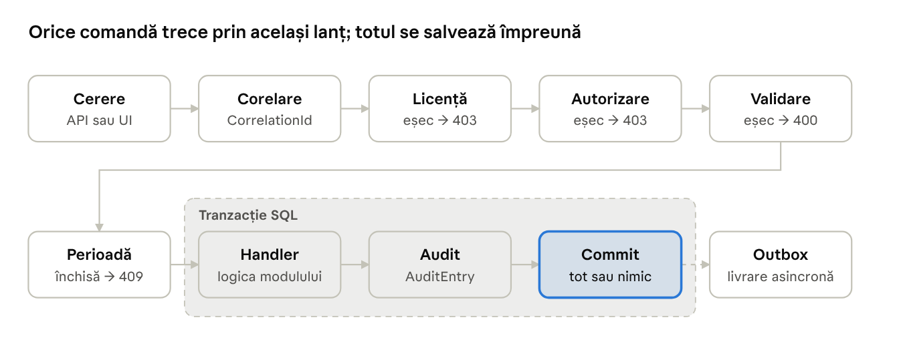

| Ordine | Behavior | Ce face | La eșec |
| --- | --- | --- | --- |
| 1 | `CorrelationBehavior` | Atașează `CorrelationId`, utilizatorul și firma curentă la context și la jurnale | — |
| 2 | `LicenseBehavior` | Verifică dacă modulul comenzii e activ în licență; în modul doar-citire (fluxul 4.4) refuză orice comandă de scriere | 403 `CORE_MODULE_NOT_LICENSED` sau `CORE_LICENSE_READ_ONLY` |
| 3 | `AuthorizationBehavior` | Verifică permisiunea declarată pe comandă (`[RequiresPermission("Sales.Invoice.Validate")]`) și scope-ul pe firmă / dimensiuni | 403 `CORE_FORBIDDEN` |
| 4 | `ValidationBehavior` | Rulează validatorii FluentValidation ai comenzii | 400 cu lista de erori pe câmp |
| 5 | `PeriodLockBehavior` | Pentru comenzile cu dată contabilă: refuză perioadele închise (P4) | 409 `CORE_PERIOD_CLOSED` |
| 6 | `TransactionBehavior` | Deschide tranzacția SQL (`ReadCommitted`, cu baza în `READ_COMMITTED_SNAPSHOT ON`, `SP-14`); un singur `DbConnection` pe request; verifică cheia de idempotență; reîncearcă de 3 ori la deadlock (`SP-17`) | Rollback |
| 7 | Handler-ul modulului | Logica de business; apelează proceduri stocate prin Dapper; scrie evenimente în outbox prin `IOutbox` | Rollback |
| 8 | `AuditBehavior` | Scrie `AuditEntry` pentru comenzile marcate `[Audited]`, în aceeași tranzacție | Rollback |
| 9 | Commit | Documentul, outbox-ul și audit-ul se salvează împreună sau deloc (P8) | — |

Interogările (`IQuery`) trec doar prin pașii 1–3 și nu deschid tranzacție de scriere.

Protecție la dublă trimitere: comenzile de creare acceptă antetul `Idempotency-Key`, generat de interfață la deschiderea formularului. `TransactionBehavior` salvează cheia și rezultatul în `core.IdempotencyKey`, în aceeași tranzacție; o a doua cerere cu aceeași cheie (dublu-clic, reîncercare după o întrerupere de rețea) primește rezultatul primei, fără să creeze încă un document.

**Detalii de implementare (etapa 1, 15.11.2026):**

- Proiectele `Erp.Core.Contracts`, `.Domain`, `.Application`, `.Infrastructure`, `.Api` (`NET-01`). Pipeline-ul se înregistrează cu `AddErpMediator(assembly-urile modulelor)`; ordinea behaviors e cea din tabel, iar `AuditBehavior` rulează în interiorul tranzacției, după handler.
- Contextul cererii vine din antete: `X-Correlation-Id` (întors și în răspuns; generat dacă lipsește), `X-Company-Id` (firma curentă; fără antet, ultima firmă a utilizatorului, `0` = nicio firmă), `Idempotency-Key` (maximum 100 de caractere). Utilizatorul se identifică prin claim-ul `NameIdentifier` = `SubjectId` și se încarcă o dată per cerere cu `core.usp_User_GetPermissions`; un cont inactiv sau extern expirat rămâne neautentificat (4.6).
- Pe lângă cele din secțiunea 6, contractele au: `ICurrentContext.IsAuthenticated`, `IdempotencyKey`, `IpAddress`; `IAuditScope` (handler-ul descrie entitatea modificată; fără descriere, intrarea de audit are doar acțiunea și tipul derivat din ea); `IPeriodLock` (implementat de Finanțe; până atunci nicio perioadă nu e închisă); `IAccountingDated` (comenzile cu dată contabilă); `ErpException` / `ErpValidationException` cu codul stabil.
- Autorizarea e „fail closed”: o cerere fără `[RequiresPermission]` e refuzată, cu excepția interogărilor marcate `[AuthenticatedUser]` (de exemplu `GET /api/core/me`). Testul de arhitectură verifică `[Module]` și permisiunea pe fiecare comandă și interogare (`NET-04`).
- Idempotența: `core.usp_IdempotencyKey_Claim` rezervă cheia cu `UPDLOCK, HOLDLOCK`, deci cererile simultane cu aceeași cheie se serializează; aceeași cheie folosită pentru altă operațiune dă 409 `CORE_IDEMPOTENCY_KEY_REUSED`. Deadlock-ul (1205) și expirarea blocării (1222) se reîncearcă de 3 ori, apoi 409 `CORE_RESOURCE_BUSY` (`SP-17`). Erorile `THROW 50xxx` se traduc în pipeline prin tabelul modulului (`NET-09`).
- Licența (4.4): starea se calculează din `ValidUntil` (avertizare cu 30 de zile înainte, 15 zile de grație, apoi doar citire). Fără licență validă, instalarea rămâne doar pentru consultare cu modulul `Core` activ; în mediul `Development` toate modulele sunt active (jurnalizat). Reverificarea zilnică și refuzul la pornire (A7) vin în etapa licenței.

### 4.2 Alocarea numărului la validare

1. Handler-ul de validare cere `INumberSeriesService.NextAsync(companyId, documentType, documentDate)`.
2. Procedura `core.usp_NumberSeries_Next` face `UPDATE ... SET NextNumber = NextNumber + 1 OUTPUT inserted.NextNumber - 1` pe rândul seriei, în tranzacția documentului; rândul rămâne blocat până la commit.
3. Dacă tranzacția face rollback, și incrementarea se anulează, deci **nu apar goluri** în seriile fiscale.
4. Seria anului nou se creează automat la prima validare din an, cu același prefix.

Caz limită: două validări simultane pe aceeași serie se serializează pe rândul seriei; durata blocajului e cât tranzacția de validare (țintă sub 2 s, din 01). Pentru serii nefiscale (oferte, comenzi) se poate folosi `SEQUENCE` SQL, fără blocaj.

**Detalii de implementare (etapa 4, 15.11.2026):** `core.usp_NumberSeries_Next(@CompanyId, @BranchId, @DocumentTypeCode, @DocumentDate)` refuză apelul în afara unei tranzacții (50028, eroare de programare) și alege seria implicită deschisă a punctului de lucru, apoi pe cea a firmei. Seria anului nou se creează automat doar dacă seria anului anterior are `AutoRollover` (comutatorul din macheta 07c); altfel 50001. Tipurile de documente sunt în catalogul `core.DocumentType` (`Modul.Tip`, de exemplu `Sales.Invoice`), completat de fiecare modul. Formatul: `{Prefix}-{An}-{Număr}`, cu `Padding` cifre. O serie fiscală folosită nu-și mai schimbă tipul, punctul de lucru, prefixul, anul sau următorul număr (50024); o serie nefiscală folosită poate doar sări înainte; o serie închisă e înghețată (50025). Testele A2 (2 × 500 de validări simultane dau numerele 1…1000) și A3 rulează pe SQL Server real.

### 4.3 Cursul valutar

1. Jobul zilnic preia cursul BNR și apelează `IExchangeRateWriter.SaveBnrRatesAsync`. Până la modulul Integrări (decizia lui Aurelian din 21.11.2026), jobul stă în `Erp.Worker` (`core-bnr-rates`, de luni până vineri la :15 și :45 între 13:00 și 16:45, ora României; se oprește când cursul zilei există), iar în Configurare › Cursuri valutare butonul „Preia acum de la BNR” aduce la cerere cursurile ultimelor zile bancare. Integrări poate prelua jobul fără schimbări în Nucleu.
2. Nucleul salvează cursurile cu `Source = BNR` și publică `CursValutarActualizat`.
3. `IExchangeRateProvider.GetRate(currency, date)` întoarce cursul BNR din ziua cerută; dacă ziua nu are curs (weekend, sărbătoare), întoarce ultimul curs anterior și data lui.
4. Documentele memorează cursul folosit; o corectare ulterioară a cursului nu modifică documentele validate.

### 4.4 Licența

1. La pornire, host-ul citește fișierul de licență și verifică semnătura cu cheia publică încorporată în aplicație.
2. Verifică că fiecare firmă activă are CUI-ul în licență și că data curentă e înainte de `ValidUntil`.
3. Înregistrează doar modulele din licență (endpoint-uri, handler-e, consumatori, joburi, meniuri).
4. Zilnic, un job reverifică licența; cu 30 de zile înainte de expirare afișează avertizare administratorilor.
5. După expirare: perioadă de grație de 15 zile cu funcționare completă, apoi **doar citire** (consultare și rapoarte, fără documente noi; LicenseBehavior refuză scrierile cu CORE_LICENSE_READ_ONLY). Datele clientului nu sunt niciodată blocate.

Perioada de grație și modul doar-citire sunt o propunere de politică comercială, de confirmat.

### 4.5 Procesarea outbox-ului

1. Serviciul Windows rulează `OutboxProcessor` la fiecare 2 secunde (configurabil).
2. Citește loturi de 100 de mesaje neprocesate, în ordinea `Id`, cu `READPAST` ca să poată rula și în paralel.
3. Pentru fiecare mesaj apelează consumatorii înregistrați; fiecare consumator își notează mesajul în `core.InboxProcessed` (idempotență: același mesaj nu se procesează de două ori).
4. La eroare: reîncercare cu așteptare crescătoare (1 min, 5 min, 30 min, 2 h), apoi mesajul trece în stare `Failed` și apare în ecranul de monitorizare, cu alertă.

### 4.6 Cazuri limită

| Situație | Comportament |
| --- | --- |
| Utilizator dezactivat în timp ce e logat | Cookie-ul e respins la următoarea verificare a sesiunii (cel mult un minut); cheile API ale contului nu mai sunt acceptate |
| Articol dezactivat care apare pe ciorne | Ciornele existente se pot valida; articolul nu mai apare la căutare pentru documente noi |
| Modificare de partener după facturare | Factura validată păstrează datele partenerului de la validare (copie pe document); nomenclatorul se poate modifica |
| Două firme din grup cu același partener | Un singur partener; condiții diferite per firmă în modulele comerciale |
| Modificarea zecimalelor unui articol | Afectează doar documentele noi; cele existente păstrează precizia de la creare |
| Ceasul serverului greșit | Health-check-ul compară ora cu serverul SQL și cu ANAF la sincronizare; diferență peste 2 minute = alertă |

### 4.7 Notificări și email

1. Modulele trimit notificări prin `INotificationService` (către utilizatori anume sau către un rol dintr-o firmă), în aceeași tranzacție cu operația: se scriu în `core.Notification` și în outbox.
2. Utilizatorul le vede în aplicație: clopoțel în antet, cu numărul celor necitite.
3. Emailul pleacă din outbox prin serverul SMTP configurat la instalare (setările `Smtp.*`, parola criptată cu Data Protection, `NET-17`), după preferințele utilizatorului pentru fiecare tip de notificare.
4. Notificări trimise de Nucleu: licența expiră în 30 de zile, mesaj outbox eșuat definitiv, cont blocat după încercări greșite (către administratori). Celelalte module își definesc propriile notificări.

### 4.8 Import inițial din Excel

1. Utilizatorul descarcă șablonul Excel al entității (parteneri, articole; soldurile inițiale se importă în modulele lor).
2. Încarcă fișierul; sistemul creează un `ImportJob` și validează fiecare rând cu aceleași validatoare ca la introducerea manuală (CUI, IBAN, UM, cotă TVA).
3. Afișează raportul: rânduri valide, rânduri cu erori și motivul, rânduri care există deja în bază.
4. La confirmare, rândurile valide se salvează în loturi de 500, fiecare lot în tranzacția lui, prin aceleași comenzi ca interfața (cu audit). Rândurile cu erori se descarcă, se corectează și se reîncarcă.
5. Importul se poate relua: un rând cu același cod sau CUI actualizează înregistrarea existentă, nu o dublează.

### 4.9 Retenția datelor

| Date | Păstrare | Motiv |
| --- | --- | --- |
| Jurnal de audit pentru documente contabile și fiscale | 10 ani de la închiderea exercițiului | Legea contabilității 82/1991 |
| Atașamente fiscale (XML ANAF, PDF) | Cât documentul, minimum 10 ani | Idem |
| Mesaje outbox procesate | 30 de zile, apoi șterse de un job zilnic | Date tehnice (`SQL-20`) |
| Chei de idempotență | 24 de ore | Date tehnice |
| Jurnal de autentificări | 1 an | Securitate |
| Notificări citite | 90 de zile | Date tehnice |

Arhivarea pe ani a jurnalului de audit (partiții sau tabelă de arhivă) se detaliază în secțiunea 05. Duratele au fost confirmate pe 14.11.2026; cele tehnice rămân configurabile.

## 5. Evenimente publicate

Nucleul nu consumă evenimente de la alte module. Toate evenimentele de integrare au un anvelop comun, definit în `Erp.Core.Contracts`:

```csharp
public abstract record IntegrationEvent
{
    public Guid EventId { get; init; } = Guid.NewGuid();
    public DateTime OccurredAtUtc { get; init; }          // setat de IOutbox din TimeProvider (NET-15)
    public int CompanyId { get; init; }
    public Guid CorrelationId { get; init; }
    public int Version { get; init; } = 1;
}
```

| Eveniment | Când | Conținut (pe lângă anvelop) | Consumatori tipici |
| --- | --- | --- | --- |
| `PartenerModificat` v1 | Creare sau modificare de partener | `PartnerId`, `Code`, `Name`, `FiscalCode`, `VatPayer`, `VatOnCollection`, `AnafInactive`, `IsActive` | CRM, Vânzări, Achiziții (cache-uri locale), POS |
| `ArticolModificat` v1 | Creare sau modificare de articol | `ItemId`, `Code`, `Name`, `ItemType`, `BaseUomCode`, `VatRateCode`, `DepositItemId`, `IsActive` | POS (sincronizare), Stocuri, Producție |
| `NomenclatorFiscalModificat` v1 | Adăugarea sau modificarea unei cote TVA ori a unei UM | `Kind` (VatRate / Uom), `Code`, `ValidFrom` | POS (sincronizare offline), Vânzări, Achiziții |
| `CursValutarActualizat` v1 | Salvarea cursurilor unei zile | `RateDate`, `Source`, lista `{CurrencyCode, Rate, Multiplier}` | Finanțe (reevaluare), Raportare |
| `FirmaModificata` v1 | Modificarea datelor unei firme | `CompanyId`, `FiscalCode`, `Name`, `VatPayer`, `VatOnCollection` | Integrări (date emitent e-Factura), Finanțe |
| `LicentaActualizata` v1 | Încărcarea unei licențe noi sau schimbarea stării ei | `Modules`, `ValidUntil`, `Limits`, `State` | Toate (repornire controlată a modulelor) |
| `UtilizatorDezactivat` v1 | Dezactivarea unui utilizator | `UserId`, `SubjectId` | Autentificarea (închiderea sesiunilor), POS |

Regulă de versionare: un câmp nou opțional nu schimbă versiunea; eliminarea sau schimbarea de sens a unui câmp cere `v2`, publicată în paralel cu `v1` până când toți consumatorii trec pe `v2`.

## 6. Contracte publice (`Erp.Core.Contracts`)

Celelalte module văd Nucleul doar prin aceste interfețe și DTO-uri (P1). Implementările stau în `Erp.Core.Infrastructure` și sunt înregistrate în DI.

```csharp
// Context curent: utilizator, firmă, permisiuni
public interface ICurrentContext
{
    int UserId { get; }
    int CompanyId { get; }
    Guid CorrelationId { get; }
    bool HasPermission(string permission, DimensionRef? scope = null);
}

// Numerotare
public interface INumberSeriesService
{
    Task<DocumentNumber> NextAsync(int companyId, string documentType,
        DateOnly documentDate, CancellationToken ct, int? branchId = null);   // branchId adăugat în etapa 4
}
public sealed record DocumentNumber(string Prefix, int Year, long Number, string Formatted);

// Precizie și rotunjire
public interface IPrecisionService
{
    Task<PrecisionInfo> ResolveAsync(int companyId, int? itemId, int? priceListId, CancellationToken ct);
    decimal RoundPrice(decimal value, PrecisionInfo precision);     // 0–6 zecimale
    decimal RoundQuantity(decimal value, PrecisionInfo precision);
    decimal RoundAmount(decimal value, PrecisionInfo precision);    // mereu 2 zecimale
}
public sealed record PrecisionInfo(byte PriceDecimals, byte QuantityDecimals, byte AmountDecimals,
    MidpointRounding Rounding);

// Cursuri
public interface IExchangeRateProvider
{
    Task<ExchangeRateDto> GetRateAsync(string currency, DateOnly date, CancellationToken ct);
}
public sealed record ExchangeRateDto(string Currency, DateOnly RateDate, decimal Rate,
    int Multiplier, string Source);

// Nomenclatoare (doar citire)
public interface IPartnerLookup
{
    Task<PartnerDto?> GetAsync(int partnerId, CancellationToken ct);
    Task<PartnerSnapshotDto> SnapshotAsync(int partnerId, CancellationToken ct); // copie pentru document
}
public interface IItemLookup
{
    Task<ItemDto?> GetAsync(int itemId, CancellationToken ct);
    Task<IReadOnlyList<ItemDto>> GetManyAsync(IEnumerable<int> ids, CancellationToken ct);
}
public interface IVatRateLookup
{
    Task<VatRateDto> GetAsync(string code, DateOnly onDate, CancellationToken ct);
}

// Outbox, audit, atașamente, licență
public interface IOutbox { Task EnqueueAsync(IntegrationEvent evt, CancellationToken ct); }
public interface IAuditWriter { Task WriteAsync(AuditRecord record, CancellationToken ct); }
public interface IAttachmentStore
{
    Task<int> SaveAsync(string entityType, long entityId, string fileName,
        string contentType, Stream content, CancellationToken ct);
    Task<Stream> OpenAsync(int attachmentId, CancellationToken ct);
}
public interface ILicenseInfo
{
    bool IsModuleActive(string moduleCode);
    IReadOnlyCollection<string> ActiveModules { get; }      // meniul interfeței (adăugat în etapa 3)
    bool IsFiscalCodeLicensed(string fiscalCode);           // CUI-ul firmei e în licență (4.4; adăugat în etapa 4)
    int? GetLimit(string limitCode);
    DateOnly ValidUntil { get; }
    LicenseState State { get; }                             // Valid, ExpiringSoon, Grace, ReadOnly
}

// Atribute pe comenzi
[AttributeUsage(AttributeTargets.Class)]
public sealed class RequiresPermissionAttribute(string permission) : Attribute { }
[AttributeUsage(AttributeTargets.Class)]
public sealed class AuditedAttribute(string action) : Attribute { }
[AttributeUsage(AttributeTargets.Class)]
public sealed class ModuleAttribute(string moduleCode) : Attribute { }
```

DTO-urile (`PartnerDto`, `ItemDto`, `VatRateDto`, `PartnerSnapshotDto`, `AuditRecord`) sunt `record`-uri imutabile, fără logică. `PartnerSnapshotDto` conține exact datele care se copiază pe un document fiscal (denumire, CUI, registru, adresă, cont bancar), ca factura să nu se schimbe dacă partenerul se modifică ulterior.

Abstracțiunile de platformă, folosite de toate modulele, stau tot în `Erp.Core.Contracts`:

```csharp
// Comenzi și interogări (peste MediatR)
public interface ICommand<TResult> : IRequest<TResult> { }
public interface IQuery<TResult> : IRequest<TResult> { }
public interface ICommandHandler<TCommand, TResult> : IRequestHandler<TCommand, TResult>
    where TCommand : ICommand<TResult> { }
public interface IQueryHandler<TQuery, TResult> : IRequestHandler<TQuery, TResult>
    where TQuery : IQuery<TResult> { }

// Conexiunea și tranzacția curentă (NET-07)
public interface IDbSession
{
    DbConnection Connection { get; }
    DbTransaction? Transaction { get; }
}

// Scriere cursuri (folosit doar de Integrări)
public interface IExchangeRateWriter
{
    // Una sau mai multe zile (fișierul BNR pe 10 zile); întoarce cursurile adăugate (21.11.2026).
    Task<IReadOnlyList<ExchangeRateDto>> SaveBnrRatesAsync(IReadOnlyList<ExchangeRateDto> rates, CancellationToken ct);
}

// Datele firmei pentru documente (emitent e-Factura, antet tipărire)
public interface ICompanyLookup
{
    Task<CompanySnapshotDto> SnapshotAsync(int companyId, int? branchId, CancellationToken ct);
}

// Dimensiuni
public interface IDimensionLookup
{
    Task<DimensionValueDto?> GetAsync(int dimensionValueId, CancellationToken ct);
    Task<int> EnsureAsync(int companyId, string dimensionType, string code, string name, CancellationToken ct);
}

// Notificări (fluxul 4.7)
public interface INotificationService
{
    Task NotifyUsersAsync(IReadOnlyList<int> userIds, NotificationDto notification, CancellationToken ct);
    Task NotifyRoleAsync(int companyId, string roleCode, NotificationDto notification, CancellationToken ct);
}

public enum LicenseState { Valid, ExpiringSoon, Grace, ReadOnly }
```

`CompanySnapshotDto` conține denumirea, CUI-ul, registrul comerțului, capitalul social, adresa (sau a punctului de lucru) și contul bancar implicit, copiate pe documentele fiscale la fel ca `PartnerSnapshotDto`.

## 7. Schema SQL `core`

Toate tabelele Nucleului stau în schema `core`. Celelalte module au drept de citire doar pe view-urile `core.v_*` și de execuție pe procedurile marcate publice (P1); scrierea în `core` se face doar prin Nucleu.

| Tabel | Cheie primară | Chei unice / străine principale | Indecși suplimentari |
| --- | --- | --- | --- |
| `core.Company` | `Id int` | UQ `Code`, UQ `FiscalCode` | — |
| `core.Branch` | `Id int` | FK `CompanyId` | `CompanyId` |
| `core.CompanyBankAccount` | `Id int` | FK `CompanyId`; UQ `Iban` | `CompanyId` |
| `core.Partner` | `Id int` | UX `CodeKey` (`SQL-24`), UQ filtrat `FiscalCode WHERE FiscalCode IS NOT NULL`; FK proprietar `OwnerCompanyId`, `(OwnerBranchId, OwnerCompanyId)`, `(OwnerLocationId, OwnerCompanyId)` | `NameSearch` (căutare, `SQL-25`), full-text opțional, `(OwnerCompanyId, OwnerBranchId, OwnerLocationId)` filtrat |
| `core.PartnerAddress`, `PartnerBankAccount`, `PartnerContact` | `Id int` | FK `PartnerId` | `PartnerId` |
| `core.Item` | `Id int` | UX `CodeKey`; FK `UomSetId`, `BaseUomId`, `DefaultVatRateId`, `ItemGroupId`, `DepositItemId`, proprietarul ca la `core.Partner` | `NameSearch`, `ItemGroupId`, `(OwnerCompanyId, OwnerBranchId, OwnerLocationId)` filtrat |
| `core.UomSet`, `core.UomSetLine` | `Id int` | UQ `UomSet.Code`; UQ `UomSetLine (UomSetId, UomId)`; index filtrat unic pe `IsBase = 1` | `UomSetId` |
| `core.ItemUom`, `ItemBarcode`, `ItemAttribute` | `Id int` | FK `ItemId`; UQ `ItemUom (ItemId, UomId)`; UQ `ItemBarcode.Barcode`; FK opțional `ItemBarcode.UomId` | `ItemId` |
| `core.ItemGroup` | `Id int` | FK `ParentId` (arbore) | `ParentId` |
| `core.Currency` | `Code char(3)` | — | — |
| `core.ExchangeRate` | `Id int` | UQ `(CurrencyCode, RateDate, Source)` | `(CurrencyCode, RateDate DESC)` |
| `core.VatRate` | `Id int` | UQ `(Code, ValidFrom)` | — |
| `core.UnitOfMeasure` | `Id int` | UQ `Code`, UQ `UneceCode` | — |
| `core.Country`, `County`, `City` | `Code` (ISO, SIRUTA) | FK ierarhic | `CountyCode` |
| `core.[User]` | `Id int` | UQ `SubjectId`, UQ `UserName`; UQ filtrat `EmployeeId`; FK `EmployeeId`, `ExternalPartnerId`, `SponsorUserId`; `CK_User_Kind` (angajat / extern / sistem), `CK_User_UserNameLower` | `ValidUntil` (filtrat pe externi) |
| `core.Employee` | `Id int` | UQ `(CompanyId, EmployeeNo)`; FK `CompanyId`, `BranchId` | `(CompanyId, LastName)` |
| `core.Role`, `Permission` | `Id int` | UQ `Code` | — |
| `core.RolePermission` | `(RoleId, PermissionId)` | FK `RoleId`, `PermissionId` | — |
| `core.UserRoleAssignment` | `Id int` | UQ `(UserId, RoleId, CompanyGroupId, CompanyId, BranchId, LocationId)`; FK `UserId`, `RoleId`, `CompanyGroupId`, `CompanyId`, `(BranchId, CompanyId)`, `(LocationId, CompanyId)` (toate nule = toată instalarea, doar pentru `ADMIN`) | `(UserId, CompanyId)`, `CompanyGroupId` (filtrat) |
| `core.UserPermissionOverride` | `Id int` | UQ `(UserId, PermissionId, CompanyId)`; FK `UserId`, `PermissionId`, `CompanyId` (nullable: `NULL` = toate firmele) | `PermissionId`, `CompanyId` (filtrat) |
| `core.NumberSeries` | `Id int` | UQ `(CompanyId, BranchId, DocumentType, Prefix, Year)` | — |
| `core.PrecisionPolicy` | `Id int` | UQ `Code` | — |
| `core.DimensionType`, `core.DimensionValue` | `Code varchar(20)`; `Id int` | UQ `(CompanyId, DimensionType, CodeKey)`; FK `CompanyId`, `DimensionType`, `ResponsibleUserId`, părintele `(ParentId, CompanyId, DimensionType)` | `ParentId` (filtrat), `(DimensionType, CompanyId)` |
| `core.AuditEntry` | `Id bigint` | — | Cluster pe `Id`; `(EntityType, EntityId)`, `(UserId, OccurredAt)` |
| `core.Attachment` | `Id int` | — | `(EntityType, EntityId)` |
| `core.Notification` | `Id bigint` | FK `UserId` | `(UserId, ReadAt)` |
| `core.Outbox` | `Id bigint` | UQ `EventId` | Filtrat `WHERE ProcessedAt IS NULL` |
| `core.InboxProcessed` | `Id bigint` | UQ `(EventId, Consumer)` | — |
| `core.IdempotencyKey` | `Id bigint` | UQ `(UserId, Key)` | `CreatedAt` (curățare) |
| `core.LoginEvent` | `Id bigint` | — | `(UserName, OccurredAt)` |
| `core.ImportJob` | `Id int` | — | `(EntityType, CreatedAt)` |
| `core.InstallationLicense` | `Id int` | Index unic filtrat `UX_InstallationLicense_IsCurrent` (`WHERE IsCurrent = 1`); `CHECK` JSON pe `FiscalCodes`, `Modules`; `ValidUntil >= IssuedDate` | — |
| `core.Setting` | `Id int` | UQ `(Scope, ScopeId, Key)` | — |
| `core.SchemaVersion` | gestionat de DbUp | — | — |
| `core.CompanyGroup` | `Id int` | UQ `Code`; FK `ParentGroupId` (arbore), `ParentCompanyId` | `ParentGroupId` |
| `core.PropertyDefinition`, `PropertyOption` | `Id int` | UQ `(EntityType, CompanyId, Code)`; FK `PropertyDefinitionId` | `(EntityType, IsActive)` |
| `core.PropertyValue` | `Id bigint` | FK `PropertyDefinitionId`, `ValueOptionId` | `(PropertyDefinitionId, EntityId)`; `(EntityId)` pentru fișă |
| `core.Location` | `Id int` | FK `CompanyId`, `BranchId` (opțional); UQ `(CompanyId, Code)` | `(CompanyId, BranchId)` |

Exemplu de tabel complet, ca model pentru toate celelalte:

```sql
CREATE TABLE core.Partner (
    Id                  int IDENTITY(1,1)  NOT NULL CONSTRAINT PK_Partner PRIMARY KEY,
    Code                nvarchar(30)       NOT NULL,
    Name                nvarchar(200)      NOT NULL,
    PartnerType         tinyint            NOT NULL,
    FiscalCode          nvarchar(30)       NULL,
    PersonalIdEncrypted varbinary(256)     NULL,      -- CNP criptat (GDPR)
    IsCustomer          bit                NOT NULL CONSTRAINT DF_Partner_IsCustomer DEFAULT (0),
    IsSupplier          bit                NOT NULL CONSTRAINT DF_Partner_IsSupplier DEFAULT (0),
    VatPayer            bit                NOT NULL CONSTRAINT DF_Partner_VatPayer DEFAULT (0),
    TradeRegisterNo     nvarchar(30)       NULL,
    CountryCode         char(2)            NOT NULL,
    IntraGroupCompanyId int                NULL CONSTRAINT FK_Partner_Company REFERENCES core.Company(Id),
    IsActive            bit                NOT NULL CONSTRAINT DF_Partner_IsActive DEFAULT (1),
    CreatedAt           datetime2(3)       NOT NULL CONSTRAINT DF_Partner_CreatedAt DEFAULT (sysutcdatetime()),
    CreatedBy           int                NOT NULL,
    ModifiedAt          datetime2(3)       NULL,
    ModifiedBy          int                NULL,
    RowVersion          rowversion         NOT NULL,
    CodeKey             AS UPPER(Code) PERSISTED,                          -- SQL-24: unicitate fără majuscule
    NameSearch          AS (Name COLLATE Latin1_General_100_CI_AI_SC_UTF8) PERSISTED,    -- SQL-25: căutare fără majuscule și diacritice
    CONSTRAINT CK_Partner_Role CHECK (IsCustomer = 1 OR IsSupplier = 1)
);
CREATE UNIQUE INDEX UX_Partner_FiscalCode ON core.Partner (FiscalCode) WHERE FiscalCode IS NOT NULL;
CREATE UNIQUE INDEX UX_Partner_CodeKey ON core.Partner (CodeKey);
CREATE INDEX IX_Partner_NameSearch ON core.Partner (NameSearch) INCLUDE (Code, Name, FiscalCode, IsActive);
```

Proceduri stocate principale (convenție de nume `core.usp_<Entitate>_<Acțiune>`):

| Procedură | Rol | Publică pentru alte module |
| --- | --- | --- |
| `core.usp_NumberSeries_Next` | Alocă următorul număr în tranzacția curentă | Da |
| `core.usp_ExchangeRate_Get` | Curs pentru monedă și zi, cu fallback la ultima zi cu curs | Da |
| `core.usp_ExchangeRate_SaveBatch` | Salvează cursurile BNR lipsă, pe una sau mai multe zile (table-valued parameter); o monedă nouă publicată de BNR se adaugă inactivă | Nu |
| `core.usp_ExchangeRate_SaveManual`, `usp_ExchangeRate_List`, `usp_Currency_List`, `usp_Currency_SetActive` | Cursul manual (motiv obligatoriu); ecranul Cursuri valutare; lista valutelor; activarea unei monede | Nu |
| `core.usp_Partner_Save`, `usp_Partner_Search` | Salvare cu validare de duplicat CUI; căutare pagină | Search: da |
| `core.usp_Item_Save`, `usp_Item_Search` | Idem pentru articole, cu UM și coduri de bare (TVP) | Search: da |
| `core.usp_User_GetPermissions` | Permisiunile efective ale unui utilizator pe o firmă | Nu (doar Nucleu) |
| `core.usp_Outbox_FetchBatch` | Lot de mesaje cu `UPDLOCK, READPAST` | Nu |
| `core.usp_Audit_Search`, `usp_Audit_Get`, `usp_LoginEvent_Search`, `usp_Company_History` | Căutare în jurnalul de audit, paginată, cu valorile filtrelor; detaliul cu intrarea anterioară (înainte / după); jurnalul de autentificări; istoricul fișei firmei | Nu |
| `core.usp_City_Search`, `usp_City_Resolve`, `fn_CityMatch` | Lista de localități SIRUTA a județului; verificarea și legarea localității la salvarea adreselor | Nu |
| `core.usp_Maintenance_IndexesAndStatistics` | Mentenanța indecșilor și a statisticilor, rulată de jobul SQL Agent (08, 5.13) | Nu |

Permisiuni SQL: fiecare modul are propriul rol de bază de date (`role_sales`, `role_fin` ș.a.) cu drepturi complete pe schema lui, `SELECT` pe `core.v_*` și `EXECUTE` pe procedurile publice. Aplicația folosește un singur login SQL, dar testele de arhitectură verifică aceste granițe pe un mediu cu loginuri separate.

Coduri de eroare: Nucleul folosește plaja SQL `50000–50999` (`SP-04`), iar în API codurile stabile au prefixul `CORE_` (`NET-09`).

| Cod SQL | Cod API | HTTP | Când apare |
| --- | --- | --- | --- |
| 50001 | `CORE_NUMBER_SERIES_NOT_FOUND` | 409 | Nu există serie pentru firmă, tip de document și an, iar seria nu poate fi creată automat |
| 50002 | `CORE_PARTNER_DUPLICATE_FISCAL_CODE` | 409 | CUI-ul există deja la alt partener |
| 50003 | `CORE_PARTNER_INVALID_FISCAL_CODE` | 400 | Cifra de control a CUI-ului e greșită |
| 50004 | `CORE_ITEM_DUPLICATE_CODE` | 409 | Codul de articol există deja |
| 50005 | `CORE_ITEM_DUPLICATE_BARCODE` | 409 | Codul de bare e folosit la alt articol |
| 50006 | `CORE_CONCURRENCY_CONFLICT` | 409 | Înregistrarea a fost modificată de alt utilizator (`RowVersion`, `SP-18`) |
| 50007 | `CORE_EXCHANGE_RATE_NOT_FOUND` | 409 | Nu există curs la data cerută sau înainte de ea |
| 50008 | `CORE_BNR_RATE_READONLY` | 409 | Încercare de modificare manuală a unui curs BNR |
| 50009 | `CORE_AUDIT_IMMUTABLE` | 500 | `UPDATE` sau `DELETE` pe `core.AuditEntry` (refuzat de trigger, `SP-21`) |
| 50010 | `CORE_ENTITY_IN_USE` | 409 | Ștergere fizică a unei înregistrări deja folosite (`SQL-20`); se dezactivează în loc |
| 50011 | `CORE_UOM_FACTOR_LOCKED` | 409 | Factorul de conversie al unui articol cu stoc sau documente nu se mai poate modifica |
| 50012 | `CORE_EMPLOYEE_ALREADY_LINKED` | 409 | Angajatul are deja un cont de utilizator |
| 50013 | `CORE_EXTERNAL_USER_INCOMPLETE` | 400 | Utilizatorul extern nu are dată de expirare, responsabil sau motiv |
| 50014 | `CORE_INITIAL_ADMIN_EXISTS` | 409 | Installer-ul încearcă să creeze administratorul inițial, dar există deja un administrator activ |
| 50015 | `CORE_LAST_ADMINISTRATOR` | 409 | Dezactivarea sau scoaterea rolului `ADMIN` ar lăsa instalarea fără administrator activ |
| 50016 | `CORE_SYSTEM_ROLE_MISSING` | 500 | Rolul de sistem `ADMIN` lipsește (datele livrate nu au rulat) |
| 50017 | `CORE_LICENSE_INVALID_DATES` | 400 | Licența salvată are `ValidUntil` înaintea `IssuedDate` (`core.usp_InstallationLicense_Save`) |
| 50018 | `CORE_DUPLICATE_CODE` | 409 | Codul există deja, fără diferență de majuscule (grup sau firmă în instalare, punct de lucru sau locație în firmă) |
| 50019 | `CORE_COMPANY_DUPLICATE_FISCAL_CODE` | 409 | Există deja o firmă cu acest CUI |
| 50020 | `CORE_NODE_HAS_ACTIVE_CHILDREN` | 409 | Dezactivarea unui grup, a unei firme sau a unui punct de lucru care are copii activi |
| 50021 | `CORE_INVALID_REFERENCE` | 400 | Părinte sau legătură invalidă: grup inexistent sau ciclu, firmă-mamă din afara grupului, punct de lucru al altei firme, tip de document sau politică inexistente |
| 50022 | `CORE_INVALID_ADDRESS` | 400 | Țara sau județul nu există în nomenclator (pentru România județul e obligatoriu) |
| 50023 | `CORE_BANK_ACCOUNT_DUPLICATE_IBAN` | 409 | IBAN-ul este deja înregistrat |
| 50024 | `CORE_NUMBER_SERIES_LOCKED` | 409 | Schimbarea numerotării unei serii fiscale deja folosite, sau coborârea următorului număr al unei serii folosite |
| 50025 | `CORE_NUMBER_SERIES_CLOSED` | 409 | Modificarea sau închiderea unei serii închise |
| 50026 | `CORE_NUMBER_SERIES_DUPLICATE` | 409 | Există deja o serie cu același prefix pentru firmă, punct de lucru, tip de document și an |
| 50027 | `CORE_ENTITY_NOT_FOUND` | 404 | Înregistrarea modificată nu există (sau nu aparține firmei) |
| 50028 | — | 500 | `core.usp_NumberSeries_Next` apelată în afara tranzacției documentului (eroare de programare) |
| 50029 | `CORE_ADDRESS_TYPE_DUPLICATE` | 409 | Codul tipului de adresă există deja |
| 50030 | `CORE_ADDRESS_TYPE_PROTECTED` | 400 | Tip de adresă de sistem dezactivat sau cu codul schimbat |
| 50031 | `CORE_USER_DUPLICATE_USERNAME` | 409 | Numele de utilizator e deja folosit |
| 50032 | `CORE_USER_LICENSE_LIMIT` | 409 | Utilizatorul nou sau reactivat ar depăși limita `users` din licență |
| 50033 | `CORE_SYSTEM_USER_PROTECTED` | 409 | Modificarea contului `system` sau a tipului / numelui administratorului integrat |
| 50034 | `CORE_ROLE_SCOPE_INVALID` | 400 | Atribuire pentru toate firmele a altui rol decât `ADMIN` |
| 50035 | `CORE_ROLE_PROTECTED` | 409 | Modificarea rolului `ADMIN`, schimbarea codului unui rol de sistem sau ștergerea unui rol de sistem |
| 50036 | `CORE_PERMISSION_OVERRIDE_INVALID` | 400 | Drept adăugat fără motiv sau excepție pentru un utilizator cu rolul `ADMIN` |
| 50037 | `CORE_OWNER_ACCESS_DENIED` | 403 | Adăugare sau modificare a unui articol / partener într-un nod (comun, firmă, punct de lucru, locație) pe care utilizatorul nu are drept de modificare |

Cod API fără cod SQL (etapa 4): `CORE_COMPANY_NOT_LICENSED` (409), CUI-ul unei firme active nu este în licență (4.4).

Coduri API fără cod SQL (utilizatori): `CORE_USER_SELF_ROLES` (409, propriile roluri), `CORE_USER_TECHNICAL_ACCOUNT` (409, parolă pentru un cont tehnic), `CORE_USER_NO_ACCOUNT` (409, acțiune de securitate pe un utilizator fără cont `ids`; resetarea parolei îl creează).

Coduri API ale pipeline-ului, fără cod SQL (etapa 1, 15.11.2026): `CORE_UNAUTHENTICATED` (401), `CORE_FORBIDDEN`, `CORE_MODULE_NOT_LICENSED`, `CORE_LICENSE_READ_ONLY` (403), `CORE_VALIDATION` (400, cu `errors` pe câmp), `CORE_PERIOD_CLOSED`, `CORE_RESOURCE_BUSY`, `CORE_IDEMPOTENCY_KEY_REUSED` (409), `CORE_UNEXPECTED_ERROR` (500, fără detalii tehnice). Răspunsurile de eroare sunt ProblemDetails cu extensiile `code` și `correlationId`. Codurile 50009 și 50016 rămân erori neprevăzute (500).

Tabelele adăugate în etapa 1 (migrarea `2026.11.004`): `core.Permission` (`Code`, `ModuleCode`, `Description`; `CHECK` că codul începe cu modulul), `core.RolePermission`, `core.Outbox` (`EventId`, `EventType`, `EventVersion`, `CompanyId`, `CorrelationId`, `Payload` JSON, `OccurredAt`, `Status` 0 = în așteptare / 1 = procesat / 2 = eșuat, `Attempts`, `NextAttemptAt`, `ProcessedAt`, `LastError`), `core.InboxProcessed`, `core.IdempotencyKey` (`UserId`, `Key`, `RequestType`, `ResultJson`). Procedurile noi: `core.usp_User_GetPermissions`, `core.usp_Outbox_Enqueue`, `core.usp_AuditEntry_Insert`, `core.usp_IdempotencyKey_Claim`, `core.usp_IdempotencyKey_Complete`. Datele livrate `02_Permissions.sql` și `03_RolePermissions.sql` conțin catalogul din secțiunea 8 și permisiunile rolurilor de sistem; rolul NOMENCLATOARE primește în plus `Core.Partner.View` și `Core.Item.View`, fără de care nu ar vedea listele pe care le gestionează.

Etapa 2 (migrarea `2026.11.005`): `core.LoginEvent` (`UserName` tastat, `UserId` dacă e cunoscut, `Success`, `FailureReason`, `IpAddress`, `UserAgent`), procedura `core.usp_LoginEvent_Insert` (actualizează `User.LastLoginAt`; la blocare pune `Erp.Auth.UtilizatorBlocat` în outbox) și view-ul `core.v_UserLoginStatus`, prin care `Erp.Auth` citește doar dacă utilizatorul poate intra (activ, în perioada de valabilitate).

Etapa 4 (migrarea `2026.11.006`): `core.Country`, `core.County`, `core.PrecisionPolicy`, `core.CompanyGroup`, `core.Company`, `core.Branch`, `core.Location`, `core.CompanyBankAccount`, `core.DocumentType`, `core.NumberSeries` (cu `FirstNumber` și `LastUsedAt`; cheile compuse `(BranchId, CompanyId)` țin locația și seria în firma punctului de lucru) și cheile străine spre `core.Company` amânate în etapa 1 (`User.LastCompanyId`, `UserRoleAssignment.CompanyId`, `AuditEntry.CompanyId`). Funcția `core.fn_UserCompanies` (firmele unui utilizator, opțional cu o permisiune) și procedurile `core.usp_OrgTree_Get`, `usp_OrgLookups_Get`, `usp_Company_Get`, `usp_User_GetCompanies`, `usp_CompanyGroup_Save`, `usp_Company_Save`, `usp_Branch_Save`, `usp_Location_Save`, `usp_CompanyBankAccount_Save`, `usp_NumberSeries_Save`, `usp_NumberSeries_Close`, `usp_NumberSeries_List`, `usp_NumberSeries_Next`. Datele livrate `04_Countries` … `07_DocumentTypes`. `core.usp_User_GetPermissions` validează acum firma cerută (vezi 3.1).

Conformitate: schema și procedurile respectă [Bune practici (SQL și cod)](../../bune-practici/BUNE_PRACTICI.md), regulile `SQL-01`–`SQL-25`, `SP-01`–`SP-21` și `MIG-01`–`MIG-07`, cu trei abateri:

- Abatere de la `SQL-13` pentru `core.Currency`, `core.Country`, `core.County`, `core.City`: cheia primară e codul standard (ISO 4217, ISO 3166, cod județ, SIRUTA), nu `int IDENTITY`. Motiv: liste standard, mici și stabile, referite peste tot prin cod. Permanentă.
- Abatere de la `SQL-13` pentru `core.RolePermission`: cheie primară compusă `(RoleId, PermissionId)`, fără `Id`. Motiv: tabelă de legătură pură, fără alte coloane. Permanentă.
- Abatere de la `SP-08` pentru `core.usp_Maintenance_IndexesAndStatistics`: buclă pe lista de indecși și statistici, pentru că fiecare `ALTER INDEX` / `UPDATE STATISTICS` e o comandă DDL separată. Lucrează pe metadate, nu pe date de business. Permanentă.

## 8. Permisiuni și roluri

Permisiunile Nucleului (format `Core.<Resursă>.<Acțiune>`):

| Permisiune | Ce permite |
| --- | --- |
| `Core.Company.View` / `.Manage` | Vizualizare / creare și modificare firme, puncte de lucru și conturi bancare |
| `Core.Partner.View` / `.Manage` | Vizualizare / creare și modificare parteneri |
| `Core.Partner.ViewPersonalData` | Vizualizare CNP și date personale ale persoanelor fizice (jurnalizată) |
| `Core.Partner.Anonymize` | Export și anonimizare GDPR a datelor unei persoane fizice (auditată) |
| `Core.Item.View` / `.Manage` | Vizualizare / creare și modificare articole |
| `Core.Nomenclature.Manage` | Valute, cote TVA, UM, țări, județe |
| `Core.Dimension.Manage` | Centre de cost, proiecte, gestiuni, șantiere (valorile dimensiunilor) |
| `Core.ExchangeRate.ManageManual` | Cursuri manuale (nu BNR) |
| `Core.NumberSeries.Manage` | Creare și modificare serii |
| `Core.Precision.Manage` | Politici de zecimale |
| `Core.Import.Run` | Importuri din Excel |
| `Core.Employee.View` / `.Manage` | Vizualizare / creare și modificare fișe minime de angajat (adăugat pe 21.11.2026) |
| `Core.User.Manage` | Utilizatori, atribuiri de roluri, deblocare cont și resetare 2FA |
| `Core.Role.Manage` | Roluri și permisiunile lor |
| `Core.Audit.View` | Consultare jurnal de audit și jurnal de autentificări |
| `Core.License.Manage` | Încărcare licență |
| `Core.Settings.Manage` | Setări de instalare și de firmă (inclusiv SMTP) |
| `Core.Property.Manage` | Definițiile de proprietăți pentru parteneri și articole (valorile se completează cu drepturile de pe entitate) |
| `Core.Integration.Monitor` | Ecranul de outbox, reîncercare mesaje eșuate |

Roluri de sistem livrate implicit (clientul le poate copia și adapta):

| Rol | Permisiuni Nucleu |
| --- | --- |
| Administrator | Drepturi depline: toate permisiunile din catalog, ale tuturor modulelor, inclusiv cele adăugate ulterior (decizie Aurelian, 15.11.2026; aplicată de `core.usp_User_GetPermissions`, independent de `core.RolePermission`) |
| Responsabil nomenclatoare | `Partner.Manage`, `Item.Manage`, `Nomenclature.Manage`, `Dimension.Manage`, `Import.Run` |
| Auditor | Toate permisiunile `*.View` + `Core.Audit.View`, fără modificări |
| Utilizator standard | `Partner.View`, `Item.View`, `Company.View` |

Regulă de separare: `Core.User.Manage` și `Core.Role.Manage` pot fi date separat, ca nimeni să nu-și poată acorda singur drepturi noi (configurabil). Excepțiile de drepturi pe utilizator (adăugate sau revocate față de roluri) sunt descrise în 3.4 și cer `Core.Role.Manage`.

## 9. Cerințe legale și integrări

| Cerință | Ce înseamnă pentru Nucleu |
| --- | --- |
| Date de identificare pe documente fiscale | Firma și partenerul au CUI, registrul comerțului, adresă completă cu județ și localitate din nomenclator; `CompanySnapshotDto` și `PartnerSnapshotDto` le copiază pe document |
| Mențiuni obligatorii ale firmei | Capitalul social, punctul de lucru și contul bancar sunt disponibile pentru antetul documentelor (Legea 31/1990) |
| e-Factura (CIUS-RO) | UM cu cod UN/ECE, cote TVA cu categoria UBL (S, Z, E, AE, K, O), țări ISO, județe în format `RO-XX`; validate la salvarea nomenclatorului |
| Numerotare fără goluri | Serii fiscale cu alocare tranzacțională (fluxul 4.2), opțional pe punct de lucru |
| Modificări de cote TVA | Cote cu `ValidFrom` / `ValidTo`; documentele folosesc cota valabilă la data faptului generator (P6) |
| TVA la încasare și contribuabili inactivi | Partenerul are `VatOnCollection` și `AnafInactive`, actualizate din registrele ANAF prin Integrări; documentele de achiziție avertizează la furnizorii inactivi |
| Sistemul de garanție-returnare (SGR) | Articolele cu ambalaj SGR au `DepositItemId`; garanția se adaugă automat pe documente |
| Curs BNR | Cursuri BNR nemodificabile, cu sursă și dată memorate |
| GDPR | CNP criptat la nivel de coloană, acces doar cu `Core.Partner.ViewPersonalData` și jurnalizat; export și anonimizare la cerere pentru persoane fizice, fără a atinge documentele fiscale |
| Pistă de audit | `core.AuditEntry` doar cu adăugare, cu trigger care refuză UPDATE și DELETE |
| Arhivare și păstrare | Atașamentele fiscale (XML ANAF, PDF) cu hash SHA-256; păstrare minimum 10 ani pentru audit și atașamente fiscale (fluxul 4.9) |

Integrări ale Nucleului: autentificarea cu ASP.NET Core Identity și cookie, în aceeași aplicație, fără server de identitate separat (deciziile lui Aurelian din 14.11.2026: fără Duende, fără OpenIddict; detalii în [08](../../08-instalare-actualizare/INSTALARE_ACTUALIZARE.md), secțiunea 8) (legătura utilizatorilor după `SubjectId`, evenimentele de autentificare scrise în `core.LoginEvent`), Active Directory prin autentificarea Windows din IIS pe `/account/windows` (opțional), cheile API pentru conturile tehnice, serverul SMTP al clientului pentru email, și interogarea ANAF pentru datele unui CUI pe fișa partenerului (în Nucleu, decizia lui Aurelian din 20.11.2026; vezi 3.2). Autentificarea își ține datele (conturi locale, parole, 2FA, sesiuni, chei API) într-o schemă `ids` din aceeași bază, ca backup-ul să le cuprindă (confirmat 14.11.2026, detaliat în secțiunea 06).

## 10. Rapoarte ale modulului

| Raport | Conținut | Utilizatori |
| --- | --- | --- |
| Lista partenerilor | Filtre pe tip, țară, plătitor TVA, TVA la încasare, inactiv ANAF, activ; export Excel | Toate rolurile cu `Partner.View` |
| Parteneri duplicați sau incompleți | CUI-uri invalide, fără adresă de județ, nume foarte asemănătoare | Responsabil nomenclatoare |
| Lista articolelor | Pe grupe, tip, cotă TVA, UM; export Excel | Toate rolurile cu `Item.View` |
| Articole incomplete pentru e-Factura | Fără UM UN/ECE, fără cotă TVA, fără cod NC (unde e nevoie) | Responsabil nomenclatoare |
| Istoric cursuri valutare | Cursuri pe monedă și interval | Finanțe |
| Utilizatori și drepturi | Cine are ce rol, pe ce firmă și dimensiuni; ultima autentificare | Administrator, Auditor |
| Jurnal de autentificări | Reușite și eșuate, pe utilizator, interval și IP; conturi blocate | Administrator, Auditor |
| Jurnal de audit | Filtre pe utilizator, entitate, acțiune, interval; export | Auditor, Administrator |
| Stare serii de numerotare | Ultimul număr alocat pe serie și an | Administrator, Contabil șef |
| Importuri | Istoricul importurilor, cu rândurile valide și cele cu erori | Responsabil nomenclatoare |
| Monitor integrări | Mesaje outbox în așteptare, eșuate, timp mediu de procesare | Administrator |

## 11. Ecrane principale

Toate ecranele urmează același tipar: listă cu filtre și căutare → fișă de detaliu cu tab-uri → istoric (audit) în ultimul tab. Structura e funcțională; designul vizual vine în etapa de UI.

| Ecran | Conținut principal | Note |
| --- | --- | --- |
| Autentificare (login) | Utilizator și parolă sau butonul „Autentificare cu contul Windows” (Active Directory, dacă e configurat); pasul al doilea cu cod 2FA dacă e activat; link „Am uitat parola”; blocare temporară după 5 încercări greșite. După autentificare, utilizatorul cu roluri în mai multe firme alege firma (implicit ultima folosită). | Pagină Razor `/account/login` din aplicația ERP; după autentificare se emite cookie-ul de sesiune (08, secțiunea 8). Poartă numele și sigla clientului. Încercările eșuate se jurnalizează. |
| Parolă: recuperare și schimbare | Email cu link de resetare valabil 30 de minute; schimbare obligatorie la prima autentificare și după resetare de către administrator; reguli de complexitate configurabile. | Doar pentru conturile locale; conturile Active Directory își schimbă parola în Windows. |
| Activare 2FA | Cod QR pentru o aplicație de autentificare (TOTP) și coduri de rezervă de unică folosință. | Obligatoriu pentru rolul Administrator, opțional pentru restul (configurabil). Valorile de 5 încercări și 30 de minute sunt propuneri. |
| Selector de firmă | În antetul aplicației; schimbă firma curentă pentru toate ecranele | Doar firmele pe care utilizatorul are roluri |
| Firme | Arbore în stânga (grupuri → firme → puncte de lucru → locații, cu căutare și filtre); în dreapta fișa nodului selectat, cu tab-uri: Date generale, Structură, Conturi bancare, Serii, Setări, Certificat ANAF, Istoric | Certificatul se configurează aici, se folosește în Integrări. Tab „Utilizatori” (21.11.2026, cu `Core.User.Manage`): utilizatorii cu roluri care acoperă firma, nodul fiecărei atribuiri și matricea de drepturi doar pentru citire. Tab „Istoric” (21.11.2026): auditul firmei și al structurii ei |
| Parteneri | Listă cu căutare după nume, cod, CUI; fișă: Date, Adrese, Conturi bancare, Contacte, Istoric | Buton „Preia de la ANAF” după CUI |
| Articole | Listă cu filtre pe stocabil, grupă și tip; fișă: Date generale, UM și conversii, Proprietăți, Coduri de bare, Istoric, plus Contabilitate și Stoc pentru firma curentă (tab-uri ale modulelor Finanțe și Stocuri) | Tab-urile de modul apar doar dacă modulul e licențiat |
| Nomenclatoare | Valute, cote TVA, UM, țări, județe, localități, grupe de articole | Editare în tabel, cu validare la salvare |
| Cursuri valutare | Tabel pe zile și monede; BNR doar citire, manuale editabile | Implementat (21.11.2026, `/admin/config/cursuri`, familia „Nomenclatoare”, cu `Core.Nomenclature.Manage` sau `Core.ExchangeRate.ManageManual`), după macheta 07b: cursurile BNR pe zile (intervalul 7–92 de zile, monedele afișate se aleg), zilele fără curs arată ziua cursului folosit; cursurile manuale; monedele active („+ monedă”, cu `Core.Nomenclature.Manage`); „Preia acum de la BNR” (cu `Core.ExchangeRate.ManageManual`). Fără „Export Excel” și „Raport istoric cursuri” (rămân de făcut) |
| Utilizatori | Listă cu filtre Angajați / Externi / Inactivi / Expiră curând / Fără 2FA; fișă: Cont (bifa angajat sau extern), Roluri și firme, Securitate, Preferințe, Sesiuni, Istoric; permisiunile efective se calculează | Invitarea utilizatorului creează contul în `ids.UserAccount`. Implementat (21.11.2026, `/admin/utilizatori`): Roluri și firme = rolul pe un nod (instalare, grup, firmă, punct de lucru, locație), cu coloana „Se aplică pe”; Preferințe = matricea de notificări (limba și firma implicită rămân în Cont, ca în 06b); fără export și sincronizare AD; parola temporară se arată o singură dată (vezi 3.4) |
| Angajați | Listă cu căutare după nume sau marcă, filtre pe firmă și „fără cont”; fișa minimă și Istoric | Fără machetă aprobată (decizie 21.11.2026); `/admin/angajati`, `Core.Employee.View` / `.Manage` |
| Roluri | Listă; matrice permisiuni grupate pe module | Doar modulele licențiate. Implementat (21.11.2026, `/admin/config/roluri`, familia „Securitate”): comutatorul „Pe rol” (macheta 07e: listă de roluri, matricea resursă × acțiune, copiere, ștergere pentru rolurile clientului) / „Roluri și utilizatori” (rândurile sunt rolurile cu utilizatorii lor dedesubt, coloanele sunt resursele și acțiunile; filtru pe firmă — sau „Toate firmele” —, pe modul și „Doar cu excepții”; clic pe celula unui utilizator revocă un drept moștenit sau adaugă unul lipsă; lista „Modificări nesalvate” cere motivul drepturilor adăugate). Drepturile rolului se schimbă doar din „Pe rol”. Fără „Raport utilizatori și drepturi” și „Compară cu alt rol” (rămân de făcut) |
| Serii de numerotare | Pe firmă și tip de document | Avertizare la modificarea unei serii fiscale folosite |
| Precizie | Politici și atribuirea lor pe firmă | Previzualizare: cum arată un preț cu 2, 4, 6 zecimale. Implementat (21.11.2026, `/admin/config/precizie`, familia „Documente”, cu `Core.Precision.Manage`), după macheta 07d; atribuirea pe firmă se face din fișa firmei (vezi 3.5) |
| Audit | Căutare și detaliu de modificare (înainte / după) | Doar citire. Implementat (21.11.2026, `/admin/config/audit`, familia „Securitate”, cu `Core.Audit.View`), după macheta 07h, cu jurnalul de autentificări în același tab; fără „Export Excel” (vezi 3.5) |
| Licență | Module active, limite, valabilitate; încărcare fișier nou | — |
| Monitor integrări | Outbox: în așteptare, eșuate, reîncercare manuală | — |
| Asistent de configurare | Pașii de la prima pornire: firme, administrator, AD, certificat ANAF, import inițial din Excel | Administratorul e creat de installer; asistentul îi completează profilul. Vezi [08 Instalare și actualizare](../../08-instalare-actualizare/INSTALARE_ACTUALIZARE.md) |
| Profilul meu | Limbă, firmă implicită, schimbare parolă, activare 2FA, preferințe de notificare (în aplicație sau pe email) | Disponibil oricărui utilizator |
| Notificări | Clopoțel în antet cu numărul celor necitite; listă cu link spre documentul vizat și marcare ca citit | Fluxul 4.7 |
| Import date | Alegerea entității, descărcare șablon, încărcare fișier, raport de validare, confirmare, descărcarea rândurilor cu erori | Fluxul 4.8; folosit și de asistentul de configurare |

Machetele pentru autentificare și pagina de start (aprobată pe 14.11.2026):

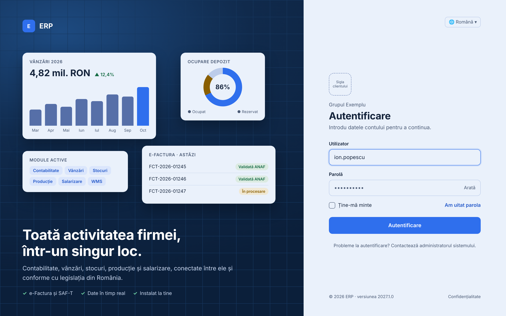

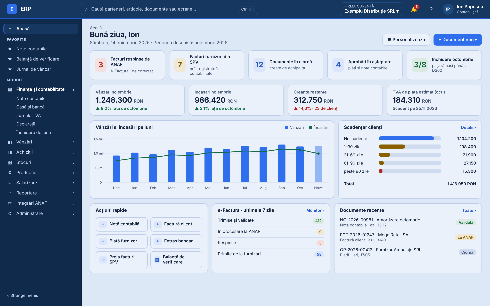

**Detalii de implementare (etapa 3, 15.11.2026):** interfața React din `src/Web/erp-web` (07, ST1–ST4) are antetul (firma curentă — dezactivată până la firme, etapa 4; notificările — dezactivate până la etapa 10; meniul utilizatorului cu Schimbă parola, Autentificare în doi pași, Ieșire), meniul lateral și pagina Acasă. Meniul arată un ecran numai dacă modulul e activ în licență și rolul are permisiunea; `GET /api/core/me` întoarce pentru asta și `modules` (modulele active) și `licenseState`. Pagina Acasă arată salutul, data (Europe/Bucharest), avertismentul de licență (expiră curând, grație, doar consultare) și modulele active; indicatorii, sarcinile „De rezolvat”, graficele și documentele recente din machetă vin cu modulele care dețin datele (Finanțe, Vânzări, Integrări). Fără sesiune, orice răspuns 401 trimite la `/account/login?returnUrl=…`, iar `IDS_PASSWORD_CHANGE_REQUIRED`/`IDS_TWO_FACTOR_SETUP_REQUIRED` la paginile de cont. `Erp.Host` servește `index.html` pe `/` și pe rutele aplicației (200 HTML, cerința 8.14); `/api/*` necunoscut răspunde 404 ProblemDetails.

**Tema vizuală (20.11.2026):** toate ecranele, inclusiv paginile `/account/*`, folosesc paleta din
[10 Interfață și temă vizuală](../../10-interfata-tema/INTERFATA_TEMA.md): albastru deschis pal pe
suprafețe, nicio suprafață albă, antetul și meniul lateral în bleumarin ca repere de orientare, câte
un accent pe modul. Culorile vin dintr-un singur fișier de tokeni, folosit și de React și de Razor
(`UI-13`–`UI-17`). Machetele 01–10 au fost reculorate cu aceeași paletă și **revalidate de Aurelian
(20.11.2026)**; PNG-urile se regenerează din HTML cu `build/machete-png.mjs`. Banda de tab-uri a unei
fișe urmează harta zonelor: tab-urile inactive pe `--surface-muted`, cel activ pe suprafața fișei, cu
care se unește.

**Ecranul de autentificare, completări (20.11.2026):** pagina aduce acum elementele din macheta
aprobată care lipseau — sigla clientului (fișierul din `Branding:LogoPath`, implicit
`wwwroot/brand/logo.svg|png`; fără fișier, inițiala numelui din licență) și ilustrația decorativă din
panoul de brand. În plus: avertisment „Caps Lock este activ” la câmpul parolă, butonul se dezactivează
la trimitere (un dublu clic consuma două din cele 5 încercări), mesajul de blocare spune minutele
rămase din `LockoutEnd` în loc de durata configurată, iar pe ecrane înguste panoul ascuns e înlocuit
cu o bandă compactă de brand. Butonul „Autentificare cu contul Windows” din machetă **nu e
implementat**: autentificarea AD rămâne o sarcină separată (10, secțiunea 9), iar până atunci butonul
nu apare nici în machetă.

**Date de exemplu comune tuturor machetelor** (verificate pe 14.11.2026): instalarea „Grupul Exemplu” are 4 firme (Exemplu Holding SA, Exemplu Distribuție SRL, Exemplu Producție SRL, Exemplu Construct SRL), licență pentru 11 din 14 module (fără WMS, TMS, CRM), 100 de utilizatori din care 86 activi. Meniul Administrare are trei intrări: Utilizatori, Firme și structură, Configurare. Politica de precizie STANDARD are preț 4, cantitate 3, valoare 2 zecimale.

### 11.1 Ecranul comun „Configurare” (adăugat pe 14.11.2026)

La cererea lui Aurelian, ecranele de administrare rămase sunt tab-uri ale unui singur ecran, **Administrare › Configurare**, în loc de intrări separate în meniu. Tab-urile sunt grupate în patru familii: **Date de bază** (Nomenclatoare, Cursuri valutare, Dimensiuni, Proprietăți), **Documente** (Serii, Precizie), **Securitate** (Roluri, Audit) și **Sistem** (Setări, Import, Integrări, Licență).

| Regulă | Detaliu |
| --- | --- |
| Vizibilitate | Fiecare tab apare doar dacă utilizatorul are permisiunea lui (de ex. `Core.Role.Manage`, `Core.Audit.View`, `Core.License.Manage`); un utilizator fără niciuna nu vede intrarea „Configurare” (`UI-07`) |
| Adresă proprie | Fiecare tab are URL propriu (`/admin/config/serii`), deci se poate deschide din căutarea globală Ctrl+K, din favorite sau dintr-un link de notificare |
| Tipar | În interiorul tab-ului se păstrează tiparul P10: listă sau tabel în stânga, detaliu în dreapta, istoric în Audit (`UI-08`) |
| Contor | Tab-ul Integrări arată numărul mesajelor eșuate |
| Ce rămâne în afara ecranului | Utilizatori și Firme rămân ecrane separate (au liste mari și fișe proprii). Profilul meu și Notificări sunt personale și se deschid din antet. Login, parola și 2FA sunt paginile `/account/*`. Asistentul de configurare rulează o singură dată, la prima pornire |

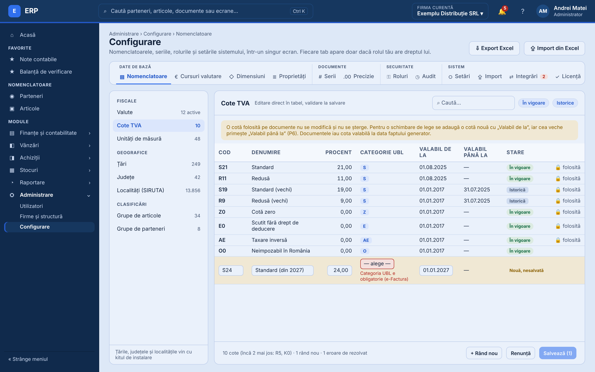


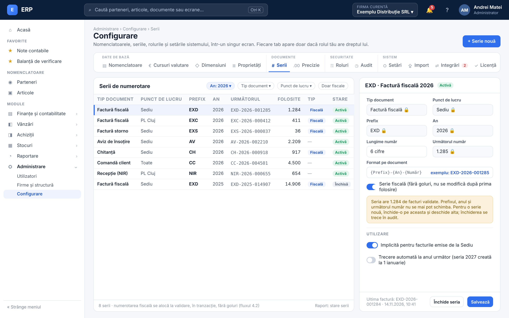

**Detalii de implementare (etapa 4, 15.11.2026):** ecranul Configurare are deocamdată doar tab-ul Serii (`/admin/config/serii`, permisiunea `Core.NumberSeries.Manage`; nu există o permisiune separată de vizualizare a seriilor), pe firma curentă din antet sau pe cea din `?firma=`. Celelalte tab-uri apar odată cu etapele lor. Selectorul de firmă din antet arată firmele active la care utilizatorul are un rol; alegerea se memorează în browser (`LastCompanyId` din profil se folosește când browserul nu are o alegere; actualizarea lui vine cu Profilul meu, etapa 10).

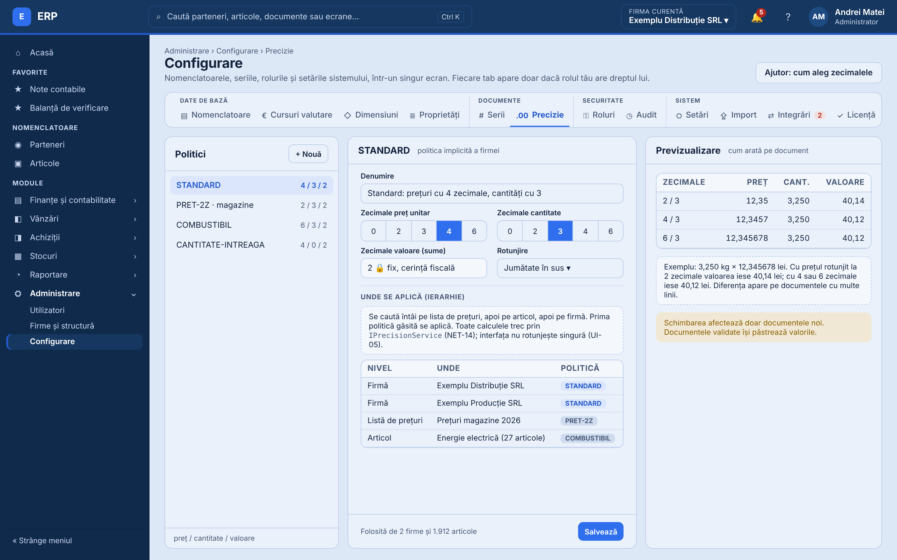

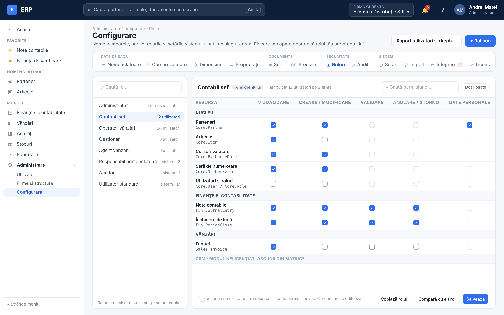

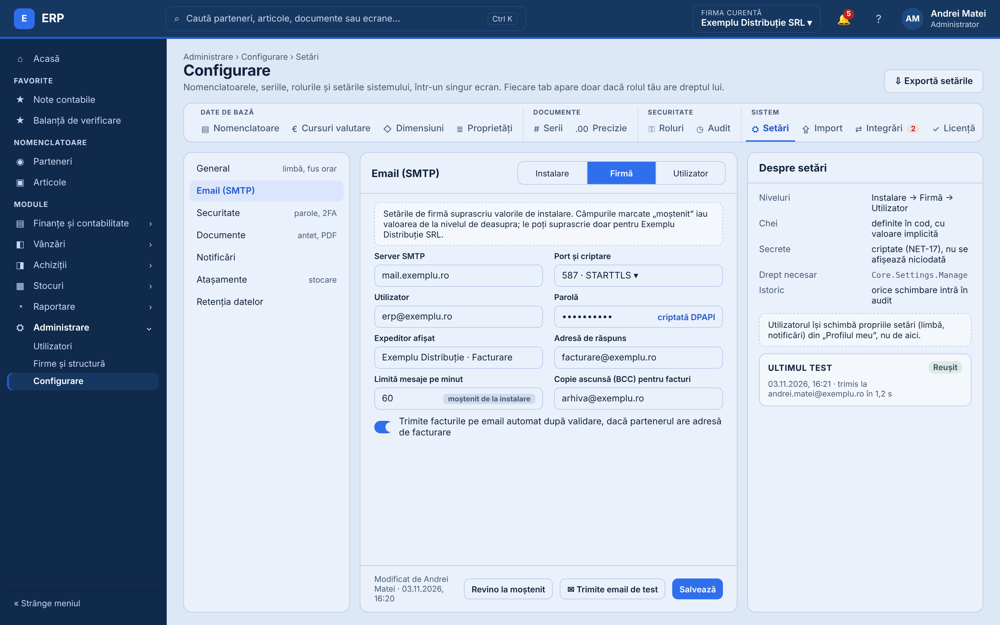


### 11.2 Ecrane personale, de autentificare și asistentul (adăugat pe 14.11.2026)

| Ecran | Ce arată macheta | Reguli |
| --- | --- | --- |
| Profilul meu | Trei coloane: datele din fișa de angajat (doar citire) și rolurile mele; Securitate (parolă, 2FA, sesiuni active cu „Închide”); matricea de notificări pe tip × canal (în aplicație, email) și momentul trimiterii (imediat sau rezumat zilnic) | Preferințele se salvează în `User.NotificationPreferences` (singura sursă, decizie 21.11.2026; vezi 3.4). Notificările critice (erori ANAF, aprobări) nu se pot opri în aplicație. Schimbarea parolei și 2FA trimit la paginile `/account/*` |
| Notificări | Panou deschis din clopoțel: filtre Necitite / Toate / Aprobări / Erori, fiecare notificare cu link spre document, „Marchează toate ca citite”, „Vezi toate” | Fluxul 4.7; necititele au punct albastru și intră în contorul din antet |
| Parolă nouă | Pagina `/account/password` cu pașii recuperării în stânga; în dreapta parola nouă, indicator de putere, regulile verificate pe loc, confirmare, timpul rămas al linkului | Aceeași pagină la prima autentificare și după resetare de administrator. Propuneri de reguli implicite (configurabile): minimum 12 caractere, literă mare și mică, cifră, fără numele de utilizator, diferită de ultimele 5, verificată contra unei liste de parole compromise. După salvare se închid toate sesiunile |
| Activare 2FA | Cod QR și cheie manuală, cod de 6 cifre, cele 10 coduri de rezervă afișate o singură dată (descărcare, tipărire) | TOTP; obligatorie pentru Administrator și externi. Fără telefon: cod de rezervă sau resetare 2FA de către administrator (`Core.User.Manage`) |
| Asistent de configurare | Ecran întreg, fără meniu: 8 pași în stânga (Licență, Administrator, Firme și puncte de lucru, Active Directory, Email SMTP, Certificat ANAF, Import inițial, Verificare și pornire), formularul pasului în centru, ajutor în dreapta | Pasul Administrator completează profilul administratorului creat de installer (nume, email, limbă) și recomandă un al doilea administrator nominal; nu creează contul. Progresul se salvează după fiecare pas; AD, certificatul ANAF și importul sunt opționale. La adăugarea firmei se preiau datele de la ANAF după CUI și se creează automat planul de conturi, seriile implicite, gestiunea „Sediu” și politica STANDARD. Aplicația rămâne în modul de configurare până la ultimul pas |


**Detalii de implementare (etapa 2, 15.11.2026):** paginile Login, al doilea factor, Parolă nouă, Activare 2FA, Ieșire și „Am uitat parola” sunt implementate în `Erp.Auth` (detalii tehnice în 08, secțiunea 8). După autentificare, parola temporară și apoi activarea 2FA (când e obligatorie) sunt impuse înaintea oricărei alte pagini. Fiecare încercare se scrie în `core.LoginEvent`; la blocarea contului se pune în `core.Outbox` evenimentul `Erp.Auth.UtilizatorBlocat`, pentru notificarea administratorilor (consumatorul vine cu notificările, etapa 10). Până la configurarea SMTP, „Am uitat parola” îndrumă utilizatorul spre administrator. Alegerea firmei după autentificare vine cu firmele (etapa 4).

## 12. Criterii de acceptare și teste cheie

Nucleul e gata (poarta fazei 0 din roadmap) când toate criteriile de mai jos sunt îndeplinite și testele trec în CI.

| # | Criteriu | Test |
| --- | --- | --- |
| A1 | O instalare curată creează schema `core`, nomenclatoarele livrate și administratorul, fără pași manuali în SQL | Test de instalare în CI pe SQL Server în container |
| A2 | 2 utilizatori care validează simultan 1.000 de documente pe aceeași serie fiscală obțin numere unice, consecutive, fără goluri | Test de integrare concurent |
| A3 | Un rollback după alocarea numărului nu lasă gol în serie | Test de integrare |
| A4 | O comandă fără permisiune e refuzată cu 403 și nu ajunge la handler | Test pe pipeline |
| A5 | O comandă cu dată într-o perioadă închisă e refuzată cu 409 | Test pe pipeline (cu perioadă simulată) |
| A6 | Un modul nelicențiat nu are endpoint-uri, meniuri sau joburi active | Test de pornire cu licență parțială |
| A7 | O licență cu semnătură invalidă sau CUI lipsă e refuzată la pornire, cu mesaj clar | Test unitar pe verificatorul de licență |
| A8 | Un eveniment scris în outbox e livrat consumatorului exact o dată, inclusiv după o oprire forțată a serviciului | Test de integrare cu oprire simulată |
| A9 | Un CUI invalid sau duplicat e refuzat la salvarea partenerului | Teste unitare pe validator (set de CUI-uri reale și invalide) |
| A10 | Rotunjirea respectă politica: preț cu 6 zecimale, valoare și TVA la 2 zecimale, pe un set de cazuri inclusiv energie | Teste unitare pe `IPrecisionService` |
| A11 | Cursul pentru o zi fără curs BNR e ultimul curs anterior, cu data lui | Test unitar |
| A12 | Orice UPDATE sau DELETE pe `core.AuditEntry` e refuzat de baza de date | Test de integrare |
| A13 | CNP-ul unui partener persoană fizică nu apare în clar în bază, în jurnale sau în răspunsurile API fără permisiune | Test de integrare + scanare de jurnale |
| A14 | Niciun alt modul nu referențiază `Erp.Core.Domain` sau `Erp.Core.Infrastructure` | NetArchTest |
| A15 | Căutarea de parteneri și articole pe 100.000 de înregistrări răspunde în p95 sub 500 ms | Test de performanță pe date sintetice |
| A16 | O comandă trimisă de două ori cu aceeași cheie de idempotență creează un singur document, iar a doua cerere primește același rezultat | Test de integrare |
| A17 | În modul doar-citire al licenței, orice comandă de scriere e refuzată cu 403, iar consultarea și rapoartele funcționează | Test pe pipeline |
| A18 | Un import de 10.000 de parteneri cu 5% rânduri greșite salvează doar rândurile valide și raportează corect erorile; reluarea importului nu creează duplicate | Test de integrare |
| A19 | Anonimizarea unei persoane fizice șterge datele personale din nomenclator, păstrează neschimbate documentele fiscale și e înregistrată în audit | Test de integrare |
| A20 | După 5 autentificări greșite contul se blochează temporar, apare în jurnalul de autentificări, iar administratorii primesc notificare | Test de integrare pe autentificare |
| A21 | Pe baza `Latin1_General_100_CS_AS_SC_UTF8`, codurile `abc` și `ABC` sunt refuzate ca duplicat, căutarea „brasov” găsește „Brașov”, iar toate procedurile Nucleului rulează pe un server cu collation case insensitive (`TST-09`) | Test de integrare |
| A22 | După instalare există exact un administrator activ, cu `ADMIN` la nivel de instalare; ultimul administrator activ nu poate fi dezactivat (50015) | Test de integrare (08, IA-06) |

Testele se scriu înainte sau odată cu codul; criteriile A2, A8 și A10 sunt critice pentru conformitate și nu se acceptă excepții.
