# ERP · 02.01 Nucleu (Platform)

14 noiembrie 2026 · Aurelian · **Validat (14.11.2026), inclusiv machetele de ecran 01–10; completat pe 14.11.2026 pentru baza case sensitive, administratorul creat la instalare și autentificarea cu ASP.NET Core Identity + cookie (validat 14.11.2026)** · Versiune editabilă: https://claude.ai/artifact/UE59RnaWRpVe5dfdJgzrqU

Nucleul e primul modul livrat (faza 0) și singurul pe care îl folosesc toate celelalte. Conține identitatea instalării și a firmelor, utilizatorii și drepturile, nomenclatoarele comune, numerotarea, precizia, audit-ul, atașamentele și licența, plus pipeline-ul comun prin care trece orice comandă. Document părinte: [02 Module principale](../MODULE_PRINCIPALE.md). Principii: [01 Scop și principii](../../01-scop-si-principii/SCOP_SI_PRINCIPII.md) (P1–P10).

## 1. Scop și perimetru

| Zonă | Ce face Nucleul | Ce NU face (și cine face) |
| --- | --- | --- |
| Instalare și firme | Datele instalării, firmele din grup (CUI, registru, adresă, regim TVA), puncte de lucru | Planul de conturi și perioadele contabile (Finanțe) |
| Utilizatori și drepturi | Utilizatori, roluri, permisiuni, atribuiri pe firmă și dimensiuni | Autentificarea propriu-zisă: o face ASP.NET Core Identity cu cookie, în aceeași aplicație (`Erp.Auth` în `Erp.Host`); Nucleul ține profilul și drepturile |
| Parteneri | Nomenclatorul unic de parteneri (persoane juridice și fizice), adrese, conturi bancare, contacte | Condițiile comerciale (Vânzări, Achiziții), soldurile (Finanțe) |
| Articole | Nomenclatorul unic de articole: cod, denumire, UM, cotă TVA implicită, tip, coduri de bare, grupe | Atributele de stoc, rețetă, preț (extensii în Stocuri, Producție, Vânzări) |
| Valute și cursuri | Valute, cursuri pe zi (BNR și manuale) | Preluarea automată BNR (Integrări), reevaluarea (Finanțe) |
| Nomenclatoare fiscale | Cote TVA, unități de măsură cu cod UN/ECE, țări, județe, localități, cu dată de intrare în vigoare (P6) | Codurile SAF-T și schemele XML (Integrări) |
| Numerotare | Serii per firmă, tip de document și an; alocare atomică la validare, fără goluri | — |
| Precizie | Politica de zecimale (0–6) pe firmă, articol și listă de prețuri; regulile de rotunjire (P7) | Aplicarea pe documente (fiecare modul folosește serviciul) |
| Dimensiuni | Centre de cost, proiecte, gestiuni ca dimensiuni generice pe documente | Semnificația de business a gestiunii (Stocuri) |
| Audit | Jurnalul de audit pentru toate modulele (P5) | — |
| Atașamente | Stocarea fișierelor atașate la orice document | Generarea PDF-urilor (fiecare modul) |
| Licență | Citirea și verificarea licenței, activarea modulelor | Emiterea licențelor (instrument intern separat) |
| Platformă comună | Pipeline MediatR, outbox și procesatorul de evenimente, joburi, configurare, health-check | Logica de business a modulelor |

Ce nu intră deloc în Nucleu: nicio regulă contabilă, fiscală de declarație sau de stoc. Dacă o regulă aparține unui singur modul, stă în acel modul, chiar dacă pare „comună”.

## 2. Model de domeniu

Entitățile Nucleului se grupează în patru zone. Firma (`Company`) e cheia: drepturile, seriile, dimensiunile și politicile de precizie sunt toate pe firmă, în timp ce partenerii și articolele sunt comune întregului grup.


Reguli de business ale modelului:

1. **Partenerii și articolele sunt la nivel de instalare** (grup), nu de firmă, ca același client să fie recunoscut în toate firmele și la consolidare.
2. **Drepturile sunt la nivel de firmă**: același utilizator poate fi contabil în firma A și doar consultant în firma B.
3. **Seriile de numerotare aparțin unei firme și unui an**; nu există serii comune între firme.
4. **Un CUI apare o singură dată** între parteneri și o singură dată între firme.
5. **Nomenclatoarele fiscale au dată de vigoare**; un document folosește întotdeauna valoarea valabilă la data lui (P6).
6. **Audit-ul și atașamentele se leagă generic** de orice entitate din orice modul, prin `EntityType` + `EntityId`.
7. **Un partener poate fi o firmă din grup** (`IntraGroupCompanyId`); tranzacțiile cu el se elimină la consolidare.

## 3. Entități și nomenclatoare

Convenții pentru toate tabelele de mai jos: cheie primară `Id` de tip `int` (sau `bigint` pentru tabelele mari), coloane de audit `CreatedAt`, `CreatedBy`, `ModifiedAt`, `ModifiedBy`, `RowVersion` pentru concurență optimistă. Nomenclatoarele nu se șterg fizic odată folosite: se dezactivează (`IsActive = 0`).

Regula pentru chei primare (validată 14.11.2026, detaliată în secțiunea 05 Date și multi-tenancy):

- **`int IDENTITY`** pentru nomenclatoare și antete de documente; **`bigint IDENTITY`** pentru tabelele care cresc mult (linii de documente, mișcări de stoc, note contabile, audit, outbox). Cheia primară e și indexul clustered.
- **`uniqueidentifier`** doar unde datele se nasc în afara bazei: bonuri POS emise offline, `EventId` din outbox/inbox, importuri și sincronizări între instalări. Acolo GUID-ul e o coloană `UNIQUE` separată (de exemplu `ExternalId`), iar clusterul rămâne pe `bigint`, ca să evităm fragmentarea.
- Opțional, **`PublicId uniqueidentifier`** pe documentele expuse în URL sau API, ca Id-urile să nu poată fi ghicite. Drepturile se verifică oricum în pipeline.

**Baza este case sensitive** (decizia lui Aurelian, 14.11.2026): collation `Latin1_General_100_CS_AS_SC_UTF8`, setat de installer ([08 Instalare și actualizare](../../08-instalare-actualizare/INSTALARE_ACTUALIZARE.md), secțiunea 9). Pentru tabelele Nucleului asta înseamnă (regulile `SQL-21`–`SQL-25` din Bune practici):

- codurile introduse de utilizatori (`Partner.Code`, `Item.Code`, `Location.Code`, `DimensionValue.Code`, `UomSet.Code`, `ItemGroup.Code`, `NumberSeries.Prefix`) sunt unice fără diferență de majuscule, prin coloana calculată `CodeKey AS UPPER(Code) PERSISTED` cu index unic;
- căutarea după denumire (parteneri, articole, angajați) folosește coloana calculată `NameSearch AS (Name COLLATE Latin1_General_100_CI_AI_SC_UTF8) PERSISTED`, indexată, ca „brasov” să găsească „Brașov”;
- `User.UserName` se salvează doar cu litere mici; autentificarea (ASP.NET Core Identity) caută după numele normalizat, deci utilizatorul se poate loga cu orice majuscule;
- codurile tehnice (permisiuni, roluri `ADMIN`, chei de setări) se compară exact; `core.[User]` se scrie între paranteze drepte.

### 3.1 Firmă (`Company`)

| Câmp | Tip | Obligatoriu | Validare / regulă |
| --- | --- | --- | --- |
| `Code` | `nvarchar(20)` | Da | Unic în instalare; folosit în serii și rapoarte |
| `Name` | `nvarchar(200)` | Da | Denumirea legală |
| `FiscalCode` (CUI) | `nvarchar(20)` | Da | Cifră de control CUI validă; unic în instalare; trebuie să fie în licență |
| `VatPayer` | `bit` | Da | Plătitor de TVA (prefix RO) |
| `VatOnCollection` | `bit` | Da | TVA la încasare |
| `TradeRegisterNo` | `nvarchar(30)` | Da | Numărul de ordine din registrul comerțului; validarea de format acceptă atât formatul clasic (J/F/C + județ + număr + an), cât și formatul nou ONRC |
| `ShareCapital` | `decimal(19,2)` | Condiționat | Capitalul social; obligatoriu pentru societăți (SRL, SA), apare pe facturi și pe documentele firmei (Legea 31/1990) |
| `Address`, `CountyCode`, `City`, `CountryCode` | diverse | Da | Județ și localitate din nomenclatoare |
| `FunctionalCurrency` | `char(3)` | Da | Fix `RON` (perimetru) |
| `DefaultPrecisionPolicyId` | `int` | Da | Politica de zecimale implicită a firmei |
| `LogoAttachmentId` | `int` | Nu | Sigla de pe documentele tipărite și de pe ecranul de autentificare |
| `IsGroupParent` | `bit` | Nu | Firma-mamă pentru consolidare |
| `IsActive` | `bit` | Da | — |

Sub firmă: **puncte de lucru** (`Branch`: denumire, adresă, cod), folosite pe documente, în seriile de numerotare și în e-Factura, și **conturi bancare** (`CompanyBankAccount`: IBAN validat, bancă, monedă, cont implicit), tipărite pe facturi.

**Structura organizatorică (arbore)**, adăugată pe 14.11.2026 la cererea lui Aurelian: firmele se organizează într-un arbore cu patru tipuri de noduri.

| Nivel | Entitate | Părinte permis | Câmpuri principale | Reguli |
| --- | --- | --- | --- | --- |
| Grup | `CompanyGroup` | Alt grup sau rădăcină | `Code`, `Name`, `ParentGroupId`, `ParentCompanyId` (firma-mamă pentru consolidare), `IsActive` | Oricâte niveluri (holding, subgrup); consolidarea se face pe grup, incluzând subgrupurile |
| Firmă | `Company` | Grup sau rădăcină | Tabelul de mai sus + `GroupId` | O firmă aparține unui singur grup; mutarea între grupuri se jurnalizează și afectează doar consolidările viitoare |
| Punct de lucru | `Branch` | Firmă | `Code`, `Name`, adresă, `IsActive` | Apare pe documente și în e-Factura; poate avea serii de numerotare proprii |
| Locație | `Location` | Punct de lucru sau direct firmă | `Code`, `Name`, `LocationType` (birou, depozit, magazin, fabrică, șantier, punct de livrare), adresă, `IsActive` | Locul fizic folosit de Stocuri, WMS, POS, Construcții și TMS; firma se deduce din părinte. Nu are sub-locații (confirmat 14.11.2026): zonele și rafturile se definesc în WMS |

Reguli: o locație nu are copii; un nod cu copii activi nu se poate dezactiva; un nod folosit pe documente nu se șterge, se dezactivează (`SQL-20`); codul e unic în cadrul firmei pentru puncte de lucru și locații și unic în instalare pentru grupuri. Drepturile se pot restrânge pe punct de lucru sau locație prin `DimensionScope`.


### 3.2 Partener (`Partner`)

Un singur nomenclator pentru clienți și furnizori, la nivel de instalare; rolul de bază (client, furnizor sau ambele) e pe partener și e obligatoriu (cel puțin unul bifat, CHECK în bază), iar condițiile comerciale se țin per firmă în Vânzări și Achiziții. Un partener marcat doar client nu apare la căutare pe documentele de achiziție, și invers.

| Câmp | Tip | Obligatoriu | Validare / regulă |
| --- | --- | --- | --- |
| `Code` | `nvarchar(30)` | Da | Unic; generat din serie sau introdus |
| `Name` | `nvarchar(200)` | Da | — |
| `PartnerType` | `tinyint` | Da | Persoană juridică RO, juridică UE, juridică non-UE, persoană fizică |
| `IsCustomer` | `bit` | Da | Rol client; cel puțin unul dintre `IsCustomer` și `IsSupplier` e 1 (`CK_Partner_Role`) |
| `IsSupplier` | `bit` | Da | Rol furnizor; un partener poate fi și client, și furnizor |
| `PartnerGroupId` | `int` | Nu | Grupă de parteneri (distribuitori, retail, servicii), pentru filtre și rapoarte |
| `FiscalCode` | `nvarchar(30)` | Condiționat | CUI valid pentru juridică RO; cod TVA UE pentru UE; gol pentru persoană fizică (CNP-ul stă criptat în `PersonalIdEncrypted`) |
| `PersonalIdEncrypted` | `varbinary(256)` | Nu | CNP-ul persoanei fizice, criptat; citit doar cu `Core.Partner.ViewPersonalData` |
| `VatPayer` | `bit` | Da | Verificabil manual sau prin serviciul ANAF de interogare (Integrări) |
| `VatOnCollection` | `bit` | Da | Partenerul aplică TVA la încasare (registrul ANAF); contează la deducerea TVA pe achiziții |
| `AnafInactive` | `bit` | Da | Contribuabil declarat inactiv de ANAF; documentele de achiziție afișează avertizare |
| `AnafCheckedAt` | `datetime2(3)` | Nu | Momentul ultimei verificări automate la ANAF (Integrări) |
| `TradeRegisterNo` | `nvarchar(30)` | Nu | — |
| `CountryCode` | `char(2)` | Da | ISO 3166 |
| `IntraGroupCompanyId` | `int` | Nu | Legătura cu o firmă din grup, pentru eliminări la consolidare |
| `IsActive` | `bit` | Da | — |

Copii: `PartnerAddress` (sediu, livrare, facturare), `PartnerBankAccount` (IBAN validat, bancă, monedă), `PartnerContact` (nume, rol, email, telefon). Regulă: un CUI apare o singură dată în nomenclator; duplicatele se semnalează la salvare.

**Proprietăți configurabile** (adăugate pe 14.11.2026): administratorul definește câmpuri suplimentare fără modificări de cod, folosite pentru parteneri și, cu același mecanism, pentru articole.

| Entitate | Câmpuri principale | Reguli |
| --- | --- | --- |
| `PropertyDefinition` | `EntityType` (Partner / Item), `Code`, `Name`, `DataType` (text, număr, dată, da/nu, listă, listă multiplă, utilizator), `AppliesTo` (client, furnizor, ambele), `Section`, `SortOrder`, `IsRequired`, `IsFilterable`, `CompanyId` (gol = tot grupul), `IsActive` | Tipul unei proprietăți folosite nu se mai schimbă; se dezactivează și se creează alta |
| `PropertyOption` | `PropertyDefinitionId`, `Code`, `Label`, `SortOrder`, `IsActive` | Valorile pentru listele de selecție |
| `PropertyValue` | `PropertyDefinitionId`, `EntityId`, `ValueText`, `ValueNumber` `decimal(19,6)`, `ValueDate`, `ValueBool`, `ValueOptionId` | O singură coloană completată, după tip; listele multiple au câte un rând pe opțiune |

Reguli: valorile se validează după tip la salvare; o proprietate obligatorie se cere doar dacă se aplică rolului partenerului; proprietățile marcate `IsFilterable` apar ca filtre în lista de parteneri și în rapoarte; modificările se auditează ca orice câmp. Exemple livrate ca model: segment, agent de vânzări, zonă de livrare, rating furnizor, certificat ISO și data expirării, acord de marketing (GDPR).

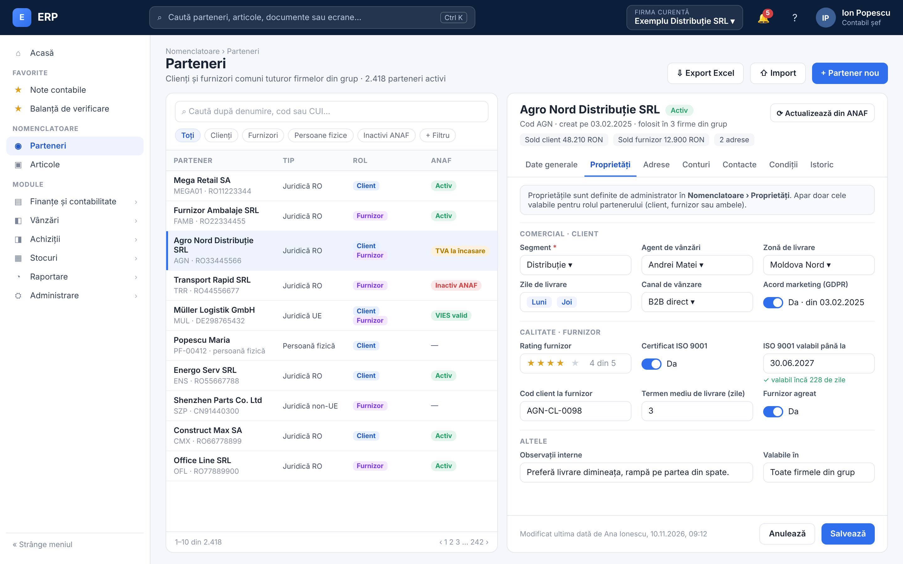

### 3.3 Articol (`Item`)

| Câmp | Tip | Obligatoriu | Validare / regulă |
| --- | --- | --- | --- |
| `Code` | `nvarchar(50)` | Da | Unic |
| `Name` | `nvarchar(250)` | Da | — |
| `ItemType` | `tinyint` | Da | Marfă, materie primă, material, produs finit, semifabricat, serviciu, ambalaj, mijloc fix |
| `UomSetId` | `int` | Da | Setul de UM folosit (de ex. Băuturi 0,5 L); UM de bază e cea cu factor 1 din set |
| `BaseUomId` | `int` | Da | Copiat din set la salvare, pentru interogări rapide; stocul și costul se țin mereu în UM de bază |
| `DefaultVatRateId` | `int` | Da | Din nomenclatorul de cote TVA |
| `ItemGroupId` | `int` | Nu | Arbore de grupe pe mai multe niveluri |
| `PricePrecision` | `tinyint` | Nu | 0–6; suprascrie politica firmei pentru acest articol (P7) |
| `QuantityPrecision` | `tinyint` | Nu | 0–6 |
| `IsStockable` | `bit` | Da | Fals pentru servicii |
| `CnCode` | `nvarchar(10)` | Nu | Cod NC pentru Intrastat și e-Transport |
| `DepositItemId` | `int` | Nu | Ambalajul cu garanție SGR (sistemul de garanție-returnare), adăugat automat pe documente lângă articol |
| `NetWeightKg`, `GrossWeightKg` | `decimal(19,6)` | Nu | Pe UM de bază; folosite la e-Transport, avize și TMS |
| `VolumeM3` | `decimal(19,6)` | Nu | Pe UM de bază; folosit la WMS și TMS |
| `IsActive` | `bit` | Da | — |

Copii: `ItemUom` (excepții de la set), `ItemBarcode` (EAN, intern, opțional legat de o UM), `ItemAttribute` (atribute libere cheie/valoare). Proprietățile configurabile ale articolului folosesc `PropertyDefinition` cu `EntityType = Item`.

**Seturi de UM** (adăugate pe 14.11.2026): conversiile se definesc o dată pe set și se refolosesc la toate articolele cu același ambalaj.

| Entitate | Câmpuri | Reguli |
| --- | --- | --- |
| `UomSet` | `Code`, `Name`, `IsActive` | Comun grupului |
| `UomSetLine` | `UomSetId`, `UomId`, `FactorToBase` `decimal(19,6)`, `IsBase`, `IsDefaultSales`, `IsDefaultPurchase`, `IsDefaultPos`, `SortOrder` | O singură linie `IsBase` cu factor 1; cel mult o linie implicită pe fiecare circuit; factor > 0 |
| `ItemUom` | `ItemId`, `UomId`, `FactorToBase`, implicitele ca mai sus | Excepție doar pentru articol (de ex. bax de 12 în loc de 6), fără a schimba setul; are prioritate față de linia din set |

Reguli: documentele păstrează UM și cantitatea introduse plus cantitatea în UM de bază (de ex. 3 paleți + 2 baxuri = 1.452 buc). Factorii unui articol, din set sau din excepție, se pot modifica doar dacă articolul nu are stoc și nici documente; altfel se creează alt set. Codul de bare se poate lega de o UM, ca scanarea unui bax să aducă direct 6 buc.

**Setări pe firmă.** Articolul e comun grupului, dar conturile contabile și gestiunea sunt ale fiecărei firme și aparțin modulelor care le folosesc. Pe fișa articolului apar pentru firma curentă, ca tab-uri adăugate de module:

| Extensie (modul) | Câmpuri | Reguli |
| --- | --- | --- |
| `fin.ItemAccounting` (Finanțe) | `CompanyId`, `ItemId`, `StockAccount`, `ExpenseAccount`, `RevenueAccount`, `VatAccountOverride` | Lipsă = contul din grupa de articole, apoi din tipul articolului |
| `inv.ItemStockSettings` (Stocuri) | `CompanyId`, `ItemId`, `DefaultWarehouseId` (gestiunea implicită), `ValuationMethod` (FIFO, CMP), `TrackingMode` (fără, lot, serie, lot și termen de valabilitate), `MinQty`, `MaxQty` | Doar pentru articole stocabile; metoda de evaluare nu se schimbă în timpul unei perioade deschise cu stoc |

Alte extensii (de ex. `mfg.ItemRecipeSettings`) stau tot în schema modulului, cu cheie pe `CompanyId` + `ItemId`.


### 3.4 Utilizatori, roluri și permisiuni

| Entitate | Câmpuri principale | Reguli |
| --- | --- | --- |
| `User` | `SubjectId` (din `ids.UserAccount`), `UserName`, `DisplayName`, `Email`, `IsActive`, `IsSystem`, `LastLoginAt`, `LastCompanyId`, `Language`, `NotificationPreferences` (JSON) | Parola și 2FA sunt în serverul de identitate (schema `ids`), nu în Nucleu; `LastCompanyId` e firma propusă la autentificare; `UserName` doar cu litere mici (`CK_User_UserNameLower`, `SQL-24`) |
| `Role` | `Code`, `Name`, `Description`, `IsSystem` | Rolurile de sistem (de ex. Administrator) nu se pot șterge |
| `Permission` | `Code` (de ex. `Sales.Invoice.Validate`), `Module`, `Description` | Lista e generată din cod la pornire; nu se editează manual |
| `RolePermission` | `RoleId`, `PermissionId` | — |
| `UserRoleAssignment` | `UserId`, `RoleId`, `CompanyId`, `DimensionScope` (JSON: gestiuni, centre de cost, șantiere) | Un rol se atribuie per firmă; scope gol = toată firma. `CompanyId = NULL` = toată instalarea (toate firmele, și cele create ulterior), permis doar pentru rolul de sistem `ADMIN` (verificat în `core.usp_UserRoleAssignment_Save`) |
| `Employee` | `CompanyId`, `BranchId`, `EmployeeNo` (marca), `FirstName`, `LastName`, `Department`, `JobTitle`, `WorkEmail`, `Phone`, `HireDate`, `LeaveDate`, `IsActive` | Fișa minimă de angajat, în Nucleu ca utilizatorii să se poată lega de ea și fără modulul HR; HR o extinde în schema `hr` (contract, salarizare, CNP). UQ `(CompanyId, EmployeeNo)` |

**Utilizator angajat sau extern** (adăugat pe 14.11.2026). Pe `User` se adaugă `IsEmployee` `bit`, `EmployeeId` `int` (FK `core.Employee`), `ExternalPartnerId` `int` (organizația, FK `core.Partner`), `SponsorUserId` (responsabilul intern), `AccessReason`, `ValidFrom`, `ValidUntil` `date`, `FirstName`, `LastName`. Constrângerea `CK_User_Kind` cere: angajat ⇒ `EmployeeId` completat; extern ⇒ `EmployeeId` gol și `ValidUntil`, `SponsorUserId`, `AccessReason` completate.

| Regulă | Detaliu |
| --- | --- |
| Un angajat, un cont | UQ filtrat pe `EmployeeId`; numele, emailul și funcția se iau din fișa angajatului, nu se editează pe utilizator |
| Plecarea angajatului | La `LeaveDate` (completată în HR sau în Nucleu), un job zilnic Hangfire dezactivează contul și închide sesiunile (`ids.UserSession`, `SecurityStamp` nou) |
| Acces extern limitat în timp | `ValidUntil` obligatoriu, cel mult 12 luni (configurabil); notificare la responsabil cu 14 zile înainte; la expirare contul se dezactivează automat; prelungirea se trece în audit |
| 2FA | Obligatoriu pentru externi și pentru rolul Administrator |
| Conturi tehnice | Externi cu `AccessReason` = integrare (de ex. Power BI), fără parolă interactivă |

**Conturi de sistem și administratorul creat la instalare** (adăugat pe 14.11.2026, la cererea lui Aurelian ca installer-ul să creeze un utilizator cu drepturi de administrator). Pe `User` se adaugă `IsSystem` `bit`; `CK_User_Kind` admite trei tipuri: angajat, extern sau cont de sistem (`IsSystem = 1`, fără `EmployeeId` și fără câmpurile de extern).

| Cont | Detaliu |
| --- | --- |
| `system` (`Id = 1`) | Utilizator tehnic creat de prima migrare, `IsActive = 0`, fără cont în `ids`; e `CreatedBy` pentru datele livrate și pentru joburi |
| Administratorul integrat | Creat de installer (08, secțiunea 8.8): nume implicit `administrator`, rolul `ADMIN` la nivel de instalare (`CompanyId = NULL`), parolă temporară cu schimbare obligatorie, 2FA obligatoriu, intrare de audit `Core.User.CreateInitialAdmin`. Nu se poate șterge; se poate dezactiva doar dacă rămâne alt Administrator activ (50015). Accesul de urgență se reface cu `ErpSetup.exe reset-admin` |

Codurile rolurilor de sistem sunt fixe și se scriu exact: `ADMIN`, `NOMENCLATOARE`, `AUDITOR`, `STANDARD`.


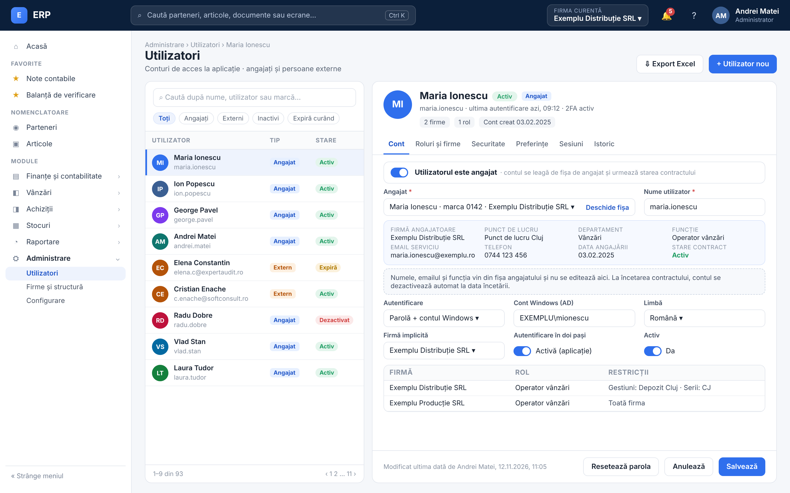

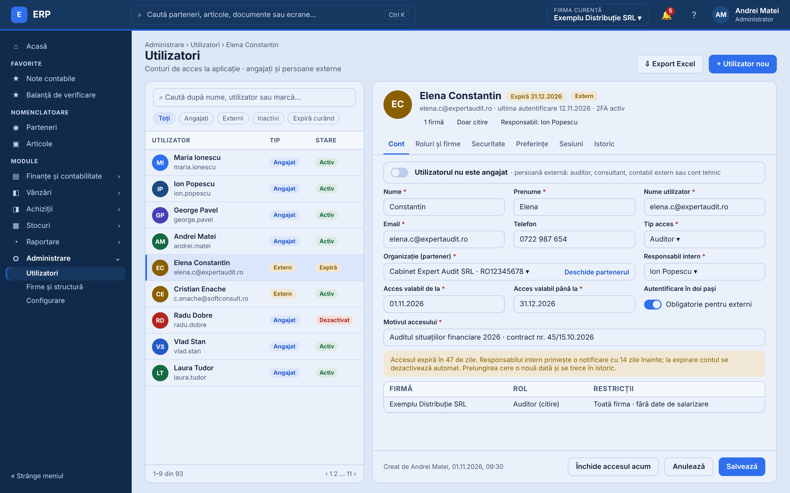

### 3.5 Celelalte nomenclatoare și entități

| Entitate | Câmpuri principale | Reguli |
| --- | --- | --- |
| `Currency` | `Code` (ISO 4217), `Name`, `Decimals` | RON obligatoriu; restul activate la nevoie |
| `ExchangeRate` | `CurrencyCode`, `RateDate`, `Rate` `decimal(19,6)`, `Multiplier`, `Source` (BNR / manual), `Note` (motivul, la cele manuale) | Unic pe monedă + zi + sursă; cursul BNR nu se modifică manual; cursul manual nu înlocuiește cursul BNR pe documentele fiscale |
| `VatRate` | `Code`, `Percent`, `Category` (S, Z, E, AE, K, O pentru UBL), `ValidFrom`, `ValidTo` | Cotele noi se adaugă cu dată de vigoare, nu se editează cele vechi (P6) |
| `UnitOfMeasure` | `Code`, `Name`, `UneceCode` | Codul UN/ECE e obligatoriu pentru e-Factura |
| `Country`, `County`, `City` | coduri ISO și SIRUTA | Livrate cu kitul, actualizabile |
| `NumberSeries` | `CompanyId`, `BranchId` (opțional), `DocumentType`, `Prefix`, `Year`, `NextNumber`, `Padding`, `IsFiscal`, `IsDefault`, `AutoRollover`, `ClosedAt` | Serie separată pe punct de lucru, dacă firma o cere; detaliat la fluxul 4.2. După prima folosire a unei serii fiscale, `Prefix`, `Year` și `NextNumber` nu se mai modifică; seria se poate doar închide (`ClosedAt`, auditat). `AutoRollover` creează seria anului următor la 1 ianuarie |
| `PrecisionPolicy` | `Code`, `PricePrecision`, `QuantityPrecision`, `AmountPrecision` (2), `RoundingMode` | Ierarhie: listă de prețuri → articol → firmă |
| `Dimension`, `DimensionValue` | `DimensionType` (centru de cost, proiect, gestiune, șantier), `Code`, `Name`, `CompanyId`, `ParentId`, `ResponsibleUserId`, `ValidFrom`, `ValidTo` | Valorile se pot crea și din modulele care le dețin. `ParentId` (pentru rapoarte pe niveluri), responsabilul și valabilitatea au fost adăugate pe 14.11.2026. Codul nu se schimbă după prima folosire; o valoare folosită se dezactivează, nu se șterge |
| `AuditEntry` | `OccurredAt`, `UserId`, `CompanyId`, `Action`, `EntityType`, `EntityId`, `Changes` (JSON), `IpAddress`, `CorrelationId` | Doar adăugare; fără UPDATE sau DELETE; retenție la fluxul 4.9 |
| `Attachment` | `EntityType`, `EntityId`, `FileName`, `ContentType`, `Size`, `Sha256`, `StorageKind` (DB / disc), `StoragePath` | Hash-ul garantează integritatea fișierelor fiscale; limită de dimensiune și tipuri permise (`SEC-05`) |
| `Notification` | `UserId`, `Type`, `Title`, `Body`, `Link`, `CreatedAt`, `ReadAt` | Notificări în aplicație, trimise și pe email după preferințe (fluxul 4.7) |
| `IdempotencyKey` | `Key`, `UserId`, `CommandType`, `ResultJson`, `CreatedAt` | Previne dublarea la dublu-clic sau reîncercare (fluxul 4.1); păstrată 24 de ore |
| `LoginEvent` | `OccurredAt`, `UserName`, `Success`, `FailureReason`, `IpAddress` | Scrise de modulul de autentificare; baza raportului de autentificări |
| `ImportJob` | `EntityType`, `FileName`, `Status`, `TotalRows`, `ErrorRows`, `ErrorReport` | Importuri din Excel (fluxul 4.8) |
| `InstallationLicense` | `LicenseId`, `CustomerName`, `FiscalCodes`, `Modules`, `Limits` (case POS, angajați), `ValidUntil`, `Signature` | Verificată la pornire și zilnic (fluxul 4.4) |
| `Setting` | `Scope` (instalare / firmă / utilizator), `ScopeId`, `Key`, `Value` | Chei definite în cod, cu valori implicite; secretele (de ex. parola SMTP) criptate cu DPAPI (`NET-17`) |

## 4. Fluxuri principale

### 4.1 Pipeline-ul comun al comenzilor

Orice comandă MediatR din orice modul (creare, validare, stornare) trece prin același lanț de behaviors înregistrat de Nucleu. Modulele scriu doar handler-ul; restul vine gratuit și identic peste tot (P10).


| Ordine | Behavior | Ce face | La eșec |
| --- | --- | --- | --- |
| 1 | `CorrelationBehavior` | Atașează `CorrelationId`, utilizatorul și firma curentă la context și la jurnale | — |
| 2 | `LicenseBehavior` | Verifică dacă modulul comenzii e activ în licență; în modul doar-citire (fluxul 4.4) refuză orice comandă de scriere | 403 `CORE_MODULE_NOT_LICENSED` sau `CORE_LICENSE_READ_ONLY` |
| 3 | `AuthorizationBehavior` | Verifică permisiunea declarată pe comandă (`[RequiresPermission("Sales.Invoice.Validate")]`) și scope-ul pe firmă / dimensiuni | 403 `CORE_FORBIDDEN` |
| 4 | `ValidationBehavior` | Rulează validatorii FluentValidation ai comenzii | 400 cu lista de erori pe câmp |
| 5 | `PeriodLockBehavior` | Pentru comenzile cu dată contabilă: refuză perioadele închise (P4) | 409 `CORE_PERIOD_CLOSED` |
| 6 | `TransactionBehavior` | Deschide tranzacția SQL (`ReadCommitted`, cu baza în `READ_COMMITTED_SNAPSHOT ON`, `SP-14`); un singur `DbConnection` pe request; verifică cheia de idempotență; reîncearcă de 3 ori la deadlock (`SP-17`) | Rollback |
| 7 | Handler-ul modulului | Logica de business; apelează proceduri stocate prin Dapper; scrie evenimente în outbox prin `IOutbox` | Rollback |
| 8 | `AuditBehavior` | Scrie `AuditEntry` pentru comenzile marcate `[Audited]`, în aceeași tranzacție | Rollback |
| 9 | Commit | Documentul, outbox-ul și audit-ul se salvează împreună sau deloc (P8) | — |

Interogările (`IQuery`) trec doar prin pașii 1–3 și nu deschid tranzacție de scriere.

Protecție la dublă trimitere: comenzile de creare acceptă antetul `Idempotency-Key`, generat de interfață la deschiderea formularului. `TransactionBehavior` salvează cheia și rezultatul în `core.IdempotencyKey`, în aceeași tranzacție; o a doua cerere cu aceeași cheie (dublu-clic, reîncercare după o întrerupere de rețea) primește rezultatul primei, fără să creeze încă un document.

**Detalii de implementare (etapa 1, 15.11.2026):**

- Proiectele `Erp.Core.Contracts`, `.Domain`, `.Application`, `.Infrastructure`, `.Api` (`NET-01`). Pipeline-ul se înregistrează cu `AddErpMediator(assembly-urile modulelor)`; ordinea behaviors e cea din tabel, iar `AuditBehavior` rulează în interiorul tranzacției, după handler.
- Contextul cererii vine din antete: `X-Correlation-Id` (întors și în răspuns; generat dacă lipsește), `X-Company-Id` (firma curentă; fără antet, ultima firmă a utilizatorului, `0` = nicio firmă), `Idempotency-Key` (maximum 100 de caractere). Utilizatorul se identifică prin claim-ul `NameIdentifier` = `SubjectId` și se încarcă o dată per cerere cu `core.usp_User_GetPermissions`; un cont inactiv sau extern expirat rămâne neautentificat (4.6).
- Pe lângă cele din secțiunea 6, contractele au: `ICurrentContext.IsAuthenticated`, `IdempotencyKey`, `IpAddress`; `IAuditScope` (handler-ul descrie entitatea modificată; fără descriere, intrarea de audit are doar acțiunea și tipul derivat din ea); `IPeriodLock` (implementat de Finanțe; până atunci nicio perioadă nu e închisă); `IAccountingDated` (comenzile cu dată contabilă); `ErpException` / `ErpValidationException` cu codul stabil.
- Autorizarea e „fail closed”: o cerere fără `[RequiresPermission]` e refuzată, cu excepția interogărilor marcate `[AuthenticatedUser]` (de exemplu `GET /api/core/me`). Testul de arhitectură verifică `[Module]` și permisiunea pe fiecare comandă și interogare (`NET-04`).
- Idempotența: `core.usp_IdempotencyKey_Claim` rezervă cheia cu `UPDLOCK, HOLDLOCK`, deci cererile simultane cu aceeași cheie se serializează; aceeași cheie folosită pentru altă operațiune dă 409 `CORE_IDEMPOTENCY_KEY_REUSED`. Deadlock-ul (1205) și expirarea blocării (1222) se reîncearcă de 3 ori, apoi 409 `CORE_RESOURCE_BUSY` (`SP-17`). Erorile `THROW 50xxx` se traduc în pipeline prin tabelul modulului (`NET-09`).
- Licența (4.4): starea se calculează din `ValidUntil` (avertizare cu 30 de zile înainte, 15 zile de grație, apoi doar citire). Fără licență validă, instalarea rămâne doar pentru consultare cu modulul `Core` activ; în mediul `Development` toate modulele sunt active (jurnalizat). Reverificarea zilnică și refuzul la pornire (A7) vin în etapa licenței.

### 4.2 Alocarea numărului la validare

1. Handler-ul de validare cere `INumberSeriesService.NextAsync(companyId, documentType, documentDate)`.
2. Procedura `core.usp_NumberSeries_Next` face `UPDATE ... SET NextNumber = NextNumber + 1 OUTPUT inserted.NextNumber - 1` pe rândul seriei, în tranzacția documentului; rândul rămâne blocat până la commit.
3. Dacă tranzacția face rollback, și incrementarea se anulează, deci **nu apar goluri** în seriile fiscale.
4. Seria anului nou se creează automat la prima validare din an, cu același prefix.

Caz limită: două validări simultane pe aceeași serie se serializează pe rândul seriei; durata blocajului e cât tranzacția de validare (țintă sub 2 s, din 01). Pentru serii nefiscale (oferte, comenzi) se poate folosi `SEQUENCE` SQL, fără blocaj.

### 4.3 Cursul valutar

1. Jobul zilnic din Integrări preia cursul BNR și apelează `IExchangeRateWriter.SaveBnrRatesAsync`.
2. Nucleul salvează cursurile cu `Source = BNR` și publică `CursValutarActualizat`.
3. `IExchangeRateProvider.GetRate(currency, date)` întoarce cursul BNR din ziua cerută; dacă ziua nu are curs (weekend, sărbătoare), întoarce ultimul curs anterior și data lui.
4. Documentele memorează cursul folosit; o corectare ulterioară a cursului nu modifică documentele validate.

### 4.4 Licența

1. La pornire, host-ul citește fișierul de licență și verifică semnătura cu cheia publică încorporată în aplicație.
2. Verifică că fiecare firmă activă are CUI-ul în licență și că data curentă e înainte de `ValidUntil`.
3. Înregistrează doar modulele din licență (endpoint-uri, handler-e, consumatori, joburi, meniuri).
4. Zilnic, un job reverifică licența; cu 30 de zile înainte de expirare afișează avertizare administratorilor.
5. După expirare: perioadă de grație de 15 zile cu funcționare completă, apoi **doar citire** (consultare și rapoarte, fără documente noi; LicenseBehavior refuză scrierile cu CORE_LICENSE_READ_ONLY). Datele clientului nu sunt niciodată blocate.

Perioada de grație și modul doar-citire sunt o propunere de politică comercială, de confirmat.

### 4.5 Procesarea outbox-ului

1. Serviciul Windows rulează `OutboxProcessor` la fiecare 2 secunde (configurabil).
2. Citește loturi de 100 de mesaje neprocesate, în ordinea `Id`, cu `READPAST` ca să poată rula și în paralel.
3. Pentru fiecare mesaj apelează consumatorii înregistrați; fiecare consumator își notează mesajul în `core.InboxProcessed` (idempotență: același mesaj nu se procesează de două ori).
4. La eroare: reîncercare cu așteptare crescătoare (1 min, 5 min, 30 min, 2 h), apoi mesajul trece în stare `Failed` și apare în ecranul de monitorizare, cu alertă.

### 4.6 Cazuri limită

| Situație | Comportament |
| --- | --- |
| Utilizator dezactivat în timp ce e logat | Cookie-ul e respins la următoarea verificare a sesiunii (cel mult un minut); cheile API ale contului nu mai sunt acceptate |
| Articol dezactivat care apare pe ciorne | Ciornele existente se pot valida; articolul nu mai apare la căutare pentru documente noi |
| Modificare de partener după facturare | Factura validată păstrează datele partenerului de la validare (copie pe document); nomenclatorul se poate modifica |
| Două firme din grup cu același partener | Un singur partener; condiții diferite per firmă în modulele comerciale |
| Modificarea zecimalelor unui articol | Afectează doar documentele noi; cele existente păstrează precizia de la creare |
| Ceasul serverului greșit | Health-check-ul compară ora cu serverul SQL și cu ANAF la sincronizare; diferență peste 2 minute = alertă |

### 4.7 Notificări și email

1. Modulele trimit notificări prin `INotificationService` (către utilizatori anume sau către un rol dintr-o firmă), în aceeași tranzacție cu operația: se scriu în `core.Notification` și în outbox.
2. Utilizatorul le vede în aplicație: clopoțel în antet, cu numărul celor necitite.
3. Emailul pleacă din outbox prin serverul SMTP configurat la instalare (setările `Smtp.*`, parola criptată cu DPAPI), după preferințele utilizatorului pentru fiecare tip de notificare.
4. Notificări trimise de Nucleu: licența expiră în 30 de zile, mesaj outbox eșuat definitiv, cont blocat după încercări greșite (către administratori). Celelalte module își definesc propriile notificări.

### 4.8 Import inițial din Excel

1. Utilizatorul descarcă șablonul Excel al entității (parteneri, articole; soldurile inițiale se importă în modulele lor).
2. Încarcă fișierul; sistemul creează un `ImportJob` și validează fiecare rând cu aceleași validatoare ca la introducerea manuală (CUI, IBAN, UM, cotă TVA).
3. Afișează raportul: rânduri valide, rânduri cu erori și motivul, rânduri care există deja în bază.
4. La confirmare, rândurile valide se salvează în loturi de 500, fiecare lot în tranzacția lui, prin aceleași comenzi ca interfața (cu audit). Rândurile cu erori se descarcă, se corectează și se reîncarcă.
5. Importul se poate relua: un rând cu același cod sau CUI actualizează înregistrarea existentă, nu o dublează.

### 4.9 Retenția datelor

| Date | Păstrare | Motiv |
| --- | --- | --- |
| Jurnal de audit pentru documente contabile și fiscale | 10 ani de la închiderea exercițiului | Legea contabilității 82/1991 |
| Atașamente fiscale (XML ANAF, PDF) | Cât documentul, minimum 10 ani | Idem |
| Mesaje outbox procesate | 30 de zile, apoi șterse de un job zilnic | Date tehnice (`SQL-20`) |
| Chei de idempotență | 24 de ore | Date tehnice |
| Jurnal de autentificări | 1 an | Securitate |
| Notificări citite | 90 de zile | Date tehnice |

Arhivarea pe ani a jurnalului de audit (partiții sau tabelă de arhivă) se detaliază în secțiunea 05. Duratele au fost confirmate pe 14.11.2026; cele tehnice rămân configurabile.

## 5. Evenimente publicate

Nucleul nu consumă evenimente de la alte module. Toate evenimentele de integrare au un anvelop comun, definit în `Erp.Core.Contracts`:

```csharp
public abstract record IntegrationEvent
{
    public Guid EventId { get; init; } = Guid.NewGuid();
    public DateTime OccurredAtUtc { get; init; }          // setat de IOutbox din TimeProvider (NET-15)
    public int CompanyId { get; init; }
    public Guid CorrelationId { get; init; }
    public int Version { get; init; } = 1;
}
```

| Eveniment | Când | Conținut (pe lângă anvelop) | Consumatori tipici |
| --- | --- | --- | --- |
| `PartenerModificat` v1 | Creare sau modificare de partener | `PartnerId`, `Code`, `Name`, `FiscalCode`, `VatPayer`, `VatOnCollection`, `AnafInactive`, `IsActive` | CRM, Vânzări, Achiziții (cache-uri locale), POS |
| `ArticolModificat` v1 | Creare sau modificare de articol | `ItemId`, `Code`, `Name`, `ItemType`, `BaseUomCode`, `VatRateCode`, `DepositItemId`, `IsActive` | POS (sincronizare), Stocuri, Producție |
| `NomenclatorFiscalModificat` v1 | Adăugarea sau modificarea unei cote TVA ori a unei UM | `Kind` (VatRate / Uom), `Code`, `ValidFrom` | POS (sincronizare offline), Vânzări, Achiziții |
| `CursValutarActualizat` v1 | Salvarea cursurilor unei zile | `RateDate`, `Source`, lista `{CurrencyCode, Rate, Multiplier}` | Finanțe (reevaluare), Raportare |
| `FirmaModificata` v1 | Modificarea datelor unei firme | `CompanyId`, `FiscalCode`, `Name`, `VatPayer`, `VatOnCollection` | Integrări (date emitent e-Factura), Finanțe |
| `LicentaActualizata` v1 | Încărcarea unei licențe noi sau schimbarea stării ei | `Modules`, `ValidUntil`, `Limits`, `State` | Toate (repornire controlată a modulelor) |
| `UtilizatorDezactivat` v1 | Dezactivarea unui utilizator | `UserId`, `SubjectId` | Autentificarea (închiderea sesiunilor), POS |

Regulă de versionare: un câmp nou opțional nu schimbă versiunea; eliminarea sau schimbarea de sens a unui câmp cere `v2`, publicată în paralel cu `v1` până când toți consumatorii trec pe `v2`.

## 6. Contracte publice (`Erp.Core.Contracts`)

Celelalte module văd Nucleul doar prin aceste interfețe și DTO-uri (P1). Implementările stau în `Erp.Core.Infrastructure` și sunt înregistrate în DI.

```csharp
// Context curent: utilizator, firmă, permisiuni
public interface ICurrentContext
{
    int UserId { get; }
    int CompanyId { get; }
    Guid CorrelationId { get; }
    bool HasPermission(string permission, DimensionRef? scope = null);
}

// Numerotare
public interface INumberSeriesService
{
    Task<DocumentNumber> NextAsync(int companyId, string documentType,
        DateOnly documentDate, CancellationToken ct);
}
public sealed record DocumentNumber(string Prefix, int Year, long Number, string Formatted);

// Precizie și rotunjire
public interface IPrecisionService
{
    PrecisionInfo Resolve(int companyId, int? itemId, int? priceListId);
    decimal RoundAmount(decimal value, string currency);   // 2 zecimale pentru RON
    decimal RoundPrice(decimal value, PrecisionInfo p);     // 0–6 zecimale
    decimal RoundQuantity(decimal value, PrecisionInfo p);
}
public sealed record PrecisionInfo(byte PriceDecimals, byte QuantityDecimals, byte AmountDecimals,
    MidpointRounding Rounding);

// Cursuri
public interface IExchangeRateProvider
{
    Task<ExchangeRateDto> GetRateAsync(string currency, DateOnly date, CancellationToken ct);
}
public sealed record ExchangeRateDto(string Currency, DateOnly RateDate, decimal Rate,
    int Multiplier, string Source);

// Nomenclatoare (doar citire)
public interface IPartnerLookup
{
    Task<PartnerDto?> GetAsync(int partnerId, CancellationToken ct);
    Task<PartnerSnapshotDto> SnapshotAsync(int partnerId, CancellationToken ct); // copie pentru document
}
public interface IItemLookup
{
    Task<ItemDto?> GetAsync(int itemId, CancellationToken ct);
    Task<IReadOnlyList<ItemDto>> GetManyAsync(IEnumerable<int> ids, CancellationToken ct);
}
public interface IVatRateLookup
{
    Task<VatRateDto> GetAsync(string code, DateOnly onDate, CancellationToken ct);
}

// Outbox, audit, atașamente, licență
public interface IOutbox { Task EnqueueAsync(IntegrationEvent evt, CancellationToken ct); }
public interface IAuditWriter { Task WriteAsync(AuditRecord record, CancellationToken ct); }
public interface IAttachmentStore
{
    Task<int> SaveAsync(string entityType, long entityId, string fileName,
        string contentType, Stream content, CancellationToken ct);
    Task<Stream> OpenAsync(int attachmentId, CancellationToken ct);
}
public interface ILicenseInfo
{
    bool IsModuleActive(string moduleCode);
    int? GetLimit(string limitCode);
    DateOnly ValidUntil { get; }
    LicenseState State { get; }                             // Valid, ExpiringSoon, Grace, ReadOnly
}

// Atribute pe comenzi
[AttributeUsage(AttributeTargets.Class)]
public sealed class RequiresPermissionAttribute(string permission) : Attribute { }
[AttributeUsage(AttributeTargets.Class)]
public sealed class AuditedAttribute(string action) : Attribute { }
[AttributeUsage(AttributeTargets.Class)]
public sealed class ModuleAttribute(string moduleCode) : Attribute { }
```

DTO-urile (`PartnerDto`, `ItemDto`, `VatRateDto`, `PartnerSnapshotDto`, `AuditRecord`) sunt `record`-uri imutabile, fără logică. `PartnerSnapshotDto` conține exact datele care se copiază pe un document fiscal (denumire, CUI, registru, adresă, cont bancar), ca factura să nu se schimbe dacă partenerul se modifică ulterior.

Abstracțiunile de platformă, folosite de toate modulele, stau tot în `Erp.Core.Contracts`:

```csharp
// Comenzi și interogări (peste MediatR)
public interface ICommand<TResult> : IRequest<TResult> { }
public interface IQuery<TResult> : IRequest<TResult> { }
public interface ICommandHandler<TCommand, TResult> : IRequestHandler<TCommand, TResult>
    where TCommand : ICommand<TResult> { }
public interface IQueryHandler<TQuery, TResult> : IRequestHandler<TQuery, TResult>
    where TQuery : IQuery<TResult> { }

// Conexiunea și tranzacția curentă (NET-07)
public interface IDbSession
{
    DbConnection Connection { get; }
    DbTransaction? Transaction { get; }
}

// Scriere cursuri (folosit doar de Integrări)
public interface IExchangeRateWriter
{
    Task SaveBnrRatesAsync(DateOnly rateDate, IReadOnlyList<ExchangeRateDto> rates, CancellationToken ct);
}

// Datele firmei pentru documente (emitent e-Factura, antet tipărire)
public interface ICompanyLookup
{
    Task<CompanySnapshotDto> SnapshotAsync(int companyId, int? branchId, CancellationToken ct);
}

// Dimensiuni
public interface IDimensionLookup
{
    Task<DimensionValueDto?> GetAsync(int dimensionValueId, CancellationToken ct);
    Task<int> EnsureAsync(int companyId, string dimensionType, string code, string name, CancellationToken ct);
}

// Notificări (fluxul 4.7)
public interface INotificationService
{
    Task NotifyUsersAsync(IReadOnlyList<int> userIds, NotificationDto notification, CancellationToken ct);
    Task NotifyRoleAsync(int companyId, string roleCode, NotificationDto notification, CancellationToken ct);
}

public enum LicenseState { Valid, ExpiringSoon, Grace, ReadOnly }
```

`CompanySnapshotDto` conține denumirea, CUI-ul, registrul comerțului, capitalul social, adresa (sau a punctului de lucru) și contul bancar implicit, copiate pe documentele fiscale la fel ca `PartnerSnapshotDto`.

## 7. Schema SQL `core`

Toate tabelele Nucleului stau în schema `core`. Celelalte module au drept de citire doar pe view-urile `core.v_*` și de execuție pe procedurile marcate publice (P1); scrierea în `core` se face doar prin Nucleu.

| Tabel | Cheie primară | Chei unice / străine principale | Indecși suplimentari |
| --- | --- | --- | --- |
| `core.Company` | `Id int` | UQ `Code`, UQ `FiscalCode` | — |
| `core.Branch` | `Id int` | FK `CompanyId` | `CompanyId` |
| `core.CompanyBankAccount` | `Id int` | FK `CompanyId`; UQ `Iban` | `CompanyId` |
| `core.Partner` | `Id int` | UX `CodeKey` (`SQL-24`), UQ filtrat `FiscalCode WHERE FiscalCode IS NOT NULL` | `NameSearch` (căutare, `SQL-25`), full-text opțional |
| `core.PartnerAddress`, `PartnerBankAccount`, `PartnerContact` | `Id int` | FK `PartnerId` | `PartnerId` |
| `core.Item` | `Id int` | UX `CodeKey`; FK `UomSetId`, `BaseUomId`, `DefaultVatRateId`, `ItemGroupId`, `DepositItemId` | `NameSearch`, `ItemGroupId` |
| `core.UomSet`, `core.UomSetLine` | `Id int` | UQ `UomSet.Code`; UQ `UomSetLine (UomSetId, UomId)`; index filtrat unic pe `IsBase = 1` | `UomSetId` |
| `core.ItemUom`, `ItemBarcode`, `ItemAttribute` | `Id int` | FK `ItemId`; UQ `ItemUom (ItemId, UomId)`; UQ `ItemBarcode.Barcode`; FK opțional `ItemBarcode.UomId` | `ItemId` |
| `core.ItemGroup` | `Id int` | FK `ParentId` (arbore) | `ParentId` |
| `core.Currency` | `Code char(3)` | — | — |
| `core.ExchangeRate` | `Id int` | UQ `(CurrencyCode, RateDate, Source)` | `(CurrencyCode, RateDate DESC)` |
| `core.VatRate` | `Id int` | UQ `(Code, ValidFrom)` | — |
| `core.UnitOfMeasure` | `Id int` | UQ `Code`, UQ `UneceCode` | — |
| `core.Country`, `County`, `City` | `Code` (ISO, SIRUTA) | FK ierarhic | `CountyCode` |
| `core.[User]` | `Id int` | UQ `SubjectId`, UQ `UserName`; UQ filtrat `EmployeeId`; FK `EmployeeId`, `ExternalPartnerId`, `SponsorUserId`; `CK_User_Kind` (angajat / extern / sistem), `CK_User_UserNameLower` | `ValidUntil` (filtrat pe externi) |
| `core.Employee` | `Id int` | UQ `(CompanyId, EmployeeNo)`; FK `CompanyId`, `BranchId` | `(CompanyId, LastName)` |
| `core.Role`, `Permission` | `Id int` | UQ `Code` | — |
| `core.RolePermission` | `(RoleId, PermissionId)` | FK `RoleId`, `PermissionId` | — |
| `core.UserRoleAssignment` | `Id int` | FK `UserId`, `RoleId`, `CompanyId` (nullable: `NULL` = toată instalarea, doar pentru `ADMIN`) | `(UserId, CompanyId)` |
| `core.NumberSeries` | `Id int` | UQ `(CompanyId, BranchId, DocumentType, Prefix, Year)` | — |
| `core.PrecisionPolicy` | `Id int` | UQ `Code` | — |
| `core.Dimension`, `DimensionValue` | `Id int` | UQ `(CompanyId, DimensionType, Code)` | — |
| `core.AuditEntry` | `Id bigint` | — | Cluster pe `Id`; `(EntityType, EntityId)`, `(UserId, OccurredAt)` |
| `core.Attachment` | `Id int` | — | `(EntityType, EntityId)` |
| `core.Notification` | `Id bigint` | FK `UserId` | `(UserId, ReadAt)` |
| `core.Outbox` | `Id bigint` | UQ `EventId` | Filtrat `WHERE ProcessedAt IS NULL` |
| `core.InboxProcessed` | `Id bigint` | UQ `(EventId, Consumer)` | — |
| `core.IdempotencyKey` | `Id bigint` | UQ `(UserId, Key)` | `CreatedAt` (curățare) |
| `core.LoginEvent` | `Id bigint` | — | `(UserName, OccurredAt)` |
| `core.ImportJob` | `Id int` | — | `(EntityType, CreatedAt)` |
| `core.InstallationLicense` | `Id int` | Index unic filtrat `UX_InstallationLicense_IsCurrent` (`WHERE IsCurrent = 1`); `CHECK` JSON pe `FiscalCodes`, `Modules`; `ValidUntil >= IssuedDate` | — |
| `core.Setting` | `Id int` | UQ `(Scope, ScopeId, Key)` | — |
| `core.SchemaVersion` | gestionat de DbUp | — | — |
| `core.CompanyGroup` | `Id int` | UQ `Code`; FK `ParentGroupId` (arbore), `ParentCompanyId` | `ParentGroupId` |
| `core.PropertyDefinition`, `PropertyOption` | `Id int` | UQ `(EntityType, CompanyId, Code)`; FK `PropertyDefinitionId` | `(EntityType, IsActive)` |
| `core.PropertyValue` | `Id bigint` | FK `PropertyDefinitionId`, `ValueOptionId` | `(PropertyDefinitionId, EntityId)`; `(EntityId)` pentru fișă |
| `core.Location` | `Id int` | FK `CompanyId`, `BranchId` (opțional); UQ `(CompanyId, Code)` | `(CompanyId, BranchId)` |

Exemplu de tabel complet, ca model pentru toate celelalte:

```sql
CREATE TABLE core.Partner (
    Id                  int IDENTITY(1,1)  NOT NULL CONSTRAINT PK_Partner PRIMARY KEY,
    Code                nvarchar(30)       NOT NULL,
    Name                nvarchar(200)      NOT NULL,
    PartnerType         tinyint            NOT NULL,
    FiscalCode          nvarchar(30)       NULL,
    PersonalIdEncrypted varbinary(256)     NULL,      -- CNP criptat (GDPR)
    IsCustomer          bit                NOT NULL CONSTRAINT DF_Partner_IsCustomer DEFAULT (0),
    IsSupplier          bit                NOT NULL CONSTRAINT DF_Partner_IsSupplier DEFAULT (0),
    VatPayer            bit                NOT NULL CONSTRAINT DF_Partner_VatPayer DEFAULT (0),
    TradeRegisterNo     nvarchar(30)       NULL,
    CountryCode         char(2)            NOT NULL,
    IntraGroupCompanyId int                NULL CONSTRAINT FK_Partner_Company REFERENCES core.Company(Id),
    IsActive            bit                NOT NULL CONSTRAINT DF_Partner_IsActive DEFAULT (1),
    CreatedAt           datetime2(3)       NOT NULL CONSTRAINT DF_Partner_CreatedAt DEFAULT (sysutcdatetime()),
    CreatedBy           int                NOT NULL,
    ModifiedAt          datetime2(3)       NULL,
    ModifiedBy          int                NULL,
    RowVersion          rowversion         NOT NULL,
    CodeKey             AS UPPER(Code) PERSISTED,                          -- SQL-24: unicitate fără majuscule
    NameSearch          AS (Name COLLATE Latin1_General_100_CI_AI_SC_UTF8) PERSISTED,    -- SQL-25: căutare fără majuscule și diacritice
    CONSTRAINT CK_Partner_Role CHECK (IsCustomer = 1 OR IsSupplier = 1)
);
CREATE UNIQUE INDEX UX_Partner_FiscalCode ON core.Partner (FiscalCode) WHERE FiscalCode IS NOT NULL;
CREATE UNIQUE INDEX UX_Partner_CodeKey ON core.Partner (CodeKey);
CREATE INDEX IX_Partner_NameSearch ON core.Partner (NameSearch) INCLUDE (Code, Name, FiscalCode, IsActive);
```

Proceduri stocate principale (convenție de nume `core.usp_<Entitate>_<Acțiune>`):

| Procedură | Rol | Publică pentru alte module |
| --- | --- | --- |
| `core.usp_NumberSeries_Next` | Alocă următorul număr în tranzacția curentă | Da |
| `core.usp_ExchangeRate_Get` | Curs pentru monedă și zi, cu fallback la ultima zi cu curs | Da |
| `core.usp_ExchangeRate_SaveBatch` | Salvează cursurile unei zile (table-valued parameter) | Nu |
| `core.usp_Partner_Save`, `usp_Partner_Search` | Salvare cu validare de duplicat CUI; căutare pagină | Search: da |
| `core.usp_Item_Save`, `usp_Item_Search` | Idem pentru articole, cu UM și coduri de bare (TVP) | Search: da |
| `core.usp_User_GetPermissions` | Permisiunile efective ale unui utilizator pe o firmă | Nu (doar Nucleu) |
| `core.usp_Outbox_FetchBatch` | Lot de mesaje cu `UPDLOCK, READPAST` | Nu |
| `core.usp_Audit_Search` | Căutare în jurnalul de audit, paginată | Nu |
| `core.usp_Maintenance_IndexesAndStatistics` | Mentenanța indecșilor și a statisticilor, rulată de jobul SQL Agent (08, 8.13) | Nu |

Permisiuni SQL: fiecare modul are propriul rol de bază de date (`role_sales`, `role_fin` ș.a.) cu drepturi complete pe schema lui, `SELECT` pe `core.v_*` și `EXECUTE` pe procedurile publice. Aplicația folosește un singur login SQL, dar testele de arhitectură verifică aceste granițe pe un mediu cu loginuri separate.

Coduri de eroare: Nucleul folosește plaja SQL `50000–50999` (`SP-04`), iar în API codurile stabile au prefixul `CORE_` (`NET-09`).

| Cod SQL | Cod API | HTTP | Când apare |
| --- | --- | --- | --- |
| 50001 | `CORE_NUMBER_SERIES_NOT_FOUND` | 409 | Nu există serie pentru firmă, tip de document și an, iar seria nu poate fi creată automat |
| 50002 | `CORE_PARTNER_DUPLICATE_FISCAL_CODE` | 409 | CUI-ul există deja la alt partener |
| 50003 | `CORE_PARTNER_INVALID_FISCAL_CODE` | 400 | Cifra de control a CUI-ului e greșită |
| 50004 | `CORE_ITEM_DUPLICATE_CODE` | 409 | Codul de articol există deja |
| 50005 | `CORE_ITEM_DUPLICATE_BARCODE` | 409 | Codul de bare e folosit la alt articol |
| 50006 | `CORE_CONCURRENCY_CONFLICT` | 409 | Înregistrarea a fost modificată de alt utilizator (`RowVersion`, `SP-18`) |
| 50007 | `CORE_EXCHANGE_RATE_NOT_FOUND` | 409 | Nu există curs la data cerută sau înainte de ea |
| 50008 | `CORE_BNR_RATE_READONLY` | 409 | Încercare de modificare manuală a unui curs BNR |
| 50009 | `CORE_AUDIT_IMMUTABLE` | 500 | `UPDATE` sau `DELETE` pe `core.AuditEntry` (refuzat de trigger, `SP-21`) |
| 50010 | `CORE_ENTITY_IN_USE` | 409 | Ștergere fizică a unei înregistrări deja folosite (`SQL-20`); se dezactivează în loc |
| 50011 | `CORE_UOM_FACTOR_LOCKED` | 409 | Factorul de conversie al unui articol cu stoc sau documente nu se mai poate modifica |
| 50012 | `CORE_EMPLOYEE_ALREADY_LINKED` | 409 | Angajatul are deja un cont de utilizator |
| 50013 | `CORE_EXTERNAL_USER_INCOMPLETE` | 400 | Utilizatorul extern nu are dată de expirare, responsabil sau motiv |
| 50014 | `CORE_INITIAL_ADMIN_EXISTS` | 409 | Installer-ul încearcă să creeze administratorul inițial, dar există deja un administrator activ |
| 50015 | `CORE_LAST_ADMINISTRATOR` | 409 | Dezactivarea sau scoaterea rolului `ADMIN` ar lăsa instalarea fără administrator activ |
| 50016 | `CORE_SYSTEM_ROLE_MISSING` | 500 | Rolul de sistem `ADMIN` lipsește (datele livrate nu au rulat) |
| 50017 | `CORE_LICENSE_INVALID_DATES` | 400 | Licența salvată are `ValidUntil` înaintea `IssuedDate` (`core.usp_InstallationLicense_Save`) |

Coduri API ale pipeline-ului, fără cod SQL (etapa 1, 15.11.2026): `CORE_UNAUTHENTICATED` (401), `CORE_FORBIDDEN`, `CORE_MODULE_NOT_LICENSED`, `CORE_LICENSE_READ_ONLY` (403), `CORE_VALIDATION` (400, cu `errors` pe câmp), `CORE_PERIOD_CLOSED`, `CORE_RESOURCE_BUSY`, `CORE_IDEMPOTENCY_KEY_REUSED` (409), `CORE_UNEXPECTED_ERROR` (500, fără detalii tehnice). Răspunsurile de eroare sunt ProblemDetails cu extensiile `code` și `correlationId`. Codurile 50009 și 50016 rămân erori neprevăzute (500).

Tabelele adăugate în etapa 1 (migrarea `2026.11.004`): `core.Permission` (`Code`, `ModuleCode`, `Description`; `CHECK` că codul începe cu modulul), `core.RolePermission`, `core.Outbox` (`EventId`, `EventType`, `EventVersion`, `CompanyId`, `CorrelationId`, `Payload` JSON, `OccurredAt`, `Status` 0 = în așteptare / 1 = procesat / 2 = eșuat, `Attempts`, `NextAttemptAt`, `ProcessedAt`, `LastError`), `core.InboxProcessed`, `core.IdempotencyKey` (`UserId`, `Key`, `RequestType`, `ResultJson`). Procedurile noi: `core.usp_User_GetPermissions`, `core.usp_Outbox_Enqueue`, `core.usp_AuditEntry_Insert`, `core.usp_IdempotencyKey_Claim`, `core.usp_IdempotencyKey_Complete`. Datele livrate `02_Permissions.sql` și `03_RolePermissions.sql` conțin catalogul din secțiunea 8 și permisiunile rolurilor de sistem; rolul NOMENCLATOARE primește în plus `Core.Partner.View` și `Core.Item.View`, fără de care nu ar vedea listele pe care le gestionează.

Conformitate: schema și procedurile respectă [Bune practici (SQL și cod)](../../bune-practici/BUNE_PRACTICI.md), regulile `SQL-01`–`SQL-25`, `SP-01`–`SP-21` și `MIG-01`–`MIG-07`, cu trei abateri:

- Abatere de la `SQL-13` pentru `core.Currency`, `core.Country`, `core.County`, `core.City`: cheia primară e codul standard (ISO 4217, ISO 3166, cod județ, SIRUTA), nu `int IDENTITY`. Motiv: liste standard, mici și stabile, referite peste tot prin cod. Permanentă.
- Abatere de la `SQL-13` pentru `core.RolePermission`: cheie primară compusă `(RoleId, PermissionId)`, fără `Id`. Motiv: tabelă de legătură pură, fără alte coloane. Permanentă.
- Abatere de la `SP-08` pentru `core.usp_Maintenance_IndexesAndStatistics`: buclă pe lista de indecși și statistici, pentru că fiecare `ALTER INDEX` / `UPDATE STATISTICS` e o comandă DDL separată. Lucrează pe metadate, nu pe date de business. Permanentă.

## 8. Permisiuni și roluri

Permisiunile Nucleului (format `Core.<Resursă>.<Acțiune>`):

| Permisiune | Ce permite |
| --- | --- |
| `Core.Company.View` / `.Manage` | Vizualizare / creare și modificare firme, puncte de lucru și conturi bancare |
| `Core.Partner.View` / `.Manage` | Vizualizare / creare și modificare parteneri |
| `Core.Partner.ViewPersonalData` | Vizualizare CNP și date personale ale persoanelor fizice (jurnalizată) |
| `Core.Partner.Anonymize` | Export și anonimizare GDPR a datelor unei persoane fizice (auditată) |
| `Core.Item.View` / `.Manage` | Vizualizare / creare și modificare articole |
| `Core.Nomenclature.Manage` | Valute, cote TVA, UM, țări, județe |
| `Core.Dimension.Manage` | Centre de cost, proiecte, gestiuni, șantiere (valorile dimensiunilor) |
| `Core.ExchangeRate.ManageManual` | Cursuri manuale (nu BNR) |
| `Core.NumberSeries.Manage` | Creare și modificare serii |
| `Core.Precision.Manage` | Politici de zecimale |
| `Core.Import.Run` | Importuri din Excel |
| `Core.User.Manage` | Utilizatori, atribuiri de roluri, deblocare cont și resetare 2FA |
| `Core.Role.Manage` | Roluri și permisiunile lor |
| `Core.Audit.View` | Consultare jurnal de audit și jurnal de autentificări |
| `Core.License.Manage` | Încărcare licență |
| `Core.Settings.Manage` | Setări de instalare și de firmă (inclusiv SMTP) |
| `Core.Property.Manage` | Definițiile de proprietăți pentru parteneri și articole (valorile se completează cu drepturile de pe entitate) |
| `Core.Integration.Monitor` | Ecranul de outbox, reîncercare mesaje eșuate |

Roluri de sistem livrate implicit (clientul le poate copia și adapta):

| Rol | Permisiuni Nucleu |
| --- | --- |
| Administrator | Toate permisiunile `Core.*` |
| Responsabil nomenclatoare | `Partner.Manage`, `Item.Manage`, `Nomenclature.Manage`, `Dimension.Manage`, `Import.Run` |
| Auditor | Toate permisiunile `*.View` + `Core.Audit.View`, fără modificări |
| Utilizator standard | `Partner.View`, `Item.View`, `Company.View` |

Regulă de separare: `Core.User.Manage` și `Core.Role.Manage` pot fi date separat, ca nimeni să nu-și poată acorda singur drepturi noi (configurabil).

## 9. Cerințe legale și integrări

| Cerință | Ce înseamnă pentru Nucleu |
| --- | --- |
| Date de identificare pe documente fiscale | Firma și partenerul au CUI, registrul comerțului, adresă completă cu județ și localitate din nomenclator; `CompanySnapshotDto` și `PartnerSnapshotDto` le copiază pe document |
| Mențiuni obligatorii ale firmei | Capitalul social, punctul de lucru și contul bancar sunt disponibile pentru antetul documentelor (Legea 31/1990) |
| e-Factura (CIUS-RO) | UM cu cod UN/ECE, cote TVA cu categoria UBL (S, Z, E, AE, K, O), țări ISO, județe în format `RO-XX`; validate la salvarea nomenclatorului |
| Numerotare fără goluri | Serii fiscale cu alocare tranzacțională (fluxul 4.2), opțional pe punct de lucru |
| Modificări de cote TVA | Cote cu `ValidFrom` / `ValidTo`; documentele folosesc cota valabilă la data faptului generator (P6) |
| TVA la încasare și contribuabili inactivi | Partenerul are `VatOnCollection` și `AnafInactive`, actualizate din registrele ANAF prin Integrări; documentele de achiziție avertizează la furnizorii inactivi |
| Sistemul de garanție-returnare (SGR) | Articolele cu ambalaj SGR au `DepositItemId`; garanția se adaugă automat pe documente |
| Curs BNR | Cursuri BNR nemodificabile, cu sursă și dată memorate |
| GDPR | CNP criptat la nivel de coloană, acces doar cu `Core.Partner.ViewPersonalData` și jurnalizat; export și anonimizare la cerere pentru persoane fizice, fără a atinge documentele fiscale |
| Pistă de audit | `core.AuditEntry` doar cu adăugare, cu trigger care refuză UPDATE și DELETE |
| Arhivare și păstrare | Atașamentele fiscale (XML ANAF, PDF) cu hash SHA-256; păstrare minimum 10 ani pentru audit și atașamente fiscale (fluxul 4.9) |

Integrări ale Nucleului: autentificarea cu ASP.NET Core Identity și cookie, în aceeași aplicație, fără server de identitate separat (deciziile lui Aurelian din 14.11.2026: fără Duende, fără OpenIddict; detalii în [08](../../08-instalare-actualizare/INSTALARE_ACTUALIZARE.md), secțiunea 8.7) (legătura utilizatorilor după `SubjectId`, evenimentele de autentificare scrise în `core.LoginEvent`), Active Directory prin autentificarea Windows din IIS pe `/account/windows` (opțional), cheile API pentru conturile tehnice, serverul SMTP al clientului pentru email, și interogarea ANAF pentru datele unui CUI la adăugarea partenerului (apelată prin modulul Integrări, opțional). Autentificarea își ține datele (conturi locale, parole, 2FA, sesiuni, chei API) într-o schemă `ids` din aceeași bază, ca backup-ul să le cuprindă (confirmat 14.11.2026, detaliat în secțiunea 06).

## 10. Rapoarte ale modulului

| Raport | Conținut | Utilizatori |
| --- | --- | --- |
| Lista partenerilor | Filtre pe tip, țară, plătitor TVA, TVA la încasare, inactiv ANAF, activ; export Excel | Toate rolurile cu `Partner.View` |
| Parteneri duplicați sau incompleți | CUI-uri invalide, fără adresă de județ, nume foarte asemănătoare | Responsabil nomenclatoare |
| Lista articolelor | Pe grupe, tip, cotă TVA, UM; export Excel | Toate rolurile cu `Item.View` |
| Articole incomplete pentru e-Factura | Fără UM UN/ECE, fără cotă TVA, fără cod NC (unde e nevoie) | Responsabil nomenclatoare |
| Istoric cursuri valutare | Cursuri pe monedă și interval | Finanțe |
| Utilizatori și drepturi | Cine are ce rol, pe ce firmă și dimensiuni; ultima autentificare | Administrator, Auditor |
| Jurnal de autentificări | Reușite și eșuate, pe utilizator, interval și IP; conturi blocate | Administrator, Auditor |
| Jurnal de audit | Filtre pe utilizator, entitate, acțiune, interval; export | Auditor, Administrator |
| Stare serii de numerotare | Ultimul număr alocat pe serie și an | Administrator, Contabil șef |
| Importuri | Istoricul importurilor, cu rândurile valide și cele cu erori | Responsabil nomenclatoare |
| Monitor integrări | Mesaje outbox în așteptare, eșuate, timp mediu de procesare | Administrator |

## 11. Ecrane principale

Toate ecranele urmează același tipar: listă cu filtre și căutare → fișă de detaliu cu tab-uri → istoric (audit) în ultimul tab. Structura e funcțională; designul vizual vine în etapa de UI.

| Ecran | Conținut principal | Note |
| --- | --- | --- |
| Autentificare (login) | Utilizator și parolă sau butonul „Autentificare cu contul Windows” (Active Directory, dacă e configurat); pasul al doilea cu cod 2FA dacă e activat; link „Am uitat parola”; blocare temporară după 5 încercări greșite. După autentificare, utilizatorul cu roluri în mai multe firme alege firma (implicit ultima folosită). | Pagină Razor `/account/login` din aplicația ERP; după autentificare se emite cookie-ul de sesiune (08, 8.7). Poartă numele și sigla clientului. Încercările eșuate se jurnalizează. |
| Parolă: recuperare și schimbare | Email cu link de resetare valabil 30 de minute; schimbare obligatorie la prima autentificare și după resetare de către administrator; reguli de complexitate configurabile. | Doar pentru conturile locale; conturile Active Directory își schimbă parola în Windows. |
| Activare 2FA | Cod QR pentru o aplicație de autentificare (TOTP) și coduri de rezervă de unică folosință. | Obligatoriu pentru rolul Administrator, opțional pentru restul (configurabil). Valorile de 5 încercări și 30 de minute sunt propuneri. |
| Selector de firmă | În antetul aplicației; schimbă firma curentă pentru toate ecranele | Doar firmele pe care utilizatorul are roluri |
| Firme | Arbore în stânga (grupuri → firme → puncte de lucru → locații, cu căutare și filtre); în dreapta fișa nodului selectat, cu tab-uri: Date generale, Structură, Conturi bancare, Serii, Setări, Certificat ANAF, Istoric | Certificatul se configurează aici, se folosește în Integrări |
| Parteneri | Listă cu căutare după nume, cod, CUI; fișă: Date, Adrese, Conturi bancare, Contacte, Istoric | Buton „Preia de la ANAF” după CUI |
| Articole | Listă cu filtre pe stocabil, grupă și tip; fișă: Date generale, UM și conversii, Proprietăți, Coduri de bare, Istoric, plus Contabilitate și Stoc pentru firma curentă (tab-uri ale modulelor Finanțe și Stocuri) | Tab-urile de modul apar doar dacă modulul e licențiat |
| Nomenclatoare | Valute, cote TVA, UM, țări, județe, localități, grupe de articole | Editare în tabel, cu validare la salvare |
| Cursuri valutare | Tabel pe zile și monede; BNR doar citire, manuale editabile | — |
| Utilizatori | Listă cu filtre Angajați / Externi / Inactivi / Expiră curând / Fără 2FA; fișă: Cont (bifa angajat sau extern), Roluri și firme, Securitate, Preferințe, Sesiuni, Istoric; permisiunile efective se calculează | Invitarea utilizatorului creează contul în `ids.UserAccount` |
| Roluri | Listă; matrice permisiuni grupate pe module | Doar modulele licențiate |
| Serii de numerotare | Pe firmă și tip de document | Avertizare la modificarea unei serii fiscale folosite |
| Precizie | Politici și atribuirea lor pe firmă | Previzualizare: cum arată un preț cu 2, 4, 6 zecimale |
| Audit | Căutare și detaliu de modificare (înainte / după) | Doar citire |
| Licență | Module active, limite, valabilitate; încărcare fișier nou | — |
| Monitor integrări | Outbox: în așteptare, eșuate, reîncercare manuală | — |
| Asistent de configurare | Pașii de la prima pornire: firme, administrator, AD, certificat ANAF, import inițial din Excel | Administratorul e creat de installer; asistentul îi completează profilul. Vezi [08 Instalare și actualizare](../../08-instalare-actualizare/INSTALARE_ACTUALIZARE.md) |
| Profilul meu | Limbă, firmă implicită, schimbare parolă, activare 2FA, preferințe de notificare (în aplicație sau pe email) | Disponibil oricărui utilizator |
| Notificări | Clopoțel în antet cu numărul celor necitite; listă cu link spre documentul vizat și marcare ca citit | Fluxul 4.7 |
| Import date | Alegerea entității, descărcare șablon, încărcare fișier, raport de validare, confirmare, descărcarea rândurilor cu erori | Fluxul 4.8; folosit și de asistentul de configurare |

Machetele pentru autentificare și pagina de start (aprobată pe 14.11.2026):


**Date de exemplu comune tuturor machetelor** (verificate pe 14.11.2026): instalarea „Grupul Exemplu” are 4 firme (Exemplu Holding SA, Exemplu Distribuție SRL, Exemplu Producție SRL, Exemplu Construct SRL), licență pentru 11 din 14 module (fără WMS, TMS, CRM), 100 de utilizatori din care 86 activi. Meniul Administrare are trei intrări: Utilizatori, Firme și structură, Configurare. Politica de precizie STANDARD are preț 4, cantitate 3, valoare 2 zecimale.

### 11.1 Ecranul comun „Configurare” (adăugat pe 14.11.2026)

La cererea lui Aurelian, ecranele de administrare rămase sunt tab-uri ale unui singur ecran, **Administrare › Configurare**, în loc de intrări separate în meniu. Tab-urile sunt grupate în patru familii: **Date de bază** (Nomenclatoare, Cursuri valutare, Dimensiuni, Proprietăți), **Documente** (Serii, Precizie), **Securitate** (Roluri, Audit) și **Sistem** (Setări, Import, Integrări, Licență).

| Regulă | Detaliu |
| --- | --- |
| Vizibilitate | Fiecare tab apare doar dacă utilizatorul are permisiunea lui (de ex. `Core.Role.Manage`, `Core.Audit.View`, `Core.License.Manage`); un utilizator fără niciuna nu vede intrarea „Configurare” (`UI-07`) |
| Adresă proprie | Fiecare tab are URL propriu (`/admin/config/serii`), deci se poate deschide din căutarea globală Ctrl+K, din favorite sau dintr-un link de notificare |
| Tipar | În interiorul tab-ului se păstrează tiparul P10: listă sau tabel în stânga, detaliu în dreapta, istoric în Audit (`UI-08`) |
| Contor | Tab-ul Integrări arată numărul mesajelor eșuate |
| Ce rămâne în afara ecranului | Utilizatori și Firme rămân ecrane separate (au liste mari și fișe proprii). Profilul meu și Notificări sunt personale și se deschid din antet. Login, parola și 2FA sunt paginile `/account/*`. Asistentul de configurare rulează o singură dată, la prima pornire |


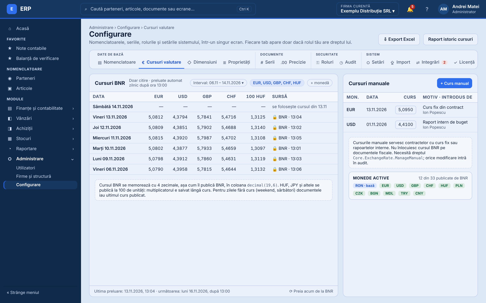


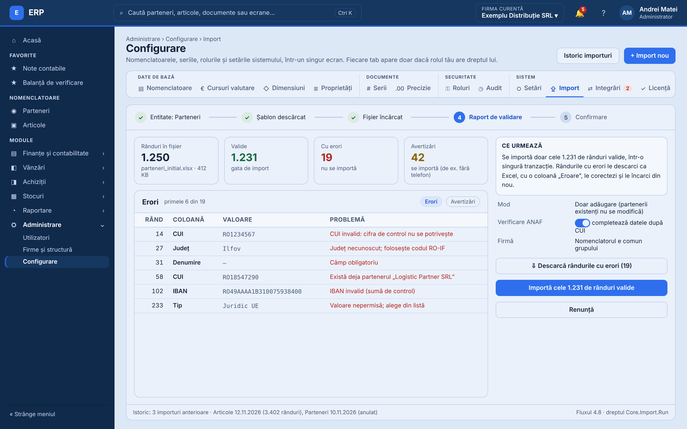


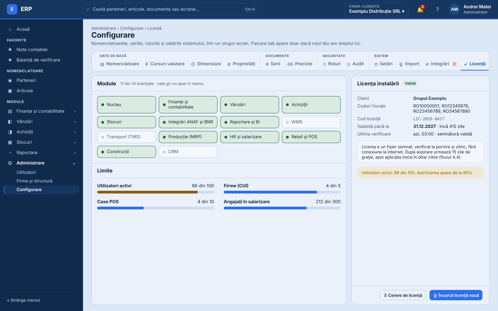


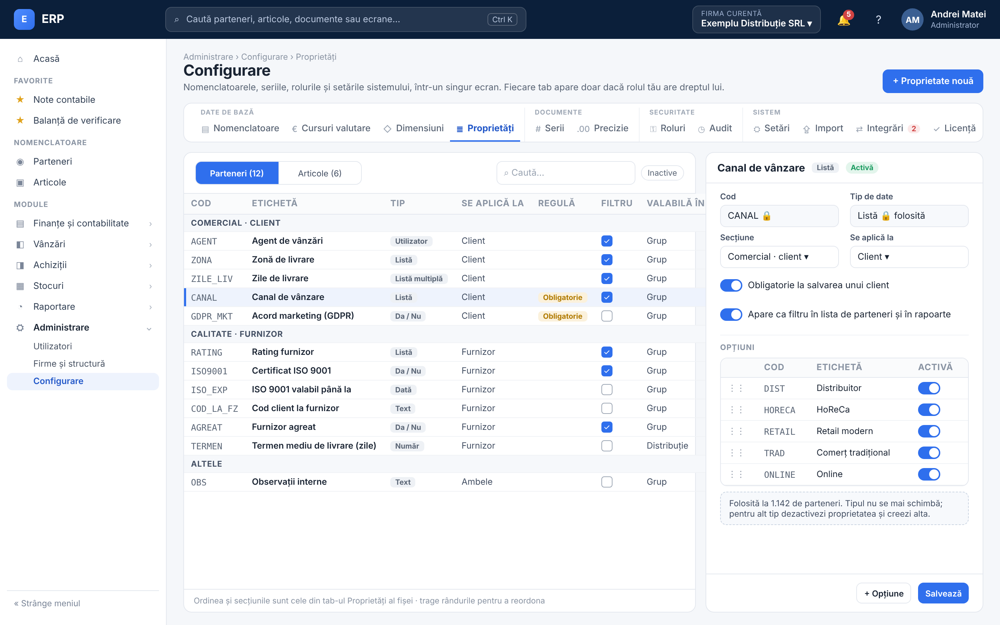

### 11.2 Ecrane personale, de autentificare și asistentul (adăugat pe 14.11.2026)

| Ecran | Ce arată macheta | Reguli |
| --- | --- | --- |
| Profilul meu | Trei coloane: datele din fișa de angajat (doar citire) și rolurile mele; Securitate (parolă, 2FA, sesiuni active cu „Închide”); matricea de notificări pe tip × canal (în aplicație, email) și momentul trimiterii (imediat sau rezumat zilnic) | Preferințele se salvează ca `Setting` cu `Scope = utilizator` și în `User.NotificationPreferences`. Notificările critice (erori ANAF, aprobări) nu se pot opri în aplicație. Schimbarea parolei și 2FA trimit la paginile `/account/*` |
| Notificări | Panou deschis din clopoțel: filtre Necitite / Toate / Aprobări / Erori, fiecare notificare cu link spre document, „Marchează toate ca citite”, „Vezi toate” | Fluxul 4.7; necititele au punct albastru și intră în contorul din antet |
| Parolă nouă | Pagina `/account/password` cu pașii recuperării în stânga; în dreapta parola nouă, indicator de putere, regulile verificate pe loc, confirmare, timpul rămas al linkului | Aceeași pagină la prima autentificare și după resetare de administrator. Propuneri de reguli implicite (configurabile): minimum 12 caractere, literă mare și mică, cifră, fără numele de utilizator, diferită de ultimele 5, verificată contra unei liste de parole compromise. După salvare se închid toate sesiunile |
| Activare 2FA | Cod QR și cheie manuală, cod de 6 cifre, cele 10 coduri de rezervă afișate o singură dată (descărcare, tipărire) | TOTP; obligatorie pentru Administrator și externi. Fără telefon: cod de rezervă sau resetare 2FA de către administrator (`Core.User.Manage`) |
| Asistent de configurare | Ecran întreg, fără meniu: 8 pași în stânga (Licență, Administrator, Firme și puncte de lucru, Active Directory, Email SMTP, Certificat ANAF, Import inițial, Verificare și pornire), formularul pasului în centru, ajutor în dreapta | Pasul Administrator completează profilul administratorului creat de installer (nume, email, limbă) și recomandă un al doilea administrator nominal; nu creează contul. Progresul se salvează după fiecare pas; AD, certificatul ANAF și importul sunt opționale. La adăugarea firmei se preiau datele de la ANAF după CUI și se creează automat planul de conturi, seriile implicite, gestiunea „Sediu” și politica STANDARD. Aplicația rămâne în modul de configurare până la ultimul pas |

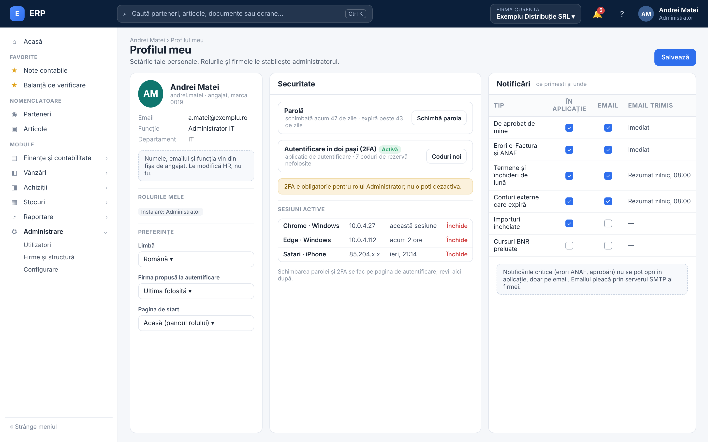

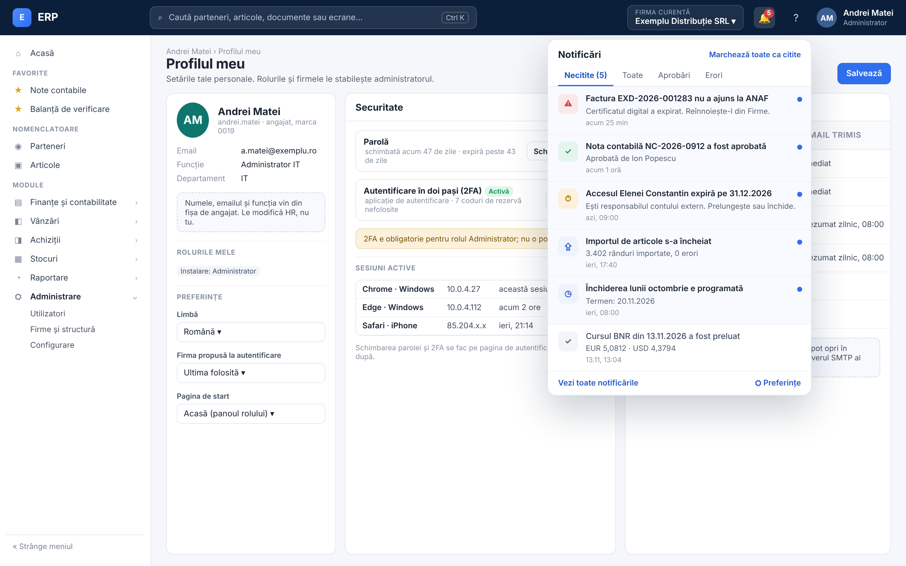

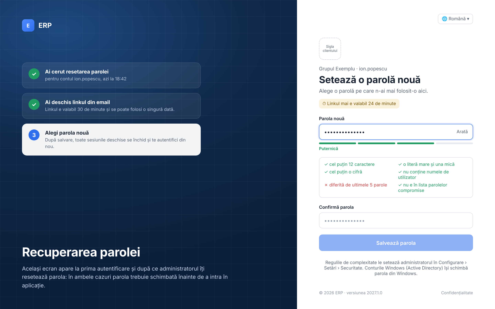


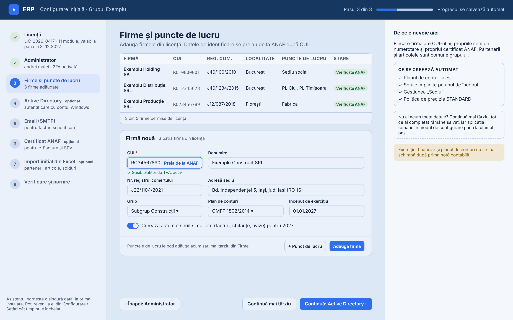

## 12. Criterii de acceptare și teste cheie

Nucleul e gata (poarta fazei 0 din roadmap) când toate criteriile de mai jos sunt îndeplinite și testele trec în CI.

| # | Criteriu | Test |
| --- | --- | --- |
| A1 | O instalare curată creează schema `core`, nomenclatoarele livrate și administratorul, fără pași manuali în SQL | Test de instalare în CI pe SQL Server în container |
| A2 | 2 utilizatori care validează simultan 1.000 de documente pe aceeași serie fiscală obțin numere unice, consecutive, fără goluri | Test de integrare concurent |
| A3 | Un rollback după alocarea numărului nu lasă gol în serie | Test de integrare |
| A4 | O comandă fără permisiune e refuzată cu 403 și nu ajunge la handler | Test pe pipeline |
| A5 | O comandă cu dată într-o perioadă închisă e refuzată cu 409 | Test pe pipeline (cu perioadă simulată) |
| A6 | Un modul nelicențiat nu are endpoint-uri, meniuri sau joburi active | Test de pornire cu licență parțială |
| A7 | O licență cu semnătură invalidă sau CUI lipsă e refuzată la pornire, cu mesaj clar | Test unitar pe verificatorul de licență |
| A8 | Un eveniment scris în outbox e livrat consumatorului exact o dată, inclusiv după o oprire forțată a serviciului | Test de integrare cu oprire simulată |
| A9 | Un CUI invalid sau duplicat e refuzat la salvarea partenerului | Teste unitare pe validator (set de CUI-uri reale și invalide) |
| A10 | Rotunjirea respectă politica: preț cu 6 zecimale, valoare și TVA la 2 zecimale, pe un set de cazuri inclusiv energie | Teste unitare pe `IPrecisionService` |
| A11 | Cursul pentru o zi fără curs BNR e ultimul curs anterior, cu data lui | Test unitar |
| A12 | Orice UPDATE sau DELETE pe `core.AuditEntry` e refuzat de baza de date | Test de integrare |
| A13 | CNP-ul unui partener persoană fizică nu apare în clar în bază, în jurnale sau în răspunsurile API fără permisiune | Test de integrare + scanare de jurnale |
| A14 | Niciun alt modul nu referențiază `Erp.Core.Domain` sau `Erp.Core.Infrastructure` | NetArchTest |
| A15 | Căutarea de parteneri și articole pe 100.000 de înregistrări răspunde în p95 sub 500 ms | Test de performanță pe date sintetice |
| A16 | O comandă trimisă de două ori cu aceeași cheie de idempotență creează un singur document, iar a doua cerere primește același rezultat | Test de integrare |
| A17 | În modul doar-citire al licenței, orice comandă de scriere e refuzată cu 403, iar consultarea și rapoartele funcționează | Test pe pipeline |
| A18 | Un import de 10.000 de parteneri cu 5% rânduri greșite salvează doar rândurile valide și raportează corect erorile; reluarea importului nu creează duplicate | Test de integrare |
| A19 | Anonimizarea unei persoane fizice șterge datele personale din nomenclator, păstrează neschimbate documentele fiscale și e înregistrată în audit | Test de integrare |
| A20 | După 5 autentificări greșite contul se blochează temporar, apare în jurnalul de autentificări, iar administratorii primesc notificare | Test de integrare pe autentificare |
| A21 | Pe baza `Latin1_General_100_CS_AS_SC_UTF8`, codurile `abc` și `ABC` sunt refuzate ca duplicat, căutarea „brasov” găsește „Brașov”, iar toate procedurile Nucleului rulează pe un server cu collation case insensitive (`TST-09`) | Test de integrare |
| A22 | După instalare există exact un administrator activ, cu `ADMIN` la nivel de instalare; ultimul administrator activ nu poate fi dezactivat (50015) | Test de integrare (08, IA-04) |

Testele se scriu înainte sau odată cu codul; criteriile A2, A8 și A10 sunt critice pentru conformitate și nu se acceptă excepții.
