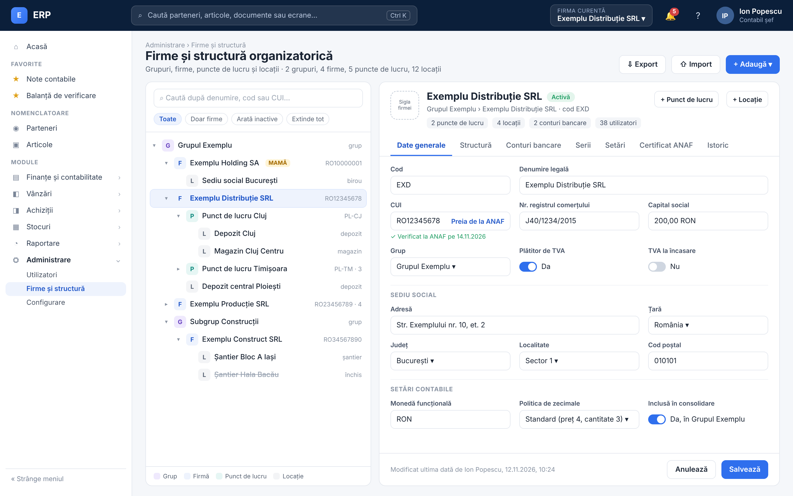
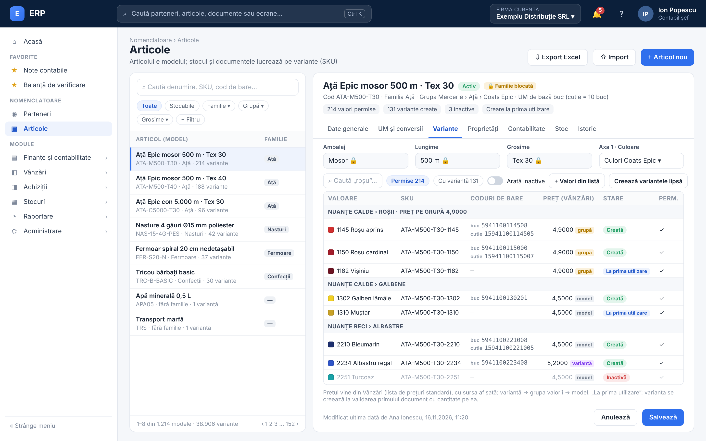
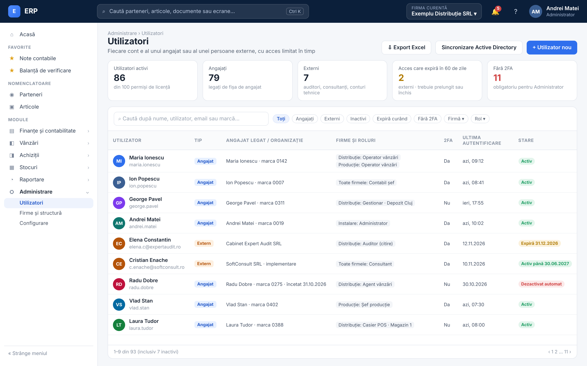
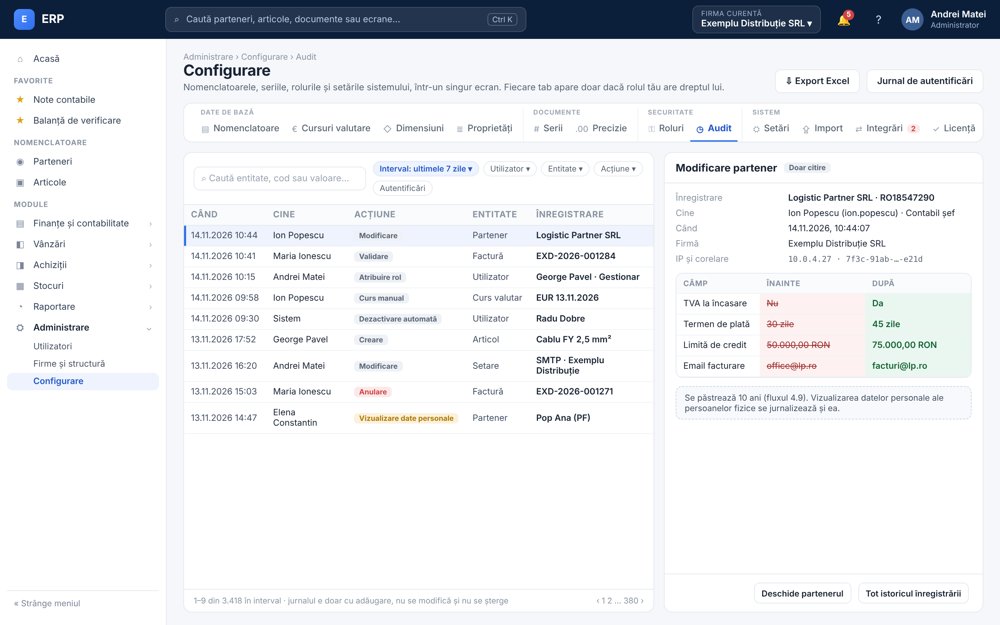
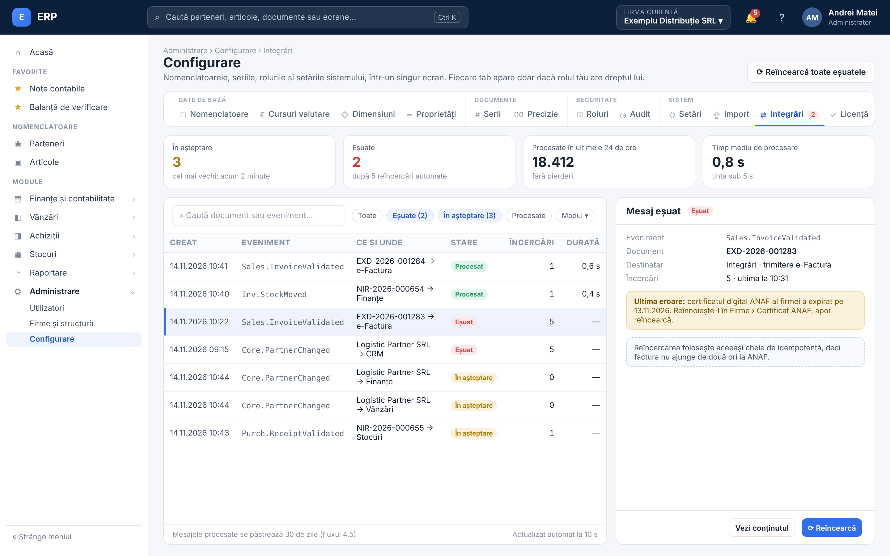
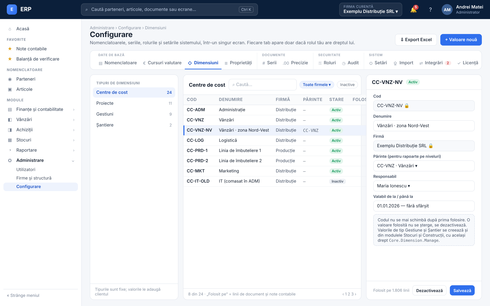
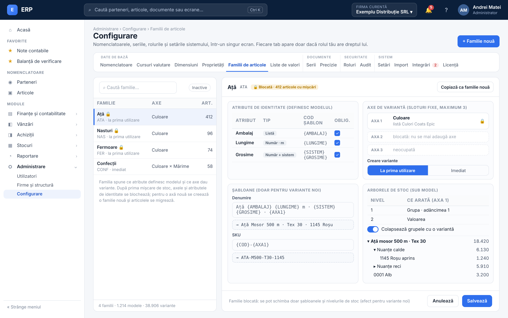
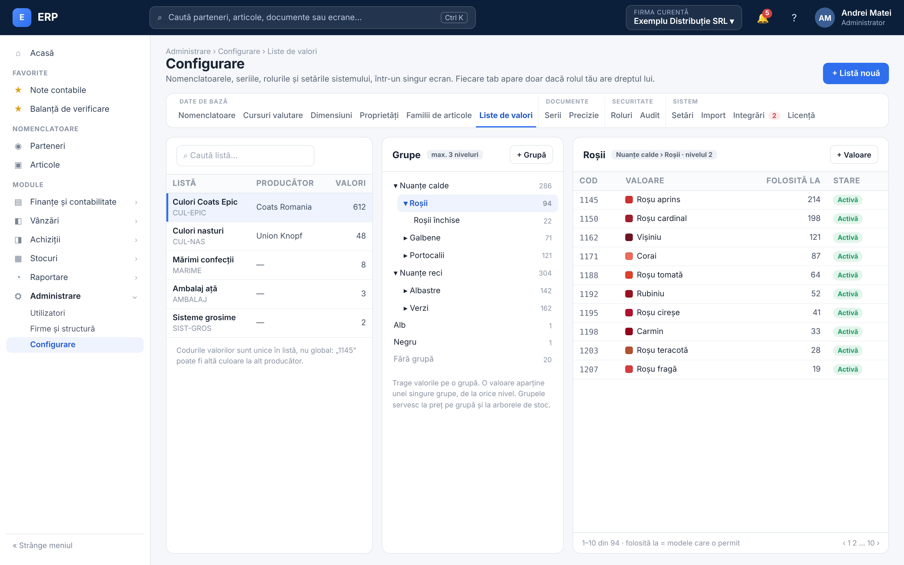
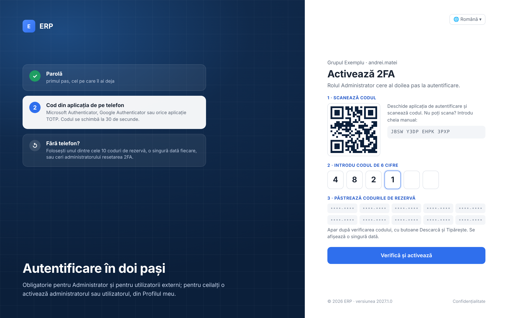

# ERP · 02.01 Nucleu (Platform)

14 noiembrie 2026 · Aurelian · **Validat (14.11.2026), inclusiv machetele de ecran 01–10; completat pe 14.11.2026 pentru baza case sensitive, administratorul creat la instalare și autentificarea cu ASP.NET Core Identity + cookie (validat 14.11.2026); completat pe 16.11.2026 cu articolele cu variante configurabile (§3.3.1, validat 16.11.2026)** · completat pe 26.11.2026 cu tipurile de tranzacții și legăturile între documente (§3.6, validat 26.11.2026 odată cu 02.04 A1) · completat pe 27.11.2026 cu motorul comun de rapoarte (§3.5, `ReportView` și `ReportSchedule`, mutate din Stocuri S7, validat 27.11.2026 odată cu 02.04 A7) · completat pe 27.11.2026 cu codurile NC8 și nomenclatoarele INS de comerț exterior (§3.3, validat 27.11.2026 odată cu 02.04 A6) · completat pe 27.11.2026 cu modalitățile de plată, codurile UNCL 4461 și GLN-ul pe adresa partenerului (§3.2, §3.5, validat 27.11.2026 odată cu 02.03 V1) · completat pe 27.11.2026 cu căutarea prețului în lanțul de liste (§3.3.1 regula 9, validat 27.11.2026 odată cu 02.03 V2) · Versiune editabilă: https://claude.ai/artifact/UE59RnaWRpVe5dfdJgzrqU

Nucleul e primul modul livrat (faza 0) și singurul pe care îl folosesc toate celelalte. Conține identitatea instalării și a firmelor, utilizatorii și drepturile, nomenclatoarele comune, numerotarea, precizia, audit-ul, atașamentele și licența, plus pipeline-ul comun prin care trece orice comandă. Document părinte: [02 Module principale](../MODULE_PRINCIPALE.md). Principii: [01 Scop și principii](../../01-scop-si-principii/SCOP_SI_PRINCIPII.md) (P1–P10).

## 1. Scop și perimetru

| Zonă | Ce face Nucleul | Ce NU face (și cine face) |
| --- | --- | --- |
| Instalare și firme | Datele instalării, firmele din grup (CUI, registru, adresă, regim TVA), puncte de lucru | Planul de conturi și perioadele contabile (Finanțe) |
| Utilizatori și drepturi | Utilizatori, roluri, permisiuni, atribuiri pe firmă și dimensiuni | Autentificarea propriu-zisă: o face ASP.NET Core Identity cu cookie, în aceeași aplicație (`Erp.Auth` în `Erp.Host`); Nucleul ține profilul și drepturile |
| Parteneri | Nomenclatorul unic de parteneri (persoane juridice și fizice), adrese, conturi bancare, contacte | Condițiile comerciale (Vânzări, Achiziții), soldurile (Finanțe) |
| Articole | Nomenclatorul unic de articole: cod, denumire, UM, cotă TVA implicită, tip, coduri de bare, grupe; familii de articole, liste de valori și variante (SKU), unitatea de stoc pentru toate modulele (§3.3.1) | Atributele de stoc, rețetă, preț (extensii în Stocuri, Producție, Vânzări) |
| Valute și cursuri | Valute, cursuri pe zi (BNR și manuale) | Preluarea automată BNR (Integrări), reevaluarea (Finanțe) |
| Nomenclatoare fiscale | Cote TVA, unități de măsură cu cod UN/ECE, țări, județe, localități, cu dată de intrare în vigoare (P6) | Codurile SAF-T și schemele XML (Integrări) |
| Numerotare | Serii per firmă, tip de document și an; alocare atomică la validare, fără goluri | — |
| Precizie | Politica de zecimale (0–6) pe firmă, articol și listă de prețuri; regulile de rotunjire (P7) | Aplicarea pe documente (fiecare modul folosește serviciul) |
| Dimensiuni | Centre de cost, proiecte, gestiuni ca dimensiuni generice pe documente | Semnificația de business a gestiunii (Stocuri) |
| Audit | Jurnalul de audit pentru toate modulele (P5) | — |
| Atașamente | Stocarea fișierelor atașate la orice document | Generarea PDF-urilor (fiecare modul) |
| Licență | Citirea și verificarea licenței, activarea modulelor | Emiterea licențelor (instrument intern separat) |
| Platformă comună | Pipeline MediatR, outbox și procesatorul de evenimente, joburi, configurare, health-check | Logica de business a modulelor |

Ce nu intră deloc în Nucleu: nicio regulă contabilă, fiscală de declarație sau de stoc. Dacă o regulă aparține unui singur modul, stă în acel modul, chiar dacă pare „comună”.

## 2. Model de domeniu

Entitățile Nucleului se grupează în patru zone. Firma (`Company`) e cheia: drepturile, seriile, dimensiunile și politicile de precizie sunt toate pe firmă, în timp ce partenerii și articolele sunt comune întregului grup.


Reguli de business ale modelului:

1. **Partenerii și articolele sunt la nivel de instalare** (grup), nu de firmă, ca același client să fie recunoscut în toate firmele și la consolidare.
2. **Drepturile sunt la nivel de firmă**: același utilizator poate fi contabil în firma A și doar consultant în firma B.
3. **Seriile de numerotare aparțin unei firme și unui an**; nu există serii comune între firme.
4. **Un CUI apare o singură dată** între parteneri și o singură dată între firme.
5. **Nomenclatoarele fiscale au dată de vigoare**; un document folosește întotdeauna valoarea valabilă la data lui (P6).
6. **Audit-ul și atașamentele se leagă generic** de orice entitate din orice modul, prin `EntityType` + `EntityId`.
7. **Un partener poate fi o firmă din grup** (`IntraGroupCompanyId`); tranzacțiile cu el se elimină la consolidare.

## 3. Entități și nomenclatoare

Convenții pentru toate tabelele de mai jos: cheie primară `Id` de tip `int` (sau `bigint` pentru tabelele mari), coloane de audit `CreatedAt`, `CreatedBy`, `ModifiedAt`, `ModifiedBy`, `RowVersion` pentru concurență optimistă. Nomenclatoarele nu se șterg fizic odată folosite: se dezactivează (`IsActive = 0`).

Regula pentru chei primare (validată 14.11.2026, detaliată în secțiunea 05 Date și multi-tenancy):

- **`int IDENTITY`** pentru nomenclatoare și antete de documente; **`bigint IDENTITY`** pentru tabelele care cresc mult (linii de documente, mișcări de stoc, note contabile, audit, outbox). Cheia primară e și indexul clustered.
- **`uniqueidentifier`** doar unde datele se nasc în afara bazei: bonuri POS emise offline, `EventId` din outbox/inbox, importuri și sincronizări între instalări. Acolo GUID-ul e o coloană `UNIQUE` separată (de exemplu `ExternalId`), iar clusterul rămâne pe `bigint`, ca să evităm fragmentarea.
- Opțional, **`PublicId uniqueidentifier`** pe documentele expuse în URL sau API, ca Id-urile să nu poată fi ghicite. Drepturile se verifică oricum în pipeline.

**Baza este case sensitive** (decizia lui Aurelian, 14.11.2026): collation `Latin1_General_100_CS_AS_SC_UTF8`, setat de installer ([08 Instalare și actualizare](../../08-instalare-actualizare/INSTALARE_ACTUALIZARE.md), secțiunea 9). Pentru tabelele Nucleului asta înseamnă (regulile `SQL-21`–`SQL-25` din Bune practici):

- codurile introduse de utilizatori (`Partner.Code`, `Item.Code`, `Location.Code`, `DimensionValue.Code`, `UomSet.Code`, `ItemGroup.Code`, `NumberSeries.Prefix`) sunt unice fără diferență de majuscule, prin coloana calculată `CodeKey AS UPPER(Code) PERSISTED` cu index unic;
- căutarea după denumire (parteneri, articole, angajați) folosește coloana calculată `NameSearch AS (Name COLLATE Latin1_General_100_CI_AI_SC_UTF8) PERSISTED`, indexată, ca „brasov” să găsească „Brașov”;
- `User.UserName` se salvează doar cu litere mici; autentificarea (ASP.NET Core Identity) caută după numele normalizat, deci utilizatorul se poate loga cu orice majuscule;
- codurile tehnice (permisiuni, roluri `ADMIN`, chei de setări) se compară exact; `core.[User]` se scrie între paranteze drepte.

### 3.1 Firmă (`Company`)

| Câmp | Tip | Obligatoriu | Validare / regulă |
| --- | --- | --- | --- |
| `Code` | `nvarchar(20)` | Da | Unic în instalare; folosit în serii și rapoarte |
| `Name` | `nvarchar(200)` | Da | Denumirea legală |
| `FiscalCode` (CUI) | `nvarchar(20)` | Da | Cifră de control CUI validă; unic în instalare; trebuie să fie în licență |
| `VatPayer` | `bit` | Da | Plătitor de TVA (prefix RO) |
| `VatOnCollection` | `bit` | Da | TVA la încasare |
| `TradeRegisterNo` | `nvarchar(30)` | Da | Numărul de ordine din registrul comerțului; validarea de format acceptă atât formatul clasic (J/F/C + județ + număr + an), cât și formatul nou ONRC |
| `ShareCapital` | `decimal(19,2)` | Condiționat | Capitalul social; obligatoriu pentru societăți (SRL, SA), apare pe facturi și pe documentele firmei (Legea 31/1990) |
| `Address`, `CountyCode`, `City`, `CountryCode` | diverse | Da | Județ și localitate din nomenclatoare |
| `FunctionalCurrency` | `char(3)` | Da | Fix `RON` (perimetru) |
| `DefaultPrecisionPolicyId` | `int` | Da | Politica de zecimale implicită a firmei |
| `LogoAttachmentId` | `int` | Nu | Sigla de pe documentele tipărite și de pe ecranul de autentificare |
| `IsGroupParent` | `bit` | Nu | Firma-mamă pentru consolidare |
| `IsActive` | `bit` | Da | — |

Sub firmă: **puncte de lucru** (`Branch`: denumire, adresă, cod), folosite pe documente, în seriile de numerotare și în e-Factura, și **conturi bancare** (`CompanyBankAccount`: IBAN validat, bancă, monedă, cont implicit), tipărite pe facturi.

**Structura organizatorică (arbore)**, adăugată pe 14.11.2026 la cererea lui Aurelian: firmele se organizează într-un arbore cu patru tipuri de noduri.

| Nivel | Entitate | Părinte permis | Câmpuri principale | Reguli |
| --- | --- | --- | --- | --- |
| Grup | `CompanyGroup` | Alt grup sau rădăcină | `Code`, `Name`, `ParentGroupId`, `ParentCompanyId` (firma-mamă pentru consolidare), `IsActive` | Oricâte niveluri (holding, subgrup); consolidarea se face pe grup, incluzând subgrupurile |
| Firmă | `Company` | Grup sau rădăcină | Tabelul de mai sus + `GroupId` | O firmă aparține unui singur grup; mutarea între grupuri se jurnalizează și afectează doar consolidările viitoare |
| Punct de lucru | `Branch` | Firmă | `Code`, `Name`, adresă, `IsActive` | Apare pe documente și în e-Factura; poate avea serii de numerotare proprii |
| Locație | `Location` | Punct de lucru sau direct firmă | `Code`, `Name`, `LocationType` (birou, depozit, magazin, fabrică, șantier, punct de livrare), adresă, `IsActive` | Locul fizic folosit de Stocuri, WMS, POS, Construcții și TMS; firma se deduce din părinte. Nu are sub-locații (confirmat 14.11.2026): zonele și rafturile se definesc în WMS |

Reguli: o locație nu are copii; un nod cu copii activi nu se poate dezactiva; un nod folosit pe documente nu se șterge, se dezactivează (`SQL-20`); codul e unic în cadrul firmei pentru puncte de lucru și locații și unic în instalare pentru grupuri. Drepturile se pot restrânge pe punct de lucru sau locație prin `DimensionScope`.



### 3.2 Partener (`Partner`)

Un singur nomenclator pentru clienți și furnizori, la nivel de instalare; rolul de bază (client, furnizor sau ambele) e pe partener și e obligatoriu (cel puțin unul bifat, CHECK în bază), iar condițiile comerciale se țin per firmă în Vânzări și Achiziții. Un partener marcat doar client nu apare la căutare pe documentele de achiziție, și invers.

| Câmp | Tip | Obligatoriu | Validare / regulă |
| --- | --- | --- | --- |
| `Code` | `nvarchar(30)` | Da | Unic; generat din serie sau introdus |
| `Name` | `nvarchar(200)` | Da | — |
| `PartnerType` | `tinyint` | Da | Persoană juridică RO, juridică UE, juridică non-UE, persoană fizică |
| `IsCustomer` | `bit` | Da | Rol client; cel puțin unul dintre `IsCustomer` și `IsSupplier` e 1 (`CK_Partner_Role`) |
| `IsSupplier` | `bit` | Da | Rol furnizor; un partener poate fi și client, și furnizor |
| `PartnerGroupId` | `int` | Nu | Grupă de parteneri (distribuitori, retail, servicii), pentru filtre și rapoarte |
| `FiscalCode` | `nvarchar(30)` | Condiționat | CUI valid pentru juridică RO; cod TVA UE pentru UE; gol pentru persoană fizică (CNP-ul stă criptat în `PersonalIdEncrypted`) |
| `PersonalIdEncrypted` | `varbinary(256)` | Nu | CNP-ul persoanei fizice, criptat; citit doar cu `Core.Partner.ViewPersonalData` |
| `VatPayer` | `bit` | Da | Verificabil manual sau prin serviciul ANAF de interogare (Integrări) |
| `VatOnCollection` | `bit` | Da | Partenerul aplică TVA la încasare (registrul ANAF); contează la deducerea TVA pe achiziții |
| `AnafInactive` | `bit` | Da | Contribuabil declarat inactiv de ANAF; documentele de achiziție afișează avertizare |
| `AnafCheckedAt` | `datetime2(3)` | Nu | Momentul ultimei verificări automate la ANAF (Integrări) |
| `TradeRegisterNo` | `nvarchar(30)` | Nu | — |
| `CountryCode` | `char(2)` | Da | ISO 3166 |
| `IntraGroupCompanyId` | `int` | Nu | Legătura cu o firmă din grup, pentru eliminări la consolidare |
| `IsActive` | `bit` | Da | — |

Copii: `PartnerAddress` (sediu, livrare, facturare; coloana `Gln varchar(13) NULL`, codul GLN al locației, cu cifra de control verificată, cerut de lanțurile de retail în EDI și în e-Factura la `DeliveryLocation/ID`, schema `0088`; precizare din Vânzări V1, 27.11.2026), `PartnerBankAccount` (IBAN validat, bancă, monedă), `PartnerContact` (nume, rol, email, telefon). Regulă: un CUI apare o singură dată în nomenclator; duplicatele se semnalează la salvare.

**Proprietăți configurabile** (adăugate pe 14.11.2026): administratorul definește câmpuri suplimentare fără modificări de cod, folosite pentru parteneri și, cu același mecanism, pentru articole.

| Entitate | Câmpuri principale | Reguli |
| --- | --- | --- |
| `PropertyDefinition` | `EntityType` (Partner / Item), `Code`, `Name`, `DataType` (text, număr, dată, da/nu, listă, listă multiplă, utilizator), `AppliesTo` (client, furnizor, ambele), `Section`, `SortOrder`, `IsRequired`, `IsFilterable`, `CompanyId` (gol = tot grupul), `IsActive` | Tipul unei proprietăți folosite nu se mai schimbă; se dezactivează și se creează alta |
| `PropertyOption` | `PropertyDefinitionId`, `Code`, `Label`, `SortOrder`, `IsActive` | Valorile pentru listele de selecție |
| `PropertyValue` | `PropertyDefinitionId`, `EntityId`, `ValueText`, `ValueNumber` `decimal(19,6)`, `ValueDate`, `ValueBool`, `ValueOptionId` | O singură coloană completată, după tip; listele multiple au câte un rând pe opțiune |

Reguli: valorile se validează după tip la salvare; o proprietate obligatorie se cere doar dacă se aplică rolului partenerului; proprietățile marcate `IsFilterable` apar ca filtre în lista de parteneri și în rapoarte; modificările se auditează ca orice câmp. Exemple livrate ca model: segment, agent de vânzări, zonă de livrare, rating furnizor, certificat ISO și data expirării, acord de marketing (GDPR).


### 3.3 Articol (`Item`)

| Câmp | Tip | Obligatoriu | Validare / regulă |
| --- | --- | --- | --- |
| `Code` | `nvarchar(50)` | Da | Unic |
| `Name` | `nvarchar(250)` | Da | — |
| `ItemType` | `tinyint` | Da | Marfă, materie primă, material, produs finit, semifabricat, serviciu, ambalaj, mijloc fix |
| `UomSetId` | `int` | Da | Setul de UM folosit (de ex. Băuturi 0,5 L); UM de bază e cea cu factor 1 din set |
| `BaseUomId` | `int` | Da | Copiat din set la salvare, pentru interogări rapide; stocul și costul se țin mereu în UM de bază |
| `DefaultVatRateId` | `int` | Da | Din nomenclatorul de cote TVA |
| `ItemGroupId` | `int` | Nu | Arbore de grupe pe mai multe niveluri |
| `PricePrecision` | `tinyint` | Nu | 0–6; suprascrie politica firmei pentru acest articol (P7) |
| `QuantityPrecision` | `tinyint` | Nu | 0–6 |
| `IsStockable` | `bit` | Da | Fals pentru servicii |
| `CnCode` | `varchar(8)` | Nu | Cod NC8 de 8 cifre din `core.CnCode`, valabil în anul curent; moștenit din familie sau propriu (`CnCodeOverridden`), regulile în Achiziții A6 §3.6 (precizare din Achiziții A6, 27.11.2026). Obligatoriu pe articolele stocabile folosite în comerț exterior sau e-Transport |
| `CnCodeOverridden` | `bit` | Da | 0 = codul vine din familie și se schimbă odată cu ea; 1 = cod propriu al articolului (precizare din Achiziții A6, 27.11.2026) |
| `DomesticReverseChargeCode` | `varchar(10)` | Nu | Categoria de bunuri cu taxare inversă internă (Codul fiscal art. 331), din care Vânzările aleg categoria de TVA `AE` (V5 §3.4) (precizare din Vânzări V5, 27.11.2026) |
| `DepositItemId` | `int` | Nu | Ambalajul cu garanție SGR (sistemul de garanție-returnare), adăugat automat pe documente lângă articol |
| `NetWeightKg`, `GrossWeightKg` | `decimal(19,6)` | Nu | Pe UM de bază; folosite la e-Transport, avize și TMS |
| `VolumeM3` | `decimal(19,6)` | Nu | Pe UM de bază; folosit la WMS și TMS |
| `IsActive` | `bit` | Da | — |

**Codul NC8 și nomenclatoarele INS** (adăugat pe 27.11.2026, validat odată cu Achiziții A6): nomenclatorul `core.CnCode`, tabelele separate `core.DeliveryTerm`, `core.TransactionNature`, `core.TransportMode`, moștenirea codului familie → articol → variantă și ecranul de import INS (XLS sau XML, cu propuneri) sunt descrise complet în [Achiziții A6 §3.6 și §3.7](../04-achizitii/A6-IMPORT-COSTURI.md); seed-ul e în [seed/nomenclatoare-ins/](../../seed/nomenclatoare-ins/). Comenzi: `SetItemFamilyCnCode`, `SetItemCnCode`, `ResetItemCnCodeToFamily`, `AnalyzeNomenclatureImport`, `ApplyNomenclatureImport`. `IItemQuery.SnapshotAsync` întoarce codul NC8 efectiv (varianta, altfel articolul).

Copii: `ItemUom` (excepții de la set), `ItemVariant` (variantele, cel puțin una, §3.3.1), `ItemAttribute` (valorile atributelor de identitate, §3.3.1; până pe 16.11.2026 erau atribute libere cheie/valoare), `ItemAllowedValue` (valorile permise pe axe). Codurile de bare (`ItemBarcode`: EAN, intern, opțional legat de o UM) stau pe variantă. Proprietățile configurabile ale articolului folosesc `PropertyDefinition` cu `EntityType = Item`.

**Seturi de UM** (adăugate pe 14.11.2026): conversiile se definesc o dată pe set și se refolosesc la toate articolele cu același ambalaj.

| Entitate | Câmpuri | Reguli |
| --- | --- | --- |
| `UomSet` | `Code`, `Name`, `IsActive` | Comun grupului |
| `UomSetLine` | `UomSetId`, `UomId`, `FactorToBase` `decimal(19,6)`, `IsBase`, `IsDefaultSales`, `IsDefaultPurchase`, `IsDefaultPos`, `SortOrder` | O singură linie `IsBase` cu factor 1; cel mult o linie implicită pe fiecare circuit; factor > 0 |
| `ItemUom` | `ItemId`, `UomId`, `FactorToBase`, implicitele ca mai sus | Excepție doar pentru articol (de ex. bax de 12 în loc de 6), fără a schimba setul; are prioritate față de linia din set |

Reguli: documentele păstrează UM și cantitatea introduse plus cantitatea în UM de bază (de ex. 3 paleți + 2 baxuri = 1.452 buc). Factorii unui articol, din set sau din excepție, se pot modifica doar dacă articolul nu are stoc și nici documente; altfel se creează alt set. Codul de bare identifică varianta și, opțional, UM-ul, ca scanarea unui bax să aducă direct 6 buc din varianta corectă.

**Setări pe firmă.** Articolul e comun grupului, dar conturile contabile și gestiunea sunt ale fiecărei firme și aparțin modulelor care le folosesc. Pe fișa articolului apar pentru firma curentă, ca tab-uri adăugate de module:

| Extensie (modul) | Câmpuri | Reguli |
| --- | --- | --- |
| `fin.ItemAccounting` (Finanțe) | `CompanyId`, `ItemId`, `StockAccount`, `ExpenseAccount`, `RevenueAccount`, `VatAccountOverride` | Lipsă = contul din grupa de articole, apoi din tipul articolului |
| `inv.ItemStockSettings` (Stocuri) | `CompanyId`, `ItemId`, `DefaultWarehouseId` (gestiunea implicită), `ValuationMethod` (FIFO, CMP), `TrackingMode` (fără, lot, serie, lot și termen de valabilitate), `MinQty`, `MaxQty` | Doar pentru articole stocabile; metoda de evaluare nu se schimbă în timpul unei perioade deschise cu stoc |

Alte extensii (de ex. `mfg.ItemRecipeSettings`) stau tot în schema modulului, cu cheie pe `CompanyId` + `ItemId`.


### 3.3.1 Articole cu variante configurabile (adăugat pe 16.11.2026)

La cererea lui Aurelian din 16.11.2026, modelul din promptul „Articole cu variante configurabile” a fost integrat în Nucleu. Tabelele din prompt erau un model. Aici sunt adaptate la schema `core` și la regulile din [Bune practici](../../bune-practici/BUNE_PRACTICI.md): nume în engleză (`SQL-02`), chei `int IDENTITY` (`SQL-13`), coduri unice fără diferență de majuscule (`SQL-24`) și seturile de UM existente. Exemplele cu ață, nasturi și confecții sunt doar ilustrative. Mecanismul funcționează pentru orice articol, prin configurare, fără cod nou.

**Ce se schimbă față de modelul validat pe 14.11.2026:** articolul (`core.Item`) devine **model**. Stocul și liniile de document nu mai trimit la articol, ci la **variantă** (`core.ItemVariant`), care e singura unitate de stoc. Un articol fără variante are o singură variantă implicită, creată automat. Pentru celelalte module asta înseamnă o singură regulă: orice linie cu efect în stoc, preț sau fiscal are `ItemVariantId`.

**Termeni.** Termenul „tip articol” din prompt devine aici **familie de articole** (`ItemFamily`), pentru că `Item.ItemType` există deja și înseamnă natura articolului (marfă, materie primă, serviciu etc.).

| Termen | Ce este | Exemplu |
| --- | --- | --- |
| Familie de articole | Configurarea comună a unui set de articole: atribute de identitate, axe, niveluri de stoc, șabloane, mod de creare a variantelor | Ață, Nasturi, Confecții |
| Grupă de articole | Clasificarea ierarhică existentă (`ItemGroup`); poate da paleta implicită de valori a modelelor din ea | Mercerie › Ață |
| Articol (model) | Combinația valorilor atributelor de identitate. Nu ține stoc și nu apare pe liniile de document | Ață mosor 500 m · Tex 30 |
| Variantă (SKU) | Modelul plus câte o valoare pe fiecare axă. Singura unitate de stoc. Are cod SKU și coduri de bare pe UM | ATA-M500-T30-1145 (Roșu) |
| Variantă implicită | Singura variantă a unui articol fără axe, cu toate sloturile `NULL` | orice articol simplu, inclusiv serviciile |
| Atribut de identitate | Atribut care definește modelul: număr, text sau valoare dintr-o listă | lungime, grosime, material |
| Axă de variantă | Atribut de tip listă care generează variante. Ocupă unul din cele 3 sloturi fixe ale familiei | culoare, mărime |
| Listă de valori | Domeniul unei axe sau al unui atribut de tip listă, de regulă specific unui producător | paleta de culori a unui producător |
| Grupă de valori | Gruparea valorilor unei liste, pe cel mult 3 niveluri, folosită la preț și la raportare | Culori › Nuanțe calde › Roșu |
| Valori permise | Subsetul listei acceptat de un anumit model, pe fiecare slot | 10 culori dintr-o paletă de sute |
| Nivel de stoc | O treaptă din arborele de stoc sub model: o grupă de la o anumită adâncime sau valoarea unei axe | Grupă culoare → Culoare |

**Maparea tabelelor din prompt pe schema proiectului:**

| Prompt (model) | Proiect | Ce s-a adaptat |
| --- | --- | --- |
| `Lista`, `ListaGrupa`, `ListaGrupaAscendent`, `ListaValoare` | `core.ValueList`, `core.ValueListGroup`, `core.ValueListGroupAncestor`, `core.ValueListValue` | Nume în engleză; `CodeKey` (`SQL-24`) unic pe listă, nu global; coloane de audit |
| `Atribut` | `core.ItemAttributeDefinition` | Tipul de date e `tinyint` cu `CHECK` (`SQL-10`); atributul cu sistem de măsură are lista sistemelor |
| `TipArticol` (+ sloturile de axă) | `core.ItemFamily` | Redenumit (vezi termenii); `Axis1..3AttributeId` |
| `TipArticolAtribut` | `core.ItemFamilyAttribute` | — |
| `TipArticolNivelStoc` | `core.ItemFamilyStockLevel` | `Source` e `tinyint` (1 = grupă, 2 = valoare) |
| `TipArticolValoareImplicita` | `core.ItemFamilyDefaultValue` | — |
| `GrupaArticol` | `core.ItemGroup` (existent) | Fără tabel nou |
| `GrupaArticolValoareImplicita` | `core.ItemGroupDefaultValue` | — |
| `Articol` | `core.Item` (existent) | Primește `ItemFamilyId` și `FirstUsedAt`. `UMBaza` e deja `UomSetId` + `BaseUomId`. `PretVanzare` nu intră în Nucleu (vezi prețul) |
| `ArticolUM` | `core.UomSet`, `core.UomSetLine`, `core.ItemUom` (existente) | UM-urile alternative vin din setul de UM, cu excepții pe articol. Sunt comune tuturor variantelor |
| `ArticolAtribut` | `core.ItemAttribute` (existent, refolosit) | Nu mai ține atribute libere cheie/valoare. Acelea sunt deja acoperite de proprietățile configurabile (`PropertyDefinition`). Ține valorile atributelor de identitate |
| `ArticolValoarePermisa` | `core.ItemAllowedValue` | — |
| `ArticolPretGrupa`, `PretVanzare` pe model și pe variantă | `sales.PriceListLine` (modulul Vânzări, 02.03) | Prețul aparține Vânzărilor (secțiunea 1). Nucleul fixează doar regula de căutare a prețului |
| `ArticolVarianta` | `core.ItemVariant` | `Axis1ValueId..Axis3ValueId`, `Code` (SKU) cu `CodeKey`, `Name` cu `NameSearch`, `FirstUsedAt`, coloane de audit |
| `VariantaEAN` | `core.ItemBarcode` (existent) | Primește `ItemVariantId` (obligatoriu) în loc de `ItemId`; `UomId` rămâne opțional, deci un cod de bare identifică varianta și UM-ul |
| `Stoc` | `inv.Stock` (modulul Stocuri, 02.05) | Cheia este `ItemVariantId` + gestiune + dimensiunile de depozitare și de trasabilitate |
| `usp_VariantaAsigura` | `core.usp_ItemVariant_Ensure` | Procedură publică, cu `UPDLOCK, HOLDLOCK` |
| `fnPretVarianta` | `sales.fn_VariantPrice` (02.03) | Ordinea de căutare e fixată mai jos |

**Reguli de modelare (invarianți).** Nu se schimbă fără o decizie explicită a lui Aurelian.

1. **Stocul stă doar pe variantă.** Stocul, mișcările, rezervările, inventarul și toate liniile de document cu efect în stoc, preț sau fiscal trimit la `ItemVariantId`. Modelul nu ține stoc. Extensiile pe firmă (`fin.ItemAccounting`, `inv.ItemStockSettings`), codul NC, cota TVA și setul de UM rămân pe model și sunt moștenite de variante.
2. **Orice articol are cel puțin o variantă.** Un articol fără familie sau dintr-o familie fără axe primește la salvare varianta implicită, cu sloturile `NULL` și SKU-ul egal cu codul articolului. Nu există linii cu `ItemId` și variantă opțională.
3. **Cel mult 3 axe, pe sloturi fixe.** Axele sunt coloanele `Axis1ValueId..Axis3ValueId` din `ItemVariant`, iar familia spune ce atribut ocupă fiecare slot. Unicitatea combinației e constrângerea `UQ_ItemVariant_Axes (ItemId, Axis1ValueId, Axis2ValueId, Axis3ValueId)`. SQL Server tratează `NULL`-urile ca egale aici, deci există o singură variantă implicită pe articol. Nu există tabel atribut–valoare pentru axe.
4. **Structura atribut–valoare servește doar identitatea.** `ItemAttribute` ține atributele de identitate, folosite la identitate, căutare și denumire. Prețul, UM, cota TVA, conturile și gestiunea rămân coloane obișnuite, în tabelele lor.
5. **Axele sunt dimensiuni de produs.** Gestiunea și locația (dimensiuni de depozitare), lotul, seria și termenul de valabilitate (dimensiuni de trasabilitate, `TrackingMode`) stau pe stoc, în Stocuri. Nu devin niciodată axe de variantă.
6. **Grupele de valori aparțin listei și sunt ierarhice.** O grupă poate avea o grupă părinte din aceeași listă, pe cel mult 3 niveluri. O valoare aparține unei singure grupe, de la orice adâncime. Un caz special pe un subset de valori (preț, raportare, aprovizionare) se rezolvă cu o grupă și un preț pe grupă, nu cu articole separate.
7. **Fiecare model are valori permise.** La crearea modelului, valorile permise pe fiecare slot se iau din paleta celei mai apropiate grupe de articole care are paletă pentru lista slotului, urcând în arbore. Dacă nu există, se iau din paleta familiei. Modelul le restrânge sau le extinde apoi. O variantă se poate crea doar din valori permise pe slotul ei.
8. **Modul de creare a variantelor se alege pe familie.** `D` (la prima utilizare) creează varianta la prima cantitate introdusă pe un document și e implicit pentru liste mari. `I` (imediat) generează toate combinațiile permise la salvarea articolului și se potrivește listelor mici.
9. **Ordinea de căutare a prețului** (aplicată de Vânzări în `sales.fn_VariantPrice`, pe lista de prețuri a documentului): variantă → cea mai apropiată grupă de valori cu preț, urcând de la grupa valorii → model. Când mai multe sloturi au grupe cu preț, câștigă slotul cu numărul cel mai mic. Prețul se definește pe UM de bază. Precizare din Vânzări V2 (27.11.2026): căutarea se face în lista documentului (lista proprie a partenerului → lista din condițiile clientului → lista grupei → lista firmei), apoi în lanțul de liste părinte (cel mult 3 niveluri, cu ajustare procentuală); pe aceeași țintă se alege pragul de cantitate cel mai mare ≤ cantitatea în UM de bază, iar o linie temporară valabilă la dată are prioritate față de cea permanentă. Procedura e `sales.usp_Price_Resolve` (TVP), apelată de `IPriceEngine`.
10. **Denumirea și SKU-ul se generează la salvare și se stochează**, din șabloanele familiei. Liniile de document păstrează o copie a denumirii de la emitere. Schimbarea unui șablon nu redenumește variantele existente și nici documentele emise.
11. **Valoare plus sistem de măsură.** Un atribut numeric cu mai multe sisteme de măsură (de exemplu Tex / Nm) se stochează ca valoare plus sistem, niciodată doar ca număr.
12. **Codurile valorilor sunt unice pe listă, nu global.** Același cod poate însemna lucruri diferite la doi producători.
13. **Blocarea după prima utilizare.** Prima validare a unui document cu o variantă setează `FirstUsedAt` pe variantă, pe model și `LockedAt` pe familie, prin `core.usp_ItemVariant_MarkUsed`. Din acel moment atributele de identitate și axele familiei sunt blocate și nu se mai adaugă axe. Pentru o axă nouă se creează o familie nouă și articolele se migrează, cu stocul mutat prin ieșire și intrare. Se pot adăuga în continuare valori în liste și în valorile permise. Se pot schimba nivelurile de stoc și șabloanele, cu efect doar pentru variantele noi. O variantă folosită nu se șterge, se dezactivează și se poate reactiva. Aceeași coloană `FirstUsedAt` blochează și factorii de UM (`CORE_UOM_FACTOR_LOCKED`).
14. **Arborele de stoc e configurabil pe familie**, cu cel mult 3 niveluri sub model. Un nivel arată fie o grupă de valori de la o anumită adâncime, fie valoarea unei axe. Raportul îl face Stocuri (02.05) după configurarea din `ItemFamilyStockLevel`.
15. **Introducerea pe documente se face pe grilă.** La recepție, comandă și vânzare se alege modelul, apoi se completează cantitățile pe grila valorilor permise, iar fiecare celulă cu cantitate devine o linie pe variantă. Scanarea unui cod de bare duce direct la variantă și la UM-ul ei. Variantele inactive sunt ascunse implicit. Cine are `Core.Item.Manage` le poate afișa și reactiva din grilă.
16. **UM-urile vin din setul de UM al modelului** și sunt comune tuturor variantelor. Stocul se ține în UM de bază. Linia de document păstrează UM-ul, cantitatea în acel UM, factorul copiat la emitere și cantitatea în UM de bază (regula existentă din 3.3). Fiecare pereche variantă + UM poate avea cod de bare propriu. Prețul pe o UM alternativă e prețul pe UM de bază înmulțit cu factorul. O cutie cu valori diferite în ea (de exemplu culori asortate) nu e o UM, ci un articol-pachet separat.

**Entitățile noi și cele modificate:**

| Entitate | Câmpuri principale | Reguli |
| --- | --- | --- |
| `ValueList` | `Code`, `Name`, `ProducerPartnerId` (opțional), `IsActive` | Lista unei axe sau a unui atribut de tip listă; comună grupului |
| `ValueListGroup` | `ValueListId`, `ParentId`, `Code`, `Name`, `Depth` (1–3), `SortOrder` | Părintele e din aceeași listă; `Depth` e calculat la salvare; cod unic pe listă |
| `ValueListGroupAncestor` | `GroupId`, `AncestorGroupId`, `Distance` | Închiderea tranzitivă a arborelui, refăcută la salvare. Servește la preț și la arborele de stoc fără CTE recursiv |
| `ValueListValue` | `ValueListId`, `GroupId` (opțional), `Code`, `Name`, `ColorHex` (opțional), `SortOrder`, `IsActive` | Cod unic pe listă (`UX (ValueListId, CodeKey)`); o valoare aparține unei singure grupe |
| `ItemAttributeDefinition` | `Code`, `Name`, `DataType` (1 = număr, 2 = text, 3 = listă), `ValueListId`, `MeasureSystemListId`, `UomId`, `IsActive` | `ValueListId` obligatoriu doar pentru tipul listă; o axă trebuie să fie de tip listă |
| `ItemFamily` | `Code`, `Name`, `Axis1AttributeId`, `Axis2AttributeId`, `Axis3AttributeId`, `VariantCreationMode` (1 = la prima utilizare, 2 = imediat), `CollapseSingleGroup`, `NameTemplate`, `SkuTemplate`, `LockedAt`, `IsActive` | Sloturile se ocupă în ordine (`CK_ItemFamily_Slots`); după `LockedAt` axele și atributele nu se mai schimbă |
| `ItemFamilyAttribute` | `ItemFamilyId`, `AttributeId`, `SortOrder`, `IsRequired`, `TemplateCode` | Atributele de identitate; `TemplateCode` e codul folosit în șabloane, de ex. `{LUNGIME}` |
| `ItemFamilyStockLevel` | `ItemFamilyId`, `Level` (1–3), `Slot` (1–3), `Source` (1 = grupă, 2 = valoare), `GroupDepth` | `GroupDepth` doar pentru sursa grupă |
| `ItemFamily` (completare 27.11.2026) | + `CnCode varchar(8) NULL` | Codul NC8 implicit al familiei; schimbarea lui actualizează articolele cu `CnCodeOverridden = 0` (Achiziții A6 §3.6) |
| `ItemFamilyDefaultValue` | `ItemFamilyId`, `Slot`, `ValueId` | Paleta implicită a familiei |
| `ItemGroupDefaultValue` | `ItemGroupId`, `ValueId` | Paleta grupei de articole, pentru slotul a cărui axă folosește lista valorii; are prioritate față de paleta familiei și se moștenește de la grupa părinte |
| `Item` (modificat) | + `ItemFamilyId` (opțional), `FirstUsedAt`; + `CnCode`, `CnCodeOverridden` (27.11.2026, Achiziții A6 §3.6) | Fără familie = articol simplu, cu variantă implicită |
| `ItemAttribute` (refolosit) | `ItemId`, `AttributeId`, `NumberValue` `decimal(19,6)`, `TextValue`, `ValueId`, `MeasureSystemValueId` | Exact una dintre valori, după tipul atributului; indecși pe `(AttributeId, NumberValue)` și `(AttributeId, ValueId)` pentru rapoartele între modele |
| `ItemAllowedValue` | `ItemId`, `Slot`, `ValueId` | Inițializat din paleta grupei sau a familiei; valoarea trebuie să fie din lista axei slotului |
| `ItemVariant` | `ItemId`, `Axis1ValueId`, `Axis2ValueId`, `Axis3ValueId`, `Code` (SKU), `Uid`, `Name`, `FirstUsedAt`, `IsActive`, `CnCode` (opțional, 27.11.2026: gol = codul articolului) | Combinație unică; SKU unic în instalare; `Uid` unic, generat la creare și neschimbat (folosit pentru etichete, scanare, sincronizare cu POS, WMS și alte instalări; stocul pe lot are în plus CKU, Stocuri S4); valorile trebuie să fie permise pe slot |
| `ItemBarcode` (modificat) | `ItemVariantId` în loc de `ItemId`, `UomId` (opțional), `Barcode`, `BarcodeType` | Codul de bare rămâne unic în instalare |

Tabelul complet al variantei, ca model pentru celelalte (`SQL-04`, `SQL-13`, `SQL-19`, `SQL-24`, `SQL-25`):

```sql
CREATE TABLE core.ItemVariant (
    Id            int IDENTITY(1,1)  NOT NULL CONSTRAINT PK_ItemVariant PRIMARY KEY,
    ItemId        int                NOT NULL CONSTRAINT FK_ItemVariant_Item REFERENCES core.Item(Id),
    Axis1ValueId  int                NULL CONSTRAINT FK_ItemVariant_ValueListValue_Axis1 REFERENCES core.ValueListValue(Id),
    Axis2ValueId  int                NULL CONSTRAINT FK_ItemVariant_ValueListValue_Axis2 REFERENCES core.ValueListValue(Id),
    Axis3ValueId  int                NULL CONSTRAINT FK_ItemVariant_ValueListValue_Axis3 REFERENCES core.ValueListValue(Id),
    Code          nvarchar(60)       NOT NULL,                     -- SKU, generat din ItemFamily.SkuTemplate
    Uid           uniqueidentifier   NOT NULL CONSTRAINT DF_ItemVariant_Uid DEFAULT (NEWID()),   -- id unic al SKU-ului (adăugat 26.11.2026, Stocuri S4)
    Name          nvarchar(250)      NOT NULL,                     -- generată din ItemFamily.NameTemplate, stocată
    FirstUsedAt   datetime2(3)       NULL,                         -- setat de core.usp_ItemVariant_MarkUsed
    IsActive      bit                NOT NULL CONSTRAINT DF_ItemVariant_IsActive DEFAULT (1),
    CreatedAt     datetime2(3)       NOT NULL CONSTRAINT DF_ItemVariant_CreatedAt DEFAULT (sysutcdatetime()),
    CreatedBy     int                NOT NULL,
    ModifiedAt    datetime2(3)       NULL,
    ModifiedBy    int                NULL,
    RowVersion    rowversion         NOT NULL,
    CodeKey       AS UPPER(Code) PERSISTED,
    NameSearch    AS (Name COLLATE Latin1_General_100_CI_AI_SC_UTF8) PERSISTED,
    -- NULL-urile sunt egale într-o constrângere UNIQUE: o singură variantă implicită pe articol
    CONSTRAINT UQ_ItemVariant_Axes UNIQUE (ItemId, Axis1ValueId, Axis2ValueId, Axis3ValueId),
    CONSTRAINT CK_ItemVariant_Slots CHECK (
        (Axis2ValueId IS NULL OR Axis1ValueId IS NOT NULL) AND
        (Axis3ValueId IS NULL OR Axis2ValueId IS NOT NULL))
);
CREATE UNIQUE INDEX UX_ItemVariant_CodeKey ON core.ItemVariant (CodeKey);
CREATE UNIQUE INDEX UX_ItemVariant_Uid ON core.ItemVariant (Uid);
CREATE INDEX IX_ItemVariant_NameSearch ON core.ItemVariant (NameSearch) INCLUDE (ItemId, Code, Name, IsActive);
CREATE INDEX IX_ItemVariant_Axis1ValueId ON core.ItemVariant (Axis1ValueId) WHERE Axis1ValueId IS NOT NULL;
CREATE INDEX IX_ItemVariant_Axis2ValueId ON core.ItemVariant (Axis2ValueId) WHERE Axis2ValueId IS NOT NULL;
CREATE INDEX IX_ItemVariant_Axis3ValueId ON core.ItemVariant (Axis3ValueId) WHERE Axis3ValueId IS NOT NULL;
```

Faptul că valorile sunt din lista axei slotului și sunt permise pe model se verifică în `core.usp_ItemVariant_Ensure` și în `core.usp_Item_Save`, nu în trigger (`SP-01`).

Găsirea sau crearea unei variante (modul „la prima utilizare” și scanarea), după șablonul din Bune practici 3.5 (procedură publică, apelată de modulele cu documente la validare):

```sql
CREATE OR ALTER PROCEDURE core.usp_ItemVariant_Ensure
    @ItemId        int,
    @Axis1ValueId  int = NULL,
    @Axis2ValueId  int = NULL,
    @Axis3ValueId  int = NULL,
    @UserId        int,
    @ItemVariantId int OUTPUT
AS
BEGIN
    SET NOCOUNT ON;
    SET XACT_ABORT ON;

    -- Tranzacția e deschisă de TransactionBehavior (SP-03); UPDLOCK, HOLDLOCK
    -- împiedică două documente să creeze simultan aceeași variantă (SP-16)
    SELECT @ItemVariantId = v.Id
    FROM core.ItemVariant AS v WITH (UPDLOCK, HOLDLOCK)
    WHERE v.ItemId = @ItemId
      AND v.Axis1ValueId IS NOT DISTINCT FROM @Axis1ValueId
      AND v.Axis2ValueId IS NOT DISTINCT FROM @Axis2ValueId
      AND v.Axis3ValueId IS NOT DISTINCT FROM @Axis3ValueId;

    IF @ItemVariantId IS NULL
    BEGIN
        -- fiecare valoare trebuie să fie permisă pe slotul ei
        IF EXISTS (
            SELECT 1
            FROM (VALUES (1, @Axis1ValueId), (2, @Axis2ValueId), (3, @Axis3ValueId)) AS s(Slot, ValueId)
            WHERE s.ValueId IS NOT NULL
              AND NOT EXISTS (SELECT 1 FROM core.ItemAllowedValue AS a
                              WHERE a.ItemId = @ItemId AND a.Slot = s.Slot AND a.ValueId = s.ValueId))
            THROW 50018, N'Valoarea nu este permisă pe acest articol.', 1;   -- SP-04

        -- numărul de valori trebuie să fie egal cu numărul de axe ale familiei
        IF NOT EXISTS (
            SELECT 1
            FROM core.Item AS i
            LEFT JOIN core.ItemFamily AS f ON f.Id = i.ItemFamilyId
            WHERE i.Id = @ItemId
              AND IIF(f.Axis1AttributeId IS NULL, 0, 1) = IIF(@Axis1ValueId IS NULL, 0, 1)
              AND IIF(f.Axis2AttributeId IS NULL, 0, 1) = IIF(@Axis2ValueId IS NULL, 0, 1)
              AND IIF(f.Axis3AttributeId IS NULL, 0, 1) = IIF(@Axis3ValueId IS NULL, 0, 1))
            THROW 50019, N'Varianta nu are câte o valoare pe fiecare axă a familiei.', 1;

        INSERT core.ItemVariant (ItemId, Axis1ValueId, Axis2ValueId, Axis3ValueId, Code, Name, CreatedBy)
        SELECT @ItemId, @Axis1ValueId, @Axis2ValueId, @Axis3ValueId, n.Code, n.Name, @UserId
        FROM core.fn_ItemVariant_BuildNames(@ItemId, @Axis1ValueId, @Axis2ValueId, @Axis3ValueId) AS n;

        SET @ItemVariantId = SCOPE_IDENTITY();
    END;
END;
```

`core.fn_ItemVariant_BuildNames` e o funcție inline care aplică șabloanele familiei (`{COD}`, codurile atributelor, `{AXA1}`..`{AXA3}`) și întoarce `Code` și `Name`.

**Fiscal: SAF-T D406 și e-Factura.** În raportările fiscale, produsul este varianta, pentru că ea e unitatea de stoc.

- **D406:** în `MasterFiles/Products`, `MovementOfGoods` și liniile de factură, produsul raportat e varianta, iar `ProductCode` e SKU-ul. Modelul poate fi transmis ca grupă de produs. UM-ul de bază al produsului e UM-ul de bază al modelului. Cantitățile în UM alternative se raportează cu factorul copiat pe linie la emitere, nu cu factorul curent.
- **e-Factura:** denumirea liniei e copia denumirii variantei de la emitere, codul articolului vânzătorului e SKU-ul, iar codul de bare al perechii variantă + UM, dacă există, merge ca identificator standard (GTIN). Cantitatea și UM-ul liniei sunt cele de pe document (de exemplu 3 cutii), cu codul UN/ECE. Codul NC stă pe model și e moștenit de variante.
- Orice schimbare de structură (mutarea stocului pe model, unirea unor variante, schimbarea unui factor de conversie) se verifică înainte pentru efectul asupra acestor raportări.

**Migrarea datelor existente.** Fiecare articol existent devine model fără familie, cu variantă implicită (SKU = codul articolului), iar codurile lui de bare trec pe acea variantă. Articolele vechi care diferă doar printr-o valoare se pot uni sub un model nou, prin mutare de stoc, cu codul vechi păstrat ca SKU. Pentru că modulele cu documente (Vânzări, Achiziții, Stocuri) nu sunt încă scrise, schimbarea nu cere migrarea liniilor de document.

**Repere din alte ERP-uri.** Deciziile urmează practica marilor producători: SAP S/4HANA Retail (articol generic cu variante, separarea caracteristicilor de variantă de cele informative, matrice de introducere), Dynamics 365 SCM (dimensiuni de produs fixe și redenumibile, separate de cele de depozitare și de trasabilitate, grupuri de culori), Business Central (stocul pe variantă, varianta obligatorie pe documente), Odoo (modurile de creare a variantelor, blocate după utilizare, grilă pe documente) și NetSuite (părintele matricei nu apare pe tranzacții). Grupa de valori ca nivel în arborele de stoc nu există standard la ei; la noi e o extensie intenționată.



### 3.4 Utilizatori, roluri și permisiuni

| Entitate | Câmpuri principale | Reguli |
| --- | --- | --- |
| `User` | `SubjectId` (din `ids.UserAccount`), `UserName`, `DisplayName`, `Email`, `IsActive`, `IsSystem`, `LastLoginAt`, `LastCompanyId`, `Language`, `NotificationPreferences` (JSON) | Parola și 2FA sunt în serverul de identitate (schema `ids`), nu în Nucleu; `LastCompanyId` e firma propusă la autentificare; `UserName` doar cu litere mici (`CK_User_UserNameLower`, `SQL-24`) |
| `Role` | `Code`, `Name`, `Description`, `IsSystem` | Rolurile de sistem (de ex. Administrator) nu se pot șterge |
| `Permission` | `Code` (de ex. `Sales.Invoice.Validate`), `Module`, `Description` | Lista e generată din cod la pornire; nu se editează manual |
| `RolePermission` | `RoleId`, `PermissionId` | — |
| `UserRoleAssignment` | `UserId`, `RoleId`, `CompanyId`, `DimensionScope` (JSON: gestiuni, centre de cost, șantiere) | Un rol se atribuie per firmă; scope gol = toată firma. `CompanyId = NULL` = toată instalarea (toate firmele, și cele create ulterior), permis doar pentru rolul de sistem `ADMIN` (verificat în `core.usp_UserRoleAssignment_Save`) |
| `Employee` | `CompanyId`, `BranchId`, `EmployeeNo` (marca), `FirstName`, `LastName`, `Department`, `JobTitle`, `WorkEmail`, `Phone`, `HireDate`, `LeaveDate`, `IsActive` | Fișa minimă de angajat, în Nucleu ca utilizatorii să se poată lega de ea și fără modulul HR; HR o extinde în schema `hr` (contract, salarizare, CNP). UQ `(CompanyId, EmployeeNo)` |

**Utilizator angajat sau extern** (adăugat pe 14.11.2026). Pe `User` se adaugă `IsEmployee` `bit`, `EmployeeId` `int` (FK `core.Employee`), `ExternalPartnerId` `int` (organizația, FK `core.Partner`), `SponsorUserId` (responsabilul intern), `AccessReason`, `ValidFrom`, `ValidUntil` `date`, `FirstName`, `LastName`. Constrângerea `CK_User_Kind` cere: angajat ⇒ `EmployeeId` completat; extern ⇒ `EmployeeId` gol și `ValidUntil`, `SponsorUserId`, `AccessReason` completate.

| Regulă | Detaliu |
| --- | --- |
| Un angajat, un cont | UQ filtrat pe `EmployeeId`; numele, emailul și funcția se iau din fișa angajatului, nu se editează pe utilizator |
| Plecarea angajatului | La `LeaveDate` (completată în HR sau în Nucleu), un job zilnic Hangfire dezactivează contul și închide sesiunile (`ids.UserSession`, `SecurityStamp` nou) |
| Acces extern limitat în timp | `ValidUntil` obligatoriu, cel mult 12 luni (configurabil); notificare la responsabil cu 14 zile înainte; la expirare contul se dezactivează automat; prelungirea se trece în audit |
| 2FA | Obligatoriu pentru externi și pentru rolul Administrator |
| Conturi tehnice | Externi cu `AccessReason` = integrare (de ex. Power BI), fără parolă interactivă |

**Conturi de sistem și administratorul creat la instalare** (adăugat pe 14.11.2026, la cererea lui Aurelian ca installer-ul să creeze un utilizator cu drepturi de administrator). Pe `User` se adaugă `IsSystem` `bit`; `CK_User_Kind` admite trei tipuri: angajat, extern sau cont de sistem (`IsSystem = 1`, fără `EmployeeId` și fără câmpurile de extern).

| Cont | Detaliu |
| --- | --- |
| `system` (`Id = 1`) | Utilizator tehnic creat de prima migrare, `IsActive = 0`, fără cont în `ids`; e `CreatedBy` pentru datele livrate și pentru joburi |
| Administratorul integrat | Creat de installer (08, secțiunea 8.8): nume implicit `administrator`, rolul `ADMIN` la nivel de instalare (`CompanyId = NULL`), parolă temporară cu schimbare obligatorie, 2FA obligatoriu, intrare de audit `Core.User.CreateInitialAdmin`. Nu se poate șterge; se poate dezactiva doar dacă rămâne alt Administrator activ (50015). Accesul de urgență se reface cu `ErpSetup.exe reset-admin` |

Codurile rolurilor de sistem sunt fixe și se scriu exact: `ADMIN`, `NOMENCLATOARE`, `AUDITOR`, `STANDARD`.




### 3.5 Celelalte nomenclatoare și entități

| Entitate | Câmpuri principale | Reguli |
| --- | --- | --- |
| `Currency` | `Code` (ISO 4217), `Name`, `Decimals` | RON obligatoriu; restul activate la nevoie |
| `ExchangeRate` | `CurrencyCode`, `RateDate`, `Rate` `decimal(19,6)`, `Multiplier`, `Source` (BNR / manual), `Note` (motivul, la cele manuale) | Unic pe monedă + zi + sursă; cursul BNR nu se modifică manual; cursul manual nu înlocuiește cursul BNR pe documentele fiscale |
| `VatRate` | `Code`, `Percent`, `Category` (S, Z, E, AE, K, O pentru UBL), `ValidFrom`, `ValidTo` | Cotele noi se adaugă cu dată de vigoare, nu se editează cele vechi (P6) |
| `UnitOfMeasure` | `Code`, `Name`, `UneceCode` | Codul UN/ECE e obligatoriu pentru e-Factura |
| `Country`, `County`, `City` | coduri ISO și SIRUTA | Livrate cu kitul, actualizabile |
| `NumberSeries` | `CompanyId`, `BranchId` (opțional), `DocumentType`, `Prefix`, `Year`, `NextNumber`, `Padding`, `IsFiscal`, `IsDefault`, `AutoRollover`, `ClosedAt` | Serie separată pe punct de lucru, dacă firma o cere; detaliat la fluxul 4.2. După prima folosire a unei serii fiscale, `Prefix`, `Year` și `NextNumber` nu se mai modifică; seria se poate doar închide (`ClosedAt`, auditat). `AutoRollover` creează seria anului următor la 1 ianuarie |
| `PaymentMeansCode` | `Code` (`varchar(3)`, codul UNCL 4461, de exemplu `10`, `30`, `42`, `48`, `49`, `97`, `ZZZ`), `Name`, `IsActive` | Doar citire; livrat cu kitul (seed `MERGE` care doar inserează, `database/seed/core/44_PaymentMeansCode.sql`, 14 coduri); trimis în e-Factura la `PaymentMeans/PaymentMeansCode` (precizare din Vânzări V1, 27.11.2026) |
| `PaymentMethod` | `Code` (`varchar(10)`, neschimbat după prima folosire, `52014`), `Name`, `PaymentMeansCode`, `Kind` (numerar, bancă, card, compensare, efect comercial, ramburs), `RequiresImmediatePayment` (plată pe loc: termen 0 și încasarea odată cu factura), `IsSystem`, `IsActive` | Comună Vânzărilor, Achizițiilor și Finanțelor; 8 valori livrate (`45_PaymentMethod.sql`), firma poate adăuga altele; se salvează cu comanda `SavePaymentMethod` (Nucleu, drept `core.paymentmethod.edit`); propusă din condițiile clientului (Vânzări V1 §3.4) sau ale furnizorului (Achiziții A1) (precizare din Vânzări V1, 27.11.2026) |
| `ETransportOperationType`, `ETransportPurpose` | `Code` (codul din schema ANAF e-Transport, de exemplu `30` Transport pe teritoriul național, `20` Livrare intracomunitară, `50` Export; scopurile `101` Comercializare, `704` Transfer între gestiuni, `705` Bunuri puse la dispoziția clientului), `Name`, `IsActive`; `ETransportPurpose` are `AllowedOperationTypes` (codurile tipurilor la care scopul e permis; gol = toate) | Comune Vânzărilor (V4 §3.7), Stocurilor (S2, transferurile) și Achizițiilor (A4, retururile); seed din schema în vigoare (`46_ETransportOperationType.sql`, `47_ETransportPurpose.sql`), de verificat la fiecare versiune a schemei ANAF (precizare din Vânzări V4, 27.11.2026) |
| `VatExemptionReason` | `Code` (VATEX), `NameRo`, `MentionText` (textul mențiunii pe factură), `LegalReference` (articolul din Codul fiscal), `VatCategory` | Motivele de scutire și neimpozitare pentru e-Factura (BT-120, BT-121); seed `48_VatExemptionReason.sql` (precizare din Vânzări V5, 27.11.2026) |
| `UneceUnit` | `Code` (UN/ECE Rec. 20, de exemplu `H87`, `KGM`, `LTR`, `XBX`), `Name`; `core.Uom` primește `UneceCode` | Codul UM-ului în e-Factura și e-Transport; seed `49_UneceUnit.sql` (subsetul uzual) (precizare din Vânzări V5, 27.11.2026) |
| `CpvCode` | `Code`, `Name`, `ParentCode` | Nomenclatorul CPV (Regulamentul (CE) 213/2008), pentru facturile către autorități; încărcat din fișier la instalare (precizare din Vânzări V5, 27.11.2026) |
| `PrecisionPolicy` | `Code`, `PricePrecision`, `QuantityPrecision`, `AmountPrecision` (2), `RoundingMode` | Ierarhie: listă de prețuri → articol → firmă |
| `Dimension`, `DimensionValue` | `DimensionType` (centru de cost, proiect, gestiune, șantier), `Code`, `Name`, `CompanyId`, `ParentId`, `ResponsibleUserId`, `ValidFrom`, `ValidTo` | Valorile se pot crea și din modulele care le dețin. `ParentId` (pentru rapoarte pe niveluri), responsabilul și valabilitatea au fost adăugate pe 14.11.2026. Codul nu se schimbă după prima folosire; o valoare folosită se dezactivează, nu se șterge |
| `AuditEntry` | `OccurredAt`, `UserId`, `CompanyId`, `Action`, `EntityType`, `EntityId`, `Changes` (JSON), `IpAddress`, `CorrelationId` | Doar adăugare; fără UPDATE sau DELETE; retenție la fluxul 4.9 |
| `Attachment` | `EntityType`, `EntityId`, `FileName`, `ContentType`, `Size`, `Sha256`, `StorageKind` (DB / disc), `StoragePath` | Hash-ul garantează integritatea fișierelor fiscale; limită de dimensiune și tipuri permise (`SEC-05`) |
| `Notification` | `UserId`, `Type`, `Title`, `Body`, `Link`, `CreatedAt`, `ReadAt` | Notificări în aplicație, trimise și pe email după preferințe (fluxul 4.7) |
| `IdempotencyKey` | `Key`, `UserId`, `CommandType`, `ResultJson`, `CreatedAt` | Previne dublarea la dublu-clic sau reîncercare (fluxul 4.1); păstrată 24 de ore |
| `LoginEvent` | `OccurredAt`, `UserName`, `Success`, `FailureReason`, `IpAddress` | Scrise de modulul de autentificare; baza raportului de autentificări |
| `ImportJob` | `EntityType`, `FileName`, `Status`, `TotalRows`, `ErrorRows`, `ErrorReport` | Importuri din Excel (fluxul 4.8) |
| `ReportView` | `OwnerUserId`, `ReportCode` (de forma `<modul>.<raport>`, de exemplu `inv.StockAtDate`, `purch.SupplierPerformance`), `Name`, `FiltersJson`, `ColumnsJson`, `SortJson`, `SharedWithRoleId` | Motorul comun de rapoarte, folosit de toate modulele: filtre, desfășurare din total până la document, export Excel (în flux, fără limită de rânduri), PDF cu antetul firmei și CSV; vizualizări personale sau partajate pe rol. Descris inițial în Stocuri S7 §3.1, mutat în Nucleu (precizare din Achiziții A7, 27.11.2026) |
| `ReportSchedule` | `ReportViewId`, `Frequency` (zilnic / săptămânal / lunar), `RunAt`, `Format` (PDF / Excel), `Recipients`, `NextRunAt`, `IsActive` | Trimitere programată pe e-mail prin joburile Nucleului; destinatarii trebuie să aibă dreptul de vizualizare al raportului, iar filtrul de vizibilitate al modulului (de exemplu `BuyerDataScope` din Achiziții) se aplică pe destinatar (precizare din Achiziții A7, 27.11.2026) |
| `InstallationLicense` | `LicenseId`, `CustomerName`, `FiscalCodes` (doar partea numerică, separate prin „:”), `Modules`, `Limits` (case POS, angajați), `ValidUntil`, `LicenseFile` (`varbinary(max)`, fișierul `.lic` criptat și semnat, exact cum a fost încărcat) | Verificată la pornire și zilnic (fluxul 4.4) |
| `Setting` | `Scope` (instalare / firmă / utilizator), `ScopeId`, `Key`, `Value` | Chei definite în cod, cu valori implicite; secretele (de ex. parola SMTP) criptate cu DPAPI (`NET-17`) |

### 3.6 Tipuri de tranzacții, legături între documente și istoricul stărilor (adăugat pe 26.11.2026)

Adăugat la cererea lui Aurelian (26.11.2026, decizia D1 de la 02.04 Achiziții): tipul de tranzacție și legăturile între documente stau în Nucleu, ca să fie comune tuturor modulelor. Achizițiile sunt primul utilizator; Vânzările, Stocurile și Producția le folosesc la fel. Ideea vine dintr-un ERP folosit anterior de Aurelian (notele din [04-achizitii/INSPIRATIE_WINDOWS_CLIENT.md](../04-achizitii/INSPIRATIE_WINDOWS_CLIENT.md)). Am preluat comportamentul, nu și configurarea prin SQL scris de client. Detaliile de folosire în achiziții sunt în [02.04 A1](../04-achizitii/A1-CONFIGURARE.md).

**Ce rezolvă.** Tipul de document spune *ce este* documentul (NIR, factură de furnizor). Tipul de tranzacție spune *cum a apărut și ce face*. „Înregistrare NIR” e manuală. „NIR din comanda furnizorului” și „NIR din factura furnizorului” sunt generate dintr-o sursă și preiau liniile ei. Legăturile pe linie, cu cantitate, dau cantitatea rămasă pe sursă, drumul documentului în ambele sensuri și limita la retur și storno.

**Reguli:**

1. **Orice document cu linii din orice modul se creează printr-un tip de tranzacție.** Tranzacția se alege la creare și nu se mai schimbă după prima salvare. Fiecare document păstrează `TransactionTypeId`.
2. **Comportamentul e definit în cod, nu în configurare.** Fiecare modul declară comportamentele pe care le știe (`Behavior`, un cod fix pe tip de document, de exemplu `GoodsReceipt.FromPurchaseOrder`). Comportamentul fixează sursele posibile, maparea câmpurilor sursă → destinație și efectul asupra stocului. Clientul poate crea oricâte tranzacții pe un comportament livrat, cu altă denumire, alte drepturi, alte valori implicite și alt semnal pentru contare. Nu poate crea comportamente noi și nu poate scrie SQL.
3. **Legătura sursă → destinație se ține pe linie și are cantitate.** Disponibilul unei linii sursă se calculează pe **grupul de consum** (`ConsumptionGroup`): o linie de comandă se consumă separat la recepție (`RECEIVE`) și la facturare (`INVOICE`). Tranzacțiile din același grup sunt „echivalente” la calculul disponibilului.
4. **Disponibilul nu se depășește** decât în limita toleranței tranzacției (procent, implicit 0). Verificarea și scrierea legăturii se fac în tranzacția SQL a documentului destinație, cu blocare pe documentul sursă, deci două generări simultane din aceeași comandă nu pot consuma de două ori aceeași cantitate.
5. **Legăturile devin active la validarea destinației.** Pe ciornă, legătura e rezervată: se vede în asistent ca „în ciornă” și se scade din disponibil, ca să nu fie preluată de două ori. Anularea ciornei sau stornarea destinației dezactivează legăturile (`IsActive = 0`, nu se șterg), iar cantitatea redevine disponibilă.
6. **O sursă cu linii consumate nu se mai modifică pe acele linii și nu se anulează.** Se pot doar închide manual liniile cu rest (cantitatea rămasă devine 0, cu motiv).
7. **Fiecare schimbare de stare a unui document se păstrează** în istoricul stărilor (`DocumentStatusLog`): cine, când, din ce stare în ce stare și motivul. Istoricul completează auditul pe câmpuri (`AuditEntry`), nu îl înlocuiește.

#### 3.6.1 Tip de tranzacție (`TransactionType`)

| Câmp | Tip | Reguli |
| --- | --- | --- |
| `CompanyId` | `int NULL` | Gol = pentru toate firmele grupului; altfel doar pentru firma dată |
| `Module` | `varchar(10)` | `purch`, `sales`, `inv`, `mfg`... |
| `DocumentType` | `varchar(40)` | Tipul documentului destinație, același cod ca la `NumberSeries` și în `AccountingPayload` (`GoodsReceipt`, `SupplierInvoice`...) |
| `Behavior` | `varchar(60)` | Comportamentul din cod (regula 2). Nu se schimbă după prima folosire (`50029`) |
| `Code`, `Name` | `nvarchar(20)`, `nvarchar(150)` | Cod unic pe `(CompanyId, DocumentType)` prin `CodeKey` (`SQL-24`). Denumirea apare pe document și în rapoarte |
| `Mode` | `tinyint` | 1 Manuală (fără sursă) · 2 Generată din sursă. Citit din comportament |
| `ConsumptionGroup` | `varchar(20) NULL` | Grupul de consum pe sursă (regula 3). Citit din comportament |
| `OverTolerancePct` | `decimal(9,4)` | Toleranța de depășire a disponibilului, 0–100. Implicit 0. Comportamentul poate impune 0 (de exemplu la storno) |
| `LimitsConsumption` | `bit` | Implicit 1. Cu 0, grupul de consum e informativ: legăturile se scriu și rămasul se afișează, dar depășirea nu ridică `50027` (de exemplu cererea de ofertă trimisă la mai mulți furnizori). Citit din comportament (adăugat pe 26.11.2026, Achiziții A2 decizia 9) |
| `AllowManualLines` | `bit` | Permite adăugarea de linii fără sursă pe un document generat (de exemplu ambalaje primite gratuit pe un NIR din comandă) |
| `AllowCostCenter` | `bit` | Liniile pot primi centru de cost și proiect |
| `PostingFlags` | `nvarchar(200) NULL` | Semnale adăugate în `AccountingPayload.Flags` (C2): din lista livrată (`Import`, `IntraCommunity`...) sau semnale proprii cu prefixul `X_`. Variantele modelului de contare le pot cere sau interzice |
| `DefaultsJson` | `nvarchar(max) NULL` | Valori implicite pe antet, din lista permisă de comportament (gestiune, monedă, termen de livrare); validat la salvare (`SQL-10`) |
| `Description` | `nvarchar(1000) NULL` | Când se folosește |
| `IsSystem` | `bit` | Livrată (`MIG-06`). Nu se șterge; se poate redenumi sau dezactiva |
| `IsActive` | `bit` | Doar tranzacțiile active apar la creare |
| `SortOrder` | `int` | Ordinea în lista de alegere |

**Surse (`TransactionTypeSource`)**, pentru tranzacțiile generate. Rândurile se creează din comportament; clientul poate doar restrânge stările sau filtrul.

| Câmp | Reguli |
| --- | --- |
| `TransactionTypeId`, `SourceDocumentType` | Tipul documentului sursă, din lista comportamentului |
| `IsPrimary` | Exact o sursă principală. Celelalte sunt auxiliare (de exemplu facturile de transport la NIR-ul de import) |
| `Level` | 1 Pe linie (contează liniile și cantitățile) · 2 Pe antet (contează valoarea, de exemplu o plată pe o factură) |
| `Measure` | 1 Cantitate · 2 Valoare în moneda documentului · 3 Valoare în lei |
| `AllowedStatuses` | Stările sursei în care poate fi preluată (de exemplu doar „Validat” sau „Confirmat”) |
| `FilterCode` | `varchar(40) NULL`: filtru din lista livrată de comportament (de exemplu `SERVICE_LINES_ONLY`, `SAME_SUPPLIER`, `ITEM_KIND:TRANSPORT`). Nu acceptă SQL |
| `IsRequired` | Sursa e obligatorie (cel puțin un document) |

**Drepturi (`TransactionTypeRole`).** Rolurile care pot folosi tranzacția și tranzacția implicită a rolului pe tipul de document. Cel mult una implicită pe `(RoleId, DocumentType, CompanyId)`. Un utilizator vede reuniunea tranzacțiilor rolurilor lui din firma curentă; implicită e cea a primului rol, în ordinea de prioritate a atribuirilor. Fără niciun rând de drepturi, tranzacția e disponibilă tuturor celor care au dreptul de creare pe tipul de document.

#### 3.6.2 Legături între documente (`DocumentLink`)

Un rând pe pereche (linie sursă, linie destinație). Pentru sursele pe antet (`Level` = 2), `SourceLineId` și `DestLineId` sunt goale și se folosește `Amount`.

| Câmp | Tip | Reguli |
| --- | --- | --- |
| `CompanyId` | `int` | Firma documentelor; legăturile nu trec între firme (documentele intra-grup se leagă prin evenimente) |
| `SourceModule`, `SourceDocumentType`, `SourceDocumentId`, `SourceLineId` | `varchar(10)`, `varchar(40)`, `bigint`, `bigint NULL` | Sursa |
| `DestModule`, `DestDocumentType`, `DestDocumentId`, `DestLineId` | idem | Destinația |
| `TransactionTypeId` | `int` | Tranzacția destinației |
| `ConsumptionGroup` | `varchar(20)` | Copiat din tranzacție, ca disponibilul să se calculeze fără join |
| `Qty` | `decimal(19,6) NULL` | Cantitatea preluată, în UM de bază a articolului |
| `Amount`, `AmountRon` | `decimal(19,4) NULL` | Valoarea preluată (surse pe antet sau pe valoare) |
| `State` | `tinyint` | 1 În ciornă · 2 Activă · 0 Inactivă (destinația anulată sau stornată) |
| `CreatedAt`, `CreatedBy`, `DeactivatedAt`, `DeactivatedBy` | | Audit |

**Închiderea manuală a unei linii sursă (`DocumentLineClosure`).** `SourceModule`, `SourceDocumentType`, `SourceLineId`, `ConsumptionGroup`, `ClosedQty`, `Reason`, `ClosedAt`, `ClosedBy`, `ReopenedAt`. Exemplu: din 3.840 de bucăți comandate furnizorul livrează doar 3.600 și anunță că nu mai livrează restul; achizitorul închide linia, iar cele 240 de bucăți nu mai apar ca „de primit” în disponibilul proiectat (Stocuri S5).

**Cum se calculează disponibilul.** Pentru o linie sursă și un grup de consum:

```
Disponibil = Cantitatea liniei sursă (o dă modulul sursă)
           − Σ DocumentLink.Qty cu State ∈ {1, 2} pe (SourceLineId, ConsumptionGroup)
           − ClosedQty (dacă linia a fost închisă manual)
Maxim preluabil = Disponibil + Cantitatea liniei × OverTolerancePct / 100
```

Cantitatea liniei sursă nu stă în `core`: fiecare modul o expune prin `ILinkableDocumentSource` (6). Calculul pe mai multe linii se face o dată, cu TVP (`SP-07`), prin `core.usp_DocumentLink_Available`.

**Concurența.** Procedura `core.usp_DocumentLink_Consume` ia un `sp_getapplock` exclusiv pe resursa `DL:{SourceDocumentType}:{SourceDocumentId}`, în tranzacția documentului destinație (`SP-03`), recalculează disponibilul și scrie legăturile. A doua generare simultană din aceeași sursă așteaptă și apoi vede cantitatea deja consumată (`50027` dacă depășește).

#### 3.6.3 Istoricul stărilor (`DocumentStatusLog`)

`Module`, `DocumentType`, `DocumentId`, `FromStatus`, `ToStatus`, `Reason`, `OccurredAt`, `UserId`, `CorrelationId`. Doar adăugare (ca `AuditEntry`, `SP-21`). Scris prin `IDocumentStatusLog.WriteAsync`, în tranzacția schimbării de stare. Pe fiecare document, tab-ul Istoric arată stările, legăturile și modificările de câmpuri într-o singură cronologie.

#### 3.6.4 Asistentul de generare (componentă comună de interfață)

Același asistent pe orice document generat, în trei pași:

1. **Tranzacția**: lista tranzacțiilor active ale utilizatorului pentru tipul de document, cu cea implicită selectată. Pentru o tranzacție manuală, asistentul se închide și documentul se completează direct.
2. **Documentele sursă**: documentele cu disponibil, filtrate de tranzacție (stări, filtru) și de antetul deja completat (partener, gestiune, monedă). Pentru sursele auxiliare (`IsPrimary` = 0), pasul se repetă pe fiecare sursă.
3. **Liniile**: liniile surselor bifate, cu cantitatea totală, cea deja preluată, cea rămasă și cantitatea de preluat (propusă = rămasă, editabilă până la maximul preluabil). La depășirea disponibilului, rândul se colorează și apare procentul de toleranță folosit.

La „Generează”, modulul destinație primește lista (sursă, linie, cantitate) și o transformă în linii prin maparea din cod a comportamentului. Liniile generate păstrează legătura și nu își mai pot schimba articolul sau UM-ul; cantitatea și prețul se pot modifica, după regulile comportamentului.

#### 3.6.5 Contracte

```csharp
public enum TransactionMode : byte { Manual = 1, FromSource = 2 }
public enum LinkLevel : byte { Line = 1, Header = 2 }
public enum LinkState : byte { Inactive = 0, Draft = 1, Active = 2 }

public sealed record TransactionTypeDto(int Id, int? CompanyId, string Module, string DocumentType, string Behavior,
    string Code, string Name, TransactionMode Mode, string? ConsumptionGroup, decimal OverTolerancePct,
    bool AllowManualLines, bool AllowCostCenter, IReadOnlyList<string> PostingFlags, bool IsActive);

// Fiecare modul își declară comportamentele la pornire (înregistrare în DI)
public interface ITransactionBehavior
{
    string Module { get; }
    string DocumentType { get; }
    string Behavior { get; }                       // de exemplu "GoodsReceipt.FromPurchaseOrder"
    TransactionMode Mode { get; }
    string? ConsumptionGroup { get; }
    IReadOnlyList<SourceSpec> Sources { get; }     // tipurile sursă, nivel, măsură, filtrele permise
    IReadOnlyList<string> AllowedDefaults { get; } // cheile permise în DefaultsJson
    bool ForbidsTolerance { get; }
    bool LimitsConsumption { get; }               // false = grup informativ, fără 50027 (A2, 26.11.2026)
}

public sealed record SourceSpec(string SourceDocumentType, bool IsPrimary, LinkLevel Level, byte Measure,
    IReadOnlyList<byte> DefaultStatuses, IReadOnlyList<string> AllowedFilters);

// Implementat de modulul care deține documentul sursă
public interface ILinkableDocumentSource
{
    string DocumentType { get; }
    Task<IReadOnlyList<SourceDocumentRow>> FindAvailableAsync(SourceQuery query, CancellationToken ct);
    Task<IReadOnlyList<SourceLineRow>> GetLinesAsync(IReadOnlyCollection<long> documentIds, CancellationToken ct);
}

public interface ITransactionTypeService
{
    Task<IReadOnlyList<TransactionTypeDto>> ListForUserAsync(int companyId, string documentType, CancellationToken ct);
    Task<TransactionTypeDto> GetAsync(int id, CancellationToken ct);
}

public interface IDocumentLinkService
{
    // În tranzacția documentului destinație; blochează sursele, verifică disponibilul, scrie legăturile
    Task ConsumeAsync(int companyId, DocumentRef dest, int transactionTypeId,
        IReadOnlyList<LinkRequest> links, LinkState state, CancellationToken ct);
    Task ActivateAsync(DocumentRef dest, CancellationToken ct);       // la validarea destinației
    Task DeactivateAsync(DocumentRef dest, CancellationToken ct);     // la anulare sau stornare
    Task<IReadOnlyList<AvailableLine>> GetAvailableAsync(IReadOnlyCollection<SourceLineKey> lines, CancellationToken ct);
    Task<DocumentTrail> GetTrailAsync(DocumentRef document, CancellationToken ct);   // drumul în ambele sensuri
    Task CloseLineAsync(SourceLineKey line, decimal closedQty, string reason, CancellationToken ct);
}

public sealed record DocumentRef(string Module, string DocumentType, long DocumentId);
public sealed record SourceLineKey(string Module, string DocumentType, long DocumentId, long? LineId, string ConsumptionGroup);
public sealed record LinkRequest(SourceLineKey Source, long? DestLineId, decimal? Qty, decimal? Amount, decimal? AmountRon);

public interface IDocumentStatusLog
{
    Task WriteAsync(DocumentRef document, byte? fromStatus, byte toStatus, string? reason, CancellationToken ct);
}
```

Pe lângă acestea, un `[Behavior]` pe comanda MediatR de generare (`GenerateFromSourcesCommand<TDest>`) aduce validarea comună: tranzacția e activă și permisă utilizatorului (`50023`, `50024`), sursele sunt de tipul și în starea permise (`50025`, `50026`), iar cantitățile nu depășesc maximul preluabil (`50027`), doar pentru tranzacțiile cu `LimitsConsumption` = 1.

#### 3.6.6 Tabele și coduri de eroare

| Tabel | Cheie primară | Chei unice / străine principale | Indecși suplimentari |
| --- | --- | --- | --- |
| `core.TransactionType` | `Id int` | UX `(CompanyId, DocumentType, CodeKey)` cu `CompanyId` tratat prin coloană calculată `ISNULL(CompanyId, 0)`; FK `CompanyId` | `(DocumentType, IsActive) INCLUDE (Code, Name, Behavior)` |
| `core.TransactionTypeSource` | `Id int` | UQ `(TransactionTypeId, SourceDocumentType)`; UX `(TransactionTypeId) WHERE IsPrimary = 1` | — |
| `core.TransactionTypeRole` | `Id int` | UQ `(TransactionTypeId, RoleId)`; FK `RoleId` | `RoleId` |
| `core.DocumentLink` | `Id bigint` | FK `TransactionTypeId`, `CompanyId` | `(SourceDocumentType, SourceLineId, ConsumptionGroup) INCLUDE (Qty, Amount, State)`; `(SourceDocumentType, SourceDocumentId)`; `(DestDocumentType, DestDocumentId)` |
| `core.DocumentLineClosure` | `Id bigint` | UX `(SourceDocumentType, SourceLineId, ConsumptionGroup) WHERE ReopenedAt IS NULL` | — |
| `core.DocumentStatusLog` | `Id bigint` | — | `(DocumentType, DocumentId, OccurredAt)` |

Proceduri publice noi: `core.usp_DocumentLink_Available` (disponibil pe un set de linii, TVP), `core.usp_DocumentLink_Consume` (blocare + verificare + scriere), `core.usp_DocumentLink_SetState` (activare sau dezactivare pe un document destinație), `core.usp_DocumentLink_Trail` (drumul unui document, recursiv, adâncime maximă 10), `core.usp_DocumentStatusLog_Write`.

| Cod SQL | Cod API | HTTP | Când apare |
| --- | --- | --- | --- |
| 50023 | `CORE_TRANSACTION_TYPE_INACTIVE` | 409 | Tranzacția aleasă e inactivă sau nu e a firmei curente |
| 50024 | `CORE_TRANSACTION_NOT_ALLOWED` | 403 | Niciun rol al utilizatorului nu are voie să folosească tranzacția |
| 50025 | `CORE_SOURCE_TYPE_NOT_ALLOWED` | 409 | Tipul documentului sursă nu e permis de tranzacție |
| 50026 | `CORE_SOURCE_STATUS_INVALID` | 409 | Documentul sursă nu e într-o stare permisă (de exemplu comanda e încă ciornă) |
| 50027 | `CORE_LINK_QTY_EXCEEDED` | 409 | Cantitatea preluată depășește disponibilul plus toleranța |
| 50028 | `CORE_SOURCE_LINE_LOCKED` | 409 | Modificarea, ștergerea sau anularea unei linii sursă deja preluate |
| 50029 | `CORE_TRANSACTION_BEHAVIOR_LOCKED` | 409 | Schimbarea comportamentului sau a tipului de document al unei tranzacții folosite |
| 50030 | `CORE_TRANSACTION_DEFAULT_DUPLICATE` | 409 | Două tranzacții implicite pentru același rol și tip de document |

Permisiune nouă: `Core.TransactionType.Manage` (tranzacțiile și drepturile lor), dată implicit Administratorului. Ecranul e în Administrare › Configurare, grupul Documente, tab-ul Tranzacții (lângă Serii și Precizie), desenat în [02.04 A1](../04-achizitii/A1-CONFIGURARE.md) (`a1-01-tranzactii`).

## 4. Fluxuri principale

### 4.1 Pipeline-ul comun al comenzilor

Orice comandă MediatR din orice modul (creare, validare, stornare) trece prin același lanț de behaviors înregistrat de Nucleu. Modulele scriu doar handler-ul; restul vine gratuit și identic peste tot (P10).


| Ordine | Behavior | Ce face | La eșec |
| --- | --- | --- | --- |
| 1 | `CorrelationBehavior` | Atașează `CorrelationId`, utilizatorul și firma curentă la context și la jurnale | — |
| 2 | `LicenseBehavior` | Verifică dacă modulul comenzii e activ în licență; în modul doar-citire (fluxul 4.4) refuză orice comandă de scriere | 403 `CORE_MODULE_NOT_LICENSED` sau `CORE_LICENSE_READ_ONLY` |
| 3 | `AuthorizationBehavior` | Verifică permisiunea declarată pe comandă (`[RequiresPermission("Sales.Invoice.Validate")]`) și scope-ul pe firmă / dimensiuni | 403 `CORE_FORBIDDEN` |
| 4 | `ValidationBehavior` | Rulează validatorii FluentValidation ai comenzii | 400 cu lista de erori pe câmp |
| 5 | `PeriodLockBehavior` | Pentru comenzile cu dată contabilă: refuză perioadele închise (P4) | 409 `CORE_PERIOD_CLOSED` |
| 6 | `TransactionBehavior` | Deschide tranzacția SQL (`ReadCommitted`, cu baza în `READ_COMMITTED_SNAPSHOT ON`, `SP-14`); un singur `DbConnection` pe request; verifică cheia de idempotență; reîncearcă de 3 ori la deadlock (`SP-17`) | Rollback |
| 7 | Handler-ul modulului | Logica de business; apelează proceduri stocate prin Dapper; scrie evenimente în outbox prin `IOutbox` | Rollback |
| 8 | `AuditBehavior` | Scrie `AuditEntry` pentru comenzile marcate `[Audited]`, în aceeași tranzacție | Rollback |
| 9 | Commit | Documentul, outbox-ul și audit-ul se salvează împreună sau deloc (P8) | — |

Interogările (`IQuery`) trec doar prin pașii 1–3 și nu deschid tranzacție de scriere.

Protecție la dublă trimitere: comenzile de creare acceptă antetul `Idempotency-Key`, generat de interfață la deschiderea formularului. `TransactionBehavior` salvează cheia și rezultatul în `core.IdempotencyKey`, în aceeași tranzacție; o a doua cerere cu aceeași cheie (dublu-clic, reîncercare după o întrerupere de rețea) primește rezultatul primei, fără să creeze încă un document.

### 4.2 Alocarea numărului la validare

1. Handler-ul de validare cere `INumberSeriesService.NextAsync(companyId, documentType, documentDate)`.
2. Procedura `core.usp_NumberSeries_Next` face `UPDATE ... SET NextNumber = NextNumber + 1 OUTPUT inserted.NextNumber - 1` pe rândul seriei, în tranzacția documentului; rândul rămâne blocat până la commit.
3. Dacă tranzacția face rollback, și incrementarea se anulează, deci **nu apar goluri** în seriile fiscale.
4. Seria anului nou se creează automat la prima validare din an, cu același prefix.

Caz limită: două validări simultane pe aceeași serie se serializează pe rândul seriei; durata blocajului e cât tranzacția de validare (țintă sub 2 s, din 01). Pentru serii nefiscale (oferte, comenzi) se poate folosi `SEQUENCE` SQL, fără blocaj.

### 4.3 Cursul valutar

1. Jobul zilnic din Integrări preia cursul BNR și apelează `IExchangeRateWriter.SaveBnrRatesAsync`.
2. Nucleul salvează cursurile cu `Source = BNR` și publică `CursValutarActualizat`.
3. `IExchangeRateProvider.GetRate(currency, date)` întoarce cursul BNR din ziua cerută; dacă ziua nu are curs (weekend, sărbătoare), întoarce ultimul curs anterior și data lui.
4. Documentele memorează cursul folosit; o corectare ulterioară a cursului nu modifică documentele validate.

### 4.4 Licența

1. La pornire, host-ul citește fișierul de licență `erp.lic` (emis de generatorul intern `ErpLicenseGen`, criptat AES-256-GCM și semnat ECDSA P-256; formatul complet în [08 Instalare și actualizare](../../08-instalare-actualizare/INSTALARE_ACTUALIZARE.md), secțiunile 3 și 4), verifică semnătura cu cheia publică încorporată în aplicație, apoi îl decriptează.
2. Verifică că fiecare firmă activă are CUI-ul în licență și că data curentă e înainte de `ValidUntil`.
3. Înregistrează doar modulele din licență (endpoint-uri, handler-e, consumatori, joburi, meniuri).
4. Zilnic, un job reverifică licența; cu 30 de zile înainte de expirare afișează avertizare administratorilor.
5. După expirare: perioadă de grație de 15 zile cu funcționare completă, apoi **doar citire** (consultare și rapoarte, fără documente noi; LicenseBehavior refuză scrierile cu CORE_LICENSE_READ_ONLY). Datele clientului nu sunt niciodată blocate.

6. **La adăugarea unei firme sau a unui grup** (`CreateCompany`, `UpdateCompany` cu CUI schimbat, pasul „Firme” al asistentului de configurare), handler-ul apelează `ILicenseService.EnsureFiscalCodeLicensed` înainte de orice scriere: CUI-ul se reduce la partea numerică (`RO 12345678` → `12345678`) și se caută în lista din licență. Dacă lipsește, comanda se refuză cu 403 `CORE_FISCAL_CODE_NOT_LICENSED` și mesajul pe câmpul CUI: „CUI-ul 12345678 nu figurează în licența acestei instalări. Pentru a adăuga firma, cereți furnizorului o licență care o include și încărcați-o din Administrare › Configurare › Licență.” La un grup se verifică toate firmele, mesajul le listează pe cele lipsă și nu se salvează nimic parțial.

Perioada de grație și modul doar-citire sunt o propunere de politică comercială, de confirmat.

### 4.5 Procesarea outbox-ului

1. Serviciul Windows rulează `OutboxProcessor` la fiecare 2 secunde (configurabil).
2. Citește loturi de 100 de mesaje neprocesate, în ordinea `Id`, cu `READPAST` ca să poată rula și în paralel.
3. Pentru fiecare mesaj apelează consumatorii înregistrați; fiecare consumator își notează mesajul în `core.InboxProcessed` (idempotență: același mesaj nu se procesează de două ori).
4. La eroare: reîncercare cu așteptare crescătoare (1 min, 5 min, 30 min, 2 h), apoi mesajul trece în stare `Failed` și apare în ecranul de monitorizare, cu alertă.

### 4.6 Cazuri limită

| Situație | Comportament |
| --- | --- |
| Utilizator dezactivat în timp ce e logat | Cookie-ul e respins la următoarea verificare a sesiunii (cel mult un minut); cheile API ale contului nu mai sunt acceptate |
| Articol dezactivat care apare pe ciorne | Ciornele existente se pot valida; articolul nu mai apare la căutare pentru documente noi |
| Variantă dezactivată care apare pe ciorne | La fel ca articolul: ciornele se pot valida; în grila documentelor noi varianta e ascunsă, iar cine are `Core.Item.Manage` o poate afișa și reactiva din grilă |
| Două documente creează simultan aceeași variantă (modul „la prima utilizare”) | `core.usp_ItemVariant_Ensure` blochează combinația cu `UPDLOCK, HOLDLOCK`; al doilea document primește varianta creată de primul |
| Familie folosită care are nevoie de o axă nouă | Refuzat (`CORE_ITEM_FAMILY_LOCKED`); se creează o familie nouă și articolele se migrează, cu stocul mutat prin ieșire și intrare |
| Schimbarea șablonului de denumire sau SKU | Afectează doar variantele create de acum înainte; variantele existente și documentele emise își păstrează denumirea |
| Modificare de partener după facturare | Factura validată păstrează datele partenerului de la validare (copie pe document); nomenclatorul se poate modifica |
| Două firme din grup cu același partener | Un singur partener; condiții diferite per firmă în modulele comerciale |
| Modificarea zecimalelor unui articol | Afectează doar documentele noi; cele existente păstrează precizia de la creare |
| Ceasul serverului greșit | Health-check-ul compară ora cu serverul SQL și cu ANAF la sincronizare; diferență peste 2 minute = alertă |

### 4.7 Notificări și email

1. Modulele trimit notificări prin `INotificationService` (către utilizatori anume sau către un rol dintr-o firmă), în aceeași tranzacție cu operația: se scriu în `core.Notification` și în outbox.
2. Utilizatorul le vede în aplicație: clopoțel în antet, cu numărul celor necitite.
3. Emailul pleacă din outbox prin serverul SMTP configurat la instalare (setările `Smtp.*`, parola criptată cu DPAPI), după preferințele utilizatorului pentru fiecare tip de notificare.
4. Notificări trimise de Nucleu: licența expiră în 30 de zile, mesaj outbox eșuat definitiv, cont blocat după încercări greșite (către administratori). Celelalte module își definesc propriile notificări.

### 4.8 Import inițial din Excel

1. Utilizatorul descarcă șablonul Excel al entității (parteneri, articole; soldurile inițiale se importă în modulele lor).
2. Încarcă fișierul; sistemul creează un `ImportJob` și validează fiecare rând cu aceleași validatoare ca la introducerea manuală (CUI, IBAN, UM, cotă TVA).
3. Afișează raportul: rânduri valide, rânduri cu erori și motivul, rânduri care există deja în bază.
4. La confirmare, rândurile valide se salvează în loturi de 500, fiecare lot în tranzacția lui, prin aceleași comenzi ca interfața (cu audit). Rândurile cu erori se descarcă, se corectează și se reîncarcă.
5. Importul se poate relua: un rând cu același cod sau CUI actualizează înregistrarea existentă, nu o dublează.

### 4.9 Retenția datelor

| Date | Păstrare | Motiv |
| --- | --- | --- |
| Jurnal de audit pentru documente contabile și fiscale | 10 ani de la închiderea exercițiului | Legea contabilității 82/1991 |
| Atașamente fiscale (XML ANAF, PDF) | Cât documentul, minimum 10 ani | Idem |
| Mesaje outbox procesate | 30 de zile, apoi șterse de un job zilnic | Date tehnice (`SQL-20`) |
| Chei de idempotență | 24 de ore | Date tehnice |
| Jurnal de autentificări | 1 an | Securitate |
| Notificări citite | 90 de zile | Date tehnice |

Arhivarea pe ani a jurnalului de audit (partiții sau tabelă de arhivă) se detaliază în secțiunea 05. Duratele au fost confirmate pe 14.11.2026; cele tehnice rămân configurabile.

## 5. Evenimente publicate

Nucleul nu consumă evenimente de la alte module. Toate evenimentele de integrare au un anvelop comun, definit în `Erp.Core.Contracts`:

```csharp
public abstract record IntegrationEvent
{
    public Guid EventId { get; init; } = Guid.NewGuid();
    public DateTime OccurredAtUtc { get; init; }          // setat de IOutbox din TimeProvider (NET-15)
    public int CompanyId { get; init; }
    public Guid CorrelationId { get; init; }
    public int Version { get; init; } = 1;
}
```

| Eveniment | Când | Conținut (pe lângă anvelop) | Consumatori tipici |
| --- | --- | --- | --- |
| `PartenerModificat` v1 | Creare sau modificare de partener | `PartnerId`, `Code`, `Name`, `FiscalCode`, `VatPayer`, `VatOnCollection`, `AnafInactive`, `IsActive` | CRM, Vânzări, Achiziții (cache-uri locale), POS |
| `CodNcArticolModificat` v1 | Schimbarea codului NC8 pe familie, articol sau variantă, inclusiv din importul anual | `ItemId`, `ItemVariantId` (opțional), `OldCnCode`, `NewCnCode`, `Source` (familie, articol, import) | Stocuri (Intrastat), Achiziții, Vânzări |
| `ArticolModificat` v1 | Creare sau modificare de articol (model) | `ItemId`, `Code`, `Name`, `ItemType`, `ItemFamilyId` (câmp opțional nou, 16.11.2026), `BaseUomCode`, `VatRateCode`, `DepositItemId`, `IsActive` | POS (sincronizare), Stocuri, Producție |
| `VariantaArticolModificata` v1 | Creare, redenumire, dezactivare sau reactivare de variantă; schimbarea codurilor ei de bare | `ItemVariantId`, `ItemId`, `Code` (SKU), `Name`, axele `{Slot, ValueCode, ValueName}`, codurile de bare `{Barcode, UomCode}`, `IsActive` | POS (sincronizare offline), Stocuri, Vânzări, Achiziții |
| `NomenclatorFiscalModificat` v1 | Adăugarea sau modificarea unei cote TVA ori a unei UM | `Kind` (VatRate / Uom), `Code`, `ValidFrom` | POS (sincronizare offline), Vânzări, Achiziții |
| `CursValutarActualizat` v1 | Salvarea cursurilor unei zile | `RateDate`, `Source`, lista `{CurrencyCode, Rate, Multiplier}` | Finanțe (reevaluare), Raportare |
| `FirmaModificata` v1 | Modificarea datelor unei firme | `CompanyId`, `FiscalCode`, `Name`, `VatPayer`, `VatOnCollection` | Integrări (date emitent e-Factura), Finanțe |
| `LicentaActualizata` v1 | Încărcarea unei licențe noi sau schimbarea stării ei | `Modules`, `ValidUntil`, `Limits`, `State` | Toate (repornire controlată a modulelor) |
| `UtilizatorDezactivat` v1 | Dezactivarea unui utilizator | `UserId`, `SubjectId` | Autentificarea (închiderea sesiunilor), POS |

Regulă de versionare: un câmp nou opțional nu schimbă versiunea; eliminarea sau schimbarea de sens a unui câmp cere `v2`, publicată în paralel cu `v1` până când toți consumatorii trec pe `v2`.

## 6. Contracte publice (`Erp.Core.Contracts`)

Celelalte module văd Nucleul doar prin aceste interfețe și DTO-uri (P1). Implementările stau în `Erp.Core.Infrastructure` și sunt înregistrate în DI.

```csharp
// Context curent: utilizator, firmă, permisiuni
public interface ICurrentContext
{
    int UserId { get; }
    int CompanyId { get; }
    Guid CorrelationId { get; }
    bool HasPermission(string permission, DimensionRef? scope = null);
}

// Numerotare
public interface INumberSeriesService
{
    Task<DocumentNumber> NextAsync(int companyId, string documentType,
        DateOnly documentDate, CancellationToken ct);
}
public sealed record DocumentNumber(string Prefix, int Year, long Number, string Formatted);

// Precizie și rotunjire
public interface IPrecisionService
{
    PrecisionInfo Resolve(int companyId, int? itemId, int? priceListId);
    decimal RoundAmount(decimal value, string currency);   // 2 zecimale pentru RON
    decimal RoundPrice(decimal value, PrecisionInfo p);     // 0–6 zecimale
    decimal RoundQuantity(decimal value, PrecisionInfo p);
}
public sealed record PrecisionInfo(byte PriceDecimals, byte QuantityDecimals, byte AmountDecimals,
    MidpointRounding Rounding);

// Cursuri
public interface IExchangeRateProvider
{
    Task<ExchangeRateDto> GetRateAsync(string currency, DateOnly date, CancellationToken ct);
}
public sealed record ExchangeRateDto(string Currency, DateOnly RateDate, decimal Rate,
    int Multiplier, string Source);

// Nomenclatoare (doar citire)
public interface IPartnerLookup
{
    Task<PartnerDto?> GetAsync(int partnerId, CancellationToken ct);
    Task<PartnerSnapshotDto> SnapshotAsync(int partnerId, CancellationToken ct); // copie pentru document
}
public interface IItemLookup
{
    Task<ItemDto?> GetAsync(int itemId, CancellationToken ct);
    Task<IReadOnlyList<ItemDto>> GetManyAsync(IEnumerable<int> ids, CancellationToken ct);
}
// Variante (adăugat pe 16.11.2026, §3.3.1): toate liniile de document trimit la ItemVariantId
public interface IItemVariantService
{
    Task<ItemVariantDto?> GetAsync(int itemVariantId, CancellationToken ct);
    Task<BarcodeMatchDto?> FindByBarcodeAsync(string barcode, CancellationToken ct);      // variantă + UM
    Task<VariantGridDto> GetGridAsync(int itemId, bool includeInactive, CancellationToken ct); // valori permise, variante existente, celule „NOU”
    Task<int> EnsureAsync(int itemId, int? axis1ValueId, int? axis2ValueId, int? axis3ValueId,
        CancellationToken ct);                         // core.usp_ItemVariant_Ensure, în tranzacția curentă
    Task MarkUsedAsync(IEnumerable<int> itemVariantIds, CancellationToken ct); // la validarea documentului (regula 13)
    Task<ItemVariantSnapshotDto> SnapshotAsync(int itemVariantId, int uomId, CancellationToken ct); // denumire, SKU, cod de bare, factor UM, cod NC pentru linie
}
public interface IVatRateLookup
{
    Task<VatRateDto> GetAsync(string code, DateOnly onDate, CancellationToken ct);
}

// Outbox, audit, atașamente, licență
public interface IOutbox { Task EnqueueAsync(IntegrationEvent evt, CancellationToken ct); }
public interface IAuditWriter { Task WriteAsync(AuditRecord record, CancellationToken ct); }
public interface IAttachmentStore
{
    Task<int> SaveAsync(string entityType, long entityId, string fileName,
        string contentType, Stream content, CancellationToken ct);
    Task<Stream> OpenAsync(int attachmentId, CancellationToken ct);
}
public interface ILicenseInfo
{
    bool IsModuleActive(string moduleCode);
    int? GetLimit(string limitCode);
    DateOnly ValidUntil { get; }
    LicenseState State { get; }                             // Valid, ExpiringSoon, Grace, ReadOnly
}

// Atribute pe comenzi
[AttributeUsage(AttributeTargets.Class)]
public sealed class RequiresPermissionAttribute(string permission) : Attribute { }
[AttributeUsage(AttributeTargets.Class)]
public sealed class AuditedAttribute(string action) : Attribute { }
[AttributeUsage(AttributeTargets.Class)]
public sealed class ModuleAttribute(string moduleCode) : Attribute { }
```

DTO-urile (`PartnerDto`, `ItemDto`, `ItemVariantDto`, `ItemVariantSnapshotDto`, `VatRateDto`, `PartnerSnapshotDto`, `AuditRecord`) sunt `record`-uri imutabile, fără logică. `PartnerSnapshotDto` conține exact datele care se copiază pe un document fiscal (denumire, CUI, registru, adresă, cont bancar), ca factura să nu se schimbe dacă partenerul se modifică ulterior.

Abstracțiunile de platformă, folosite de toate modulele, stau tot în `Erp.Core.Contracts`:

```csharp
// Comenzi și interogări (peste MediatR)
public interface ICommand<TResult> : IRequest<TResult> { }
public interface IQuery<TResult> : IRequest<TResult> { }
public interface ICommandHandler<TCommand, TResult> : IRequestHandler<TCommand, TResult>
    where TCommand : ICommand<TResult> { }
public interface IQueryHandler<TQuery, TResult> : IRequestHandler<TQuery, TResult>
    where TQuery : IQuery<TResult> { }

// Conexiunea și tranzacția curentă (NET-07)
public interface IDbSession
{
    DbConnection Connection { get; }
    DbTransaction? Transaction { get; }
}

// Scriere cursuri (folosit doar de Integrări)
public interface IExchangeRateWriter
{
    Task SaveBnrRatesAsync(DateOnly rateDate, IReadOnlyList<ExchangeRateDto> rates, CancellationToken ct);
}

// Datele firmei pentru documente (emitent e-Factura, antet tipărire)
public interface ICompanyLookup
{
    Task<CompanySnapshotDto> SnapshotAsync(int companyId, int? branchId, CancellationToken ct);
}

// Dimensiuni
public interface IDimensionLookup
{
    Task<DimensionValueDto?> GetAsync(int dimensionValueId, CancellationToken ct);
    Task<int> EnsureAsync(int companyId, string dimensionType, string code, string name, CancellationToken ct);
}

// Notificări (fluxul 4.7)
public interface INotificationService
{
    Task NotifyUsersAsync(IReadOnlyList<int> userIds, NotificationDto notification, CancellationToken ct);
    Task NotifyRoleAsync(int companyId, string roleCode, NotificationDto notification, CancellationToken ct);
}

public enum LicenseState { Valid, ExpiringSoon, Grace, ReadOnly }
```

`CompanySnapshotDto` conține denumirea, CUI-ul, registrul comerțului, capitalul social, adresa (sau a punctului de lucru) și contul bancar implicit, copiate pe documentele fiscale la fel ca `PartnerSnapshotDto`.

## 7. Schema SQL `core`

Toate tabelele Nucleului stau în schema `core`. Celelalte module au drept de citire doar pe view-urile `core.v_*` și de execuție pe procedurile marcate publice (P1); scrierea în `core` se face doar prin Nucleu.

| Tabel | Cheie primară | Chei unice / străine principale | Indecși suplimentari |
| --- | --- | --- | --- |
| `core.Company` | `Id int` | UQ `Code`, UQ `FiscalCode` | — |
| `core.Branch` | `Id int` | FK `CompanyId` | `CompanyId` |
| `core.CompanyBankAccount` | `Id int` | FK `CompanyId`; UQ `Iban` | `CompanyId` |
| `core.Partner` | `Id int` | UX `CodeKey` (`SQL-24`), UQ filtrat `FiscalCode WHERE FiscalCode IS NOT NULL` | `NameSearch` (căutare, `SQL-25`), full-text opțional |
| `core.PartnerAddress`, `PartnerBankAccount`, `PartnerContact` | `Id int` | FK `PartnerId` | `PartnerId` |
| `core.Item` | `Id int` | UX `CodeKey`; FK `UomSetId`, `BaseUomId`, `DefaultVatRateId`, `ItemGroupId`, `DepositItemId`, `ItemFamilyId` | `NameSearch`, `ItemGroupId`, `ItemFamilyId` |
| `core.UomSet`, `core.UomSetLine` | `Id int` | UQ `UomSet.Code`; UQ `UomSetLine (UomSetId, UomId)`; index filtrat unic pe `IsBase = 1` | `UomSetId` |
| `core.ItemUom`, `ItemAttribute` | `Id int` | FK `ItemId`; UQ `ItemUom (ItemId, UomId)`; UQ `ItemAttribute (ItemId, AttributeId)`; FK `ItemAttribute.AttributeId`, `ValueId`, `MeasureSystemValueId` | `ItemId`; `ItemAttribute (AttributeId, NumberValue)` și `(AttributeId, ValueId)` `INCLUDE (ItemId)` |
| `core.ItemBarcode` | `Id int` | FK `ItemVariantId`; UQ `Barcode`; FK opțional `UomId` | `ItemVariantId` |
| `core.ItemVariant` | `Id int` | FK `ItemId`, `Axis1ValueId`..`Axis3ValueId`; UQ `(ItemId, Axis1ValueId, Axis2ValueId, Axis3ValueId)`; UX `CodeKey`; UX `Uid`; `CK_ItemVariant_Slots` | `NameSearch`; filtrați pe fiecare `AxisNValueId` |
| `core.ItemAllowedValue` | `Id int` | FK `ItemId`, `ValueId`; UQ `(ItemId, Slot, ValueId)` | `ValueId` |
| `core.ItemFamily` | `Id int` | UX `CodeKey`; FK `Axis1AttributeId`..`Axis3AttributeId`; `CK_ItemFamily_Slots` | — |
| `core.ItemFamilyAttribute`, `ItemFamilyStockLevel`, `ItemFamilyDefaultValue` | `Id int` | FK `ItemFamilyId`; UQ `(ItemFamilyId, AttributeId)`, `(ItemFamilyId, Level)`, `(ItemFamilyId, Slot, ValueId)` | `ItemFamilyId` |
| `core.ItemGroupDefaultValue` | `Id int` | FK `ItemGroupId`, `ValueId`; UQ `(ItemGroupId, ValueId)` | `ValueId` |
| `core.ItemAttributeDefinition` | `Id int` | UX `CodeKey`; FK `ValueListId`, `MeasureSystemListId`, `UomId` | — |
| `core.ValueList` | `Id int` | UX `CodeKey`; FK opțional `ProducerPartnerId` | — |
| `core.ValueListGroup` | `Id int` | FK `ValueListId`, `ParentId`; UX `(ValueListId, CodeKey)`; `CK_ValueListGroup_Depth` (1–3) | `ParentId` |
| `core.ValueListGroupAncestor` | `(GroupId, AncestorGroupId)` | FK `GroupId`, `AncestorGroupId` | `AncestorGroupId` |
| `core.ValueListValue` | `Id int` | FK `ValueListId`, `GroupId`; UX `(ValueListId, CodeKey)` | `GroupId`; `NameSearch` |
| `core.ItemGroup` | `Id int` | FK `ParentId` (arbore) | `ParentId` |
| `core.CnCode` | `Key varchar(20)` | UX `(Code, ValidFrom) WHERE Code <> ''`; FK `ParentKey` (arbore) | `(Kind, Code)`, `ParentKey` |
| `core.DeliveryTerm`, `core.TransportMode`, `core.TransactionNature` | `Code` (cod INS) | `TransactionNature` FK `ParentCode` | — |
| `core.NomenclatureImportBatch`, `core.NomenclatureImportLine` | `Id bigint` | FK `BatchId`; UQ `(BatchId, Nomenclature, Key)` | `(BatchId, ChangeKind)` |
| `core.Currency` | `Code char(3)` | — | — |
| `core.ExchangeRate` | `Id int` | UQ `(CurrencyCode, RateDate, Source)` | `(CurrencyCode, RateDate DESC)` |
| `core.VatRate` | `Id int` | UQ `(Code, ValidFrom)` | — |
| `core.UnitOfMeasure` | `Id int` | UQ `Code`, UQ `UneceCode` | — |
| `core.Country`, `County`, `City` | `Code` (ISO, SIRUTA) | FK ierarhic | `CountyCode` |
| `core.[User]` | `Id int` | UQ `SubjectId`, UQ `UserName`; UQ filtrat `EmployeeId`; FK `EmployeeId`, `ExternalPartnerId`, `SponsorUserId`; `CK_User_Kind` (angajat / extern / sistem), `CK_User_UserNameLower` | `ValidUntil` (filtrat pe externi) |
| `core.Employee` | `Id int` | UQ `(CompanyId, EmployeeNo)`; FK `CompanyId`, `BranchId` | `(CompanyId, LastName)` |
| `core.Role`, `Permission` | `Id int` | UQ `Code` | — |
| `core.RolePermission` | `(RoleId, PermissionId)` | FK `RoleId`, `PermissionId` | — |
| `core.UserRoleAssignment` | `Id int` | FK `UserId`, `RoleId`, `CompanyId` (nullable: `NULL` = toată instalarea, doar pentru `ADMIN`) | `(UserId, CompanyId)` |
| `core.NumberSeries` | `Id int` | UQ `(CompanyId, BranchId, DocumentType, Prefix, Year)` | — |
| `core.PrecisionPolicy` | `Id int` | UQ `Code` | — |
| `core.Dimension`, `DimensionValue` | `Id int` | UQ `(CompanyId, DimensionType, Code)` | — |
| `core.AuditEntry` | `Id bigint` | — | Cluster pe `Id`; `(EntityType, EntityId)`, `(UserId, OccurredAt)` |
| `core.Attachment` | `Id int` | — | `(EntityType, EntityId)` |
| `core.Notification` | `Id bigint` | FK `UserId` | `(UserId, ReadAt)` |
| `core.ReportView`, `core.ReportSchedule` | `Id int` | UX `(OwnerUserId, ReportCode, Name)`; FK `ReportViewId` | `(NextRunAt) WHERE IsActive = 1` (motorul comun de rapoarte (precizare din Achiziții A7, 27.11.2026)) |
| `core.Outbox` | `Id bigint` | UQ `EventId` | Filtrat `WHERE ProcessedAt IS NULL` |
| `core.InboxProcessed` | `Id bigint` | UQ `(EventId, Consumer)` | — |
| `core.TransactionType`, `TransactionTypeSource`, `TransactionTypeRole`, `DocumentLink`, `DocumentLineClosure`, `DocumentStatusLog` | vezi §3.6.6 | Tranzacții, legături între documente, istoricul stărilor (adăugate pe 26.11.2026) | |
| `core.IdempotencyKey` | `Id bigint` | UQ `(UserId, Key)` | `CreatedAt` (curățare) |
| `core.LoginEvent` | `Id bigint` | — | `(UserName, OccurredAt)` |
| `core.ImportJob` | `Id int` | — | `(EntityType, CreatedAt)` |
| `core.InstallationLicense` | `Id int` | — | — |
| `core.Setting` | `Id int` | UQ `(Scope, ScopeId, Key)` | — |
| `core.SchemaVersion` | gestionat de DbUp | — | — |
| `core.CompanyGroup` | `Id int` | UQ `Code`; FK `ParentGroupId` (arbore), `ParentCompanyId` | `ParentGroupId` |
| `core.PropertyDefinition`, `PropertyOption` | `Id int` | UQ `(EntityType, CompanyId, Code)`; FK `PropertyDefinitionId` | `(EntityType, IsActive)` |
| `core.PropertyValue` | `Id bigint` | FK `PropertyDefinitionId`, `ValueOptionId` | `(PropertyDefinitionId, EntityId)`; `(EntityId)` pentru fișă |
| `core.Location` | `Id int` | FK `CompanyId`, `BranchId` (opțional); UQ `(CompanyId, Code)` | `(CompanyId, BranchId)` |

Exemplu de tabel complet, ca model pentru toate celelalte:

```sql
CREATE TABLE core.Partner (
    Id                  int IDENTITY(1,1)  NOT NULL CONSTRAINT PK_Partner PRIMARY KEY,
    Code                nvarchar(30)       NOT NULL,
    Name                nvarchar(200)      NOT NULL,
    PartnerType         tinyint            NOT NULL,
    FiscalCode          nvarchar(30)       NULL,
    PersonalIdEncrypted varbinary(256)     NULL,      -- CNP criptat (GDPR)
    IsCustomer          bit                NOT NULL CONSTRAINT DF_Partner_IsCustomer DEFAULT (0),
    IsSupplier          bit                NOT NULL CONSTRAINT DF_Partner_IsSupplier DEFAULT (0),
    VatPayer            bit                NOT NULL CONSTRAINT DF_Partner_VatPayer DEFAULT (0),
    TradeRegisterNo     nvarchar(30)       NULL,
    CountryCode         char(2)            NOT NULL,
    IntraGroupCompanyId int                NULL CONSTRAINT FK_Partner_Company REFERENCES core.Company(Id),
    IsActive            bit                NOT NULL CONSTRAINT DF_Partner_IsActive DEFAULT (1),
    CreatedAt           datetime2(3)       NOT NULL CONSTRAINT DF_Partner_CreatedAt DEFAULT (sysutcdatetime()),
    CreatedBy           int                NOT NULL,
    ModifiedAt          datetime2(3)       NULL,
    ModifiedBy          int                NULL,
    RowVersion          rowversion         NOT NULL,
    CodeKey             AS UPPER(Code) PERSISTED,                          -- SQL-24: unicitate fără majuscule
    NameSearch          AS (Name COLLATE Latin1_General_100_CI_AI_SC_UTF8) PERSISTED,    -- SQL-25: căutare fără majuscule și diacritice
    CONSTRAINT CK_Partner_Role CHECK (IsCustomer = 1 OR IsSupplier = 1)
);
CREATE UNIQUE INDEX UX_Partner_FiscalCode ON core.Partner (FiscalCode) WHERE FiscalCode IS NOT NULL;
CREATE UNIQUE INDEX UX_Partner_CodeKey ON core.Partner (CodeKey);
CREATE INDEX IX_Partner_NameSearch ON core.Partner (NameSearch) INCLUDE (Code, Name, FiscalCode, IsActive);
```

Proceduri stocate principale (convenție de nume `core.usp_<Entitate>_<Acțiune>`):

| Procedură | Rol | Publică pentru alte module |
| --- | --- | --- |
| `core.usp_NumberSeries_Next` | Alocă următorul număr în tranzacția curentă | Da |
| `core.usp_ExchangeRate_Get` | Curs pentru monedă și zi, cu fallback la ultima zi cu curs | Da |
| `core.usp_ExchangeRate_SaveBatch` | Salvează cursurile unei zile (table-valued parameter) | Nu |
| `core.usp_Partner_Save`, `usp_Partner_Search` | Salvare cu validare de duplicat CUI; căutare pagină | Search: da |
| `core.usp_Item_Save`, `usp_Item_Search` | Idem pentru articole, cu UM, atribute de identitate și valori permise (TVP); creează varianta implicită sau, în modul „imediat”, toate combinațiile permise | Search: da |
| `core.usp_ItemVariant_Ensure` | Găsește sau creează varianta unei combinații de valori (`UPDLOCK, HOLDLOCK`), în tranzacția documentului | Da |
| `core.usp_ItemVariant_MarkUsed` | Setează `FirstUsedAt` pe variante și pe model și `LockedAt` pe familie, la validarea unui document (TVP cu Id-uri) | Da |
| `core.usp_ItemVariant_FindByBarcode` | Variantă + UM după codul de bare | Da |
| `core.usp_ItemVariant_Save`, `usp_ItemVariant_SetActive` | Coduri de bare ale variantei, dezactivare și reactivare | Nu |
| `core.usp_ItemFamily_Save`, `usp_ValueList_Save` | Familii și liste de valori; refac `ValueListGroupAncestor` și `Depth`; refuză schimbarea axelor după `LockedAt` | Nu |
| `core.fn_ItemVariant_BuildNames` | Funcție inline: SKU și denumire din șabloanele familiei | Nu |
| `core.usp_User_GetPermissions` | Permisiunile efective ale unui utilizator pe o firmă | Nu (doar Nucleu) |
| `core.usp_Outbox_FetchBatch` | Lot de mesaje cu `UPDLOCK, READPAST` | Nu |
| `core.usp_Audit_Search` | Căutare în jurnalul de audit, paginată | Nu |

Permisiuni SQL: fiecare modul are propriul rol de bază de date (`role_sales`, `role_fin` ș.a.) cu drepturi complete pe schema lui, `SELECT` pe `core.v_*` și `EXECUTE` pe procedurile publice. Aplicația folosește un singur login SQL, dar testele de arhitectură verifică aceste granițe pe un mediu cu loginuri separate.

Coduri de eroare: Nucleul folosește plaja SQL `50000–50999` (`SP-04`), iar în API codurile stabile au prefixul `CORE_` (`NET-09`).

| Cod SQL | Cod API | HTTP | Când apare |
| --- | --- | --- | --- |
| 50001 | `CORE_NUMBER_SERIES_NOT_FOUND` | 409 | Nu există serie pentru firmă, tip de document și an, iar seria nu poate fi creată automat |
| 50002 | `CORE_PARTNER_DUPLICATE_FISCAL_CODE` | 409 | CUI-ul există deja la alt partener |
| 50003 | `CORE_PARTNER_INVALID_FISCAL_CODE` | 400 | Cifra de control a CUI-ului e greșită |
| 50004 | `CORE_ITEM_DUPLICATE_CODE` | 409 | Codul de articol există deja |
| 50005 | `CORE_ITEM_DUPLICATE_BARCODE` | 409 | Codul de bare e folosit la alt articol |
| 50006 | `CORE_CONCURRENCY_CONFLICT` | 409 | Înregistrarea a fost modificată de alt utilizator (`RowVersion`, `SP-18`) |
| 50007 | `CORE_EXCHANGE_RATE_NOT_FOUND` | 409 | Nu există curs la data cerută sau înainte de ea |
| 50008 | `CORE_BNR_RATE_READONLY` | 409 | Încercare de modificare manuală a unui curs BNR |
| 50009 | `CORE_AUDIT_IMMUTABLE` | 500 | `UPDATE` sau `DELETE` pe `core.AuditEntry` (refuzat de trigger, `SP-21`) |
| 50010 | `CORE_ENTITY_IN_USE` | 409 | Ștergere fizică a unei înregistrări deja folosite (`SQL-20`); se dezactivează în loc |
| 50011 | `CORE_UOM_FACTOR_LOCKED` | 409 | Factorul de conversie al unui articol cu stoc sau documente nu se mai poate modifica |
| 50012 | `CORE_EMPLOYEE_ALREADY_LINKED` | 409 | Angajatul are deja un cont de utilizator |
| 50013 | `CORE_EXTERNAL_USER_INCOMPLETE` | 400 | Utilizatorul extern nu are dată de expirare, responsabil sau motiv |
| 50014 | `CORE_INITIAL_ADMIN_EXISTS` | 409 | Installer-ul încearcă să creeze administratorul inițial, dar există deja un administrator activ |
| 50015 | `CORE_LAST_ADMINISTRATOR` | 409 | Dezactivarea sau scoaterea rolului `ADMIN` ar lăsa instalarea fără administrator activ |
| 50016 | `CORE_SYSTEM_ROLE_MISSING` | 500 | Rolul de sistem `ADMIN` lipsește (datele livrate nu au rulat) |
| 50017 | `CORE_FISCAL_CODE_NOT_LICENSED` | 403 | CUI-ul firmei adăugate nu figurează în licență (fluxul 4.4, pasul 6) |
| 50018 | `CORE_VARIANT_VALUE_NOT_ALLOWED` | 409 | Valoarea nu e permisă pe slotul ei pentru acest articol |
| 50019 | `CORE_VARIANT_AXES_MISMATCH` | 400 | Varianta nu are exact câte o valoare pe fiecare axă a familiei |
| 50020 | `CORE_ITEM_FAMILY_LOCKED` | 409 | Schimbarea axelor sau a atributelor de identitate ale unei familii cu articole folosite |
| 50021 | `CORE_VARIANT_IN_USE` | 409 | Ștergerea unei variante folosite; se dezactivează în loc |
| 50022 | `CORE_TEMPLATE_UNKNOWN_CODE` | 400 | Șablonul de denumire sau SKU conține un cod care nu e atribut al familiei |
| 50023–50030 | `CORE_TRANSACTION_*`, `CORE_SOURCE_*`, `CORE_LINK_*` | 403 / 409 | Tranzacții și legături între documente, detaliate în §3.6.6 |
| 50031 | `CORE_NOMENCLATURE_FILE_INVALID` | 400 | Fișier de import INS fără foile sau elementele așteptate, sau cu alt an decât cel ales (Achiziții A6 §3.7) |
| 50032 | `CORE_NOMENCLATURE_REPLACEMENT_REQUIRED` | 409 | Aplicarea unui import care elimină un cod NC8 folosit, fără înlocuitor ales și fără marcarea articolelor pentru revizuire |
| 50033 | `CORE_CN_CODE_INVALID` | 409 | Cod NC8 care nu e de 8 cifre sau nu e valabil în anul curent, pus pe familie, articol sau variantă |

Conformitate: schema și procedurile respectă [Bune practici (SQL și cod)](../../bune-practici/BUNE_PRACTICI.md), regulile `SQL-01`–`SQL-25`, `SP-01`–`SP-21` și `MIG-01`–`MIG-07`, cu două abateri:

- Abatere de la `SQL-13` pentru `core.Currency`, `core.Country`, `core.County`, `core.City`: cheia primară e codul standard (ISO 4217, ISO 3166, cod județ, SIRUTA), nu `int IDENTITY`. Motiv: liste standard, mici și stabile, referite peste tot prin cod. Permanentă.
- Abatere de la `SQL-13` pentru `core.RolePermission`: cheie primară compusă `(RoleId, PermissionId)`, fără `Id`. Motiv: tabelă de legătură pură, fără alte coloane. Permanentă.
- Abatere de la `SQL-13` pentru `core.ValueListGroupAncestor`: cheie primară compusă `(GroupId, AncestorGroupId)`. Motiv: închidere tranzitivă refăcută integral la salvarea listei, fără alte coloane de business. Permanentă.

## 8. Permisiuni și roluri

Permisiunile Nucleului (format `Core.<Resursă>.<Acțiune>`):

| Permisiune | Ce permite |
| --- | --- |
| `Core.Company.View` / `.Manage` | Vizualizare / creare și modificare firme, puncte de lucru și conturi bancare |
| `Core.Partner.View` / `.Manage` | Vizualizare / creare și modificare parteneri |
| `Core.Partner.ViewPersonalData` | Vizualizare CNP și date personale ale persoanelor fizice (jurnalizată) |
| `Core.Partner.Anonymize` | Export și anonimizare GDPR a datelor unei persoane fizice (auditată) |
| `Core.Item.View` / `.Manage` | Vizualizare / creare și modificare articole și variante, inclusiv reactivarea variantelor din grila documentelor |
| `Core.ItemFamily.Manage` | Familii de articole, atribute de identitate și liste de valori cu grupele lor; codul NC8 al familiei |
| `Core.CnNomenclature.Manage` | Importul nomenclatoarelor INS (NC8, termeni de livrare, natura tranzacției, moduri de transport), acceptarea propunerilor, marcajele termenilor de livrare (Achiziții A6 §3.7) |
| `Core.Nomenclature.Manage` | Valute, cote TVA, UM, țări, județe |
| `Core.Dimension.Manage` | Centre de cost, proiecte, gestiuni, șantiere (valorile dimensiunilor) |
| `Core.ExchangeRate.ManageManual` | Cursuri manuale (nu BNR) |
| `Core.NumberSeries.Manage` | Creare și modificare serii |
| `Core.Precision.Manage` | Politici de zecimale |
| `Core.Import.Run` | Importuri din Excel |
| `Core.User.Manage` | Utilizatori, atribuiri de roluri, deblocare cont și resetare 2FA |
| `Core.Role.Manage` | Roluri și permisiunile lor |
| `Core.Audit.View` | Consultare jurnal de audit și jurnal de autentificări |
| `Core.License.Manage` | Încărcare licență |
| `Core.Settings.Manage` | Setări de instalare și de firmă (inclusiv SMTP) |
| `Core.Property.Manage` | Definițiile de proprietăți pentru parteneri și articole (valorile se completează cu drepturile de pe entitate) |
| `Core.Integration.Monitor` | Ecranul de outbox, reîncercare mesaje eșuate |
| `Core.TransactionType.Manage` | Tipurile de tranzacții, sursele și drepturile lor pe roluri (§3.6, adăugat pe 26.11.2026) |

Roluri de sistem livrate implicit (clientul le poate copia și adapta):

| Rol | Permisiuni Nucleu |
| --- | --- |
| Administrator | Toate permisiunile `Core.*` |
| Responsabil nomenclatoare | `Partner.Manage`, `Item.Manage`, `ItemFamily.Manage`, `Nomenclature.Manage`, `Dimension.Manage`, `Import.Run` |
| Auditor | Toate permisiunile `*.View` + `Core.Audit.View`, fără modificări |
| Utilizator standard | `Partner.View`, `Item.View`, `Company.View` |

Regulă de separare: `Core.User.Manage` și `Core.Role.Manage` pot fi date separat, ca nimeni să nu-și poată acorda singur drepturi noi (configurabil).

## 9. Cerințe legale și integrări

| Cerință | Ce înseamnă pentru Nucleu |
| --- | --- |
| Date de identificare pe documente fiscale | Firma și partenerul au CUI, registrul comerțului, adresă completă cu județ și localitate din nomenclator; `CompanySnapshotDto` și `PartnerSnapshotDto` le copiază pe document |
| Mențiuni obligatorii ale firmei | Capitalul social, punctul de lucru și contul bancar sunt disponibile pentru antetul documentelor (Legea 31/1990) |
| e-Factura (CIUS-RO) | UM cu cod UN/ECE, cote TVA cu categoria UBL (S, Z, E, AE, K, O), țări ISO, județe în format `RO-XX`; validate la salvarea nomenclatorului |
| Numerotare fără goluri | Serii fiscale cu alocare tranzacțională (fluxul 4.2), opțional pe punct de lucru |
| Modificări de cote TVA | Cote cu `ValidFrom` / `ValidTo`; documentele folosesc cota valabilă la data faptului generator (P6) |
| TVA la încasare și contribuabili inactivi | Partenerul are `VatOnCollection` și `AnafInactive`, actualizate din registrele ANAF prin Integrări; documentele de achiziție avertizează la furnizorii inactivi |
| SAF-T D406 și e-Factura pentru articole cu variante | Produsul raportat e varianta: `ProductCode` = SKU, denumirea liniei = copia denumirii variantei, codul de bare al perechii variantă + UM ca GTIN, factorul UM copiat pe linie la emitere (§3.3.1) |
| Sistemul de garanție-returnare (SGR) | Articolele cu ambalaj SGR au `DepositItemId`; garanția se adaugă automat pe documente |
| Curs BNR | Cursuri BNR nemodificabile, cu sursă și dată memorate |
| GDPR | CNP criptat la nivel de coloană, acces doar cu `Core.Partner.ViewPersonalData` și jurnalizat; export și anonimizare la cerere pentru persoane fizice, fără a atinge documentele fiscale |
| Pistă de audit | `core.AuditEntry` doar cu adăugare, cu trigger care refuză UPDATE și DELETE |
| Arhivare și păstrare | Atașamentele fiscale (XML ANAF, PDF) cu hash SHA-256; păstrare minimum 10 ani pentru audit și atașamente fiscale (fluxul 4.9) |

Integrări ale Nucleului: autentificarea cu ASP.NET Core Identity și cookie, în aceeași aplicație, fără server de identitate separat (deciziile lui Aurelian din 14.11.2026: fără Duende, fără OpenIddict; detalii în [08](../../08-instalare-actualizare/INSTALARE_ACTUALIZARE.md), secțiunea 8.7) (legătura utilizatorilor după `SubjectId`, evenimentele de autentificare scrise în `core.LoginEvent`), Active Directory prin autentificarea Windows din IIS pe `/account/windows` (opțional), cheile API pentru conturile tehnice, serverul SMTP al clientului pentru email, și interogarea ANAF pentru datele unui CUI la adăugarea partenerului (apelată prin modulul Integrări, opțional). Autentificarea își ține datele (conturi locale, parole, 2FA, sesiuni, chei API) într-o schemă `ids` din aceeași bază, ca backup-ul să le cuprindă (confirmat 14.11.2026, detaliat în secțiunea 06).

## 10. Rapoarte ale modulului

| Raport | Conținut | Utilizatori |
| --- | --- | --- |
| Lista partenerilor | Filtre pe tip, țară, plătitor TVA, TVA la încasare, inactiv ANAF, activ; export Excel | Toate rolurile cu `Partner.View` |
| Parteneri duplicați sau incompleți | CUI-uri invalide, fără adresă de județ, nume foarte asemănătoare | Responsabil nomenclatoare |
| Lista articolelor | Pe grupe, tip, cotă TVA, UM; export Excel | Toate rolurile cu `Item.View` |
| Lista variantelor | SKU, model, valori pe axe, coduri de bare pe UM, stare, prima utilizare; filtre pe familie, grupă, atribute de identitate | Toate rolurile cu `Item.View` |
| Familii de articole | Axe, atribute, mod de creare, câte articole și variante are fiecare, starea de blocare | Responsabil nomenclatoare |
| Articole incomplete pentru e-Factura | Fără UM UN/ECE, fără cotă TVA, fără cod NC8 efectiv (unde e nevoie) | Responsabil nomenclatoare |
| Coduri NC8 de revizuit | Articole și variante stocabile fără cod NC8, cu cod scos din nomenclator sau diferit de ultimul DVI; înlocuitorii propuși la import (Achiziții A6 §3.7) | Responsabil nomenclatoare |
| Istoric cursuri valutare | Cursuri pe monedă și interval | Finanțe |
| Utilizatori și drepturi | Cine are ce rol, pe ce firmă și dimensiuni; ultima autentificare | Administrator, Auditor |
| Jurnal de autentificări | Reușite și eșuate, pe utilizator, interval și IP; conturi blocate | Administrator, Auditor |
| Jurnal de audit | Filtre pe utilizator, entitate, acțiune, interval; export | Auditor, Administrator |
| Stare serii de numerotare | Ultimul număr alocat pe serie și an | Administrator, Contabil șef |
| Importuri | Istoricul importurilor, cu rândurile valide și cele cu erori | Responsabil nomenclatoare |
| Monitor integrări | Mesaje outbox în așteptare, eșuate, timp mediu de procesare | Administrator |

## 11. Ecrane principale

Toate ecranele urmează același tipar: listă cu filtre și căutare → fișă de detaliu cu tab-uri → istoric (audit) în ultimul tab. Structura e funcțională; designul vizual vine în etapa de UI.

| Ecran | Conținut principal | Note |
| --- | --- | --- |
| Autentificare (login) | Utilizator și parolă sau butonul „Autentificare cu contul Windows” (Active Directory, dacă e configurat); pasul al doilea cu cod 2FA dacă e activat; link „Am uitat parola”; blocare temporară după 5 încercări greșite. După autentificare, utilizatorul cu roluri în mai multe firme alege firma (implicit ultima folosită). | Pagină Razor `/account/login` din aplicația ERP; după autentificare se emite cookie-ul de sesiune (08, 8.7). Poartă numele și sigla clientului. Încercările eșuate se jurnalizează. |
| Parolă: recuperare și schimbare | Email cu link de resetare valabil 30 de minute; schimbare obligatorie la prima autentificare și după resetare de către administrator; reguli de complexitate configurabile. | Doar pentru conturile locale; conturile Active Directory își schimbă parola în Windows. |
| Activare 2FA | Cod QR pentru o aplicație de autentificare (TOTP) și coduri de rezervă de unică folosință. | Obligatoriu pentru rolul Administrator, opțional pentru restul (configurabil). Valorile de 5 încercări și 30 de minute sunt propuneri. |
| Selector de firmă | În antetul aplicației; schimbă firma curentă pentru toate ecranele | Doar firmele pe care utilizatorul are roluri |
| Firme | Arbore în stânga (grupuri → firme → puncte de lucru → locații, cu căutare și filtre); în dreapta fișa nodului selectat, cu tab-uri: Date generale, Structură, Conturi bancare, Serii, Setări, Certificat ANAF, Istoric | Certificatul se configurează aici, se folosește în Integrări |
| Parteneri | Listă cu căutare după nume, cod, CUI; fișă: Date, Adrese, Conturi bancare, Contacte, Istoric | Buton „Preia de la ANAF” după CUI |
| Articole | Listă cu filtre pe stocabil, grupă, tip și familie; fișă: Date generale (cu atributele de identitate ale familiei), UM și conversii, Variante (valori permise, variante, coduri de bare pe UM, butoanele „Creează acum variantele lipsă” și „Adaugă valori din listă”), Proprietăți, Istoric, plus Contabilitate și Stoc pentru firma curentă (tab-uri ale modulelor Finanțe și Stocuri) | Tab-urile de modul apar doar dacă modulul e licențiat |
| Nomenclatoare | Valute, cote TVA, UM, țări, județe, localități, grupe de articole (cu paleta implicită pe listă) | Editare în tabel, cu validare la salvare |
| Familii de articole | Atribute de identitate, cele 3 sloturi de axă, modul de creare, nivelurile de stoc cu bifa de colapsare, șabloanele de denumire și SKU cu exemplu calculat, previzualizarea arborelui de stoc, starea de blocare | Tab în Configurare (11.1) |
| Liste de valori | Arborele de grupe pe cel mult 3 niveluri și valorile trase pe grupe | Tab în Configurare (11.1) |
| Cursuri valutare | Tabel pe zile și monede; BNR doar citire, manuale editabile | — |
| Utilizatori | Listă cu filtre Angajați / Externi / Inactivi / Expiră curând / Fără 2FA; fișă: Cont (bifa angajat sau extern), Roluri și firme, Securitate, Preferințe, Sesiuni, Istoric; permisiunile efective se calculează | Invitarea utilizatorului creează contul în `ids.UserAccount` |
| Roluri | Listă; matrice permisiuni grupate pe module | Doar modulele licențiate |
| Serii de numerotare | Pe firmă și tip de document | Avertizare la modificarea unei serii fiscale folosite |
| Precizie | Politici și atribuirea lor pe firmă | Previzualizare: cum arată un preț cu 2, 4, 6 zecimale |
| Audit | Căutare și detaliu de modificare (înainte / după) | Doar citire |
| Licență | Module active, limite, valabilitate; încărcare fișier nou | — |
| Monitor integrări | Outbox: în așteptare, eșuate, reîncercare manuală | — |
| Asistent de configurare | Pașii de la prima pornire: firme, administrator, AD, certificat ANAF, import inițial din Excel | Administratorul e creat de installer; asistentul îi completează profilul. Vezi [08 Instalare și actualizare](../../08-instalare-actualizare/INSTALARE_ACTUALIZARE.md) |
| Profilul meu | Limbă, firmă implicită, schimbare parolă, activare 2FA, preferințe de notificare (în aplicație sau pe email) | Disponibil oricărui utilizator |
| Notificări | Clopoțel în antet cu numărul celor necitite; listă cu link spre documentul vizat și marcare ca citit | Fluxul 4.7 |
| Import date | Alegerea entității, descărcare șablon, încărcare fișier, raport de validare, confirmare, descărcarea rândurilor cu erori | Fluxul 4.8; folosit și de asistentul de configurare |

Machetele pentru autentificare și pagina de start (aprobată pe 14.11.2026):


**Date de exemplu comune tuturor machetelor** (verificate pe 14.11.2026): instalarea „Grupul Exemplu” are 4 firme (Exemplu Holding SA, Exemplu Distribuție SRL, Exemplu Producție SRL, Exemplu Construct SRL), licență pentru 11 din 14 module (fără WMS, TMS, CRM), 100 de utilizatori din care 86 activi. Meniul Administrare are trei intrări: Utilizatori, Firme și structură, Configurare. Politica de precizie STANDARD are preț 4, cantitate 3, valoare 2 zecimale.

### 11.1 Ecranul comun „Configurare” (adăugat pe 14.11.2026)

La cererea lui Aurelian, ecranele de administrare rămase sunt tab-uri ale unui singur ecran, **Administrare › Configurare**, în loc de intrări separate în meniu. Tab-urile sunt grupate în patru familii: **Date de bază** (Nomenclatoare, Cursuri valutare, Dimensiuni, Proprietăți, Familii de articole, Liste de valori; ultimele două adăugate pe 16.11.2026), **Documente** (Serii, Precizie), **Securitate** (Roluri, Audit) și **Sistem** (Setări, Import, Integrări, Licență).

| Regulă | Detaliu |
| --- | --- |
| Vizibilitate | Fiecare tab apare doar dacă utilizatorul are permisiunea lui (de ex. `Core.Role.Manage`, `Core.Audit.View`, `Core.License.Manage`); un utilizator fără niciuna nu vede intrarea „Configurare” (`UI-07`) |
| Adresă proprie | Fiecare tab are URL propriu (`/admin/config/serii`), deci se poate deschide din căutarea globală Ctrl+K, din favorite sau dintr-un link de notificare |
| Tipar | În interiorul tab-ului se păstrează tiparul P10: listă sau tabel în stânga, detaliu în dreapta, istoric în Audit (`UI-08`) |
| Contor | Tab-ul Integrări arată numărul mesajelor eșuate |
| Ce rămâne în afara ecranului | Utilizatori și Firme rămân ecrane separate (au liste mari și fișe proprii). Profilul meu și Notificări sunt personale și se deschid din antet. Login, parola și 2FA sunt paginile `/account/*`. Asistentul de configurare rulează o singură dată, la prima pornire |














### 11.2 Ecrane personale, de autentificare și asistentul (adăugat pe 14.11.2026)

| Ecran | Ce arată macheta | Reguli |
| --- | --- | --- |
| Profilul meu | Trei coloane: datele din fișa de angajat (doar citire) și rolurile mele; Securitate (parolă, 2FA, sesiuni active cu „Închide”); matricea de notificări pe tip × canal (în aplicație, email) și momentul trimiterii (imediat sau rezumat zilnic) | Preferințele se salvează ca `Setting` cu `Scope = utilizator` și în `User.NotificationPreferences`. Notificările critice (erori ANAF, aprobări) nu se pot opri în aplicație. Schimbarea parolei și 2FA trimit la paginile `/account/*` |
| Notificări | Panou deschis din clopoțel: filtre Necitite / Toate / Aprobări / Erori, fiecare notificare cu link spre document, „Marchează toate ca citite”, „Vezi toate” | Fluxul 4.7; necititele au punct albastru și intră în contorul din antet |
| Parolă nouă | Pagina `/account/password` cu pașii recuperării în stânga; în dreapta parola nouă, indicator de putere, regulile verificate pe loc, confirmare, timpul rămas al linkului | Aceeași pagină la prima autentificare și după resetare de administrator. Propuneri de reguli implicite (configurabile): minimum 12 caractere, literă mare și mică, cifră, fără numele de utilizator, diferită de ultimele 5, verificată contra unei liste de parole compromise. După salvare se închid toate sesiunile |
| Activare 2FA | Cod QR și cheie manuală, cod de 6 cifre, cele 10 coduri de rezervă afișate o singură dată (descărcare, tipărire) | TOTP; obligatorie pentru Administrator și externi. Fără telefon: cod de rezervă sau resetare 2FA de către administrator (`Core.User.Manage`) |
| Asistent de configurare | Ecran întreg, fără meniu: 8 pași în stânga (Licență, Administrator, Firme și puncte de lucru, Active Directory, Email SMTP, Certificat ANAF, Import inițial, Verificare și pornire), formularul pasului în centru, ajutor în dreapta | Pasul Administrator completează profilul administratorului creat de installer (nume, email, limbă) și recomandă un al doilea administrator nominal; nu creează contul. Progresul se salvează după fiecare pas; AD, certificatul ANAF și importul sunt opționale. La adăugarea firmei se verifică întâi CUI-ul în licență (fluxul 4.4, pasul 6; eroare afișată pe câmp dacă lipsește), apoi se preiau datele de la ANAF după CUI și se creează automat planul de conturi, seriile implicite, gestiunea „Sediu” și politica STANDARD. Aplicația rămâne în modul de configurare până la ultimul pas |





## 12. Criterii de acceptare și teste cheie

Nucleul e gata (poarta fazei 0 din roadmap) când toate criteriile de mai jos sunt îndeplinite și testele trec în CI.

| # | Criteriu | Test |
| --- | --- | --- |
| A1 | O instalare curată creează schema `core`, nomenclatoarele livrate și administratorul, fără pași manuali în SQL | Test de instalare în CI pe SQL Server în container |
| A2 | 2 utilizatori care validează simultan 1.000 de documente pe aceeași serie fiscală obțin numere unice, consecutive, fără goluri | Test de integrare concurent |
| A3 | Un rollback după alocarea numărului nu lasă gol în serie | Test de integrare |
| A4 | O comandă fără permisiune e refuzată cu 403 și nu ajunge la handler | Test pe pipeline |
| A5 | O comandă cu dată într-o perioadă închisă e refuzată cu 409 | Test pe pipeline (cu perioadă simulată) |
| A6 | Un modul nelicențiat nu are endpoint-uri, meniuri sau joburi active | Test de pornire cu licență parțială |
| A7 | O licență cu semnătură invalidă sau CUI lipsă e refuzată la pornire, cu mesaj clar | Test unitar pe verificatorul de licență |
| A8 | Un eveniment scris în outbox e livrat consumatorului exact o dată, inclusiv după o oprire forțată a serviciului | Test de integrare cu oprire simulată |
| A9 | Un CUI invalid sau duplicat e refuzat la salvarea partenerului | Teste unitare pe validator (set de CUI-uri reale și invalide) |
| A10 | Rotunjirea respectă politica: preț cu 6 zecimale, valoare și TVA la 2 zecimale, pe un set de cazuri inclusiv energie | Teste unitare pe `IPrecisionService` |
| A11 | Cursul pentru o zi fără curs BNR e ultimul curs anterior, cu data lui | Test unitar |
| A12 | Orice UPDATE sau DELETE pe `core.AuditEntry` e refuzat de baza de date | Test de integrare |
| A13 | CNP-ul unui partener persoană fizică nu apare în clar în bază, în jurnale sau în răspunsurile API fără permisiune | Test de integrare + scanare de jurnale |
| A14 | Niciun alt modul nu referențiază `Erp.Core.Domain` sau `Erp.Core.Infrastructure` | NetArchTest |
| A15 | Căutarea de parteneri și articole pe 100.000 de înregistrări răspunde în p95 sub 500 ms | Test de performanță pe date sintetice |
| A16 | O comandă trimisă de două ori cu aceeași cheie de idempotență creează un singur document, iar a doua cerere primește același rezultat | Test de integrare |
| A17 | În modul doar-citire al licenței, orice comandă de scriere e refuzată cu 403, iar consultarea și rapoartele funcționează | Test pe pipeline |
| A18 | Un import de 10.000 de parteneri cu 5% rânduri greșite salvează doar rândurile valide și raportează corect erorile; reluarea importului nu creează duplicate | Test de integrare |
| A19 | Anonimizarea unei persoane fizice șterge datele personale din nomenclator, păstrează neschimbate documentele fiscale și e înregistrată în audit | Test de integrare |
| A20 | După 5 autentificări greșite contul se blochează temporar, apare în jurnalul de autentificări, iar administratorii primesc notificare | Test de integrare pe autentificare |
| A21 | Pe baza `Latin1_General_100_CS_AS_SC_UTF8`, codurile `abc` și `ABC` sunt refuzate ca duplicat, căutarea „brasov” găsește „Brașov”, iar toate procedurile Nucleului rulează pe un server cu collation case insensitive (`TST-09`) | Test de integrare |
| A22 | După instalare există exact un administrator activ, cu `ADMIN` la nivel de instalare; ultimul administrator activ nu poate fi dezactivat (50015) | Test de integrare (08, IA-04) |
| A23 | Adăugarea unei firme sau a unui grup cu un CUI care nu e în licență e refuzată cu 403 `CORE_FISCAL_CODE_NOT_LICENSED` și mesajul pe câmpul CUI; `RO 12345678` și `12345678` sunt tratate la fel; un grup cu un CUI lipsă nu se salvează deloc | Test de integrare (08, IA-07) |
| A24 | Orice articol salvat are cel puțin o variantă; un articol fără axe are exact una, cu sloturile `NULL`; a doua variantă implicită e refuzată de `UQ_ItemVariant_Axes` | Test de integrare |
| A25 | 20 de documente validate simultan cu aceeași combinație nouă de valori creează o singură variantă, iar toate liniile trimit la ea | Test de integrare concurent |
| A26 | După prima validare a unui document cu o variantă, schimbarea axelor familiei e refuzată cu `CORE_ITEM_FAMILY_LOCKED`, iar adăugarea de valori în listă și în valorile permise merge | Test de integrare |
| A27 | Scanarea codului de bare al unei cutii (cutie = 2 buc) adaugă 1 cutie pe varianta corectă, iar cantitatea în UM de bază e 2 | Test de integrare |

Testele se scriu înainte sau odată cu codul; criteriile A2, A8 și A10 sunt critice pentru conformitate și nu se acceptă excepții.

## Precizări din 02.15 Mijloace fixe și obiecte de inventar (aplicate pe 27.11.2026)

Modulul 02.15 ([README](../15-mijloace-fixe/README.md), părțile M1–M7) a fost adăugat pe 27.11.2026. Precizările de mai jos completează acest document; unde textul de mai sus spune altceva, precizarea are prioritate.

- **Serii de numerotare** (§3.6): două tipuri noi, `AssetInventoryNumber` (numerele de inventar ale mijloacelor fixe, format implicit `MF 000001`, nerefolosite niciodată; componentele primesc numărul părintelui cu sufixul `/n`) și `InUseRecordNumber` (numerele individuale opționale ale obiectelor de inventar în folosință, `OB 000001`, și ale bunurilor terților, `TP 000001`). [M1 §3.8](../15-mijloace-fixe/M1-CONFIGURARE.md)
- **Proprietăți** (§3.5): `EntityType = Asset`, cu `AppliesToAssetGroupIds` (datele tehnice ale fișei pe grupă de mijloace fixe). [M1 §3.7](../15-mijloace-fixe/M1-CONFIGURARE.md)
- **Articole** (§3.3): `ItemType` are valorile mijloc fix (nestocabil, descrie ce s-a cumpărat; fișa e bunul concret) și obiect de inventar (stocabil, scos din stoc prin bonul de consum S2 și urmărit apoi în M6).
- **Locații** (§3.1): câmpul `IsInUseStorage` marchează locațiile de depozitare a obiectelor de inventar restituite (rămân în evidența de folosință, nu revin în stoc). [M6 §3.2](../15-mijloace-fixe/M6-OBIECTE-FOLOSINTA.md)
- **Parteneri**: `GroupCompanyId` leagă partenerul de o firmă a grupului din aceeași bază (folosit de transferul în grup, M5 §3.6).
- **Roluri livrate**: Contabil mijloace fixe, Administrator patrimoniu, Șef administrativ, Responsabil de loc; rolul Membru comisie primește și semnarea casărilor și inventarierea mijloacelor fixe. [M1 §8](../15-mijloace-fixe/M1-CONFIGURARE.md)
- **Asistentul de configurare**: pasul „Mijloace fixe” (pragul, regimurile active, grupele, seria numerelor de inventar), afișat doar cu pachetul de licență „Active”.

## Precizări din 02.12 CRM (aplicate pe 27.11.2026)

Modulul 02.12 CRM ([README](../12-crm/README.md), părțile CR1–CR5) a fost documentat pe 27.11.2026. Precizările de mai jos completează acest document; unde textul de mai sus spune altceva, precizarea are prioritate. Toate legăturile spre CRM sunt opționale: fără pachetul de licență „CRM”, câmpurile și butoanele de mai jos sunt ascunse și modulul funcționează ca până acum.

- **Serii de numerotare** (§3.6): tipurile noi `Lead` (`LD 000001`), `Opportunity` (`OP 000001`), `Campaign` (`CMP 000001`) și `Case` (`CAZ 000001`), cu tranzacțiile livrate din [CR1 §3.6](../12-crm/CR1-CONFIGURARE.md). Activitățile CRM nu au număr.
- **Parteneri**: rolul nou `Prospect` (client potențial), pus la calificarea lead-ului; devine automat „Client” la prima factură emisă (evenimentul `FacturaEmisa`). Partenerul prospect nu apare în listele de facturare decât dacă e ales explicit. [CR2 §3.5](../12-crm/CR2-LEADURI-CONTACTE.md)
- **Persoane de contact** (`core.PartnerContact`): rămân singura sursă pentru nume, e-mail și telefon; CRM-ul adaugă tabelul 1:1 `crm.ContactProfile` (rol în decizie, interese) și consimțămintele `crm.Consent`. Acțiunea „Anonimizează persoana” (GDPR art. 17) e executată de CRM și scrie în jurnalul de audit; documentele fiscale nu se modifică.
- **Chei API**: tipul nou „Formular web”, legat de o firmă și de un `FormCode`, cu limită de rată; folosit de endpoint-ul `POST /api/crm/leads/webform`. [CR2 §3.1](../12-crm/CR2-LEADURI-CONTACTE.md)
- **Roluri livrate**: Manager vânzări, Agent CRM, Marketing, Operator relații clienți. [CR1 §8](../12-crm/CR1-CONFIGURARE.md)
- **Asistentul de configurare**: pasul „CRM” (pipeline-ul implicit, vizibilitatea, furnizorul de e-mail), afișat doar cu pachetul de licență „CRM”.
- **Protecția secretelor**: parolele și tokenurile căsuțelor de e-mail sincronizate (`crm.Mailbox`) se salvează cu `IDataProtector`, ca celelalte secrete.

## Precizări din 02.13 Raportare și BI (aplicate pe 27.11.2026)

Modulul 02.13 Raportare și BI ([README](../13-raportare-bi/README.md), părțile BI1–BI5) a fost documentat pe 27.11.2026. Precizările de mai jos completează acest document; unde textul de mai sus spune altceva, precizarea are prioritate. Vederile publicate sunt doar citire și sunt contracte versionate: o schimbare incompatibilă cere o versiune nouă a vederii (`_v2`), cu vechea păstrată o versiune de produs.

- **Roluri livrate noi**: Director general (toate tablourile și măsurile, toate firmele, doar citire), Director economic (Finanțe, Mijloace fixe, Buget, măsurile sensibile financiare), Analist (generatorul de analize, tablouri partajate), Responsabil buget (BI5). [BI1 §8](../13-raportare-bi/BI1-CONFIGURARE-CATALOG.md)
- **Motorul comun de rapoarte** (§3.5) rămâne în Nucleu. `core.ReportSchedule` primește coloanele `ReportPackId int NULL` (pachete), `SendOnlyIfRows bit` (trimite doar dacă are rânduri), `WaitForEvent nvarchar(64) NULL` (de exemplu `LunaInchisa`) și `ParamsJson` cu parametri relativi („luna trecută”, „ieri”). `core.ReportView` cu `ReportCode = 'rpt.Analysis'` păstrează analizele din generator. [BI3 §3.5](../13-raportare-bi/BI3-RAPOARTE-ANALIZE.md)
- **Vederile salvate** (`core.ReportView`, completare din 28.11.2026): coloana `IsDefault bit` (cel mult o vedere implicită pe utilizator și raport, index unic filtrat) și filtre relative pe dată sau pe măsură în `FiltersJson`, recalculate la fiecare deschidere. [BI3 §3.6](../13-raportare-bi/BI3-RAPOARTE-ANALIZE.md)
- **Serii de numerotare** (§3.6): tipul de document nou `Budget` (`BUG 2026/01`), cu tranzacțiile `BUG-BVC`, `BUG-VNZ` și `BUG-REV` (rectificare). Aprobarea bugetului folosește fluxul de aprobare Nucleu. [BI5](../13-raportare-bi/BI5-BUGETARE.md)
- **Chei de dispozitiv**: tipul nou „Ecran”, legat de un tablou și de o firmă, doar citire, pentru modul kiosk (`/kiosk/<cod>`); se revocă din administrare, accesul se jurnalizează. [BI4 §3.5](../13-raportare-bi/BI4-TABLOURI-KPI-ALERTE.md)
- **Parteneri**: câmpul `GroupCompanyId` marchează partenerul care e o firmă din grup; rapoartele „pe grup” exclud tranzacțiile cu el. Setarea de instalare `ReportingConnection` (baza principală sau o replică doar citire). [BI2 §3.5](../13-raportare-bi/BI2-DEPOZIT-DATE.md)
- **Dimensiunile analitice** (`DimensionValue`) primesc `ResponsibleUserId`, responsabilul centrului de cost, folosit de secțiunile bugetului și de aprobarea depășirilor.
- **Ecranul „Acasă”** primește widget-uri prin `IHomeWidgetProvider`, implementat de BI4 (cartonașele KPI ale utilizatorului).
- **Licențe**: pachetul nou „BI” (generatorul de analize, tablourile proprii, alertele, ecranele mari, bugetarea, accesul extern), care cere „Bază”. Catalogul, rapoartele modulelor și tablourile livrate rămân în „Bază”.
