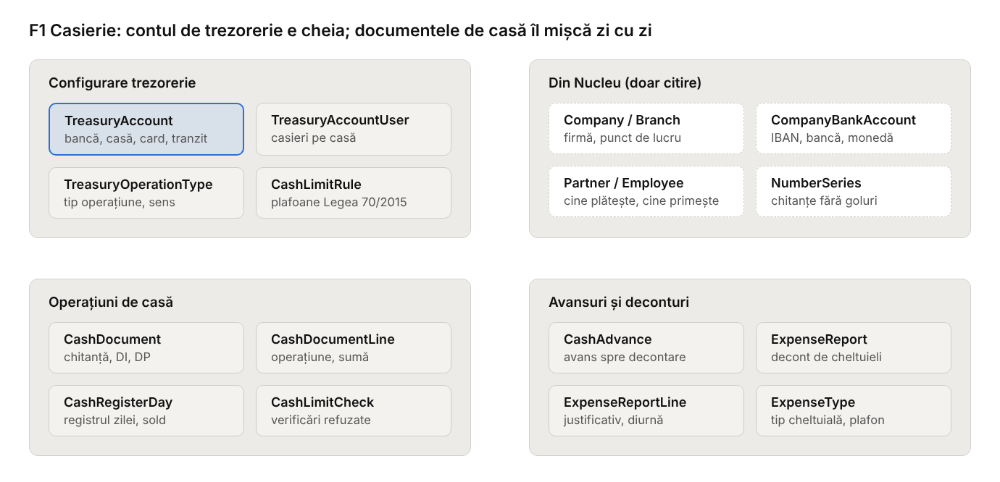

# ERP · 02.02 Finanțe · F1 Casierie și conturi de trezorerie

15 noiembrie 2026 · Aurelian · **✓ Validat de Aurelian (15.11.2026)**, cu deciziile lui din aceeași zi (doar storno, fără anulare; plafoanele 5.000 / 10.000 / 50.000 lei confirmate; închiderea zilei automată sau la cerere; avans nou cu avans depășit doar cu avertizare; deconturile le introduce contabilul)

Prima din cele 5 sub-părți ale părții financiare a modulului 02.02 Finanțe și contabilitate (schema SQL `fin`, prefix de cod `Erp.Finance`). Acoperă conturile de trezorerie ale firmei și tot ce ține de numerar: documentele de casă, registrul de casă zilnic, plafoanele de numerar, avansurile spre decontare și deconturile de cheltuieli. Documente părinte: [02 Module principale](../MODULE_PRINCIPALE.md), [02.01 Nucleu](../01-nucleu/NUCLEU.md). Principii: [01 Scop și principii](../../01-scop-si-principii/SCOP_SI_PRINCIPII.md) (P1–P10). Reguli de cod: [Bune practici (SQL și cod)](../../bune-practici/BUNE_PRACTICI.md), referite prin identificator (`SQL-nn`, `SP-nn`, `NET-nn`).

Celelalte sub-părți: F2 Bancă, F3 Decontări cu partenerii, F4 Multivalută, F5 Planificare trezorerie, apoi partea contabilă (plan de conturi, note contabile, reguli de contare, închideri, declarații). Indexul lor e în [README.md](README.md).

**Ce trebuie știut înainte de citire (context autonom, pentru oameni și pentru Copilot / Claude Code):**

- Produs ERP licențiat, instalat on-premise, o bază SQL Server per grup de firme, collation `Latin1_General_100_CS_AS_SC_UTF8` (case sensitive, `SQL-21`).
- Monolit modular .NET 10 + MediatR; acces la date doar cu Dapper și proceduri stocate, **fără EF Core sau alt ORM**; fiecare modul are schema lui; un modul vede din altul doar proiectul `.Contracts` (P1, `NET-01`).
- Orice comandă trece prin pipeline-ul comun din Nucleu (02.01, fluxul 4.1): licență → permisiune → validare → perioadă închisă → tranzacție → handler → audit → commit. Evenimentele pleacă prin outbox în aceeași tranzacție (P8).
- Ciclul de viață comun al documentelor: Ciornă → Validat (număr din serie, imutabil, eveniment) → Stornat; Anulat doar pentru documente fără efecte (02, „Convenții comune”).
- Partea contabilă nu există încă. F1 **nu scrie note contabile**: publică evenimente, iar regulile de contare care le transformă în note vin în partea contabilă. Până atunci, conturile de trezorerie și tipurile de operațiuni păstrează doar **simbolul contului contabil** (`5311`, `542`...) ca text, ca referință.

## 1. Scop și perimetru

| Zonă | Ce face F1 | Ce NU face (și cine face) |
| --- | --- | --- |
| Conturi de trezorerie | Registrul unic al locurilor unde firma ține bani: conturi bancare, case în lei și în valută, carduri de firmă, contul de viramente interne | IBAN-ul și banca (Nucleu: `CompanyBankAccount`); mișcările din bancă (F2) |
| Documente de casă | Chitanță, dispoziție de încasare, dispoziție de plată, storno (fără anulare); validare cu sold și plafoane | Bonul fiscal (POS, 02.10); factura (Vânzări, Achiziții) |
| Registrul de casă | Registrul zilnic pe fiecare casă, cu sold inițial, încasări, plăți, sold final; închiderea și redeschiderea zilei | Nota contabilă a zilei (partea contabilă) |
| Plafoane de numerar | Regulile din Legea 70/2015, cu dată de vigoare, verificate la validare | — |
| Avansuri spre decontare | Avansul acordat unui angajat, termenul de decontare, soldul rămas | Calculul salarial al diurnei impozabile (HR, 02.09) |
| Deconturi de cheltuieli | Decontul angajatului: justificative, diurnă, diferența de restituit sau de plătit | Înregistrarea facturii de furnizor (Achiziții, 02.04) |
| Legătura cu facturile | Linia de document de casă poate indica factura încasată sau plătită | Alocarea propriu-zisă pe facturi, soldurile partenerilor (F3) |
| Valută | Casă în valută, curs BNR memorat pe document, echivalent în lei | Diferențele de curs și reevaluarea (F4) |

Ce nu intră deloc în F1: reconcilierea bancară, ordinele de plată, compensările (F2, F3) și orice regulă de contare.

## 2. Model de domeniu

Contul de trezorerie (`TreasuryAccount`) e cheia: fiecare document de casă mișcă exact un cont de trezorerie de tip casă, iar registrul zilei se ține pe cont și zi.



Reguli de business ale modelului:

1. **Un cont de trezorerie are o singură monedă și aparține unei singure firme.** Casa în lei și casa în euro ale aceluiași punct de lucru sunt două conturi.
2. **Soldul unei case nu poate fi negativ** la sfârșitul niciunei zile și după niciun document validat. Regula e verificată la validare, nu doar la închiderea zilei.
3. **Documentele de casă se validează doar în zile deschise.** Zilele deschise ale unei case formează un interval continuu: de la prima zi neînchisă până azi. O zi se închide doar dacă ziua anterioară e închisă.
4. **Plafoanele de numerar au dată de vigoare** (P6) și se aplică după data documentului.
5. **Un angajat cu un avans nedecontat după termen poate primi un avans nou doar cu avertizare confirmată** (decizia din 15.11.2026); confirmarea intră în audit.
6. **Contul de viramente interne (tranzit)** trebuie să ajungă la sold zero: o depunere de numerar ieșită din casă rămâne „în tranzit” până apare în extrasul bancar (F2).
7. **Casierul lucrează doar pe casele la care e atribuit** (`TreasuryAccountUser`), pe lângă drepturile pe firmă din Nucleu.

## 3. Entități, documente și ciclul lor de viață

Convenții pentru toate tabelele (02.01, secțiunea 3): coloane de audit `CreatedAt`, `CreatedBy`, `ModifiedAt`, `ModifiedBy`, `RowVersion` (`SQL-11`, `SQL-19`); documentele validate au `ValidatedAt`, `ValidatedBy`; nomenclatoarele folosite se dezactivează, nu se șterg (`SQL-20`). Valorile sunt `decimal(19,2)` în moneda documentului și în lei, cursurile `decimal(19,6)` (`SQL-07`).

### 3.1 Cont de trezorerie (`TreasuryAccount`)

| Câmp | Tip | Reguli |
| --- | --- | --- |
| `CompanyId`, `BranchId` | FK | Firma obligatorie; punctul de lucru opțional (obligatoriu pentru case) |
| `Code`, `Name` | text | Cod unic pe firmă, fără diferență de majuscule (`SQL-24`): `CASA-SEDIU`, `BT-RON` |
| `Kind` | `tinyint` | 1 Bancă, 2 Casă, 3 Card de firmă, 4 Viramente interne (tranzit), 5 Acreditiv / depozit |
| `CurrencyCode` | `char(3)` | O singură monedă; nu se schimbă după primul document |
| `CompanyBankAccountId` | FK `core.CompanyBankAccount` | Obligatoriu pentru Bancă și Card; IBAN-ul vine din Nucleu și nu se copiază |
| `GlAccountCode` | `nvarchar(20)` | Simbolul contului contabil: `5121` bancă lei, `5124` bancă valută, `5311` casă lei, `5314` casă valută, `581` viramente interne, `5125` sume în curs de decontare (card). Devine FK spre planul de conturi în partea contabilă |
| `ResponsibleUserId` | FK `core.[User]` | Gestionarul (casierul titular), pentru casă |
| `ReceiptSeriesId`, `CashInSeriesId`, `CashOutSeriesId` | FK `core.NumberSeries` | Seriile chitanțelor, dispozițiilor de încasare și de plată; dacă lipsesc, se folosește seria implicită a firmei și a punctului de lucru |
| `MaxClosingBalance` | `decimal(19,2)` | Plafonul de sold propriu al casei (opțional, mai strict decât cel legal) |
| `CloseMode` | `tinyint` | 1 La cerere (implicit), 2 Automat la miezul nopții; în ambele moduri casierul poate închide ziua oricând la cerere |
| `OpeningDate` | `date` | Prima zi de lucru în sistem; soldul inițial vine printr-un document de sold inițial (3.3) |
| `IsActive` | `bit` | Un cont cu sold diferit de zero nu se poate dezactiva |

Atribuirea casierilor: `TreasuryAccountUser` (`TreasuryAccountId`, `UserId`, `CanValidate`, `ValidFrom`, `ValidTo`). Un utilizator fără atribuire vede casa doar dacă are `Fin.Cash.ViewAll`.

### 3.2 Tip de operațiune de trezorerie (`TreasuryOperationType`)

Nomenclator extensibil de client (`SQL-10`: tabelă, nu enum), comun casei (F1) și băncii (F2, care adaugă tipurile bancare). Numele a fost schimbat din `CashOperationType` pe 15.11.2026, la scrierea F2. Valorile de casă livrate (`MIG-06`):

| Cod | Denumire | Sens | Cere | Cont implicit (referință) |
| --- | --- | --- | --- | --- |
| `INC-CLIENT` | Încasare de la client | Intrare | Partener | `4111` |
| `INC-AVANS-CLIENT` | Avans încasat de la client | Intrare | Partener | `419` |
| `INC-RESTITUIRE-AVANS` | Restituire avans spre decontare | Intrare | Angajat, avans | `542` |
| `INC-RIDICARE-BANCA` | Numerar ridicat din bancă | Intrare | Cont de trezorerie sursă | `581` |
| `INC-VANZARI-POS` | Încasări din vânzări cu amănuntul (raport Z) | Intrare | — (generat automat, fluxul 4.6) | `4111` / `707` |
| `INC-DIVERSE` | Alte încasări | Intrare | Text explicativ | — |
| `PLATA-FURNIZOR` | Plată către furnizor | Ieșire | Partener | `401` |
| `PLATA-AVANS-FURNIZOR` | Avans plătit furnizorului | Ieșire | Partener | `409` |
| `PLATA-AVANS-DECONTARE` | Avans spre decontare acordat | Ieșire | Angajat | `542` |
| `PLATA-DIFERENTA-DECONT` | Diferență de plătit din decont | Ieșire | Angajat, decont | `542` |
| `PLATA-DEPUNERE-BANCA` | Numerar depus la bancă | Ieșire | Cont de trezorerie destinație | `581` |
| `PLATA-SALARII` | Plată salarii în numerar | Ieșire | Angajat | `421` |
| `PLATA-DIVERSE` | Alte plăți | Ieșire | Text explicativ | — |

Câmpuri: `Code`, `Name`, `Direction` (1 Intrare, 2 Ieșire), `RequiresPartner`, `RequiresEmployee`, `RequiresCounterAccount` (alt cont de trezorerie), `SettlementKind` (0 Nimic, 1 Facturi client, 2 Facturi furnizor, 3 Avans spre decontare, 4 Decont), `CounterGlAccountCode` (referință pentru partea contabilă), `CashLimitCategory` (ce plafon se aplică, 3.6), `AppliesToCash`, `AppliesToBank` (unde poate fi folosit), `IsSystem` (tipurile livrate nu se șterg și nu își schimbă sensul).

### 3.3 Document de casă (`CashDocument` + `CashDocumentLine`)

Un singur tabel pentru toate documentele de casă, deosebite prin `Kind`:

| `Kind` | Document | Când se folosește | Serie |
| --- | --- | --- | --- |
| 1 | Chitanță | Încasare în numerar de la un terț (client, persoană fizică) pentru care nu se emite bon fiscal | Fiscală, fără goluri |
| 2 | Dispoziție de încasare | Încasare internă: restituire avans, numerar ridicat din bancă, încasări din raport Z | Internă |
| 3 | Dispoziție de plată | Orice plată din casă: furnizor, avans spre decontare, salarii, depunere la bancă | Internă |
| 4 | Sold inițial | O singură dată pe casă, la pornirea în sistem (`OpeningDate`) | Fără număr din serie |

Formularele tipizate și conținutul lor minim urmează OMFP 2634/2015 privind documentele financiar-contabile.

**Antet** (`CashDocument`): `CompanyId`, `TreasuryAccountId`, `Kind`, `Number` (alocat la validare), `DocumentDate`, `AccountingDate` (egală cu data documentului; casa nu acceptă date contabile diferite), `PartnerId` sau `EmployeeId` sau `PersonName` + `PersonIdDocument` (pentru persoane fără fișă de partener; datele de identitate se criptează, `SP-20`), `CurrencyCode` (moneda casei), `ExchangeRate` și `RateDate` (BNR din ziua documentului, 02.01 fluxul 4.3; 1 pentru lei), `TotalAmount`, `TotalAmountRon`, `Description`, `Status`, `CashRegisterDayId`, `ReversalOfId` / `ReversedById`, `ExpenseReportId`, `CashAdvanceId`, `PublicId`, `IdempotencyKey`.

**Linie** (`CashDocumentLine`, `bigint`): `TreasuryOperationTypeId`, `Amount`, `AmountRon`, `CounterTreasuryAccountId` (la depuneri și ridicări), `SettlementRef` (referința facturii indicate de utilizator: tip document + id + număr, folosită de F3 la alocare), `CostCenterId`, `ProjectId` (dimensiuni din Nucleu), `Note`.

Reguli:

1. Toate liniile au același sens ca documentul: o chitanță sau o dispoziție de încasare are doar linii de intrare; o dispoziție de plată, doar de ieșire. `CHECK` pe `Kind` + `Direction` în procedura de validare.
2. `TotalAmount` = suma liniilor; calculul e în handler cu `IPrecisionService` (`SP-13`), iar procedura verifică egalitatea.
3. `TotalAmountRon` = `round(TotalAmount × ExchangeRate, 2)` la nivel de document; diferența de rotunjire față de suma liniilor se pune pe linia cu valoarea cea mai mare (P7).
4. Un document are cel mult un partener sau un angajat (plafoanele se calculează pe persoană).
5. Chitanța are obligatoriu un plătitor identificat (partener sau nume + act de identitate) și suma în litere pe tipărire.

**Ciclul de viață:**

| Stare | Ce înseamnă | Tranziții permise |
| --- | --- | --- |
| Ciornă (1) | Se editează și se șterge liber; nu mișcă soldul | → Validat, → ștergere |
| Validat (2) | Are număr, a mișcat soldul zilei, eveniment publicat | → Stornat |
| Stornat (3) | Anulat printr-un document de stornare cu sume negative, validat în ziua deschisă curentă | Final |

**Doar storno, fără anulare** (decizia lui Aurelian, 15.11.2026): un document de casă validat, inclusiv o chitanță greșită, se corectează numai prin stornare, chiar dacă ziua e încă deschisă. Convenția comună din 02 se aplică fără abatere. O greșeală prinsă înainte de validare se corectează în ciornă, care nu are încă număr.

### 3.4 Registrul de casă (`CashRegisterDay`)

Un rând pe casă și zi în care a existat cel puțin un document sau care a fost închisă explicit.

| Câmp | Reguli |
| --- | --- |
| `TreasuryAccountId`, `Day` | Unic pe pereche |
| `OpeningBalance` | Egal cu `ClosingBalance` al zilei anterioare cu activitate |
| `TotalIn`, `TotalOut`, `ClosingBalance` | Actualizate la fiecare validare și stornare, în aceeași tranzacție (`SP-16`) |
| `Status` | 1 Deschisă, 2 Închisă |
| `CloseMode` | Moștenit din contul de trezorerie: 1 La cerere, 2 Automat la miezul nopții (fluxul 4.2) |
| `FirstPageNo`, `LastPageNo` | Paginile registrului, numerotate continuu pe casă și an; alocate la închidere |
| `ClosedAt`, `ClosedBy`, `ReopenedAt`, `ReopenedBy`, `ReopenReason` | Închiderea și redeschiderea sunt auditate |

Registrul tipărit (sau PDF semnat și atașat, 02.01 `Attachment`) conține, în ordinea validării: număr document, fel document, explicație, încasări, plăți, sold, cu semnătura casierului și a contabilului.

### 3.5 Avans spre decontare (`CashAdvance`)

| Câmp | Reguli |
| --- | --- |
| `CompanyId`, `EmployeeId` | Angajatul din `core.Employee` |
| `Purpose` | 1 Cheltuieli curente, 2 Deplasare internă, 3 Deplasare externă, 4 Achiziție de bunuri |
| `CurrencyCode`, `Amount` | Valută permisă doar la deplasări externe |
| `GrantedByCashDocumentId` | Dispoziția de plată prin care s-a dat avansul (sau, în F2, plata bancară) |
| `TripStartDate`, `TripEndDate` | La deplasări |
| `SettlementDueDate` | Calculat: data întoarcerii (sau data acordării, la cheltuieli curente) + `Fin.Advance.SettlementWorkingDays` zile lucrătoare (implicit 3) |
| `SettledAmount`, `ReturnedAmount`, `Balance` | Actualizate de decont și de restituiri |
| `Status` | 1 Acordat, 2 Decontat parțial, 3 Decontat, 4 Depășit termenul (calculat de un job zilnic), 5 Stornat |

### 3.6 Plafoane de numerar (`CashLimitRule`)

Plafoanele din Legea 70/2015 se țin în tabel, cu dată de vigoare (P6), ca o modificare legislativă să fie o actualizare de date, nu de cod.

| `Category` | Ce se limitează | Valoare livrată | Acțiune |
| --- | --- | --- | --- |
| `IncasarePJ` | Încasări în numerar de la o persoană juridică, PFA sau profesie liberală, pe zi și persoană | 5.000 lei | Blocare |
| `IncasarePF` | Încasări în numerar de la o persoană fizică, pe zi și persoană | 10.000 lei | Blocare |
| `PlataPJ` | Plăți în numerar către o persoană juridică, PFA sau profesie liberală, pe zi și persoană | 5.000 lei | Blocare |
| `PlataPF` | Plăți în numerar către o persoană fizică, pe zi și persoană (exclus salarii, avansuri și deconturi legale) | 10.000 lei | Blocare |
| `AvansPersoanaZi` | Avansuri spre decontare din casă, pe zi și persoană (fără deplasări) | 5.000 lei | Blocare |
| `SoldCasa` | Soldul casei la sfârșitul zilei | 50.000 lei | Avertizare la închiderea zilei |

Valorile 5.000 / 10.000 / 50.000 lei sunt cele folosite acum (confirmat de Aurelian, 15.11.2026). **Valorile livrate se verifică cu forma în vigoare a Legii 70/2015 înainte de fiecare livrare** (au fost modificate de mai multe ori, ultima dată prin OUG 115/2023); responsabilitatea actualizării e a echipei produsului, prin migrare de date (`MIG-06`), cu `ValidFrom`. Câmpuri: `Category`, `CurrencyCode` (plafoanele în valută se compară cu echivalentul în lei la cursul BNR al zilei), `Amount`, `Action` (1 Blocare, 2 Avertizare), `ValidFrom`, `ValidTo`, `LegalReference`.

Reguli de calcul:

1. Suma zilnică se calculează pe **firmă** (toate casele ei), partener și zi, inclusiv documentul curent; documentele stornate și stornările lor nu se numără.
2. **Nu se permite fracționarea**: două documente în aceeași zi pentru același partener se adună.
3. Tipul de persoană (PJ sau PF) se ia din `core.Partner.PartnerType`; pentru `PersonName` fără partener se consideră persoană fizică.
4. O verificare refuzată se jurnalizează în `CashLimitCheck` (utilizator, partener, sumă, plafon), pentru raportul de încercări de depășire.
5. Plafonul de Blocare **nu are excepție prin drepturi**: nici Administratorul nu îl poate ocoli. Avertizarea se confirmă explicit, iar confirmarea intră în audit.

### 3.7 Decont de cheltuieli (`ExpenseReport` + `ExpenseReportLine`)

**Antet**: `CompanyId`, `EmployeeId`, `CashAdvanceId` (opțional; un decont poate închide un singur avans), `Number`, `DocumentDate`, `CurrencyCode`, `TotalJustified`, `AdvanceAmount`, `Difference` (pozitiv: firma datorează angajatului; negativ: angajatul restituie), `Status` (Ciornă, Trimis spre aprobare, Aprobat, Validat, Stornat), `ApprovedBy`, `ApprovedAt`.

**Linie** (`ExpenseReportLine`): `ExpenseTypeId`, `JustificationKind` (1 Factură pe firmă, 2 Bon fiscal, 3 Diurnă, 4 Alt document), `DocumentNo`, `DocumentDate`, `SupplierFiscalCode`, `SupplierInvoiceId` (factura de furnizor din Achiziții, dacă e factură pe firmă), `Amount`, `VatAmount`, `CostCenterId`, `ProjectId`; pentru diurnă: `Days`, `DailyAmount`, `NonTaxableAmount`, `TaxableAmount`.

Reguli:

1. **Factura pe numele firmei** (inclusiv cele primite prin e-Factura) se înregistrează ca factură de furnizor în Achiziții; linia decontului o referă, iar F3 va stinge datoria față de furnizor din avansul angajatului (plată prin angajat). Decontul nu dublează factura.
2. **Bonul fiscal fără factură** rămâne cheltuială justificată direct în decont (TVA dedus doar dacă bonul îndeplinește condițiile de factură simplificată; setare per tip de cheltuială).
3. **Diurna**: suma pe zi și plafonul neimpozabil se iau din `ExpenseType` (cu dată de vigoare); partea impozabilă se transmite către HR prin eveniment (5.1), pentru calculul salarial.
4. Diferența se închide printr-o dispoziție de încasare (restituire) sau de plată (diferență de plătit), generate din decont ca ciorne și validate de casier.
5. Separarea sarcinilor: cine a întocmit decontul nu îl poate aproba (configurabil, ca în 00, „Securitate”).

`ExpenseType` (nomenclator): `Code`, `Name`, `DefaultVatRateCode`, `IsPerDiem`, `DailyAmount`, `NonTaxableDailyLimit`, `CurrencyCode`, `CountryCode` (diurna externă pe țară), `ValidFrom`, `ValidTo`, `CounterGlAccountCode`.

## 4. Fluxuri principale

### 4.1 Încasare sau plată în numerar

1. Casierul deschide ecranul Casa, alege casa (doar cele atribuite) și ziua curentă deschisă.
2. Creează documentul: tipul (chitanță, DI, DP), partenerul sau angajatul, liniile cu tipul de operațiune și suma; opțional indică factura (din lista facturilor deschise ale partenerului, furnizată de F3).
3. La salvare (ciornă), serverul calculează totalurile și echivalentul în lei (`UI-05`).
4. La validare, handler-ul `ValidateCashDocument`:
   1. blochează rândul contului de trezorerie (`UPDLOCK`), ca validările pe aceeași casă să se serializeze (`SP-16`);
   2. verifică ziua (deschisă) și plafoanele (3.6);
   3. alocă numărul din serie (02.01, fluxul 4.2);
   4. actualizează `CashRegisterDay` și verifică soldul nenegativ pentru ziua documentului și pentru zilele deschise ulterioare;
   5. scrie `IncasareInregistrata` sau `PlataInregistrata` în outbox.
5. În aceeași tranzacție, handler-ul apelează serviciul intern de alocare din F3 (`ISettlementService`, în același modul Finanțe), care stinge factura indicată sau, după setarea partenerului, pe cele mai vechi (F3, fluxul 4.2). F1, F2 și F3 sunt părți ale aceluiași modul, deci se apelează direct, nu prin evenimente; evenimentul e pentru celelalte module și pentru partea contabilă.
6. Chitanța se tipărește în două exemplare (PDF din șablon), cu suma în litere.

### 4.2 Închiderea și redeschiderea zilei

1. Casierul cere „Închide ziua”. Condiții: ziua anterioară cu activitate e închisă; nu există ciorne datate în acea zi (se mută sau se șterg); soldul final ≥ 0.
2. Dacă soldul depășește plafonul `SoldCasa` sau `MaxClosingBalance`, sistemul avertizează și propune o dispoziție de plată „Numerar depus la bancă”.
3. Se alocă paginile registrului, se generează PDF-ul registrului și se atașează zilei (hash SHA-256, 02.01).
4. Se publică `RegistruCasaInchis`.
5. Redeschiderea cere `Fin.Cash.ReopenDay`, un motiv scris și condiția ca perioada contabilă să nu fie închisă; se redeschid automat și zilele ulterioare închise, în ordine inversă. Toate se auditează.

Moduri de închidere (decizia lui Aurelian, 15.11.2026), setate pe fiecare casă în `TreasuryAccount.CloseMode`:

- **La cerere**: casierul închide ziua din ecranul Casa, oricând.
- **Automat la miezul nopții**: un job Hangfire rulează la 00:05 (ora României) și închide ziua precedentă a fiecărei case cu acest mod, dacă îndeplinește condițiile de la pasul 1; închiderea se face în numele utilizatorului tehnic al modulului și apare în audit. Dacă o condiție nu e îndeplinită (ciorne, zi anterioară deschisă), ziua rămâne deschisă, iar casierul și contabilul primesc notificare. Și în acest mod casierul poate închide ziua mai devreme, la cerere.

### 4.3 Depunere și ridicare de numerar (viramente interne)

1. Depunere: dispoziție de plată din casă cu `PLATA-DEPUNERE-BANCA` și contul bancar destinație. Suma intră în tranzit (`581`).
2. Extrasul bancar (F2) conține depunerea; reconcilierea leagă linia de extras de dispoziția de plată și închide tranzitul.
3. Ridicare: invers; extrasul bancar arată ieșirea, iar dispoziția de încasare din casă cu `INC-RIDICARE-BANCA` închide tranzitul.
4. Raportul „Sume în tranzit” arată ce nu s-a închis după `Fin.Transit.AlertDays` (implicit 3 zile lucrătoare).

### 4.4 Avans spre decontare și decont

1. Contabilul creează avansul (`CashAdvance`): angajat, scop, sumă, perioada deplasării. Verificări: avans nedecontat după termen (avertizare care trebuie confirmată, regula 5 din secțiunea 2), plafonul `AvansPersoanaZi` (blocare, fără deplasări).
2. La validarea dispoziției de plată generate, avansul trece în Acordat și se publică `AvansDecontareAcordat`.
3. După întoarcere, angajatul predă documentele, iar **contabilul introduce decontul** (decizia din 15.11.2026: fără self-service pentru angajați până la modulul HR), cu justificativele și diurna.
4. Decontul se aprobă (șeful direct sau rolul configurat), apoi se validează de contabil.
5. Diferența generează DI sau DP (ciornă); validarea lor de către casier închide avansul.
6. Jobul zilnic marchează avansurile depășite și trimite notificări angajatului, contabilului și șefului (02.01, fluxul 4.7).

### 4.5 Sold inițial la pornirea în sistem

1. La configurarea casei se introduce documentul de sold inițial, cu data `OpeningDate - 1`, înainte de orice alt document.
2. Avansurile spre decontare nedecontate la data pornirii se importă (Excel, prin mecanismul de import din 02.01, fluxul 4.8), legate de documentul de sold inițial al contului `542`.

### 4.6 Încasările din POS în casa magazinului

1. Consumatorul evenimentului `ZiInchisaPOS` (02.10) caută casa de trezorerie atribuită magazinului (`Store.TreasuryAccountId`, definit în 02.10).
2. Creează și validează automat o dispoziție de încasare `INC-VANZARI-POS` cu suma în numerar din raportul Z (plățile cu card merg în F2, ca sume în curs de decontare).
3. Dacă ziua casei e închisă, documentul rămâne ciornă și se trimite notificare contabilului. Procesarea e idempotentă (`core.InboxProcessed`).

### 4.7 Cazuri limită

| Situație | Comportament |
| --- | --- |
| Doi casieri validează simultan pe aceeași casă | Se serializează pe rândul contului de trezorerie; soldul rămâne corect (test de concurență, criteriul F1-A3) |
| Document datat într-o zi închisă | Refuz `FIN_CASH_DAY_CLOSED`; se redeschide ziua sau se datează azi |
| Plată care ar face soldul negativ într-o zi ulterioară deschisă | Refuz `FIN_CASH_NEGATIVE_BALANCE`, cu ziua și soldul afectat în mesaj |
| Partener care plătește 3.000 lei dimineața și 3.000 lei după-amiaza la două case diferite | A doua încasare e refuzată (plafon pe firmă, regula 1 din 3.6) |
| Chitanță tipărită greșit după validare | Storno și chitanță nouă corectă; ambele apar în registru |
| Eroare descoperită după închiderea zilei | Storno în ziua curentă și document nou corect; ziua veche nu se modifică |
| Casă în valută fără curs BNR în ziua documentului | Se folosește ultimul curs anterior (02.01, fluxul 4.3), cu data lui memorată în `RateDate` |
| Angajat plecat din firmă cu avans nedecontat | Raportul de avansuri îl evidențiază; reținerea din lichidare e o operațiune HR (02.09) |
| Perioadă contabilă închisă | Refuz în pipeline `CORE_PERIOD_CLOSED` (02.01, fluxul 4.1), inclusiv la redeschiderea zilei |

## 5. Evenimente

### 5.1 Publicate

Toate moștenesc `IntegrationEvent` din `Erp.Core.Contracts` (02.01, secțiunea 5). Numele sunt la trecut, în română fără diacritice.

| Eveniment | Când | Conținut (pe lângă anvelop) | Consumatori |
| --- | --- | --- | --- |
| `IncasareInregistrata` v1 | Validarea unei chitanțe sau dispoziții de încasare (în F2: și a unei încasări bancare) | `TreasuryAccountId`, `TreasuryKind`, `DocumentType`, `DocumentId`, `Number`, `DocumentDate`, `PartnerId`, `EmployeeId`, `CurrencyCode`, `ExchangeRate`, `TotalAmount`, `TotalAmountRon`, lista `{LineId, OperationTypeCode, Amount, AmountRon, SettlementRef, CounterTreasuryAccountId}` | Vânzări, CRM, partea contabilă (alocarea F3 se face sincron, în aceeași tranzacție) |
| `PlataInregistrata` v1 | Validarea unei dispoziții de plată (în F2: și a unei plăți bancare) | Idem | F3, Achiziții, partea contabilă |
| `DocumentTrezorerieStornat` v1 | Validarea unui storno | `OriginalDocumentId`, `ReversalDocumentId`, `DocumentDate` | F3, partea contabilă |
| `RegistruCasaInchis` v1 | Închiderea unei zile | `TreasuryAccountId`, `Day`, `OpeningBalance`, `TotalIn`, `TotalOut`, `ClosingBalance` | Raportare, partea contabilă |
| `AvansDecontareAcordat` v1 | Validarea plății avansului | `CashAdvanceId`, `EmployeeId`, `Amount`, `CurrencyCode`, `SettlementDueDate` | HR (evidență), Raportare |
| `DecontCheltuieliValidat` v1 | Validarea decontului | `ExpenseReportId`, `EmployeeId`, `CashAdvanceId`, `TotalJustified`, `Difference`, `TaxablePerDiemAmount`, liniile cu `ExpenseTypeCode`, `Amount`, `VatAmount`, `SupplierInvoiceId` | HR (diurna impozabilă), F3, partea contabilă |

`IncasareInregistrata` și `PlataInregistrata` sunt evenimentele modulului deja anunțate în 02; F2 le publică cu aceeași formă, ca F3 și contabilitatea să aibă un singur consumator pentru numerar și bancă.

### 5.2 Consumate

| Eveniment | De la | Ce face F1 |
| --- | --- | --- |
| `ZiInchisaPOS` | POS (02.10) | Dispoziție de încasare automată în casa magazinului (fluxul 4.6) |
| `UtilizatorDezactivat` | Nucleu | Închide atribuirile `TreasuryAccountUser` ale utilizatorului |
| `FirmaModificata` | Nucleu | Nimic de recalculat; datele firmei se citesc la tipărire |

## 6. Contracte publice (`Erp.Finance.Contracts`, partea F1)

Celelalte module văd F1 doar prin aceste interfețe și DTO-uri (`NET-01`); toate sunt `record`-uri imutabile, cu `decimal` pentru bani (`NET-14`) și `DateOnly` pentru zile (`NET-15`).

```csharp
namespace Erp.Finance.Contracts.Treasury;

public enum TreasuryAccountKind : byte { Bank = 1, Cash = 2, CompanyCard = 3, Transit = 4, Deposit = 5 }

public sealed record TreasuryAccountDto(
    int Id, int CompanyId, int? BranchId, string Code, string Name,
    TreasuryAccountKind Kind, string CurrencyCode, int? CompanyBankAccountId,
    string? GlAccountCode, bool IsActive);

public sealed record TreasuryBalanceDto(
    int TreasuryAccountId, DateOnly Day, string CurrencyCode,
    decimal Balance, decimal BalanceRon, bool IsDayClosed);

public interface ITreasuryAccountQueries
{
    Task<IReadOnlyList<TreasuryAccountDto>> GetByCompanyAsync(
        int companyId, TreasuryAccountKind? kind, CancellationToken ct);
    Task<TreasuryBalanceDto> GetBalanceAsync(
        int treasuryAccountId, DateOnly day, CancellationToken ct);
}

// Folosit de POS (02.10) și de alte module care generează încasări de numerar
public sealed record CashReceiptRequest(
    int CompanyId, int TreasuryAccountId, DateOnly DocumentDate,
    string OperationTypeCode, decimal Amount, string Description,
    string SourceModule, string SourceDocumentRef);

public interface ICashDocumentWriter
{
    // Creează și încearcă validarea în tranzacția curentă; dacă ziua e închisă, lasă ciorna și întoarce Validated = false
    Task<CashDocumentResult> CreateCashInAsync(CashReceiptRequest request, CancellationToken ct);
}

public sealed record CashDocumentResult(int CashDocumentId, string? Number, bool Validated);

// Folosit de HR (02.09) la lichidare și de rapoarte
public sealed record OpenAdvanceDto(
    int CashAdvanceId, int EmployeeId, string CurrencyCode,
    decimal Balance, DateOnly SettlementDueDate, bool IsOverdue);

public interface ICashAdvanceQueries
{
    Task<IReadOnlyList<OpenAdvanceDto>> GetOpenByEmployeeAsync(
        int companyId, int employeeId, CancellationToken ct);
}
```

Comenzile interne F1 (nu sunt în `.Contracts`; `NET-02`, `NET-04`, `NET-05`): `CreateTreasuryAccount`, `UpdateTreasuryAccount`, `AssignCashier`, `SaveCashDocument`, `ValidateCashDocument`, `ReverseCashDocument`, `CloseCashDay`, `ReopenCashDay`, `CreateCashAdvance`, `SaveExpenseReport`, `SubmitExpenseReport`, `ApproveExpenseReport`, `ValidateExpenseReport`, `SaveCashLimitRule`.

Exemplu, după șablonul din Bune practici 4.5:

```csharp
// Finance/Cash/Validate/ValidateCashDocument.cs
[Module("Finance")]
[RequiresPermission("Fin.Cash.Validate")]
[Audited("Fin.Cash.Validate")]
public sealed record ValidateCashDocument(int CashDocumentId, byte[] RowVersion, bool ConfirmWarnings)
    : ICommand<ValidateCashDocumentResult>;

public sealed record ValidateCashDocumentResult(int CashDocumentId, string Number, decimal DayClosingBalance, byte[] RowVersion);

internal sealed class ValidateCashDocumentHandler(
    ICashDocumentStore documents,
    ICashLimitService limits,
    INumberSeriesService numbers,
    IOutbox outbox,
    ICurrentContext context) : ICommandHandler<ValidateCashDocument, ValidateCashDocumentResult>
{
    public async Task<ValidateCashDocumentResult> Handle(ValidateCashDocument cmd, CancellationToken ct)
    {
        var doc = await documents.GetForValidationAsync(cmd.CashDocumentId, ct)
            ?? throw new NotFoundError("FIN_CASH_DOCUMENT_NOT_FOUND");

        doc.EnsureCanValidate();                                    // stare, sens linii, totaluri

        await limits.EnsureWithinLimitsAsync(doc, cmd.ConfirmWarnings, ct);   // 3.6; Blocare => 409

        var number = await numbers.NextAsync(
            context.CompanyId, doc.SeriesDocumentType, doc.DocumentDate, ct);

        var result = await documents.ValidateAsync(cmd.CashDocumentId, number, cmd.RowVersion, ct);
        // procedura blochează contul de trezorerie, actualizează CashRegisterDay și verifică soldul

        await outbox.EnqueueAsync(doc.ToIntegrationEvent(number, context), ct);   // P8, aceeași tranzacție
        return result;
    }
}
```

## 7. Schema SQL `fin` (partea F1)

| Tabel | Cheie primară | Chei unice / străine principale | Indecși suplimentari |
| --- | --- | --- | --- |
| `fin.TreasuryAccount` | `Id int` | UX `(CompanyId, CodeKey)`; FK `CompanyId`, `BranchId`, `CompanyBankAccountId`, `ResponsibleUserId`, cele trei serii | `(CompanyId, Kind, IsActive)` |
| `fin.TreasuryAccountUser` | `Id int` | UQ `(TreasuryAccountId, UserId)`; FK | `UserId` |
| `fin.TreasuryOperationType` | `Id int` | UX `CodeKey` | — |
| `fin.CashDocument` | `Id int` | UX filtrat `(TreasuryAccountId, Kind, Number) WHERE Number IS NOT NULL`; UQ `PublicId`; FK `TreasuryAccountId`, `PartnerId`, `EmployeeId`, `CashRegisterDayId`, `ReversalOfId`, `CashAdvanceId`, `ExpenseReportId` | `(CompanyId, DocumentDate)` (`SQL-18`); `(PartnerId, DocumentDate)` INCLUDE `(TotalAmountRon, Status)` pentru plafoane; `(TreasuryAccountId, DocumentDate, Status)` |
| `fin.CashDocumentLine` | `Id bigint` | FK `CashDocumentId` (cascadă doar pe ciornă, `SQL-15`), `TreasuryOperationTypeId`, `CounterTreasuryAccountId` | `CashDocumentId` |
| `fin.CashRegisterDay` | `Id int` | UQ `(TreasuryAccountId, Day)` | `(TreasuryAccountId, Status, Day)` |
| `fin.CashLimitRule` | `Id int` | UQ `(Category, CurrencyCode, ValidFrom)` | — |
| `fin.CashLimitCheck` | `Id bigint` | FK `PartnerId` (opțional) | `(CompanyId, CheckedAt)` |
| `fin.CashAdvance` | `Id int` | FK `EmployeeId`, `GrantedByCashDocumentId` | `(CompanyId, EmployeeId, Status)`; filtrat `WHERE Status IN (1,2,4)` |
| `fin.ExpenseType` | `Id int` | UQ `(CodeKey, ValidFrom)` | — |
| `fin.ExpenseReport` | `Id int` | UX filtrat `(CompanyId, Number) WHERE Number IS NOT NULL`; FK `EmployeeId`, `CashAdvanceId` | `(CompanyId, DocumentDate)`, `(EmployeeId, Status)` |
| `fin.ExpenseReportLine` | `Id bigint` | FK `ExpenseReportId`, `ExpenseTypeId`; `SupplierInvoiceId` fără FK (altă schemă, P1) | `ExpenseReportId` |

Legăturile spre alte scheme (`core.Company`, `core.Partner`, `core.Employee`, `core.[User]`, `core.NumberSeries`, `core.CompanyBankAccount`) au FK declarat: Nucleul e dedesubtul tuturor modulelor, iar 02.01 permite referințe spre `core`. Spre module de pe același nivel sau de deasupra (Achiziții, POS) nu se pune FK; se păstrează Id-ul și se verifică prin contracte.

Exemplu de tabel complet:

```sql
CREATE TABLE fin.CashDocument (
    Id                  int IDENTITY(1,1)  NOT NULL CONSTRAINT PK_CashDocument PRIMARY KEY,
    PublicId            uniqueidentifier   NOT NULL CONSTRAINT DF_CashDocument_PublicId DEFAULT (NEWID()),
    CompanyId           int                NOT NULL CONSTRAINT FK_CashDocument_Company REFERENCES core.Company(Id),
    TreasuryAccountId   int                NOT NULL CONSTRAINT FK_CashDocument_TreasuryAccount REFERENCES fin.TreasuryAccount(Id),
    Kind                tinyint            NOT NULL,
    Number              nvarchar(30)       NULL,          -- alocat la validare
    DocumentDate        date               NOT NULL,
    Status              tinyint            NOT NULL CONSTRAINT DF_CashDocument_Status DEFAULT (1),
    PartnerId           int                NULL CONSTRAINT FK_CashDocument_Partner REFERENCES core.Partner(Id),
    EmployeeId          int                NULL CONSTRAINT FK_CashDocument_Employee REFERENCES core.Employee(Id),
    PersonName          nvarchar(200)      NULL,
    PersonIdEncrypted   varbinary(256)     NULL,          -- act de identitate criptat (SP-20)
    CurrencyCode        char(3)            NOT NULL CONSTRAINT FK_CashDocument_Currency REFERENCES core.Currency(Code),
    ExchangeRate        decimal(19,6)      NOT NULL,
    RateDate            date               NOT NULL,
    TotalAmount         decimal(19,2)      NOT NULL,
    TotalAmountRon      decimal(19,2)      NOT NULL,
    Description         nvarchar(500)      NULL,
    CashRegisterDayId   int                NULL CONSTRAINT FK_CashDocument_CashRegisterDay REFERENCES fin.CashRegisterDay(Id),
    ReversalOfId        int                NULL CONSTRAINT FK_CashDocument_CashDocument_ReversalOf REFERENCES fin.CashDocument(Id),
    CashAdvanceId       int                NULL CONSTRAINT FK_CashDocument_CashAdvance REFERENCES fin.CashAdvance(Id),
    ExpenseReportId     int                NULL CONSTRAINT FK_CashDocument_ExpenseReport REFERENCES fin.ExpenseReport(Id),
    ValidatedAt         datetime2(3)       NULL,
    ValidatedBy         int                NULL,
    CreatedAt           datetime2(3)       NOT NULL CONSTRAINT DF_CashDocument_CreatedAt DEFAULT (sysutcdatetime()),
    CreatedBy           int                NOT NULL,
    ModifiedAt          datetime2(3)       NULL,
    ModifiedBy          int                NULL,
    RowVersion          rowversion         NOT NULL,
    CONSTRAINT CK_CashDocument_Kind   CHECK (Kind IN (1, 2, 3, 4)),
    CONSTRAINT CK_CashDocument_Status CHECK (Status IN (1, 2, 3)),
    CONSTRAINT CK_CashDocument_OnePerson CHECK (
        (CASE WHEN PartnerId  IS NOT NULL THEN 1 ELSE 0 END)
      + (CASE WHEN EmployeeId IS NOT NULL THEN 1 ELSE 0 END)
      + (CASE WHEN PersonName IS NOT NULL THEN 1 ELSE 0 END) <= 1),
    CONSTRAINT CK_CashDocument_ReceiptHasPayer CHECK (Kind <> 1 OR PartnerId IS NOT NULL OR PersonName IS NOT NULL),
    CONSTRAINT CK_CashDocument_PostedHasNumber CHECK (Status = 1 OR Kind = 4 OR Number IS NOT NULL)
);
CREATE UNIQUE INDEX UX_CashDocument_TreasuryAccountId_Kind_Number
    ON fin.CashDocument (TreasuryAccountId, Kind, Number) WHERE Number IS NOT NULL;
CREATE UNIQUE INDEX UX_CashDocument_PublicId ON fin.CashDocument (PublicId);
CREATE INDEX IX_CashDocument_CompanyId_DocumentDate ON fin.CashDocument (CompanyId, DocumentDate);
CREATE INDEX IX_CashDocument_PartnerId_DocumentDate
    ON fin.CashDocument (PartnerId, DocumentDate) INCLUDE (TotalAmountRon, Status, Kind)
    WHERE PartnerId IS NOT NULL;
CREATE INDEX IX_CashDocument_TreasuryAccountId_DocumentDate_Status
    ON fin.CashDocument (TreasuryAccountId, DocumentDate, Status);
```

Procedura de validare, după șablonul din Bune practici 3.5 (tranzacția e a pipeline-ului, `SP-03`):

```sql
CREATE OR ALTER PROCEDURE fin.usp_CashDocument_Validate
    @CashDocumentId int,
    @Number         nvarchar(30),
    @RowVersion     binary(8),
    @UserId         int
AS
BEGIN
    SET NOCOUNT ON;
    SET XACT_ABORT ON;

    DECLARE @Status tinyint, @Kind tinyint, @AccountId int, @Day date,
            @Amount decimal(19,2), @CurrentVersion binary(8), @DayId int, @DayStatus tinyint;

    SELECT @Status = d.Status, @Kind = d.Kind, @AccountId = d.TreasuryAccountId,
           @Day = d.DocumentDate, @Amount = d.TotalAmount, @CurrentVersion = d.RowVersion
    FROM fin.CashDocument AS d WITH (UPDLOCK, ROWLOCK)
    WHERE d.Id = @CashDocumentId;

    IF @Status IS NULL
        THROW 51001, N'Documentul de casă nu există.', 1;
    IF @CurrentVersion <> @RowVersion
        THROW 51002, N'Documentul a fost modificat de alt utilizator.', 1;
    IF @Status <> 1
        THROW 51003, N'Doar o ciornă poate fi validată.', 1;

    -- Serializare pe casă: ordinea de blocare e mereu cont de trezorerie, apoi ziua (SP-16)
    UPDATE fin.TreasuryAccount SET ModifiedAt = ModifiedAt WHERE Id = @AccountId;

    SELECT @DayId = Id, @DayStatus = Status
    FROM fin.CashRegisterDay WITH (UPDLOCK, ROWLOCK)
    WHERE TreasuryAccountId = @AccountId AND Day = @Day;

    IF @DayStatus = 2
        THROW 51004, N'Ziua de casă este închisă.', 1;

    IF @DayId IS NULL
    BEGIN
        INSERT INTO fin.CashRegisterDay (TreasuryAccountId, Day, OpeningBalance, TotalIn, TotalOut, Status, CreatedBy)
        SELECT @AccountId, @Day,
               ISNULL((SELECT TOP (1) p.ClosingBalance FROM fin.CashRegisterDay AS p
                       WHERE p.TreasuryAccountId = @AccountId AND p.Day < @Day ORDER BY p.Day DESC), 0),
               0, 0, 1, @UserId;
        SET @DayId = SCOPE_IDENTITY();
    END;

    DECLARE @In decimal(19,2) = CASE WHEN @Kind IN (1, 2, 4) THEN @Amount ELSE 0 END;
    DECLARE @Out decimal(19,2) = CASE WHEN @Kind = 3 THEN @Amount ELSE 0 END;

    -- Ziua documentului și toate zilele deschise ulterioare (ClosingBalance e coloană calculată persistată)
    UPDATE fin.CashRegisterDay
    SET TotalIn  = TotalIn  + CASE WHEN Id = @DayId THEN @In  ELSE 0 END,
        TotalOut = TotalOut + CASE WHEN Id = @DayId THEN @Out ELSE 0 END,
        OpeningBalance = OpeningBalance + CASE WHEN Id = @DayId THEN 0 ELSE @In - @Out END,
        ModifiedAt = SYSUTCDATETIME(), ModifiedBy = @UserId
    WHERE TreasuryAccountId = @AccountId AND Day >= @Day;

    IF EXISTS (SELECT 1 FROM fin.CashRegisterDay
               WHERE TreasuryAccountId = @AccountId AND Day >= @Day AND ClosingBalance < 0)
        THROW 51005, N'Soldul casei ar deveni negativ.', 1;

    UPDATE fin.CashDocument
    SET Status = 2, Number = @Number, CashRegisterDayId = @DayId,
        ValidatedAt = SYSUTCDATETIME(), ValidatedBy = @UserId,
        ModifiedAt  = SYSUTCDATETIME(), ModifiedBy  = @UserId
    WHERE Id = @CashDocumentId;

    SELECT d.Id, d.Number, r.ClosingBalance AS DayClosingBalance, d.RowVersion
    FROM fin.CashDocument AS d
    JOIN fin.CashRegisterDay AS r ON r.Id = d.CashRegisterDayId
    WHERE d.Id = @CashDocumentId;
END;
```

`fin.CashRegisterDay.ClosingBalance` e coloană calculată persistată `AS (OpeningBalance + TotalIn - TotalOut) PERSISTED`, ca să nu existe două surse pentru sold. Documentul de stornare are sume negative, deci intră pe aceeași formulă.

Proceduri stocate principale:

| Procedură | Rol | Publică |
| --- | --- | --- |
| `fin.usp_TreasuryAccount_Save`, `fin.usp_TreasuryAccount_List` | Configurare și listă | List: da |
| `fin.usp_TreasuryAccount_GetBalance` | Sold pe cont și zi | Da |
| `fin.usp_CashDocument_Save` | Salvare ciornă cu linii (TVP `fin.tt_CashDocumentLine`, `SP-07`) | Nu |
| `fin.usp_CashDocument_Validate` | Validare (mai sus) | Nu |
| `fin.usp_CashDocument_Reverse` | Storno: document cu sume negative în ziua deschisă curentă | Nu |
| `fin.usp_CashLimit_GetDailyTotal` | Totalul zilei pe firmă, partener și categorie, pentru verificarea plafonului | Nu |
| `fin.usp_CashRegisterDay_Close`, `fin.usp_CashRegisterDay_Reopen` | Închidere cu alocare de pagini (la cerere sau din jobul de la miezul nopții); redeschidere | Nu |
| `fin.usp_CashRegister_Report` | Registrul de casă pe zi sau interval | Nu |
| `fin.usp_CashAdvance_Save`, `fin.usp_CashAdvance_MarkOverdue` | Avans; job zilnic de termen | Nu |
| `fin.usp_ExpenseReport_Save`, `fin.usp_ExpenseReport_Validate` | Decont | Nu |

Coduri de eroare. Plaja modulului e `51000–51999` (`SP-04`); o împart pe sub-părți ca să nu se suprapună: F1 `51000–51199`, F2 `51200–51399`, F3 `51400–51599`, F4 `51600–51699`, F5 `51700–51799`, partea contabilă `51800–51999`. Codurile API au prefixul `FIN_` (`NET-09`).

| Cod SQL | Cod API | HTTP | Când apare |
| --- | --- | --- | --- |
| 51001 | `FIN_CASH_DOCUMENT_NOT_FOUND` | 404 | Documentul nu există |
| 51002 | `FIN_CONCURRENCY_CONFLICT` | 409 | `RowVersion` diferit (`SP-18`) |
| 51003 | `FIN_CASH_DOCUMENT_NOT_DRAFT` | 409 | Validare sau modificare pe un document care nu e ciornă |
| 51004 | `FIN_CASH_DAY_CLOSED` | 409 | Documentul e datat într-o zi închisă |
| 51005 | `FIN_CASH_NEGATIVE_BALANCE` | 409 | Soldul casei ar deveni negativ |
| 51006 | `FIN_CASH_LIMIT_EXCEEDED` | 409 | Plafon legal de numerar depășit (Blocare) |
| 51007 | `FIN_CASH_LIMIT_WARNING_UNCONFIRMED` | 409 | Plafon de avertizare neconfirmat de utilizator |
| 51008 | `FIN_CASH_LINE_DIRECTION_MISMATCH` | 400 | Linie de ieșire pe document de intrare sau invers |
| 51009 | `FIN_CASH_TOTAL_MISMATCH` | 400 | Totalul antetului diferă de suma liniilor |
| 51010 | — | — | Retras pe 15.11.2026 (anularea chitanței nu mai există); numărul nu se refolosește |
| 51011 | `FIN_CASH_ALREADY_REVERSED` | 409 | Document deja stornat |
| 51012 | `FIN_CASH_PREVIOUS_DAY_OPEN` | 409 | Închidere de zi cu o zi anterioară deschisă |
| 51013 | `FIN_CASH_DAY_HAS_DRAFTS` | 409 | Închidere de zi cu ciorne datate în ziua respectivă |
| 51014 | `FIN_CASHIER_NOT_ASSIGNED` | 403 | Utilizatorul nu e atribuit casei |
| 51015 | `FIN_TREASURY_ACCOUNT_CURRENCY_LOCKED` | 409 | Schimbarea monedei unui cont cu documente |
| 51016 | `FIN_TREASURY_ACCOUNT_NOT_EMPTY` | 409 | Dezactivarea unui cont cu sold diferit de zero |
| 51017 | `FIN_OPENING_BALANCE_EXISTS` | 409 | Al doilea sold inițial sau sold inițial după alte documente |
| 51018 | `FIN_ADVANCE_OVERDUE_UNCONFIRMED` | 409 | Angajatul are un avans nedecontat după termen, iar avertizarea nu a fost confirmată |
| 51019 | `FIN_EXPENSE_REPORT_SELF_APPROVAL` | 403 | Aprobarea propriului decont, cu separarea sarcinilor activă |
| 51020 | `FIN_EXPENSE_REPORT_ADVANCE_MISMATCH` | 409 | Decontul referă un avans al altui angajat sau deja decontat |

Conformitate: schema și procedurile respectă `SQL-01`–`SQL-25`, `SP-01`–`SP-21` și `MIG-01`–`MIG-07`. `CashDocument` folosește `int` (antet), liniile și jurnalul de verificări `bigint` (`SQL-13`). Abateri: niciuna.

## 8. Permisiuni și roluri

| Permisiune | Ce permite |
| --- | --- |
| `Fin.TreasuryAccount.View` / `.Manage` | Vizualizare / configurare conturi de trezorerie și atribuire casieri |
| `Fin.Cash.View` | Documentele și registrul caselor atribuite |
| `Fin.Cash.ViewAll` | Toate casele firmei, fără atribuire |
| `Fin.Cash.Create` | Creare și modificare ciorne de casă |
| `Fin.Cash.Validate` | Validare documente de casă (doar pe casele cu `CanValidate`) |
| `Fin.Cash.Reverse` | Stornare documente de casă |
| `Fin.Cash.CloseDay` | Închiderea zilei de casă |
| `Fin.Cash.ReopenDay` | Redeschiderea unei zile închise (auditată) |
| `Fin.CashLimit.Manage` | Plafoane proprii ale firmei (cele legale se actualizează doar prin versiune) |
| `Fin.Advance.Manage` | Avansuri spre decontare |
| `Fin.ExpenseReport.Create` | Deconturi pentru orice angajat |
| `Fin.ExpenseReport.Approve` | Aprobare deconturi |
| `Fin.ExpenseReport.Validate` | Validare deconturi |
| `Fin.Treasury.Configure` | Tipuri de operațiuni, tipuri de cheltuieli |

Roluri livrate (adaptabile de client):

| Rol | Permisiuni F1 |
| --- | --- |
| Casier | `Cash.View`, `Cash.Create`, `Cash.Validate`, `Cash.CloseDay` (doar pe casele atribuite) |
| Contabil trezorerie | Toate `Fin.Cash.*` fără `ReopenDay`, `Advance.Manage`, `ExpenseReport.Create`, `.Validate`, `TreasuryAccount.View` |
| Contabil șef | Toate permisiunile F1 |
| Aprobator (șef direct) | `ExpenseReport.Approve` |
| Auditor | `TreasuryAccount.View`, `Cash.ViewAll`, rapoartele |

Scope suplimentar: pe lângă firmă și dimensiuni (02.01), accesul la o casă cere atribuirea din `TreasuryAccountUser` sau `Fin.Cash.ViewAll`. Verificarea e în `AuthorizationBehavior`, printr-un furnizor de scope înregistrat de modulul Finanțe.

## 9. Cerințe legale și integrări

| Cerință | Ce înseamnă pentru F1 |
| --- | --- |
| Legea 70/2015 (plafoane de numerar, modificată ultima dată prin OUG 115/2023) | Plafoane în `fin.CashLimitRule`, cu dată de vigoare, verificate pe firmă, partener și zi, fără fracționare (3.6); valorile se verifică la fiecare livrare |
| OMFP 2634/2015 (documente financiar-contabile) | Chitanță, dispoziție de plată / încasare către casierie, registru de casă, decont de cheltuieli, cu conținutul minim din normă; șabloane PDF |
| Legea contabilității 82/1991 | Documentele validate sunt imutabile; corecțiile prin storno; păstrare 10 ani (02.01, fluxul 4.9) |
| Numerotare | Chitanțele pe serie fiscală fără goluri (02.01, fluxul 4.2); chitanțele stornate și stornările rămân în registru |
| Diurnă (HG 714/2018 pentru plafonul de referință; Codul fiscal pentru plafonul neimpozabil) | Sume și plafoane în `fin.ExpenseType`, cu dată de vigoare; partea impozabilă trimisă la HR prin `DecontCheltuieliValidat` |
| Factura simplificată (bon fiscal cu CUI) | Setare pe tipul de cheltuială dacă TVA-ul se poate deduce din bon |
| e-Factura | Facturile pe firmă plătite de angajat sunt facturi de furnizor preluate din SPV (02.04, 02.14); decontul le referă, nu le dublează |
| GDPR | Actul de identitate al persoanelor fără fișă de partener se criptează (`SP-20`) și se vede doar cu `Core.Partner.ViewPersonalData` |

Integrări: niciuna externă în F1. Interne: Nucleu (serii, cursuri, parteneri, angajați, atașamente, notificări), POS (`ZiInchisaPOS`), Achiziții (facturi referite în decont), HR (diurnă impozabilă, avansuri la lichidare).

## 10. Rapoarte

| Raport | Conținut | Utilizatori |
| --- | --- | --- |
| Registrul de casă | Pe casă și zi sau interval, format OMFP 2634/2015, cu sold de început și de sfârșit; PDF | Casier, Contabil |
| Jurnal de casă | Toate documentele pe interval, cu filtre pe casă, tip de operațiune, partener | Contabil trezorerie |
| Solduri case | Soldul fiecărei case la o dată, în valută și în lei, cu zilele neînchise evidențiate | Contabil șef, Director financiar |
| Verificare plafoane numerar | Încasări și plăți în numerar pe partener și zi, cu cele apropiate de plafon; jurnalul încercărilor refuzate | Contabil șef, Auditor |
| Sume în tranzit | Depuneri și ridicări neregăsite în extrasul bancar, cu vechimea | Contabil trezorerie |
| Situația avansurilor spre decontare | Pe angajat: acordat, decontat, restituit, sold, termen, zile de întârziere | Contabil, HR |
| Deconturi de cheltuieli | Pe angajat, tip de cheltuială, centru de cost, proiect; diurnă neimpozabilă și impozabilă | Contabil, Controlling |

## 11. Ecrane principale

Tiparul comun: listă cu filtre → fișă cu tab-uri → istoric (`UI-08`). Machetele (HTML + PNG) sunt în [ecrane/f1-casierie/](ecrane/f1-casierie/): `f1-01-conturi-trezorerie`, `f1-02-casa`, `f1-03-document-casa`, `f1-04-registrul-de-casa`, `f1-05-avansuri`, `f1-06-decont-cheltuieli`. Tab-urile de configurare apar în lotul Configurare › Finanțe.

| Ecran | Conținut principal | Note |
| --- | --- | --- |
| Conturi de trezorerie | Listă pe firmă, grupată pe tip (bănci, case, carduri, tranzit), cu soldul curent; fișă: Date generale, Casieri, Serii, Plafon propriu, Istoric | Bancă și card aleg IBAN-ul din conturile firmei (Nucleu) |
| Casa (ecran de lucru) | Antet cu casa, ziua deschisă, soldul de început și cel curent; lista documentelor zilei; butoane mari „Încasare”, „Plată”, „Închide ziua”; avertizări de plafon | Ecranul principal al casierului; utilizabil din tastatură (`UI-09`) |
| Document de casă | Tip, partener sau angajat, linii (tip operațiune, sumă, factură indicată, centru de cost), total, total în lei; acțiuni după stare: Validează, Tipărește, Stornează | La alegerea partenerului se afișează facturile lui deschise (din F3) |
| Registrul de casă | Calendar cu zilele (deschise, închise, cu avertizări); detaliu zi cu documentele în ordine și PDF-ul registrului | Redeschiderea cere motiv |
| Avansuri spre decontare | Listă cu filtre Deschise / Depășite / Decontate; fișă cu avansul, plata, deconturile și restituirile | Indicator roșu la depășire |
| Decont de cheltuieli | Antet cu avansul; linii cu justificative și atașamente (scanarea bonului); calcul diurnă; diferența și butonul care generează DI / DP | Introdus de contabil; self-service pentru angajați doar odată cu modulul HR (02.09) |
| Configurare Finanțe | Tab-uri noi în ecranul comun Configurare (02.01, 11.1), într-o familie „Finanțe”: Tipuri de operațiuni de casă, Tipuri de cheltuieli și diurnă, Plafoane de numerar | Familia apare doar dacă modulul e licențiat |

## 12. Criterii de acceptare și teste cheie

Fiecare criteriu are cel puțin un test automat marcat `[Trait("Criteriu", "02.02-F1-An")]` (`TST-01`).

| # | Criteriu | Test |
| --- | --- | --- |
| F1-A1 | O chitanță validată primește numărul următor din seria casei, fără goluri, chiar dacă o validare anterioară a făcut rollback | Test de integrare |
| F1-A2 | O plată care ar face soldul negativ, în ziua ei sau într-o zi deschisă ulterioară, e refuzată cu 51005 | Test de integrare |
| F1-A3 | 10 validări simultane pe aceeași casă lasă soldul zilei egal cu suma documentelor validate | Test de concurență (`TST-05`) |
| F1-A4 | Încasările în numerar de la același partener persoană juridică, la două case ale firmei în aceeași zi, sunt refuzate peste plafonul în vigoare la data documentului | Test de integrare cu două reguli cu `ValidFrom` diferit |
| F1-A5 | Plafonul de Blocare nu poate fi ocolit nici de Administrator; avertizarea confirmată apare în audit | Test pe pipeline |
| F1-A6 | Un document datat într-o zi închisă e refuzat (51004); redeschiderea cere permisiune, motiv și apare în audit | Test de integrare |
| F1-A7 | Ziua nu se poate închide cu ziua anterioară deschisă sau cu ciorne în ea | Test de integrare |
| F1-A8 | Soldul de început al zilei = soldul final al zilei anterioare cu activitate, pe 1.000 de zile generate aleator | Test de proprietate |
| F1-A9 | Stornarea unui document dintr-o zi închisă creează un document negativ în ziua curentă și lasă registrul vechi neschimbat | Test de integrare |
| F1-A10 | Pe o casă cu închidere automată, jobul de la miezul nopții închide ziua care îndeplinește condițiile și lasă deschisă, cu notificare, ziua cu ciorne | Test de integrare cu `TimeProvider` simulat |
| F1-A11 | Un avans nou pentru un angajat cu avans depășit e refuzat fără confirmare (51018) și acordat cu confirmare, care apare în audit | Test de integrare |
| F1-A12 | Decontul cu diferență negativă generează dispoziția de încasare corectă, iar validarea ei închide avansul | Test de integrare |
| F1-A13 | Evenimentele `IncasareInregistrata` și `PlataInregistrata` se scriu în outbox în aceeași tranzacție cu validarea și au conținutul din 5.1 | Test de integrare |
| F1-A14 | Raportul Z din POS creează exact o dispoziție de încasare, chiar dacă evenimentul e livrat de două ori | Test de integrare (idempotență) |
| F1-A15 | Echivalentul în lei al unui document în valută folosește cursul BNR din ziua lui (sau ultimul anterior) și rotunjirea P7 | Test unitar |
| F1-A16 | Toate procedurile F1 rulează corect pe baza case sensitive creată pe un server cu collation case insensitive | Test de integrare (`TST-09`) |
| F1-A17 | Registrul de casă pe o zi cu 500 de documente se generează în sub 3 secunde | Test de performanță |

Criteriile F1-A2, F1-A3 și F1-A4 sunt critice pentru conformitate și nu se acceptă excepții.

## Decizii de validare (15.11.2026)

| # | Întrebare | Decizia lui Aurelian | Unde e aplicată |
| --- | --- | --- | --- |
| 1 | Anularea chitanței în aceeași zi | Doar storno, fără anulare | 3.3, 4.7, 5.1, 7, 8, F1-A10 |
| 2 | Plafoanele de numerar | 5.000 / 10.000 / 50.000 lei, fără alte valori | 3.6 |
| 3 | Închiderea zilei de casă | Automat la miezul nopții sau la cerere, configurabil pe casă | 3.1, 3.4, 4.2, F1-A10 |
| 4 | Avans nou cu avans depășit | Avertizare, nu blocare | 2, 4.4, 7, F1-A11 |
| 5 | Deconturile completate de angajați | Le introduce contabilul; self-service odată cu HR | 4.4, 8, 11 |
