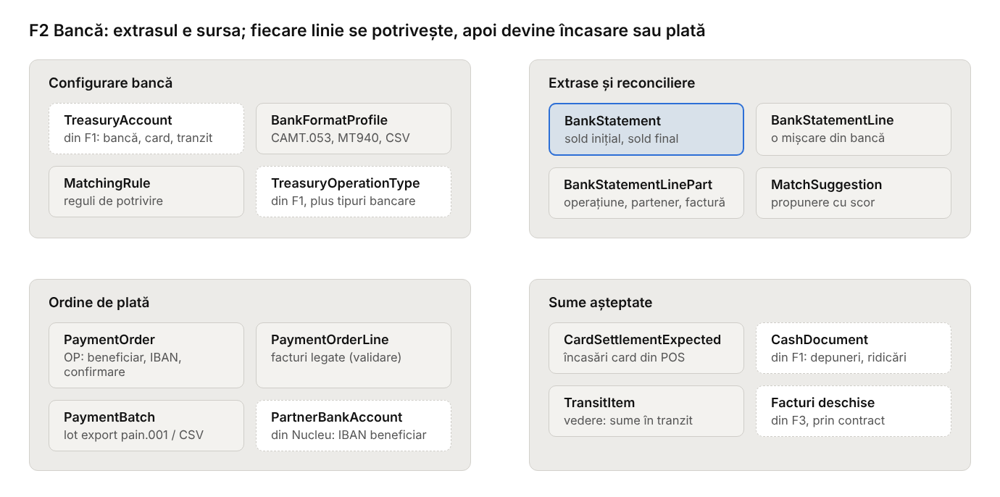

# ERP · 02.02 Finanțe · F2 Bancă

15 noiembrie 2026 · Aurelian · **✓ Validat de Aurelian (15.11.2026)**, cu deciziile lui din aceeași zi (încasările potrivite exact pe factură se validează automat; ordinul de plată se introduce din ecranul Extras de cont sau din ecranul propriu, se validează la legarea de factură și se confirmă pe extras; patru ochi pornit implicit; importul automat din folder păstrat; extrasele reale pentru teste rămân de primit)

A doua din cele 5 sub-părți ale părții financiare a modulului 02.02 Finanțe și contabilitate (schema SQL `fin`, prefix de cod `Erp.Finance`). Acoperă tot ce trece prin conturile bancare ale firmei: importul extraselor, reconcilierea liniilor cu facturile și cu operațiunile interne, ordinele de plată exportate către bancă, comisioanele, dobânzile, viramentele între conturi proprii și încasările cu cardul din POS. Documente părinte: [02 Module principale](../MODULE_PRINCIPALE.md), [02.01 Nucleu](../01-nucleu/NUCLEU.md), [F1 Casierie](F1-CASIERIE.md). Principii: [01 Scop și principii](../../01-scop-si-principii/SCOP_SI_PRINCIPII.md) (P1–P10). Reguli de cod: [Bune practici (SQL și cod)](../../bune-practici/BUNE_PRACTICI.md), referite prin identificator.

**Ce trebuie știut înainte de citire (context autonom, pentru oameni și pentru Copilot / Claude Code):**

- Produs ERP licențiat, instalat on-premise, o bază SQL Server per grup de firme, collation `Latin1_General_100_CS_AS_SC_UTF8` (case sensitive, `SQL-21`). Monolit modular .NET 10 + MediatR; Dapper și proceduri stocate, **fără EF Core sau alt ORM**; un modul vede din altul doar `.Contracts` (P1). **Fără componente plătite**: parserele CAMT.053 / MT940 și generatorul pain.001 se scriu în produs.
- Orice comandă trece prin pipeline-ul comun (02.01, fluxul 4.1); evenimentele pleacă prin outbox în aceeași tranzacție (P8).
- F1 a definit deja: contul de trezorerie (`fin.TreasuryAccount`, cu tipurile Bancă, Casă, Card de firmă, Tranzit, Depozit), nomenclatorul `fin.TreasuryOperationType` (comun casei și băncii) și evenimentele `IncasareInregistrata` / `PlataInregistrata`. F2 le folosește, nu le redefinește.
- Partea contabilă nu există încă: F2 **nu scrie note contabile**, publică evenimente. Alocarea pe facturi și soldurile partenerilor sunt în F3; diferențele de curs, în F4; propunerile de plată cu aprobări pe praguri, în F5.

## 1. Scop și perimetru

| Zonă | Ce face F2 | Ce NU face (și cine face) |
| --- | --- | --- |
| Extrase bancare | Import CAMT.053, MT940 și CSV pe profil de bancă; introducere manuală; verificarea continuității soldurilor; eliminarea dublurilor | Conectarea directă la API-ul băncii (ulterior, ca integrare în 02.14) |
| Reconciliere | Potrivirea fiecărei linii de extras: ordin de plată, factură, sumă în tranzit, decontare card, comision, regulă; validarea liniei ca încasare sau plată | Alocarea sumei pe facturi și soldurile partenerilor (F3) |
| Ordine de plată (OP) | OP-ul ca document de plată bancară, introdus din ecranul Extras de cont sau din ecranul propriu; validare la legarea de factură; confirmare pe extras; aprobare cu patru ochi; export pain.001 sau CSV pe loturi | Propunerile de plată din scadențe, cu aprobări pe praguri (F5) |
| Plăți către buget | Ordin de plată către Trezoreria Statului, cu CUI-ul plătitorului și referința obligației | Calculul obligațiilor și declarațiile (partea contabilă, 02.14) |
| Operațiuni interne | Viramente între conturile proprii, schimb valutar între conturi proprii, depuneri și ridicări de numerar (cu F1), comisioane, dobânzi | Diferențele de curs din schimbul valutar (F4) |
| Card | Extrasul cardului de firmă; decontarea încasărilor cu cardul din POS (brut, comision, net) | Bonul și raportul Z (POS, 02.10) |

## 2. Model de domeniu

Extrasul bancar (`BankStatement`) e sursa: liniile lui sunt date de bancă, nu se modifică. Utilizatorul (sau o regulă) explică fiecare linie prin una sau mai multe părți (`BankStatementLinePart`), iar validarea liniei o transformă în încasare sau plată.



Reguli de business ale modelului:

1. **Datele băncii sunt imutabile.** Data, suma, contrapartida și detaliile unei linii importate nu se editează; doar explicația ei (părțile) se completează. O linie introdusă manual se poate corecta cât e neconfirmată.
2. **Fiecare linie trebuie explicată integral**: suma părților = suma liniei. Nu există linii „ignorate”; o sumă necunoscută merge pe tipul `BANK-NEIDENTIFICAT`, care o ține în sume de clarificat (`473`) până se lămurește.
3. **Extrasele unui cont sunt continue**: soldul inițial al unui extras = soldul final al extrasului anterior; un gol se semnalează și blochează validarea liniilor de după gol.
4. **Validarea e pe linie, nu pe extras**: la zeci de mii de mișcări pe lună, liniile clare se validează imediat (automat, după reguli), iar cele neclare așteaptă fără să blocheze restul. Extrasul devine Închis când toate liniile lui sunt validate.
5. **Ordinul de plată (OP) e documentul plății bancare și are efect de la validare** (decizia lui Aurelian, 15.11.2026). Se introduce din ecranul Extras de cont sau din ecranul propriu Ordine de plată și **se validează în momentul legării de factură** (sau de alt obiect al plății: avans, salarii, obligație la buget). Validarea stinge factura (F3) și scade soldul scriptic al contului.
6. **Un OP introdus din ecranul propriu rămâne neconfirmat** până apare pe extras și e confirmat acolo, prin legarea de linia de extras. Un OP introdus direct din ecranul Extras de cont se naște deja confirmat, pe linia pe care o explică.
7. **Fiecare cont bancar are două solduri**: soldul din extras (confirmat de bancă) și soldul scriptic = soldul din extras minus OP-urile validate și neconfirmate. Plățile către parteneri trec întotdeauna printr-un OP; liniile de extras fără OP (comisioane, dobânzi, încasări, viramente) devin încasări sau plăți direct, la validarea liniei.
8. **O linie apare o singură dată**: cheia de unicitate e referința băncii pe cont; reimportarea aceluiași fișier sau a unui fișier care se suprapune nu dublează nimic.
9. **Contul de tranzit (`581`) se închide doar prin potrivire**: o depunere din casă (F1), un virament între conturi proprii sau o decontare de card așteaptă linia pereche din extras.

## 3. Entități, documente și ciclul lor de viață

Convențiile de coloane, tipuri și chei sunt cele din F1, secțiunea 3 (`SQL-07`, `SQL-11`, `SQL-13`, `SQL-19`, `SQL-20`).

### 3.1 Profil de format bancar (`BankFormatProfile`)

Descrie cum se citește extrasul și cum se scrie fișierul de plăți pentru o bancă. Livrat cu profile pentru formatele standard; clientul adaugă profile CSV pentru băncile lui.

| Câmp | Reguli |
| --- | --- |
| `Code`, `Name`, `BankBic` | Unic pe instalare (`SQL-24`) |
| `StatementFormat` | 1 CAMT.053 (ISO 20022), 2 MT940 (SWIFT), 3 CSV, 4 Fără import |
| `CsvMapping` | JSON (`SQL-12`): separator, codare, rândul de antet, formatul datei și al numerelor, coloana pentru fiecare câmp (dată, sumă sau debit / credit separat, contrapartidă, IBAN, detalii, referință) |
| `PaymentFormat` | 1 pain.001.001.03, 2 pain.001.001.09, 3 CSV pe profil, 4 Fără export |
| `PaymentMapping` | JSON pentru exportul CSV; pentru pain.001, opțiunile băncii (lot sau linie cu linie, `ChrgBr`, cod de urgență) |
| `MaxRemittanceLength` | Lungimea maximă a detaliilor plății (implicit 140) |

`TreasuryAccount` (F1) primește în F2 câmpurile `BankFormatProfileId`, `ImportFolder` (opțional, pentru importul automat din folder, fluxul 4.1) și `LastStatementDate` (calculat).

### 3.2 Tipuri de operațiuni bancare (extinderea `TreasuryOperationType`)

F2 adaugă în nomenclatorul din F1 (3.2) tipurile cu `AppliesToBank = 1`. Tipurile de încasare și plată către parteneri din F1 (`INC-CLIENT`, `PLATA-FURNIZOR`, avansuri) se folosesc și la bancă.

| Cod | Denumire | Sens | Cere | Cont implicit (referință) |
| --- | --- | --- | --- | --- |
| `BANK-COMISION` | Comision bancar | Ieșire | — | `627` |
| `BANK-DOBANDA-INC` | Dobândă încasată | Intrare | — | `766` |
| `BANK-DOBANDA-PLATA` | Dobândă plătită | Ieșire | — | `666` |
| `BANK-TRANSFER-INTERN` | Virament între conturi proprii | Ambele | Cont de trezorerie pereche | `581` |
| `BANK-SCHIMB-VALUTAR` | Schimb valutar între conturi proprii | Ambele | Cont de trezorerie pereche, curs | `581` (diferențele în F4) |
| `BANK-DEPUNERE-NUMERAR` | Numerar depus (pereche cu DP din F1) | Intrare | Documentul de casă | `581` |
| `BANK-RIDICARE-NUMERAR` | Numerar ridicat (pereche cu DI din F1) | Ieșire | Documentul de casă | `581` |
| `BANK-DECONTARE-CARD` | Decontare încasări card (POS sau online) | Intrare | Decontarea așteptată | `5125` |
| `BANK-PLATA-BUGET` | Plată către bugetul de stat | Ieșire | Referința obligației | `4xx` după obligație |
| `BANK-PLATA-SALARII` | Plată salarii | Ieșire | Angajat sau lot | `421` |
| `BANK-NEIDENTIFICAT` | Sumă de clarificat | Ambele | Text explicativ | `473` |
| `BANK-RESTITUIRE` | Sumă returnată de bancă (plată respinsă) | Intrare | Ordinul de plată | — |

### 3.3 Extras bancar (`BankStatement`)

| Câmp | Reguli |
| --- | --- |
| `TreasuryAccountId` | Doar conturi de tip Bancă, Card sau Depozit |
| `StatementNo`, `StatementDate` | Din fișier (`ElctrncSeqNb` / `:28C:`) sau de la utilizator |
| `PeriodFrom`, `PeriodTo` | Intervalul acoperit; un extras pe zi e cazul obișnuit, dar sunt acceptate și extrase pe interval |
| `CurrencyCode` | Trebuie să fie moneda contului |
| `OpeningBalance`, `ClosingBalance` | Din fișier; verificat: `ClosingBalance - OpeningBalance` = suma liniilor |
| `Source` | 1 CAMT.053, 2 MT940, 3 CSV, 4 Manual, 5 Sold inițial |
| `FileAttachmentId`, `FileSha256` | Fișierul original, atașat (02.01 `Attachment`); hash unic pe cont (același fișier nu se importă de două ori) |
| `Status` | 1 Importat, 2 În reconciliere, 3 Închis (toate liniile validate) |
| `ContinuityStatus` | 1 OK, 2 Gol față de extrasul anterior (blochează validarea liniilor), 3 Gol acceptat (cu motiv, permisiune și audit) |

Soldul inițial al unui cont bancar la pornirea în sistem e un extras cu `Source = 5`, fără linii, datat `OpeningDate - 1`.

### 3.4 Linie de extras (`BankStatementLine`) și explicația ei (`BankStatementLinePart`)

**Linia** (`bigint`), date de bancă, imutabile:

| Câmp | Din CAMT.053 | Din MT940 |
| --- | --- | --- |
| `BookingDate`, `ValueDate` | `BookgDt`, `ValDt` | `:61:` |
| `Amount` (cu semn: + intrare, − ieșire) | `Amt` + `CdtDbtInd` | `:61:` |
| `CounterpartyName`, `CounterpartyIban`, `CounterpartyBic` | `RltdPties`, `RltdAgts` | `:86:` (după profilul băncii) |
| `RemittanceInfo` | `RmtInf/Ustrd` sau `Strd` | `:86:` |
| `EndToEndId` | `Refs/EndToEndId` | `:86:` dacă banca îl transmite |
| `BankReference` | `AcctSvcrRef` (sau hash calculat, dacă lipsește) | `:61:` referința băncii |
| `BankTransactionCode` | `BkTxCd` | codul tranzacției din `:61:` |

Unicitate: `(TreasuryAccountId, BankReference)`. Când banca nu dă o referință, `BankReference` = hash SHA-256 din cont, dată, sumă, contrapartidă, detalii și numărul de ordine al apariției identice în aceeași zi.

Câmpuri de lucru: `MatchStatus` (1 Nepotrivită, 2 Propusă, 3 Explicată, 4 Validată), `MatchSource` (Ordin de plată, Factură, Tranzit, Card, Regulă, Manual), `PartnerId` (identificat), `ExtractedFiscalCode` și `ExtractedDocumentNo` (găsite în detalii), `ValidatedAt`, `ValidatedBy`, `ReversedAt`.

**Partea** (`BankStatementLinePart`, `bigint`): `TreasuryOperationTypeId`, `Amount` (cu același semn ca linia), `PartnerId` sau `EmployeeId`, `SettlementRef` (factura sau facturile, ca în F1, folosită de F3), `PaymentOrderId` (OP-ul pe care partea îl confirmă; o astfel de parte nu mai publică o plată, pentru că OP-ul a publicat-o la validare), `CashDocumentId` (perechea din casă), `CounterTreasuryAccountId`, `CardSettlementExpectedId`, `BudgetObligationRef`, `CostCenterId`, `ProjectId`, `Note`. Exemplu: o încasare de 9.850 lei de la procesatorul de carduri = parte `BANK-DECONTARE-CARD` 10.000 lei + parte `BANK-COMISION` −150 lei.

**Ciclul de viață al liniei:**

| Stare | Ce înseamnă | Tranziții |
| --- | --- | --- |
| Nepotrivită (1) | Importată, fără explicație | → Propusă, → Explicată |
| Propusă (2) | Motorul de potrivire a găsit una sau mai multe propuneri, cu scor | → Explicată (acceptare), → Nepotrivită (respingere) |
| Explicată (3) | Părțile acoperă suma; se mai poate modifica | → Validată, → Nepotrivită |
| Validată (4) | A devenit încasare sau plată, eveniment publicat; imutabilă | → Explicată, prin „Desface validarea” (storno) |

„Desface validarea” publică `DocumentTrezorerieStornat` pentru linie (F3 și contabilitatea desfac efectele), iar linia revine la Explicată, ca să poată primi altă explicație. Datele băncii rămân neatinse. Data contabilă a liniei e `BookingDate`; o perioadă închisă refuză validarea și desfacerea (`CORE_PERIOD_CLOSED`).

### 3.5 Regulă de potrivire (`MatchingRule`)

Regulile clientului, aplicate după potrivirile automate standard (fluxul 4.3):

| Câmp | Reguli |
| --- | --- |
| `CompanyId`, `Priority`, `Name`, `IsActive` | Se aplică în ordinea priorității; prima regulă care se potrivește câștigă |
| `TreasuryAccountId` | Opțional: regula doar pentru un cont |
| Condiții | `Direction`, `CounterpartyIban`, `CounterpartyFiscalCode`, `RemittanceContains` (text, fără majuscule și diacritice), `BankTransactionCode`, `AmountFrom`, `AmountTo` |
| Acțiune | `TreasuryOperationTypeId`, `PartnerId`, `CostCenterId`, `ProjectId`, `NoteTemplate` |
| `AutoValidate` | Dacă linia explicată de regulă se validează imediat (doar pentru tipuri fără partener: comisioane, dobânzi) |
| `CreatedFromLineId` | Regulă creată din ecranul de reconciliere, pe baza unei potriviri manuale („Ține minte pentru data viitoare”) |

Textul se compară fără majuscule și diacritice (coloană calculată ca la `SQL-25`); fără expresii regulate în bază, ca regula să rămână simplă și rapidă.

### 3.6 Ordin de plată (`PaymentOrder` + `PaymentOrderLine`) și lot de export (`PaymentBatch`)

Un **OP** e o plată bancară către un singur beneficiar, dintr-un singur cont de trezorerie. Liniile lui spun ce stinge plata (facturi, avans, salarii, obligație la buget). Mai multe OP-uri se exportă împreună într-un **lot** (`PaymentBatch`), adică un fișier pentru internet banking.

**Antet** (`PaymentOrder`): `CompanyId`, `TreasuryAccountId` (sursa), `Number` (serie internă, alocată la validare), `DocumentDate` (data OP-ului, care e și data contabilă a plății), `RequestedExecutionDate`, `IsUrgent`, `Origin` (1 Ecranul Ordine de plată, 2 Ecranul Extras de cont, 3 Propunere F5, 4 Alt modul, de exemplu HR), `Purpose` (1 Furnizori, 2 Salarii, 3 Buget de stat, 4 Diverse), `PartnerId` sau `EmployeeId`, `BeneficiaryName`, `BeneficiaryIban`, `BeneficiaryBic`, `BeneficiaryFiscalCode`, `CurrencyCode` (moneda contului sursă), `Amount`, `RemittanceInfo` (generat din facturi: „Plata fact. FA-123, FA-130”, tăiat la `MaxRemittanceLength`), `EndToEndId` (unic: prefix firmă + Id), `BudgetObligationRef`, `Status`, `ConfirmationStatus`, `BankStatementLineId` (linia care l-a confirmat), `PaymentBatchId`, `ApprovedBy`, `ApprovedAt`, `ReversalOfId`, `SourceProposalId`.

**Linie** (`PaymentOrderLine`, `bigint`): `TreasuryOperationTypeId` (`PLATA-FURNIZOR`, `PLATA-AVANS-FURNIZOR`, `BANK-PLATA-SALARII`, `BANK-PLATA-BUGET`...), `SettlementRef` (factura stinsă, folosită de F3), `Amount`, `CostCenterId`, `ProjectId`. Suma liniilor = `Amount`.

**Lot** (`PaymentBatch`): `TreasuryAccountId`, `Number`, `Format` (din profilul băncii), `OrderCount`, `TotalAmount`, `ExportedAt`, `ExportedBy`, `FileAttachmentId`, `FileSha256`, `Status` (1 Deschis, 2 Exportat, 3 Anulat).

Reguli:

1. IBAN-ul beneficiarului se ia din `core.PartnerBankAccount` (validat în Nucleu); un IBAN tastat direct e permis doar cu `Fin.PaymentOrder.FreeIban` și se jurnalizează.
2. **Validarea se face la legarea de factură** (decizia din 15.11.2026): un OP e validat când liniile lui acoperă suma și fiecare linie are obiectul plății completat (factura din lista facturilor deschise ale partenerului, din F3; sau tipul de operațiune pentru avans, salarii, buget). La validare primește număr, publică `PlataInregistrata` și devine imutabil. Un OP salvat fără legătură rămâne ciornă.
3. **Aprobarea cu patru ochi e pornită implicit** (setare `Fin.PaymentOrder.RequireApproval`, confirmată de Aurelian pe 15.11.2026): un OP validat se exportă către bancă doar după ce un alt utilizator decât cel care l-a validat îl aprobă. Aprobarea nu schimbă efectul plății (care există de la validare), ci controlează ce pleacă la bancă. Pentru OP-urile născute din ecranul Extras de cont plata e deja făcută, deci aprobarea nu se cere.
4. Un OP către un partener marcat inactiv la ANAF (`core.Partner.AnafInactive`) cere confirmare explicită la validare (avertizare, auditată).
5. Pentru plățile în euro, numele beneficiarului trimis e cel din fișa partenerului, pentru verificarea numelui beneficiarului făcută de bănci (Regulamentul UE 2024/886).
6. Plățile către bugetul de stat merg în contul unic al Trezoreriei; OP-ul are obligatoriu `BeneficiaryFiscalCode` (CUI-ul firmei plătitoare, după formularul OPT) și `BudgetObligationRef` (referința obligației, în forma cerută la data plății).
7. Un OP neconfirmat după `Fin.PaymentOrder.ConfirmationAlertDays` (implicit 3 zile lucrătoare de la data cerută) apare în alerte și în raportul OP-urilor neconfirmate.

**Ciclul de viață al OP-ului** are două axe: starea documentului (convenția comună) și starea confirmării pe extras.

| Stare document | Ce înseamnă | Tranziții |
| --- | --- | --- |
| Ciornă (1) | Se editează și se șterge; încă nelegat de factură | → Validat, → ștergere |
| Validat (2) | Legat de factură, are număr, plata e înregistrată (`PlataInregistrata`) | → Stornat |
| Stornat (3) | Efectele desfăcute printr-un OP de stornare (sume negative, aceeași dată sau data curentă dacă perioada e închisă); factura redevine deschisă | Final |

| Stare confirmare | Ce înseamnă | Tranziții |
| --- | --- | --- |
| Neconfirmat (1) | Validat, dar încă negăsit pe extras; intră în soldul scriptic | → Confirmat, → Respins |
| Confirmat (2) | Legat de linia de extras care îl conține | → Neconfirmat, doar prin desfacerea potrivirii pe extras |
| Respins (3) | Banca l-a refuzat sau returnat (linie `BANK-RESTITUIRE`); sistemul creează automat OP-ul de stornare ca ciornă, pentru validare | Final |

Un OP validat și neexportat se poate scoate dintr-un lot deschis; exportul lotului cere ca toate OP-urile lui să fie validate și (cu patru ochi activ) aprobate. Un nou export al aceluiași lot cere `Fin.PaymentOrder.ReExport`, un motiv și afișează avertizarea de plată dublă; fișierul nou are aceleași `EndToEndId`, ca banca să poată refuza dublura. Un OP greșit, deja validat, se corectează doar prin storno (ca în F1).

### 3.7 Decontare card așteptată (`CardSettlementExpected`)

Creată din `ZiInchisaPOS` (încasările cu cardul ale unei case de marcat pe zi) sau manual (vânzări online prin procesator):

| Câmp | Reguli |
| --- | --- |
| `CompanyId`, `AcquirerCode` | Banca sau procesatorul (setat pe magazin în 02.10) |
| `SalesDate`, `GrossAmount`, `ExpectedSettlementDate` | Data plus `Fin.Card.SettlementDays` (implicit 2 zile lucrătoare) |
| `SourceModule`, `SourceRef` | POS: magazin, casă, raport Z |
| `SettledAmount`, `FeeAmount`, `Status` | 1 În așteptare, 2 Decontată, 3 Decontată cu diferență (cere explicație) |

Sumele în tranzit se văd printr-un singur view, `fin.v_TransitItem`: depunerile și ridicările de numerar din F1 nepereche, viramentele interne cu o singură parte validată și decontările de card în așteptare, cu vechimea fiecăreia.

## 4. Fluxuri principale

### 4.1 Importul extrasului

1. Utilizatorul descarcă extrasul din internet banking și îl încarcă în ecranul Extrase bancare; sau, dacă `TreasuryAccount.ImportFolder` e setat, un job Hangfire citește la 15 minute fișierele noi din folder și le mută în subfolderul `importate` (sau `erori`).
2. Sistemul identifică profilul după contul ales (sau după IBAN-ul din fișier, care trebuie să fie al unui cont de trezorerie al firmei curente), verifică hash-ul fișierului și parsează. Fișierul e tratat ca nesigur (`SEC-01`, `SEC-05`): limită de dimensiune, XML fără DTD și fără entități externe.
3. Pentru fiecare extras din fișier (un CAMT.053 poate avea mai multe): verifică moneda, suma liniilor față de solduri și continuitatea cu extrasul anterior.
4. Liniile cu `BankReference` deja existent se sar (raport „X linii existau deja”).
5. Extrasul și liniile se salvează într-o tranzacție (`fin.usp_BankStatement_Import`, TVP `fin.tt_BankStatementLine`, `SP-07`), apoi pornește potrivirea automată (4.3), în afara tranzacției de import.
6. Se publică `ExtrasBancarImportat`.

### 4.2 Plata prin OP din ecranul propriu (plată pregătită)

1. Contabilul creează OP-ul în ecranul Ordine de plată, alege partenerul și leagă facturile din lista lui de facturi deschise (F3); poate crea mai multe OP-uri deodată din facturile scadente sau din propunerea aprobată în F5. Detaliile plății se generează din numerele facturilor.
2. La legarea de factură OP-ul se validează: primește număr, stinge factura prin serviciul de alocare din F3, în aceeași tranzacție, publică `PlataInregistrata`, iar soldul scriptic al contului scade. Starea confirmării e Neconfirmat.
3. Un al doilea utilizator aprobă OP-urile (patru ochi, implicit pornit).
4. Contabilul pune OP-urile aprobate într-un lot și îl exportă (pain.001 sau CSV); fișierul se atașează lotului cu hash și se publică `OrdinPlataExportat`. Exportul e opțional: un OP poate fi tastat și direct în internet banking.
5. Utilizatorul încarcă fișierul în internet banking și îl autorizează acolo (semnătura rămâne la bancă; ERP-ul nu ține credențiale bancare).
6. La importul extrasului, OP-urile neconfirmate ale contului apar în ecranul Extras de cont ca „de confirmat”. Potrivirea automată (4.3, pasul 1) le leagă de linii după `EndToEndId`, sau după IBAN + sumă + dată; contabilul confirmă (sau confirmarea e automată, după `Fin.Bank.AutoValidateLevel`).
7. Confirmarea leagă linia de extras de OP, cu o parte care referă OP-ul; validarea liniei nu mai publică o plată nouă, ci `OrdinPlataConfirmat`. Dacă data din extras diferă de data OP-ului, data contabilă rămâne a OP-ului.
8. Un OP respins de bancă (linie `BANK-RESTITUIRE` legată de el) trece în Respins, iar sistemul pregătește storno-ul ca ciornă și notifică autorul.

### 4.2a Plata prin OP din ecranul Extras de cont (plată constatată)

1. Contabilul lucrează pe extrasul importat și găsește o plată către un partener fără OP în sistem (de exemplu tastată direct în internet banking).
2. Din linia de extras alege „OP nou”: se deschide OP-ul precompletat cu contul, data, suma, beneficiarul și IBAN-ul din linie (`Origin = 2`).
3. Leagă facturile; la legare OP-ul se validează și se confirmă în același pas, pe linia respectivă. Aprobarea cu patru ochi nu se cere, pentru că plata e deja executată.
4. O linie de extras poate fi explicată de mai multe OP-uri doar dacă banca a cumulat plățile (rar); în rest, o linie = un OP.

### 4.3 Potrivirea automată

Rulează după import și la cerere. Pentru fiecare linie Nepotrivită, încearcă în ordine și se oprește la prima potrivire sigură:

| Pas | Caută | Potrivire sigură când | Rezultat |
| --- | --- | --- | --- |
| 1 | OP validat și neconfirmat | `EndToEndId` identic; sau IBAN + sumă identice în ±5 zile de la data cerută | Explicată (confirmare OP) |
| 2 | Pereche internă | Depunere / ridicare de numerar (F1), virament între conturi proprii, schimb valutar: sumă identică, contul pereche, ±3 zile | Explicată |
| 3 | Decontare card | Procesatorul (după IBAN) și suma netă egală cu brutul așteptat minus comisionul în toleranța `Fin.Card.FeeTolerancePercent` | Explicată (brut + comision) |
| 3a | Efect comercial depus (F3, 3.5) | Partenerul emitent și suma identice, data după scadența efectului | Explicată (efect încasat) |
| 4 | Factură deschisă (prin F3) | Partenerul identificat (IBAN memorat → CUI din detalii → nume) și: numărul facturii apare în detalii și suma = restul de plată; sau o singură factură deschisă cu acel rest | Explicată |
| 5 | Regulă a clientului | Condițiile regulii | Explicată (sau Validată, dacă regula are `AutoValidate`) |
| 6 | Propuneri | Partener identificat, dar suma nu se potrivește exact (plată parțială, mai multe facturi) | Propusă, cu scor și lista candidaților |

Identificarea partenerului: IBAN-ul contrapartidei căutat în `core.PartnerBankAccount`; altfel CUI-ul găsit în detalii (cifra de control verificată ca în Nucleu); altfel numele (căutare fără diacritice, scor). Un IBAN găsit într-o potrivire acceptată manual se propune pentru salvare în fișa partenerului.

Liniile Explicate automat se validează automat doar dacă `Fin.Bank.AutoValidateLevel` permite (0 Niciodată, 1 Doar confirmările de OP, perechile interne și comisioanele, 2 Și încasările cu potrivire exactă pe factură — implicit, decizia lui Aurelian din 15.11.2026). Restul așteaptă confirmarea contabilului în ecranul Extras de cont. O plată către partener fără OP nu se validează automat niciodată: are nevoie de un OP (fluxul 4.2a).

### 4.4 Reconcilierea manuală

1. Ecranul Extras de cont arată în stânga liniile nevalidate ale contului și OP-urile neconfirmate, iar în dreapta, pentru linia selectată, propunerile și căutarea liberă în facturile deschise ale partenerilor (F3), OP-urile neconfirmate, sumele în tranzit; pentru o plată fără OP, butonul „OP nou” (fluxul 4.2a).
2. Contabilul acceptă o propunere sau construiește părțile: partener, facturi, tip de operațiune, sume; se poate împărți o linie pe oricâte părți (de exemplu o încasare care acoperă trei facturi și o diferență de curs).
3. „Ține minte” creează o regulă de potrivire din alegerea făcută.
4. Validează linia sau un grup de linii selectate (`ValidateBankStatementLines`, până la 500 de linii pe comandă, fiecare cu rezultatul ei: o linie respinsă nu oprește restul).

### 4.5 Virament între conturi proprii și schimb valutar

1. Ieșirea din contul A apare în extrasul lui A: partea `BANK-TRANSFER-INTERN` cu contul pereche B; suma intră în tranzit.
2. Intrarea în contul B, din extrasul lui B, se potrivește automat (pasul 2) și închide tranzitul.
3. La schimb valutar (de exemplu lei → euro), cele două linii au monede diferite; partea memorează cursul băncii (suma în lei / suma în valută). Diferența față de cursul BNR din ziua respectivă e calculată și contată în F4.

### 4.6 Încasări cu cardul din POS

1. `ZiInchisaPOS` aduce totalul încasat cu cardul pe casă și zi; F2 creează `CardSettlementExpected`, cu brutul și data estimată a decontării.
2. Linia din extras de la procesator se potrivește (pasul 3): parte `BANK-DECONTARE-CARD` pe brut și parte `BANK-COMISION` pe diferență.
3. O diferență peste toleranță lasă decontarea în „Decontată cu diferență” și cere explicația contabilului (de exemplu un retur pe card, o tranzacție contestată).

### 4.7 Cazuri limită

| Situație | Comportament |
| --- | --- |
| Același fișier importat de două ori | Refuz pe hash (`FIN_BANK_FILE_ALREADY_IMPORTED`) |
| Fișier care se suprapune parțial cu unul importat | Liniile existente se sar după `BankReference`; soldurile se verifică pe extrasul nou |
| Lipsește extrasul unei zile | `ContinuityStatus = 2`; liniile de după gol nu se validează până la importul extrasului lipsă sau acceptarea golului cu motiv |
| IBAN-ul din fișier nu aparține firmei curente | Refuz (`FIN_BANK_ACCOUNT_NOT_FOUND`), fără să se încerce altă firmă |
| Client care plătește mai mult decât factura | Parte pe factură + parte `INC-AVANS-CLIENT` pentru diferență (F3 o tratează ca avans) |
| Client care plătește două facturi cu o singură sumă, fără detalii | Propusă, cu combinațiile de facturi deschise a căror sumă e egală cu suma încasată (cel mult 5 facturi, cele mai vechi) |
| Plată în euro dintr-un cont în lei | Linia are moneda contului (lei); suma în valută a plății, dacă e în fișier, se memorează informativ |
| Linie validată greșit, perioada încă deschisă | „Desface validarea” (storno al efectelor), explicație nouă, validare |
| Linie validată greșit, perioada închisă | Refuz; corecția se face în perioada curentă, prin documentele F3 (reclasificare), după regulile contabilității |
| OP validat, dar niciodată trimis băncii | Rămâne Neconfirmat și apare în alerte; dacă plata nu se mai face, se stornează și factura redevine deschisă |
| Lot exportat, dar fișierul nu a fost încărcat la bancă | Lotul se anulează cu confirmare explicită; OP-urile rămân validate și pot intra într-un lot nou |
| Plată găsită pe extras, fără OP în sistem | „OP nou” din linia de extras (fluxul 4.2a) |
| OP de 10.000 lei executat de bancă în două tranșe | Ambele linii se leagă de același OP; OP-ul devine Confirmat când suma liniilor legate egalează suma lui |

## 5. Evenimente

### 5.1 Publicate

| Eveniment | Când | Conținut (pe lângă anvelop) | Consumatori |
| --- | --- | --- | --- |
| `IncasareInregistrata` v1 | Validarea unei linii de intrare | Forma din F1 (5.1), cu `TreasuryKind = Bank`, `DocumentType = BankStatementLine`, `DocumentId` = Id-ul liniei, `Number` = numărul extrasului + numărul liniei, `DocumentDate` = `BookingDate`; o intrare în listă pentru fiecare parte | F3, Vânzări, CRM, partea contabilă |
| `PlataInregistrata` v1 | Validarea unui OP; validarea unei linii de ieșire fără OP (comision, dobândă, virament) | Forma din F1, cu `TreasuryKind = Bank`; pentru OP: `DocumentType = PaymentOrder`, `DocumentDate` = data OP-ului, câte o intrare pe linie de OP; pentru linia de extras: ca la încasare | F3, Achiziții, F5, partea contabilă |
| `DocumentTrezorerieStornat` v1 | Stornarea unui OP sau desfacerea validării unei linii | Forma din F1, cu `DocumentType = PaymentOrder` sau `BankStatementLine` | F3, partea contabilă |
| `OrdinPlataConfirmat` v1 | Confirmarea OP-ului pe extras | `PaymentOrderId`, `BankStatementLineId`, `BookingDate`, `Amount` | Raportare, F5 |
| `OrdinPlataRespins` v1 | Banca a refuzat sau returnat OP-ul | `PaymentOrderId`, `BankStatementLineId`, `Reason` | F5, notificări |
| `ExtrasBancarImportat` v1 | Importul unui extras | `BankStatementId`, `TreasuryAccountId`, `StatementDate`, `LineCount`, `OpeningBalance`, `ClosingBalance`, `ContinuityStatus` | Raportare, notificări |
| `OrdinPlataExportat` v1 | Exportul unui lot | `PaymentBatchId`, `TreasuryAccountId`, `TotalAmount`, lista `{PaymentOrderId, PartnerId, Amount}` | F5 |

O parte de linie care confirmă un OP nu generează niciun eveniment de plată: plata a fost publicată o singură dată, la validarea OP-ului.

### 5.2 Consumate

| Eveniment | De la | Ce face F2 |
| --- | --- | --- |
| `ZiInchisaPOS` | POS (02.10) | Creează `CardSettlementExpected` pentru suma încasată cu cardul (fluxul 4.6) |
| `PartenerModificat` | Nucleu | Reface cache-ul IBAN → partener folosit la potrivire |

Propunerile de plată aprobate în F5 nu vin prin eveniment: F5 e în același modul și apelează direct crearea OP-urilor (F5, fluxul 4.3).

## 6. Contracte publice (`Erp.Finance.Contracts`, partea F2)

```csharp
namespace Erp.Finance.Contracts.Bank;

public sealed record CardSettlementRequest(
    int CompanyId, string AcquirerCode, DateOnly SalesDate, decimal GrossAmount,
    string SourceModule, string SourceRef);

public interface ICardSettlementWriter
{
    // Idempotent pe (SourceModule, SourceRef)
    Task<int> RegisterExpectedAsync(CardSettlementRequest request, CancellationToken ct);
}

public sealed record PaymentOrderLineRequest(
    string OperationTypeCode, decimal Amount, string? SettlementRef,
    int? CostCenterId, int? ProjectId);

// Un OP = un beneficiar; liniile spun ce stinge plata
public sealed record PaymentOrderRequest(
    int CompanyId, int TreasuryAccountId, DateOnly DocumentDate, DateOnly RequestedExecutionDate,
    byte Purpose, bool IsUrgent, int? PartnerId, int? EmployeeId, int? PartnerBankAccountId,
    string? BudgetObligationRef, int? SourceProposalId,
    IReadOnlyList<PaymentOrderLineRequest> Lines);

public interface IPaymentOrderWriter
{
    // Folosit de F5 (propuneri de plată) și de HR (plata salariilor); creează ciornă,
    // validarea o face utilizatorul (legarea de factură e deja făcută prin SettlementRef)
    Task<int> CreateDraftAsync(PaymentOrderRequest request, CancellationToken ct);
}

public sealed record UnconfirmedPaymentDto(
    int PaymentOrderId, int? PartnerId, DateOnly DocumentDate, decimal Amount, byte ConfirmationStatus);

public interface IPaymentOrderQueries
{
    // Folosit de F5 (sold scriptic) și de rapoarte
    Task<IReadOnlyList<UnconfirmedPaymentDto>> GetUnconfirmedAsync(
        int companyId, int treasuryAccountId, CancellationToken ct);
}
```

Comenzi interne F2: `SaveBankFormatProfile`, `ImportBankStatement`, `CreateManualBankStatement`, `AcceptStatementGap`, `RunAutoMatching`, `ExplainBankStatementLine`, `ValidateBankStatementLines`, `UnvalidateBankStatementLine`, `SaveMatchingRule`, `SavePaymentOrder`, `LinkPaymentOrderSettlement` (legarea de factură, care validează OP-ul), `CreatePaymentOrderFromStatementLine` (fluxul 4.2a), `ReversePaymentOrder`, `ApprovePaymentOrders`, `UnapprovePaymentOrders`, `SavePaymentBatch`, `ExportPaymentBatch`, `CancelPaymentBatch`, `ConfirmPaymentOrder`, `RejectPaymentOrder`, `ResolveCardSettlement`.

Parserele și generatorul stau în `Erp.Finance.Infrastructure/Bank/Formats`, câte o clasă pe format (`Camt053Parser`, `Mt940Parser`, `CsvStatementParser`, `Pain001Writer`, `CsvPaymentWriter`) în spatele interfețelor `IStatementParser` și `IPaymentFileWriter`; fiecare are teste pe fișiere reale anonimizate de la băncile din România (`TST-06`).

## 7. Schema SQL `fin` (partea F2)

| Tabel | Cheie primară | Chei unice / străine principale | Indecși suplimentari |
| --- | --- | --- | --- |
| `fin.BankFormatProfile` | `Id int` | UX `CodeKey` | — |
| `fin.BankStatement` | `Id int` | UQ `(TreasuryAccountId, FileSha256)` filtrat pe `FileSha256 IS NOT NULL`; FK `TreasuryAccountId`, `FileAttachmentId` | `(TreasuryAccountId, StatementDate)` |
| `fin.BankStatementLine` | `Id bigint` | UQ `(TreasuryAccountId, BankReference)`; FK `BankStatementId`, `PartnerId` | `(TreasuryAccountId, MatchStatus, BookingDate)` INCLUDE `(Amount, CounterpartyIban)`; `EndToEndId` filtrat `WHERE EndToEndId IS NOT NULL`; `(CounterpartyIban)` |
| `fin.BankStatementLinePart` | `Id bigint` | FK `BankStatementLineId`, `TreasuryOperationTypeId`, `PaymentOrderId`, `CashDocumentId`, `CounterTreasuryAccountId`, `CardSettlementExpectedId` | `BankStatementLineId`; `PaymentOrderId`, `CashDocumentId` filtrate pe `IS NOT NULL` |
| `fin.MatchSuggestion` | `Id bigint` | FK `BankStatementLineId` | `BankStatementLineId`; șterse la validarea liniei |
| `fin.MatchingRule` | `Id int` | FK `CompanyId`, `TreasuryAccountId`, `TreasuryOperationTypeId`, `PartnerId` | `(CompanyId, IsActive, Priority)` |
| `fin.PaymentOrder` | `Id int` | UX filtrat `(CompanyId, Number) WHERE Number IS NOT NULL`; UQ `EndToEndId`; FK `TreasuryAccountId`, `PartnerId`, `EmployeeId`, `PaymentBatchId`, `BankStatementLineId`, `ReversalOfId` | `(CompanyId, DocumentDate)`; `(TreasuryAccountId, ConfirmationStatus)` filtrat pe neconfirmate; `(BeneficiaryIban, Amount)` pentru potrivirea fără `EndToEndId`; `(PartnerId, Status)` |
| `fin.PaymentOrderLine` | `Id bigint` | FK `PaymentOrderId` (cascadă doar pe ciornă), `TreasuryOperationTypeId` | `PaymentOrderId` |
| `fin.PaymentBatch` | `Id int` | UX filtrat `(CompanyId, Number) WHERE Number IS NOT NULL`; FK `TreasuryAccountId`, `FileAttachmentId` | `(TreasuryAccountId, Status)` |
| `fin.CardSettlementExpected` | `Id int` | UQ `(SourceModule, SourceRef)`; FK `CompanyId` | `(CompanyId, AcquirerCode, Status, ExpectedSettlementDate)` |

`TreasuryAccount` primește coloanele `BankFormatProfileId` (FK), `ImportFolder nvarchar(260)`, `LastStatementDate date` printr-o migrare nouă (`MIG-02`, `MIG-05`). `BankStatementLine.RemittanceSearch AS (RemittanceInfo COLLATE Latin1_General_100_CI_AI_SC_UTF8) PERSISTED` servește căutarea din ecran și regulile; pentru că `RemittanceInfo` e `nvarchar(500)`, nu se indexează (căutarea „conține” nu e SARGable), dar se filtrează mereu întâi pe cont, stare și dată.

Exemplu de tabel complet:

```sql
CREATE TABLE fin.BankStatementLine (
    Id                      bigint IDENTITY(1,1) NOT NULL CONSTRAINT PK_BankStatementLine PRIMARY KEY,
    BankStatementId         int                NOT NULL CONSTRAINT FK_BankStatementLine_BankStatement REFERENCES fin.BankStatement(Id),
    TreasuryAccountId       int                NOT NULL CONSTRAINT FK_BankStatementLine_TreasuryAccount REFERENCES fin.TreasuryAccount(Id),
    LineNo                  int                NOT NULL,
    BookingDate             date               NOT NULL,
    ValueDate               date               NULL,
    Amount                  decimal(19,2)      NOT NULL,
    CounterpartyName        nvarchar(200)      NULL,
    CounterpartyIban        varchar(34)        NULL,          -- normalizat: majuscule, fără spații (SQL-24)
    CounterpartyBic         varchar(11)        NULL,
    RemittanceInfo          nvarchar(500)      NULL,
    EndToEndId              varchar(35)        NULL,
    BankReference           varchar(100)       NOT NULL,
    BankTransactionCode     varchar(35)        NULL,
    MatchStatus             tinyint            NOT NULL CONSTRAINT DF_BankStatementLine_MatchStatus DEFAULT (1),
    MatchSource             tinyint            NULL,
    PartnerId               int                NULL CONSTRAINT FK_BankStatementLine_Partner REFERENCES core.Partner(Id),
    ExtractedFiscalCode     varchar(20)        NULL,
    ExtractedDocumentNo     nvarchar(50)       NULL,
    ValidatedAt             datetime2(3)       NULL,
    ValidatedBy             int                NULL,
    CreatedAt               datetime2(3)       NOT NULL CONSTRAINT DF_BankStatementLine_CreatedAt DEFAULT (sysutcdatetime()),
    CreatedBy               int                NOT NULL,
    ModifiedAt              datetime2(3)       NULL,
    ModifiedBy              int                NULL,
    RowVersion              rowversion         NOT NULL,
    RemittanceSearch        AS (RemittanceInfo COLLATE Latin1_General_100_CI_AI_SC_UTF8) PERSISTED,
    CONSTRAINT CK_BankStatementLine_MatchStatus CHECK (MatchStatus IN (1, 2, 3, 4)),
    CONSTRAINT CK_BankStatementLine_AmountNotZero CHECK (Amount <> 0),
    CONSTRAINT CK_BankStatementLine_ValidatedHasUser CHECK (MatchStatus <> 4 OR ValidatedBy IS NOT NULL)
);
CREATE UNIQUE INDEX UX_BankStatementLine_TreasuryAccountId_BankReference
    ON fin.BankStatementLine (TreasuryAccountId, BankReference);
CREATE INDEX IX_BankStatementLine_TreasuryAccountId_MatchStatus_BookingDate
    ON fin.BankStatementLine (TreasuryAccountId, MatchStatus, BookingDate)
    INCLUDE (Amount, CounterpartyIban, PartnerId);
CREATE INDEX IX_BankStatementLine_EndToEndId
    ON fin.BankStatementLine (EndToEndId) WHERE EndToEndId IS NOT NULL;
CREATE INDEX IX_BankStatementLine_BankStatementId ON fin.BankStatementLine (BankStatementId);
CREATE INDEX IX_BankStatementLine_PartnerId ON fin.BankStatementLine (PartnerId) WHERE PartnerId IS NOT NULL;
```

Validarea unui grup de linii, pe seturi (`SP-08`), după șablonul din Bune practici 3.5; handler-ul a verificat deja perioada și a construit evenimentele:

```sql
CREATE OR ALTER PROCEDURE fin.usp_BankStatementLine_Validate
    @Lines  fin.tt_IdRowVersion READONLY,     -- (Id bigint, RowVersion binary(8))
    @UserId int
AS
BEGIN
    SET NOCOUNT ON;
    SET XACT_ABORT ON;

    -- Blocare în ordinea Id-urilor (SP-16)
    DECLARE @Locked TABLE (Id bigint PRIMARY KEY, MatchStatus tinyint, Amount decimal(19,2),
                           RowVersion binary(8), ContinuityStatus tinyint);
    INSERT INTO @Locked (Id, MatchStatus, Amount, RowVersion, ContinuityStatus)
    SELECT l.Id, l.MatchStatus, l.Amount, l.RowVersion, s.ContinuityStatus
    FROM fin.BankStatementLine AS l WITH (UPDLOCK, ROWLOCK)
    JOIN fin.BankStatement AS s ON s.Id = l.BankStatementId
    WHERE l.Id IN (SELECT Id FROM @Lines)
    ORDER BY l.Id;

    IF (SELECT COUNT(*) FROM @Locked) <> (SELECT COUNT(*) FROM @Lines)
        THROW 51201, N'Una sau mai multe linii de extras nu există.', 1;
    IF EXISTS (SELECT 1 FROM @Locked AS k JOIN @Lines AS p ON p.Id = k.Id WHERE k.RowVersion <> p.RowVersion)
        THROW 51202, N'O linie de extras a fost modificată de alt utilizator.', 1;
    IF EXISTS (SELECT 1 FROM @Locked WHERE MatchStatus <> 3)
        THROW 51203, N'Doar liniile explicate pot fi validate.', 1;
    IF EXISTS (SELECT 1 FROM @Locked WHERE ContinuityStatus = 2)
        THROW 51204, N'Extrasul are un gol față de extrasul anterior.', 1;
    IF EXISTS (SELECT 1 FROM @Locked AS k
               OUTER APPLY (SELECT SUM(p.Amount) AS PartsTotal
                            FROM fin.BankStatementLinePart AS p WHERE p.BankStatementLineId = k.Id) AS t
               WHERE ISNULL(t.PartsTotal, 0) <> k.Amount)
        THROW 51205, N'Suma părților nu este egală cu suma liniei.', 1;

    UPDATE l
    SET MatchStatus = 4, ValidatedAt = SYSUTCDATETIME(), ValidatedBy = @UserId,
        ModifiedAt  = SYSUTCDATETIME(), ModifiedBy  = @UserId
    FROM fin.BankStatementLine AS l
    JOIN @Locked AS k ON k.Id = l.Id;

    -- Confirmarea OP-urilor: Confirmat când liniile validate legate de OP acoperă suma lui (și în tranșe)
    UPDATE po
    SET ConfirmationStatus = 2, BankStatementLineId = c.LastLineId,
        ModifiedAt = SYSUTCDATETIME(), ModifiedBy = @UserId
    FROM fin.PaymentOrder AS po
    JOIN (SELECT p.PaymentOrderId, -SUM(p.Amount) AS ConfirmedAmount, MAX(p.BankStatementLineId) AS LastLineId
          FROM fin.BankStatementLinePart AS p
          JOIN fin.BankStatementLine AS l ON l.Id = p.BankStatementLineId AND l.MatchStatus = 4
          WHERE p.PaymentOrderId IN (SELECT x.PaymentOrderId FROM fin.BankStatementLinePart AS x
                                     JOIN @Locked AS k ON k.Id = x.BankStatementLineId
                                     WHERE x.PaymentOrderId IS NOT NULL)
            AND p.Amount < 0
          GROUP BY p.PaymentOrderId) AS c ON c.PaymentOrderId = po.Id
    WHERE po.Status = 2 AND po.ConfirmationStatus = 1 AND c.ConfirmedAmount = po.Amount;

    UPDATE s
    SET Status = 3, ModifiedAt = SYSUTCDATETIME(), ModifiedBy = @UserId
    FROM fin.BankStatement AS s
    WHERE s.Id IN (SELECT l.BankStatementId FROM fin.BankStatementLine AS l JOIN @Locked AS k ON k.Id = l.Id)
      AND NOT EXISTS (SELECT 1 FROM fin.BankStatementLine AS x WHERE x.BankStatementId = s.Id AND x.MatchStatus <> 4);

    SELECT l.Id, l.MatchStatus, l.RowVersion
    FROM fin.BankStatementLine AS l
    JOIN @Locked AS k ON k.Id = l.Id;
END;
```

Handler-ul publică `IncasareInregistrata` / `PlataInregistrata` doar pentru părțile fără `PaymentOrderId`, iar pentru OP-urile confirmate publică `OrdinPlataConfirmat`. Restituirile (`BANK-RESTITUIRE` legate de un OP) trec OP-ul în Respins prin `fin.usp_PaymentOrder_Reject`, în același lot. Handler-ul `ValidateBankStatementLines` grupează liniile pe care le poate valida (cele cu erori de formă sunt raportate și scoase din lot înainte de apel), deci procedura primește doar linii care trebuie să treacă; un `THROW` aici e o eroare de concurență și face rollback întregului lot, care se reîncearcă.

Proceduri stocate principale:

| Procedură | Rol | Publică |
| --- | --- | --- |
| `fin.usp_BankStatement_Import` | Salvare extras + linii (TVP), sărirea dublurilor, verificarea soldurilor și a continuității | Nu |
| `fin.usp_BankStatementLine_Explain` | Salvare părți (TVP `fin.tt_BankStatementLinePart`), verificare sumă | Nu |
| `fin.usp_BankStatementLine_Validate`, `fin.usp_BankStatementLine_Unvalidate` | Validare pe lot; desfacere | Nu |
| `fin.usp_BankMatching_Candidates` | Candidații pentru potrivire pe un lot de linii: ordine, perechi, decontări card (facturile vin din F3 prin contract) | Nu |
| `fin.usp_PaymentOrder_Save`, `_Validate`, `_Reverse`, `_Approve`, `_Reject` | Ciclul OP-ului: salvare ciornă (TVP `fin.tt_PaymentOrderLine`), validare la legarea de factură, storno, aprobare pe lot, respingere | Nu |
| `fin.usp_PaymentBatch_Save`, `_MarkExported`, `_Cancel` | Loturile de export | Nu |
| `fin.usp_PaymentOrder_Unconfirmed` | OP-uri validate și neconfirmate pe cont (sold scriptic) | Da (prin `IPaymentOrderQueries`) |
| `fin.usp_CardSettlement_Register` | Decontare așteptată, idempotentă | Da (prin `ICardSettlementWriter`) |
| `fin.usp_TransitItem_List` | Sumele în tranzit, pe vechime (citește `fin.v_TransitItem`) | Nu |

Coduri de eroare (plaja F2 `51200–51399`, prefix API `FIN_`):

| Cod SQL | Cod API | HTTP | Când apare |
| --- | --- | --- | --- |
| 51201 | `FIN_BANK_LINE_NOT_FOUND` | 404 | Linie de extras inexistentă |
| 51202 | `FIN_CONCURRENCY_CONFLICT` | 409 | `RowVersion` diferit (`SP-18`) |
| 51203 | `FIN_BANK_LINE_NOT_EXPLAINED` | 409 | Validarea unei linii care nu e Explicată |
| 51204 | `FIN_BANK_STATEMENT_GAP` | 409 | Extras cu gol de continuitate neacceptat |
| 51205 | `FIN_BANK_LINE_PARTS_MISMATCH` | 400 | Suma părților ≠ suma liniei |
| 51206 | `FIN_BANK_FILE_ALREADY_IMPORTED` | 409 | Același fișier (hash) importat deja |
| 51207 | `FIN_BANK_ACCOUNT_NOT_FOUND` | 409 | IBAN-ul din fișier nu e un cont de trezorerie al firmei curente |
| 51208 | `FIN_BANK_STATEMENT_BALANCE_MISMATCH` | 400 | Sold final − sold inițial ≠ suma liniilor |
| 51209 | `FIN_BANK_STATEMENT_CURRENCY_MISMATCH` | 400 | Moneda extrasului diferă de a contului |
| 51210 | `FIN_BANK_FILE_INVALID` | 400 | Fișier care nu poate fi citit cu profilul ales (cu rândul și motivul) |
| 51211 | `FIN_BANK_LINE_IMMUTABLE` | 409 | Modificarea datelor de bancă ale unei linii importate |
| 51212 | `FIN_PAYMENT_ORDER_NOT_DRAFT` | 409 | Modificarea unui OP validat (se corectează doar prin storno) |
| 51213 | `FIN_PAYMENT_ORDER_SELF_APPROVAL` | 403 | Aprobarea unui OP validat de același utilizator, cu patru ochi activ |
| 51214 | `FIN_PAYMENT_ORDER_NOT_APPROVED` | 409 | Export fără aprobare |
| 51215 | `FIN_PAYMENT_ORDER_IBAN_INVALID` | 400 | IBAN beneficiar lipsă sau invalid |
| 51216 | `FIN_PAYMENT_ORDER_BUDGET_REF_MISSING` | 400 | Plată către buget fără CUI plătitor sau referința obligației |
| 51217 | `FIN_PAYMENT_ORDER_ALREADY_CONFIRMED` | 409 | Storno sau scoatere din lot a unui OP deja confirmat pe extras (întâi se desface confirmarea) |
| 51218 | `FIN_PAYMENT_ORDER_REEXPORT_REASON` | 400 | Reexport fără motiv |
| 51219 | `FIN_BANK_LINE_PAYMENT_ORDER_TAKEN` | 409 | OP-ul e deja confirmat integral pe alte linii de extras |
| 51220 | `FIN_BANK_TRANSIT_PAIR_TAKEN` | 409 | Documentul de casă sau viramentul pereche e deja potrivit |
| 51221 | `FIN_PAYMENT_ORDER_NOT_LINKED` | 400 | Validarea unui OP ale cărui linii nu acoperă suma sau nu au obiectul plății (factură, avans, salarii, obligație) |
| 51222 | `FIN_PAYMENT_BATCH_NOT_READY` | 409 | Export de lot cu OP-uri nevalidate sau, cu patru ochi activ, neaprobate |
| 51223 | `FIN_BANK_PARTNER_PAYMENT_WITHOUT_OP` | 400 | Validarea unei linii de plată către partener explicate fără OP (se folosește „OP nou”, fluxul 4.2a) |

Conformitate: schema și procedurile respectă `SQL-01`–`SQL-25`, `SP-01`–`SP-21`, `MIG-01`–`MIG-07`. Abateri: niciuna. `CounterpartyIban`, `EndToEndId`, `BankReference` sunt `varchar` pentru că sunt coduri ASCII după standard (`SQL-09`).

## 8. Permisiuni și roluri

| Permisiune | Ce permite |
| --- | --- |
| `Fin.Bank.View` | Extrase, linii și reconcilierea conturilor bancare ale firmei |
| `Fin.BankStatement.Import` | Import de extrase și introducere manuală |
| `Fin.BankStatement.Reconcile` | Explicarea liniilor, acceptarea propunerilor, crearea regulilor din potriviri |
| `Fin.BankStatement.Validate` | Validarea liniilor |
| `Fin.BankStatement.Unvalidate` | Desfacerea validării unei linii (auditată) |
| `Fin.BankStatement.AcceptGap` | Acceptarea unui gol de continuitate, cu motiv |
| `Fin.BankRule.Manage` | Reguli de potrivire |
| `Fin.BankFormat.Manage` | Profile de format bancar și foldere de import |
| `Fin.PaymentOrder.Create` | Creare și modificare OP ciornă, din ecranul propriu sau din Extras de cont |
| `Fin.PaymentOrder.Validate` | Legarea de factură, care validează OP-ul |
| `Fin.PaymentOrder.Reverse` | Stornarea unui OP validat |
| `Fin.PaymentOrder.Approve` | Aprobare (patru ochi, implicit pornit) |
| `Fin.PaymentOrder.Export` | Loturi și export fișier către bancă |
| `Fin.PaymentOrder.ReExport` | Reexport, cu motiv |
| `Fin.PaymentOrder.Cancel` | Anularea unui lot exportat dar netrimis |
| `Fin.PaymentOrder.FreeIban` | IBAN beneficiar tastat direct, nu din fișa partenerului |

Roluri livrate:

| Rol | Permisiuni F2 |
| --- | --- |
| Contabil trezorerie | `Bank.View`, `BankStatement.Import`, `.Reconcile`, `.Validate`, `PaymentOrder.Create`, `.Validate`, `.Export` |
| Contabil șef | Toate permisiunile F2 |
| Director financiar | `Bank.View`, `PaymentOrder.Approve` |
| Auditor | `Bank.View` și rapoartele |

`PaymentOrder.Validate` și `PaymentOrder.Approve` sunt în roluri diferite, iar cu patru ochi pornit (implicit) aprobarea de către același utilizator e refuzată oricum (51213), ca nimeni să nu poată pregăti și trimite singur o plată. `Fin.PaymentOrder.FreeIban` nu e în niciun rol livrat.

## 9. Cerințe legale și integrări

| Cerință | Ce înseamnă pentru F2 |
| --- | --- |
| Legea contabilității 82/1991 | Extrasul bancar e document justificativ: fișierul original se păstrează atașat, cu hash, 10 ani (02.01, fluxul 4.9); liniile validate se corectează doar prin storno |
| ISO 20022 (CAMT.053, pain.001) și SWIFT MT940 | Formatele de import și export suportate; validarea XML contra schemelor oficiale în teste (`TST-06`) |
| Plăți către bugetul de stat | Ordin către contul unic al Trezoreriei, cu CUI-ul plătitorului și referința obligației, în forma formularului OPT în vigoare; câmpurile se actualizează prin versiune când se schimbă regulile |
| Regulamentul UE 2024/886 (plăți instant, verificarea numelui beneficiarului) | Numele beneficiarului din fișa partenerului se trimite exact; avertizare la nepotrivire (3.6, regula 4) |
| Contribuabili inactivi | Avertizare confirmată la plata către un partener inactiv ANAF (3.6, regula 3) |
| GDPR | IBAN-urile persoanelor fizice sunt date personale: în jurnale doar mascate (`NET-18`); exportul fișierelor de plăți e acțiune auditată |
| Securitate | ERP-ul nu ține credențiale de internet banking și nu semnează plăți; autorizarea rămâne în aplicația băncii |

Integrări: bănci, doar prin fișiere (import extrase, export plăți), fără conexiune directă în faza 1. Conectarea prin API-ul băncilor (PSD2 sau API-urile corporate) se poate adăuga ulterior în 02.14 Integrări, ca o nouă sursă pentru același flux de import. Interne: F1 (perechi de numerar), F3 (facturi deschise, alocare), F4 (schimb valutar), F5 (propuneri de plată), POS (carduri), HR (plata salariilor, prin `IPaymentOrderWriter`).

## 10. Rapoarte

| Raport | Conținut | Utilizatori |
| --- | --- | --- |
| Solduri bancare | Pe fiecare cont, la o dată: soldul din extras și soldul scriptic (cu OP-urile neconfirmate), în valută și în lei; data ultimului extras | Contabil șef, Director financiar |
| Stare reconciliere | Pe cont: linii nevalidate, pe stare și vechime; extrase cu goluri | Contabil trezorerie |
| OP-uri neconfirmate | OP-urile validate care nu au apărut pe extras, cu vechimea; soldul din extras, OP-urile neconfirmate și soldul scriptic pe fiecare cont | Contabil trezorerie, Director financiar |
| Jurnal de bancă | Liniile validate pe interval, cont, partener, tip de operațiune | Contabil |
| Sume în tranzit | Din `fin.v_TransitItem`, pe tip și vechime (comun cu F1) | Contabil trezorerie |
| Ordine de plată | Pe stare, confirmare, origine (ecran propriu sau extras) și lot; OP-uri respinse | Contabil trezorerie, Director financiar |
| Comisioane bancare | Pe cont, bancă și lună | Director financiar |
| Decontări card | Brut, comision, net, pe procesator și zi; diferențe nelămurite | Contabil, Retail |
| Eficiența potrivirii automate | Procentul liniilor potrivite automat, pe pas și regulă; regulile nefolosite | Contabil șef |

## 11. Ecrane principale

Tiparul comun: listă cu filtre → fișă cu tab-uri → istoric (`UI-08`). Machetele (HTML + PNG) sunt în [ecrane/f2-banca/](ecrane/f2-banca/): `f2-01-extrase-bancare`, `f2-02-extras-de-cont`, `f2-03-ordine-de-plata`, `f2-04-reguli-de-potrivire`. Linia de extras nu are ecran separat: e panoul din dreapta al ecranului Extras de cont (decizie la lista de ecrane, 15.11.2026).

| Ecran | Conținut principal | Note |
| --- | --- | --- |
| Extrase bancare | Listă pe cont și dată, cu solduri, număr de linii, linii nevalidate, starea continuității; buton „Importă extras” (încărcare fișier, alegerea contului) | Golurile de continuitate evidențiate |
| Extras de cont (reconciliere) | Ecran împărțit: stânga, liniile nevalidate ale contului și OP-urile neconfirmate „de confirmat” (filtre pe stare, sumă, partener, dată); dreapta, pentru linia selectată, propunerile cu scor, căutarea în facturi deschise, OP-uri și tranzit, editorul de părți și butonul „OP nou” (fluxul 4.2a); jos, „Validează selecția”; în antet, soldul din extras și soldul scriptic | Ecranul de lucru zilnic al contabilului de trezorerie; tastatură completă (`UI-09`) |
| Linie de extras | Datele băncii (doar citire), părțile, istoricul (validare, desfacere) | — |
| Ordine de plată | Listă cu filtre pe stare, confirmare, aprobare și lot; fișa OP-ului: beneficiar, IBAN, suma, facturile legate (legarea validează), aprobarea, lotul, linia de extras care l-a confirmat; acțiuni: Aprobă, Adaugă în lot, Exportă lotul, Stornează | Butonul „Din facturi scadente” creează OP-uri din facturile alese din F3; OP-urile neconfirmate apar și în ecranul Extras de cont |
| Reguli de potrivire | Listă cu prioritate (reordonare prin tragere), condiții, acțiune, numărul de folosiri | — |
| Configurare Finanțe | Tab-uri noi în familia „Finanțe” din Configurare: Profile de format bancar, Tipuri de operațiuni (comun cu F1) | — |

## 12. Criterii de acceptare și teste cheie

Fiecare criteriu are cel puțin un test automat marcat `[Trait("Criteriu", "02.02-F2-An")]` (`TST-01`).

| # | Criteriu | Test |
| --- | --- | --- |
| F2-A1 | Un CAMT.053 și un MT940 reale (anonimizate) de la cel puțin 5 bănci din România se importă cu toate liniile, soldurile și referințele corecte. Fișierele reale nu există încă (decizia din 15.11.2026: de procurat ulterior); până atunci testele rulează pe fișiere construite după specificațiile publice ISO 20022 și SWIFT | Teste pe fișiere de referință (`TST-06`) |
| F2-A2 | Același fișier importat de două ori e refuzat; un fișier care se suprapune adaugă doar liniile noi | Test de integrare |
| F2-A3 | Un extras cu sold final ≠ sold inițial + linii e refuzat cu 51208 | Test de integrare |
| F2-A4 | Un gol de continuitate blochează validarea liniilor de după gol până la importul extrasului lipsă sau acceptarea golului | Test de integrare |
| F2-A5 | O linie se poate valida doar dacă părțile acoperă exact suma ei | Test de integrare |
| F2-A6 | Un OP validat din ecranul propriu, exportat și apoi regăsit în extras după `EndToEndId`, se potrivește automat și devine Confirmat, fără să publice a doua oară plata | Test de integrare |
| F2-A7 | Fișierul pain.001 generat e valid după schema ISO 20022, iar `EndToEndId`-urile sunt unice | Test pe schemă |
| F2-A8 | Cine a validat un OP nu îl poate aproba când patru ochi e activ (implicit), iar un lot cu OP-uri neaprobate nu se exportă (51213, 51222) | Test pe pipeline |
| F2-A9 | O depunere de numerar din F1 și linia din extras se potrivesc automat, iar suma dispare din tranzit | Test de integrare |
| F2-A10 | O decontare de card cu comision în toleranță se explică automat ca brut + comision | Test de integrare |
| F2-A11 | Desfacerea validării unei linii publică storno-ul, readuce linia la Explicată și lasă datele băncii neschimbate | Test de integrare |
| F2-A12 | Validarea unei linii într-o perioadă închisă e refuzată (`CORE_PERIOD_CLOSED`) | Test pe pipeline |
| F2-A13 | Importul unui extras de 10.000 de linii și potrivirea automată se termină în sub 60 de secunde | Test de performanță |
| F2-A14 | Validarea a 500 de linii într-o singură comandă publică 500 de evenimente în aceeași tranzacție | Test de integrare |
| F2-A15 | Un fișier XML cu DTD sau entități externe e refuzat fără a fi procesat | Test de securitate (`SEC-01`) |
| F2-A17 | Un OP se validează abia când liniile lui sunt legate de facturi (sau de alt obiect al plății) și acoperă suma; validarea stinge factura în F3 și scade soldul scriptic | Test de integrare |
| F2-A18 | Un OP creat din linia de extras („OP nou”) se validează și se confirmă în același pas, fără aprobare | Test de integrare |
| F2-A19 | O plată către partener pe extras nu se poate valida fără OP (51223) | Test de integrare |
| F2-A20 | Un OP executat în două tranșe devine Confirmat abia după a doua linie | Test de integrare |
| F2-A21 | O încasare potrivită exact pe o factură (partener identificat, număr de factură în detalii, sumă = rest) se validează automat cu setarea implicită, iar una potrivită doar parțial rămâne Propusă | Test de integrare |
| F2-A16 | Toate procedurile F2 rulează corect pe baza case sensitive creată pe un server cu collation case insensitive | Test de integrare (`TST-09`) |

Criteriile F2-A2, F2-A5 și F2-A7 sunt critice: o dublură sau o linie validată parțial strică soldurile, iar un fișier de plăți invalid e refuzat de bancă.

## Decizii de validare (15.11.2026)

| # | Întrebare | Decizia lui Aurelian | Unde e aplicată |
| --- | --- | --- | --- |
| 1 | Cum se lucrează cu ordinele de plată | OP-ul se introduce din ecranul Extras de cont sau din ecranul propriu; cele din ecranul propriu rămân neconfirmate până se confirmă pe extras; OP-ul se validează la legarea de factură | 1, 2, 3.4, 3.6, 4.2, 4.2a, 4.3, 5.1, 6, 7, 8, 10, 11, F2-A6, F2-A17–A20 |
| 2 | Aprobarea cu patru ochi | Pornită implicit | 3.6, 8, F2-A8 |
| 3 | Importul automat din folder | Se păstrează | 3.1, 4.1 |
| 4 | Extrase reale pentru teste | Nu există încă; de procurat ulterior (TBD) | F2-A1 |
| 5 | Validarea automată a încasărilor potrivite exact pe factură | Da, implicit pornită (`Fin.Bank.AutoValidateLevel = 2`) | 4.3, F2-A21 |

## Note de implementare (22.11.2026)

| Pas | Ce s-a făcut | Abateri și completări față de specificație |
| --- | --- | --- |
| F2.1 | Migrarea `2026.11.030` (profile, extrase, linii, părți, TVP `fin.BankStatementLineList` după convenția repo-ului), seed-urile `06_BankOperationTypes` și `07_BankFormatProfiles`, permisiunile și rolurile F2 (rol nou `DIRECTOR_FINANCIAR`), comenzile `ImportBankStatement`, `AcceptStatementGap`, `SaveBankFormatProfile`, `SetTreasuryAccountBankFormat` și interogările extraselor | Fișierul original se păstrează provizoriu în `fin.BankStatementFile` (hash unic pe cont), până la atașamentele Nucleului (02.01); un CAMT.053 cu mai multe extrase are un singur fișier. Continuitatea se judecă pe sold: gol = soldul inițial ≠ soldul final al extrasului anterior (băncile nu emit extras în zilele fără mișcări); un extras lipsă importat ulterior închide golul următorului. Sensul „Ambele” (3) e permis doar tipurilor folosite numai la bancă. Cod nou 51224 `FIN_BANK_STATEMENT_NOT_FOUND`. Un CSV fără coloană de sold pornește de la soldul final al extrasului anterior. Testele F2-A1 rulează pe fișiere construite (decizia 4) |

