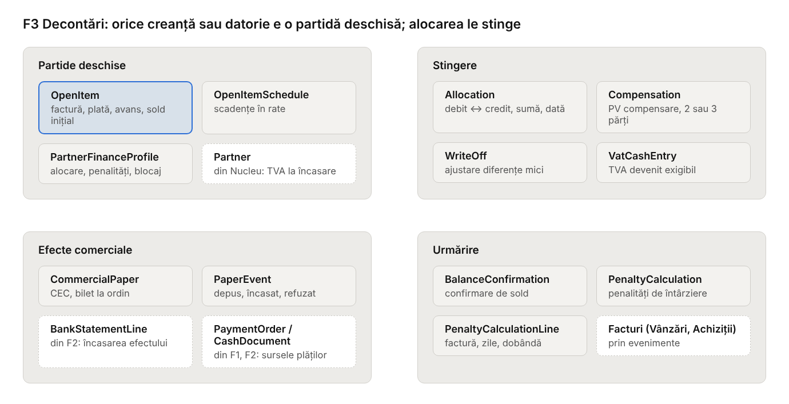

# ERP · 02.02 Finanțe · F3 Decontări cu partenerii

15 noiembrie 2026 · Aurelian · **✓ Validat de Aurelian (15.11.2026)**, cu deciziile lui din aceeași zi (plățile fără factură indicată se alocă FIFO; plata facturilor neprimite în SPV doar cu avertizare; prag de ajustare 5 lei; factura de penalități emisă de Vânzări; CEC și bilet la ordin incluse din faza 1)

A treia din cele 5 sub-părți ale părții financiare a modulului 02.02 Finanțe și contabilitate (schema SQL `fin`, prefix de cod `Erp.Finance`). Acoperă tot ce ține de soldurile clienților și furnizorilor: partidele deschise (facturi, plăți, avansuri), alocarea plăților pe facturi, scadențarul și vechimea soldurilor, compensările, efectele comerciale (CEC, bilet la ordin), ajustările de diferențe mici, TVA la încasare, legătura cu e-Factura, confirmările de sold și penalitățile de întârziere. Documente părinte: [02 Module principale](../MODULE_PRINCIPALE.md), [02.01 Nucleu](../01-nucleu/NUCLEU.md), [F1 Casierie](F1-CASIERIE.md), [F2 Bancă](F2-BANCA.md). Principii: [01 Scop și principii](../../01-scop-si-principii/SCOP_SI_PRINCIPII.md) (P1–P10). Reguli de cod: [Bune practici (SQL și cod)](../../bune-practici/BUNE_PRACTICI.md), referite prin identificator.

**Ce trebuie știut înainte de citire (context autonom, pentru oameni și pentru Copilot / Claude Code):**

- Produs ERP licențiat, instalat on-premise, o bază SQL Server per grup de firme, collation `Latin1_General_100_CS_AS_SC_UTF8` (case sensitive, `SQL-21`). Monolit modular .NET 10 + MediatR; Dapper și proceduri stocate, **fără EF Core sau alt ORM**; un modul vede din altul doar `.Contracts` (P1). Fără componente plătite.
- Orice comandă trece prin pipeline-ul comun (02.01, fluxul 4.1); evenimentele pleacă prin outbox în aceeași tranzacție (P8).
- **F1, F2 și F3 sunt părți ale aceluiași modul (Finanțe).** Între ele nu se trimit evenimente: F1 (documente de casă) și F2 (ordine de plată, linii de extras) apelează direct serviciul de alocare din F3 (`ISettlementService`), în aceeași tranzacție. Evenimentele sunt pentru celelalte module (Vânzări, Achiziții, CRM) și pentru partea contabilă.
- Facturile se emit în Vânzări (02.03) și se înregistrează în Achiziții (02.04); F3 nu le creează, ci le primește prin evenimente și le ține ca partide deschise. Diferențele de curs la decontare se calculează în F4; propunerile de plată, în F5; notele contabile, în partea contabilă.
- Partenerul e unic pe instalare (02.01, 3.2); soldurile se țin **pe firmă și partener**, separat pentru rolul de client și de furnizor.

## 1. Scop și perimetru

| Zonă | Ce face F3 | Ce NU face (și cine face) |
| --- | --- | --- |
| Partide deschise | Registrul unic al creanțelor și datoriilor pe partener: facturi, facturi storno, avansuri, plăți nealocate, solduri inițiale, cu scadențe | Emiterea facturilor (Vânzări), înregistrarea facturilor primite (Achiziții) |
| Alocare | Stingerea facturilor cu plăți și încasări (automat la plată sau manual), desfacerea alocării | Documentul de plată însuși (F1, F2) |
| Solduri și scadențe | Sold pe partener, scadențar, vechimea soldurilor, fișa partenerului | Limita de credit și blocarea livrărilor (Vânzări, pe baza soldului dat de F3) |
| Compensări | Proces-verbal de compensare bilaterală sau cu trei părți, inclusiv între firmele grupului | Eliminările la consolidare (partea contabilă) |
| Efecte comerciale | CEC și bilet la ordin primite și emise: portofoliu, depunere, încasare, refuz | Mișcarea bancară (F2) |
| Ajustări | Stingerea diferențelor mici (rotunjiri, comisioane reținute de client) sub un prag | Creanțele incerte și ajustările pentru depreciere (partea contabilă) |
| TVA la încasare | TVA-ul care devine exigibil (colectat sau deductibil) la fiecare încasare, plată sau compensare | Jurnalele de TVA și D300 (partea contabilă) |
| e-Factura | Starea e-Factura pe partidă; regula de plată a facturilor de furnizor neprimite în SPV | Trimiterea și preluarea din SPV (Integrări, 02.14) |
| Urmărire | Confirmări de sold și penalități de întârziere calculate | Factura de penalități (Vânzări, la cererea F3) |

## 2. Model de domeniu

Totul pornește de la **partida deschisă** (`OpenItem`): orice document care schimbă soldul unui partener devine o partidă cu semn, iar **alocarea** (`Allocation`) leagă o partidă de debit de una de credit și le scade restul de plată amândurora.



Convenția de semn, ca în contabilitate, separat pe rol:

| Rol | Debit (+) | Credit (−) |
| --- | --- | --- |
| Client (creanță) | Factură emisă, factură de avans emisă, notă de debit, sold inițial debitor, restituire de bani către client | Încasare, factură storno / credit, sold inițial creditor |
| Furnizor (datorie) | Plată, factură storno primită, sold inițial debitor (avans dat) | Factură primită, factură de avans primită, sold inițial creditor |

Reguli de business ale modelului:

1. **Soldul unui partener = suma resturilor de plată ale partidelor lui**, pe firmă, rol și monedă. Nu există un câmp „sold” separat care s-ar putea desincroniza.
2. **O alocare leagă întotdeauna o partidă de debit cu una de credit**, ale aceluiași partener, firme și rol (excepție: compensarea, regula 6). Suma alocată nu depășește restul de plată al niciuneia.
3. **Restul de plată nu schimbă semnul**: o factură de 100 nu poate avea rest −10. Ce se plătește în plus rămâne pe partida de plată, ca plată nealocată (avans de fapt).
4. **Alocarea are o dată** (data documentului mai recent dintre cele două), folosită pentru TVA la încasare, vechime și diferențele de curs (F4). Alocarea se verifică pe perioada închisă după această dată.
5. **Plățile nu se pierd**: o încasare fără factură indicată devine partidă de credit nealocată; o factură fără plată rămâne partidă deschisă. Nimic nu se stinge „pe sold”, fără partide.
6. **Compensarea** e singurul loc unde se leagă partide din roluri sau de la parteneri diferiți (client ↔ furnizor la același partener; sau trei parteneri), printr-un document propriu.
7. **O partidă în litigiu** (`IsDisputed`) nu intră în alocarea automată, în propunerile de plată (F5) și în calculul penalităților, dar rămâne în sold.

## 3. Entități, documente și ciclul lor de viață

Convențiile de coloane, tipuri și chei sunt cele din F1, secțiunea 3 (`SQL-07`, `SQL-11`, `SQL-13`, `SQL-19`, `SQL-20`).

### 3.1 Partidă deschisă (`OpenItem`)

| Câmp | Tip | Reguli |
| --- | --- | --- |
| `CompanyId`, `PartnerId` | FK | Obligatorii |
| `Role` | `tinyint` | 1 Client, 2 Furnizor |
| `Kind` | `tinyint` | 1 Factură, 2 Factură storno / credit, 3 Factură de avans, 4 Notă de debit / factură de penalități, 5 Încasare / plată, 6 Sold inițial, 7 Compensare, 8 Efect comercial, 9 Ajustare, 10 Plată prin angajat (decont) |
| `SourceModule`, `SourceDocumentType`, `SourceDocumentId` | text, text, `bigint` | Documentul de origine (`Sales.Invoice`, `Purchasing.SupplierInvoice`, `Finance.PaymentOrder`, `Finance.CashDocument`, `Finance.BankStatementLine`...); unic împreună cu `SourceLineKey` |
| `SourceLineKey` | `nvarchar(50)` | Partea din document (de exemplu linia de OP sau partea liniei de extras); gol pentru facturi |
| `DocumentNo`, `DocumentDate`, `AccountingDate` | | Copiate din sursă |
| `DueDate` | `date` | Scadența; pentru plăți = data documentului. Mai multe scadențe în `OpenItemSchedule` |
| `CurrencyCode`, `ExchangeRate` | | Moneda și cursul documentului de origine |
| `Amount`, `AmountRon` | `decimal(19,2)` | Valoarea cu semn (convenția de mai sus), în monedă și în lei |
| `OpenAmount` | `decimal(19,2)` | Restul de plată, în moneda partidei, cu același semn; 0 = închisă |
| `VatAmount`, `VatAmountRon`, `IsVatOnCollection`, `VatOnCollectionSide` | | TVA-ul facturii și dacă se aplică TVA la încasare (3.7); copiate din eveniment la data facturii |
| `GlAccountCode` | `nvarchar(20)` | Referință: `4111`, `419`, `401`, `404`, `409`, `413`, `403`, `461`, `462` (FK spre planul de conturi în partea contabilă) |
| `EInvoiceStatus`, `EInvoiceIndexNo` | | 0 Nu se aplică, 1 Trimisă, 2 Acceptată, 3 Respinsă, 4 Primită din SPV, 5 Neprimită din SPV (3.8) |
| `IsDisputed`, `DisputeNote` | | Litigiu (regula 7 din secțiunea 2) |
| `IsBlockedForPayment` | `bit` | Blocare manuală la plată, pentru facturile de furnizor |
| `CostCenterId`, `ProjectId` | | Dimensiunile documentului de origine (rapoarte pe proiect, șantier) |
| `ClosedAt` | `date` | Data alocării care a adus restul la zero; folosit în vechime și penalități |
| `ReversalOfId` | FK | La facturile storno, factura stornată |

`OpenItemSchedule` (scadențe în rate): `OpenItemId`, `DueDate`, `Amount`, `OpenAmount`. Alocarea stinge ratele în ordinea scadenței. O partidă fără rânduri în `OpenItemSchedule` are o singură scadență, `DueDate`.

**Cum se nasc partidele:**

| Sursă | Eveniment sau apel | Partidă |
| --- | --- | --- |
| Factură emisă (Vânzări) | `FacturaEmisa` | Client, debit, cu scadențele și TVA-ul facturii |
| Factură storno emisă | `FacturaEmisa` cu `IsReversal` | Client, credit; alocată automat pe factura stornată dacă aceasta are rest |
| Factură primită (Achiziții) | `FacturaFurnizorValidata` | Furnizor, credit |
| Încasare în casă sau în bancă (F1, F2) | `ISettlementService` în tranzacția documentului | Client, credit (sau Furnizor, debit, la o restituire primită de la furnizor) |
| Plată prin OP sau din casă (F1, F2) | Idem | Furnizor, debit (sau Client, debit, la o restituire către client) |
| Decont cu factură de furnizor plătită de angajat (F1) | Idem, la validarea decontului | Furnizor, debit, tip 10 |
| Sold inițial | Import din Excel la pornire (fluxul 4.9) | Pe fiecare factură neîncasată sau neplătită, cu scadența ei |
| Compensare, efect comercial, ajustare | Documentele F3 | Fluxurile 4.4–4.6 |

### 3.2 Profilul financiar al partenerului (`PartnerFinanceProfile`)

Câte un rând pe firmă, partener și rol, creat la prima partidă, cu valori implicite din setările firmei:

| Câmp | Reguli |
| --- | --- |
| `AutoAllocationMode` | 1 Doar pe factura indicată (restul rămâne nealocat), 2 Pe factura indicată, apoi **FIFO**: cele mai vechi scadențe întâi, la scadență egală data documentului, apoi Id-ul (implicit, decizia lui Aurelian din 15.11.2026), 3 Fără alocare automată |
| `PenaltyRatePerDay`, `PenaltyBasis` | Rata de penalitate din contract (procent pe zi) sau 0 pentru dobânda legală penalizatoare (3.10); `PenaltyGraceDays` |
| `ApplyFixedRecoveryCost` | Suma fixă de 40 EUR pe factură întârziată, între profesioniști (Legea 72/2013); implicit oprită |
| `IsPaymentBlocked`, `BlockReason` | Blocare la plată pentru toate facturile furnizorului |
| `BalanceConfirmationEmail` | Adresa pentru confirmările de sold (altfel contactul de facturare din Nucleu) |

### 3.3 Alocare (`Allocation`)

| Câmp | Reguli |
| --- | --- |
| `CompanyId`, `DebitOpenItemId`, `CreditOpenItemId` | Același partener și rol, cu excepția alocărilor dintr-o compensare |
| `Amount` | Pozitiv, în moneda partidelor; dacă monedele diferă, `DebitAmount` și `CreditAmount` separat, cu cursul folosit (F4) |
| `AmountRonDebit`, `AmountRonCredit` | Echivalentul în lei la cursul fiecărei partide; diferența e diferența de curs, calculată și contată în F4 |
| `AllocationDate` | Regula 4 din secțiunea 2 |
| `Source` | 1 Automat la plată, 2 Manual, 3 Compensare, 4 Factură storno, 5 Efect comercial, 6 Ajustare, 7 Import |
| `CompensationId`, `WriteOffId`, `CommercialPaperId` | Documentul F3 care a creat alocarea, după caz |
| `Status` | 1 Activă, 2 Desfăcută (`UndoneAt`, `UndoneBy`, `UndoReason`) |

O alocare nu se modifică: se desface (status 2, restul de plată revine pe ambele partide) și se face alta. Desfacerea e refuzată dacă perioada datei alocării e închisă (`CORE_PERIOD_CLOSED`) sau dacă alocarea vine dintr-o compensare ori dintr-un efect (se stornează documentul acela).

### 3.4 Compensare (`Compensation` + `CompensationLine`)

Documentul e procesul-verbal de compensare, semnat de părți.

**Antet**: `CompanyId`, `Number` (serie), `DocumentDate`, `Kind` (1 Bilaterală la același partener: client ↔ furnizor, 2 Bilaterală între două roluri cu cesiune, 3 Cu trei părți, 4 Din sesiune de compensare externă), `ExternalRef` (referința sesiunii sau a documentului primit), `CurrencyCode`, `TotalAmount`, `Status` (Ciornă, Validat, Stornat), `SignedAttachmentId` (PV-ul semnat, scanat).

**Linie**: `OpenItemId`, `Amount` (cu semnul care stinge partida). Regulă: suma liniilor = 0 (ce se stinge ca datorie = ce se stinge ca creanță).

La validare, F3 creează alocări între partidele din linii (prin partide tehnice de tip 7, câte una pe partener și rol, ca alocarea să rămână debit ↔ credit pe același partener) și publică `CompensareValidata`. Compensarea e „încasare” și „plată” pentru TVA la încasare (3.7).

### 3.5 Efect comercial (`CommercialPaper`)

| Câmp | Reguli |
| --- | --- |
| `CompanyId`, `PartnerId`, `Direction` | 1 Primit de la client, 2 Emis către furnizor |
| `Kind` | 1 CEC, 2 Bilet la ordin |
| `Series`, `Number`, `IssuerBank`, `IssuerAccount` | Datele de pe instrument (Legea 59/1934 pentru CEC, Legea 58/1934 pentru biletul la ordin) |
| `Amount`, `CurrencyCode`, `IssueDate`, `MaturityDate` | Scadența biletului; la CEC, data emiterii |
| `TreasuryAccountId` | Contul bancar la care se depune (primite) sau din care se plătește (emise) |
| `Status` | 1 În portofoliu, 2 Depus la bancă, 3 Încasat / plătit, 4 Refuzat, 5 Girat (transmis altui furnizor), 6 Stornat |
| `GlAccountCode` | Referință: `5112` CEC de încasat, `5113` efecte de încasat, `413` efecte de primit, `403` efecte de plătit |
| `SettledOpenItemIds` | Facturile stinse la primire (prin alocările cu `Source = 5`) |

Istoricul stărilor e în `CommercialPaperEvent` (`Status`, `EventDate`, `BankStatementLineId`, `Note`).

### 3.6 Ajustare (`WriteOff`)

Pentru diferențe mici rămase după alocare (rotunjiri, comisioane bancare reținute de client, câțiva bani lipsă):

- `OpenItemId`, `Amount`, `Reason` (1 Rotunjire, 2 Comision reținut de partener, 3 Diferență acceptată), `DocumentDate`.
- Pragul maxim pe ajustare e `Fin.WriteOff.MaxAmountRon` (implicit 5 lei, confirmat de Aurelian pe 15.11.2026); peste prag, ajustarea cere `Fin.WriteOff.AboveThreshold`.
- Ajustarea creează o partidă de tip 9 și o alocare cu `Source = 6`; contarea (de exemplu pe `658` / `758`) e în partea contabilă.
- Creanțele neîncasabile (prescrise, faliment) nu se ajustează aici: se reclasifică și se depreciază în partea contabilă.

### 3.7 TVA la încasare (`VatCashEntry`)

Se aplică facturilor marcate `IsVatOnCollection` la data lor:

- **colectat**: facturile emise de o firmă din grup care aplică TVA la încasare (`core.Company.VatOnCollection` la data facturii);
- **deductibil**: facturile primite de la un furnizor care aplică TVA la încasare (`core.Partner.VatOnCollection` la data facturii, din registrul ANAF preluat de Integrări), precum și toate facturile primite de o firmă care aplică ea însăși TVA la încasare.

La fiecare alocare activă pe o astfel de factură (încasare, plată, compensare, efect încasat, ajustare), F3 calculează TVA-ul devenit exigibil, proporțional:

`VatExigibil = round(SumaAlocată × VatAmount / Amount, 2)`, iar la alocarea care închide factura, `VatExigibil = TVA rămas` (ca suma să dea exact TVA-ul facturii, P7).

Rândul `VatCashEntry` are `OpenItemId`, `AllocationId`, `Side` (1 Colectat, 2 Deductibil), `ExigibilityDate` (data alocării), `BaseAmountRon`, `VatAmountRon`, `IsReversal`. Desfacerea alocării creează rândul invers. Partea contabilă îl transformă în mutarea din `4428` neexigibil în `4427` sau `4426` și în jurnalele de TVA. Lunar, raportul „TVA neexigibil” trebuie să egaleze soldul `4428` pe facturile cu rest de plată.

### 3.8 Legătura cu e-Factura

| Situație | Comportament |
| --- | --- |
| Factură emisă respinsă de e-Factura (`EFacturaRespinsa`) | Partida primește `EInvoiceStatus = 3` și apare în raportul „Facturi neîncasate cu e-Factura respinsă”; încasarea se poate aloca, cu avertizare |
| Factură de furnizor înregistrată fără să fie preluată din SPV | `EInvoiceStatus = 5`; legarea ei de un OP sau de o plată din casă cere **confirmarea unei avertizări** (setarea `Fin.Payment.RequireSpvInvoice` = 2 Avertizare, implicit, decizia lui Aurelian din 15.11.2026; se poate trece pe 1 Blocare sau 0 Fără verificare). Furnizorii din afara României și persoanele fizice neînregistrate sunt scutiți automat |
| Factura sosește ulterior în SPV | Achiziții o leagă de factura înregistrată (`FacturaPrimitaSPV` → actualizare); partida trece în `EInvoiceStatus = 4` |
| Factură emisă stornată | Factura storno trece prin e-Factura ca orice factură; partida de credit se alocă pe factura inițială |

Motivul regulii: din 2024 facturile între firme din România trebuie să treacă prin sistemul RO e-Factura, iar o factură care nu e în SPV e un risc la deducerea TVA și la un control. Plata ei nu e interzisă de lege, de aceea implicit e doar avertizare.

### 3.9 Confirmare de sold (`BalanceConfirmation`)

- `CompanyId`, `PartnerId`, `Role`, `AsOfDate`, `Number`, `GeneratedAttachmentId` (PDF cu partidele deschise), `SentAt`, `SentTo`, `ResponseStatus` (1 Trimisă, 2 Confirmată, 3 Contestată, 4 Fără răspuns), `ResponseDate`, `PartnerBalance` (soldul declarat de partener), `Difference`, `ResponseAttachmentId`.
- Se generează pe lot (toți partenerii cu sold peste un prag, la o dată), se trimit pe email prin outbox (02.01, fluxul 4.7) și se urmăresc. O contestare cere explicarea diferenței (partide lipsă la una din părți).

### 3.10 Penalități de întârziere (`PenaltyCalculation` + `PenaltyCalculationLine`)

**Antet**: `CompanyId`, `Number`, `CalculationDate`, `PeriodFrom`, `PeriodTo`, `PartnerId` (opțional: toți partenerii), `Status` (Ciornă, Aprobat, Facturat, Anulat).

**Linie**: `OpenItemId`, `DueDate`, `PaidDate` (sau data calculului, dacă e încă neplătită), `BaseAmount` (restul de plată pe fiecare interval), `Days`, `RatePerDay` sau `AnnualRate`, `PenaltyAmount`, `FixedRecoveryCost`.

Reguli:

1. Penalitatea se calculează pe fiecare interval în care restul de plată a fost constant, de la `DueDate + PenaltyGraceDays + 1` până la data fiecărei alocări (plățile parțiale micșorează baza).
2. Rata vine din profilul partenerului (contract). Dacă profilul are 0, se aplică **dobânda legală penalizatoare** între profesioniști: rata de referință BNR + 8 puncte procentuale pe an (OG 13/2011), cu rata de referință valabilă în fiecare semestru, ținută în `fin.ReferenceRate` (`ValidFrom`, `Rate`, actualizată de echipa produsului sau manual).
3. Opțional, valoarea totală a penalităților se plafonează la valoarea debitului, dacă așa prevede contractul (`PenaltyCapAtPrincipal` pe profil).
4. Partidele în litigiu nu se penalizează.
5. Aprobarea calculului publică `PenalitatiCalculate`, pe care Vânzări îl consumă ca să creeze factura de penalități ca ciornă (F3 nu poate apela Vânzări direct, pentru că Vânzări e deasupra Finanțelor, 02 „Dependențe”).

## 4. Fluxuri principale

### 4.1 Factura devine partidă deschisă

1. Vânzări validează factura și publică `FacturaEmisa`; Achiziții publică `FacturaFurnizorValidata`.
2. Consumatorul F3 creează partida (idempotent pe `SourceDocumentType` + `SourceDocumentId`, `core.InboxProcessed`), cu scadențele, TVA-ul, marcajul TVA la încasare și starea e-Factura.
3. Dacă partenerul are plăți nealocate și `AutoAllocationMode = 2`, F3 alocă automat plățile nealocate pe factura nouă (cele mai vechi întâi). Așa se închide automat avansul încasat înaintea facturii.
4. O factură storno se alocă automat pe factura stornată (`Source = 4`).

Conținutul minim cerut evenimentelor `FacturaEmisa` și `FacturaFurnizorValidata` (se va respecta în 02.03 și 02.04): `InvoiceId`, `PartnerId`, `Number`, `DocumentDate`, `AccountingDate`, `CurrencyCode`, `ExchangeRate`, `TotalAmount`, `TotalAmountRon`, `VatAmount`, `VatAmountRon`, `IsVatOnCollection`, `IsReversal`, `ReversedInvoiceId`, `IsAdvanceInvoice`, lista scadențelor `{DueDate, Amount}`, `CostCenterId`, `ProjectId`, `EInvoiceStatus`, `EInvoiceIndexNo`.

### 4.2 Alocarea la încasare sau plată

1. F1 (validarea documentului de casă) sau F2 (validarea OP-ului, validarea liniei de extras) apelează `ISettlementService.RegisterPaymentAsync` în aceeași tranzacție, cu partenerul, rolul, suma, data și lista facturilor indicate (`SettlementRef`).
2. F3 creează partida plății și o alocă pe facturile indicate, în ordinea dată, până la suma fiecăreia.
3. Dacă plata nu indică o factură, sau ce rămâne după facturile indicate, se alocă **FIFO** (mod 2, implicit): cele mai vechi scadențe întâi, la scadență egală data documentului, apoi Id-ul; ce depășește toate facturile deschise rămâne plată nealocată. În modurile 1 și 3 restul rămâne nealocat.
4. Pentru fiecare alocare pe o factură cu TVA la încasare, F3 scrie `VatCashEntry` (3.7).
5. Dacă alocarea închide o factură, F3 publică `FacturaAchitata` (Vânzări și Achiziții își actualizează starea, CRM vede istoricul).
6. Stornarea plății (F1, F2) apelează `ISettlementService.ReversePaymentAsync`: alocările ei se desfac, iar facturile redevin deschise.

Blocările se verifică înainte de alocare: factură de furnizor blocată la plată, partener blocat, regula SPV (3.8), factură în litigiu. Toate dau o eroare clară (secțiunea 7) sau o avertizare care se confirmă, după caz.

### 4.3 Alocarea manuală

1. Ecranul Alocare (lettraj) arată pentru un partener și rol partidele de debit în stânga și pe cele de credit în dreapta, cu restul de plată.
2. Contabilul bifează partidele și sumele; ecranul arată suma alocată pe fiecare parte și diferența.
3. Propuneri automate: perechi cu sumă egală, combinații de facturi care dau suma plății (cel mult 5 facturi), restul pe cele mai vechi.
4. La salvare se creează alocările (`fin.usp_Allocation_CreateBatch`, TVP), cu `VatCashEntry` și evenimentele aferente. O diferență mică rămasă se poate ajusta direct (3.6).

### 4.4 Compensarea

1. Contabilul creează PV-ul de compensare: alege partenerii și partidele de stins din fiecare parte (ecranul propune automat, la un partener care e și client și furnizor, suma minimă dintre cele două solduri).
2. Tipărește PV-ul, îl trimite partenerului și atașează exemplarul semnat.
3. Validarea creează alocările și intrările de TVA la încasare și publică `CompensareValidata`.
4. Stornarea PV-ului desface toate alocările lui.

### 4.5 Efectul comercial primit

1. La primirea CEC-ului sau a biletului la ordin, contabilul îl înregistrează și alege facturile pe care le stinge; F3 creează partida efectului (credit pe client) și alocările (`Source = 5`). Factura e stinsă, iar efectul intră în portofoliu.
2. La depunere la bancă, starea devine Depus (opțional, borderou de depunere tipărit).
3. Linia din extras care aduce banii se potrivește cu efectul (F2, pasul 3a din tabelul de potrivire automată 4.3: după sumă, partener și scadență) și efectul devine Încasat.
4. Un efect refuzat (linie de refuz sau aviz de la bancă) trece în Refuzat: alocările lui se desfac, factura redevine deschisă și restantă, iar F3 notifică contabilul (și, opțional, marchează partenerul pentru verificare în Vânzări).
5. Efectele emise către furnizori urmează același drum în oglindă: emiterea stinge factura furnizorului, plata la scadență vine din extras (F2).

### 4.6 Confirmări de sold

1. Contabilul alege data, rolul, pragul de sold și partenerii; sistemul generează un PDF pe partener, cu partidele deschise la acea dată și soldul.
2. Trimiterea pe email trece prin outbox; răspunsurile se înregistrează manual (confirmat, contestat cu soldul partenerului) cu atașamentul primit.
3. Raportul de stare arată confirmările fără răspuns și diferențele.

### 4.7 Penalități de întârziere

1. Contabilul pornește calculul pe interval (și opțional pe partener); sistemul generează liniile după regulile din 3.10.
2. Verifică, scoate liniile pe care nu le facturează și aprobă.
3. Aprobarea publică `PenalitatiCalculate`; Vânzări creează factura de penalități ca ciornă; la validarea ei, factura devine partidă deschisă ca oricare alta (tip 4), iar calculul trece în Facturat.

### 4.8 Ajustarea diferențelor mici

1. Din ecranul de alocare sau din raportul de partide cu rest mic, contabilul selectează partidele cu rest sub prag.
2. Alege motivul; F3 creează ajustările și alocările lor într-un lot.

### 4.9 Soldurile inițiale la pornirea în sistem

1. Se importă din Excel (mecanismul din 02.01, fluxul 4.8) câte un rând pe factură deschisă la data pornirii: partener, rol, număr, dată, scadență, monedă, valoare, rest, TVA la încasare și TVA-ul neexigibil rămas.
2. Plățile nealocate (avansuri) se importă ca partide de credit (client) sau de debit (furnizor).
3. Totalul importat pe rol trebuie să egaleze soldul conturilor `4111`, `401` etc. din balanța de pornire (verificare în raportul de import).

### 4.10 Cazuri limită

| Situație | Comportament |
| --- | --- |
| Client care plătește mai mult decât factura | Diferența rămâne încasare nealocată (avans de fapt); se alocă automat pe următoarea factură (mod 2) |
| Client care plătește în lei o factură în euro | Alocare cu monede diferite; F3 ține cursul plății, F4 calculează diferența de curs |
| Factură stornată parțial, deja încasată integral | Partida storno rămâne credit nealocat (de restituit sau de alocat pe altă factură) |
| Două OP-uri validate simultan pe aceeași factură | Alocările se serializează pe rândul facturii (`UPDLOCK`); al doilea OP alocă doar restul, iar surplusul rămâne plată nealocată, cu avertizare în ecran |
| Desfacerea unei alocări într-o perioadă închisă | Refuz (`CORE_PERIOD_CLOSED`); corecția se face prin alocări noi în perioada curentă |
| Partener cu același CUI ca o firmă din grup | Partidele intră în raportul de reconciliere intra-grup; compensările între firmele grupului sunt permise |
| Plată pe o factură în litigiu | Permisă manual, cu avertizare; nu și automat |
| Furnizor care trece la TVA la încasare în cursul lunii | Contează marcajul la data fiecărei facturi, nu la data plății |

## 5. Evenimente

### 5.1 Publicate

| Eveniment | Când | Conținut (pe lângă anvelop) | Consumatori |
| --- | --- | --- | --- |
| `AlocareInregistrata` v1 | Crearea sau desfacerea unei alocări (inclusiv din compensări, efecte, ajustări) | `AllocationId`, `PartnerId`, `Role`, `DebitOpenItem {Id, SourceDocumentType, SourceDocumentId, CurrencyCode, ExchangeRate}`, `CreditOpenItem {...}`, `Amount`, `AmountRonDebit`, `AmountRonCredit`, `AllocationDate`, `Source`, `IsUndo` | Partea contabilă (reclasificare avansuri `419`/`409`), F4 (diferențe de curs) |
| `FacturaAchitata` v1 | O factură ajunge la rest zero (sau iese din zero, la desfacere) | `Role`, `SourceDocumentType`, `SourceDocumentId`, `PartnerId`, `ClosedAt`, `IsReopened` | Vânzări, Achiziții, CRM |
| `TvaLaIncasareExigibil` v1 | Scrierea unui `VatCashEntry` | `OpenItemId`, `SourceDocumentId`, `Side`, `ExigibilityDate`, `BaseAmountRon`, `VatAmountRon`, `IsReversal` | Partea contabilă (jurnale TVA, `4428`) |
| `CompensareValidata` v1 | Validarea unui PV de compensare | `CompensationId`, `Number`, `DocumentDate`, liniile `{OpenItemId, PartnerId, Role, Amount}` | Partea contabilă |
| `EfectComercialModificat` v1 | Orice schimbare de stare a unui efect | `CommercialPaperId`, `Direction`, `Kind`, `Status`, `Amount`, `PartnerId`, `EventDate` | Partea contabilă, Raportare |
| `PenalitatiCalculate` v1 | Aprobarea unui calcul de penalități | `PenaltyCalculationId`, pe partener: `PartnerId`, totalul, liniile `{InvoiceNo, Days, PenaltyAmount}` | Vânzări (factura de penalități) |

### 5.2 Consumate

| Eveniment | De la | Ce face F3 |
| --- | --- | --- |
| `FacturaEmisa` | Vânzări | Partidă client (fluxul 4.1) |
| `FacturaFurnizorValidata` | Achiziții | Partidă furnizor |
| `EFacturaAcceptata`, `EFacturaRespinsa` | Integrări | Actualizează `EInvoiceStatus` pe partida clientului |
| `FacturaPrimitaSPV` (prin Achiziții, la legarea facturii) | Achiziții | Actualizează `EInvoiceStatus` pe partida furnizorului |
| `PartenerModificat` | Nucleu | Reține schimbarea `VatOnCollection` (pentru facturile viitoare; cele existente păstrează marcajul de la data lor) |
| `SituatieLucrariAprobata` | Construcții | Nimic direct: factura vine prin Vânzări; garanțiile de bună execuție reținute se țin ca scadențe separate (`OpenItemSchedule`) ale facturii |

## 6. Contracte publice (`Erp.Finance.Contracts`, partea F3)

```csharp
namespace Erp.Finance.Contracts.Settlement;

public enum PartnerRole : byte { Customer = 1, Supplier = 2 }

public sealed record PartnerBalanceDto(
    int CompanyId, int PartnerId, PartnerRole Role, string CurrencyCode,
    decimal Balance, decimal BalanceRon, decimal OverdueRon, int MaxOverdueDays,
    decimal UnallocatedPaymentsRon, DateOnly AsOf);

public sealed record OpenItemDto(
    long OpenItemId, string SourceDocumentType, long SourceDocumentId, string DocumentNo,
    DateOnly DocumentDate, DateOnly DueDate, string CurrencyCode,
    decimal Amount, decimal OpenAmount, bool IsDisputed, bool IsBlockedForPayment, byte EInvoiceStatus);

public interface IPartnerBalanceQueries
{
    // Folosit de Vânzări (limita de credit, blocarea livrărilor), CRM (istoric), Raportare
    Task<IReadOnlyList<PartnerBalanceDto>> GetBalanceAsync(
        int companyId, int partnerId, PartnerRole? role, DateOnly asOf, CancellationToken ct);

    Task<IReadOnlyList<OpenItemDto>> GetOpenItemsAsync(
        int companyId, int partnerId, PartnerRole role, CancellationToken ct);
}
```

Contract intern al modulului Finanțe (nu e în `.Contracts`, pentru că îl folosesc doar F1, F2, F4, F5 din același modul):

```csharp
namespace Erp.Finance.Application.Settlement;

public sealed record PaymentSettlementRequest(
    int CompanyId, int PartnerId, PartnerRole Role, string SourceDocumentType, long SourceDocumentId,
    string SourceLineKey, string DocumentNo, DateOnly DocumentDate, string CurrencyCode, decimal ExchangeRate,
    decimal Amount, decimal AmountRon, bool IsRefund,
    IReadOnlyList<SettlementTarget> Targets, bool ConfirmWarnings);

public sealed record SettlementTarget(long OpenItemId, decimal? Amount);

public interface ISettlementService
{
    // Apelat în tranzacția documentului de plată (F1, F2); creează partida plății și alocările
    Task<PaymentSettlementResult> RegisterPaymentAsync(PaymentSettlementRequest request, CancellationToken ct);
    Task ReversePaymentAsync(string sourceDocumentType, long sourceDocumentId, string? sourceLineKey, CancellationToken ct);
}

public sealed record PaymentSettlementResult(
    long PaymentOpenItemId, decimal AllocatedAmount, decimal UnallocatedAmount, IReadOnlyList<long> ClosedOpenItemIds);
```

Comenzi interne F3: `AllocateManually`, `UndoAllocation`, `SetOpenItemDispute`, `SetOpenItemPaymentBlock`, `SavePartnerFinanceProfile`, `SaveCompensation`, `ValidateCompensation`, `ReverseCompensation`, `RegisterCommercialPaper`, `ChangeCommercialPaperStatus`, `CreateWriteOffs`, `GenerateBalanceConfirmations`, `SendBalanceConfirmations`, `RecordBalanceConfirmationResponse`, `CalculatePenalties`, `ApprovePenaltyCalculation`, `SaveReferenceRate`, `ImportOpeningOpenItems`.

## 7. Schema SQL `fin` (partea F3)

| Tabel | Cheie primară | Chei unice / străine principale | Indecși suplimentari |
| --- | --- | --- | --- |
| `fin.OpenItem` | `Id bigint` | UQ `(SourceDocumentType, SourceDocumentId, SourceLineKey, Role)`; FK `CompanyId`, `PartnerId`, `ReversalOfId` | `(CompanyId, PartnerId, Role, CurrencyCode)` filtrat `WHERE OpenAmount <> 0` INCLUDE `(DueDate, OpenAmount, DocumentNo)`; `(CompanyId, Role, DueDate)` filtrat pe deschise (scadențar); `(CompanyId, DocumentDate)` |
| `fin.OpenItemSchedule` | `Id bigint` | FK `OpenItemId` | `OpenItemId` |
| `fin.PartnerFinanceProfile` | `Id int` | UQ `(CompanyId, PartnerId, Role)` | — |
| `fin.Allocation` | `Id bigint` | FK `DebitOpenItemId`, `CreditOpenItemId`, `CompensationId`, `WriteOffId`, `CommercialPaperId` | `DebitOpenItemId`, `CreditOpenItemId`; `(CompanyId, AllocationDate)` |
| `fin.VatCashEntry` | `Id bigint` | FK `OpenItemId`, `AllocationId` | `(CompanyId, ExigibilityDate, Side)` |
| `fin.Compensation`, `fin.CompensationLine` | `int` / `bigint` | UX filtrat `(CompanyId, Number)`; FK `OpenItemId` pe linie | `(CompanyId, DocumentDate)` |
| `fin.CommercialPaper` | `Id int` | UQ `(CompanyId, PartnerId, Kind, Series, Number)`; FK `TreasuryAccountId` | `(CompanyId, Status, MaturityDate)` |
| `fin.CommercialPaperEvent` | `Id bigint` | FK `CommercialPaperId`, `BankStatementLineId` | `CommercialPaperId` |
| `fin.WriteOff` | `Id int` | FK `OpenItemId` | `(CompanyId, DocumentDate)` |
| `fin.BalanceConfirmation` | `Id int` | UX filtrat `(CompanyId, Number)`; FK `PartnerId` | `(CompanyId, AsOfDate, ResponseStatus)` |
| `fin.PenaltyCalculation`, `fin.PenaltyCalculationLine` | `int` / `bigint` | FK `OpenItemId` pe linie | `(CompanyId, CalculationDate)` |
| `fin.ReferenceRate` | `Id int` | UQ `ValidFrom` | — |

`SourceDocumentId` e `bigint` fără FK, pentru că documentele sursă stau în alte scheme (Vânzări, Achiziții) sau în tabele diferite din `fin` (P1); integritatea e asigurată de consumatorul idempotent și de cheia unică.

Exemplu de tabel complet:

```sql
CREATE TABLE fin.OpenItem (
    Id                   bigint IDENTITY(1,1) NOT NULL CONSTRAINT PK_OpenItem PRIMARY KEY,
    CompanyId            int                NOT NULL CONSTRAINT FK_OpenItem_Company REFERENCES core.Company(Id),
    PartnerId            int                NOT NULL CONSTRAINT FK_OpenItem_Partner REFERENCES core.Partner(Id),
    Role                 tinyint            NOT NULL,
    Kind                 tinyint            NOT NULL,
    SourceModule         varchar(20)        NOT NULL,
    SourceDocumentType   varchar(50)        NOT NULL,
    SourceDocumentId     bigint             NOT NULL,
    SourceLineKey        nvarchar(50)       NOT NULL CONSTRAINT DF_OpenItem_SourceLineKey DEFAULT (N''),
    DocumentNo           nvarchar(50)       NOT NULL,
    DocumentDate         date               NOT NULL,
    AccountingDate       date               NOT NULL,
    DueDate              date               NOT NULL,
    CurrencyCode         char(3)            NOT NULL CONSTRAINT FK_OpenItem_Currency REFERENCES core.Currency(Code),
    ExchangeRate         decimal(19,6)      NOT NULL,
    Amount               decimal(19,2)      NOT NULL,
    AmountRon            decimal(19,2)      NOT NULL,
    OpenAmount           decimal(19,2)      NOT NULL,
    VatAmount            decimal(19,2)      NOT NULL CONSTRAINT DF_OpenItem_VatAmount DEFAULT (0),
    VatAmountRon         decimal(19,2)      NOT NULL CONSTRAINT DF_OpenItem_VatAmountRon DEFAULT (0),
    IsVatOnCollection    bit                NOT NULL CONSTRAINT DF_OpenItem_IsVatOnCollection DEFAULT (0),
    GlAccountCode        nvarchar(20)       NULL,
    EInvoiceStatus       tinyint            NOT NULL CONSTRAINT DF_OpenItem_EInvoiceStatus DEFAULT (0),
    EInvoiceIndexNo      varchar(30)        NULL,
    IsDisputed           bit                NOT NULL CONSTRAINT DF_OpenItem_IsDisputed DEFAULT (0),
    IsBlockedForPayment  bit                NOT NULL CONSTRAINT DF_OpenItem_IsBlockedForPayment DEFAULT (0),
    CostCenterId         int                NULL,
    ProjectId            int                NULL,
    ClosedAt             date               NULL,
    ReversalOfId         bigint             NULL CONSTRAINT FK_OpenItem_OpenItem_ReversalOf REFERENCES fin.OpenItem(Id),
    CreatedAt            datetime2(3)       NOT NULL CONSTRAINT DF_OpenItem_CreatedAt DEFAULT (sysutcdatetime()),
    CreatedBy            int                NOT NULL,
    ModifiedAt           datetime2(3)       NULL,
    ModifiedBy           int                NULL,
    RowVersion           rowversion         NOT NULL,
    CONSTRAINT CK_OpenItem_Role CHECK (Role IN (1, 2)),
    CONSTRAINT CK_OpenItem_Kind CHECK (Kind BETWEEN 1 AND 10),
    CONSTRAINT CK_OpenItem_AmountNotZero CHECK (Amount <> 0),
    -- Restul de plată are semnul valorii și nu o depășește (regula 3 din secțiunea 2)
    CONSTRAINT CK_OpenItem_OpenAmountRange CHECK (
        (Amount > 0 AND OpenAmount BETWEEN 0 AND Amount) OR
        (Amount < 0 AND OpenAmount BETWEEN Amount AND 0)),
    CONSTRAINT CK_OpenItem_ClosedAt CHECK ((OpenAmount = 0 AND ClosedAt IS NOT NULL) OR (OpenAmount <> 0 AND ClosedAt IS NULL))
);
CREATE UNIQUE INDEX UX_OpenItem_Source
    ON fin.OpenItem (SourceDocumentType, SourceDocumentId, SourceLineKey, Role);
CREATE INDEX IX_OpenItem_CompanyId_PartnerId_Role_Open
    ON fin.OpenItem (CompanyId, PartnerId, Role, CurrencyCode)
    INCLUDE (DueDate, OpenAmount, DocumentNo, IsDisputed)
    WHERE OpenAmount <> 0;
CREATE INDEX IX_OpenItem_CompanyId_Role_DueDate_Open
    ON fin.OpenItem (CompanyId, Role, DueDate) INCLUDE (PartnerId, OpenAmount, CurrencyCode)
    WHERE OpenAmount <> 0;
CREATE INDEX IX_OpenItem_CompanyId_DocumentDate ON fin.OpenItem (CompanyId, DocumentDate);
```

Crearea unui lot de alocări, după șablonul din Bune practici 3.5 (TVA-ul exigibil e calculat în handler cu `IPrecisionService`, `SP-13`, și trimis în același TVP):

```sql
CREATE OR ALTER PROCEDURE fin.usp_Allocation_CreateBatch
    @Allocations fin.tt_Allocation READONLY,   -- (RowNo, DebitOpenItemId, CreditOpenItemId, DebitAmount, CreditAmount,
                                               --  AmountRonDebit, AmountRonCredit, AllocationDate, Source, VatDebit, VatCredit)
    @UserId      int
AS
BEGIN
    SET NOCOUNT ON;
    SET XACT_ABORT ON;

    -- Partidele atinse, blocate în ordinea Id-urilor (SP-16)
    DECLARE @Items TABLE (Id bigint PRIMARY KEY, CompanyId int, PartnerId int, Role tinyint,
                          Amount decimal(19,2), OpenAmount decimal(19,2));
    INSERT INTO @Items (Id, CompanyId, PartnerId, Role, Amount, OpenAmount)
    SELECT o.Id, o.CompanyId, o.PartnerId, o.Role, o.Amount, o.OpenAmount
    FROM fin.OpenItem AS o WITH (UPDLOCK, ROWLOCK)
    WHERE o.Id IN (SELECT DebitOpenItemId FROM @Allocations UNION SELECT CreditOpenItemId FROM @Allocations)
    ORDER BY o.Id;

    IF EXISTS (SELECT 1 FROM @Allocations AS a
               JOIN @Items AS d ON d.Id = a.DebitOpenItemId
               JOIN @Items AS c ON c.Id = a.CreditOpenItemId
               WHERE d.Amount < 0 OR c.Amount > 0)
        THROW 51401, N'Alocarea trebuie să lege o partidă de debit cu una de credit.', 1;

    IF EXISTS (SELECT 1 FROM @Allocations AS a
               JOIN @Items AS d ON d.Id = a.DebitOpenItemId
               JOIN @Items AS c ON c.Id = a.CreditOpenItemId
               WHERE a.Source <> 3 AND (d.PartnerId <> c.PartnerId OR d.Role <> c.Role OR d.CompanyId <> c.CompanyId))
        THROW 51402, N'Partidele aparțin altor parteneri sau roluri.', 1;

    -- Totalul alocat pe fiecare partidă nu depășește restul de plată
    IF EXISTS (SELECT 1 FROM @Items AS i
               CROSS APPLY (SELECT SUM(a.DebitAmount) AS D FROM @Allocations AS a WHERE a.DebitOpenItemId = i.Id) AS dd
               CROSS APPLY (SELECT SUM(a.CreditAmount) AS C FROM @Allocations AS a WHERE a.CreditOpenItemId = i.Id) AS cc
               WHERE ISNULL(dd.D, 0) > i.OpenAmount OR ISNULL(cc.C, 0) > -i.OpenAmount)
        THROW 51403, N'Suma alocată depășește restul de plată.', 1;

    DECLARE @Inserted TABLE (AllocationId bigint, RowNo int);

    MERGE fin.Allocation AS t
    USING @Allocations AS a ON 1 = 0
    WHEN NOT MATCHED THEN
        INSERT (CompanyId, DebitOpenItemId, CreditOpenItemId, DebitAmount, CreditAmount,
                AmountRonDebit, AmountRonCredit, AllocationDate, Source, Status, CreatedBy)
        VALUES ((SELECT CompanyId FROM @Items WHERE Id = a.DebitOpenItemId), a.DebitOpenItemId, a.CreditOpenItemId,
                a.DebitAmount, a.CreditAmount, a.AmountRonDebit, a.AmountRonCredit, a.AllocationDate, a.Source, 1, @UserId)
    OUTPUT inserted.Id, a.RowNo INTO @Inserted (AllocationId, RowNo);

    UPDATE o
    SET OpenAmount = o.OpenAmount - x.Delta,
        ClosedAt   = CASE WHEN o.OpenAmount - x.Delta = 0 THEN x.LastDate ELSE NULL END,
        ModifiedAt = SYSUTCDATETIME(), ModifiedBy = @UserId
    FROM fin.OpenItem AS o
    JOIN (SELECT ItemId, SUM(Delta) AS Delta, MAX(AllocationDate) AS LastDate
          FROM (SELECT DebitOpenItemId AS ItemId, DebitAmount AS Delta, AllocationDate FROM @Allocations
                UNION ALL
                SELECT CreditOpenItemId, -CreditAmount, AllocationDate FROM @Allocations) AS u
          GROUP BY ItemId) AS x ON x.ItemId = o.Id;

    INSERT INTO fin.VatCashEntry (CompanyId, OpenItemId, AllocationId, Side, ExigibilityDate, BaseAmountRon, VatAmountRon, IsReversal, CreatedBy)
    SELECT o.CompanyId, o.Id, i.AllocationId, CASE WHEN o.Role = 1 THEN 1 ELSE 2 END, a.AllocationDate,
           v.VatBase, v.Vat, 0, @UserId
    FROM @Allocations AS a
    JOIN @Inserted AS i ON i.RowNo = a.RowNo
    CROSS APPLY (VALUES (a.DebitOpenItemId, a.VatDebit, a.VatDebitBase), (a.CreditOpenItemId, a.VatCredit, a.VatCreditBase)) AS v(ItemId, Vat, VatBase)
    JOIN fin.OpenItem AS o ON o.Id = v.ItemId
    WHERE o.IsVatOnCollection = 1 AND v.Vat <> 0;

    SELECT i.RowNo, i.AllocationId FROM @Inserted AS i;
END;
```

`fin.tt_Allocation` conține și `VatDebitBase`, `VatCreditBase` (baza în lei aferentă TVA-ului exigibil). Din F4, același `UPDATE` pe `fin.OpenItem` scade și `OpenAmountRon` (valoarea contabilă în lei a restului) cu `AmountRonDebit` / `AmountRonCredit`, iar valorile în lei vin din `IFxSettlementService` (F4, fluxul 4.1). `MERGE ... ON 1 = 0` e folosit doar ca să poată întoarce `RowNo` din TVP în `OUTPUT`.

Proceduri stocate principale:

| Procedură | Rol | Publică |
| --- | --- | --- |
| `fin.usp_OpenItem_CreateFromInvoice` | Partidă din eveniment de factură, idempotent | Nu |
| `fin.usp_OpenItem_RegisterPayment` | Partida plății (apelată de `ISettlementService`) | Nu |
| `fin.usp_Allocation_CreateBatch`, `fin.usp_Allocation_Undo` | Alocări pe lot; desfacere (cu `VatCashEntry` invers) | Nu |
| `fin.usp_Allocation_Candidates` | Propuneri pentru ecranul de alocare (sume egale, combinații) | Nu |
| `fin.usp_PartnerBalance_Get` | Sold, restanțe, plăți nealocate pe partener și dată | Da (prin `IPartnerBalanceQueries`) |
| `fin.usp_OpenItem_ListOpen` | Partidele deschise ale unui partener | Da |
| `fin.usp_OpenItem_AsOf` | Partidele deschise la o dată trecută (refăcute din alocările de până la acea dată) | Nu |
| `fin.usp_Aging_Report`, `fin.usp_DueSchedule_Report` | Vechimea soldurilor, scadențarul | Nu |
| `fin.usp_Compensation_Save`, `_Validate`, `_Reverse` | PV de compensare | Nu |
| `fin.usp_CommercialPaper_Register`, `_ChangeStatus` | Efecte comerciale | Nu |
| `fin.usp_Penalty_Calculate` | Calculul penalităților pe intervale (pe seturi, cu `LEAD()` peste alocări) | Nu |

Coduri de eroare (plaja F3 `51400–51599`, prefix API `FIN_`):

| Cod SQL | Cod API | HTTP | Când apare |
| --- | --- | --- | --- |
| 51401 | `FIN_ALLOCATION_SIDES_INVALID` | 400 | Alocare între două partide de debit sau două de credit |
| 51402 | `FIN_ALLOCATION_PARTNER_MISMATCH` | 400 | Partide de la parteneri, roluri sau firme diferite, în afara unei compensări |
| 51403 | `FIN_ALLOCATION_EXCEEDS_OPEN` | 409 | Suma alocată depășește restul de plată (inclusiv după o alocare concurentă) |
| 51404 | `FIN_ALLOCATION_UNDO_NOT_ALLOWED` | 409 | Desfacerea unei alocări din compensare, efect sau ajustare (se stornează documentul) |
| 51405 | `FIN_OPEN_ITEM_DUPLICATE_SOURCE` | 409 | A doua partidă pentru același document sursă (eveniment repetat tratat ca idempotent în consumator) |
| 51406 | `FIN_OPEN_ITEM_BLOCKED_FOR_PAYMENT` | 409 | Plată pe o factură sau la un furnizor blocat la plată |
| 51407 | `FIN_OPEN_ITEM_NOT_IN_SPV` | 409 | Plată pe o factură de furnizor neprimită în SPV, cu regula pe Blocare |
| 51408 | `FIN_OPEN_ITEM_NOT_IN_SPV_UNCONFIRMED` | 409 | Idem, cu regula pe Avertizare, neconfirmată |
| 51409 | `FIN_OPEN_ITEM_DISPUTED_UNCONFIRMED` | 409 | Alocare manuală pe o partidă în litigiu, neconfirmată |
| 51410 | `FIN_COMPENSATION_NOT_BALANCED` | 400 | Suma liniilor PV-ului de compensare ≠ 0 |
| 51411 | `FIN_COMPENSATION_NOT_DRAFT` | 409 | Modificarea unui PV validat |
| 51412 | `FIN_COMMERCIAL_PAPER_DUPLICATE` | 409 | Efect cu aceeași serie și număr deja înregistrat |
| 51413 | `FIN_COMMERCIAL_PAPER_STATUS_INVALID` | 409 | Tranziție de stare nepermisă a efectului |
| 51414 | `FIN_WRITEOFF_ABOVE_THRESHOLD` | 403 | Ajustare peste prag fără permisiunea dedicată |
| 51415 | `FIN_PENALTY_ALREADY_INVOICED` | 409 | Modificarea sau anularea unui calcul facturat |
| 51416 | `FIN_REFERENCE_RATE_MISSING` | 409 | Nu există rata de referință BNR pentru un interval din calculul penalităților |
| 51417 | `FIN_CONCURRENCY_CONFLICT` | 409 | `RowVersion` diferit (`SP-18`) |

Conformitate: schema și procedurile respectă `SQL-01`–`SQL-25`, `SP-01`–`SP-21`, `MIG-01`–`MIG-07`. Abateri: niciuna. `SourceModule` și `SourceDocumentType` sunt `varchar`, coduri tehnice ASCII livrate de produs, comparate exact (`SQL-09`, `SQL-24`).

## 8. Permisiuni și roluri

| Permisiune | Ce permite |
| --- | --- |
| `Fin.PartnerBalance.View` | Solduri, fișa partenerului, scadențar, vechime |
| `Fin.Allocation.Manage` | Alocare manuală |
| `Fin.Allocation.Undo` | Desfacerea alocărilor (auditată) |
| `Fin.OpenItem.SetDispute` | Marcarea litigiilor |
| `Fin.OpenItem.BlockPayment` | Blocarea la plată a facturilor și furnizorilor |
| `Fin.PartnerProfile.Manage` | Profilul financiar al partenerului (alocare, penalități) |
| `Fin.Compensation.Create` / `.Validate` | PV de compensare |
| `Fin.CommercialPaper.Manage` | Efecte comerciale |
| `Fin.WriteOff.Create` | Ajustări sub prag |
| `Fin.WriteOff.AboveThreshold` | Ajustări peste prag |
| `Fin.BalanceConfirmation.Manage` | Confirmări de sold |
| `Fin.Penalty.Calculate` / `.Approve` | Calcul și aprobare penalități |
| `Fin.OpeningBalance.Import` | Importul partidelor inițiale |

Roluri livrate:

| Rol | Permisiuni F3 |
| --- | --- |
| Contabil clienți / furnizori | `PartnerBalance.View`, `Allocation.Manage`, `OpenItem.SetDispute`, `Compensation.Create`, `CommercialPaper.Manage`, `WriteOff.Create`, `BalanceConfirmation.Manage`, `Penalty.Calculate` |
| Contabil șef | Toate permisiunile F3 |
| Director financiar | `PartnerBalance.View`, `OpenItem.BlockPayment`, `Compensation.Validate`, `Penalty.Approve` |
| Agent de vânzări | `PartnerBalance.View` (doar pe partenerii lui, prin scope-ul din Vânzări) |
| Auditor | `PartnerBalance.View` și rapoartele |

## 9. Cerințe legale și integrări

| Cerință | Ce înseamnă pentru F3 |
| --- | --- |
| Codul fiscal: TVA la încasare (art. 282 și 297) | Marcaj pe factură la data ei; TVA exigibil proporțional cu fiecare încasare, plată sau compensare; raport de TVA neexigibil (3.7) |
| Registrul persoanelor care aplică TVA la încasare | Marcajul partenerului vine din Nucleu, actualizat din registrul ANAF de Integrări |
| RO e-Factura (OUG 120/2021, B2B obligatoriu din 2024) | Starea e-Factura pe partidă; regula configurabilă pentru plata facturilor de furnizor neprimite în SPV (3.8) |
| Legea 72/2013 (întârzieri la plată între profesioniști) | Penalități de întârziere și suma fixă de recuperare de 40 EUR, opțională pe partener |
| OG 13/2011 (dobânda legală) | Dobânda legală penalizatoare = rata de referință BNR + 8 puncte procentuale între profesioniști, când contractul nu prevede altă rată |
| Codul civil (compensația) | PV de compensare cu acordul părților, semnat și atașat |
| Legea 59/1934 (CEC), Legea 58/1934 (cambia și biletul la ordin) | Datele obligatorii ale efectelor; stările până la încasare sau refuz |
| Legea contabilității 82/1991 și inventarierea anuală (OMFP 2861/2009) | Confirmările de sold ajută la inventarierea creanțelor și datoriilor la sfârșit de an |
| GDPR | Partenerii persoane fizice: confirmările de sold și fișele conțin date personale; trimiterea e auditată |

Integrări: niciuna externă directă (emailul pleacă prin Nucleu). Interne: Vânzări și Achiziții (facturi, prin evenimente), Integrări (stări e-Factura), F1 și F2 (plăți, prin `ISettlementService`), F4 (diferențe de curs), F5 (facturi de plătit), partea contabilă (alocări, TVA la încasare, compensări, efecte).

## 10. Rapoarte

| Raport | Conținut | Utilizatori |
| --- | --- | --- |
| Fișa partenerului | Pe partener, rol și interval: sold inițial, documente, plăți, alocări, sold final, în valută și în lei | Contabil, Agent de vânzări |
| Solduri parteneri | Pe rol, la o dată: sold, restanțe, plăți nealocate, pe partener; total pe grup de firme | Contabil șef, Director financiar |
| Vechimea soldurilor | Pe intervale configurabile (implicit nescadent, 1–30, 31–60, 61–90, 91–180, peste 180 de zile), pe client sau furnizor | Director financiar, Vânzări |
| Scadențar | Încasări și plăți de primit / făcut pe zile, săptămâni, luni; sursă pentru prognoza din F5 | Contabil trezorerie, Director financiar |
| Plăți nealocate | Încasări și plăți fără factură, cu vechimea | Contabil |
| TVA la încasare | TVA neexigibil pe facturi deschise, la o dată; TVA devenit exigibil pe lună (colectat, deductibil) | Contabil șef |
| Facturi cu probleme e-Factura | Facturi emise respinse sau facturi de furnizor neprimite în SPV, cu restul de plată | Contabil |
| Reconciliere intra-grup | Creanța firmei A față de B comparată cu datoria lui B față de A, cu diferențele pe documente | Contabil șef (consolidare) |
| Efecte comerciale | Portofoliu pe scadențe; depuse și neîncasate; refuzate | Contabil trezorerie |
| Confirmări de sold | Pe stare, cu diferențele declarate | Contabil, Auditor |
| Penalități | Calculate, aprobate, facturate, pe partener | Director financiar |

## 11. Ecrane principale

Tiparul comun: listă cu filtre → fișă cu tab-uri → istoric (`UI-08`). Machetele (HTML + PNG) sunt în [ecrane/f3-decontari/](ecrane/f3-decontari/): `f3-01-solduri-parteneri`, `f3-02-fisa-financiara-partener`, `f3-03-alocare`, `f3-04-scadentar`, `f3-05-compensari`, `f3-06-efecte-comerciale`, `f3-07-confirmari-de-sold`, `f3-08-penalitati`.

| Ecran | Conținut principal | Note |
| --- | --- | --- |
| Solduri parteneri | Listă cu soldul pe client sau furnizor, restanța, vechimea maximă, plățile nealocate; filtre pe rol, restanțe, agent, grup | Deschide fișa partenerului |
| Fișa partenerului (financiar) | Tab-uri: Partide deschise, Toate documentele, Alocări, Efecte, Confirmări, Profil financiar; în antet soldurile ca client și ca furnizor | Același ecran apare ca tab „Financiar” în fișa partenerului din Nucleu, dacă modulul e licențiat |
| Alocare (lettraj) | Partener și rol; debit în stânga, credit în dreapta, cu rest; propuneri; diferența și ajustarea ei | Tastatură completă (`UI-09`) |
| Scadențar | Calendar sau tabel pe zile cu încasări și plăți scadente; din el se pot crea OP-uri (F2) | — |
| Compensări | Listă; fișa PV-ului cu partidele fiecărei părți și totalurile; tipărire, atașarea PV-ului semnat | Propunere automată pentru partenerii client și furnizor |
| Efecte comerciale | Portofoliu pe stare și scadență; fișa efectului cu istoricul stărilor | — |
| Confirmări de sold | Generare pe lot, trimitere, înregistrarea răspunsurilor | — |
| Penalități | Calcul pe interval, linii pe factură, aprobare | — |
| Configurare Finanțe | Tab-uri noi în familia „Finanțe”: Rate de referință BNR, Praguri (ajustări, confirmări), Intervale de vechime | — |

## 12. Criterii de acceptare și teste cheie

Fiecare criteriu are cel puțin un test automat marcat `[Trait("Criteriu", "02.02-F3-An")]` (`TST-01`).

| # | Criteriu | Test |
| --- | --- | --- |
| F3-A1 | Soldul unui partener calculat din partide = sold inițial + facturi − plăți, pe orice set de 10.000 de documente generate aleator | Test de proprietate |
| F3-A2 | Un eveniment de factură livrat de două ori creează o singură partidă | Test de integrare (idempotență) |
| F3-A3 | O încasare cu factura indicată stinge factura în aceeași tranzacție cu documentul de plată; surplusul rămâne nealocat sau merge pe cele mai vechi scadențe, după profil | Test de integrare |
| F3-A4 | Două plăți simultane pe aceeași factură nu o pot stinge peste valoarea ei | Test de concurență (`TST-05`) |
| F3-A5 | Restul de plată nu schimbă semnul și nu depășește valoarea partidei (refuzat și de `CHECK` în bază) | Test de integrare |
| F3-A6 | Desfacerea unei alocări readuce resturile, scrie TVA-ul invers și e refuzată într-o perioadă închisă | Test de integrare |
| F3-A7 | Pe o factură cu TVA la încasare plătită în trei tranșe, suma TVA-ului exigibil e exact TVA-ul facturii | Test unitar + integrare |
| F3-A8 | Plata unei facturi de furnizor neprimite în SPV e blocată cu regula pe Blocare și cere confirmare cu regula pe Avertizare | Test de integrare |
| F3-A9 | Un PV de compensare echilibrat stinge partidele ambelor părți și generează TVA exigibil pe facturile cu TVA la încasare; unul neechilibrat e refuzat | Test de integrare |
| F3-A10 | Un CEC refuzat redeschide factura stinsă la primire | Test de integrare |
| F3-A11 | Penalitățile pe o factură plătită în două tranșe se calculează pe două intervale cu baze diferite, iar dobânda legală folosește rata de referință din fiecare semestru | Test unitar |
| F3-A12 | Partidele deschise refăcute la o dată trecută coincid cu fișa partenerului la acea dată | Test de integrare |
| F3-A13 | Importul de solduri inițiale de 50.000 de facturi se încheie fără duplicate, iar totalul pe rol egalează totalul din fișier | Test de integrare |
| F3-A14 | Soldul unui partener pe 1.000.000 de partide răspunde în p95 sub 200 ms | Test de performanță |
| F3-A15 | Toate procedurile F3 rulează corect pe baza case sensitive creată pe un server cu collation case insensitive | Test de integrare (`TST-09`) |

Criteriile F3-A4, F3-A5 și F3-A7 sunt critice: un sold greșit sau un TVA exigibil greșit ajung direct în declarații.

## Decizii de validare (15.11.2026)

| # | Întrebare | Decizia lui Aurelian | Unde e aplicată |
| --- | --- | --- | --- |
| 1 | Alocarea unei plăți fără factură indicată sau a surplusului | FIFO: cele mai vechi scadențe întâi | 3.2, 4.2 |
| 2 | Plata unei facturi de furnizor neprimite în SPV | Avertizare (care se confirmă), nu blocare | 3.8, F3-A8 |
| 3 | Pragul pentru ajustarea diferențelor mici | 5 lei | 3.6 |
| 4 | Factura de penalități | O emite Vânzări, din calculul aprobat în Finanțe | 3.10, 4.7 |
| 5 | CEC și bilet la ordin | Se folosesc; rămân în faza 1 | 3.5, 4.5 |

## Note de implementare (23.11.2026)

| Pas | Ce s-a făcut | Abateri și completări față de specificație |
| --- | --- | --- |
| F3.1 | Migrarea `2026.11.036`, procedurile `fin.usp_OpenItem_Create` (idempotentă pe documentul sursă, creează profilul), `_Candidates` (blocare în ordinea Id-urilor, ordine FIFO), `fin.usp_Allocation_CreateBatch`, `fin.usp_Allocation_Undo`, `fin.usp_OpenItemSchedule_Refresh`, `fin.usp_PartnerBalance_Get` (soldul refăcut din alocări la o dată), `fin.usp_OpenItem_ListOpen`, `_SetFlags`, `_PaymentItems`, profilul; `SettlementService` (`ISettlementService` + factura nouă + alocarea manuală), `InvoiceOpenItems` și consumatorul `RegisterInvoices` din Worker; comenzile `AllocateManually`, `UndoAllocation`, `SetOpenItemDispute`, `SetOpenItemPaymentBlock`, `SavePartnerFinanceProfile` și interogările soldului, partidelor și profilului; `IPartnerBalanceQueries` | Evenimentele de facturi sunt în `Erp.Finance.Contracts.Settlement` (decizia lui Aurelian din 23.11.2026), ca Finanțele să nu depindă de Vânzări / Achiziții. TVA-ul exigibil se calculează în procedura lotului, sub blocarea partidelor (nu în handler), ca să vadă și alocările concurente; tranșa care închide factura ia restul exact. TVP-urile urmează convenția repo-ului (`fin.AllocationList`, `fin.OpenItemScheduleList`). Alocarea între monede diferite e refuzată deocamdată (51418 `FIN_ALLOCATION_CURRENCY_MISMATCH`, cod nou) până la diferențele de curs din F4 (corectură 24.11.2026: din F4, alocarea între monede se face la curs încrucișat; 51418 rămâne doar fără curs încrucișat). Stornarea plății desface alocările și închide plata cu o partidă inversă (`SourceLineKey` + `#S`, `ReversalOfId`), alocată cu `Source = 4`, ca soldul să rămână suma partidelor. FIFO nu atinge facturile în litigiu, blocate la plată sau neprimite în SPV (când regula SPV e pornită); acestea se plătesc doar indicate, cu confirmare. Rolul livrat „Contabil clienți / furnizori” are codul `CONTABIL_DECONTARI`; rolul Agent de vânzări vine cu Vânzări. Restanța și vechimea din sold folosesc scadența partidei (nu ratele) |
| F3.2 | `TreasurySettlement` (puntea F1 / F2 → `ISettlementService`) apelat la validarea documentului de casă (`Finance.CashDocument`, cheia = Id-ul liniei), a OP-ului (`Finance.PaymentOrder`, cheia = numărul liniei) și a liniei de extras (`Finance.BankStatementLine`, cheia = numărul părții; părțile pe OP nu se înregistrează a doua oară); stornarea documentului de casă, a OP-ului și desfacerea validării liniei apelează `ReversePaymentAsync`; procedura `fin.usp_TreasuryOperationType_Kinds` | Rolul vine din `SettlementKind`-ul tipului de operațiune: 1 facturi client, 2 facturi furnizor și, nou (migrarea `2026.11.037`, F1 3.2 extins), 5 avans client (`INC-AVANS-CLIENT`) și 6 avans furnizor (`PLATA-AVANS-FURNIZOR`), înregistrate fără alocare la plată. Sensul opus rolului e o restituire. Facturile indicate se scriu în `SettlementRef` ca „OI:<Id partidă>” (una sau mai multe), forma pe care o va folosi alegerea din lista facturilor deschise; un text liber nu indică nimic (restul merge FIFO). O linie de extras revalidată după desfacere primește partide noi (cheia + „/n”), cele vechi rămân stornate. La liniile de extras avertizările F3 sunt considerate confirmate (facturile au fost alese explicit la explicare; plățile către furnizori trec oricum prin OP, unde regula SPV se confirmă cu `ConfirmWarnings`). Plata prin angajat (tip 10, din decont) vine odată cu facturile de furnizor din Achiziții |
| F3.4d | Migrarea `2026.11.043` (`fin.BalanceConfirmationBatch`, `fin.BalanceConfirmation`), procedurile `fin.usp_OpenItem_AsOf` (partidele deschise la o dată trecută, refăcute din alocări, F3-A12), `fin.usp_BalanceConfirmation_Generate`, `_Get`, `_List`, `_Update`, `fin.usp_BalanceConfirmationBatch_MarkSent`; comenzile `GenerateBalanceConfirmations` (PDF QuestPDF pe partener, atașat prin `IAttachmentStore`), `SendBalanceConfirmations` (emailul prin `IEmailOutbox`, cu PDF-ul atașat), `RecordBalanceConfirmationResponse`; ecranul Confirmări de sold (macheta f3-07); API `/api/finance/balance-confirmations` | Confirmarea are în plus starea 0 „Generată” (PDF făcut, încă netrimisă) și un antet de lot (`BalanceConfirmationBatch`: data, rolul, pragul, numărul din seria `Finance.BalanceConfirmation`); confirmările se numerotează „lot/nnnn”. Pragul se aplică soldului în lei, în valoare absolută. Adresa e `BalanceConfirmationEmail` din profilul financiar, altfel emailul partenerului din Nucleu (contactul de facturare nu are încă un rol distinct). La „Confirmat” soldul partenerului e al nostru și diferența 0; „Contestat” cere soldul declarat și explicația. Cod nou 51421 `FIN_BALANCE_CONFIRMATION_NOT_FOUND`. Raportul de stare (4.6 pasul 3) e chiar lista lotului cu filtrele |
| F3.4e | Migrarea `2026.11.044` (`fin.ReferenceRate`, `fin.PenaltyCalculation`, `fin.PenaltyCalculationLine`, TVP `fin.PenaltyLineList`), procedurile `fin.usp_Penalty_Sources`, `fin.usp_PenaltyCalculation_Save`, `_Change`, `_Get`, `_List`, `fin.usp_ReferenceRate_Save`, `_List`; regulile `PenaltyRules` (domeniu, testul unitar F3-A11); comenzile `CalculatePenalties`, `RecalculatePenalties`, `RemovePenaltyLines`, `CancelPenaltyCalculation`, `ApprovePenaltyCalculation` (evenimentul `PenalitatiCalculate`), `SaveReferenceRate`; ecranul Penalități (macheta f3-08, cu întreținerea ratelor de referință); API `/api/finance/penalties`, `/api/finance/reference-rates` | Intervalele se calculează în C# (`PenaltyRules`, funcție pură, testabilă), nu în procedură cu `LEAD()`: procedura dă partidele, alocările și ratele. Zilele se numără inclusiv capetele (ziua plății se penalizează cu baza veche); dobânda legală e pe an / 365 și se rupe la schimbarea ratei de referință; rotunjire la 2 zecimale pe interval. Se penalizează partidele de client de tip factură, notă de debit și sold inițial debitor, fără cele în litigiu; zilele deja calculate într-un calcul neanulat nu se mai penalizează, iar plafonul la debit ține cont de ce s-a calculat înainte. Penalitatea e în moneda facturii; suma fixă de 40 EUR (Legea 72/2013) e o linie separată (`Kind = 2`, în EUR), o dată pe factură. Numărul calculului se dă la generarea ciornei. Ratele de referință sunt comune instalării și nu sunt pre-încărcate (se introduc din ecran, permisiunea `Fin.Treasury.Configure`); lipsa ratei pentru o zi cu dobândă legală oprește calculul (`FIN_REFERENCE_RATE_MISSING`). Coduri noi 51422 `FIN_PENALTY_CALCULATION_NOT_FOUND`, 51423 `FIN_PENALTY_NOT_DRAFT`; `FIN_PENALTY_EMPTY` la aprobarea unui calcul fără linii. Trecerea în Facturat vine cu factura de penalități din Vânzări |
| F3.4f | Importul soldurilor inițiale: contractele de import ale Nucleului (`ISpreadsheetFiles`, `IImportJobs`, migrarea `2026.11.046`), TVP-ul `fin.OpeningItemList` (migrarea `2026.11.045`), procedurile `fin.usp_OpeningBalance_Lookup` și `fin.usp_OpeningBalance_Import` (pe seturi, idempotent); comenzile `UploadOpeningBalances` (validare + job), `ImportOpeningOpenItems` (loturi de 500), `FailOpeningBalanceImport`, `CancelOpeningBalanceImport`, interogările jobului, șablonului și rândurilor cu erori; tab-urile Configurare › Finanțe › Solduri inițiale și Rate de referință BNR; API `/api/finance/opening-balances`; testul F3-A13 (50.000 de rânduri) | Rândul are în plus `Tip` (Factură / Plată nealocată) și `Curs` (obligatoriu la valută). Partida importată are ca valoare restul de la data pornirii (valoarea documentului se validează, dar nu se păstrează), cu semnul pe rol: factura e tip 6 (sold inițial), plata nealocată tip 5, ca să apară la plățile nealocate; TVA-ul neexigibil rămas e TVA-ul partidei, deci se face exigibil proporțional cu încasările ulterioare (tipul 6 intră acum în calculul TVA la încasare). Cheia de idempotență: documentul `Finance.OpeningBalance`, partenerul, rolul și „firmă:tip:număr”; rândurile deja importate apar ca avertizări și nu se reimportă. Partenerul se caută după cod sau CUI (cu sau fără „RO”); partenerii lipsă nu se creează (se importă întâi partenerii, 02.01). Comparația cu balanța de pornire (pasul 3) se face manual pe totalurile pe rol și monedă din raport, până la partea contabilă. Ratele de referință s-au mutat în Configurare › Finanțe (11) |

### Rămân de făcut (consemnat la cererea lui Aurelian, 23.11.2026)

Inventarul complet al Finanțelor e în [RAMAS-DE-FACUT.md](RAMAS-DE-FACUT.md).

| # | Ce | Când |
| --- | --- | --- |
| 1 | Scadențar (f3-04): vizualizarea Calendar, exportul Excel și „Trimite în propunere de plată” | Cu F5 Planificarea trezoreriei |
| 2 | ~~Alocare (f3-03): ajustarea diferenței mici rămase (sub pragul de 5 lei) direct din ecran~~ | Făcut în F3.4a (23.11.2026) |
| 3 | Alocare (f3-03): propunerile pe combinații de facturi care dau suma plății (cel mult 5 facturi, F3 4.3 pasul 3) | De planificat |
| 4 | Factura pe părțile liniei de extras (alegerea din lista facturilor deschise la explicarea liniei) | Cu pasul de potrivire pe facturi din F2 (4.3, pasul 4) |
