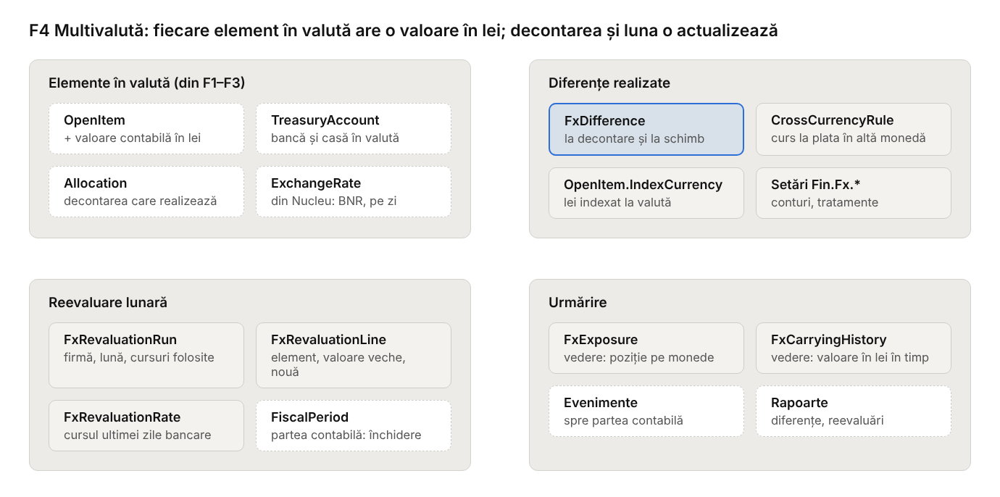

# ERP · 02.02 Finanțe · F4 Multivalută

15 noiembrie 2026 · Aurelian · **✓ Validat de Aurelian (15.11.2026)**, cu deciziile lui din aceeași zi (plata în altă monedă: cursul BNR implicit sau alt curs ales de operator; alocările din luni reevaluate se acceptă cu corecție în luna următoare; fără facturi de diferență de curs; avansurile nu se reevaluează)

A patra din cele 5 sub-părți ale părții financiare a modulului 02.02 Finanțe și contabilitate (schema SQL `fin`, prefix de cod `Erp.Finance`). Acoperă tot ce ține de valută după ce documentul există: valoarea în lei a fiecărui element în valută, diferențele de curs **realizate** (la decontare și la schimbul valutar), creanțele și datoriile **în lei indexate la o valută** și **reevaluarea lunară** a elementelor monetare în valută. Documente părinte: [02 Module principale](../MODULE_PRINCIPALE.md), [02.01 Nucleu](../01-nucleu/NUCLEU.md), [F1 Casierie](F1-CASIERIE.md), [F2 Bancă](F2-BANCA.md), [F3 Decontări](F3-DECONTARI.md). Principii: [01 Scop și principii](../../01-scop-si-principii/SCOP_SI_PRINCIPII.md) (P1–P10). Reguli de cod: [Bune practici (SQL și cod)](../../bune-practici/BUNE_PRACTICI.md), referite prin identificator.

**Ce trebuie știut înainte de citire (context autonom, pentru oameni și pentru Copilot / Claude Code):**

- Produs ERP licențiat, instalat on-premise, o bază SQL Server per grup de firme, collation `Latin1_General_100_CS_AS_SC_UTF8` (case sensitive, `SQL-21`). Monolit modular .NET 10 + MediatR; Dapper și proceduri stocate, **fără EF Core sau alt ORM**. Fără componente plătite.
- Moneda funcțională a tuturor firmelor e **RON** (firme doar din România, decizia din schiță). Cursurile sunt cele din Nucleu (`core.ExchangeRate`): BNR pe zi, preluate de Integrări; manuale doar pentru monedele pe care BNR nu le publică (02.01, fluxul 4.3).
- Rotunjirea se face doar prin `IPrecisionService` (P7, `NET-14`): valorile în lei la 2 zecimale, cursurile memorate cu 6 zecimale (`SQL-07`).
- F1–F4 sunt părți ale aceluiași modul: F4 e apelat direct de F3 la fiecare alocare (în aceeași tranzacție) și de F2 la schimbul valutar. Evenimentele sunt pentru partea contabilă, care face notele (`665` / `765`, `668` / `768`).
- **Ce NU face F4**: nu emite documente fiscale, nu calculează TVA (TVA-ul unei facturi în valută rămâne la cursul din data facturii) și nu scrie note contabile.

## 1. Scop și perimetru

| Zonă | Ce face F4 | Ce NU face (și cine face) |
| --- | --- | --- |
| Valoarea în lei | Ține valoarea contabilă în lei a restului de plată al fiecărei partide în valută și a soldului fiecărui cont de trezorerie în valută | Cursul zilei (Nucleu, Integrări) |
| Diferențe realizate | Diferența dintre valoarea contabilă în lei a facturii și valoarea în lei a plății, la fiecare alocare; diferența dintre cursul băncii și cursul BNR la schimbul valutar | Alocarea însăși (F3), operațiunea bancară (F2) |
| Plata în altă monedă | Regula de curs când o factură în EUR e plătită în lei (sau invers) | — |
| Indexare | Facturile în lei cu decontare la cursul unei valute: diferențele la plată și la reevaluare | Clauza din contract și factura (Vânzări, Achiziții) |
| Reevaluare lunară | Rularea de la sfârșitul lunii pe partide deschise și conturi de trezorerie în valută, la cursul BNR din ultima zi bancară | Închiderea perioadei și nota contabilă (partea contabilă) |
| Poziție valutară | Expunerea pe monede, la o dată | Acoperirea riscului valutar (în afara produsului) |

## 2. Model de domeniu

Fiecare element monetar în valută are, pe lângă suma în valută, o **valoare contabilă în lei**. Ea se schimbă doar în două momente: la decontare (diferență realizată) și la reevaluarea de la sfârșitul lunii (diferență nerealizată).



Reguli de business ale modelului:

1. **Elementele monetare în valută** se reevaluează: creanțele și datoriile din facturi, plățile nealocate care sunt bani de restituit, conturile bancare și casele în valută, efectele comerciale în valută. **Avansurile** acordate furnizorilor sau primite de la clienți (facturi de avans și plăți nealocate tratate ca avans) nu se reevaluează, pentru că se decontează prin bunuri sau servicii, nu prin bani (tratament implicit, configurabil pe tipul de partidă, `Fin.Fx.RevalueAdvances`, implicit oprit).
2. **Valoarea contabilă în lei a restului** (`OpenAmountRon`) pornește de la cursul documentului și se actualizează la fiecare reevaluare validată. Diferența la decontare se calculează față de această valoare, nu față de cursul inițial.
3. **O alocare împarte valoarea contabilă proporțional** cu suma alocată; alocarea care închide partida ia tot restul în lei, ca să nu rămână bani (P7).
4. **Diferența realizată = valoarea în lei a părții de credit − valoarea în lei a părții de debit**, la fiecare alocare. La client, o valoare pozitivă e câștig (`765`), negativă e pierdere (`665`); la furnizor, semnele sunt inverse (secțiunea 3.2).
5. **Indexarea nu schimbă moneda partidei**: factura rămâne în lei, dar are o valută și o sumă de referință (`IndexCurrencyCode`, `IndexedAmount`); diferențele ei merg pe `668` / `768`.
6. **O reevaluare validată pe lună și firmă.** Rularea se poate reface doar după stornarea celei validate; o alocare cu dată într-o lună deja reevaluată e acceptată, iar efectul ei asupra reevaluării se corectează automat în luna următoare (secțiunea 4.6).
7. **Cursul de reevaluare** e cursul comunicat de BNR în ultima zi bancară a lunii (OMFP 1802/2014), memorat în rularea respectivă; o corectare ulterioară a cursului în Nucleu nu schimbă o rulare validată.

## 3. Entități, documente și ciclul lor de viață

Convențiile de coloane, tipuri și chei sunt cele din F1, secțiunea 3.

### 3.1 Extinderi ale entităților din F1–F3

| Entitate | Coloane noi | Reguli |
| --- | --- | --- |
| `fin.OpenItem` (F3) | `OpenAmountRon decimal(19,2)`, `CarryingRate decimal(19,6)`, `LastRevaluationRunId`, `IsMonetary bit`, `IndexCurrencyCode char(3)`, `IndexedAmount decimal(19,2)`, `IndexedOpenAmount decimal(19,2)` | `OpenAmountRon` = valoarea contabilă în lei a restului; la creare = `round(OpenAmount × ExchangeRate, 2)` (sau `AmountRon` al documentului). `IsMonetary` = 0 pentru avansuri (regula 1). Pentru partidele în lei neindexate, `OpenAmountRon = OpenAmount` și nu intră în F4 |
| `fin.Allocation` (F3) | `CrossRate decimal(19,6)`, `CrossRateSource tinyint` | Cursul folosit când cele două partide au monede diferite (3.3) |
| `fin.TreasuryAccount` (F1) | — | Valoarea contabilă în lei a soldului se calculează (3.4), nu se ține în coloană |
| `fin.PartnerFinanceProfile` (F3) | `CrossCurrencyRule tinyint`, `CrossCurrencyMarkupPercent decimal(9,4)` | Regula de curs pentru plata în altă monedă decât factura (3.3) |

### 3.2 Diferență de curs realizată (`FxDifference`)

Un rând pentru fiecare diferență realizată:

| Câmp | Reguli |
| --- | --- |
| `CompanyId`, `DifferenceDate` | Data alocării sau a schimbului valutar |
| `Source` | 1 Alocare (F3), 2 Schimb valutar între conturi proprii (F2), 3 Ieșire din cont în valută (diferența între valoarea contabilă și cursul zilei, doar dacă `Fin.Fx.RealizeOnTreasuryOutflow` e pornit, 3.4), 4 Indexare la plată |
| `AllocationId`, `BankStatementLinePartId` | Originea |
| `PartnerId`, `Role`, `OpenItemId` | Pentru alocări: partida în valută (sau indexată) a cărei valoare s-a realizat |
| `CurrencyCode`, `ForeignAmount` | Suma în valută realizată |
| `CarryingAmountRon`, `SettlementAmountRon` | Valoarea contabilă și valoarea de decontare, în lei |
| `DifferenceRon` | `SettlementAmountRon − CarryingAmountRon`, cu semnul ales astfel încât **pozitiv = câștig** pentru firmă |
| `GlAccountCode` | Referință: `765` / `665` (valută), `768` / `668` (indexare) |
| `IsReversal`, `ReversalOfId` | La desfacerea alocării se scrie rândul invers |

Semnul câștigului:

| Rol | Partida în valută | Când e câștig |
| --- | --- | --- |
| Client | Factura (debit) | Plata valorează în lei mai mult decât valoarea contabilă a facturii (leul s-a depreciat) |
| Furnizor | Factura (credit) | Plata costă în lei mai puțin decât valoarea contabilă a facturii (leul s-a apreciat) |

### 3.3 Plata în altă monedă decât factura

Când partida de debit și cea de credit au monede diferite (de exemplu factură de 1.000 EUR plătită dintr-un cont în lei), alocarea are nevoie de un curs încrucișat, ca să știe câți euro stinge plata în lei. **Implicit se folosește cursul BNR din ziua plății, iar operatorul poate alege la plată alt curs** (decizia lui Aurelian din 15.11.2026). Ecranul de alocare și cel de plată (F1, F2) arată cursul propus și permit înlocuirea lui; cursul ales se memorează pe alocare (`CrossRate`, `CrossRateSource`). Ca să nu fie tastat de fiecare dată, partenerul poate avea în profil (`CrossCurrencyRule`) o regulă propusă implicit:

| Regulă | Cursul folosit | Când |
| --- | --- | --- |
| 1 BNR din ziua plății (implicit) | `core.ExchangeRate` BNR la data documentului de plată | Contractele obișnuite: „plata în lei la cursul BNR din ziua plății” |
| 2 BNR din ziua plății + marjă | Cursul BNR × (1 + `CrossCurrencyMarkupPercent`/100) | Contracte cu „BNR + 1%” sau similar |
| 3 BNR din ziua facturii | Cursul facturii | Contracte cu preț fix în lei la cursul de la facturare |
| 4 Curs ales de operator | Cursul introdus de operator la plată sau la alocare, memorat pe alocare | Orice situație în care operatorul alege alt curs (curs negociat, cursul băncii); cere `Fin.Fx.ManualCrossRate`, inclusă în rolurile contabile |

Suma stinsă în moneda facturii = suma plătită / cursul încrucișat, rotunjită la 2 zecimale; dacă depășește restul facturii, surplusul în lei rămâne plată nealocată. Diferența de curs se calculează ca la regula 4 din secțiunea 2: valoarea în lei a plății alocate minus valoarea contabilă în lei a părții stinse din factură.

### 3.4 Conturi de trezorerie în valută

Pentru fiecare cont de trezorerie în valută (bancă, casă, card), F4 calculează **valoarea contabilă în lei a soldului**:

`ValoareLei(cont, dată) = Σ AmountRon al mișcărilor validate până la dată + Σ DifferenceRon al reevaluărilor validate ale contului până la dată`

Fiecare mișcare are `AmountRon` la cursul BNR din ziua ei (F1, F2). Așadar, după o lună cu intrări și ieșiri la cursuri diferite, valoarea în lei nu mai corespunde soldului în valută × cursul de la final; reevaluarea lunară închide diferența (fluxul 4.4).

Opțiune: `Fin.Fx.RealizeOnTreasuryOutflow` (implicit oprită). Pornită, fiecare ieșire din cont se evaluează la cursul mediu ponderat al soldului, iar diferența față de cursul zilei devine diferență realizată la ieșire (`Source = 3`). Oprită, totul se regularizează la reevaluarea lunară, ceea ce e mai simplu și suficient pentru OMFP 1802.

### 3.5 Schimb valutar între conturi proprii

În F2, o pereche de linii (de exemplu −5.020 RON în contul în lei și +1.000 EUR în contul în euro) se explică cu `BANK-SCHIMB-VALUTAR`. Cursul băncii (5,02) diferă de cursul BNR al zilei (4,97):

- linia în euro intră în contul în valută cu `AmountRon` la cursul BNR (4.970 RON);
- cei 5.020 RON ieșiți din contul în lei sunt valoarea reală plătită;
- diferența de 50 RON e **pierdere realizată** din schimb (`Source = 2`, `665`).

La o vânzare de valută, invers: diferența dintre lei primiți și valoarea contabilă în lei a euro-ilor ieșiți (la cursul BNR al zilei sau la valoarea medie ponderată, după opțiunea din 3.4).

### 3.6 Reevaluare lunară (`FxRevaluationRun` + `FxRevaluationLine` + `FxRevaluationRate`)

**Rularea** (`FxRevaluationRun`): `CompanyId`, `PeriodYear`, `PeriodMonth`, `RevaluationDate` (ultima zi a lunii), `RateDate` (ultima zi bancară a lunii, după calendarul BNR), `Number`, `Status` (1 Ciornă, 2 Validat, 3 Stornat), `TotalGainRon`, `TotalLossRon`, `ValidatedAt`, `ValidatedBy`, `ReversalOfId`.

**Cursurile folosite** (`FxRevaluationRate`): `RunId`, `CurrencyCode`, `Rate`, `Multiplier`, `Source` (BNR / manual). Copiate din Nucleu la generarea rulării; o rulare validată nu le mai citește din Nucleu.

**Liniile** (`FxRevaluationLine`, `bigint`): `RunId`, `ElementKind` (1 Partidă deschisă, 2 Cont de trezorerie, 3 Efect comercial), `OpenItemId` / `TreasuryAccountId` / `CommercialPaperId`, `PartnerId`, `Role`, `CurrencyCode` (sau valuta de indexare), `ForeignAmount` (restul în valută la data reevaluării), `CarryingAmountRon` (înainte), `RevaluedAmountRon` (`round(ForeignAmount × Rate, 2)`), `DifferenceRon` (pozitiv = câștig), `IsIndexed`, `GlAccountCode` (`765` / `665` sau `768` / `668`), `IsCorrection` și `CorrectedRunId` (liniile de corecție din 4.6).

Ce intră într-o rulare (la data reevaluării):

| Element | Intră când | Nu intră |
| --- | --- | --- |
| Partide deschise | `CurrencyCode <> 'RON'` sau `IndexCurrencyCode` completat, `IsMonetary = 1`, rest diferit de zero la data reevaluării | Avansuri (dacă `RevalueAdvances` e oprit). Partidele în litigiu intră: litigiul nu schimbă natura monetară |
| Conturi de trezorerie | Moneda contului ≠ RON, sold diferit de zero sau valoare în lei diferită de zero | Conturile în lei |
| Efecte comerciale | În valută, în portofoliu sau depuse, neîncasate | Cele încasate, refuzate |

Restul la data reevaluării se reface din alocările cu data până la `RevaluationDate` (F3, `fin.usp_OpenItem_AsOf`), ca rularea să fie corectă și dacă e generată după prima zi a lunii următoare, când au apărut deja plăți noi.

**Ciclul de viață:**

| Stare | Ce înseamnă | Tranziții |
| --- | --- | --- |
| Ciornă (1) | Liniile se pot regenera oricând (de exemplu după alocări întârziate); nu schimbă nimic | → Validat, → ștergere |
| Validat (2) | `OpenAmountRon` și `CarryingRate` actualizate pe partide; diferențele conturilor de trezorerie memorate; eveniment publicat | → Stornat |
| Stornat (3) | Valorile contabile revin la cele dinainte (din liniile rulării); o nouă rulare poate fi generată | Final |

Stornarea e permisă doar dacă perioada contabilă a lunii e deschisă și nu există o rulare validată pentru o lună ulterioară (se stornează în ordine inversă).

## 4. Fluxuri principale

### 4.1 Diferența de curs la alocare

1. F3 creează o alocare (automată la plată sau manuală) și apelează `IFxSettlementService.ComputeAsync` înainte de a scrie alocările, în aceeași tranzacție.
2. F4 determină, pentru fiecare parte a alocării, valoarea contabilă în lei a sumei alocate: proporțional cu `OpenAmountRon / OpenAmount` sau tot restul, dacă alocarea închide partida (regula 3).
3. Dacă monedele diferă, F4 aplică regula de curs încrucișat (3.3) și calculează suma stinsă în moneda facturii.
4. Dacă partida e indexată, calculează valoarea de decontare la cursul valutei de indexare din ziua plății (sau după contract) și suma de referință stinsă (`IndexedOpenAmount`).
5. Scrie `FxDifference` (dacă diferența ≠ 0) și întoarce valorile în lei pe care F3 le pune în `fin.tt_Allocation` (`AmountRonDebit`, `AmountRonCredit`).
6. F3 actualizează `OpenAmount` și `OpenAmountRon` pe ambele partide în același `UPDATE` (F3, `fin.usp_Allocation_CreateBatch`).
7. Se publică `DiferentaCursInregistrata`. Desfacerea alocării scrie rândul invers și refacerea valorilor contabile.

Exemplu (client): factură 1.000 EUR la 4,95 (4.950 RON); reevaluată la 31 ianuarie la 4,97 (4.970 RON, câștig nerealizat 20 RON); încasată pe 10 februarie 1.000 EUR la 4,99 (4.990 RON). Diferența realizată pe 10 februarie = 4.990 − 4.970 = **+20 RON câștig** (`765`); totalul câștigurilor pe factură e 40 RON, cât diferența dintre 4,99 și 4,95.

### 4.2 Factură indexată (în lei, decontată la cursul unei valute)

1. Vânzări sau Achiziții emite factura în lei cu mențiunea valutei de referință (de exemplu 4.950 RON = 1.000 EUR la 4,95); evenimentul de factură aduce `IndexCurrencyCode` și `IndexedAmount`.
2. La plată, valoarea datorată = rest în EUR × cursul din ziua plății (regula de curs din profil); clientul plătește 4.990 RON.
3. Alocarea stinge 1.000 EUR de referință și 4.950 RON (valoarea contabilă); cei 40 RON în plus nu sunt surplus de plată, ci diferență de curs realizată din indexare (`Source = 4`, `768`).
4. Reevaluarea lunară actualizează și facturile indexate deschise (`IsIndexed = 1`, `668` / `768`).

**Nu se emit facturi pentru diferențele de curs** (decizia lui Aurelian din 15.11.2026): diferențele merg doar pe `768` / `668`. Diferențele din indexare nu modifică baza de impozitare a TVA-ului facturii (TVA-ul rămâne cel de pe factură). Tratamentul fiscal se confirmă cu un expert contabil înainte de livrare.

### 4.3 Schimb valutar între conturi proprii

1. Contabilul explică în F2 perechea de linii cu `BANK-SCHIMB-VALUTAR`.
2. F2 apelează `IFxSettlementService.ComputeExchangeAsync` cu cele două părți; F4 calculează diferența (3.5) și scrie `FxDifference` cu `Source = 2`.
3. La validarea liniilor se publică `DiferentaCursInregistrata`.

### 4.4 Reevaluarea de la sfârșitul lunii

1. După ultima zi bancară a lunii, jobul lunar (sau contabilul, din ecran) generează rularea ciornă: copiază cursurile BNR din `RateDate`, reface resturile la `RevaluationDate` și calculează liniile.
2. Contabilul verifică previzualizarea (totaluri pe monedă, pe tip de element, cele mai mari diferențe) și o regenerează dacă au mai intrat documente cu dată în lună.
3. Validarea (comanda `ValidateFxRevaluation`):
   1. verifică perioada deschisă și că nu există altă rulare validată pentru lună;
   2. actualizează `OpenAmountRon`, `CarryingRate = Rate`, `LastRevaluationRunId` pe partidele din linii;
   3. marchează rularea Validat și publică `ReevaluareValutaraValidata` cu totalurile pe cont contabil și pe monedă.
4. Partea contabilă face nota; închiderea lunii (în partea contabilă) va cere o rulare validată pentru fiecare firmă cu elemente în valută.

### 4.5 Corectarea unei reevaluări

1. Dacă după validare apare un document cu dată în luna reevaluată (de exemplu o factură de furnizor înregistrată târziu), luna nu e încă închisă contabil și vrei reevaluarea corectă: stornezi rularea și generezi alta.
2. Dacă luna e închisă, documentul întârziat intră cu `OpenAmountRon` la cursul lui, iar diferența lui se prinde în reevaluarea lunii următoare.

### 4.6 Alocări cu dată într-o lună deja reevaluată

Decizia lui Aurelian (15.11.2026): **alocarea se acceptă, iar corecția se face automat în luna următoare.** O plată înregistrată târziu, cu dată într-o lună deja reevaluată, nu se blochează.

1. F4 reface valoarea contabilă a partidei **la data alocării**, din rulările validate dinaintea acelei date (fără rularea lunii alocării), și calculează diferența realizată față de ea. Diferența realizată are data alocării.
2. Rularea validată a lunii a reevaluat însă și partea care, retroactiv, era deja stinsă la sfârșitul lunii. Ca să nu fie numărată de două ori, F4 scrie o **linie de corecție** în așteptare (`fin.FxRevaluationCorrection`: `OpenItemId`, `RunId` al lunii afectate, `ForeignAmount` stins, `DifferenceRon` de anulat, `AllocationId`).
3. `OpenAmountRon` al partidei scade cu valoarea contabilă de la data alocării plus diferența de reevaluare a părții stinse, ca restul rămas să aibă exact valoarea pe care ar fi avut-o dacă plata ar fi fost înregistrată la timp.
4. La generarea rulării lunii următoare, corecțiile în așteptare devin linii ale rulării (`IsCorrection = 1`, cu referința rulării afectate), care anulează diferența nerealizată de prisos. După validare, corecțiile se marchează preluate.
5. Dacă luna alocării e închisă contabil, alocarea e refuzată de pipeline (`CORE_PERIOD_CLOSED`), ca orice document.

Setarea `Fin.Fx.BlockAllocationsInRevaluedMonth` rămâne disponibilă pentru clienții care preferă blocarea, dar e **oprită implicit**.

### 4.7 Cazuri limită

| Situație | Comportament |
| --- | --- |
| Monedă fără curs BNR (de exemplu o monedă exotică) | Curs manual în Nucleu (`Source = manual`, cu motiv); rularea memorează sursa |
| Ultima zi bancară a lunii fără curs încărcat | Generarea rulării e refuzată (`FIN_FX_RATE_MISSING`) până la preluarea cursului |
| Plată parțială în valută pe o factură reevaluată de două ori | Valoarea contabilă e proporțională cu restul; închiderea ia tot restul în lei |
| Factură în EUR plătită în USD | Curs încrucișat EUR/USD calculat din cursurile BNR ale zilei (ambele față de RON); diferența în lei ca de obicei |
| Cont în valută cu sold zero, dar valoare în lei ≠ 0 | Intră în reevaluare cu `ForeignAmount = 0`; diferența aduce valoarea la zero |
| Diferență de curs pe o compensare între o factură în EUR și una în RON | Compensarea folosește regula de curs a PV-ului (BNR din data PV-ului, implicit); diferența se realizează ca la alocare |
| Avans în valută (factură de avans) | Nu se reevaluează; la stornarea avansului pe factura finală, alocarea între avans și factură nu generează diferență de curs pentru partea de avans (se folosește cursul avansului) |

## 5. Evenimente

### 5.1 Publicate

| Eveniment | Când | Conținut (pe lângă anvelop) | Consumatori |
| --- | --- | --- | --- |
| `DiferentaCursInregistrata` v1 | Scrierea unui `FxDifference` (inclusiv invers) | `FxDifferenceId`, `Source`, `DifferenceDate`, `PartnerId`, `Role`, `OpenItemId`, `AllocationId`, `CurrencyCode`, `ForeignAmount`, `DifferenceRon`, `IsIndexed`, `GlAccountCode`, `IsReversal` | Partea contabilă, Raportare |
| `ReevaluareValutaraValidata` v1 | Validarea rulării | `RunId`, `PeriodYear`, `PeriodMonth`, `RevaluationDate`, totaluri pe `{GlAccountCode, CounterGlAccountCode, CurrencyCode, DifferenceRon}`, numărul de linii | Partea contabilă, Raportare |
| `ReevaluareValutaraStornata` v1 | Stornarea rulării | `RunId`, `ReversalRunId` | Partea contabilă |

`CounterGlAccountCode` din totaluri e contul elementului reevaluat (`4111`, `401`, `5124`, `5314`...), ca partea contabilă să poată face nota fără să recitească liniile.

### 5.2 Consumate

| Eveniment | De la | Ce face F4 |
| --- | --- | --- |
| `CursValutarActualizat` | Nucleu | Dacă există o rulare ciornă pentru luna cursului, o marchează „de regenerat” |

Apelurile din F2 și F3 sunt directe, în același modul (`IFxSettlementService`), nu prin evenimente.

## 6. Contracte

F4 nu expune contracte publice altor module: tot ce au nevoie celelalte module (soldurile în lei, diferențele) vine prin rapoartele din `rpt` și prin evenimente. Contractul intern al modulului Finanțe:

```csharp
namespace Erp.Finance.Application.Fx;

public sealed record FxSide(long OpenItemId, decimal Amount);   // suma alocată, în moneda partidei

public sealed record FxAllocationRequest(
    int CompanyId, FxSide Debit, FxSide Credit, DateOnly AllocationDate,
    byte CrossRateSource, decimal? ManualCrossRate);

public sealed record FxAllocationResult(
    decimal DebitAmount, decimal CreditAmount,            // ajustate după cursul încrucișat
    decimal AmountRonDebit, decimal AmountRonCredit,      // valorile contabile alocate
    decimal? CrossRate, decimal DifferenceRon, bool IsIndexed);

public interface IFxSettlementService
{
    // Apelat de F3 pentru fiecare alocare, în aceeași tranzacție; scrie FxDifference
    Task<FxAllocationResult> ComputeAsync(FxAllocationRequest request, CancellationToken ct);

    // Apelat de F2 la schimbul valutar între conturi proprii
    Task<decimal> ComputeExchangeAsync(long outLinePartId, long inLinePartId, CancellationToken ct);
}

public sealed record TreasuryRonValueDto(
    int TreasuryAccountId, DateOnly AsOf, string CurrencyCode, decimal Balance, decimal CarryingAmountRon);

public interface IFxValuationQueries
{
    Task<TreasuryRonValueDto> GetTreasuryRonValueAsync(int treasuryAccountId, DateOnly asOf, CancellationToken ct);
}
```

Calculul diferenței e o funcție pură în `Erp.Finance.Domain` (`FxCalculator`), testată unitar pe toate combinațiile de rol, semn, monedă și indexare (`TST-02`); serviciul doar citește datele și scrie rezultatul.

Comenzi interne F4: `GenerateFxRevaluation`, `ValidateFxRevaluation`, `ReverseFxRevaluation`, `DeleteFxRevaluationDraft`, `SaveFxSettings`.

## 7. Schema SQL `fin` (partea F4)

| Tabel | Cheie primară | Chei unice / străine principale | Indecși suplimentari |
| --- | --- | --- | --- |
| `fin.FxDifference` | `Id bigint` | FK `AllocationId`, `BankStatementLinePartId`, `OpenItemId`, `PartnerId`, `ReversalOfId` | `(CompanyId, DifferenceDate)`; `AllocationId` filtrat |
| `fin.FxRevaluationRun` | `Id int` | UX filtrat `(CompanyId, PeriodYear, PeriodMonth) WHERE Status = 2` (o singură rulare validată pe lună) | `(CompanyId, Status)` |
| `fin.FxRevaluationRate` | `Id int` | UQ `(RunId, CurrencyCode)`; FK `RunId` | — |
| `fin.FxRevaluationCorrection` | `Id bigint` | FK `OpenItemId`, `RunId` (rularea afectată), `AllocationId`, `AppliedInRunId` | `(CompanyId, AppliedInRunId)` filtrat `WHERE AppliedInRunId IS NULL` |
| `fin.FxRevaluationLine` | `Id bigint` | FK `RunId`, `OpenItemId`, `TreasuryAccountId`, `CommercialPaperId` | `RunId`; `(OpenItemId)` filtrat; `(TreasuryAccountId)` filtrat |

Coloanele noi pe `fin.OpenItem`, `fin.Allocation`, `fin.PartnerFinanceProfile` (3.1) intră printr-o migrare nouă, compatibilă în urmă (`MIG-05`): `OpenAmountRon` se adaugă nullable, se completează în loturi din `AmountRon` și alocări, apoi devine `NOT NULL` în versiunea următoare. Pe `fin.OpenItem` se adaugă `CK_OpenItem_OpenAmountRon` (același semn ca `OpenAmount`, zero când `OpenAmount` e zero) și `CK_OpenItem_Indexed` (`IndexCurrencyCode` și `IndexedAmount` ambele completate sau ambele goale).

Exemplu de tabel complet:

```sql
CREATE TABLE fin.FxRevaluationLine (
    Id                  bigint IDENTITY(1,1) NOT NULL CONSTRAINT PK_FxRevaluationLine PRIMARY KEY,
    RunId               int                NOT NULL CONSTRAINT FK_FxRevaluationLine_FxRevaluationRun REFERENCES fin.FxRevaluationRun(Id),
    ElementKind         tinyint            NOT NULL,
    OpenItemId          bigint             NULL CONSTRAINT FK_FxRevaluationLine_OpenItem REFERENCES fin.OpenItem(Id),
    TreasuryAccountId   int                NULL CONSTRAINT FK_FxRevaluationLine_TreasuryAccount REFERENCES fin.TreasuryAccount(Id),
    CommercialPaperId   int                NULL CONSTRAINT FK_FxRevaluationLine_CommercialPaper REFERENCES fin.CommercialPaper(Id),
    PartnerId           int                NULL CONSTRAINT FK_FxRevaluationLine_Partner REFERENCES core.Partner(Id),
    Role                tinyint            NULL,
    CurrencyCode        char(3)            NOT NULL CONSTRAINT FK_FxRevaluationLine_Currency REFERENCES core.Currency(Code),
    IsIndexed           bit                NOT NULL CONSTRAINT DF_FxRevaluationLine_IsIndexed DEFAULT (0),
    ForeignAmount       decimal(19,2)      NOT NULL,
    Rate                decimal(19,6)      NOT NULL,
    CarryingAmountRon   decimal(19,2)      NOT NULL,
    RevaluedAmountRon   decimal(19,2)      NOT NULL,
    DifferenceRon       decimal(19,2)      NOT NULL,       -- pozitiv = câștig pentru firmă
    GlAccountCode       nvarchar(20)       NOT NULL,       -- 765 / 665 sau 768 / 668
    CounterGlAccountCode nvarchar(20)      NULL,           -- contul elementului: 4111, 401, 5124...
    CreatedAt           datetime2(3)       NOT NULL CONSTRAINT DF_FxRevaluationLine_CreatedAt DEFAULT (sysutcdatetime()),
    CreatedBy           int                NOT NULL,
    CONSTRAINT CK_FxRevaluationLine_ElementKind CHECK (ElementKind IN (1, 2, 3)),
    CONSTRAINT CK_FxRevaluationLine_OneElement CHECK (
        (ElementKind = 1 AND OpenItemId IS NOT NULL AND TreasuryAccountId IS NULL AND CommercialPaperId IS NULL) OR
        (ElementKind = 2 AND TreasuryAccountId IS NOT NULL AND OpenItemId IS NULL AND CommercialPaperId IS NULL) OR
        (ElementKind = 3 AND CommercialPaperId IS NOT NULL AND OpenItemId IS NULL AND TreasuryAccountId IS NULL))
);
CREATE INDEX IX_FxRevaluationLine_RunId ON fin.FxRevaluationLine (RunId) INCLUDE (CurrencyCode, DifferenceRon, GlAccountCode);
CREATE INDEX IX_FxRevaluationLine_OpenItemId ON fin.FxRevaluationLine (OpenItemId) WHERE OpenItemId IS NOT NULL;
CREATE INDEX IX_FxRevaluationLine_TreasuryAccountId ON fin.FxRevaluationLine (TreasuryAccountId) WHERE TreasuryAccountId IS NOT NULL;
CREATE INDEX IX_FxRevaluationLine_CommercialPaperId ON fin.FxRevaluationLine (CommercialPaperId) WHERE CommercialPaperId IS NOT NULL;
CREATE INDEX IX_FxRevaluationLine_PartnerId ON fin.FxRevaluationLine (PartnerId) WHERE PartnerId IS NOT NULL;
```

Liniile rulării sunt date tehnice ale unui calcul (fără `ModifiedAt` / `RowVersion`): se creează odată cu rularea și nu se editează, iar regenerarea ciornei le șterge și le recreează. Rularea (`fin.FxRevaluationRun`) are coloanele complete de audit și `RowVersion`.

Validarea rulării, după șablonul din Bune practici 3.5:

```sql
CREATE OR ALTER PROCEDURE fin.usp_FxRevaluation_Validate
    @RunId      int,
    @RowVersion binary(8),
    @UserId     int
AS
BEGIN
    SET NOCOUNT ON;
    SET XACT_ABORT ON;

    DECLARE @Status tinyint, @CompanyId int, @Year smallint, @Month tinyint, @CurrentVersion binary(8);

    SELECT @Status = Status, @CompanyId = CompanyId, @Year = PeriodYear, @Month = PeriodMonth,
           @CurrentVersion = RowVersion
    FROM fin.FxRevaluationRun WITH (UPDLOCK, ROWLOCK)
    WHERE Id = @RunId;

    IF @Status IS NULL
        THROW 51601, N'Rularea de reevaluare nu există.', 1;
    IF @CurrentVersion <> @RowVersion
        THROW 51602, N'Rularea a fost modificată de alt utilizator.', 1;
    IF @Status <> 1
        THROW 51603, N'Doar o rulare ciornă poate fi validată.', 1;
    IF EXISTS (SELECT 1 FROM fin.FxRevaluationRun
               WHERE CompanyId = @CompanyId AND PeriodYear = @Year AND PeriodMonth = @Month AND Status = 2)
        THROW 51604, N'Luna are deja o reevaluare validată.', 1;

    -- Partidele: blocate în ordinea Id-urilor (SP-16), apoi actualizate pe set (SP-08)
    UPDATE o
    SET OpenAmountRon        = o.OpenAmountRon + l.DifferenceRon,
        CarryingRate         = l.Rate,
        LastRevaluationRunId = @RunId,
        ModifiedAt           = SYSUTCDATETIME(),
        ModifiedBy           = @UserId
    FROM fin.OpenItem AS o WITH (UPDLOCK, ROWLOCK)
    JOIN fin.FxRevaluationLine AS l ON l.OpenItemId = o.Id
    WHERE l.RunId = @RunId;

    UPDATE fin.FxRevaluationRun
    SET Status       = 2,
        TotalGainRon = (SELECT ISNULL(SUM(DifferenceRon), 0) FROM fin.FxRevaluationLine WHERE RunId = @RunId AND DifferenceRon > 0),
        TotalLossRon = (SELECT ISNULL(-SUM(DifferenceRon), 0) FROM fin.FxRevaluationLine WHERE RunId = @RunId AND DifferenceRon < 0),
        ValidatedAt  = SYSUTCDATETIME(), ValidatedBy = @UserId,
        ModifiedAt   = SYSUTCDATETIME(), ModifiedBy  = @UserId
    WHERE Id = @RunId;

    SELECT Id, Status, TotalGainRon, TotalLossRon, RowVersion
    FROM fin.FxRevaluationRun
    WHERE Id = @RunId;
END;
```

Semnul din `UPDATE`: `OpenAmountRon` are semnul partidei (pozitiv pentru ce firma are de primit, negativ pentru ce are de dat), iar `DifferenceRon` e pozitiv pentru câștig. Pe o creanță un câștig mărește valoarea; pe o datorie un câștig o face mai puțin negativă. În ambele cazuri se adună `DifferenceRon` așa cum e (exemplu: datorie −4.950 RON, cursul scade, câștig +50, valoare nouă −4.900). Conturile de trezorerie nu au coloană de actualizat: valoarea lor în lei se calculează din mișcări plus liniile rulărilor validate (3.4).

Proceduri stocate principale:

| Procedură | Rol | Publică |
| --- | --- | --- |
| `fin.usp_FxDifference_Insert` | Scrie diferențele calculate de `FxCalculator` (TVP) | Nu |
| `fin.usp_FxRevaluation_Generate` | Ciorna: cursuri, resturi la dată, linii (pe seturi) | Nu |
| `fin.usp_FxRevaluation_Validate`, `_Reverse` | Validare, stornare | Nu |
| `fin.usp_TreasuryAccount_RonValue` | Valoarea în lei a soldului unui cont în valută la o dată | Nu (prin `IFxValuationQueries`) |
| `fin.usp_FxExposure_Report` | Poziția pe monede la o dată | Nu |

Coduri de eroare (plaja F4 `51600–51699`, prefix API `FIN_`):

| Cod SQL | Cod API | HTTP | Când apare |
| --- | --- | --- | --- |
| 51601 | `FIN_FX_RUN_NOT_FOUND` | 404 | Rulare inexistentă |
| 51602 | `FIN_CONCURRENCY_CONFLICT` | 409 | `RowVersion` diferit (`SP-18`) |
| 51603 | `FIN_FX_RUN_NOT_DRAFT` | 409 | Validarea sau regenerarea unei rulări care nu e ciornă |
| 51604 | `FIN_FX_RUN_ALREADY_VALIDATED` | 409 | A doua rulare validată pentru aceeași lună și firmă |
| 51605 | `FIN_FX_RATE_MISSING` | 409 | Lipsește cursul pentru o monedă în ziua de reevaluare sau de plată |
| 51606 | `FIN_FX_LATER_RUN_EXISTS` | 409 | Stornarea unei rulări când există o rulare validată ulterioară |
| 51607 | `FIN_FX_MONTH_REVALUED` | 409 | Alocare cu dată într-o lună reevaluată, doar dacă blocarea a fost pornită explicit (implicit oprită, 4.6) |
| 51608 | `FIN_FX_MANUAL_RATE_FORBIDDEN` | 403 | Curs încrucișat tastat fără permisiunea dedicată |
| 51609 | `FIN_FX_RUN_OUT_OF_ORDER` | 409 | Validarea unei luni când luna anterioară cu elemente în valută nu e reevaluată |

Conformitate: schema și procedurile respectă `SQL-01`–`SQL-25`, `SP-01`–`SP-21`, `MIG-01`–`MIG-07`, cu o abatere:

- Abatere de la `SQL-19` și `SQL-11` pentru `fin.FxRevaluationLine`: fără `ModifiedAt`, `ModifiedBy`, `RowVersion`. Motiv: liniile sunt rezultatul unui calcul, nu se editează; se șterg și se recreează doar cât rularea e ciornă. Permanentă.

## 8. Permisiuni și roluri

| Permisiune | Ce permite |
| --- | --- |
| `Fin.Fx.View` | Diferențe de curs, rulări de reevaluare, poziția valutară |
| `Fin.Fx.Revalue` | Generarea și validarea rulărilor |
| `Fin.Fx.ReverseRevaluation` | Stornarea unei rulări validate (auditată) |
| `Fin.Fx.ManualCrossRate` | Curs încrucișat tastat la alocare |
| `Fin.Fx.Settings` | Setările `Fin.Fx.*` și regula implicită de curs încrucișat |

Roluri livrate: Contabil șef (toate), Contabil clienți / furnizori și Contabil trezorerie (`View`, `ManualCrossRate`), Director financiar (`View`), Auditor (`View`).

## 9. Cerințe legale și integrări

| Cerință | Ce înseamnă pentru F4 |
| --- | --- |
| OMFP 1802/2014 (reglementările contabile) | Operațiunile în valută se înregistrează la cursul BNR din ziua operațiunii; diferențele la decontare sunt venituri sau cheltuieli financiare; elementele monetare în valută se evaluează la sfârșitul lunii la cursul comunicat de BNR în ultima zi bancară a lunii; creanțele și datoriile în lei decontate în funcție de cursul unei valute se actualizează la fel, cu diferențele în `768` / `668` |
| Elementele nemonetare (avansuri) | Nu se reevaluează (regula 1 din secțiunea 2), tratament configurabil |
| Codul fiscal (TVA) | Diferențele de curs dintre facturare și încasare nu modifică baza TVA; TVA-ul facturii în valută rămâne la cursul de la data faptului generator |
| Curs BNR | Din Nucleu, nemodificabil; rularea memorează cursurile folosite |
| Pistă de audit | Rulările nu se modifică după validare; corecția prin storno și rulare nouă |

Integrări: niciuna externă directă (cursul vine prin Nucleu și Integrări). Interne: F2 (schimb valutar), F3 (alocări, partide), partea contabilă (note, închidere de lună).

## 10. Rapoarte

| Raport | Conținut | Utilizatori |
| --- | --- | --- |
| Poziția valutară | Pe monedă, la o dată: creanțe, datorii, conturi de trezorerie, efecte; poziția netă și valoarea în lei | Director financiar |
| Diferențe de curs realizate | Pe interval, partener, monedă, sursă; câștiguri și pierderi | Contabil șef |
| Registrul reevaluărilor | Pe lună: cursurile folosite, liniile, totalurile pe cont, legătura cu nota contabilă | Contabil șef, Auditor |
| Partide în valută | Deschise la o dată, cu valoarea în valută, valoarea contabilă în lei și valoarea la cursul zilei | Contabil |
| Conturi de trezorerie în valută | Sold în valută, valoarea contabilă în lei, valoarea la cursul zilei, diferența nerealizată | Contabil trezorerie |

## 11. Ecrane principale

Tiparul comun: listă cu filtre → fișă cu tab-uri → istoric (`UI-08`). Machetele (HTML + PNG) sunt în [ecrane/f4-multivaluta/](ecrane/f4-multivaluta/): `f4-01-reevaluare-valutara`, `f4-02-diferente-de-curs`, `f4-03-pozitia-valutara`; setările sunt în tab-ul Valută din Configurare, [ecrane/configurare/](ecrane/configurare/) `cf-08-multivaluta`.

| Ecran | Conținut principal | Note |
| --- | --- | --- |
| Reevaluare valutară | Listă pe luni și firme, cu starea; fișa rulării: cursurile folosite, totaluri pe monedă și tip de element, liniile cu filtre, cele mai mari diferențe; acțiuni: Generează / Regenerează, Validează, Stornează | Avertizare dacă au apărut documente în lună după generare |
| Diferențe de curs | Listă pe interval cu filtre pe sursă, partener, monedă; link spre alocare sau linia de extras | Doar citire |
| Poziția valutară | Tabel pe monede, cu detaliere | — |
| Configurare Finanțe | Tab nou în familia „Finanțe”: Multivalută (regula implicită de curs încrucișat, reevaluarea avansurilor, realizarea la ieșire din cont, blocarea alocărilor în luni reevaluate) | — |

## 12. Criterii de acceptare și teste cheie

Fiecare criteriu are cel puțin un test automat marcat `[Trait("Criteriu", "02.02-F4-An")]` (`TST-01`).

| # | Criteriu | Test |
| --- | --- | --- |
| F4-A1 | Exemplul din 4.1 (factură 1.000 EUR la 4,95, reevaluată la 4,97, încasată la 4,99) dă 20 RON câștig nerealizat și 20 RON câștig realizat, total 40 RON | Test unitar pe `FxCalculator` + integrare |
| F4-A2 | Aceeași situație la furnizor dă pierderi cu aceleași valori, cu semnele corecte | Test unitar |
| F4-A3 | O factură în valută plătită în trei tranșe, cu o reevaluare între ele, se închide cu `OpenAmountRon = 0`, iar suma diferențelor realizate și nerealizate = valoarea în lei a plăților − valoarea inițială a facturii | Test de proprietate |
| F4-A4 | O factură în EUR plătită din cont în lei cu regula „BNR din ziua plății + 1%” stinge suma corectă în EUR și înregistrează diferența | Test unitar + integrare |
| F4-A5 | O factură indexată plătită la un curs mai mare dă diferență pe `768`, iar TVA-ul facturii rămâne neschimbat | Test de integrare |
| F4-A6 | Schimbul valutar la cursul băncii diferit de BNR produce exact diferența dintre lei plătiți și valoarea BNR a valutei primite | Test de integrare |
| F4-A7 | Rularea de reevaluare generată pe 5 ale lunii următoare folosește resturile de la sfârșitul lunii, nu pe cele curente | Test de integrare |
| F4-A8 | Avansurile nu intră în reevaluare cu setarea implicită și intră cu setarea pornită | Test de integrare |
| F4-A9 | A doua rulare validată pe aceeași lună e refuzată; stornarea readuce exact valorile contabile dinainte | Test de integrare |
| F4-A10 | Valoarea în lei a unui cont în valută după reevaluare = sold × cursul de reevaluare, la ban | Test de integrare |
| F4-A11 | Reevaluarea a 200.000 de partide deschise se generează în sub 2 minute și se validează în sub 30 de secunde | Test de performanță |
| F4-A12 | Desfacerea unei alocări cu diferență de curs scrie diferența inversă și reface valorile contabile ale ambelor partide | Test de integrare |
| F4-A14 | O plată înregistrată în martie cu dată în ianuarie (lună reevaluată) produce diferența realizată față de valoarea de dinaintea reevaluării din ianuarie, iar rularea din martie conține linia de corecție; totalul diferențelor pe factură e același ca dacă plata ar fi fost înregistrată la timp | Test de integrare |
| F4-A15 | Operatorul poate înlocui cursul BNR propus cu alt curs la plată; cursul ales e memorat pe alocare și folosit la diferența de curs | Test de integrare |
| F4-A13 | Toate procedurile F4 rulează corect pe baza case sensitive creată pe un server cu collation case insensitive | Test de integrare (`TST-09`) |

Criteriile F4-A1, F4-A3 și F4-A9 sunt critice: diferențele de curs ajung direct în contul de profit și pierdere.

## Decizii de validare (15.11.2026)

| # | Întrebare | Decizia lui Aurelian | Unde e aplicată |
| --- | --- | --- | --- |
| 1 | Cursul la plata în altă monedă decât factura | Cursul BNR implicit sau alt curs ales de operator | 3.3, 8, F4-A15 |
| 2 | Plăți cu dată într-o lună deja reevaluată | Se acceptă; corecția se face automat în luna următoare | 4.6, 7, F4-A14 |
| 3 | Facturi pentru diferențele de curs la indexare | Nu se emit; diferențele merg pe `768` / `668` | 4.2 |
| 4 | Reevaluarea avansurilor | Nu se reevaluează | 2 (regula 1) |

## Note de implementare (23.11.2026)

| Pas | Ce s-a făcut | Abateri și completări față de specificație |
| --- | --- | --- |
| F4.1 | Migrarea `2026.11.047`: `OpenAmountRon`, `CarryingRate`, `LastRevaluationRunId`, `IsMonetary`, coloanele de indexare pe `fin.OpenItem`; `CrossRate`, `CrossRateSource` pe `fin.Allocation`; `CrossCurrencyRule`, `CrossCurrencyMarkupPercent` pe profil; `fin.FxDifference`; TVP-ul `fin.AllocationList` cu sumele pe fiecare parte, valorile în lei, cursul și diferența. `FxCalculator` (domeniu, funcție pură): valoarea contabilă proporțională, închiderea ia tot restul în lei, diferența = lei credit − lei debit (pozitiv = câștig la ambele roluri), cursul încrucișat după regulă. `SettlementService` blochează partidele (`fin.usp_OpenItem_LockForAllocation`), propune cursul (`IExchangeRateProvider` din Nucleu) și calculează; `fin.usp_Allocation_CreateBatch` scrie alocările, scade restul și valoarea lui în lei, scrie `FxDifference`; `fin.usp_Allocation_Undo` le reface și scrie diferențele inverse (cu data desfacerii). Evenimentul `DiferentaCursInregistrata`; permisiunile `Fin.Fx.View`, `.Revalue`, `.ReverseRevaluation`, `.ManualCrossRate`, `.Settings` și rolurile din 8. Plata cu facturi indicate și alocarea manuală acceptă monede diferite; cursul ales de operator la alocarea manuală (`CrossRate` pe pereche) cere `Fin.Fx.ManualCrossRate` (`FIN_FX_MANUAL_RATE_FORBIDDEN`, 403) | `IFxSettlementService` nu e un serviciu separat: calculul e în `FxCalculator`, apelat din `SettlementService` înaintea lotului (aceeași tranzacție, partidele blocate), iar scrierea în procedura lotului. `OpenAmountRon` e `NOT NULL` din aceeași migrare (completat din alocările existente), nu din versiunea următoare: instalarea se actualizează oprită. Între monede diferite suma cererii e în moneda plății; factura se stinge cel mult până la rest, iar surplusul rămâne plată nealocată. Regula 4 din profil („curs ales de operator”) propune cursul BNR până îl alege operatorul. FIFO-ul rămâne pe aceeași monedă. Lipsa cursului BNR dă eroarea Nucleului `CORE_EXCHANGE_RATE_NOT_FOUND`. Facturile de avans au `IsMonetary = 0`; plățile nealocate tratate ca avans se marchează cu F4.2 |
| F4.2 | Migrarea `2026.11.048` (`fin.FxRevaluationRun`, `fin.FxRevaluationRate`, `fin.FxRevaluationLine`, TVP `fin.FxRateList`, FK `LastRevaluationRunId`, `RevaluationRunId` pe `fin.FxDifference`); procedurile `fin.usp_FxRevaluation_Inputs`, `_Generate`, `_Validate`, `_Reverse`, `_Delete`, `_List`, `_Get`; comenzile `GenerateFxRevaluation` (cursurile BNR din ultima zi bancară a lunii, `FIN_FX_RATE_MISSING`), `ValidateFxRevaluation`, `ReverseFxRevaluation`, `DeleteFxRevaluationDraft`, interogările listei și fișei; evenimentele `ReevaluareValutaraValidata`, `ReevaluareValutaraStornata`; setarea `Fin.Fx.RevalueAdvances`; API `/api/finance/fx/revaluations`; testele F4-A1 (integrare), A7, A8, A9 | Se reevaluează partidele deschise (efectele comerciale sunt partide de tip 8, deci intră ca partide, fără `ElementKind = 3`); conturile de trezorerie în valută vin cu F4.3, odată cu valoarea în lei a mișcărilor bancare. Restul și valoarea contabilă la sfârșitul lunii se refac din starea curentă plus alocările active cu data după sfârșitul lunii. La validare, partea din diferență care revine plăților cu data după sfârșitul lunii, deja înregistrate, nu se adaugă la valoarea contabilă, ci corectează diferența lor realizată (rânduri `FxDifference` legate de rulare, cu data alocării), ca totalul pe factură să fie exact (exemplul 4.1: 20 nerealizat + 20 realizat). Validarea e refuzată dacă au apărut alocări cu data în lună după generare (51610 `FIN_FX_RUN_STALE`, se regenerează), iar stornarea dacă o partidă a rulării a fost alocată sau desfăcută după validare (51611 `FIN_FX_RUN_SETTLED_AFTER`). Desfacerea unei alocări corectate întoarce și partea de reevaluare în valoarea contabilă. Numărul rulării e „RV an-lună/n” (fără serie de numerotare). Corecțiile din 4.6 vin cu F4.2b |
| F4.2b | Corecțiile din 4.6: migrarea `2026.11.049` (`fin.FxRevaluationCorrection`, `IsCorrection`, `CorrectionId`, `CorrectedRunId` pe linii, TVP `fin.FxCorrectionList`); `fin.usp_OpenItem_LockForAllocation` dă și rulările validate ale partidelor; `FxCalculator` măsoară diferența realizată a unei alocări față de valoarea contabilă de dinaintea rulărilor validate cu data reevaluării la sau după data alocării și scrie corecțiile în așteptare (câte una pe rulare); generarea rulării următoare le preia ca linii de corecție, validarea le marchează preluate, stornarea le readuce în așteptare, desfacerea alocării le anulează; testul F4-A14 | Partea de reevaluare a sumei stinse se calculează proporțional cu restul pe care s-a aplicat rularea (restul de la sfârșitul lunii minus plățile de după, corectate la validare). Valoarea contabilă a restului scade ca la orice alocare (proporțional cu valoarea curentă), deci restul rămas are exact valoarea pe care ar fi avut-o cu plata la timp. Validarea cere regenerarea dacă s-au schimbat corecțiile după generare (51610). Setarea `Fin.Fx.BlockAllocationsInRevaluedMonth` nu e încă implementată (oprită implicit, vine cu ecranul de setări din F4.4) |
