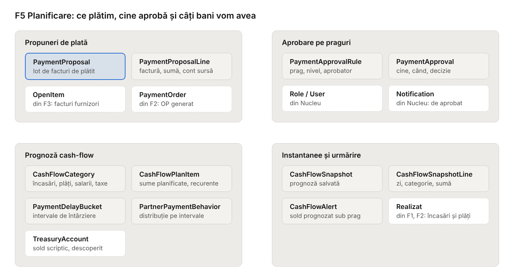

# ERP · 02.02 Finanțe · F5 Planificare trezorerie

15 noiembrie 2026 · Aurelian · **✓ Validat de Aurelian (15.11.2026)**, cu deciziile lui din aceeași zi (pragurile de aprobare 0 / 50.000 / 250.000 lei; aprobarea propunerii ține loc de patru ochi; încasările din prognoză repartizate pe intervale de întârziere, după istoricul clientului; salariile și taxele ca sume planificate recurente)

Ultima din cele 5 sub-părți ale părții financiare a modulului 02.02 Finanțe și contabilitate (schema SQL `fin`, prefix de cod `Erp.Finance`). Acoperă cele două întrebări de planificare ale directorului financiar: **ce plătim și cine aprobă** (propunerile de plată, cu aprobare pe praguri valorice, din care se generează ordinele de plată) și **câți bani vom avea** (prognoza de cash-flow pe zile, săptămâni și luni, cu alertele de sold și comparația prognoză–realizat). Documente părinte: [02 Module principale](../MODULE_PRINCIPALE.md), [02.01 Nucleu](../01-nucleu/NUCLEU.md), [F1 Casierie](F1-CASIERIE.md), [F2 Bancă](F2-BANCA.md), [F3 Decontări](F3-DECONTARI.md), [F4 Multivalută](F4-MULTIVALUTA.md). Principii: [01 Scop și principii](../../01-scop-si-principii/SCOP_SI_PRINCIPII.md) (P1–P10). Reguli de cod: [Bune practici (SQL și cod)](../../bune-practici/BUNE_PRACTICI.md), referite prin identificator.

**Ce trebuie știut înainte de citire (context autonom, pentru oameni și pentru Copilot / Claude Code):**

- Produs ERP licențiat, instalat on-premise, o bază SQL Server per grup de firme, collation `Latin1_General_100_CS_AS_SC_UTF8` (case sensitive, `SQL-21`). Monolit modular .NET 10 + MediatR; Dapper și proceduri stocate, **fără EF Core sau alt ORM**. Fără componente plătite.
- F1–F5 sunt părți ale aceluiași modul (Finanțe) și se apelează direct, în aceeași tranzacție; evenimentele sunt pentru celelalte module și pentru partea contabilă.
- Din F2 (validat): **ordinul de plată (OP)** e o plată către un singur beneficiar; se **validează când e legat de factură**; OP-urile introduse din ecranul propriu rămân **neconfirmate** până se confirmă pe extras; **aprobarea cu patru ochi** e pornită implicit și se cere înainte de exportul către bancă. Fiecare cont bancar are **sold din extras** și **sold scriptic** (extras minus OP-urile neconfirmate).
- Din F3 (validat): facturile sunt **partide deschise** (`fin.OpenItem`) cu scadențe; plățile fără factură indicată se alocă **FIFO**; partidele în litigiu sau blocate la plată nu intră automat în plăți; plata unei facturi de furnizor neprimite în SPV cere confirmarea unei avertizări.
- F5 nu mută bani și nu scrie note contabile: pregătește OP-uri (prin F2) și calculează prognoze.

## 1. Scop și perimetru

| Zonă | Ce face F5 | Ce NU face (și cine face) |
| --- | --- | --- |
| Propuneri de plată | Selectează facturile de furnizor de plătit după scadență, prioritate și bani disponibili; alege contul sursă; trimite la aprobare | Plata însăși: OP-ul, exportul, confirmarea (F2) |
| Aprobare pe praguri | Reguli de aprobare pe valoare, cu unul până la trei niveluri, pe firmă | Patru ochi pe exportul OP-ului (F2), care rămâne în vigoare |
| Generarea OP-urilor | Din propunerea aprobată, OP-uri validate (legate de facturi), câte unul pe beneficiar și cont | — |
| Prognoză cash-flow | Sold de pornire + încasări așteptate + plăți așteptate + sume planificate, pe zi, săptămână, lună, pe firmă și monedă | Bugetul de venituri și cheltuieli (controlling, ulterior) |
| Alerte | Sold prognozat sub prag pe un cont sau pe firmă | — |
| Prognoză vs realizat | Instantanee salvate și comparația cu încasările și plățile reale | — |

## 2. Model de domeniu

Propunerea de plată (`PaymentProposal`) adună facturi deschise din F3 și, după aprobare, devine OP-uri în F2. Prognoza nu are o entitate „vie”: se calculează la cerere din soldurile din F1–F2, partidele din F3 și sumele planificate, iar instantaneele (`CashFlowSnapshot`) o păstrează pentru comparație.



Reguli de business ale modelului:

1. **O factură apare într-o singură propunere activă** (ciornă, în aprobare sau aprobată și negenerată), cu suma propusă cel mult egală cu restul de plată minus OP-urile deja validate pe ea.
2. **Propunerea nu stinge nimic.** Factura e stinsă abia când OP-ul generat e validat (F2); până atunci, prognoza o tratează ca plată planificată la data propusă.
3. **Aprobarea se face pe propunere, cu posibilitatea de a respinge linii**; o linie respinsă iese din propunere și factura redevine disponibilă.
4. **Nivelul de aprobare cerut** vine din regula cu pragul cel mai mare atins de totalul propunerii în lei sau de cea mai mare linie (după setarea regulii).
5. **Aprobarea propunerii ține loc de patru ochi pentru OP-urile generate**, dacă ultimul aprobator al propunerii nu e și cel care generează OP-urile; altfel OP-urile cer aprobarea din F2 ca de obicei.
6. **Prognoza folosește soldul scriptic** al conturilor (F2), ca plățile deja validate și neconfirmate să nu fie numărate de două ori.
7. **Încasările așteptate se repartizează pe intervale de întârziere față de scadență** (de exemplu la termen, 1–30, 31–60, 61–90, 91–180 de zile), după cum a plătit clientul în ultimele 12 luni (`PartnerPaymentBehavior`, 3.4): fiecare factură deschisă se împarte în tranșe, câte una pe interval, cu ponderea și întârzierea medie istorică a intervalului.

## 3. Entități, documente și ciclul lor de viață

Convențiile de coloane, tipuri și chei sunt cele din F1, secțiunea 3.

### 3.1 Propunere de plată (`PaymentProposal` + `PaymentProposalLine`)

**Antet**: `CompanyId`, `Number` (serie internă), `Name`, `ProposalDate`, `PlannedPaymentDate`, `DueDateUntil` (facturile scadente până la această dată), `DefaultTreasuryAccountId`, `TotalAmountRon`, `RequiredApprovalLevel`, `CurrentApprovalLevel`, `Status`, `CreatedBy`, `SubmittedAt`, `ApprovedAt`, `GeneratedAt`.

**Linie** (`bigint`): `OpenItemId` (factura de furnizor din F3, sau o partidă de alt tip: salarii, obligații la buget, introduse ca partide în F3 de modulele lor), `PartnerId`, `DueDate`, `CurrencyCode`, `OpenAmount` (la data propunerii), `ProposedAmount`, `ProposedAmountRon`, `TreasuryAccountId` (contul sursă; implicit cel din antet, sau un cont în moneda facturii), `Priority`, `Warnings` (JSON `SQL-12`: furnizor inactiv ANAF, factură neprimită în SPV, plată parțială, sumă în altă monedă), `LineStatus` (1 Propusă, 2 Respinsă, 3 Generată), `RejectReason`, `PaymentOrderId` (OP-ul generat).

**Ciclul de viață:**

| Stare | Ce înseamnă | Tranziții |
| --- | --- | --- |
| Ciornă (1) | Se editează liber: linii, sume, conturi | → Trimisă la aprobare, → ștergere |
| În aprobare (2) | Blocată la editare; aprobatorii nivelului curent primesc notificare | → Aprobată (ultimul nivel), → Ciornă (retrasă de autor sau returnată de un aprobator, cu motiv), → Respinsă |
| Aprobată (3) | Toate nivelurile au aprobat; se pot genera OP-urile | → Generată, → Ciornă (retragerea aprobării, doar înainte de generare, cu motiv) |
| Generată (4) | OP-urile au fost create în F2 | Final |
| Respinsă (5) | Respinsă integral; facturile redevin disponibile | Final |

Propunerea nu are efecte contabile, deci respingerea și retragerea sunt simple schimbări de stare (convenția comună permite Anulat pentru documente fără efecte; aici se numește Respinsă).

### 3.2 Reguli de aprobare (`PaymentApprovalRule`) și aprobări (`PaymentApproval`)

`PaymentApprovalRule`: `CompanyId`, `Level` (1, 2, 3), `ThresholdRon` (de la ce valoare se cere nivelul), `Basis` (1 Totalul propunerii, 2 Cea mai mare linie), `ApproverRoleId` sau lista `ApproverUserIds`, `MinApprovers` (implicit 1), `IsActive`.

Exemplu livrat (se adaptează pe firmă): nivelul 1 de la 0 lei (Contabil șef), nivelul 2 de la 50.000 lei (Director financiar), nivelul 3 de la 250.000 lei (Director general).

`PaymentApproval` (`bigint`): `PaymentProposalId`, `Level`, `UserId`, `Decision` (1 Aprobat, 2 Returnat, 3 Respins), `DecidedAt`, `Comment`, `RejectedLineIds` (la aprobarea cu linii respinse). Doar adăugare; trigger care refuză `UPDATE` și `DELETE` (`SP-21`), pentru că e pistă de audit a aprobărilor.

Reguli:

1. Nivelurile se aprobă în ordine; nivelul 2 nu vede propunerea înainte de aprobarea nivelului 1.
2. Autorul propunerii nu o poate aproba la niciun nivel; același utilizator nu aprobă două niveluri ale aceleiași propuneri.
3. O propunere returnată la ciornă și retrimisă pierde aprobările anterioare.
4. Aprobatorii primesc notificare în aplicație și pe email (02.01, fluxul 4.7); o propunere neaprobată după `Fin.Proposal.ApprovalReminderHours` (implicit 24) retrimite notificarea.

### 3.3 Profilul de plată al partenerului (extinderea `PartnerFinanceProfile` din F3)

| Coloană nouă | Reguli |
| --- | --- |
| `PaymentPriority` | 1 Critic (utilități, chirii, furnizori esențiali), 2 Ridicat, 3 Normal (implicit), 4 Scăzut; ordinea în propuneri |
| `PreferredTreasuryAccountId` | Contul din care se plătește de obicei furnizorul |
| `PaymentDayOfWeek` | Opțional: zile fixe de plată pentru furnizor |

Salariile și obligațiile la buget au implicit prioritatea 1 (setare pe tipul de partidă).

### 3.4 Comportamentul de plată al clientului, pe intervale de întârziere (`PaymentDelayBucket`, `PartnerPaymentBehavior`)

**Decizie (15.11.2026):** încasările din prognoză se mută pe **categorii de zile de întârziere față de scadență**, nu cu o singură întârziere medie. Interpretarea de mai jos (distribuția istorică pe intervale, pe client) a fost confirmată de Aurelian (16.11.2026).

**Intervalele** (`fin.PaymentDelayBucket`, pe firmă, configurabile): `Code`, `Name`, `DaysFrom`, `DaysTo` (`NULL` = fără limită), `SortOrder`, `IsUncollectible`. Livrate:

| Cod | Interval | Zile față de scadență |
| --- | --- | --- |
| `B0` | La termen sau înainte | ≤ 0 |
| `B1` | 1–30 zile | 1–30 |
| `B2` | 31–60 zile | 31–60 |
| `B3` | 61–90 zile | 61–90 |
| `B4` | 91–180 zile | 91–180 |
| `B5` | Peste 180 de zile | > 180 (`IsUncollectible = 1`: nu intră în prognoză, apare separat ca „încasări incerte”) |

Intervalele nu se suprapun și acoperă toată axa (validare la salvare). Aceleași intervale se folosesc în raportul de vechime a soldurilor din F3, ca utilizatorul să vadă o singură grilă.

**Istoricul pe client** (`fin.PartnerPaymentBehavior` + `fin.PartnerPaymentBehaviorBucket`), recalculat lunar de un job (`fin.usp_PartnerPaymentBehavior_Recalculate`), din alocările din ultimele 12 luni (F3, `fin.Allocation`). Pentru fiecare sumă încasată se calculează zilele dintre scadența partidei și data încasării, iar suma intră în intervalul corespunzător:

- antet: `CompanyId`, `PartnerId` (`NULL` = media firmei, pe toți clienții), `SampleInvoices`, `SampleAmountRon`, `AvgDaysLate` (medie ponderată cu suma, pentru afișare), `CalculatedAt`;
- linii, câte una pe interval: `BucketId`, `AmountShare` (ponderea sumei încasate în interval, 0–1, suma liniilor = 1), `AvgDaysLate` (întârzierea medie ponderată în interval).

Exemplu: clientul X a plătit în ultimele 12 luni 60% la termen (în medie cu 2 zile înainte), 30% în 1–30 de zile (în medie 18) și 10% în 31–60 de zile (în medie 45). O factură de 10.000 lei cu scadența 1 decembrie apare în prognoză ca 6.000 lei pe 29 noiembrie, 3.000 lei pe 19 decembrie și 1.000 lei pe 15 ianuarie.

**Facturile deja restante** folosesc doar intervalele care încep după întârzierea curentă, cu ponderile renormalizate (probabilitate condiționată). Dacă factura e restantă de 40 de zile, contează doar intervalele de la 31–60 în sus; data tranșei e maximul dintre scadența + întârzierea medie a intervalului și ziua de pornire. Dacă istoricul nu are nicio sumă în intervalele rămase, factura se pune în ziua de pornire + jumătatea intervalului curent.

**Lipsa istoricului:** sub `Fin.Forecast.MinSampleInvoices` (implicit 5) facturi încasate, clientul folosește distribuția firmei (rândul cu `PartnerId NULL`); dacă nici firma nu are istoric suficient, încasarea se pune la scadență.

**Setări** (`Fin.Forecast.*`): `CollectionMode` (1 Pe intervale de întârziere, implicit; 2 La scadență), `MinSampleInvoices`, `HistoryMonths` (implicit 12).

### 3.5 Sume planificate (`CashFlowCategory`, `CashFlowPlanItem`)

`CashFlowCategory` (nomenclator, `SQL-10`): `Code`, `Name`, `Direction`, `SortOrder`, `ParentId`. Livrate: Încasări clienți, Alte încasări, Plăți furnizori, Salarii și contribuții, Taxe și impozite, Rate și dobânzi, Investiții, Chirii și utilități, Dividende, Transferuri între conturi.

`CashFlowPlanItem`: `CompanyId`, `CategoryId`, `Description`, `CurrencyCode`, `Amount`, `TreasuryAccountId` (opțional), `FirstDate`, `Recurrence` (0 O dată, 1 Lunar în ziua X, 2 Săptămânal, 3 Trimestrial, 4 Anual), `RecurrenceDay`, `EndDate`, `IsActive`, `Probability` (0–100%, implicit 100). Exemple: salariile nete pe 10 ale lunii, contribuțiile și impozitele pe 25, rata creditului, chiria.

Când modulele care le generează vor exista, sumele planificate pentru salarii (HR) și taxe (partea contabilă) vor fi înlocuite de partide reale; până atunci se introduc aici.

### 3.6 Instantaneu de prognoză (`CashFlowSnapshot` + `CashFlowSnapshotLine`)

`CashFlowSnapshot`: `CompanyId`, `Name`, `TakenAt`, `TakenBy`, `HorizonFrom`, `HorizonTo`, `Granularity` (zi, săptămână, lună), `Parameters` (JSON: întârzieri folosite, conturi incluse).

`CashFlowSnapshotLine` (`bigint`): `SnapshotId`, `PeriodStart`, `CategoryId`, `TreasuryAccountId` (opțional), `CurrencyCode`, `Amount`, `AmountRon`, `SourceKind` (1 Sold, 2 Partidă deschisă, 3 OP neconfirmat, 4 Propunere, 5 Sumă planificată).

Instantaneele se iau manual sau automat (setare, implicit în fiecare luni dimineață) și nu se modifică după creare (fără `ModifiedAt`; abatere scrisă în secțiunea 7).

### 3.7 Alertă de cash-flow (`CashFlowAlertRule`)

`CompanyId`, `TreasuryAccountId` (opțional: tot firma), `MinBalanceRon`, `HorizonDays` (implicit 14), `NotifyRoleId`. Jobul zilnic recalculează prognoza pe orizont și trimite notificare dacă soldul prognozat scade sub prag într-o zi, cu data și categoria care cauzează scăderea.

## 4. Fluxuri principale

### 4.1 Construirea propunerii de plată

1. Contabilul alege data plății, data-limită a scadențelor, contul sursă implicit și filtrele (furnizori, monede, prioritate, valoare minimă).
2. Sistemul aduce partidele deschise de furnizor (F3, `IOpenItemQueries`) care îndeplinesc filtrele și **exclude** automat: partidele în litigiu, blocate la plată, cele aflate deja într-o propunere activă și partea deja acoperită de OP-uri validate.
3. Liniile se ordonează după prioritate, apoi scadență (FIFO, ca în F3).
4. Dacă e pornită „Limitează la bani disponibili”, sistemul arată pentru fiecare cont soldul scriptic + descoperitul permis (`TreasuryAccount.OverdraftLimit`, coloană nouă) − plățile deja propuse și bifează liniile în ordine până la epuizarea sumei; restul rămân în propunere nebifate (Respinse cu motivul „fonduri insuficiente”, la salvare, dacă utilizatorul nu le mută manual).
5. Avertizările se calculează pe linie: furnizor inactiv ANAF, factură neprimită în SPV (F3, 3.8), monedă diferită de a contului sursă, plată parțială. Ele nu blochează propunerea, dar se confirmă la generarea OP-urilor, ca în F2 și F3.
6. Contabilul ajustează sumele (plăți parțiale), conturile sursă și trimite la aprobare.

### 4.2 Aprobarea

1. La trimitere, sistemul calculează nivelul cerut (regula 4 din secțiunea 2) și notifică aprobatorii nivelului 1.
2. Fiecare aprobator vede propunerea grupată pe furnizor și cont, cu soldul disponibil după plată; poate aproba, returna (cu motiv) sau respinge, ori respinge doar anumite linii și aproba restul.
3. După ultimul nivel, propunerea devine Aprobată și se publică `PropunerePlataAprobata`.

### 4.3 Generarea OP-urilor

1. Contabilul de trezorerie apasă „Generează OP-uri” pe propunerea aprobată.
2. F5 grupează liniile pe beneficiar și cont sursă și apelează direct serviciul F2 de creare a OP-urilor (același modul), câte un OP pe grup, cu facturile legate (`Origin = 3`, `SourceProposalId`).
3. Pentru că facturile sunt deja legate, OP-urile se creează **validate** (regula din F2: OP-ul se validează la legarea de factură), cu confirmarea avertizărilor rămase; F3 stinge facturile în aceeași tranzacție.
4. OP-urile sunt considerate aprobate pentru patru ochi dacă utilizatorul care le generează nu e ultimul aprobator al propunerii (regula 5 din secțiunea 2); altfel cer aprobarea din F2.
5. Propunerea trece în Generată; contabilul pune OP-urile într-un lot și îl exportă (F2, fluxul 4.2).
6. Dacă o factură s-a schimbat între aprobare și generare (plătită între timp, stornată, rest mai mic), linia ei se sare, cu raport; celelalte se generează.

### 4.4 Prognoza de cash-flow

Calculul (`fin.usp_CashFlow_Forecast`), pe firmă, interval și granularitate:

| Componentă | Sursă | Data în prognoză | Categorie |
| --- | --- | --- | --- |
| Sold de pornire | Sold scriptic la azi al conturilor incluse (F1, F2), convertit în lei la cursul zilei | Ziua de pornire | Sold |
| Încasări așteptate | Partidele deschise de client (F3), restul de plată | Repartizată în tranșe pe intervalele de întârziere ale clientului (3.4): scadența + întârzierea medie a fiecărui interval, cu ponderea lui; intervalul marcat `IsUncollectible` (implicit peste 180 de zile) nu intră în sold, ci pe un rând separat „încasări incerte” | Încasări clienți |
| Plăți așteptate | Partidele deschise de furnizor (F3), fără cele cuprinse în propuneri sau OP-uri | Scadența (restanțele: ziua de pornire) | Plăți furnizori |
| Propuneri aprobate sau în aprobare | F5 | Data planificată a plății | Plăți furnizori |
| OP-uri validate neconfirmate | F2 | Nu se adaugă: sunt deja scăzute din soldul scriptic | — |
| Efecte comerciale în portofoliu | F3 | Scadența efectului | Încasări sau plăți |
| Sume planificate | `CashFlowPlanItem`, desfășurate pe recurență, × probabilitate | Datele din recurență | Categoria lor |
| Decontări card așteptate | F2 (`CardSettlementExpected`) | Data estimată a decontării | Alte încasări |

Rezultatul: pe fiecare perioadă, sold inițial, intrări și ieșiri pe categorii, sold final; pe firmă și opțional pe cont sau monedă. Sumele în valută se convertesc la cursul BNR al zilei de calcul (fără ipoteze de curs viitor).

Parametru „scenariu prudent”: încasările se mută cu un interval mai târziu decât arată istoricul (de exemplu tranșa „la termen” trece în 1–30 de zile), plus întârziere suplimentară opțională (implicit 0 zile) și excluderea încasărilor restante; se poate rula alături de scenariul de bază, în același ecran.

### 4.5 Prognoză vs realizat

1. Un instantaneu salvat (3.6) păstrează prognoza dintr-o zi.
2. Raportul compară, pe săptămâni și categorii, prognoza din instantaneu cu încasările și plățile reale (documentele validate din F1 și F2, pe categorie după tipul de operațiune, `TreasuryOperationType.CashFlowCategoryId`, coloană nouă).
3. Abaterile mari pe client sau furnizor se pot deschide până la document.

### 4.6 Cazuri limită

| Situație | Comportament |
| --- | --- |
| Factură plătită manual (OP din extras) cât era într-o propunere aprobată | La generare linia se sare, cu raport; propunerea se generează pentru rest |
| Factură în EUR propusă din cont în lei | Avertizare; suma în lei se calculează la cursul BNR al zilei (F4, 3.3); operatorul poate alege alt curs la generarea OP-ului |
| Regulă de aprobare schimbată cât o propunere e în aprobare | Propunerea păstrează nivelul calculat la trimitere |
| Aprobator plecat din firmă | Regula pe rol permite oricărui titular al rolului să aprobe; dacă rolul e gol, Administratorul primește alertă |
| Prognoză pe o firmă fără plan de salarii | Prognoza arată doar ce are; ecranul semnalează categoriile fără nicio sumă (salarii, taxe) |
| Client fără istoric de plată (sub 5 facturi încasate) | Se folosește distribuția pe intervale a firmei; fără istoric nici la firmă, plata la scadență |
| Intervale schimbate de utilizator | Istoricul se recalculează imediat pentru firmă (job pornit la salvare), nu la sfârșitul lunii |

## 5. Evenimente

### 5.1 Publicate

| Eveniment | Când | Conținut (pe lângă anvelop) | Consumatori |
| --- | --- | --- | --- |
| `PropunerePlataAprobata` v1 | Aprobarea finală a unei propuneri | `PaymentProposalId`, `Number`, `PlannedPaymentDate`, `TotalAmountRon`, `LineCount`, `ApprovedBy` | Raportare, notificări |
| `AlertaCashFlow` v1 | Soldul prognozat scade sub prag | `CompanyId`, `TreasuryAccountId`, `Date`, `ForecastBalanceRon`, `MinBalanceRon` | Notificări, Raportare |

### 5.2 Consumate

| Eveniment | De la | Ce face F5 |
| --- | --- | --- |
| `FacturaAchitata` (intern, din F3, prin apel direct) | F3 | Liniile propunerilor active pe factura achitată se marchează „deja plătită” |
| `UtilizatorDezactivat` | Nucleu | Verifică dacă rolurile de aprobare mai au titulari activi |

## 6. Contracte

F5 nu are contracte publice: prognoza și propunerile se văd în ecranele Finanțe și în rapoartele din `rpt`. Contractul intern al modulului (folosit de F5 spre F2 și F3):

```csharp
namespace Erp.Finance.Application.Planning;

// F2: crearea OP-urilor validate din propunere, în tranzacția comenzii GeneratePaymentOrders
public interface IPaymentOrderFactory
{
    Task<IReadOnlyList<int>> CreateValidatedFromProposalAsync(
        int paymentProposalId, IReadOnlyList<ProposalPaymentGroup> groups,
        bool approvalSatisfied, bool confirmWarnings, CancellationToken ct);
}

public sealed record ProposalPaymentGroup(
    int TreasuryAccountId, int PartnerId, DateOnly RequestedExecutionDate,
    IReadOnlyList<ProposalPaymentLine> Lines);

public sealed record ProposalPaymentLine(long OpenItemId, decimal Amount, decimal? CrossRate);

// F3: partidele candidate pentru plată
public interface IOpenItemQueries
{
    Task<IReadOnlyList<PayableCandidateDto>> GetPayableCandidatesAsync(
        int companyId, DateOnly dueUntil, PayableFilter filter, CancellationToken ct);
}

public sealed record PayableFilter(
    IReadOnlyList<int>? PartnerIds, IReadOnlyList<string>? Currencies, byte? MaxPriority, decimal? MinAmountRon);

public sealed record PayableCandidateDto(
    long OpenItemId, int PartnerId, string DocumentNo, DateOnly DueDate, string CurrencyCode,
    decimal OpenAmount, decimal AlreadyOrderedAmount, byte PaymentPriority,
    bool AnafInactive, byte EInvoiceStatus);
```

Comenzi interne F5: `BuildPaymentProposal`, `SavePaymentProposal`, `SubmitPaymentProposal`, `DecidePaymentProposal` (aprobare, returnare, respingere, cu liniile respinse), `WithdrawPaymentProposal`, `GeneratePaymentOrders`, `SavePaymentApprovalRule`, `SaveCashFlowPlanItem`, `RunCashFlowForecast` (interogare), `TakeCashFlowSnapshot`, `SaveCashFlowAlertRule`.

## 7. Schema SQL `fin` (partea F5)

| Tabel | Cheie primară | Chei unice / străine principale | Indecși suplimentari |
| --- | --- | --- | --- |
| `fin.PaymentProposal` | `Id int` | UX filtrat `(CompanyId, Number)`; FK `DefaultTreasuryAccountId` | `(CompanyId, Status, PlannedPaymentDate)` |
| `fin.PaymentProposalLine` | `Id bigint` | FK `PaymentProposalId` (cascadă doar pe ciornă), `OpenItemId`, `TreasuryAccountId`, `PaymentOrderId`; UX filtrat `(OpenItemId) WHERE IsActive = 1` (o factură într-o singură propunere activă) | `PaymentProposalId` |
| `fin.PaymentApprovalRule` | `Id int` | UQ `(CompanyId, Level)` filtrat pe active; FK `ApproverRoleId` | — |
| `fin.PaymentApproval` | `Id bigint` | FK `PaymentProposalId`, `UserId` | `(PaymentProposalId, Level)` |
| `fin.PaymentDelayBucket` | `Id int` | UQ `(CompanyId, Code)`; UQ `(CompanyId, SortOrder)` | — |
| `fin.PartnerPaymentBehavior` | `Id int` | UX filtrat `(CompanyId, PartnerId) WHERE PartnerId IS NOT NULL`; UX filtrat `(CompanyId) WHERE PartnerId IS NULL` (media firmei) | — |
| `fin.PartnerPaymentBehaviorBucket` | `Id bigint` | UQ `(BehaviorId, BucketId)`; FK `BehaviorId`, `BucketId` | — |
| `fin.CashFlowCategory` | `Id int` | UX `CodeKey`; FK `ParentId` | — |
| `fin.CashFlowPlanItem` | `Id int` | FK `CompanyId`, `CategoryId`, `TreasuryAccountId` | `(CompanyId, IsActive)` |
| `fin.CashFlowSnapshot`, `fin.CashFlowSnapshotLine` | `int` / `bigint` | FK `SnapshotId`, `CategoryId` | `(CompanyId, TakenAt)`; `(SnapshotId, PeriodStart)` |
| `fin.CashFlowAlertRule` | `Id int` | FK `CompanyId`, `TreasuryAccountId`, `NotifyRoleId` | — |

Coloane noi pe tabele existente (migrare nouă, `MIG-02`, `MIG-05`): `fin.TreasuryAccount.OverdraftLimit decimal(19,2) NULL`, `fin.TreasuryAccount.IncludeInForecast bit NOT NULL DEFAULT 1`, `fin.TreasuryOperationType.CashFlowCategoryId int NULL`, `fin.PartnerFinanceProfile.PaymentPriority tinyint NOT NULL DEFAULT 3`, `PreferredTreasuryAccountId`, `PaymentDayOfWeek`.

`fin.PaymentProposalLine.IsActive` e coloană calculată persistată `AS (CASE WHEN LineStatus = 1 AND ProposalIsOpen = 1 THEN 1 ELSE 0 END)`, unde `ProposalIsOpen` se actualizează de procedurile de schimbare a stării propunerii (ciornă, în aprobare, aprobată = 1; generată, respinsă = 0). Indexul unic filtrat pe `IsActive = 1` garantează regula 1 din secțiunea 2 direct în bază (`SQL-17`).

Exemplu de tabel complet:

```sql
CREATE TABLE fin.PaymentProposalLine (
    Id                  bigint IDENTITY(1,1) NOT NULL CONSTRAINT PK_PaymentProposalLine PRIMARY KEY,
    PaymentProposalId   int                NOT NULL CONSTRAINT FK_PaymentProposalLine_PaymentProposal REFERENCES fin.PaymentProposal(Id),
    OpenItemId          bigint             NOT NULL CONSTRAINT FK_PaymentProposalLine_OpenItem REFERENCES fin.OpenItem(Id),
    PartnerId           int                NOT NULL CONSTRAINT FK_PaymentProposalLine_Partner REFERENCES core.Partner(Id),
    DueDate             date               NOT NULL,
    CurrencyCode        char(3)            NOT NULL CONSTRAINT FK_PaymentProposalLine_Currency REFERENCES core.Currency(Code),
    OpenAmount          decimal(19,2)      NOT NULL,
    ProposedAmount      decimal(19,2)      NOT NULL,
    ProposedAmountRon   decimal(19,2)      NOT NULL,
    TreasuryAccountId   int                NOT NULL CONSTRAINT FK_PaymentProposalLine_TreasuryAccount REFERENCES fin.TreasuryAccount(Id),
    Priority            tinyint            NOT NULL,
    Warnings            nvarchar(max)      NULL,
    LineStatus          tinyint            NOT NULL CONSTRAINT DF_PaymentProposalLine_LineStatus DEFAULT (1),
    RejectReason        nvarchar(300)      NULL,
    ProposalIsOpen      bit                NOT NULL CONSTRAINT DF_PaymentProposalLine_ProposalIsOpen DEFAULT (1),
    PaymentOrderId      int                NULL CONSTRAINT FK_PaymentProposalLine_PaymentOrder REFERENCES fin.PaymentOrder(Id),
    CreatedAt           datetime2(3)       NOT NULL CONSTRAINT DF_PaymentProposalLine_CreatedAt DEFAULT (sysutcdatetime()),
    CreatedBy           int                NOT NULL,
    ModifiedAt          datetime2(3)       NULL,
    ModifiedBy          int                NULL,
    RowVersion          rowversion         NOT NULL,
    IsActive            AS (CASE WHEN LineStatus = 1 AND ProposalIsOpen = 1 THEN CAST(1 AS bit) ELSE CAST(0 AS bit) END) PERSISTED,
    CONSTRAINT CK_PaymentProposalLine_LineStatus CHECK (LineStatus IN (1, 2, 3)),
    CONSTRAINT CK_PaymentProposalLine_Amount CHECK (ProposedAmount > 0 AND ProposedAmount <= ABS(OpenAmount)),
    CONSTRAINT CK_PaymentProposalLine_Warnings CHECK (Warnings IS NULL OR ISJSON(Warnings) = 1),
    CONSTRAINT CK_PaymentProposalLine_RejectReason CHECK (LineStatus <> 2 OR RejectReason IS NOT NULL)
);
CREATE UNIQUE INDEX UX_PaymentProposalLine_OpenItemId_Active
    ON fin.PaymentProposalLine (OpenItemId) WHERE IsActive = 1;
CREATE INDEX IX_PaymentProposalLine_PaymentProposalId ON fin.PaymentProposalLine (PaymentProposalId);
CREATE INDEX IX_PaymentProposalLine_PartnerId ON fin.PaymentProposalLine (PartnerId);
CREATE INDEX IX_PaymentProposalLine_TreasuryAccountId ON fin.PaymentProposalLine (TreasuryAccountId);
CREATE INDEX IX_PaymentProposalLine_PaymentOrderId ON fin.PaymentProposalLine (PaymentOrderId) WHERE PaymentOrderId IS NOT NULL;
```

Decizia de aprobare, după șablonul din Bune practici 3.5:

```sql
CREATE OR ALTER PROCEDURE fin.usp_PaymentProposal_Decide
    @PaymentProposalId int,
    @RowVersion        binary(8),
    @Decision          tinyint,                  -- 1 Aprobat, 2 Returnat, 3 Respins
    @RejectedLines     fin.tt_IdList READONLY,   -- (Id bigint): linii respinse la o aprobare parțială
    @Comment           nvarchar(500),
    @UserId            int
AS
BEGIN
    SET NOCOUNT ON;
    SET XACT_ABORT ON;

    DECLARE @Status tinyint, @Level tinyint, @Required tinyint, @CreatedBy int, @CurrentVersion binary(8);

    SELECT @Status = Status, @Level = CurrentApprovalLevel + 1, @Required = RequiredApprovalLevel,
           @CreatedBy = CreatedBy, @CurrentVersion = RowVersion
    FROM fin.PaymentProposal WITH (UPDLOCK, ROWLOCK)
    WHERE Id = @PaymentProposalId;

    IF @Status IS NULL
        THROW 51701, N'Propunerea de plată nu există.', 1;
    IF @CurrentVersion <> @RowVersion
        THROW 51702, N'Propunerea a fost modificată de alt utilizator.', 1;
    IF @Status <> 2
        THROW 51703, N'Propunerea nu este în aprobare.', 1;
    IF @CreatedBy = @UserId
        THROW 51704, N'Autorul nu își poate aproba propria propunere.', 1;
    IF EXISTS (SELECT 1 FROM fin.PaymentApproval
               WHERE PaymentProposalId = @PaymentProposalId AND UserId = @UserId AND Decision = 1)
        THROW 51705, N'Același utilizator nu poate aproba două niveluri.', 1;
    -- Dreptul pe nivel (rol sau listă de utilizatori) e verificat de handler înainte de apel

    INSERT INTO fin.PaymentApproval (PaymentProposalId, Level, UserId, Decision, DecidedAt, Comment, CreatedBy)
    VALUES (@PaymentProposalId, @Level, @UserId, @Decision, SYSUTCDATETIME(), @Comment, @UserId);

    UPDATE l
    SET LineStatus = 2, RejectReason = ISNULL(@Comment, N'Respinsă la aprobare'),
        ModifiedAt = SYSUTCDATETIME(), ModifiedBy = @UserId
    FROM fin.PaymentProposalLine AS l
    JOIN @RejectedLines AS r ON r.Id = l.Id
    WHERE l.PaymentProposalId = @PaymentProposalId AND l.LineStatus = 1;

    UPDATE fin.PaymentProposal
    SET Status = CASE
                    WHEN @Decision = 2 THEN 1                                  -- returnată la ciornă
                    WHEN @Decision = 3 THEN 5                                  -- respinsă
                    WHEN @Level >= @Required THEN 3                            -- aprobată
                    ELSE 2 END,
        CurrentApprovalLevel = CASE WHEN @Decision = 1 THEN @Level WHEN @Decision = 2 THEN 0 ELSE CurrentApprovalLevel END,
        ApprovedAt = CASE WHEN @Decision = 1 AND @Level >= @Required THEN SYSUTCDATETIME() ELSE ApprovedAt END,
        TotalAmountRon = (SELECT ISNULL(SUM(ProposedAmountRon), 0) FROM fin.PaymentProposalLine
                          WHERE PaymentProposalId = @PaymentProposalId AND LineStatus = 1),
        ModifiedAt = SYSUTCDATETIME(), ModifiedBy = @UserId
    WHERE Id = @PaymentProposalId;

    -- Respinsă: liniile ies din propunerile active
    IF @Decision = 3
        UPDATE fin.PaymentProposalLine
        SET ProposalIsOpen = 0, ModifiedAt = SYSUTCDATETIME(), ModifiedBy = @UserId
        WHERE PaymentProposalId = @PaymentProposalId;

    SELECT Id, Status, CurrentApprovalLevel, TotalAmountRon, RowVersion
    FROM fin.PaymentProposal
    WHERE Id = @PaymentProposalId;
END;
```

Totalul se recalculează aici ca sumă simplă a liniilor rămase (valori deja rotunjite de handler cu `IPrecisionService`), deci nu încalcă `SP-13`. La returnarea la ciornă, aprobările anterioare rămân în istoric, dar nu mai contează: handler-ul trimiterii pornește din nou de la nivelul 1 (regula 3 din 3.2).

Proceduri stocate principale:

| Procedură | Rol | Publică |
| --- | --- | --- |
| `fin.usp_PaymentProposal_Build` | Candidații după filtre, cu excluderi și bani disponibili (pe seturi) | Nu |
| `fin.usp_PaymentProposal_Save`, `_Submit`, `_Decide`, `_Withdraw` | Ciclul propunerii | Nu |
| `fin.usp_PaymentProposal_MarkGenerated` | Leagă liniile de OP-urile create de F2 | Nu |
| `fin.usp_PartnerPaymentBehavior_Recalculate` | Job lunar (și la schimbarea intervalelor): distribuția pe intervale pe client și pe firmă, într-o singură trecere pe seturi | Nu |
| `fin.usp_CashFlow_Forecast` | Prognoza pe interval și granularitate (pe seturi, desfășurarea recurențelor cu o tabelă de numere) | Nu |
| `fin.usp_CashFlowSnapshot_Take`, `fin.usp_CashFlow_ForecastVsActual` | Instantanee; comparația | Nu |
| `fin.usp_CashFlowAlert_Check` | Job zilnic de alerte | Nu |

Coduri de eroare (plaja F5 `51700–51799`, prefix API `FIN_`):

| Cod SQL | Cod API | HTTP | Când apare |
| --- | --- | --- | --- |
| 51701 | `FIN_PROPOSAL_NOT_FOUND` | 404 | Propunere inexistentă |
| 51702 | `FIN_CONCURRENCY_CONFLICT` | 409 | `RowVersion` diferit (`SP-18`) |
| 51703 | `FIN_PROPOSAL_NOT_IN_APPROVAL` | 409 | Decizie pe o propunere care nu e în aprobare |
| 51704 | `FIN_PROPOSAL_SELF_APPROVAL` | 403 | Autorul își aprobă propunerea |
| 51705 | `FIN_PROPOSAL_SAME_APPROVER_TWICE` | 403 | Același utilizator la două niveluri |
| 51706 | `FIN_PROPOSAL_APPROVER_NOT_ALLOWED` | 403 | Utilizatorul nu e aprobator pentru nivelul curent |
| 51707 | `FIN_PROPOSAL_INVOICE_ALREADY_PROPOSED` | 409 | Factura e deja într-o propunere activă (indexul unic) |
| 51708 | `FIN_PROPOSAL_AMOUNT_EXCEEDS_OPEN` | 400 | Suma propusă depășește restul neacoperit de OP-uri |
| 51709 | `FIN_PROPOSAL_NOT_APPROVED` | 409 | Generarea OP-urilor dintr-o propunere neaprobată |
| 51710 | `FIN_PROPOSAL_NO_APPROVAL_RULE` | 409 | Firma nu are nicio regulă de aprobare activă |
| 51711 | `FIN_CASHFLOW_HORIZON_TOO_LONG` | 400 | Orizont peste limita granularității (zi: 92 de zile, săptămână: 104, lună: 36) |

Conformitate: schema și procedurile respectă `SQL-01`–`SQL-25`, `SP-01`–`SP-21`, `MIG-01`–`MIG-07`, cu o abatere:

- Abatere de la `SQL-19` și `SQL-11` pentru `fin.CashFlowSnapshotLine` și `fin.PaymentApproval`: fără `ModifiedAt`, `ModifiedBy`, `RowVersion`. Motiv: înregistrări doar cu adăugare (instantaneu, decizie de aprobare), care nu se editează niciodată; `fin.PaymentApproval` are și trigger care refuză `UPDATE` și `DELETE` (`SP-21`). Permanentă.

## 8. Permisiuni și roluri

| Permisiune | Ce permite |
| --- | --- |
| `Fin.PaymentProposal.View` | Propunerile firmei |
| `Fin.PaymentProposal.Create` | Construire, modificare, trimitere la aprobare |
| `Fin.PaymentProposal.Approve` | Decizie de aprobare (nivelul vine din regulă) |
| `Fin.PaymentProposal.GenerateOrders` | Generarea OP-urilor din propunerea aprobată |
| `Fin.PaymentApprovalRule.Manage` | Regulile de aprobare (auditate) |
| `Fin.CashFlow.View` | Prognoza, instantaneele, comparațiile |
| `Fin.CashFlow.Plan` | Sume planificate, alerte, categorii |
| `Fin.CashFlow.Snapshot` | Salvarea instantaneelor |

Roluri livrate:

| Rol | Permisiuni F5 |
| --- | --- |
| Contabil trezorerie | `PaymentProposal.View`, `.Create`, `.GenerateOrders`, `CashFlow.View`, `.Plan`, `.Snapshot` |
| Contabil șef | Cele de mai sus + `PaymentProposal.Approve` (nivelul 1), `PaymentApprovalRule.Manage` |
| Director financiar | `PaymentProposal.View`, `.Approve` (nivelul 2), `CashFlow.View` |
| Director general | `PaymentProposal.View`, `.Approve` (nivelul 3), `CashFlow.View` |
| Auditor | `PaymentProposal.View`, `CashFlow.View` |

`PaymentApprovalRule.Manage` nu poate fi dat aceluiași utilizator care aprobă la ultimul nivel (separarea sarcinilor, configurabil).

## 9. Cerințe legale și integrări

| Cerință | Ce înseamnă pentru F5 |
| --- | --- |
| Control intern (separarea sarcinilor) | Autorul nu aprobă; niveluri pe praguri; pista de aprobări doar cu adăugare |
| Legea 72/2013 (termene de plată între profesioniști) | Scadențele din facturi ordonează propunerile; raportul de restanțe arată furnizorii plătiți peste termen |
| Pistă de audit | Regulile de aprobare, deciziile și generarea OP-urilor sunt auditate (02.01, P5) |

Integrări: niciuna externă. Interne: F2 (OP-uri, solduri scriptice, decontări card), F3 (partide, profil, comportament de plată), F4 (curs încrucișat), Nucleu (roluri, notificări).

## 10. Rapoarte

| Raport | Conținut | Utilizatori |
| --- | --- | --- |
| Prognoza de cash-flow | Pe zi, săptămână, lună: sold inițial, intrări și ieșiri pe categorii, sold final, pe firmă, cont sau monedă; scenariu de bază și prudent | Director financiar, Contabil trezorerie |
| Prognoză vs realizat | Pe săptămână și categorie, cu abaterile | Director financiar |
| Propuneri de plată | Pe stare, cu timpii de aprobare pe nivel | Contabil șef |
| Plăți peste termen | Facturile de furnizor plătite după scadență și cele restante, pe furnizor | Director financiar |
| Comportamentul de plată al clienților | Distribuția încasărilor pe intervale de întârziere (procent și zile medii), pe client și pe firmă | Director financiar, Vânzări |

## 11. Ecrane principale

Tiparul comun: listă cu filtre → fișă cu tab-uri → istoric (`UI-08`). Machetele (HTML + PNG) sunt în [ecrane/f5-planificare/](ecrane/f5-planificare/): `f5-01-propuneri-de-plata`, `f5-02-de-aprobat` (văzut de Directorul financiar), `f5-03-prognoza-cash-flow`, `f5-04-sume-planificate`; setările sunt în tab-ul Planificare din Configurare, [ecrane/configurare/](ecrane/configurare/) `cf-09` … `cf-11`. Intervalele de întârziere sunt aceeași grilă cu intervalele de vechime din F3 (`cf-07`).

| Ecran | Conținut principal | Note |
| --- | --- | --- |
| Propuneri de plată | Listă pe stare; fișa propunerii: filtre de construire, liniile grupate pe furnizor (bifă, sumă, cont sursă, avertizări), totaluri pe cont cu soldul disponibil după plată, istoricul aprobărilor; acțiuni după stare | Butonul „Generează OP-uri” apare doar pe propunerile aprobate |
| De aprobat | Lista propunerilor care așteaptă decizia utilizatorului curent; aprobare, returnare, respingere, cu linii respinse | Deschis și din notificare |
| Prognoză cash-flow | Grafic cu soldul pe zile și pragul de alertă; tabel pe categorii și perioade; comutatoare pentru granularitate, scenariu, firmă, cont | Clic pe o celulă deschide documentele din spate |
| Sume planificate | Listă cu recurența și următoarele apariții | — |
| Configurare Finanțe | Tab-uri noi în familia „Finanțe”: Reguli de aprobare a plăților, Intervale de întârziere, Categorii de cash-flow, Alerte de cash-flow | — |

## 12. Criterii de acceptare și teste cheie

Fiecare criteriu are cel puțin un test automat marcat `[Trait("Criteriu", "02.02-F5-An")]` (`TST-01`).

| # | Criteriu | Test |
| --- | --- | --- |
| F5-A1 | Propunerea exclude facturile în litigiu, blocate, deja propuse și partea acoperită de OP-uri validate | Test de integrare |
| F5-A2 | O factură nu poate intra în două propuneri active, nici la două salvări simultane (indexul unic) | Test de concurență (`TST-05`) |
| F5-A3 | Cu „Limitează la bani disponibili”, totalul bifat pe cont nu depășește soldul scriptic + descoperitul | Test de integrare |
| F5-A4 | O propunere de 300.000 lei cere trei niveluri, aprobate în ordine, de trei utilizatori diferiți, niciunul autorul | Test pe pipeline |
| F5-A5 | Returnarea la ciornă anulează aprobările; retrimiterea pornește de la nivelul 1 | Test de integrare |
| F5-A6 | Generarea creează câte un OP validat pe beneficiar și cont, cu facturile stinse în F3, în aceeași tranzacție | Test de integrare |
| F5-A7 | O factură plătită între aprobare și generare e sărită, iar celelalte linii se generează | Test de integrare |
| F5-A8 | OP-urile generate nu mai cer patru ochi dacă generatorul nu e ultimul aprobator, și îl cer dacă este | Test de integrare |
| F5-A9 | Prognoza nu numără de două ori OP-urile neconfirmate (sunt doar în soldul scriptic) | Test de integrare |
| F5-A10 | O factură de 10.000 lei a unui client cu istoric 60% la termen (−2 zile), 30% în 1–30 (18 zile), 10% în 31–60 (45 de zile) apare ca trei tranșe: 6.000 / 3.000 / 1.000 lei la scadență −2, +18 și +45 de zile; o factură restantă de 40 de zile folosește doar intervalele de la 31–60 în sus | Test unitar |
| F5-A15 | Un client cu sub 5 facturi încasate folosește distribuția firmei; fără istoric la firmă, scadența | Test unitar |
| F5-A11 | Sumele planificate lunare se desfășoară corect pe 12 luni, inclusiv la 31 ale lunii în lunile mai scurte (ultima zi) | Test unitar |
| F5-A12 | Alerta se trimite o singură dată pe zi și cont când soldul prognozat scade sub prag | Test de integrare |
| F5-A13 | Prognoza zilnică pe 92 de zile pentru o firmă cu 100.000 de partide deschise răspunde sub 3 secunde | Test de performanță |
| F5-A14 | Toate procedurile F5 rulează corect pe baza case sensitive creată pe un server cu collation case insensitive | Test de integrare (`TST-09`) |

Criteriile F5-A2, F5-A4 și F5-A6 sunt critice: o factură plătită de două ori sau o plată neaprobată sunt exact riscurile pe care F5 trebuie să le prevină.

## Decizii de validare (15.11.2026)

| # | Întrebare | Decizia lui Aurelian | Unde e aplicată |
| --- | --- | --- | --- |
| 1 | Pragurile implicite de aprobare | Da: 0 lei Contabil șef, 50.000 lei Director financiar, 250.000 lei Director general | 3.2 |
| 2 | Aprobarea propunerii ține loc de patru ochi pe OP-urile generate | Da | 2 (regula 5), 4.3, F5-A8 |
| 3 | Cum se mută încasările în prognoză | Pe categorii de zile de întârziere față de scadență (interpretarea cu distribuția istorică pe intervale, pe client, acceptată la validare) | 2 (regula 7), 3.4, 4.4, 7, F5-A10, F5-A15 |
| 4 | Salariile și taxele | Ca sume planificate recurente, până vin HR și partea contabilă | 3.5 |

## Note de implementare (24.11.2026)

| Pas | Ce s-a făcut | Abateri și completări față de specificație |
| --- | --- | --- |
| F5.1 | Migrarea `2026.11.052` (`fin.PaymentProposal`, `fin.PaymentProposalLine` cu indexul unic filtrat pe linia propusă a unei propuneri deschise, `fin.PaymentApprovalRule`, `fin.PaymentApproval` doar cu adăugare, prin trigger, TVP `fin.PaymentProposalLineList`; `OverdraftLimit`, `IncludeInForecast` pe cont; `PaymentPriority`, `PreferredTreasuryAccountId`, `PaymentDayOfWeek` pe profil); procedurile `fin.usp_PaymentProposal_Candidates`, `_Funds`, `_Save`, `_Get`, `_List`, `_Transition`, `_Decide`, `_MarkGenerated`, `fin.usp_PaymentOrder_ApproveFromProposal`, `fin.usp_PaymentApprovalRule_Save`, `_List`; comenzile `BuildPaymentProposal`, `SavePaymentProposal`, `DeletePaymentProposal`, `SubmitPaymentProposal`, `WithdrawPaymentProposal`, `DecidePaymentProposal` (evenimentul `PropunerePlataAprobata`), `GeneratePaymentOrders`, `SavePaymentApprovalRules`; 8 permisiuni F5 și rolul `DIRECTOR_GENERAL`; API `/api/finance/payment-proposals`, `/payment-approval-rules`; testele F5-A1…A8 | Aprobatorul are rolul regulii nivelului următor, atribuit pe firmă sau pe toată instalarea (nu și pe grupul de firme); `MinApprovers` e 1. Retrimiterea crește `SubmissionNo`, deci aprobările vechi rămân în istoric, dar nu mai contează. Numărul propunerii e „PP an/n”, fără serie. Contul sursă al liniei: cel preferat al furnizorului, altfel cel implicit; o linie în altă monedă decât contul primește suma OP-ului la cursul BNR al zilei, iar F4 stinge factura la curs încrucișat. Generarea validează OP-urile (F3 stinge facturile) cu avertizările confirmate; liniile cu facturi schimbate se sar (`LineStatus = 4`) cu motiv. Regulile de aprobare nu sunt pre-încărcate: firma le salvează (praguri 0 / 50.000 / 250.000 lei, ca în decizia din 15.11.2026, din ecranul de configurare); fără reguli, trimiterea e refuzată (`FIN_PROPOSAL_NO_APPROVAL_RULE`). Notificările către aprobatori și reamintirea după 24 de ore vin cu notificările din Nucleu; F5-A2 e verificat secvențial (indexul unic), nu cu salvări simultane |
| F5.2a | Migrarea `2026.11.053` (`fin.PaymentDelayBucket`, `fin.PartnerPaymentBehavior` + `Bucket`, `fin.CashFlowCategory` cu seed-ul `08_CashFlowCategories`, `fin.CashFlowPlanItem`); procedurile `fin.usp_PaymentDelayBucket_Ensure`, `_List`, `_Save`, `fin.usp_PartnerPaymentBehavior_Recalculate`, `_Companies`, `fin.usp_CashFlow_ForecastInputs`, `fin.usp_CashFlowCategory_List`, `fin.usp_CashFlowPlanItem_List`, `_Save`, `_Delete`; regulile pure `CashFlowRules` (tranșele încasărilor, recurențele) și `CashFlowPeriods` (perioade, alegerea istoricului, validarea intervalelor); `CashFlowForecaster` și interogarea `GetCashFlowForecast` (scenariul de bază și cel prudent); comenzile `SavePaymentDelayBuckets`, `RecalculatePaymentBehavior`, `SaveCashFlowPlanItem`, `DeleteCashFlowPlanItem`; jobul lunar `PaymentBehaviorRecalculation` (pe 1, la 01:30); API `/api/finance/cash-flow/*`; testele F5-A9, A10, A11, A15 | Calculul nu e o singură procedură `fin.usp_CashFlow_Forecast`: `fin.usp_CashFlow_ForecastInputs` aduce datele pe seturi, iar tranșele, recurențele și gruparea pe perioade se fac în C#, ca regulile să aibă teste unitare (ca la reevaluarea din F4). Intervalele livrate B0–B5 se creează la prima recalculare a firmei; până atunci ecranul le arată pe cele implicite. Istoricul ia alocările active ale facturilor de client (facturi, avansuri, note de debit, solduri inițiale) pe încasări, cu valoarea în lei a facturii stinse. Un interval fără istoric, folosit de scenariul prudent, are întârzierea de la mijlocul lui (cel fără sfârșit: începutul). Soldul de pornire: bancă = ultimul extras minus OP-urile validate neconfirmate (F5-A9), casă = ultima zi de registru. Partidele fără cont și decontările de card intră doar în prognoza pe toată firma. OP-urile în ciornă intră la data cerută a execuției, iar facturile lor (referința `OI:`) nu mai intră separat. Notele de credit ale clienților rămase deschise apar la scadență, cu semnul lor. Ziua de pornire e azi; perioadele încep lunea sau pe 1 ale lunii, prima la data „de la”. Cod nou `51712 FIN_CASHFLOW_PLAN_ITEM_NOT_FOUND` (404). Setările `Fin.Forecast.*` se citesc din `fin.CompanySetting` (ecranul lor vine cu F5.3) |
