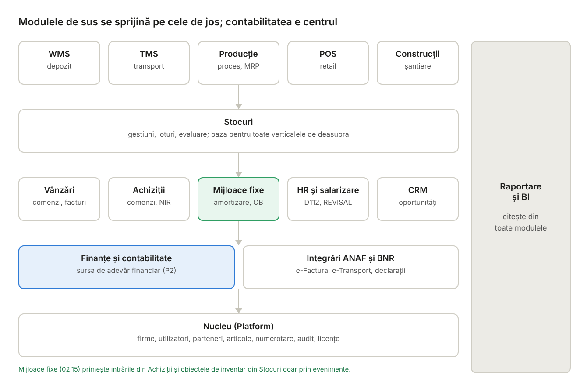

# ERP · 02 Module principale

14 noiembrie 2026 · Aurelian · **Validat** · Versiune editabilă: https://claude.ai/artifact/6wZzKpXDTAbPBPmTwUZRSY

Produsul are **14 module**: nucleul comun, 12 module de business și modulul de integrări ANAF/BNR. Acest document e harta lor: ce face fiecare, de ce depinde și ce convenții respectă toate. Fiecare modul primește apoi un document detaliat separat (02.01–02.14), în subfolderul lui. Respectă principiile din [01 Scop și principii](../01-scop-si-principii/SCOP_SI_PRINCIPII.md), referite aici ca P1–P10.

## Harta modulelor

| # | Modul | Schemă SQL | Prefix cod | Fază roadmap | Depinde obligatoriu de | Rol într-o frază |
| --- | --- | --- | --- | --- | --- | --- |
| 02.01 | Nucleu (Platform) | `core` | `Erp.Core` | 0 | — | Firme, utilizatori, roluri, nomenclatoare comune, numerotare, audit, licențe |
| 02.02 | Finanțe și contabilitate | `fin` | `Erp.Finance` | 1 | Nucleu | Transformă evenimentele în note contabile; TVA, trezorerie, închideri, consolidare |
| 02.03 | Vânzări | `sales` | `Erp.Sales` | 1 | Nucleu, Finanțe | Oferte, comenzi, avize, facturi către clienți |
| 02.04 | Achiziții | `purch` | `Erp.Purchasing` | 1 | Nucleu, Finanțe | Comenzi și facturi de la furnizori, recepții |
| 02.05 | Stocuri | `inv` | `Erp.Inventory` | 2 | Nucleu, Finanțe | Gestiuni, mișcări, loturi, evaluare, inventar |
| 02.06 | WMS (depozit) | `wms` | `Erp.Warehouse` | 2 | Stocuri | Locații, put-away, picking, packing |
| 02.07 | Transport (TMS) | `tms` | `Erp.Transport` | 2 | Vânzări, Stocuri | Curse, vehicule, șoferi, cost transport, UIT |
| 02.08 | Producție de proces și MRP | `mfg` | `Erp.Manufacturing` | 3 | Stocuri | Rețete, șarje, calitate, MRP, cost de producție |
| 02.09 | HR și salarizare | `hr` | `Erp.Hr` | 4 | Nucleu, Finanțe | Angajați, contracte, pontaj, salarii, D112, REVISAL |
| 02.10 | Vânzări retail (POS) | `pos` | `Erp.Pos` | 4 | Vânzări, Stocuri | Case de vânzare offline, bonuri fiscale, închideri de zi |
| 02.11 | Construcții | `cons` | `Erp.Construction` | 4 | Finanțe, Stocuri, Achiziții | Șantiere, devize, buget vs realizat, situații de lucrări |
| 02.12 | CRM | `crm` | `Erp.Crm` | 4 | Nucleu (cu Vânzări doar prin evenimente) | Lead-uri, oportunități, activități |
| 02.13 | Raportare și BI | `rpt` | `Erp.Reporting` | 1 → 4 | Toate (doar citire) | Rapoarte operaționale, legale, consolidate, dashboard-uri |
| 02.14 | Integrări ANAF și BNR | `intg` | `Erp.Integrations` | 1 | Nucleu | e-Factura, e-Transport, SPV, declarații, curs BNR |

Raportarea crește odată cu fiecare fază: fiecare modul nou vine cu rapoartele lui de bază. Integrările intră în faza 1 pentru că e-Factura e obligatorie de la prima factură.

## Dependențele dintre module

Modulele sunt așezate pe niveluri: un modul poate depinde doar de nivelurile de sub el, niciodată de cele de deasupra sau de unul de pe același nivel. Asta dă ordinea de livrare și previne dependențele circulare.

Dependența înseamnă că modulul folosește contractele (`.Contracts`) sau evenimentele modulului de dedesubt. Legăturile în sens invers (de exemplu, Stocuri află de o livrare din Vânzări) trec doar prin evenimente, deci nu creează dependențe de compilare. Raportarea citește din toate modulele prin view-uri, fără ca vreun modul să depindă de ea.

## Convenții comune tuturor modulelor

Toate modulele folosesc aceleași reguli pentru documente, numerotare, dimensiuni și precizie (P10). Documentele detaliate nu le redefinesc, doar le aplică.

**Ciclul de viață al unui document**

1. **Ciornă** (`Draft`): se poate modifica și șterge; nu are efecte în alte module; nu are număr definitiv.
2. **Validat** (`Posted`): primește număr din serie, devine imutabil (P3), scrie în outbox evenimentul `<Document>Validat` (P8).
3. **Stornat** (`Reversed`): un document de stornare, validat și el, anulează efectele; documentul original rămâne vizibil, cu legătură către stornare.
4. **Anulat** (`Cancelled`): doar pentru documente care nu au efecte contabile sau fiscale (de ex. o ofertă sau o comandă neexecutată).

| Convenție | Regula | Unde se implementează |
| --- | --- | --- |
| Numerotare | Serii configurabile per firmă, tip de document și an (de ex. `FV-2026-000123`); fără goluri pentru documentele fiscale; numărul se alocă la validare | Nucleu: serviciu `NumberSeries` |
| Dată contabilă vs dată document | Fiecare document are data documentului și data contabilă; perioada închisă se verifică pe data contabilă (P4) | Pipeline MediatR + Finanțe |
| Dimensiuni | Firmă (obligatoriu), gestiune / depozit, centru de cost, proiect / șantier, pe antet și pe linie | Nucleu: tabele de dimensiuni |
| Parteneri | Un singur nomenclator de parteneri (clienți și furnizori), cu rol per firmă | Nucleu |
| Articole | Un singur nomenclator de articole, cu atribute per modul (stoc, producție, retail) | Nucleu + extensii în module |
| Precizie | Prețuri unitare și cantități `decimal(19,6)`, zecimale configurabile 0–6 pe firmă, articol și listă de prețuri; valori și TVA rotunjite la 2 zecimale în RON (P7) | Nucleu: `PrecisionPolicy` |
| Monedă | Moneda pe document și curs BNR memorat; valorile în RON calculate la validare | Nucleu + Finanțe |
| Atașamente | Orice document poate avea fișiere atașate (PDF, XML ANAF), stocate în bază sau pe disc configurat | Nucleu: `Attachments` |
| Audit | Crearea, validarea, stornarea, exportul și schimbările de configurare se jurnalizează (P5) | Pipeline MediatR + Nucleu |
| Evenimente | Nume la trecut, în română fără diacritice în cod (`FacturaEmisa`), versionate (`v1`, `v2`) | Proiectul `.Contracts` al modulului |

## Fișe pe modul

Fiecare fișă e rezumatul documentului detaliat al modulului. Evenimentele sunt cele principale; lista completă și schemele lor intră în documentul detaliat și în secțiunea 03.

### 02.01 Nucleu (Platform) · [folder](01-nucleu/)

Fundația comună: tot ce folosesc toate celelalte module și nu aparține niciunuia.

- **Entități cheie**: `Company`, `User`, `Role`, `Permission`, `Partner`, `Item`, `Currency`, `ExchangeRate`, `UnitOfMeasure`, `NumberSeries`, `License`, `AuditEntry`.
- **Funcții**: firme din grup, utilizatori și roluri, nomenclatoare comune, serii de numerotare, politici de precizie, atașamente, audit, licențe pe module, configurare.
- **Publică**: `PartenerModificat`, `ArticolModificat`, `CursValutarActualizat`.
- **Consumă**: nimic de la alte module.

### 02.02 Finanțe și contabilitate · [folder](02-finante-contabilitate/)

Sursa de adevăr financiar (P2): transformă evenimentele modulelor în note contabile și produce raportările legale.

- **Entități cheie**: `Account` (plan de conturi), `JournalEntry`, `PostingRule`, `FiscalPeriod`, `BankAccount`, `Payment`, `FixedAsset`, `VatRegister`, `ConsolidationMap`.
- **Documente**: notă contabilă manuală, extras bancar, registru de casă, ordin de plată, fișă de mijloc fix, notă de reevaluare valutară.
- **Funcții**: reguli de contare, jurnale TVA, D300/D394/D390/D406, închidere de lună și an, trezorerie, reconciliere bancară, mijloace fixe și amortizare, multivalută, consolidare de grup.
- **Publică**: `PlataInregistrata`, `IncasareInregistrata`, `PerioadaInchisa`.
- **Consumă**: evenimentele de document validat din toate modulele operaționale.

### 02.03 Vânzări · [folder](03-vanzari/)

Ciclul comandă → factură pentru clienții B2B.

- **Entități cheie**: `Quote`, `SalesOrder`, `DeliveryNote` (aviz), `SalesInvoice`, `PriceList`, `Discount`.
- **Documente**: ofertă, comandă client, aviz de însoțire, factură (inclusiv avans și storno), proformă.
- **Funcții**: liste de prețuri cu precizie configurabilă, discounturi, rezervare stoc, limite de credit, facturare din avize, trimitere automată în e-Factura.
- **Publică**: `ComandaClientConfirmata`, `LivrareEfectuata`, `FacturaEmisa`.
- **Consumă**: `OportunitateCastigata` (CRM), `IncasareInregistrata` (Finanțe), starea e-Factura (Integrări).

### 02.04 Achiziții · [folder](04-achizitii/)

Ciclul necesar → comandă → recepție → factură pentru furnizori.

- **Entități cheie**: `PurchaseRequest`, `PurchaseOrder`, `GoodsReceipt` (NIR), `SupplierInvoice`.
- **Documente**: referat de necesitate, comandă furnizor, NIR, factură furnizor, factură de servicii.
- **Funcții**: aprobări pe praguri, preluarea facturilor din SPV și potrivirea cu comanda și recepția (3-way match), costuri de achiziție (transport, vamă) repartizate pe articole.
- **Publică**: `ReceptieNIRValidata`, `FacturaFurnizorValidata`.
- **Consumă**: `FacturaPrimitaSPV` (Integrări), `NecesarCalculat` (MRP), `PlataInregistrata` (Finanțe).

### 02.05 Stocuri · [folder](05-stocuri/)

Evidența cantitativ-valorică a bunurilor în gestiuni.

- **Entități cheie**: `Warehouse` (gestiune), `StockMovement`, `StockBalance`, `Batch`, `SerialNumber`, `InventoryCount`.
- **Documente**: transfer între gestiuni, bon de consum, notă de predare, proces-verbal de inventar, plus mișcările generate din NIR și avize.
- **Funcții**: evaluare CMP și FIFO, loturi și serii cu termen de valabilitate, rezervări, inventar cu diferențe, fișe de magazie, Intrastat.
- **Publică**: `MiscareStocValidata` (cu valoare), `InventarFinalizat`.
- **Consumă**: `LivrareEfectuata`, `ReceptieNIRValidata`, `ConsumMateriale`, `PredareProduseFinite`, `ZiInchisaPOS`.

### 02.06 WMS (depozit) · [folder](06-wms/)

Operațiunile fizice din depozit, la nivel de locație; Stocuri rămâne sursa de adevăr cantitativ-valorică.

- **Entități cheie**: `Location`, `Zone`, `PutAwayTask`, `PickWave`, `PickTask`, `Package`.
- **Funcții**: structura depozitului, reguli de put-away, valuri de picking, packing, inventar pe locație, interfață web pentru terminale cu scanner.
- **Publică**: `PickingFinalizat`, `MarfaAmplasata`.
- **Consumă**: `ComandaClientConfirmata`, `ReceptieNIRValidata`.

### 02.07 Transport (TMS) · [folder](07-transport-tms/)

Planificarea și costul livrărilor cu flota proprie sau transportatori.

- **Entități cheie**: `Vehicle`, `Driver`, `Trip` (cursă), `Route`, `Carrier`, `TransportCost`.
- **Documente**: foaie de parcurs, cursă, declarație e-Transport.
- **Funcții**: gruparea livrărilor pe curse, ordinea opririlor, cost transport repartizat pe livrări, coduri UIT, documente pentru șofer.
- **Publică**: `CursaPlanificata`, `CursaLivrata`.
- **Consumă**: `LivrareEfectuata`, `PickingFinalizat`, `UitObtinut` (Integrări).

### 02.08 Producție de proces și MRP · [folder](08-productie-mrp/)

Producția pe rețete și șarje, cu planificarea necesarului de materiale.

- **Entități cheie**: `Recipe` (cu versiuni și randamente), `ProductionOrder`, `Batch`, `QualityCheck`, `MrpRun`, `MrpSuggestion`.
- **Documente**: comandă de producție, bon de consum, raport de producție, notă de predare produse finite, buletin de calitate.
- **Funcții**: rețete cu coproduse și deșeuri, trasabilitate lot materie primă → lot produs finit, control calitate, MRP (necesar net din comenzi, stoc și stoc de siguranță), cost real vs standard.
- **Publică**: `ConsumMateriale`, `PredareProduseFinite`, `NecesarCalculat`.
- **Consumă**: `ComandaClientConfirmata`, `MiscareStocValidata`.

### 02.09 HR și salarizare · [folder](09-hr-salarizare/)

Evidența angajaților și calculul complet al salariilor, conform Codului Muncii și Codului fiscal.

- **Entități cheie**: `Employee`, `EmploymentContract`, `Timesheet`, `Leave`, `PayrollRun`, `Payslip`, `Benefit` (tichete, sporuri).
- **Documente**: contract și act adițional, pontaj lunar, cerere de concediu, stat de plată, fluturaș.
- **Funcții**: pontaj, concedii și medicale, calcul brut → net, contribuții și impozit, D112, REVISAL, self-service pentru angajați, date personale criptate (GDPR).
- **Publică**: `StatDePlataValidat`, `ContractModificat`.
- **Consumă**: `PerioadaInchisa` (Finanțe).

### 02.10 Vânzări retail (POS) · [folder](10-retail-pos/)

Vânzarea la casă în magazine, care funcționează și fără conexiune la server.

- **Entități cheie**: `Store`, `Register` (casă), `Receipt` (bon), `Shift`, `ZReport`.
- **Componente**: modul server (configurare, sincronizare, rapoarte) + client local cu SQLite și driver AMEF.
- **Funcții**: vânzare rapidă cu scanner, plată card/numerar/mixt, retururi, închidere de zi cu raport Z, sincronizare (nomenclatoare în jos, bonuri în sus).
- **Publică**: `ZiInchisaPOS` (vânzări și încasări agregate pe zi și casă).
- **Consumă**: `ArticolModificat`, liste de prețuri din Vânzări.

### 02.11 Construcții · [folder](11-constructii/)

Urmărirea proiectelor de construcții pe șantiere, cu buget și situații de lucrări.

- **Entități cheie**: `Project`, `Site` (șantier), `Estimate` (deviz), `BudgetLine`, `WorkStatement` (situație de lucrări), `Subcontract`.
- **Documente**: deviz, situație de lucrări, contract de subantrepriză, consum pe șantier.
- **Funcții**: buget vs realizat pe capitol de deviz, consumuri și costuri pe șantier, facturare pe situații de lucrări, rețineri și garanții de bună execuție, taxare inversă.
- **Publică**: `SituatieLucrariAprobata`, `ConsumSantier`.
- **Consumă**: `MiscareStocValidata`, `FacturaFurnizorValidata`, `StatDePlataValidat` (cost manoperă).

### 02.12 CRM · [folder](12-crm/)

Relația cu clienții înainte și după vânzare.

- **Entități cheie**: `Lead`, `Opportunity`, `Activity`, `Campaign`, `Contact`.
- **Funcții**: pipeline de vânzări, activități și memento-uri, istoric complet client (oferte, facturi, încasări din alte module, doar citire).
- **Publică**: `OportunitateCastigata`.
- **Consumă**: `FacturaEmisa`, `IncasareInregistrata`.

### 02.13 Raportare și BI · [folder](13-raportare-bi/)

Rapoartele care citesc din mai multe module; fiecare modul își are și rapoartele proprii.

- **Surse**: view-uri read-only dedicate în schema `rpt`, singurul loc unde se fac join-uri între scheme (P1).
- **Funcții**: rapoarte legale (bilanț, situații financiare), rapoarte consolidate de grup, dashboard-uri pe rol, export Excel/PDF, rapoarte programate pe email.
- **Publică / consumă**: nimic; doar citește.

### 02.14 Integrări ANAF și BNR · [folder](14-integrari-anaf-bnr/)

Toate comunicările cu sisteme externe ale statului, izolate ca să poată fi actualizate rapid când se schimbă schemele.

- **Entități cheie**: `AnafToken`, `EInvoiceSubmission`, `EInvoiceInbox`, `ETransportDeclaration`, `DeclarationFile`, `BnrRate`.
- **Funcții**: OAuth SPV, generare UBL CIUS-RO, trimitere și urmărire stare e-Factura, descărcare facturi primite, e-Transport, generare XML declarații, preluare curs BNR, reîncercări și alerte.
- **Publică**: `EFacturaAcceptata`, `EFacturaRespinsa`, `FacturaPrimitaSPV`, `UitObtinut`, `CursBnrPreluat`.
- **Consumă**: `FacturaEmisa`, `CursaPlanificata`, cereri de declarații din Finanțe și Salarizare.

## Licențiere

Propunerea: un **pachet de bază obligatoriu** plus module opționale, cu dependențele verificate de licență (nu se poate activa WMS fără Stocuri). Prețurile și numele comerciale ale pachetelor sunt decizii de business, de stabilit separat.

| Pachet | Module incluse | Cere în plus |
| --- | --- | --- |
| Bază (obligatoriu) | Nucleu, Finanțe și contabilitate, Integrări ANAF și BNR, Raportare de bază | — |
| Comercial | Vânzări, Achiziții | Bază |
| Logistic | Stocuri | Comercial |
| Depozit | WMS | Logistic |
| Transport | TMS | Logistic |
| Producție | Producție de proces și MRP | Logistic |
| Retail | POS (licență și pe număr de case) | Logistic |
| Construcții | Construcții | Logistic |
| Oameni | HR și salarizare (licență și pe număr de angajați) | Bază |
| CRM | CRM | Bază (Comercial recomandat) |
| BI avansat | Rapoarte consolidate, dashboard-uri, rapoarte programate | Bază |

Cum funcționează tehnic: fișierul de licență semnat conține lista de module active; la pornire, host-ul înregistrează doar acele module (endpoint-uri, handler-e MediatR, consumatori de evenimente, joburi, meniuri). Un modul inactiv nu apare deloc în interfață, dar schema lui există în bază, ca activarea ulterioară să nu ceară migrare specială.

## Documente detaliate

Fiecare modul primește un document separat, scris în ordinea roadmap-ului, ca să avem specificația completă a unui modul înainte să înceapă implementarea lui. Fiecare document detaliat va avea aceeași structură:

1. Scop și perimetru al modulului (ce face, ce nu face)
2. Model de domeniu: entități, relații, reguli de business, diagramă
3. Documente și ciclul lor de viață, cu câmpuri și validări
4. Fluxuri principale (diagrame) și cazuri limită
5. Evenimente publicate și consumate, cu conținut
6. Contracte (`.Contracts`): interfețe și DTO-uri publice
7. Schema SQL: tabele, chei, indecși, proceduri stocate principale
8. Permisiuni și roluri specifice
9. Cerințe legale specifice și integrări
10. Rapoarte ale modulului
11. Ecrane principale (structură, nu design final)
12. Criterii de acceptare și teste cheie

| Ordine | Document | Fază | Folder în Library | Stare |
| --- | --- | --- | --- | --- |
| 1 | 02.01 Nucleu (Platform) | 0 | [NUCLEU.md](01-nucleu/NUCLEU.md) · [Claude Docs](https://claude.ai/artifact/UE59RnaWRpVe5dfdJgzrqU) | Validat (14.11.2026) |
| 2 | 02.02 Finanțe și contabilitate | 1 | [02-finante-contabilitate](02-finante-contabilitate/) | Validat (15.11.2026); în implementare (F1) |
| 3 | 02.14 Integrări ANAF și BNR | 1 | [14-integrari-anaf-bnr](14-integrari-anaf-bnr/) | De făcut |
| 4 | 02.03 Vânzări | 1 | [03-vanzari](03-vanzari/) | De făcut |
| 5 | 02.04 Achiziții | 1 | [04-achizitii](04-achizitii/) | De făcut |
| 6 | 02.13 Raportare și BI | 1 → 4 | [13-raportare-bi](13-raportare-bi/) | De făcut |
| 7 | 02.05 Stocuri | 2 | [05-stocuri](05-stocuri/) | De făcut |
| 8 | 02.06 WMS | 2 | [06-wms](06-wms/) | De făcut |
| 9 | 02.07 Transport (TMS) | 2 | [07-transport-tms](07-transport-tms/) | De făcut |
| 10 | 02.08 Producție de proces și MRP | 3 | [08-productie-mrp](08-productie-mrp/) | De făcut |
| 11 | 02.09 HR și salarizare | 4 | [09-hr-salarizare](09-hr-salarizare/) | De făcut |
| 12 | 02.10 Vânzări retail (POS) | 4 | [10-retail-pos](10-retail-pos/) | De făcut |
| 13 | 02.11 Construcții | 4 | [11-constructii](11-constructii/) | De făcut |
| 14 | 02.12 CRM | 4 | [12-crm](12-crm/) | De făcut |
