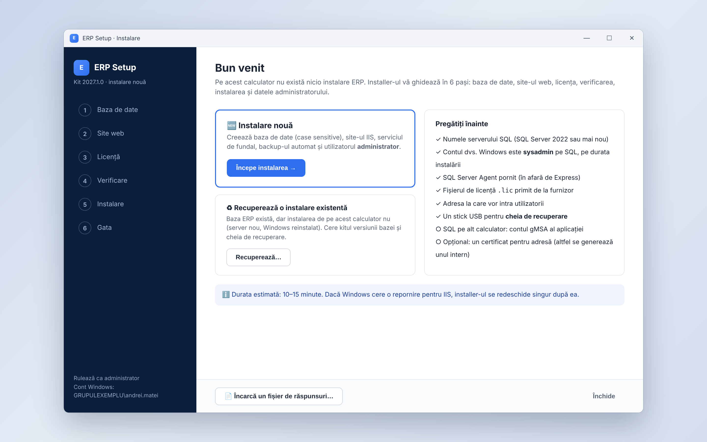
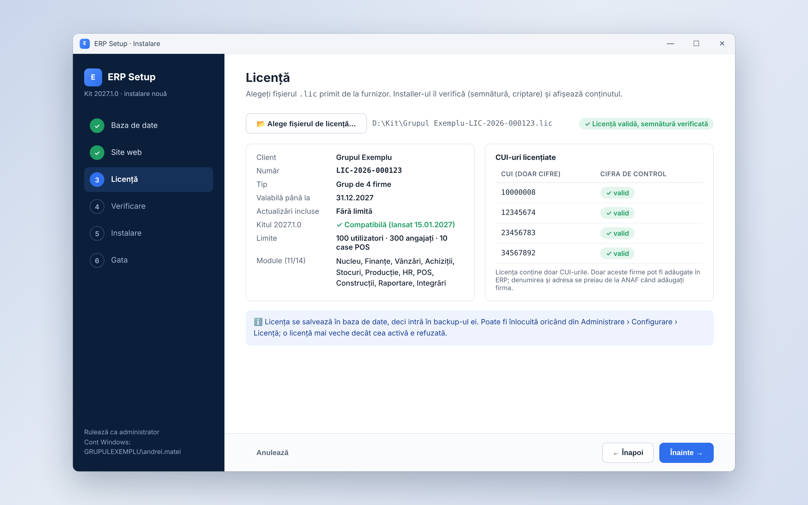
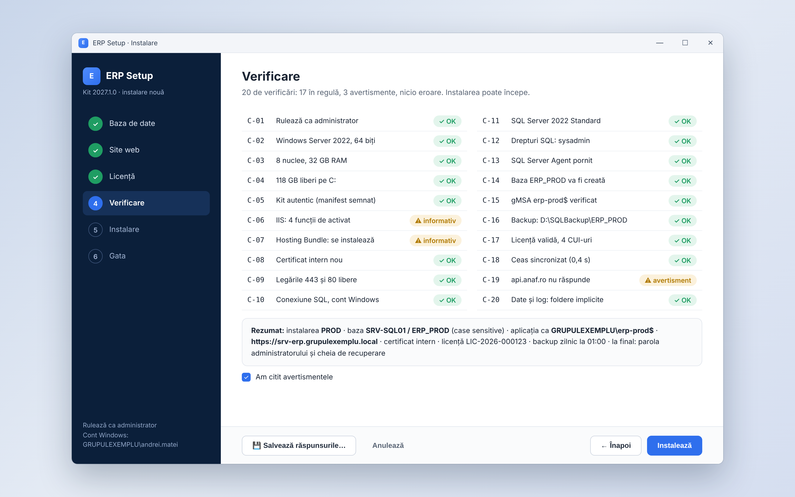
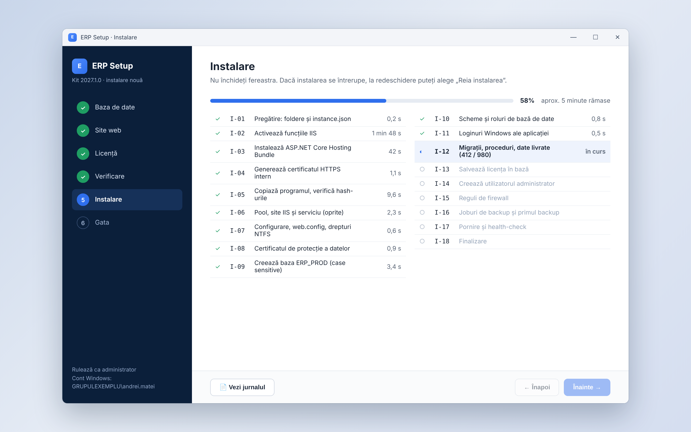

# ERP · 08 Instalare și actualizare

19 noiembrie 2026 · Aurelian, Claude · **Versiunea 3, rescrisă de Claude prin delegarea lui Aurelian (19.11.2026)**; înlocuiește versiunea din 15.11.2026 și este sursa de adevăr pentru implementare · Documente legate: [Ghidul operațional](GHID_INSTALARE_ACTUALIZARE.md), [Bune practici](../bune-practici/BUNE_PRACTICI.md), [02.01 Nucleu](../02-module-principale/01-nucleu/NUCLEU.md), [schița](../00-schita/ARHITECTURA_ERP.md)

Instalarea ERP-ului se face cu **două aplicații mici, cu ecrane simple**:

1. **Generatorul de licențe** (`ErpLicenseGen.exe`), folosit doar de noi: produce fișierul de licență al clientului, cu CUI-ul firmei sau lista CUI-urilor grupului, criptat și semnat.
2. **Installer-ul** (`ErpSetup.exe`), rulat la client pe Windows Server, Windows 11 sau Windows 10. Operatorul alege serverul SQL și numele bazei (autentificare Windows), adresa site-ului și fișierul de licență, apoi apasă „Instalează”. Installer-ul creează baza, site-ul IIS, serviciul și utilizatorul administrator, a cărui parolă se afișează o singură dată, și cere salvarea cheii de recuperare.

Lângă installer, kitul conține și `ErpSetup.Cli.exe`: aceeași logică, aceiași pași, fără ferestre, pentru instalarea neasistată și pentru testele automate pe mașini virtuale (decizia D13). Modelul e cel al produselor Microsoft de tip on-premise: SQL Server (`Setup.exe /ConfigurationFile=… /Q`) și Business Central (`setup.exe /config … /quiet`) au un expert cu ferestre pentru operator și un mod silențios condus de un fișier de răspunsuri, pe care expertul îl poate produce.

Documentul e scris ca specificație de implementare: un agent de cod (Claude Code, GitHub Copilot) trebuie să poată construi ambele aplicații doar din el. Deciziile sunt în secțiunea 14; cele marcate „Claude, prin delegare” au fost luate la cererea explicită a lui Aurelian din 19.11.2026 („ne vom ghida după documentația scrisă de tine”).

**Ce s-a schimbat față de versiunea din 15.11.2026** (motivele sunt în secțiunea 14):

| Schimbare | Decizie |
| --- | --- |
| Logica installer-ului rămâne în biblioteci `net10.0`, testabile în CI pe Linux; doar ferestrele WPF sunt `net10.0-windows` | D12 |
| Pe lângă fereastra WPF, un punct de intrare în linia de comandă peste același plan de pași; fișierul de răspunsuri e produs de expert și citit de linia de comandă | D13, D14, D28 |
| Kitul are manifestul semnat (`manifest.sig`), nu doar hash-uri | D15 |
| Chei de rezervă pentru licențe și kit, livrate de la prima versiune | D16 |
| `sysadmin` obligatoriu pe durata instalării (varianta `dbcreator` + `securityadmin` nu acoperea pașii) | D17 |
| Licența stă în bază, nu și într-un fișier pe disc; câmp opțional „actualizări incluse până la”; protecție la licențe vechi și la ceas dat înapoi | D18, D19, D20 |
| Pe SQL la distanță, aplicația folosește de preferință un cont gMSA | D21 |
| **Cheile de criptare ale aplicației stau în bază, protejate cu un certificat al instalării, iar cheia de recuperare se salvează obligatoriu.** Înainte, o bază restaurată pe alt server pierdea 2FA, secretele și datele criptate | D22 |
| Revenirea la actualizare folosește un snapshot al bazei (rapid) și backup-ul (protecție) | D23 |
| Ordinea pașilor, preluarea unei baze pregătite de DBA, recuperarea pe alt calculator | D24, D25, D26 |
| Windows 10 acceptat cu avertisment (fără actualizări de securitate din 14.10.2025) | D27 |

---

## 0. Reguli pentru agentul de cod

Citește tot documentul înainte de a scrie cod pentru installer, generator sau licență. Regulile de mai jos au prioritate față de orice obișnuință a agentului. Regulile de lucru pe domenii sunt în [instrucțiunile installer-ului](../../../.github/instructions/installer.instructions.md), iar procedura de implementare în skill-ul [erp-installer](../../../.github/skills/erp-installer/SKILL.md).

| # | Regulă |
| --- | --- |
| R1 | **Straturile** (D12): logica (pași, verificări, SQL, Windows, stare) stă în biblioteci `net10.0` marcate `[SupportedOSPlatform("windows")]` unde folosesc API-uri Windows; ViewModel-urile stau într-o bibliotecă `net10.0` cu `CommunityToolkit.Mvvm` (MIT); **numai** View-urile (XAML) sunt `net10.0-windows` cu `<UseWPF>true</UseWPF>` și `<EnableWindowsTargeting>true</EnableWindowsTargeting>`. Doar controale WPF standard, fără biblioteci de controale cu plată. Operațiile lungi rulează `async` și raportează prin `IProgress<T>`. |
| R2 | **Publicarea**: ambele executabile ale installer-ului și generatorul sunt self-contained, single-file (`PublishSingleFile`, `IncludeNativeLibrariesForSelfExtract`, `EnableCompressionInSingleFile`), `win-x64`, fără trimming. `ErpSetup.exe` are în manifest `requireAdministrator`; `ErpSetup.Cli.exe` are `asInvoker` și se oprește cu codul 10 dacă nu rulează ca administrator (altfel UAC ar deschide altă fereastră și ieșirea s-ar pierde). **Nu** MSI, **nu** WiX, **nu** scripturi PowerShell ca logică principală. |
| R3 | Acces la date: **Dapper + SQL parametrizat sau proceduri stocate**. Fără Entity Framework Core sau alt ORM, fără Duende, fără OpenIddict, fără componente cu licență plătită. Migrațiile: **DbUp**, scripturi `.sql` (`MIG-01`–`MIG-07`). |
| R4 | Baza se creează cu collation **`Latin1_General_100_CS_AS_SC_UTF8`** (case sensitive). Orice nume de obiect, coloană, parametru sau cod se scrie exact cu majusculele din declarație (`SQL-21`–`SQL-25`). |
| R5 | Conexiunea SQL folosește **numai Windows authentication** (`Integrated Security = true`): installer-ul cu contul operatorului, aplicația cu identitățile ei Windows (5.8). Nu există parole SQL și nici fișiere cu parole SQL. |
| R6 | La instalarea nouă se creează **exact un** utilizator Administrator (5.10). Actualizarea, repararea și recuperarea **nu** creează și nu modifică utilizatori; singura excepție e acțiunea explicită „Resetează accesul administratorului” (11.3). |
| R7 | Licența conține CUI-urile doar ca cifre, separate prin `:`, într-un fișier **criptat AES-256-GCM și semnat ECDSA P-256** (secțiunea 3). Cheile private (licențe, kit) există doar pe calculatorul de emitere și în copiile offline, niciodată în ERP sau în Git (`SEC-02`). |
| R8 | Niciun secret (parole, chei, conținutul decriptat al licenței, parola cheii de recuperare) nu apare în jurnale, în mesaje de eroare sau în argumentele liniei de comandă (`SEC-02`, `NET-18`). Excepții controlate, singurele: parola temporară a administratorului, afișată o singură dată pe ecranul 6, iar la instalarea neasistată scrisă în fișierul protejat din 5.10. |
| R9 | Installer-ul nu șterge niciodată o bază de date și nu scrie peste o bază existentă cu date. Singura bază pe care o șterge este snapshot-ul creat de el însuși la actualizare (10.2). |
| R10 | Orice pas e **idempotent**: rulat a doua oară, nu dublează nimic și nu strică nimic. |
| R11 | Textele pentru utilizator sunt în română, cu diacritice; identificatorii din cod și din SQL sunt în engleză (`NET-19`). |
| R12 | Nimic din acest document nu se „simplifică” tăcut. Dacă un pas pare imposibil, agentul se oprește și întreabă. |
| R13 | **Un singur plan** (D13): fereastra și linia de comandă construiesc același `InstallRequest`, din care același `PlanBuilder` produce aceeași listă de pași; verificările C-xx sunt aceleași. Nu există opțiune care să sară verificările într-un build `Release`. |
| R14 | Agentul nu rulează instalare, actualizare, restaurare, modificări IIS, servicii, firewall sau dezinstalare pe o infrastructură reală fără autorizare explicită; testele cu efecte administrative rulează pe mașini virtuale dedicate. |

Implementarea se face pe sarcinile din secțiunea 13, în ordine, câte un pull request pe sarcină (`GIT-01`–`GIT-04`).

---

## 1. Pe scurt: cum se instalează la un client

| Pas | Cine | Ce face | Durată |
| --- | --- | --- | --- |
| 1 | Noi | În **ErpLicenseGen**: denumirea clientului, CUI-urile firmelor (doar cifre), modulele, valabilitatea; salvăm fișierul `.lic` | 2 minute |
| 2 | IT-ul clientului, o singură dată | Pregătește serverul ([ghidul](GHID_INSTALARE_ACTUALIZARE.md), secțiunea 5): SQL Server Agent pornit, `sysadmin` temporar pentru operator, numele DNS al site-ului, folderul de backup; pentru SQL pe alt calculator, contul gMSA al aplicației | — |
| 3 | Operatorul (noi sau IT-ul clientului) | Dezarhivează kitul pe serverul de aplicație și pornește **ErpSetup.exe** (cere confirmarea de administrator) | — |
| 4 | Idem | Ecranul 1: serverul SQL și baza, „Testează conexiunea”. Ecranul 2: adresa site-ului și certificatul. Ecranul 3: fișierul de licență, cu CUI-urile afișate. Ecranul 4: verificările | 3 minute |
| 5 | Idem | „Instalează”: installer-ul face singur restul și arată progresul pas cu pas | 5–15 minute |
| 6 | Idem | Ecranul final: adresa aplicației, utilizatorul `administrator` și **parola, afișată o singură dată**; **salvarea cheii de recuperare** (fișier `.pfx` cu parolă aleasă de operator), obligatorie | 2 minute |
| 7 | Administratorul ERP al clientului | Prima autentificare: parolă nouă, activarea 2FA, apoi asistentul de configurare, unde adaugă firmele (CUI-ul fiecăreia se verifică în licență) | — |
| 8 | IT-ul clientului | Retrage `sysadmin` operatorului; organizează copierea backup-urilor în afara serverului; păstrează cheia de recuperare **separat** de backup-uri; distribuie certificatul intern pe calculatoarele utilizatorilor, dacă s-a folosit | — |

Actualizarea se face cu același `ErpSetup.exe`, dintr-un kit nou: aplicația recunoaște instalarea existentă și oferă „Actualizează” (secțiunea 10). Recuperarea după pierderea serverului de aplicație se face cu kitul versiunii instalate și cheia de recuperare (11.2).

---

## 2. Context minim (ca documentul să fie autonom)

**Produsul.** ERP românesc licențiat, vândut companiilor medii și mari, instalat **on-premise** la fiecare client. O instalare servește un grup de firme și are **o singură bază SQL Server**; firmele sunt separate prin `CompanyId`. Pe un calculator pot exista mai multe instalări independente (de exemplu `PROD` și `TEST`), fiecare cu baza, site-ul și serviciul ei. Echipa e mică (Aurelian + Claude), deci instalarea trebuie să fie simplă și fără pași manuali în SQL (principiul P9 din 01).

**Calculatoarele unei instalări.** În tot documentul, „calculatorul” installer-ului și al aplicației înseamnă **serverul de aplicație**:

| Rol | Ce rulează pe el | Se conectează la SQL Server? |
| --- | --- | --- |
| Calculatoarele utilizatorilor | Doar browserul; deschid ERP-ul prin HTTPS, de oriunde din rețea sau prin VPN | **Nu, niciodată** |
| Serverul de aplicație | Site-ul IIS (`Erp.Host`), serviciul `ErpWorker`; aici rulează installer-ul | Da, cu identitatea Windows a aplicației (5.8) |
| Serverul SQL | SQL Server și SQL Server Agent | — |

„SQL Server pe același calculator” înseamnă că serverul de aplicație și serverul SQL sunt aceeași mașină; poziția utilizatorilor nu contează. Contul Windows al unui utilizator nu ajunge niciodată la SQL Server, nici când se autentifică în ERP cu contul de domeniu: autentificarea îl identifică în aplicație, iar aplicația lucrează cu baza sub identitatea ei și verifică singură drepturile utilizatorului.

| Strat | Tehnologie |
| --- | --- |
| Sistem de operare | Windows Server 2019, 2022, 2025 (producție) sau Windows 11 (firme mici, demonstrații, test); Windows 10 22H2 acceptat cu avertisment (D27) |
| Server web | IIS 10 (activat de installer dacă lipsește) |
| Runtime | .NET 10 (LTS), ASP.NET Core Hosting Bundle 10.x (inclus în kit) |
| Aplicație | `Erp.Host`: API, interfața React (fișiere statice) și paginile de autentificare `/account/*`, într-un singur site IIS |
| Autentificare | ASP.NET Core Identity cu cookie, în `Erp.Host`; chei API pentru conturi tehnice; autentificare Windows opțională pentru Active Directory; date în schema `ids` (secțiunea 8) |
| Lucru în fundal | Serviciul Windows `Erp.Worker`: Hangfire (schema `hangfire`), outbox, joburi zilnice |
| Bază de date | SQL Server 2022 (versiunea 16) sau mai nou; Standard sau Enterprise în producție, Developer sau Express doar pentru test și demonstrații (5.1) |
| Acces date | Dapper + proceduri stocate, fără ORM; migrații DbUp |
| Licență | Fișier `.lic` criptat și semnat, încărcat în bază (secțiunile 3 și 4) |
| Chei de criptare | ASP.NET Core Data Protection; inelul de chei în bază, protejat cu certificatul instalării; cheie de recuperare exportată (5.12) |

**Schemele bazei** (`SQL-01`): `core`, `ids`, `fin`, `sales`, `purch`, `inv`, `intg`, `wms`, `tms`, `mfg`, `hr`, `pos`, `cons`, `crm`, `rpt`, plus schema tehnică `hangfire`. Nimic în `dbo`.

---

## 3. Aplicația 1: Generatorul de licențe (`ErpLicenseGen.exe`)

### 3.1 Rol

Aplicație internă, folosită doar de noi (pe calculatorul lui Aurelian). **Nu se livrează niciodată clienților**: conține cheia privată de semnare. Produce un fișier `.lic` pentru un client: o firmă (un CUI) sau un grup (o listă de CUI-uri). Este forma obișnuită din piață (portalul de emitere al FlexNet sau Sentinel), construită în casă: fără cost per dezvoltator și fără o dependență externă.

### 3.2 Ecranul

O singură fereastră:

| Câmp | Tip | Regulă |
| --- | --- | --- |
| Denumire client | text, obligatoriu | 2–200 caractere; de exemplu „Grupul Exemplu” |
| CUI-uri | text pe mai multe rânduri, obligatoriu | Se acceptă CUI-uri separate prin rând nou, virgulă, spațiu sau `:`, cu sau fără prefixul `RO`. La „Validează” fiecare CUI se **normalizează la partea numerică** (se elimină `RO`, spațiile și orice altceva decât cifre), se verifică cifra de control CUI și dublurile. Lista normalizată se afișează sub câmp, de exemplu `10000001:12345678:23456789:34567890`. Un CUI invalid se marchează cu roșu și blochează generarea |
| Tip | afișat automat | „Firmă” dacă e un singur CUI, „Grup de N firme” dacă sunt mai multe |
| Module | casete de bifat | Nucleu bifat și blocat; Finanțe, Vânzări, Achiziții, Stocuri, WMS, Transport, Producție, HR, POS, Construcții, CRM, Raportare, Integrări |
| Limite | numere | Utilizatori, angajați salarizare, case POS. Numărul de firme = numărul de CUI-uri |
| Valabilă până la | dată sau „Nelimitat” | Implicit: 1 an de azi |
| Actualizări incluse până la | dată sau „Fără limită” | Implicit „Fără limită” (4.5, D19). Dacă se completează, nu poate depăși „Valabilă până la” când aceasta e o dată |
| Număr licență | afișat automat | `LIC-<AAAA>-<NNNNNN>`, următorul număr din registrul local (3.6) |
| Cheie de semnare | afișat | `KeyId` activ (de exemplu „1 · activă”); dacă lipsește cheia privată, generarea e blocată cu trimitere la „Chei” |

Butoane: **„Generează licența”** (dialogul de salvare cu numele propus `<Client>-<NumărLicență>.lic`), **„Deschide o licență”** (verifică și afișează conținutul unui `.lic` existent, cu aceleași verificări ca ERP-ul, 4.2), **„Chei”** (prima configurare și rotirea, 3.5).

Macheta (de validat): 

### 3.3 Conținutul licenței

Conținutul (înainte de criptare) e un JSON UTF-8. CUI-urile sunt **un singur șir, doar cifre, separate prin `:`** (decizia D4):

```json
{
  "licenseId": "LIC-2026-000123",
  "product": "ERP",
  "customerName": "Grupul Exemplu",
  "fiscalCodes": "10000001:12345678:23456789:34567890",
  "modules": ["Core", "Finance", "Sales", "Purchasing", "Inventory", "Integrations", "Manufacturing", "Hr", "Pos", "Construction", "Reporting"],
  "limits": { "users": 100, "payrollEmployees": 300, "posTerminals": 10 },
  "issuedAt": "2026-11-15",
  "validUntil": "2027-12-31",
  "updatesUntil": null
}
```

| Câmp | Regulă |
| --- | --- |
| `fiscalCodes` | `^[1-9][0-9]{1,9}(:[1-9][0-9]{1,9})*$`, fără duplicate, fiecare cu cifra de control CUI validă |
| `modules` | Coduri tehnice exacte (`NET-21`, `Ordinal`); un cod necunoscut versiunii instalate se ignoră cu avertisment în jurnal (o licență nouă poate conține un modul livrat mai târziu) |
| `validUntil` | Dată sau `null` („Nelimitat”) |
| `updatesUntil` | Dată sau `null` („Fără limită”); 4.5 |
| `issuedAt` | Data emiterii; folosită la protecția contra licențelor vechi (4.2, verificarea 6) |

Validarea CUI-ului (normalizare și cifră de control) stă într-o singură clasă, `FiscalCode`, în `Erp.Licensing`, folosită de generator, de installer și de Nucleu.

### 3.4 Criptarea și semnarea

| Element | Algoritm |
| --- | --- |
| Criptare | **AES-256-GCM** (`System.Security.Cryptography.AesGcm`), cheie de 256 de biți pe `KeyId`, nonce aleator de 12 octeți pentru fiecare licență, tag de 16 octeți; antetul fișierului e date autentificate (AAD) |
| Semnare | **ECDSA P-256 cu SHA-256** (`ECDsa`, format IEEE P1363, 64 de octeți), peste tot fișierul în afară de semnătură (criptează, apoi semnează) |

Formatul binar al fișierului `.lic`:

| Poziție | Lungime | Câmp |
| --- | --- | --- |
| 0 | 8 | Marcaj ASCII `ERPLIC01` |
| 8 | 1 | Versiunea formatului = `1` |
| 9 | 1 | `KeyId` = numărul perechii de chei folosite (1–255) |
| 10 | 12 | Nonce AES-GCM |
| 22 | 4 | Lungimea textului criptat `n` (uint32, little-endian), maximum 65 536 |
| 26 | n | Textul criptat (JSON-ul din 3.3) |
| 26 + n | 16 | Tag-ul GCM |
| 42 + n | 64 | Semnătura ECDSA peste octeții `0 … 41 + n` |

AAD pentru GCM = octeții `0 … 25`. Orice octet modificat face fie semnătura, fie decriptarea să eșueze; semnătura se verifică **înainte** de decriptare.

**Ce garantează fiecare parte, spus exact.** Semnătura e protecția reală: fără cheia privată, nimeni nu poate fabrica sau modifica o licență. Criptarea împiedică citirea și editarea „la vedere”, dar cheia AES trebuie să existe în ERP ca licența să poată fi citită, deci un atacator hotărât o poate extrage din binar; de aceea criptarea nu se bazează pe secretul ei, iar CUI-urile sunt oricum date publice (ANAF, ONRC). O variantă care ar ascunde CUI-urile cu adevărat (amprente cu sare în locul CUI-urilor) ar face imposibilă afișarea listei pe ecranul 3 și a fost respinsă.

Codul de criptare, decriptare și verificare stă într-o singură bibliotecă, `Erp.Licensing` (`net10.0`), folosită de generator, de installer și de aplicație. Scrierea licenței (`LicenseWriter`) stă în `Erp.LicenseGen.Core` și nu se compilează în celelalte aplicații.

### 3.5 Cheile și rotirea lor

| Cheie | Unde stă | Cine o are |
| --- | --- | --- |
| Cheia privată ECDSA **activă** (`KeyId = 1`) | `%APPDATA%\ErpLicenseGen\keys\sign-1.bin`, criptată DPAPI `CurrentUser` pe calculatorul de emitere, plus o copie offline exportată cu parolă | Doar generatorul |
| Cheia privată ECDSA **de rezervă** (`KeyId = 2`) | **Numai** în copia offline, exportată cu parolă; nu stă pe calculatorul de emitere | Nimeni, până la rotire |
| Cheile publice ECDSA 1 și 2 | Constante în `Erp.Licensing/LicenseKeys.cs`, pe `KeyId` | ERP, installer, generator |
| Cheile AES-256 1 și 2 | Constante în `LicenseKeys.cs`, mascate (XOR cu o a doua constantă), ca să nu apară în clar ca șir în binar | ERP, installer, generator |

**Prima configurare.** Butonul „Chei” generează **ambele** perechi (1 și 2) și ambele chei AES, salvează cheia privată 1 ca mai sus, exportă cheile private 1 și 2 într-un fișier de siguranță protejat cu parolă (PKCS#8 criptat, AES-256), șterge cheia 2 din memorie și afișează textul C# pentru `LicenseKeys.cs`. Copia de siguranță se păstrează offline, în două locuri (de exemplu două stick-uri USB criptate, în locații diferite), cu parola separat.

**De ce două chei de la început** (D16): o instalare acceptă numai cheile publice compilate în versiunea ei. Dacă se adaugă o cheie nouă abia când cea veche e pierdută sau compromisă, clienții care nu au actualizat nu pot primi licențe noi. Cu cheia 2 livrată de la prima versiune, rotirea nu cere actualizarea clienților.

**Rotirea.** Pierderea calculatorului de emitere: se importă cheia 1 din copia offline. Compromiterea cheii 1: generatorul trece pe cheia 2 (importată din copia offline); versiunea următoare a ERP-ului scoate cheia 1 din `LicenseKeys.cs` și adaugă o nouă rezervă, 3; licențele emise cu cheia 1 se reemit din registru (3.6) cu cheia 2. Cheile private nu intră niciodată în Git (`SEC-02`).

### 3.6 Registrul licențelor emise

Generatorul păstrează local `%APPDATA%\ErpLicenseGen\licente-emise.csv`: număr licență, data, client, CUI-uri, module, limite, valabilitate, actualizări incluse, `KeyId`, numele fișierului. Nu conține chei. Din el se calculează următorul număr de licență și se reface o licență pierdută. Registrul se copiază împreună cu copia de siguranță a cheilor.

---

## 4. Licența în ERP

### 4.1 Unde stă (D18)

**Sursa de adevăr este baza de date**, tabela `core.InstallationLicense`: rândul cu `IsCurrent = 1` conține octeții fișierului `.lic` (`LicenseFile varbinary(max)`), iar celelalte coloane sunt proiecția lui pentru afișare și interogări. Licența nu se mai copiază pe disc. Așa, licența intră în backup-ul bazei, nu există două surse care pot diverge după o restaurare, iar `Erp.Host` și `Erp.Worker` citesc aceeași valoare.

| Moment | Ce se întâmplă |
| --- | --- |
| Installer, ecranul 3 | Operatorul alege fișierul `.lic`. Installer-ul îl verifică (4.2) și afișează: clientul, lista CUI-urilor (cu prefixul `RO` doar la afișare), modulele, valabilitatea, actualizările incluse și compatibilitatea cu kitul (4.5). O licență invalidă nu permite continuarea |
| Installer, pasul I-13 | Scrie octeții fișierului și proiecția în `core.InstallationLicense`, cu `IsCurrent = 1` |
| Aplicația, Administrare › Configurare › Licență | Încărcarea unei licențe noi (de exemplu pentru o firmă adăugată în grup), cu permisiunea `Core.License.Manage`; aceleași verificări, plus verificarea 6; licența veche rămâne în istoric (`IsCurrent = 0`) |
| `ErpSetup.Cli.exe repair --license <fișier>` | Aceeași încărcare, din installer, pentru cazul în care nimeni nu se mai poate autentifica |

În clar, conținutul licenței există doar în memorie, niciodată pe disc sau în jurnale.

Structura țintă a tabelei (o migrare nouă în Nucleu, T3; scriptul `2026.11.001` deja existent nu se modifică, `MIG-02`): se adaugă `LicenseFile varbinary(max)` și `UpdatesUntil date NULL`, `ValidUntil` devine `NULL`, constrângerea `CK_InstallationLicense_Validity` se înlocuiește cu una care acceptă `NULL`, coloana `Signature` se elimină (semnătura e în fișier), `KeyId` păstrează numărul cheii ca text. `LimitCompanies` rămâne numărul de CUI-uri.

### 4.2 Verificarea fișierului

`ILicenseReader.Read(ReadOnlySpan<byte> file)` din `Erp.Licensing`, în ordine; primul eșec oprește verificarea:

| # | Verificare | Mesaj la eșec |
| --- | --- | --- |
| 1 | Marcajul `ERPLIC01`, versiunea 1, lungimile corecte | „Fișierul nu este o licență ERP.” |
| 2 | `KeyId` cunoscut și semnătura ECDSA validă | „Licența nu este emisă de producător sau a fost modificată.” |
| 3 | Decriptarea AES-GCM reușește (tag valid) | „Licența este deteriorată.” |
| 4 | JSON valid, `product = "ERP"`, câmpurile respectă regulile din 3.3 | „Licența este deteriorată.” |
| 5 | `validUntil` este `null` sau ≥ data de referință (4.4) | „Licența a expirat la {dată}. Cereți furnizorului o licență nouă.” În aplicație se aplică perioada de grație din 02.01, fluxul 4.4; la instalare, nu |
| 6 | Doar la înlocuirea licenței active: `issuedAt` ≥ `issuedAt` al licenței active (D20). Aceeași `licenseId` încărcată din nou nu schimbă nimic | „Licența încărcată este mai veche decât cea activă (emisă la {dată}).” |

Verificările 1–5 sunt aceleași în generator („Deschide o licență”), în installer și în aplicație.

### 4.3 Verificarea CUI-ului la adăugarea firmei sau a grupului

1. Comenzile `CreateCompany`, `UpdateCompany` (dacă se schimbă CUI-ul) și crearea unui grup cu firmele lui (asistentul de configurare, pasul „Firme”, și ecranul Firme și structură) apelează în handler `ILicenseService.EnsureFiscalCodeLicensed(fiscalCode)`, **înainte** de orice scriere.
2. `ILicenseService` (în `Erp.Core.Infrastructure`) citește licența activă din bază, o verifică (4.2) și păstrează lista de CUI-uri în memorie. Cache-ul se invalidează imediat la încărcarea unei licențe noi în același proces; celălalt proces (`Erp.Host` sau `Erp.Worker`) observă schimbarea în cel mult 5 minute, comparând `Id`-ul licenței active.
3. CUI-ul introdus se normalizează cu `FiscalCode.Normalize` (de exemplu `RO 12345678` → `12345678`) și se compară exact (`Ordinal`) cu fiecare element din `fiscalCodes.Split(':')`.
4. Dacă nu se găsește, comanda se refuză cu `403` și codul `CORE_FISCAL_CODE_NOT_LICENSED`, cu mesajul afișat pe câmpul CUI:
   > „CUI-ul 12345678 nu figurează în licența acestei instalări. Pentru a adăuga firma, cereți furnizorului o licență care o include și încărcați-o din Administrare › Configurare › Licență.”
5. Pentru un grup, fiecare firmă se verifică separat; mesajul listează toate CUI-urile care lipsesc, iar grupul nu se salvează parțial.
6. Numărul de firme active nu poate depăși numărul de CUI-uri din licență (consecință directă a regulii de mai sus).
7. La pornire și zilnic, aplicația verifică și că toate firmele active au CUI-ul în licență (02.01, fluxul 4.4); o firmă al cărei CUI a dispărut dintr-o licență nouă intră în modul doar-citire, cu avertisment pentru administratori.

Testul de acceptare corespunzător este IA-07 (secțiunea 12).

### 4.4 Expirarea și ceasul (D20)

- `validUntil = null`: licența nu expiră; nu se afișează niciun avertisment de expirare, iar `/health/ready` raportează `license: Healthy`. Limitele și CUI-urile se aplică în continuare.
- Cu dată: avertisment cu 30 de zile înainte, perioadă de grație de 15 zile după, apoi doar citire (02.01, fluxul 4.4).
- **Data de referință** pentru expirare este cea mai mare dintre data curentă și cea mai mare dată văzută vreodată de aplicație (`core.Setting`, cheia `License.HighestSeenDate`, actualizată la pornire și zilnic de `Erp.Worker`). Un ceas dat înapoi nu prelungește licența și nu blochează nimic altceva. Dacă ceasul serverului e cu peste o zi în urma datei văzute, administratorii primesc un avertisment, iar în audit se scrie `Core.License.ClockBehind`.

### 4.5 Dreptul la actualizări (D19)

`updatesUntil` separă dreptul de folosire de dreptul la versiuni noi, ca la licențele perpetue cu abonament de mentenanță (modelul Atlassian Data Center sau JetBrains).

- `null`: orice versiune se poate instala și actualiza (comportamentul de până acum).
- Cu dată: installer-ul refuză **instalarea nouă** (C-17) și **actualizarea** (U-01) cu un kit a cărui dată de lansare (`releaseDate` din `manifest.json`) e după `updatesUntil`, cu codul 41 și mesajul: „Licența include actualizări lansate până la {updatesUntil}; kitul {versiune} a fost lansat la {releaseDate}. Folosiți un kit lansat până la acea dată sau cereți furnizorului prelungirea.”
- „Repară” și „Recuperează” cu kitul versiunii instalate funcționează întotdeauna. Aplicația instalată nu e afectată: rulează cât timp `validUntil` o permite.

Dacă și cum se folosește câmpul este o decizie comercială a lui Aurelian, luată la emiterea fiecărei licențe; mecanismul doar o face posibilă.

---

## 5. Aplicația 2: Installer-ul (`ErpSetup.exe` și `ErpSetup.Cli.exe`)

### 5.1 Unde rulează și ce cere

| Cerință | Valoare |
| --- | --- |
| Sistem | Windows Server 2019/2022/2025 sau Windows 11, 64 de biți. Windows 10 22H2: acceptat cu avertisment, pentru că nu mai primește actualizări de securitate din 14.10.2025 decât prin abonamentul ESU (D27) |
| Drepturi Windows | Administrator local |
| Drepturi SQL | Contul Windows al operatorului e **`sysadmin`** pe SQL Server pe durata instalării, actualizării, reparării, recuperării și resetării administratorului (D17). Motive: proprietarul bazei și al joburilor e `SUSER_SNAME(0x01)`, `xp_create_subdir` și restaurarea la revenire cer drepturi de server. După operație, administratorul SQL retrage dreptul; aplicația nu are nevoie de el |
| SQL Server | 2022 (versiunea 16) sau mai nou. **Standard / Enterprise**: recomandat pentru producție. **Developer**: acceptat cu avertisment „doar pentru test”. **Express**: acceptat cu avertisment „fără SQL Agent, deci fără backup automat; limită de dimensiune a bazei; doar pentru test și demonstrații” |
| SQL pe alt calculator | Ambele calculatoare în același domeniu Active Directory. Identitatea aplicației: de preferință un cont gMSA creat de administratorul AD; altfel contul calculatorului, cu avertisment (5.8, D21). Fără domeniu, SQL Server trebuie să fie pe același calculator |
| Resurse | Minimum 4 nuclee și 8 GB RAM (16 GB recomandat în producție), 5 GB liberi pentru program și date locale |

### 5.2 Arhitectura: două învelișuri, un singur plan

```
src/Setup/
├── Erp.Setup.Core/          net10.0   InstallRequest, PlanBuilder, IInstallStep, orchestratorul, verificările C-xx,
│                                      instance.json, fișierul de răspunsuri, codurile de ieșire, actualizarea și revenirea
├── Erp.Setup.Sql/           net10.0   baza, bootstrap, loginuri, DbUp, joburi SQL Agent, snapshot, backup/restaurare
├── Erp.Setup.Windows/       net10.0   IIS, DISM, Hosting Bundle, serviciu, firewall, ACL, certificate, gMSA
│                                      ([SupportedOSPlatform("windows")])
├── Erp.Setup.Presentation/  net10.0   ViewModel-urile ecranelor 0–6 (CommunityToolkit.Mvvm), fără referință la WPF
├── Erp.Setup/               net10.0-windows, WPF   doar XAML, App, stiluri → ErpSetup.exe (requireAdministrator)
├── Erp.Setup.Cli/           net10.0   comenzile din secțiunea 6 → ErpSetup.Cli.exe (asInvoker)
└── Erp.Setup.Tests/         net10.0   unitare + integrare SQL (Testcontainers, rulate în CI pe Linux)
```

De ce așa (D12): testele de integrare SQL rulează în CI pe Ubuntu (Testcontainers), iar un assembly `net10.0-windows` nu rulează pe Linux. Proiectele WPF se compilează și pe Linux cu `EnableWindowsTargeting=true` (verificat), dar se rulează doar pe Windows; de aceea în ele nu stă nimic de testat.

**Un singur plan (R13).** Fereastra (din valorile ecranelor) și linia de comandă (din fișierul de răspunsuri) construiesc același `InstallRequest`. `PlanBuilder.Build(InstallRequest, InstanceState?)` produce lista de `PlannedStep` pentru instalare, actualizare, reparare sau recuperare; `StepOrchestrator` o rulează și raportează prin `IStepReporter`, cu două implementări: `ConsoleStepReporter` (CLI) și `ViewModelStepReporter` (fereastra, prin `IProgress<T>`). Testul IA-13 verifică echivalența.

```csharp
public interface IInstallStep
{
    string Id { get; }                       // de ex. "I-11"
    string Title { get; }                    // text în română, afișat pe ecranul 5 și în consolă
    Task<StepResult> ExecuteAsync(SetupContext context, CancellationToken ct);
    Task CompensateAsync(SetupContext context, CancellationToken ct);   // doar la actualizare (10.2)
}
```

**O singură rulare.** Ambele executabile iau mutexul `Global\Erp.Setup` la pornire; dacă e ocupat, afișează „Installer-ul rulează deja pe acest calculator.” și se opresc (cod 2).

**Jurnalul.** `C:\ProgramData\Erp\<Instanță>\logs\setup\setup-<AAAAMMZZ-HHmmss>.log`; până la crearea instanței, `%TEMP%\ErpSetup\`, mutat apoi în folderul instanței. Serilog, cu redactarea valorilor sensibile (R8).

### 5.3 Ecranele

Installer-ul e un asistent cu butoanele „Înapoi” / „Înainte” și pașii în stânga (stilul vizual al machetelor din 02.01: albastru `#2f6fed`, bleumarin, fontul Segoe UI). Fiecare eroare afișată conține și codul de ieșire corespunzător (secțiunea 6.3), ca suportul să vorbească despre același lucru indiferent de înveliș.

| Ecran | Câmpuri și acțiuni |
| --- | --- |
| **0. Bun venit** | Detectează instalările de pe calculator (`C:\ProgramData\Erp\*\instance.json`). **Fără instalare:** „Instalare nouă”, „Recuperează o instalare existentă” (11.2) și legătura „Încarcă un fișier de răspunsuri…” (completează ecranele 1–3). **Cu instalări:** lista lor; pentru instalarea aleasă: versiunea instalată și a kitului, starea, ultimul backup, expirarea licenței și a certificatului HTTPS, data exportului cheii de recuperare; butoanele „Actualizează” (kit mai nou, 10), „Repară” (aceeași versiune, 11.1), „Resetează accesul administratorului” (11.3), „Cheia de recuperare…” (11.4), „Pachet de diagnostic” (11.5), „Dezinstalează” (11.6); plus „Instalare nouă” pentru altă instanță. **Stări speciale:** `Installing` → „Reia instalarea”; `Upgrading` întreruptă → doar „Revino la versiunea anterioară”; `Maintenance` → pașii manuali din 10.2 și „Repară” |
| **1. Baza de date** | *Server SQL* (implicit `localhost`; acceptă `server`, `server\instanță`, `server,port`); *Numele bazei* (implicit `ERP_PROD`, regula `^[A-Za-z][A-Za-z0-9_]{2,63}$`); *Autentificare*: afișat, needitabil, „Windows, contul curent: DOMENIU\utilizator”; **„Testează conexiunea”**: versiunea, ediția, collation-ul serverului, drepturile, starea SQL Agent, starea bazei (C-14) și dacă serverul e pe alt calculator. *Pe alt calculator:* **Identitatea aplicației**: „Cont gMSA (recomandat)” cu câmpul `DOMENIU\nume$`, verificat pe loc (C-15), sau „Contul calculatorului” (⚠). *Folder backup* (pe serverul SQL; implicit `SERVERPROPERTY('InstanceDefaultBackupPath')\<Bază>`); *Ora backup-ului complet* (implicit 01:00). **„Avansat”** (restrâns implicit): folderele fișierelor de date și de log (implicit cele ale instanței SQL), backup de log la N minute (15), păstrare N zile (14), verificarea integrității (sâmbătă, 02:00) |
| **2. Site web** | *Nume instalare* (implicit `PROD`, regula `^[A-Z][A-Z0-9]{1,9}$`, folosit în numele site-ului, serviciului, folderelor); *Adresă* (implicit numele complet al calculatorului, de exemplu `srv-erp.grupulexemplu.local`); *Port HTTPS* (implicit 443); *„Redirecționează HTTP (80) spre HTTPS”* (bifat implicit dacă portul 80 e liber pentru adresă); *Certificat*: implicit **„Generează un certificat intern”** (5.11, D9); alternativ, lista certificatelor din `LocalMachine\My` valabile pentru adresă; *Folder program* (implicit `C:\Program Files\Erp`) |
| **3. Licență** | „Alege fișierul de licență…”; afișează clientul, **lista CUI-urilor**, numărul de firme, modulele, valabilitatea, actualizările incluse și „Compatibilă cu kitul {versiune}” (4.5). Licență invalidă sau incompatibilă = mesaj roșu, „Înainte” dezactivat |
| **4. Verificare** | Lista verificărilor din 5.4 cu ✓ / ⚠ / ✗ și rezumatul alegerilor. „Instalează” e activ doar fără ✗; avertismentele ⚠ cer bifa „Am citit avertismentele”. „Salvează răspunsurile…” scrie fișierul de răspunsuri (6.2), pentru o instalare identică din linia de comandă |
| **5. Instalare** | Pașii din 5.5, fiecare cu starea (în așteptare, în curs, ✓, ⚠, ✗, sărit) și durata; bara de progres; „Vezi jurnalul”. La eroare: mesajul clar cu codul, pasul care a eșuat, ce trebuie făcut și „Reîncearcă” (pașii sunt idempotenți, R10) |
| **6. Gata** | Adresa aplicației (link); utilizatorul `administrator` și **parola temporară, afișată o singură dată**, cu font mare și „Copiază”. **Cheia de recuperare** (5.12): „Salvează cheia de recuperare…” deschide un dialog cu calea fișierului `.pfx` (implicit pe un stick USB, dacă există) și parola, introdusă de două ori, minimum 12 caractere; starea devine ✓. Pentru certificatul intern: calea fișierului `.cer` de distribuit pe calculatoarele utilizatorilor. Textul „La prima autentificare vi se cere o parolă nouă și activarea autentificării în 2 pași (2FA), apoi porniți asistentul de configurare.” **„Închide” e activ doar după** bifa „Am notat parola” **și** salvarea cheii de recuperare. „Deschide aplicația” |

Toate valorile alese (fără parole) se salvează în `instance.json` (5.7) și în `install\answers.json` (6.2) și se propun la o rulare ulterioară.

**Machetele ecranelor** (WPF, de validat; sursa fiecăreia e fișierul HTML cu același nume din `ecrane/`, iar PNG-ul e randarea lui):

| Ecran | Machetă |
| --- | --- |
| 0. Bun venit, fără instalare |  |
| 0. Instalare existentă |  |
| 1. Baza de date (SQL pe alt calculator, cont gMSA) |  |
| 2. Site web și certificat |  |
| 3. Licență validă |  |
| 3. Licență invalidă |  |
| 4. Verificare |  |
| 5. Instalare în curs |  |
| 5. Eroare la un pas |  |
| 6. Gata: parola o singură dată și cheia de recuperare |  |

### 5.4 Verificările (ecranul 4, comanda `check`)

| ID | Verificare | Cum | Rezultat |
| --- | --- | --- | --- |
| C-01 | Rulează ca administrator | `WindowsPrincipal.IsInRole(Administrator)` | ✗ (cod 10) |
| C-02 | Windows suportat, 64 de biți | `RtlGetVersion`: Server build ≥ 17763 sau Windows 11 (build ≥ 22000) = ✓; Windows 10 build 19045 = ⚠ (D27); altceva = ✗ | ✗ / ⚠ |
| C-03 | Memorie și procesor | ≥ 4 nuclee, ≥ 8 GB RAM; sub 16 GB pe Windows Server = ⚠ | ✗ / ⚠ |
| C-04 | Spațiu pe disc local | ≥ 5 GB liberi pe volumele folderului program și `C:\ProgramData` | ✗ |
| C-05 | Kitul e întreg și autentic | Semnătura `manifest.sig` peste `manifest.json`, verificată cu cheia publică a kitului încorporată în installer (după `kitKeyId`); SHA-256 al fiecărui fișier comparat cu manifestul; niciun fișier în plus în `app\` și `database\` (D15) | ✗ (cod 20 / 21) |
| C-06 | IIS și funcțiile necesare | Lipsesc → se activează la I-02. Dacă activarea cere repornire, installer-ul cere repornirea și se redeschide singur (cheie `RunOnce`) | ⚠ (informativ) |
| C-07 | ASP.NET Core Hosting Bundle ≥ versiunea din manifest | `%ProgramFiles%\dotnet\shared\Microsoft.AspNetCore.App\10.*` și `%windir%\System32\inetsrv\aspnetcorev2.dll`; lipsește → se instalează la I-03. Dacă pe calculator există alte site-uri IIS: ⚠ „Instalarea Hosting Bundle repornește IIS; celelalte N site-uri vor fi indisponibile aproximativ un minut.” | ⚠ (informativ) |
| C-08 | Certificatul ales (dacă nu e cel intern) | Cu cheie privată, adresa în SAN, EKU Server Authentication, valabil cel puțin 30 de zile | ✗ (⚠ sub 30 de zile) |
| C-09 | Legările libere | Nicio legare IIS cu același port și aceeași adresă (inclusiv 80, dacă s-a ales redirecționarea) care să aparțină altui site | ✗ |
| C-10 | Conexiunea SQL cu contul Windows curent | Conexiune la `master`, `Integrated Security = true`, `Encrypt = Mandatory`. Dacă validarea certificatului serverului SQL eșuează: `TrustServerCertificate = true` cu ⚠ „Serverul SQL nu are un certificat de încredere; conexiunea e criptată, dar serverul nu e verificat.”; valoarea se scrie în configurare | ✗ / ⚠ |
| C-11 | Versiunea și ediția SQL | `SERVERPROPERTY('ProductMajorVersion')` ≥ 16; ediția după `SERVERPROPERTY('Edition')` (nu după `EngineEdition`, care e 3 și pentru Developer): Standard / Enterprise = ✓, Developer = ⚠, Express = ⚠ | ✗ / ⚠ |
| C-12 | Drepturile SQL ale operatorului | `IS_SRVROLEMEMBER('sysadmin') = 1` | ✗ (cod 12) |
| C-13 | SQL Agent pornit (în afară de Express) | `sys.dm_server_services`; oprit → ✗ „Porniți SQL Server Agent și setați-l pe Automatic.” | ✗ |
| C-14 | Starea bazei | Nu există → ✓ (se creează). Există, are collation-ul corect și e **goală** (fără obiecte cu `is_ms_shipped = 0` și fără scheme proprii) → ✓ „Baza existentă va fi preluată.” (D25). Are `ErpInstallId` egal cu cel din `instance.json` → ✓ (reluare). E o bază ERP (`ErpProduct = ERP`) fără instalare pe acest calculator → ✗ „Baza aparține instalării {ErpInstance}; folosiți «Recuperează o instalare existentă».” (cod 31). Are date → ✗ „Baza există deja și conține date; alegeți alt nume.” (cod 31). Alt collation → ✗ (cod 32) | ✗ |
| C-15 | SQL pe alt calculator | Dacă `SERVERPROPERTY('MachineName')` ≠ calculatorul curent: calculatorul e în domeniu (`Domain.GetComputerDomain()`), altfel ✗. Cu gMSA: contul există și poate fi folosit pe acest calculator (`NetIsServiceAccount`) = ✓, altfel ✗ cu pașii din ghid. Cu contul calculatorului: ⚠ „Orice serviciu al acestui calculator care iese în rețea cu contul calculatorului va avea acces la baza ERP.” | ✗ / ⚠ |
| C-16 | Folderul de backup (în afară de Express) | `EXEC master.dbo.xp_create_subdir @Path` (creat de contul serviciului SQL Server) | ✗ |
| C-17 | Licența | 4.2 și 4.5 | ✗ (cod 40 / 41) |
| C-18 | Ceasul | Diferența față de `SYSUTCDATETIME()` din SQL < 2 minute | ⚠ |
| C-19 | Ieșire spre ANAF și BNR | `HEAD https://api.anaf.ro/`, `GET https://www.bnr.ro/nbrfxrates.xml`, timeout 10 s | ⚠ |
| C-20 | Folderele de date și log alese în „Avansat” | `xp_create_subdir`, ca la C-16 | ✗ |

La actualizare se rulează C-01–C-05, C-07, C-10–C-13, C-17–C-19, plus verificările din 10.2 (U-01).

### 5.5 Ce face „Instalează” (ecranul 5)

Ordinea respectă dependențele (D24): componentele Windows care pot cere repornire vin primele; identitățile Windows (pool, serviciu) există înainte de drepturile NTFS și de loginurile SQL care le folosesc; nimic din SQL nu începe înainte ca programul să fie pe disc și verificat.

| Pas | Ce face | Detalii |
| --- | --- | --- |
| I-01 | Pregătire: folderele din `C:\ProgramData\Erp\<Instanță>\`, `instance.json` cu `state = Installing` și un `installId` nou (păstrat la reluare) | 5.7 |
| I-02 | Activează funcțiile IIS lipsă | 5.11 |
| I-03 | Instalează Hosting Bundle din kit, dacă lipsește | 5.11 |
| I-04 | Certificatul HTTPS: generează certificatul intern sau verifică certificatul ales | 5.11 |
| I-05 | Copiază programul în `versions\<Versiune>\{host,worker}` și verifică din nou hash-urile | 5.11 |
| I-06 | Creează pool-ul și site-ul IIS (oprite) și serviciul Windows (oprit); pentru gMSA, acordă dreptul „Log on as a service” | 5.8, 5.11 |
| I-07 | Scrie configurarea, `web.config` și paginile de mentenanță; setează drepturile NTFS | 5.11 |
| I-08 | Creează certificatul de protecție a datelor și dă identităților aplicației drept de citire pe cheia lui privată | 5.12 |
| I-09 | Creează baza de date (case sensitive) sau preia baza goală pregătită de DBA | 5.6 |
| I-10 | Creează schemele și rolurile de bază de date | 5.6 |
| I-11 | Creează loginurile Windows ale aplicației și utilizatorii din bază | 5.8 |
| I-12 | Rulează migrațiile, obiectele programabile și datele livrate | 5.9 |
| I-13 | Salvează licența în bază | 4.1 |
| I-14 | **Creează utilizatorul Administrator** | 5.10 |
| I-15 | Creează regulile de firewall (TCP pe portul HTTPS și, dacă e cazul, 80; profilurile Domain și Private) | — |
| I-16 | Creează joburile de backup și face primul backup complet (sărit pe Express, cu avertisment) | 5.13 |
| I-17 | Pornește serviciul și site-ul, apoi health-check | 5.14 |
| I-18 | `state = Installed`; scrie `install\answers.json`; ecranul 6 (parola, cheia de recuperare) | 5.10, 5.12, 6.2 |

Toți pașii SQL rulează cu contul Windows al operatorului. Fiecare pas terminat se adaugă în `completedSteps`. Dacă instalarea e întreruptă, la redeschidere installer-ul vede `state = Installing` și oferă „Reia instalarea”: pașii terminați se verifică rapid și se continuă de la primul neterminat. Baza existentă se acceptă la reluare doar dacă are proprietatea extinsă `ErpInstallId` egală cu `installId` din `instance.json`.

Instalarea nouă nu are revenire automată: o bază nou creată nu conține date ale clientului, iar R9 interzice ștergerea ei. Reluarea o completează; „Dezinstalează” elimină restul, lăsând baza, care poate fi preluată la o instalare ulterioară cu același nume (C-14, reluare).

### 5.6 Baza de date, schemele și rolurile (I-09, I-10)

Comenzile DDL nu acceptă parametri, deci textul se construiește în C# cu reguli stricte (abatere scrisă de la `SP-06`, secțiunea 15):

- numele bazei e validat cu `^[A-Za-z][A-Za-z0-9_]{2,63}$` și pus între paranteze drepte prin `QuoteName()` (dublează `]`);
- căile sunt validate (absolute, fără `'`, `;`, `--`, caractere de control) și puse ca literal Unicode prin `SqlLiteral()` (prefix `N`, apostroful dublat);
- numerele sunt formatate cu `CultureInfo.InvariantCulture`.

**Baza nouă.** Folderele de date și de log sunt cele din „Avansat” sau, implicit, `SERVERPROPERTY('InstanceDefaultDataPath')` și `SERVERPROPERTY('InstanceDefaultLogPath')`. Scriptul rezultat, rulat pe `master` (exemplu pentru `ERP_PROD`):

```sql
CREATE DATABASE [ERP_PROD]
ON PRIMARY
(
    NAME = N'ERP_PROD_data',
    FILENAME = N'D:\SQLData\ERP_PROD.mdf',
    SIZE = 1024MB,
    FILEGROWTH = 512MB
)
LOG ON
(
    NAME = N'ERP_PROD_log',
    FILENAME = N'L:\SQLLog\ERP_PROD_log.ldf',
    SIZE = 512MB,
    FILEGROWTH = 512MB
)
COLLATE Latin1_General_100_CS_AS_SC_UTF8;          -- R4, SQL-21: case sensitive, accent sensitive
```

Dacă fișierele `.mdf` / `.ldf` există deja pe disc (rămase de la o bază ștearsă), pasul eșuează cu mesaj clar; installer-ul nu le suprascrie.

**Baza preluată** (D25): administratorul SQL al clientului a creat-o el însuși, de exemplu pe discuri anume. Dacă C-14 a confirmat collation-ul corect și că e goală, `CREATE DATABASE` se sare; restul pasului e identic.

**Setările, pentru ambele cazuri:**

```sql
ALTER DATABASE [ERP_PROD] SET RECOVERY FULL;                                   -- RPO 15 min prin backup de log
ALTER DATABASE [ERP_PROD] SET READ_COMMITTED_SNAPSHOT ON WITH ROLLBACK IMMEDIATE; -- SP-14
ALTER DATABASE [ERP_PROD] SET ALLOW_SNAPSHOT_ISOLATION OFF;
ALTER DATABASE [ERP_PROD] SET PAGE_VERIFY CHECKSUM;
ALTER DATABASE [ERP_PROD] SET AUTO_CLOSE OFF;
ALTER DATABASE [ERP_PROD] SET AUTO_SHRINK OFF;
ALTER DATABASE [ERP_PROD] SET AUTO_CREATE_STATISTICS ON;
ALTER DATABASE [ERP_PROD] SET AUTO_UPDATE_STATISTICS ON;
ALTER DATABASE [ERP_PROD] SET AUTO_UPDATE_STATISTICS_ASYNC ON;
ALTER DATABASE [ERP_PROD] SET COMPATIBILITY_LEVEL = 160;                       -- fix pe versiune de produs; se ridică doar printr-o versiune nouă, testată
ALTER DATABASE [ERP_PROD] SET TARGET_RECOVERY_TIME = 60 SECONDS;
ALTER DATABASE [ERP_PROD] SET QUERY_STORE = ON
    (OPERATION_MODE = READ_WRITE, QUERY_CAPTURE_MODE = AUTO, MAX_STORAGE_SIZE_MB = 2048);
GO
ALTER AUTHORIZATION ON DATABASE::[ERP_PROD] TO [sa];   -- în implementare: SUSER_SNAME(0x01), pentru cazul în care sa a fost redenumit
GO
USE [ERP_PROD];
EXEC sys.sp_addextendedproperty @name = N'ErpProduct',   @value = N'ERP';
EXEC sys.sp_addextendedproperty @name = N'ErpInstance',  @value = N'PROD';
EXEC sys.sp_addextendedproperty @name = N'ErpInstallId', @value = N'5b8e…';   -- installId din instance.json
```

Proprietățile extinse se adaugă doar dacă lipsesc (`sys.fn_listextendedproperty`), ca pasul să fie idempotent; ele permit și recuperarea instalării (11.2).

Verificarea după pas (pasul eșuează dacă oricare valoare diferă):

```sql
SELECT d.collation_name,                 -- = N'Latin1_General_100_CS_AS_SC_UTF8'
       d.is_read_committed_snapshot_on,  -- = 1
       d.recovery_model_desc,            -- = N'FULL'
       d.compatibility_level,            -- = 160
       d.page_verify_option_desc         -- = N'CHECKSUM'
FROM sys.databases AS d
WHERE d.name = @DatabaseName;
```

**Atenție la majuscule** (R4): pe o bază case sensitive, vederile de sistem se scriu cu litere mici (`sys.databases`, `sys.objects`, `sys.schemas`), exact ca în documentație; `SYS.Databases` nu funcționează.

**Schemele și rolurile.** Rulate în noua bază, ca operator, din `database/bootstrap/` (la fiecare instalare, actualizare, reparare și recuperare; sunt idempotente). Schemele se creează aici, nu în migrații, ca jurnalul DbUp (`core.SchemaVersion`) să aibă schema `core` deja existentă.

`database/bootstrap/001_Schemas.sql`:

```sql
SET NOCOUNT ON;
SET XACT_ABORT ON;

-- CREATE SCHEMA trebuie să fie singură în lotul ei, deci fiecare rulează prin EXEC; textul e fix (fără concatenare),
-- iar lista e explicită, nu o buclă (SP-08).
IF SCHEMA_ID(N'core')     IS NULL EXEC (N'CREATE SCHEMA core AUTHORIZATION dbo;');
IF SCHEMA_ID(N'ids')      IS NULL EXEC (N'CREATE SCHEMA ids AUTHORIZATION dbo;');
IF SCHEMA_ID(N'hangfire') IS NULL EXEC (N'CREATE SCHEMA hangfire AUTHORIZATION dbo;');
IF SCHEMA_ID(N'intg')     IS NULL EXEC (N'CREATE SCHEMA intg AUTHORIZATION dbo;');
IF SCHEMA_ID(N'fin')      IS NULL EXEC (N'CREATE SCHEMA fin AUTHORIZATION dbo;');
IF SCHEMA_ID(N'inv')      IS NULL EXEC (N'CREATE SCHEMA inv AUTHORIZATION dbo;');
IF SCHEMA_ID(N'sales')    IS NULL EXEC (N'CREATE SCHEMA sales AUTHORIZATION dbo;');
IF SCHEMA_ID(N'purch')    IS NULL EXEC (N'CREATE SCHEMA purch AUTHORIZATION dbo;');
IF SCHEMA_ID(N'wms')      IS NULL EXEC (N'CREATE SCHEMA wms AUTHORIZATION dbo;');
IF SCHEMA_ID(N'tms')      IS NULL EXEC (N'CREATE SCHEMA tms AUTHORIZATION dbo;');
IF SCHEMA_ID(N'mfg')      IS NULL EXEC (N'CREATE SCHEMA mfg AUTHORIZATION dbo;');
IF SCHEMA_ID(N'hr')       IS NULL EXEC (N'CREATE SCHEMA hr AUTHORIZATION dbo;');
IF SCHEMA_ID(N'pos')      IS NULL EXEC (N'CREATE SCHEMA pos AUTHORIZATION dbo;');
IF SCHEMA_ID(N'cons')     IS NULL EXEC (N'CREATE SCHEMA cons AUTHORIZATION dbo;');
IF SCHEMA_ID(N'crm')      IS NULL EXEC (N'CREATE SCHEMA crm AUTHORIZATION dbo;');
IF SCHEMA_ID(N'rpt')      IS NULL EXEC (N'CREATE SCHEMA rpt AUTHORIZATION dbo;');
```

`database/bootstrap/002_Roles.sql` creează câte un rol de bază de date per schemă și dă drepturi la nivel de schemă (drepturile pe schemă acoperă și obiectele create mai târziu):

```sql
-- pentru fiecare schemă X din lista de mai sus, rolul role_X:
IF DATABASE_PRINCIPAL_ID(N'role_core') IS NULL
    CREATE ROLE role_core AUTHORIZATION dbo;
GRANT SELECT, INSERT, UPDATE, DELETE, EXECUTE ON SCHEMA::core TO role_core;
-- ... identic pentru ids, hangfire, intg, fin, inv, sales, purch, wms, tms, mfg, hr, pos, cons, crm, rpt
```

Drepturile între module (de exemplu `SELECT` pe `core.v_*` și `EXECUTE` pe procedurile publice ale Nucleului pentru `role_sales`) nu stau în bootstrap: se dau în fișierul obiectului, în `Programmability/`, imediat după `CREATE OR ALTER` (02.01, secțiunea 7).

### 5.7 Topologia pe calculator

| Ce | Nume / cale | Drepturi |
| --- | --- | --- |
| Site IIS | `ERP-<Instanță>`, legare HTTPS `*:<port>:<adresă>` (SNI) și, opțional, HTTP `*:80:<adresă>` | — |
| Pool IIS | `ERP-<Instanță>`, identitate `ApplicationPoolIdentity` sau contul gMSA (5.8) | — |
| Serviciu Windows | `ErpWorker-<Instanță>`, cont virtual `NT SERVICE\ErpWorker-<Instanță>` sau contul gMSA, pornire automată întârziată | — |
| Program | `C:\Program Files\Erp\<Instanță>\versions\<Versiune>\{host,worker}\` | Citire: pool și serviciu; scriere: Administrators, SYSTEM |
| Stare | `C:\ProgramData\Erp\<Instanță>\instance.json` | Citire: pool și serviciu |
| Configurare | `C:\ProgramData\Erp\<Instanță>\config\appsettings.Installation.json` (fără secrete) | Citire: pool și serviciu |
| Răspunsuri | `C:\ProgramData\Erp\<Instanță>\install\answers.json` (fără secrete) | Administrators, SYSTEM |
| Certificatul intern (partea publică) | `C:\ProgramData\Erp\<Instanță>\certificat-erp.cer` | Citire: toți |
| Jurnale | `C:\ProgramData\Erp\<Instanță>\logs\{host,worker,setup}\`, rotite zilnic, 30 de zile | Scriere: componenta respectivă |
| Mentenanță | `C:\ProgramData\Erp\<Instanță>\maintenance\maintenance.flag` (10.3) | Citire: pool și serviciu |
| Actualizări | `C:\ProgramData\Erp\<Instanță>\upgrade\` | Administrators, SYSTEM |
| Backup | `<Folder backup>\{FULL,LOG,UPGRADE}\` pe serverul SQL | Scriere: contul serviciului SQL Server |

Nu mai există pe disc: fișierul de licență (stă în bază, D18), fișiere de secrete (nu există parole SQL, D3) și cheile Data Protection (stau în bază, D22).

`instance.json` (fără secrete):

```json
{
  "formatVersion": 2,
  "instance": "PROD",
  "currentVersion": "2027.1.0",
  "previousVersions": ["2026.4.2"],
  "state": "Installed",
  "installId": "5b8e…",
  "installedAt": "2026-11-20T09:14:03Z",
  "lastUpgradeAt": null,
  "installRoot": "C:\\Program Files\\Erp",
  "siteName": "ERP-PROD",
  "hostName": "srv-erp.grupulexemplu.local",
  "httpsPort": 443,
  "httpRedirect": true,
  "certificateKind": "Internal",
  "certificateThumbprint": "3F2A9C…E1",
  "serviceName": "ErpWorker-PROD",
  "sqlServer": "SQL01",
  "databaseName": "ERP_PROD",
  "sqlIsRemote": true,
  "trustServerCertificate": false,
  "appIdentity": "Gmsa",
  "appIdentityAccount": "GRUPULEXEMPLU\\erp-prod$",
  "appSqlLogins": ["GRUPULEXEMPLU\\erp-prod$"],
  "dataProtectionCertificateThumbprint": "9C41D0…7A",
  "recoveryKeyExportedAt": "2026-11-20T09:31:47Z",
  "backupFolder": "B:\\SQLBackup\\ERP_PROD",
  "backupEdition": "Agent",
  "lastMigration": "core/2027.01.004_Add_User_IsSystem.sql",
  "completedSteps": ["I-01", "I-02"]
}
```

`state`: `Installing`, `Installed`, `Upgrading`, `RollingBack`, `Maintenance`. `appIdentity`: `VirtualAccounts` (SQL local), `Gmsa`, `ComputerAccount`. `backupEdition`: `Agent` sau `None` (Express).

### 5.8 Identitățile aplicației și loginurile SQL (I-06, I-11)

Aplicația nu are parolă SQL: se conectează cu identitatea Windows a procesului (D3).

| Situație | Identitatea pool-ului și a serviciului | Loginuri SQL create |
| --- | --- | --- |
| SQL Server pe **același** calculator cu serverul de aplicație | Conturi virtuale: `IIS APPPOOL\ERP-PROD`, `NT SERVICE\ErpWorker-PROD` | Câte un login pentru fiecare |
| SQL pe **alt** calculator, cu **gMSA** (recomandat) | Câte un cont gMSA pentru fiecare instalare (de exemplu `GRUPULEXEMPLU\erp-prod$`, iar pentru `TEST` altul), același pentru pool (`SpecificUser`, parolă goală) și serviciu (`obj= GRUPULEXEMPLU\erp-prod$ password= ""`) | Un login, pentru contul gMSA |
| SQL pe **alt** calculator, fără gMSA | Conturi virtuale; în rețea ies cu contul calculatorului | Un login, `[DOMENIU\CALCULATOR$]` (⚠ C-15) |

**De ce gMSA** (D21): contul calculatorului e folosit în rețea de *orice* serviciu al acelui calculator care rulează ca Network Service sau cu o identitate virtuală, deci un alt site IIS de pe același server ar avea acces la baza ERP. Un gMSA e o identitate dedicată, cu parola gestionată automat de Active Directory: rămâne Windows authentication, fără nicio parolă de păstrat. Contul gMSA îl creează administratorul AD înainte de instalare, după ghidul detaliat pentru IT-ul clientului ([ghidul](GHID_INSTALARE_ACTUALIZARE.md), secțiunea 5.2: cerințe, comenzi, drepturile primite, verificare, probleme frecvente); installer-ul doar îl verifică (C-15) și îl folosește.

Pool-ul și serviciul se creează (oprite) la I-06, înainte de I-11, pentru că loginurile conturilor virtuale cer existența lor. Serviciul creat la I-06 indică deja programul copiat la I-05.

```sql
-- pe master (exemplul pentru SQL local); numele trec prin QuoteName (abaterea de la SP-06, secțiunea 15)
IF SUSER_ID(N'IIS APPPOOL\ERP-PROD') IS NULL
    CREATE LOGIN [IIS APPPOOL\ERP-PROD] FROM WINDOWS WITH DEFAULT_DATABASE = [ERP_PROD], DEFAULT_LANGUAGE = [us_english];
IF SUSER_ID(N'NT SERVICE\ErpWorker-PROD') IS NULL
    CREATE LOGIN [NT SERVICE\ErpWorker-PROD] FROM WINDOWS WITH DEFAULT_DATABASE = [ERP_PROD], DEFAULT_LANGUAGE = [us_english];
ALTER LOGIN [IIS APPPOOL\ERP-PROD] ENABLE;
ALTER LOGIN [NT SERVICE\ErpWorker-PROD] ENABLE;
```

În baza ERP, fiecare login primește un utilizator membru în toate rolurile de modul (**fără `db_owner`**, `SP-19`):

```sql
IF DATABASE_PRINCIPAL_ID(N'erp_web') IS NULL
    CREATE USER erp_web FOR LOGIN [IIS APPPOOL\ERP-PROD] WITH DEFAULT_SCHEMA = core;
IF DATABASE_PRINCIPAL_ID(N'erp_worker') IS NULL
    CREATE USER erp_worker FOR LOGIN [NT SERVICE\ErpWorker-PROD] WITH DEFAULT_SCHEMA = core;
-- pentru fiecare utilizator și fiecare rol de modul:
ALTER ROLE role_core     ADD MEMBER erp_web;
ALTER ROLE role_ids      ADD MEMBER erp_web;
ALTER ROLE role_hangfire ADD MEMBER erp_web;
-- ... role_intg, role_fin, role_inv, role_sales, role_purch, role_wms, role_tms, role_mfg, role_hr, role_pos, role_cons, role_crm, role_rpt
-- (identic pentru erp_worker; pe SQL la distanță există un singur utilizator, erp_app, pentru gMSA sau contul calculatorului)
```

Dacă utilizatorul există, dar e legat de alt login (după o restaurare sau o recuperare pe alt calculator), se reface legătura: `ALTER USER erp_app WITH LOGIN = [GRUPULEXEMPLU\erp-prod$];`.

În `msdb`, pentru ecranul „Ultimul backup” din aplicație: `CREATE USER` pentru același login și `GRANT SELECT ON dbo.backupset`.

Migrațiile nu folosesc un login separat: rulează cu contul Windows al operatorului, care are `sysadmin` doar cât rulează installer-ul. `SP-19` e respectat: aplicația și migrațiile au identități diferite, iar aplicația nu e `db_owner`.

### 5.9 Migrații, obiecte programabile și date livrate (I-12)

**Sursa scripturilor.** Scripturile sunt fișiere în kit (`database/migrations/<modul>/`, `database/programmability/<modul>/`, `database/seed/<modul>/`), verificate prin manifest (C-05). Build-ul (`package-kit.ps1`) le copiază din `src/Modules/<Modul>/Erp.<Modul>.Infrastructure/Database/`, `src/Auth/Erp.Auth/Database/` și `src/Worker/Erp.Worker/Database/`. Fișierele sunt UTF-8 fără BOM; textele românești din scripturi sunt literali `N'...'`. Loturile se despart cu `GO` pe rând separat.

**Toate modulele se instalează în bază, indiferent de licență** (D10). Licența decide doar ce module pornesc în aplicație (02.01, fluxul 4.4). Așa, o licență extinsă mai târziu nu cere migrații, iar baza are aceeași structură la toți clienții.

**Ordinea migrațiilor.** Numele fișierului respectă `MIG-01`: `^\d{4}\.\d{2}\.\d{3}_[A-Za-z0-9_]+\.sql$` (de exemplu `2026.11.001_Create_Company.sql`). Numele în jurnal este `<modul>/<fișier>`. Ordinea de execuție:

1. după prefixul de versiune `AAAA.LL.NNN` (crescător);
2. la prefix egal, după ordinea fixă a modulelor: `core`, `ids`, `hangfire`, `intg`, `fin`, `inv`, `sales`, `purch`, `wms`, `tms`, `mfg`, `hr`, `pos`, `cons`, `crm`, `rpt` (constanta din `Erp.Setup.Sql/ModuleOrder.cs`, aceeași cu ordinea de dependență din 02);
3. două fișiere cu același prefix în același modul → build-ul kitului eșuează.

O migrare poate referi doar obiecte din schema modulului ei și din `core` (verificat în CI de un test care parcurge scripturile).

**Configurarea DbUp** (pachetul `dbup-sqlserver`):

```csharp
public sealed class MigrationRunner(ILogger<MigrationRunner> logger)
{
    public DatabaseUpgradeResult RunMigrations(string setupConnectionString, KitScripts scripts)
    {
        var upgrader = DeployChanges.To
            .SqlDatabase(setupConnectionString)
            .WithScripts(scripts.Migrations)                     // deja ordonate (vezi mai sus)
            .JournalToSqlTable("core", "SchemaVersion")          // exact așa scris: baza e case sensitive
            .WithTransactionPerScript()
            .WithExecutionTimeout(TimeSpan.FromMinutes(30))
            .WithVariablesDisabled()                             // fără înlocuiri $var$ în scripturi
            .LogTo(new SerilogUpgradeLog(logger))
            .Build();

        return upgrader.PerformUpgrade();
    }

    public DatabaseUpgradeResult RunAlways(string setupConnectionString, IEnumerable<SqlScript> scripts)
    {
        var upgrader = DeployChanges.To
            .SqlDatabase(setupConnectionString)
            .WithScripts(scripts)
            .JournalTo(new NullJournal())                        // rulate la fiecare instalare / actualizare
            .WithTransactionPerScript()
            .WithExecutionTimeout(TimeSpan.FromMinutes(10))
            .WithVariablesDisabled()
            .LogTo(new SerilogUpgradeLog(logger))
            .Build();

        return upgrader.PerformUpgrade();
    }
}
```

Dacă `PerformUpgrade()` întoarce `Successful = false`, pasul eșuează (cod 30); mesajul afișat conține numele scriptului (`result.ErrorScript.Name`) și eroarea SQL (fără date din tabele).

**Obiectele programabile** (`MIG-04`): fiecare fișier conține un singur obiect, scris `CREATE OR ALTER`, urmat opțional de instrucțiuni `GRANT` pentru alte roluri de modul. Ordinea: pe module (lista de mai sus), apoi `Functions/` → `Views/` → `Procedures/`, apoi alfabetic; un prefix `NN_` în numele fișierului forțează ordinea când un obiect depinde de altul din același folder. Tipurile tabelă (`CREATE TYPE ... AS TABLE`) nu au `CREATE OR ALTER`: stau în migrații. Eliminarea unui obiect retras se face printr-o migrare (`DROP PROCEDURE IF EXISTS sales.usp_Old;`).

**Verificări de build pentru scripturi** (în `package-kit.ps1` și ca test în CI):

- fiecare fișier din `Programmability/` începe (după comentarii) cu `CREATE OR ALTER`;
- nicio referință la `dbo.` în afara `msdb.dbo.` și `master.dbo.` (`SQL-01`);
- niciun script deja livrat nu s-a modificat față de tag-ul versiunii anterioare (`MIG-02`; comparație `git diff --name-status <tag-anterior> -- '**/Migrations/*.sql'` fără `M` sau `D`).

**Date livrate.** Scripturile din `database/seed/<modul>/` rulează cu `RunAlways` (`NullJournal`), în ordinea modulelor și apoi alfabetic (`01_Currencies.sql`, `02_VatRates.sql` ...). Fiecare script folosește `MERGE` pe cheia naturală (`MIG-06`) și nu șterge rânduri create de client.

Datele livrate de Nucleu, relevante pentru installer:

| Date | Unde | Observații |
| --- | --- | --- |
| Utilizatorul tehnic `system` | `core.[User]`, `Id = 1` | Creat de o **migrare** (o singură dată), cu `SET IDENTITY_INSERT core.[User] ON`; `IsSystem = 1`, `IsActive = 0` (nu se poate autentifica). Folosit ca `CreatedBy` pentru datele livrate și pentru joburi. Nu are cont în `ids` |
| Rolurile de sistem | `core.Role` | Coduri fixe, cu majuscule exacte: `ADMIN` (Administrator), `NOMENCLATOARE` (Responsabil nomenclatoare), `AUDITOR`, `STANDARD` (Utilizator standard); `IsSystem = 1` |
| Valute, cote TVA, UM, țări, județe, localități | `core.*` | 02.01, secțiunea 3.5 |
| Setările implicite ale instalării | `core.Setting` | Inclusiv `Installation.SetupCompleted = false` (aplicația pornește în modul de configurare) |

Lista de permisiuni (`core.Permission`) **nu** se încarcă din seed: o generează aplicația la pornire din atributele `[RequiresPermission]` (02.01, 3.4), iar la aceeași pornire rolul `ADMIN` primește automat toate permisiunile existente. De aceea administratorul are drepturile efective după primul start al aplicației (I-17).

`core.[User]`: `User` e cuvânt rezervat în T-SQL, deci tabela se scrie mereu între paranteze drepte, exact `core.[User]`.

### 5.10 Utilizatorul Administrator (I-14, I-18)

**Ce se creează.** Un singur cont, „administratorul integrat” al instalării:

| Atribut | Valoare |
| --- | --- |
| Nume de utilizator | `administrator` (doar litere mici) |
| Nume afișat | „Administrator ERP” (se schimbă în asistent) |
| Tip | Cont de sistem: `core.[User].IsSystem = 1`, fără angajat legat, fără câmpurile de extern (02.01, 3.4) |
| Rol | `ADMIN`, atribuit **la nivel de instalare** (`core.UserRoleAssignment.CompanyId = NULL`: toate firmele, inclusiv cele adăugate ulterior) |
| Parolă | Temporară, generată, `MustChangePassword = 1` |
| Autentificare în 2 pași | `TwoFactorRequired = 1`: la prima autentificare, după schimbarea parolei, activarea 2FA e obligatorie |
| Protecție | Nu se poate șterge; se poate dezactiva doar dacă există alt Administrator activ (02.01, eroarea 50015) |

**Parola temporară.** 20 de caractere generate cu `RandomNumberGenerator`, din alfabetul fără caractere ușor de confundat (`ABCDEFGHJKLMNPQRSTUVWXYZ abcdefghijkmnpqrstuvwxyz 23456789 !#$%&*+-=?@_`), cel puțin 2 din fiecare categorie. Hash-ul se calculează cu `PasswordHasher<TUser>` din `Microsoft.Extensions.Identity.Core` (formatul V3, cel verificat de `Erp.Auth`), prin `Erp.Security.Passwords`. Parola în clar nu ajunge în SQL sau în jurnal; există doar în memorie până la închiderea ecranului 6. Se generează și `SubjectId = Guid.NewGuid()`, `SecurityStamp` (32 de octeți aleatori, Base32) și `ConcurrencyStamp`.

**La instalarea neasistată** (`ErpSetup.Cli.exe install --unattended`, D29) nu există ecran, deci parola se scrie în `C:\ProgramData\Erp\<Instanță>\install\initial-admin.txt`, creat direct cu drepturi NTFS doar pentru Administrators și SYSTEM, fără moștenire, plus dreptul de ștergere pentru identitatea pool-ului. `Erp.Host` șterge fișierul imediat după prima schimbare a parolei administratorului. Calea se afișează în consolă; parola nu. Este singura excepție la R8 în afara ecranului 6.

**Scrierea în bază.** Installer-ul deschide o tranzacție pe conexiunea lui (Windows authentication, contul operatorului) și apelează, în ordine, două proceduri livrate în `Programmability/`:

```sql
CREATE OR ALTER PROCEDURE ids.usp_UserAccount_CreateInitialAdmin
    @SubjectId          uniqueidentifier,
    @UserName           nvarchar(50),
    @Email              nvarchar(256),
    @PasswordHash       nvarchar(500),
    @SecurityStamp      nvarchar(64),
    @ConcurrencyStamp   nvarchar(64)
AS
BEGIN
    SET NOCOUNT ON;
    SET XACT_ABORT ON;
    -- Tranzacția e deschisă de installer (SP-03)

    IF @UserName <> LOWER(@UserName)
        THROW 64001, N'Numele de utilizator trebuie scris cu litere mici.', 1;
    IF EXISTS (SELECT 1 FROM ids.UserAccount WHERE NormalizedUserName = UPPER(@UserName))
        THROW 64002, N'Există deja un cont cu acest nume de utilizator.', 1;

    INSERT INTO ids.UserAccount
        (SubjectId, UserName, NormalizedUserName, Email, NormalizedEmail, EmailConfirmed,
         PasswordHash, PasswordChangedAt, MustChangePassword, SecurityStamp, ConcurrencyStamp,
         TwoFactorEnabled, TwoFactorRequired, LockoutEnabled, AccessFailedCount, IsActive, CreatedBy)
    VALUES
        (@SubjectId, @UserName, UPPER(@UserName), @Email, UPPER(@Email), 0,
         @PasswordHash, SYSUTCDATETIME(), 1, @SecurityStamp, @ConcurrencyStamp,
         0, 1, 1, 0, 1, 1 /* system */);

    SELECT Id, SubjectId, UserName
    FROM ids.UserAccount
    WHERE SubjectId = @SubjectId;
END;
GO

CREATE OR ALTER PROCEDURE core.usp_User_CreateInitialAdmin
    @SubjectId      uniqueidentifier,
    @UserName       nvarchar(50),
    @DisplayName    nvarchar(200),
    @Email          nvarchar(256),
    @SetupVersion   nvarchar(20),
    @MachineName    nvarchar(128)
AS
BEGIN
    SET NOCOUNT ON;
    SET XACT_ABORT ON;
    -- Tranzacția e deschisă de installer (SP-03)

    DECLARE @AdminRoleId int, @UserId int;

    SELECT @AdminRoleId = Id
    FROM core.Role
    WHERE Code = N'ADMIN' AND IsSystem = 1;                 -- codul exact, cu majuscule (SQL-21)

    IF @AdminRoleId IS NULL
        THROW 50016, N'Rolul de sistem ADMIN lipsește; rulați din nou datele livrate.', 1;

    IF EXISTS (
        SELECT 1
        FROM core.UserRoleAssignment AS a
        JOIN core.[User] AS u ON u.Id = a.UserId
        WHERE a.RoleId = @AdminRoleId AND u.IsActive = 1)
        THROW 50014, N'Instalarea are deja un administrator activ.', 1;

    INSERT INTO core.[User]
        (SubjectId, UserName, DisplayName, Email, IsActive, IsEmployee, IsSystem, Language, CreatedBy)
    VALUES
        (@SubjectId, @UserName, @DisplayName, @Email, 1, 0, 1, N'ro', 1 /* system */);

    SET @UserId = SCOPE_IDENTITY();

    INSERT INTO core.UserRoleAssignment (UserId, RoleId, CompanyId, DimensionScope, CreatedBy)
    VALUES (@UserId, @AdminRoleId, NULL /* toată instalarea */, NULL, 1);

    INSERT INTO core.AuditEntry (OccurredAt, UserId, CompanyId, Action, EntityType, EntityId, Changes, IpAddress, CorrelationId)
    VALUES (SYSUTCDATETIME(), 1, NULL, N'Core.User.CreateInitialAdmin', N'Core.User', @UserId,
            (SELECT @UserName AS userName, @SetupVersion AS setupVersion, @MachineName AS machine
             FOR JSON PATH, WITHOUT_ARRAY_WRAPPER),
            NULL, NEWID());

    SELECT Id, UserName, DisplayName
    FROM core.[User]
    WHERE Id = @UserId;
END;
```

Ambele proceduri există deja în depozit (`src/Auth/Erp.Auth/Database/Programmability/Procedures/` și `src/Modules/Core/Erp.Core.Infrastructure/Database/Programmability/Procedures/`); coloanele exacte ale `core.[User]` și `core.AuditEntry` sunt cele din 02.01 (secțiunile 3.4, 3.5, 7).

**Idempotență.** Dacă există deja un administrator activ, pasul I-14 se marchează „sărit” cu mesajul „Administratorul există deja; nu se creează altul.” și ecranul 6 nu afișează nicio parolă. Actualizarea, repararea și recuperarea nu rulează acest pas.

**Dacă parola se pierde** (installer-ul închis forțat după I-14, sau operatorul n-a notat-o): „Resetează accesul administratorului” (11.3).

**Prima autentificare.** `/account/login` cu `administrator` și parola temporară → „Parolă nouă” (ecranul 09 din 02.01) → „Activare 2FA” cu codul QR (ecranul 09b) → aplicația, aflată în modul de configurare, deschide asistentul (ecranul 10). Pasul „Administrator” din asistent completează profilul (nume, email, limbă) și recomandă un al doilea administrator nominal. Pasul „Firme” verifică fiecare CUI în licență (4.3).

### 5.11 Programul, configurarea, IIS, serviciul și certificatul HTTPS

**Funcțiile IIS (I-02).** Prin `dism.exe /Online /Enable-Feature /FeatureName:<nume> /All /NoRestart` (aceleași nume pe Windows 10/11 și pe Windows Server): `IIS-WebServerRole`, `IIS-WebServer`, `IIS-CommonHttpFeatures`, `IIS-DefaultDocument`, `IIS-StaticContent`, `IIS-HttpErrors`, `IIS-HealthAndDiagnostics`, `IIS-HttpLogging`, `IIS-Performance`, `IIS-HttpCompressionStatic`, `IIS-HttpCompressionDynamic`, `IIS-Security`, `IIS-RequestFiltering`, `IIS-WindowsAuthentication`, `IIS-ApplicationDevelopment`, `IIS-WebSockets`, `IIS-ManagementConsole`. Codul de ieșire 3010 înseamnă „repornire necesară”: installer-ul o cere și se redeschide la pornire (C-06). Procesele se lansează cu `Process.Start` și `ArgumentList`, fără shell.

**Hosting Bundle (I-03).** `prerequisites\dotnet-hosting-10.0.<x>-win.exe /install /quiet /norestart`, apoi `iisreset /restart` (avertismentul C-07 pentru celelalte site-uri).

**Certificatul HTTPS intern (I-04, implicit, D9).** `CertificateRequest` RSA 3072, SAN = adresa aleasă și numele scurt al calculatorului, valabil 2 ani (sub limita de 825 de zile aplicată de Apple și la certificatele de încredere locală), EKU Server Authentication, salvat în `LocalMachine\My` și copiat în `LocalMachine\Root` pe acest calculator. Partea publică se exportă în `C:\ProgramData\Erp\<Instanță>\certificat-erp.cer`; ecranul 6 explică faptul că trebuie instalată pe calculatoarele utilizatorilor (manual sau prin politică de grup), altfel browserul afișează un avertisment. Cu 60 de zile înainte de expirare, administratorii văd un avertisment în aplicație; „Repară” generează un certificat nou, care trebuie redistribuit. O autoritate de certificare internă proprie (care ar evita redistribuirea) a fost respinsă pentru versiunea 1: cheia ei, aflată pe server și de încredere pe toate calculatoarele, ar putea emite certificate pentru orice site (secțiunea 16).

**Programul (I-05).** `app\host` și `app\worker` din kit se copiază în `C:\Program Files\Erp\<Instanță>\versions\<Versiune>\{host,worker}`, apoi hash-urile se verifică din nou. Versiunile vechi se păstrează (ultimele 3), pentru revenire.

**Configurarea (I-07).** `appsettings.Installation.json`, comun pentru `Erp.Host` și `Erp.Worker`, fără secrete:

```json
{
  "Erp": {
    "Instance": "PROD",
    "Version": "2027.1.0",
    "PublicOrigin": "https://srv-erp.grupulexemplu.local",
    "DataRoot": "C:\\ProgramData\\Erp\\PROD",
    "MaintenanceFlagPath": "C:\\ProgramData\\Erp\\PROD\\maintenance\\maintenance.flag"
  },
  "Database": {
    "Server": "SQL01",
    "Name": "ERP_PROD",
    "Encrypt": "Mandatory",
    "TrustServerCertificate": false,
    "CommandTimeoutSeconds": 30
  },
  "DataProtection": { "CertificateThumbprint": "9C41D0…7A" },
  "Auth": { "IdleTimeoutMinutes": 30, "AbsoluteTimeoutHours": 10 },
  "Attachments": { "StorageKind": "Database" },
  "Logging": { "Path": "C:\\ProgramData\\Erp\\PROD\\logs", "RetainedDays": 30 }
}
```

Șirul de conexiune se construiește în `Erp.Configuration` cu `SqlConnectionStringBuilder`: `IntegratedSecurity = true`, `ApplicationName = ERP-<Instanță>-<Componentă>`. Nu există fișier de secrete. Alte secrete (parola SMTP, certificatul ANAF) le adaugă asistentul în `core.Setting`, criptate cu Data Protection (5.12, `NET-17`).

La același pas se copiază din kit `maintenance.html` (pagina servită de aplicație în mentenanță, 10.3) și `app_offline.template.htm` (folosit la actualizare, 10.2) în `C:\ProgramData\Erp\<Instanță>\maintenance\`.

**`web.config`** pentru `Erp.Host`:

```xml
<?xml version="1.0" encoding="utf-8"?>
<configuration>
  <location path="." inheritInChildApplications="false">
    <system.webServer>
      <handlers>
        <add name="aspNetCore" path="*" verb="*" modules="AspNetCoreModuleV2" resourceType="Unspecified" />
      </handlers>
      <aspNetCore processPath=".\Erp.Host.exe" stdoutLogEnabled="false" hostingModel="inprocess">
        <environmentVariables>
          <environmentVariable name="ASPNETCORE_ENVIRONMENT" value="Production" />
          <environmentVariable name="ERP_INSTANCE_DIR" value="C:\ProgramData\Erp\PROD" />
        </environmentVariables>
      </aspNetCore>
      <security>
        <requestFiltering removeServerHeader="true">
          <requestLimits maxAllowedContentLength="52428800" />
        </requestFiltering>
      </security>
      <httpProtocol>
        <customHeaders>
          <remove name="X-Powered-By" />
        </customHeaders>
      </httpProtocol>
    </system.webServer>
  </location>
  <location path="account/windows">
    <system.webServer>
      <security>
        <authentication>
          <anonymousAuthentication enabled="false" />
          <windowsAuthentication enabled="true" />
        </authentication>
      </security>
    </system.webServer>
  </location>
</configuration>
```

`inheritInChildApplications="false"` previne moștenirea handler-ului dacă se adaugă vreodată o aplicație IIS copil. Al doilea bloc `location` activează autentificarea Windows doar pe `/account/windows`; restul site-ului rămâne cu acces anonim, iar autentificarea o face cookie-ul.

**IIS (I-06).** Implementat cu `Microsoft.Web.Administration.ServerManager`; toate modificările într-un singur `CommitChanges()` per pas. Dacă un obiect există deja (reluare, „Repară”), se actualizează, nu se recreează.

| Obiect | Setări |
| --- | --- |
| Pool `ERP-<Instanță>` | `ManagedRuntimeVersion = ""` (No Managed Code), `ManagedPipelineMode = Integrated`, `Enable32BitAppOnWin64 = false`, `StartMode = AlwaysRunning`, `ProcessModel.IdentityType = ApplicationPoolIdentity` sau `SpecificUser` cu contul gMSA și parolă goală (5.8), `ProcessModel.IdleTimeout = 00:00:00`, `ProcessModel.LoadUserProfile = true`, `Recycling.PeriodicRestart.Time = 00:00:00` |
| Site `ERP-<Instanță>` | Cale fizică `...\versions\<Versiune>\host`, pool-ul `ERP-<Instanță>`, `applicationDefaults.preloadEnabled = true`, `serverAutoStart = true` |
| Legare HTTPS | `*:<httpsPort>:<hostName>`, `SslFlags = Sni`, certificatul din `LocalMachine\My` după amprentă |
| Legare HTTP (dacă `httpRedirect`) | `*:80:<hostName>`; redirecționarea spre HTTPS o face aplicația (`UseHttpsRedirection`, plus HSTS 1 an) |
| Autentificare Windows | Secțiunea `system.webServer/security/authentication/windowsAuthentication` deblocată pentru site (`OverrideMode = Allow`); activată doar pe `/account/windows` prin `web.config` (secțiunea 8) |

**Serviciul Windows (I-06).**

```
sc.exe create ErpWorker-PROD binPath= "\"C:\Program Files\Erp\PROD\versions\2027.1.0\worker\Erp.Worker.exe\" --instance-dir \"C:\ProgramData\Erp\PROD\"" start= delayed-auto obj= "NT SERVICE\ErpWorker-PROD" DisplayName= "ERP Worker (PROD)"
sc.exe description ErpWorker-PROD "Procesare în fundal ERP: outbox, joburi Hangfire, sincronizări ANAF și BNR."
sc.exe failure ErpWorker-PROD reset= 86400 actions= restart/60000/restart/60000/restart/300000
sc.exe failureflag ErpWorker-PROD 1
```

Cu gMSA: `obj= "GRUPULEXEMPLU\erp-prod$" password= ""`, iar installer-ul acordă contului dreptul „Log on as a service” (`LsaAddAccountRights`, `SeServiceLogonRight`). Comenzile se lansează cu `Process.Start` și `ArgumentList`; codul de ieșire ≠ 0 → pasul eșuează (cod 50). La reluare sau „Repară”, dacă serviciul există, se folosește `sc.exe config` cu aceleași valori. `Erp.Worker` folosește `UseWindowsService()`; Hangfire rulează cu `PrepareSchemaIfNecessary = false` și `SchemaName = "hangfire"` (tabelele vin din migrațiile `hangfire/`, scriptul oficial Hangfire fixat la versiunea pachetului).

**Drepturile NTFS (I-07)** sunt cele din tabelul 5.7, date identităților reale (conturile virtuale sau contul gMSA).

### 5.12 Cheile de criptare ale aplicației și cheia de recuperare (I-08, I-18)

**Problema rezolvată** (D22). Aplicația criptează cu ASP.NET Core Data Protection: cookie-ul de autentificare, antiforgery, cheile 2FA ale utilizatorilor (`ids.UserAccount.AuthenticatorKeyEncrypted`), secretele din `core.Setting` (parola SMTP, certificatul ANAF) și orice altă valoare criptată de aplicație (`NET-17`). Dacă inelul de chei ar sta pe disc, protejat cu DPAPI `LocalMachine`, o bază restaurată pe alt server (după o defecțiune) ar avea toate aceste valori ilizibile: fiecare utilizator și-ar reactiva 2FA, iar datele personale criptate s-ar pierde definitiv. Același model, cheia de criptare stocată cu baza și o copie de siguranță a ei protejată cu parolă, îl folosesc SQL Server (certificatul TDE) și Reporting Services (cheia de criptare).

**Soluția:**

| Element | Implementare |
| --- | --- |
| Inelul de chei | În bază, tabela `core.DataProtectionKey` (`Id`, `FriendlyName`, `Xml`, `CreatedAt`), creată de o migrare a Nucleului; citit și scris printr-un `IXmlRepository` cu Dapper în `Erp.Hosting`, folosit de `Erp.Host` și `Erp.Worker`. Intră în backup-ul bazei, inclusiv cheile create la rotirea automată (90 de zile) |
| Protecția inelului | `ProtectKeysWithCertificate(cert)` și `UnprotectKeysWithAnyCertificate(cert)`, cu certificatul instalării; `SetApplicationName("ERP-<Instanță>")` |
| Certificatul instalării | Generat la I-08: `CN=ERP-<Instanță> Data Protection`, RSA 3072, valabil 20 de ani, Key Usage = Key Encipherment, în `LocalMachine\My`, cheia privată exportabilă; drept de citire pe cheia privată pentru identitățile pool-ului și serviciului. Amprenta merge în configurare și în `instance.json` |
| Cheia de recuperare | Exportul certificatului cu cheia privată într-un fișier `.pfx` (PKCS#12, protejat cu AES-256), cu parola aleasă de operator. **Obligatorie** la instalare: ecranul 6 nu se închide fără ea; `install --unattended` cere `--recovery-key-out` (6.1). Se poate reexporta oricând („Cheia de recuperare…”, 11.4). Parola nu se stochează nicăieri |

**Ce face fiecare acțiune cu certificatul:** „Repară” verifică existența lui și drepturile pe cheia privată; nu îl recreează niciodată (un certificat nou nu ar putea citi inelul existent). „Recuperează” (11.2) îl importă din cheia de recuperare. „Dezinstalează” îl **păstrează** (o reinstalare peste aceeași bază are nevoie de el) și îl listează în ce a rămas. Health-check-ul raportează `dataProtection` (5.14).

**Fără cheia de recuperare**, pe alt server: aplicația pornește, dar `dataProtection: Unhealthy`; administratorul reintroduce secretele (SMTP, certificatul ANAF), utilizatorii reactivează 2FA după resetare, iar valorile criptate cu inelul vechi rămân ilizibile. Ghidul (secțiunea 6.3) spune unde se păstrează cheia: separat de backup-uri, cu parola în managerul de parole al clientului sau într-un plic sigilat.

Alternativa DPAPI-NG (cheile protejate pentru un grup din Active Directory) a fost respinsă: nu funcționează fără domeniu (Windows 10/11 în grup de lucru) și leagă recuperarea de existența domeniului.

### 5.13 Backup (I-16)

Joburile se creează cu procedurile din `msdb` (`sp_add_job`, `sp_add_jobstep`, `sp_add_schedule`, `sp_attach_schedule`, `sp_add_jobserver`), în categoria `ERP`, cu proprietarul `SUSER_SNAME(0x01)`, `@notify_level_eventlog = 2` (eșecurile ajung în Event Log). Descrierea fiecărui job conține `ERP-JOB v1` (versiunea definiției): la „Repară” și la actualizare, jobul se recreează doar dacă versiunea definiției din kit e mai nouă; altfel se actualizează doar programarea din `instance.json`.

| Job | Programare (implicit, D11) | Pasul T-SQL |
| --- | --- | --- |
| `ERP <Bază> - Backup complet` | Zilnic la `fullBackupTime` (01:00) | Backup complet + verificare (mai jos) |
| `ERP <Bază> - Backup log` | La fiecare `logBackupEveryMinutes` (15), toată ziua | Backup de log + verificare |
| `ERP <Bază> - Curățare backup` | Zilnic la 05:00 | Șterge backup-urile mai vechi de `retentionDays` (14) din `FULL` și `LOG` și istoricul din `msdb` |
| `ERP <Bază> - Verificare integritate` | Săptămânal, `integrityCheckDay` (sâmbătă) la `integrityCheckTime` (02:00) | `DBCC CHECKDB` |
| `ERP <Bază> - Mentenanță indecși` | Săptămânal, duminică la 04:00 | `EXEC core.usp_Maintenance_IndexesAndStatistics` |

Pasul de backup complet (în `master`):

```sql
DECLARE @Db   sysname       = N'ERP_PROD';
DECLARE @Dir  nvarchar(400) = N'B:\SQLBackup\ERP_PROD\FULL\';
DECLARE @Now  datetime2(0)  = SYSUTCDATETIME();
DECLARE @File nvarchar(500) = @Dir + @Db + N'_FULL_'
    + CONVERT(nchar(8), @Now, 112) + N'_' + REPLACE(CONVERT(nchar(8), @Now, 108), N':', N'') + N'.bak';

BACKUP DATABASE @Db TO DISK = @File WITH CHECKSUM, COMPRESSION, INIT, STATS = 10;
RESTORE VERIFYONLY FROM DISK = @File WITH CHECKSUM;
```

Backup-ul de log e identic, cu `BACKUP LOG`, folderul `LOG\` și extensia `.trn`. Curățarea:

```sql
DECLARE @Cutoff datetime = DATEADD(DAY, -14, GETDATE());     -- retentionDays
EXEC master.dbo.xp_delete_file 0, N'B:\SQLBackup\ERP_PROD\FULL\', N'bak', @Cutoff, 0;
EXEC master.dbo.xp_delete_file 0, N'B:\SQLBackup\ERP_PROD\LOG\',  N'trn', @Cutoff, 0;
EXEC msdb.dbo.sp_delete_backuphistory @oldest_date = @Cutoff;
```

`xp_delete_file` e procedura folosită de Maintenance Plans; șterge doar fișiere care sunt backup-uri SQL Server. Folderul `UPGRADE\` nu e atins de acest job; backup-urile de actualizare le gestionează installer-ul (ultimele 3, pasul U-10).

Integritatea: `DBCC CHECKDB (N'ERP_PROD') WITH NO_INFOMSGS, ALL_ERRORMSGS;`.

`core.usp_Maintenance_IndexesAndStatistics` (în `Programmability/` din Nucleu, nu în installer): reorganizează indecșii cu fragmentare între 10% și 30% și reconstruiește peste 30%, doar pentru indecși cu peste 1.000 de pagini, cu `ONLINE = ON` doar pe ediția Enterprise; apoi actualizează statisticile modificate.

Toate textele SQL ale joburilor se generează de installer cu numele bazei și căile validate (5.6), nu se editează manual.

**Primul backup.** `EXEC msdb.dbo.sp_start_job @job_name = N'ERP ERP_PROD - Backup complet';`, apoi installer-ul urmărește `msdb.dbo.sysjobactivity` și `msdb.dbo.sysjobhistory` (la 5 s, maximum 30 de minute) până la terminare. Eșecul (de exemplu calea de backup fără drept de scriere pentru contul SQL Server) oprește instalarea cu mesajul din istoricul jobului. Acest backup pornește și lanțul de backup-uri de log.

Pe **SQL Express** (fără SQL Agent) pasul se sare; ecranul 6 și antetul aplicației afișează pentru administratori avertismentul „Instalarea nu are backup automat”.

Installer-ul **nu** copiază backup-urile în afara serverului SQL: asta e responsabilitatea IT-ului clientului (ghidul, secțiunea 6.4). Un backup aflat pe același disc cu baza nu protejează de pierderea serverului.

### 5.14 Pornire și health-check (I-17)

1. Pornește serviciul (`ServiceController.Start`, așteaptă `Running` maximum 60 s) și pool-ul.
2. Cere `GET https://<hostName>:<httpsPort>/health/ready` la fiecare 5 s, maximum 180 s. Cererea se face de pe server, conectându-se la `127.0.0.1` dar cu SNI și antetul `Host` egale cu `hostName` (`SocketsHttpHandler.ConnectCallback`), ca să nu depindă de DNS. Certificatul se validează normal; pentru certificatul intern se acceptă doar amprenta lui.
3. Răspunsul așteptat (contract fix între installer și `Erp.Host`):

```json
{
  "status": "Healthy",
  "version": "2027.1.0",
  "schemaVersion": "core/2027.01.004_Add_User_IsSystem.sql",
  "checks": {
    "database": "Healthy",
    "schema": "Healthy",
    "license": "Healthy",
    "dataProtection": "Healthy",
    "worker": "Healthy"
  }
}
```

| Verificare | Ce înseamnă `Healthy` |
| --- | --- |
| `database` | Conexiune deschisă și `SELECT 1` în sub 2 s |
| `schema` | Ultimul script din `core.SchemaVersion` = `lastMigration` încorporat în build (10.4) |
| `license` | Licența activă din bază e validă (4.2, 4.4) |
| `dataProtection` | Certificatul instalării e accesibil, iar cheia curentă a inelului se poate citi |
| `worker` | Serverul Hangfire al serviciului are heartbeat în ultimele 60 s (`hangfire.Server`) |

4. Verifică și `GET /` (200, HTML) și `GET /account/login` (200, pagina de autentificare).
5. Health-check eșuat → pasul I-17 eșuează pe ecranul 5 (cod 60); mesajul listează verificările care nu sunt `Healthy` și ultimele 50 de rânduri din jurnalele componentelor.

`/health/ready` răspunde detaliat doar cererilor de pe loopback; din rețea întoarce doar `status`. `/health/live` întoarce 200 cât timp procesul rulează.

---

## 6. Linia de comandă, fișierul de răspunsuri și codurile de ieșire

`ErpSetup.Cli.exe` există pentru trei situații: instalarea neasistată (mai multe instalări identice, intervenții la distanță pe o sesiune îngustă), testele E2E automate pe mașini virtuale (IA-03, IA-10, IA-12) și diagnosticarea rapidă. Fereastra rămâne calea documentată pentru operatorul clientului (`CITESTE-MA.txt` o menționează doar pe ea); linia de comandă e descrisă în ghid, pentru noi și pentru IT-ul clientului care o cere.

### 6.1 Comenzile

`ErpSetup.Cli.exe <comandă> [opțiuni]`, rulat dintr-o consolă deschisă ca administrator, din folderul kitului. Ajutorul (`--help`) e în română.

| Comandă | Ce face | Corespondentul din fereastră |
| --- | --- | --- |
| `check --answers <fișier>` | Rulează verificările 5.4; nu modifică nimic | Ecranul 4 |
| `install --answers <fișier> [--unattended] [--recovery-key-out <fișier.pfx>]` | Instalare nouă (5.5). Fără `--unattended`: afișează rezumatul și cere confirmarea, cere parola cheii de recuperare cu ecou ascuns și afișează parola administratorului o singură dată. Cu `--unattended`: `--recovery-key-out` e obligatoriu, parola cheii vine din variabila de mediu `ERP_RECOVERY_KEY_PASSWORD` a sesiunii curente, iar parola administratorului merge în fișierul protejat din 5.10 | „Instalare nouă” |
| `upgrade --instance <I> [--unattended]` | Actualizare cu revenire automată (10) | „Actualizează” |
| `rollback --instance <I>` | Revenire după o actualizare întreruptă (10.2) | „Revino la versiunea anterioară” |
| `repair --instance <I> [--license <fișier.lic>]` | 11.1 | „Repară” |
| `recover --answers <fișier> --recovery-key <fișier.pfx>` | 11.2; parola cheii ca la `install` | „Recuperează o instalare existentă” |
| `reset-admin --instance <I>` | 11.3; parola nouă se afișează o singură dată (fără opțiune neasistată) | „Resetează accesul administratorului” |
| `export-recovery-key --instance <I> --out <fișier.pfx>` | 11.4 | „Cheia de recuperare…” |
| `verify-recovery-key --instance <I> --recovery-key <fișier.pfx>` | 11.4; nu modifică nimic | „Cheia de recuperare…” › „Verifică o cheie existentă” |
| `diagnose --instance <I> [--out <folder>]` | 11.5 | „Pachet de diagnostic” |
| `uninstall --instance <I> --confirm-instance <I>` | 11.6 | „Dezinstalează” |
| `status --instance <I>` | 11.7 | Informațiile din ecranul 0 |

Opțiuni comune: `--log-level <Information|Debug>`, `--no-color`. Opțiunea `--dev-skip-signature` (kit de test fără semnătură) există numai în build-ul `Debug` (R13).

Parolele nu se dau niciodată ca argumente (ar ajunge în istoricul consolei și în lista proceselor): se cer cu ecou ascuns sau, doar la `--unattended`, din variabila de mediu a sesiunii, ștearsă imediat după citire.

### 6.2 Fișierul de răspunsuri (D14)

Ca la SQL Server (`ConfigurationFile.ini`), fișierul de răspunsuri e **produs de expert** și **citit de linia de comandă**: expertul îl scrie la final în `install\answers.json` și, la cerere, de pe ecranul 4 („Salvează răspunsurile…”); legătura „Încarcă un fișier de răspunsuri…” de pe ecranul 0 îl citește înapoi. O a doua instalare identică (altă firmă din grup, mașina de test) se face fără reintroducerea valorilor. Fișierul nu conține secrete, pentru că nu există parole SQL.

```json
{
  "formatVersion": 1,
  "instance": "PROD",
  "sql": {
    "server": "SQL01",
    "database": "ERP_PROD",
    "dataFolder": null,
    "logFolder": null,
    "appIdentity": "Gmsa",
    "gmsaAccount": "GRUPULEXEMPLU\\erp-prod$"
  },
  "backup": {
    "folder": "B:\\SQLBackup\\ERP_PROD",
    "fullBackupTime": "01:00",
    "logBackupEveryMinutes": 15,
    "retentionDays": 14,
    "integrityCheckDay": "Saturday",
    "integrityCheckTime": "02:00"
  },
  "site": {
    "hostName": "srv-erp.grupulexemplu.local",
    "httpsPort": 443,
    "httpRedirect": true,
    "certificate": { "kind": "Internal", "thumbprint": null },
    "installRoot": "C:\\Program Files\\Erp"
  },
  "license": { "file": "C:\\Kit\\Grupul Exemplu-LIC-2026-000123.lic" },
  "acceptedWarnings": ["C-11", "C-19"]
}
```

| Regulă | Detaliu |
| --- | --- |
| Validare | Aceleași reguli ca ecranele (expresiile regulate din 5.3, valorile permise); orice câmp invalid oprește cu codul 11 și numele câmpului |
| Valori lipsă | Primesc valorile implicite din 5.3; `sql.server`, `sql.database`, `site.hostName`, `license.file` sunt obligatorii |
| `appIdentity` | `VirtualAccounts` (doar SQL local), `Gmsa` (cu `gmsaAccount`), `ComputerAccount` |
| `acceptedWarnings` | Echivalentul bifei „Am citit avertismentele”: la `--unattended`, orice avertisment ⚠ care **nu** e listat oprește instalarea cu codul 12. Un avertisment nu se acceptă niciodată tăcut |
| Versionare | `formatVersion` crește la orice schimbare incompatibilă; installer-ul citește versiunile anterioare acceptate și refuză una necunoscută (cod 11) |
| Șablon | `templates\answers.example.json` din kit, cu toate câmpurile și comentarii în `CITESTE-MA.txt` |

### 6.3 Codurile de ieșire (D28)

Contractul liniei de comandă. Fereastra afișează același cod în mesajele de eroare.

| Cod | Înseamnă |
| --- | --- |
| 0 | Reușit |
| 1 | Reușit, cu avertismente |
| 2 | Anulat de operator, sau installer-ul rulează deja pe calculator |
| 3 | Comandă sau opțiune invalidă |
| 10 | Nu rulează ca administrator, sau Windows nesuportat |
| 11 | Fișierul de răspunsuri e invalid sau lipsește o opțiune obligatorie (de exemplu `--recovery-key-out` la `--unattended`) |
| 12 | Cerințe neîndeplinite (o verificare ✗ sau un avertisment neacceptat) |
| 20 | Semnătura kitului e invalidă |
| 21 | Fișiere din kit lipsă, modificate sau în plus |
| 30 | Eroare SQL (detaliile în jurnal) |
| 31 | Baza există și conține date, sau aparține altei instalări |
| 32 | Baza existentă are alt collation |
| 40 | Licență invalidă sau expirată |
| 41 | Licența nu include actualizări pentru data de lansare a kitului (4.5) |
| 50 | Eroare IIS, serviciu, certificat, firewall sau fișiere |
| 60 | Health-check eșuat |
| 70 | Actualizarea a eșuat; instalarea a revenit automat la versiunea anterioară și funcționează |
| 71 | Actualizarea a eșuat și revenirea a eșuat; instalarea e în mentenanță (pașii manuali din 10.2) |
| 72 | Versiune neacceptată pentru actualizare (kitul nu e mai nou sau instalarea e sub `minUpgradeFrom`) |
| 73 | Există o actualizare întreruptă; singura comandă permisă e `rollback` |
| 74 | Kitul nu are versiunea cerută: „Repară” și „Recuperează” cer kitul versiunii instalării, respectiv al bazei |
| 80 | Cheia de recuperare lipsește, nu corespunde instalării sau parola ei e greșită |

---

## 7. Kitul de instalare și structura soluției

Kitul e un ZIP, `ERP-<Versiune>-kit.zip`, același pentru instalare, actualizare, reparare și recuperare:

```
ERP-2027.1.0-kit/
├── ErpSetup.exe                         installer-ul cu ferestre (WPF, self-contained, semnat Authenticode)
├── ErpSetup.Cli.exe                     installer-ul în linia de comandă (self-contained, semnat Authenticode)
├── manifest.json                        versiunea, data lansării, compatibilitatea, ultima migrare, SHA-256 pe fiecare fișier
├── manifest.sig                         semnătura ECDSA P-256 a manifest.json (Base64, IEEE P1363)
├── app/
│   ├── host/                            Erp.Host publicat (framework-dependent, net10.0, win-x64)
│   └── worker/                          Erp.Worker publicat
├── database/
│   ├── bootstrap/                       scheme și roluri (5.6)
│   ├── migrations/<modul>/              rulate o singură dată (MIG-01)
│   ├── programmability/<modul>/         CREATE OR ALTER, la fiecare instalare/actualizare (MIG-04)
│   └── seed/<modul>/                    MERGE idempotent (MIG-06)
├── prerequisites/
│   └── dotnet-hosting-10.0.<x>-win.exe  ASP.NET Core Hosting Bundle
├── templates/                           answers.example.json, maintenance.html, app_offline.template.htm
├── CITESTE-MA.txt
└── THIRD-PARTY-NOTICES.txt
```

`manifest.json` conține: `version`, `releaseDate` (folosită la 4.5), `minUpgradeFrom` (versiunile livrate în ultimele 12 luni), `minSqlServerMajorVersion` (16), `databaseCollation` (`Latin1_General_100_CS_AS_SC_UTF8`), `hostingBundleVersion`, `lastMigration`, `kitKeyId` și lista `files` cu SHA-256. Generatorul de licențe **nu** face parte din kit.

**Autenticitatea kitului** (D15, D16). Hash-urile singure nu ajung: cine modifică un script SQL poate rescrie și hash-ul din manifest. De aceea `manifest.json` e semnat cu cheia privată a kitului (ECDSA P-256, `kitKeyId`), iar installer-ul are încorporate cheile publice ale kitului (activă 1 și de rezervă 2, ca la licențe, 3.5). Cheia kitului e diferită de cheia licențelor și de certificatul Authenticode. Authenticode (SHA-256, cu marcă de timp RFC 3161, ca semnătura să rămână valabilă după expirarea certificatului) protejează executabilele la pornire, prin Windows și SmartScreen; manifestul semnat protejează restul kitului.

**Structura în monorepo** (`GIT-01`):

```
src/
├── Tools/
│   ├── Erp.LicenseGen/              aplicația 1, fereastra WPF (net10.0-windows) – doar intern
│   ├── Erp.LicenseGen.Core/         LicenseWriter, registrul, cheile private (net10.0)
│   ├── Erp.LicenseGen.Tests/        IA-01, IA-02 (net10.0)
│   └── Erp.DevDatabase/             baza de dezvoltare (existent)
├── Setup/                           aplicația 2: Erp.Setup.Core, .Sql, .Windows, .Presentation, Erp.Setup (WPF), Erp.Setup.Cli, .Tests (5.2)
├── Shared/
│   ├── Erp.Licensing/               citire, decriptare, verificare licență; FiscalCode; LicenseKeys.cs (chei publice + AES mascat)
│   ├── Erp.Configuration/           appsettings.Installation.json, șirul de conexiune
│   ├── Erp.Hosting/                 health-check, mentenanța, protecția de versiune, inelul Data Protection în bază
│   └── Erp.Security.Passwords/      PasswordHasher compatibil ASP.NET Core Identity V3
├── Auth/Erp.Auth/                   store-uri Dapper Identity, paginile /account, chei API (folosit de Erp.Host)
├── Host/Erp.Host/
├── Worker/Erp.Worker/
└── Modules/<Modul>/Erp.<Modul>.Infrastructure/Database/{Migrations,Programmability,Seed}/
build/package-kit.ps1                 compilează, publică, copiază scripturile, generează și semnează manifestul, semnează Authenticode
```

Logica stă în proiectele `net10.0` (testabile fără interfață și pe Linux); ecranele WPF doar colectează valori și afișează progresul; ViewModel-urile se testează unitar fără fereastră.

---

## 8. Autentificarea și schema `ids`

**Deciziile lui Aurelian (14.11.2026, D7):** fără Duende IdentityServer (costuri de licență) și fără OpenIddict. ERP-ul e o singură aplicație web, cu interfața React servită de pe aceeași adresă ca API-ul, deci nu are nevoie de un server OAuth/OpenID Connect: autentificarea se face cu **ASP.NET Core Identity și un cookie**, direct în `Erp.Host`. Toate componentele sunt gratuite, parte din .NET. Dacă vreodată e nevoie de SSO spre alte aplicații, un server OIDC se poate adăuga peste aceleași conturi, fără migrarea utilizatorilor.

**Componente** (biblioteca `Erp.Auth`, folosită de `Erp.Host`):

| Componentă | Rol |
| --- | --- |
| ASP.NET Core Identity (`Microsoft.Extensions.Identity.Core`, `Microsoft.AspNetCore.Identity`) | Conturi locale, hash de parole, politica de parole, blocare după încercări greșite, 2FA TOTP, coduri de rezervă, `SecurityStamp` |
| Cookie de autentificare (`Microsoft.AspNetCore.Authentication.Cookies`) | Sesiunea utilizatorului în browser |
| Autentificare Windows prin IIS (`IISServerDefaults.AuthenticationScheme`) | Login cu contul de domeniu (Active Directory), opțional, doar pe `/account/windows` |
| `ApiKeyAuthenticationHandler` (scris de noi) | Conturile tehnice (Power BI, integrări) și, mai târziu, casele POS |
| Pagini Razor `/account/*` | Login, logout, „Am uitat parola”, „Parolă nouă”, „Activare 2FA”, cod 2FA; aspectul din machetele 01, 09, 09b din 02.01 |

**Store-urile** ASP.NET Core Identity se implementează în `Erp.Auth` cu Dapper (R3), pe tabele din schema `ids` create prin migrații DbUp din `src/Auth/Erp.Auth/Database/Migrations/`:

| Interfață | Tabelă | Rol |
| --- | --- | --- |
| `IUserStore<UserAccount>`, `IUserPasswordStore`, `IUserEmailStore`, `IUserSecurityStampStore`, `IUserLockoutStore`, `IUserTwoFactorStore`, `IUserAuthenticatorKeyStore`, `IUserTwoFactorRecoveryCodeStore`, `IUserLoginStore` | `ids.UserAccount`, `ids.UserRecoveryCode`, `ids.UserExternalLogin`, `ids.PasswordHistory` | Conturile, parolele, 2FA, legătura cu contul Windows |
| `IUserSessionStore` (al nostru) | `ids.UserSession` | Sesiunile active (`SessionId`, `UserAccountId`, `CreatedAt`, `LastSeenAt`, `IpAddress`, `UserAgent`, `RevokedAt`), pentru lista „Sesiuni active” din Profilul meu și pentru închiderea lor de către administrator |
| `IApiKeyStore` (al nostru) | `ids.ApiKey` | Cheile API: `UserId` (contul tehnic din `core.[User]`), `Name`, `KeyPrefix` (primele 8 caractere, pentru identificare), `KeyHash` (SHA-256 al secretului), `ExpiresAt`, `LastUsedAt`, `RevokedAt` |

Nu se folosește `Microsoft.AspNetCore.Identity.EntityFrameworkCore` și nici `MapIdentityApi` (endpoint-uri cu tokenuri, nenecesare).

**Cookie-ul:**

- nume `__Host-erp-auth`, `HttpOnly`, `Secure`, `SameSite=Strict`, `Path=/`, fără `Domain`;
- expirare la inactivitate 30 de minute (glisantă), durată maximă 10 ore (`Auth:IdleTimeoutMinutes`, `Auth:AbsoluteTimeoutHours`, configurabile);
- conținutul e protejat cu cheile Data Protection (5.12); claim-urile: `sub` (`SubjectId`), numele, `sid` (`SessionId`), `SecurityStamp`;
- la fiecare cerere, cel mult o dată pe minut, `OnValidatePrincipal` verifică `SecurityStamp` și că sesiunea nu e revocată în `ids.UserSession`; altfel cookie-ul se respinge. Așa, dezactivarea unui utilizator, schimbarea parolei sau „Închide sesiunea” au efect în cel mult un minut (02.01, 3.4);
- pentru `/api/*` un utilizator neautentificat primește 401 (nu redirect); interfața React trimite atunci la `/account/login?returnUrl=...`. Pentru 403 la fel, fără redirect.

**Protecția CSRF:** antiforgery cu antet. La încărcarea interfeței, `GET /api/antiforgery` setează cookie-ul `XSRF-TOKEN` (citibil din JavaScript); interfața îl trimite în antetul `X-XSRF-TOKEN` la orice `POST`, `PUT`, `PATCH`, `DELETE`. Un filtru global validează antetul pentru cererile autentificate cu cookie; cererile cu cheie API nu au nevoie de el.

**Cheile API** (conturi tehnice și case POS): antetul `Authorization: ApiKey <prefix>.<secret>`, secretul de 32 de octeți aleatori în base64url. Cheia se afișează o singură dată la creare (din fișa utilizatorului tehnic, permisiunea `Core.User.Manage`); în bază rămâne doar hash-ul. Drepturile vin din rolurile contului tehnic, ca la orice utilizator; crearea, folosirea (`LastUsedAt`) și revocarea sunt auditate. Casele POS vor folosi același mecanism, cu o cheie per casă, detaliat în 02.10.

**Autentificarea Windows (AD):** IIS acceptă autentificarea Windows doar pe calea `/account/windows` (5.11, `web.config`); acolo `Erp.Auth` citește identitatea Windows, caută contul legat în `ids.UserExternalLogin` și emite același cookie. Dacă AD nu e activat în asistent, endpoint-ul răspunde 404. Pentru asta installer-ul activează funcția IIS `IIS-WindowsAuthentication` (pasul I-02) și deblochează secțiunea `windowsAuthentication` pentru site (5.11).

Structura minimă a contului, de care depinde pasul I-14 (tabela folosită de ASP.NET Core Identity prin store-ul Dapper; detaliile complete vin în secțiunea 06 Securitate):

```sql
CREATE TABLE ids.UserAccount (
    Id                        int IDENTITY(1,1) NOT NULL CONSTRAINT PK_UserAccount PRIMARY KEY,
    SubjectId                 uniqueidentifier  NOT NULL,
    UserName                  nvarchar(50)      NOT NULL,
    NormalizedUserName        nvarchar(50)      NOT NULL,     -- UPPER invariant; folosit la autentificare
    Email                     nvarchar(256)     NULL,
    NormalizedEmail           nvarchar(256)     NULL,
    EmailConfirmed            bit               NOT NULL CONSTRAINT DF_UserAccount_EmailConfirmed DEFAULT (0),
    PasswordHash              nvarchar(500)     NULL,
    PasswordChangedAt         datetime2(3)      NULL,
    MustChangePassword        bit               NOT NULL CONSTRAINT DF_UserAccount_MustChangePassword DEFAULT (0),
    SecurityStamp             nvarchar(64)      NOT NULL,
    ConcurrencyStamp          nvarchar(64)      NOT NULL,
    TwoFactorEnabled          bit               NOT NULL CONSTRAINT DF_UserAccount_TwoFactorEnabled DEFAULT (0),
    TwoFactorRequired         bit               NOT NULL CONSTRAINT DF_UserAccount_TwoFactorRequired DEFAULT (0),
    AuthenticatorKeyEncrypted varbinary(512)    NULL,         -- criptat cu Data Protection (5.12)
    LockoutEnabled            bit               NOT NULL CONSTRAINT DF_UserAccount_LockoutEnabled DEFAULT (1),
    LockoutEndAt              datetime2(3)      NULL,
    AccessFailedCount         int               NOT NULL CONSTRAINT DF_UserAccount_AccessFailedCount DEFAULT (0),
    IsActive                  bit               NOT NULL CONSTRAINT DF_UserAccount_IsActive DEFAULT (1),
    CreatedAt                 datetime2(3)      NOT NULL CONSTRAINT DF_UserAccount_CreatedAt DEFAULT (sysutcdatetime()),
    CreatedBy                 int               NOT NULL,
    ModifiedAt                datetime2(3)      NULL,
    ModifiedBy                int               NULL,
    RowVersion                rowversion        NOT NULL,
    CONSTRAINT UQ_UserAccount_SubjectId UNIQUE (SubjectId),
    CONSTRAINT UQ_UserAccount_NormalizedUserName UNIQUE (NormalizedUserName),
    CONSTRAINT CK_UserAccount_UserNameLower CHECK (UserName = LOWER(UserName)),          -- SQL-24: doar litere mici
    CONSTRAINT CK_UserAccount_Normalized CHECK (NormalizedUserName = UPPER(UserName))
);
CREATE UNIQUE INDEX UX_UserAccount_NormalizedEmail ON ids.UserAccount (NormalizedEmail) WHERE NormalizedEmail IS NOT NULL;
```

Pe o bază case sensitive, `UserName = LOWER(UserName)` compară exact, deci constrângerea refuză `Administrator`. Autentificarea caută după `NormalizedUserName`, deci utilizatorul se poate loga scriind `Administrator`, `ADMINISTRATOR` sau `administrator` (9.3).

Plaja de coduri de eroare SQL pentru schema `ids`: **64000–64999** (Bune practici, 8.3); în API prefixul `IDS_`.

---

## 9. Baza de date case sensitive

### 9.1 Decizia

Decizia lui Aurelian (14.11.2026, D1): baza de date a clientului este **case sensitive**, cu collation-ul **`Latin1_General_100_CS_AS_SC_UTF8`**:

| Parte | Înseamnă | Consecință |
| --- | --- | --- |
| `Latin1_General_100` | Reguli de comparare și sortare generale, versiunea 100 | `ORDER BY` tratează ă, â, î, ș, ț ca variante ale lui a, i, s, t (nu exact ordinea alfabetului românesc); suficient pentru liste și rapoarte |
| `CS` | Case sensitive: `A` ≠ `a` | Decizia de mai sus |
| `AS` | Accent sensitive: `ș` ≠ `s` | Coduri și denumiri exacte; căutarea fără diacritice se face separat (`SQL-25`) |
| `SC` | Caractere suplimentare (UTF-16 complet) | Funcțiile de text tratează corect orice caracter Unicode |
| `UTF8` | Coloanele `varchar` stochează UTF-8 | Textul rămâne `nvarchar` (`SQL-09`, neschimbat); `varchar` rămâne pentru codurile ASCII. Diacriticele românești sunt corecte în ambele tipuri |

### 9.2 Ce face installer-ul

1. Creează baza cu `COLLATE Latin1_General_100_CS_AS_SC_UTF8` (5.6) și verifică după creare.
2. Refuză orice bază existentă cu alt collation (C-14, cod 32), la instalare, actualizare, reparare și recuperare. Nu rulează niciodată `ALTER DATABASE ... COLLATE` (schimbarea collation-ului unei baze cu date nu e suportată).
3. Raportează collation-ul serverului (ecranul 1, „Testează conexiunea”). Dacă serverul e case insensitive (cazul obișnuit, `SQL_Latin1_General_CP1_CI_AS`), `tempdb` are alt collation decât baza ERP; de aceea regula `SQL-23`.
4. Scrie toate numele (scheme, tabele, loginuri, joburi, coduri de rol) exact cum sunt declarate, ca în exemplele din acest document.

### 9.3 Ce înseamnă pentru cod (rezumat; regulile complete sunt în Bune practici)

| Regulă | Pe scurt |
| --- | --- |
| `SQL-21` | Baza are collation `Latin1_General_100_CS_AS_SC_UTF8`, setat de installer. Coloanele nu primesc alt `COLLATE`, cu excepția coloanelor calculate de căutare (`SQL-25`) |
| `SQL-22` | Orice identificator se scrie exact ca în declarație: `core.Partner`, nu `core.partner`; `@InvoiceId`, nu `@invoiceId`; vederile de sistem cu litere mici (`sys.objects`). `core.[User]` între paranteze (cuvânt rezervat) |
| `SQL-23` | În tabelele temporare `#t`, coloanele text se declară `COLLATE DATABASE_DEFAULT`; altfel join-urile cu tabelele ERP dau eroarea „Cannot resolve the collation conflict” pe serverele case insensitive. Parametrii tabelă (`tt_*`) și variabilele tabelă nu au problema |
| `SQL-24` | Unicitatea codurilor introduse de utilizatori (cod partener, cod articol, cod gestiune, serie) nu ține cont de majuscule: coloana calculată persistată `CodeKey AS UPPER(Code) PERSISTED` cu index unic. Numele de utilizator se salvează doar cu litere mici (`CHECK`). CUI, IBAN, coduri ISO se normalizează la salvare (majuscule, fără spații). Codurile tehnice livrate (permisiuni, roluri, chei de setări, valori de enumerare) se compară exact |
| `SQL-25` | Căutarea după denumire în ecrane nu ține cont de majuscule și diacritice: coloana calculată persistată `NameSearch AS (Name COLLATE Latin1_General_100_CI_AI_SC_UTF8) PERSISTED`, indexată, folosită cu `LIKE @Term + N'%'` (SARGable, `SP-09`) |
| `NET-21` | În C#, codurile tehnice se compară cu `StringComparer.Ordinal`; codurile introduse de utilizatori cu `StringComparer.OrdinalIgnoreCase` după normalizare, la fel ca în bază |
| `TST-09` | Testele de integrare rulează pe o bază `Latin1_General_100_CS_AS_SC_UTF8` creată pe un server cu collation implicit `SQL_Latin1_General_CP1_CI_AS`, ca greșelile de majuscule și conflictele cu `tempdb` să apară în CI, nu la client |

Autentificarea: ASP.NET Core Identity caută contul după `NormalizedUserName` (majuscule), deci login-ul nu depinde de cum scrie utilizatorul numele. Hangfire: compatibilitatea scripturilor lui cu o bază case sensitive se verifică în CI (`TST-09`); orice problemă se rezolvă în scriptul de migrare `hangfire/`, nu prin schimbarea collation-ului.

---

## 10. Actualizarea (butonul „Actualizează”)


### 10.1 Cum arată pentru operator

Operatorul pornește `ErpSetup.exe` din kitul nou. Ecranul 0 arată „Instalat: 2026.4.2 · Kit: 2027.1.0” și butonul **„Actualizează”**. Urmează ecranul de verificare (verificările din 5.4 și cele de la U-01), durata estimată și confirmarea. Ecranul de progres arată pașii din 10.2. La final: „Actualizare reușită” sau „Actualizarea nu a reușit; instalarea a revenit automat la versiunea 2026.4.2 și funcționează”, cu motivul și codul.

**Durata estimată** = durata ultimului backup complet (din `msdb.dbo.backupset`) × 1,2 + 5 minute pentru migrații și pornire; fără istoric de backup: „Durata nu se poate estima”. Utilizatorii văd pe durata ei pagina „Aplicația se actualizează”.

Reguli: se actualizează doar spre o versiune mai nouă, doar de la `minUpgradeFrom` în sus (cod 72) și doar dacă licența include actualizări pentru data lansării kitului (cod 41, 4.5); nu se creează și nu se modifică utilizatori; migrațiile merg doar înainte (`MIG-03`), iar protecția e copia bazei dinaintea actualizării.

### 10.2 Pașii și revenirea automată

**Două protecții pentru bază** (D23): un **snapshot** al bazei, pentru revenire rapidă (secunde sau minute, proporțional cu paginile modificate de migrații, nu cu mărimea bazei), și un **backup `COPY_ONLY` verificat**, pentru siguranță (snapshot-ul stă pe aceleași discuri cu baza și devine inutilizabil dacă rămâne fără spațiu). Snapshot-urile de bază sunt disponibile în toate edițiile, inclusiv Express, de la SQL Server 2016 SP1. Dacă baza are grupuri de fișiere FILESTREAM sau memory-optimized (ERP-ul nu folosește) sau are deja alte snapshot-uri, nu se creează snapshot și revenirea folosește backup-ul.

| Pas | Ce face | La eșec |
| --- | --- | --- |
| U-01 | Verificările (5.4), versiunile (kit > instalat, instalat ≥ `minUpgradeFrom`), dreptul la actualizări (4.5), spațiul liber pe volumul fișierelor de date (`sys.dm_os_volume_stats`) față de dimensiunea folosită a bazei; durata estimată | Oprire, nimic modificat |
| U-02 | Scrie `upgrade\upgrade-state.json` (versiunea de la care pleacă, ultima migrare, numele backup-ului și al snapshot-ului, pașii terminați); `state = Upgrading` | Oprire |
| U-03 | **Mentenanță:** creează `maintenance.flag`; pune `app_offline.htm` (din șablon) în folderul versiunii curente, ca modulul ASP.NET Core să oprească aplicația curat și să servească pagina de mentenanță (D31); oprește serviciul; `ALTER DATABASE [ERP_PROD] SET RESTRICTED_USER WITH ROLLBACK IMMEDIATE;` (aplicația nu e `db_owner`, deci nu se mai conectează) | Revenire |
| U-04 | **Backup de siguranță:** `BACKUP DATABASE [ERP_PROD] TO DISK = N'<Folder backup>\UPGRADE\ERP_PROD_<de la>_la_<la>_<AAAAMMZZ_HHmmss>.bak' WITH COPY_ONLY, CHECKSUM, COMPRESSION, INIT;` + `RESTORE VERIFYONLY ... WITH CHECKSUM`; copia folderului `config\`; apoi **snapshot-ul** (mai jos). Dacă discul de backup se umple, pasul eșuează fără nicio modificare a bazei | Revenire (baza neatinsă) |
| U-05 | Copiază programul nou în `versions\<versiune nouă>\` și verifică hash-urile | Revenire |
| U-06 | Rulează bootstrap, migrațiile, obiectele programabile, datele livrate (5.6, 5.9) | Revenire **cu revenirea bazei** |
| U-07 | Regenerează configurarea (păstrând valorile existente) și `web.config` | Revenire cu revenirea bazei |
| U-08 | Comută calea site-ului și a serviciului pe folderul nou (fără `app_offline.htm`) | Revenire cu revenirea bazei |
| U-09 | `SET MULTI_USER`, pornește serviciul și pool-ul, health-check (5.14) cu versiunea și schema noi. `maintenance.flag` e încă prezent: utilizatorii văd pagina de mentenanță, iar health-check-ul de pe loopback trece de ea (10.3) | Revenire cu revenirea bazei |
| U-10 | Șterge `maintenance.flag`; șterge snapshot-ul; `state = Installed`, versiunea nouă; păstrează ultimele 3 versiuni de program și ultimele 3 backup-uri `UPGRADE`; șterge `app_offline.htm` din folderul vechi | — |

Snapshot-ul (un fișier rar, `.ss`, pentru fiecare fișier de date, lângă fișierele bazei):

```sql
CREATE DATABASE [ERP_PROD_UPG]
ON (NAME = N'ERP_PROD_data', FILENAME = N'D:\SQLData\ERP_PROD_UPG_data.ss')   -- câte un rând pentru fiecare fișier de date din sys.database_files
AS SNAPSHOT OF [ERP_PROD];
```

**Revenirea automată** (la orice eșec din U-03 … U-09):

| Pas | Ce face |
| --- | --- |
| R-01 | Rămâne în mentenanță; readuce calea site-ului și a serviciului pe folderul vechi (care are încă `app_offline.htm`) |
| R-02 | Dacă U-06 a început, readuce baza: **din snapshot**, dacă există și e utilizabil (`ALTER DATABASE [ERP_PROD] SET SINGLE_USER WITH ROLLBACK IMMEDIATE; RESTORE DATABASE [ERP_PROD] FROM DATABASE_SNAPSHOT = N'ERP_PROD_UPG';`), altfel **din backup** (întâi `DROP DATABASE IF EXISTS [ERP_PROD_UPG]`, pentru că o bază cu snapshot nu se poate restaura; apoi `RESTORE DATABASE ... WITH REPLACE, CHECKSUM, RECOVERY`). Verifică apoi că ultima migrare e cea de la care s-a plecat |
| R-03 | Readuce configurarea din copie; `SET MULTI_USER` |
| R-04 | Șterge `app_offline.htm` din folderul vechi, pornește serviciul și pool-ul și face health-check pe versiunea veche |
| R-05 | Dacă baza a fost readusă (din snapshot sau din backup), pornește imediat jobul de backup complet: ambele întrerup lanțul backup-urilor de log. Șterge snapshot-ul |
| R-06 | Șterge `maintenance.flag`; `state = Installed` pe versiunea veche; raportează motivul (cod 70) |

Nu se pierd date: din U-03 nimeni nu a mai putut scrie.

Dacă și revenirea eșuează (cod 71), instalarea rămâne în mentenanță (`state = Maintenance`) și ecranul afișează pașii manuali cu valorile reale: readucerea bazei din snapshot sau din fișierul `UPGRADE`, calea veche pentru site și serviciu, apoi „Repară” din kitul versiunii vechi.

Dacă installer-ul e închis forțat în timpul actualizării, la redeschidere ecranul 0 arată „Actualizare întreruptă” și singura acțiune permisă e **„Revino la versiunea anterioară”** (cod 73 pentru orice altă comandă), care face pașii R-01…R-06 pe baza celor marcați în `upgrade-state.json`.

### 10.3 Modul de mentenanță

Două mecanisme, cu roluri diferite:

- **`app_offline.htm`** (mecanismul standard al modulului ASP.NET Core pentru IIS): cât timp fișierul e în folderul aplicației, procesul aplicației e oprit și IIS servește conținutul fișierului cu `503`. Se folosește când aplicația nu trebuie să ruleze deloc (U-03 … U-08, R-01 … R-03).
- **`maintenance.flag`**: `Erp.Host` are un middleware, primul în pipeline: dacă fișierul `MaintenanceFlagPath` există (verificat cel mult o dată la 2 s), orice cerere care **nu** este `/health/*` de pe loopback primește `503`, antetul `Retry-After: 300` și pagina `maintenance.html` („Aplicația se actualizează. Reveniți în câteva minute.”). Se folosește când aplicația rulează, dar utilizatorii nu trebuie să intre încă (U-09, R-04). `Erp.Worker` nu pornește joburi noi cât timp fișierul există.

### 10.4 Protecția versiune program ↔ versiune bază (D30)

La build se încorporează în `Erp.Host` și `Erp.Worker` (`AssemblyMetadata("ErpLastMigration", "...")`) numele ultimei migrări. La pornire ambele citesc `SELECT TOP (1) ScriptName FROM core.SchemaVersion ORDER BY Id DESC;`. Dacă diferă, partea de business nu pornește, se jurnalizează „Versiunea bazei de date nu corespunde aplicației”, iar `/health/ready` raportează `schema: Unhealthy`.

Comparația rămâne **strictă** (egalitate): o bază mai veche decât programul nu are structura cerută, iar una mai nouă apare doar dacă programul a fost readus fără bază, adică exact cazul periculos. Corecturile de bază vin întotdeauna cu un kit nou, care încorporează noua ultimă migrare, deci egalitatea nu împiedică remedierile. Soluția operatorului este „Repară” cu kitul versiunii bazei.

---

## 11. Celelalte acțiuni ale installer-ului

### 11.1 „Repară”

Cere un kit cu aceeași versiune ca instalarea (cod 74 altfel). Refă: verificările, funcțiile IIS, bootstrap-ul, migrațiile (fără efect dacă baza e la zi), obiectele programabile, datele livrate, fișierele programului al căror hash nu corespunde, configurarea, drepturile NTFS, loginurile Windows ale aplicației și legătura utilizatorilor din bază, site-ul, serviciul, firewall-ul, joburile de backup, drepturile pe cheia privată a certificatului instalării, certificatul HTTPS intern (regenerat dacă expiră în mai puțin de 60 de zile), health-check-ul. Nu atinge utilizatorii și datele. Cu `--license <fișier>` (sau din fereastră, „Încarcă altă licență…”), încarcă o licență nouă (4.1). Dacă certificatul instalării lipsește, „Repară” se oprește și trimite la „Recuperează” (cod 80): un certificat nou nu poate citi inelul de chei existent.

### 11.2 „Recuperează o instalare existentă” (D26)

Pentru situațiile în care baza există, dar instalarea de pe calculator nu: serverul de aplicație s-a defectat și s-a reinstalat Windows, ERP-ul se mută pe alt calculator, `C:\ProgramData\Erp\` s-a pierdut, sau administratorul SQL a restaurat baza din backup-uri pe un server nou.

1. Ecranul 1: serverul SQL și baza. C-14 recunoaște o bază ERP (`ErpProduct = ERP`) și afișează instanța (`ErpInstance`) și versiunea ei (ultima migrare).
2. Kitul trebuie să aibă exact versiunea bazei (cod 74: „Baza este la versiunea {X}; folosiți kitul {X}, apoi actualizați.”).
3. Ecranul 2: site-ul (numele instanței se ia din bază).
4. **Cheia de recuperare**: fișierul `.pfx` și parola (cod 80 dacă lipsesc sau nu corespund inelului din bază). Fără ea, recuperarea continuă doar după confirmarea explicită „Continuă fără cheia de recuperare; datele criptate se pierd” (5.12).
5. Pașii: I-01 … I-07, I-08 cu **importul** certificatului în locul generării, I-09 cu preluarea bazei (păstrează `ErpInstallId` al bazei în noul `instance.json`), I-10 … I-12 (idempotente), I-15 … I-18. Se sar I-13 (licența e în bază) și I-14 (administratorul există). Loginurile vechi ale aplicației (ale calculatorului vechi) rămân; raportul final le listează, pentru dezactivare de către administratorul SQL.

Ghidul (secțiunea 9) descrie scenariile complete de recuperare după dezastru, inclusiv restaurarea bazei la un moment dat din backup-urile de log.

### 11.3 „Resetează accesul administratorului”

Pentru situația în care niciun administrator nu se mai poate autentifica (parolă pierdută, telefon 2FA pierdut, cont blocat). Dovada autorității: operatorul e administrator local și are `sysadmin` pe SQL Server (Windows authentication). Installer-ul generează o parolă temporară nouă pentru `administrator`, setează `MustChangePassword = 1`, dezactivează 2FA (se reactivează obligatoriu la autentificare, `TwoFactorRequired = 1`), deblochează contul, închide toate sesiunile (`SecurityStamp` nou, sesiunile revocate în `ids.UserSession`), readaugă rolul `ADMIN` la nivel de instalare dacă lipsește, scrie în audit `Core.User.EmergencyReset` și trimite notificare celorlalți administratori. Parola se afișează o singură dată, ca pe ecranul 6; nu există variantă neasistată.

### 11.4 „Cheia de recuperare…”

Reexportă certificatul instalării ca fișier `.pfx`, cu o parolă nouă aleasă de operator (5.12). Actualizează `recoveryKeyExportedAt` în `instance.json` și scrie în audit `Core.Installation.RecoveryKeyExported`. Se folosește când cheia inițială s-a pierdut sau când clientul schimbă locul unde o păstrează.

**„Verifică o cheie existentă”** deschide un `.pfx` cu parola lui și confirmă că amprenta certificatului din fișier e aceeași cu `dataProtectionCertificateThumbprint` al instalării; nu modifică nimic. Ghidul recomandă verificarea anuală a cheii păstrate (cod 80 dacă fișierul, parola sau amprenta nu corespund).

### 11.5 „Pachet de diagnostic”

Creează `erp-diagnostic-<Instanță>-<AAAAMMZZ-HHmmss>.zip` (implicit pe Desktop): rezultatul verificărilor, `instance.json`, `appsettings.Installation.json`, `answers.json`, jurnalele ultimelor 7 zile, configurarea IIS a site-ului, starea serviciului, rezumatul licenței (client, număr de CUI-uri, module, valabilitate; **fără** fișierul de licență), din SQL: versiune, ediție, collation, ultimele 20 de migrații, ultimele 50 de rulări ale joburilor ERP, ultimele 20 de backup-uri, răspunsul `/health/ready`. Exclus: cheia de recuperare, inelul de chei, fișierul de licență, `initial-admin.txt`, orice date de business.

### 11.6 „Dezinstalează”

Confirmare prin tastarea numelui instalării. Oprește și șterge serviciul, site-ul, pool-ul, regulile de firewall și programul; păstrează `logs`, `install\answers.json`, certificatul instalării (5.12) și certificatul HTTPS. **Nu** șterge baza, backup-urile și joburile de backup (R9); loginurile Windows ale aplicației se dezactivează, nu se șterg. La final afișează ce a rămas și cum se șterge manual, dacă se dorește.

### 11.7 „Stare”

Versiunea, starea, rezultatul health-check-ului, ultimul backup complet și de log, expirarea licenței, a dreptului la actualizări și a certificatului HTTPS, data exportului cheii de recuperare. Fără modificări; e informația din ecranul 0 și ieșirea comenzii `status`.

---

## 12. Teste și criterii de acceptare

| # | Criteriu | Test |
| --- | --- | --- |
| IA-01 | Generatorul normalizează `RO10000001, ro 12345678` la `10000001:12345678`, refuză un CUI cu cifră de control greșită și dublurile | Unitar |
| IA-02 | O licență generată se citește corect de `Erp.Licensing`, cu cheia 1 și cu cheia de rezervă 2; un singur octet modificat oriunde în fișier duce la refuz; o licență semnată cu altă cheie e refuzată; CUI-urile nu apar în clar în fișier | Unitar |
| IA-03 | O instalare curată pe Windows Server 2022 + SQL Server 2022 și pe Windows 11 + SQL Server 2022 Developer se termină fără pași manuali în SQL sau IIS, iar `/health/ready` e `Healthy`. Automat prin `ErpSetup.Cli.exe install --unattended`; o dată pe versiune și manual prin fereastră | E2E pe mașini virtuale |
| IA-04 | Baza creată sau preluată are collation `Latin1_General_100_CS_AS_SC_UTF8`, RCSI activ, recovery `FULL`, nivel de compatibilitate 160 și proprietățile extinse ERP | Integrare |
| IA-05 | Aplicația se conectează la SQL fără nicio parolă: cu SQL local (conturi virtuale), cu SQL la distanță și gMSA, cu SQL la distanță și contul calculatorului (cu avertisment); loginurile aplicației nu sunt `db_owner` | E2E |
| IA-06 | După instalare există exact un administrator activ, cu `ADMIN` la nivel de instalare, `MustChangePassword = 1`, `TwoFactorRequired = 1` și intrarea de audit; parola nu apare în niciun fișier de pe disc, cu excepția `initial-admin.txt` la `--unattended`, șters după prima schimbare a parolei | Integrare + scanare fișiere |
| IA-07 | Adăugarea unei firme cu un CUI din licență reușește (cu sau fără `RO` scris de utilizator); cu un CUI care nu e în licență e refuzată cu `CORE_FISCAL_CODE_NOT_LICENSED` și mesajul din 4.3; un grup cu o firmă nelicențiată nu se salvează deloc | Integrare + E2E Playwright |
| IA-08 | La prima autentificare a administratorului se cer parola nouă și activarea 2FA, apoi se deschide asistentul | E2E Playwright |
| IA-09 | Rularea a doua oară a instalării (reluare) nu creează al doilea administrator și nu dublează datele livrate | Integrare |
| IA-10 | Actualizarea N-1 → N reușește și păstrează datele; o migrare defectă intenționat duce la revenire automată, **o dată din snapshot și o dată din backup** (snapshot dezactivat), cu baza identică celei dinainte și aplicația funcțională pe versiunea veche | E2E |
| IA-11 | Toate migrațiile, procedurile și datele livrate rulează pe baza `Latin1_General_100_CS_AS_SC_UTF8` creată pe un server `SQL_Latin1_General_CP1_CI_AS` (`TST-09`) | Integrare (Testcontainers) |
| IA-12 | Pe SQL Express instalarea reușește cu avertisment, fără joburi de backup, iar aplicația afișează avertismentul pentru administratori | E2E |
| IA-13 | Pentru aceleași valori, expertul și fișierul de răspunsuri produc același `InstallRequest` și același plan de pași; `answers.json` scris de expert, citit înapoi, produce același `InstallRequest`; un avertisment neacceptat oprește `--unattended` cu codul 12 | Unitar |
| IA-14 | Recuperarea pe alt calculator cu cheia de recuperare păstrează 2FA-ul utilizatorilor și secretele din `core.Setting`; fără cheie, `dataProtection: Unhealthy` și mesajul din 5.12; „Repară” nu recreează niciodată certificatul instalării | E2E + integrare |
| IA-15 | O licență mai veche decât cea activă e refuzată; `updatesUntil` anterior datei kitului refuză instalarea și actualizarea cu codul 41, dar nu „Repară”; un ceas dat înapoi nu prelungește valabilitatea; `validUntil = null` nu produce avertismente de expirare | Unitar + integrare |
| IA-16 | Un kit cu un script modificat și hash-ul rescris în manifest e refuzat (semnătura manifestului, cod 20); un fișier în plus sau lipsă e refuzat (cod 21) | Unitar + kit de test |
| IA-17 | Starea bazei (C-14): o bază goală pregătită de DBA se preia; o bază cu date, o bază ERP a altei instalări și o bază cu alt collation sunt refuzate cu codurile 31, 31 și 32, fără nicio modificare | Integrare |

Testele unitare și de integrare SQL rulează în CI la fiecare pull request (Testcontainers, `mcr.microsoft.com/mssql/server:2022-latest`, pe Linux). Proiectele WPF se compilează în jobul Windows din CI. Testele E2E rulează pe mașini virtuale Windows (Server 2022 și Windows 11) înainte de fiecare versiune livrată, prin `ErpSetup.Cli.exe`. Fiecare test poartă criteriul: `[Trait("Criteriu", "08-IA-07")]` (`TST-01`).

---

## 13. Sarcini de implementare și codul existent

### 13.1 Ce se întâmplă cu codul existent

Depozitul conține deja o implementare a versiunii anterioare a acestei specificații (consolă, parole SQL, fișier de secrete), cu teste care trec. **Nu se rescrie de la zero**: orchestratorul, verificările, crearea bazei, DbUp, IIS, serviciul și joburile de backup sunt descrise aproape identic și aici. Se elimină doar ce contrazice deciziile actuale.

| Cod existent | Ce se face | Sarcina |
| --- | --- | --- |
| `src/Setup/Erp.Setup.Core` (orchestrator, `IInstallStep`, verificări, `instance.json`, kit, fișierul de răspunsuri) | Se păstrează și se adaptează: `InstallRequest`, `PlanBuilder`, ordinea I-01…I-18, `instance.json` v2, verificările C-01…C-20, codurile din 6.3 | T7 |
| `src/Setup/Erp.Setup.Sql` | Se păstrează; se elimină loginurile SQL cu parolă și loginul de migrare; se adaugă preluarea bazei, conturile gMSA și ale calculatorului, snapshot-ul și revenirea | T5 |
| `src/Setup/Erp.Setup.Windows` | Se păstrează; se adaugă gMSA, certificatul instalării (generare, drepturi, export, import), `app_offline.htm`, legarea HTTP | T6 |
| `src/Setup/Erp.Setup` (aplicația de consolă) | Se mută în `Erp.Setup.Cli`; numele `Erp.Setup` trece la fereastra WPF | T8, T9 |
| `src/Setup/Erp.Setup.Tests` | Se păstrează testele părților păstrate; se șterg cele ale părților eliminate | toate |
| `Erp.Setup.Windows/Security/InitialAdminFile.cs` | Se păstrează, folosit doar la `--unattended` (D29) | T8 |
| `src/Shared/Erp.Licensing` (`LicenseVerifier`, `Keys/*.pem`) | Se înlocuiește: format binar criptat, `ILicenseReader`, `FiscalCode`, `LicenseKeys.cs` | T1 |
| `src/Shared/Erp.Configuration/InstallationSecrets.cs` (`secrets.app.bin`) | Se șterge (nu există parole SQL, D3) | T7 |
| `Erp.Setup.Sql/Logins/SqlPasswordGenerator.cs`, ramura cu parolă din `LoginScripts` | Se șterg | T5 |
| `Erp.Setup.Core/Secrets/SecretReader.cs`, `Erp.Setup/Cli/ConsoleSecretInput.cs` pentru parola SQL, `repair --rotate-secrets` | Se șterg; citirea ascunsă rămâne doar pentru parola cheii de recuperare | T8 |
| `Erp.Core.Infrastructure/Licensing/LicenseInfo.cs` | Se adaptează: licența din bază, 4.4, 4.5 | T3 |
| `Erp.Host/Program.cs`, cheile Data Protection pe disc | Se înlocuiesc cu inelul din bază (5.12) | T4 |
| `build/package-kit.ps1`, `build/KitBuilder.psm1`, semnarea manifestului | Se păstrează și se extind | T13 |
| `src/Tools/Erp.DevDatabase`, `build/dev-database.ps1` | Se adaptează la T1, T3, T4 (licența de dezvoltare în bază) | T3, T4 |

### 13.2 Sarcinile

| # | Sarcină | Gata când |
| --- | --- | --- |
| T1 | `Erp.Licensing`: formatul din 3.4, `ILicenseReader` cu verificările 1–5 din 4.2, `FiscalCode`, `LicenseKeys.cs` cu cheile 1 și 2 | IA-02 |
| T2 | `ErpLicenseGen` (`Erp.LicenseGen.Core` + fereastra WPF): ecranul din 3.2, cheile și rotirea (3.5), registrul (3.6), „Deschide o licență” | IA-01; o licență generată se deschide corect |
| T3 | Licența în Nucleu: migrarea `core.InstallationLicense` (4.1), `ILicenseService.EnsureFiscalCodeLicensed`, încărcarea din Configurare, verificarea 6, data de referință (4.4), `updatesUntil` afișat | IA-07, IA-15 |
| T4 | Data Protection în bază: migrarea `core.DataProtectionKey`, `IXmlRepository` cu Dapper în `Erp.Hosting`, protecția cu certificat în `Erp.Host` și `Erp.Worker`, verificarea `dataProtection` | IA-14 (partea de integrare) |
| T5 | `Erp.Setup.Sql`: bază nouă și preluată (5.6), identitățile și loginurile (5.8), DbUp (5.9), snapshot, backup și revenire (10.2) | IA-04, IA-05 (integrare), IA-11, IA-17 |
| T6 | `Erp.Setup.Windows`: DISM, Hosting Bundle, certificatul HTTPS, certificatul instalării și cheia de recuperare, IIS, serviciu, gMSA, firewall, ACL, `app_offline.htm` (5.11, 5.12) | Instalare pe VM până la I-15 |
| T7 | `Erp.Setup.Core`: `InstallRequest`, `PlanBuilder`, pașii I-01…I-18 și reluarea, `instance.json` v2, fișierul de răspunsuri (6.2), verificările (5.4), codurile (6.3) | IA-09, IA-13 |
| T8 | `Erp.Setup.Cli`: comenzile din 6.1 | IA-13; IA-03 rulat prin CLI |
| T9 | `Erp.Setup.Presentation` și `Erp.Setup` (WPF): ecranele 0–6 (5.3) | IA-03 manual, IA-08 |
| T10 | Backup (5.13) și health-check (5.14); `/health/*`, mentenanța (10.3) și protecția de versiune (10.4) în `Erp.Host` și `Erp.Worker` | IA-12 |
| T11 | Actualizarea și revenirea (10) | IA-10 |
| T12 | Repară, Recuperează, Resetează accesul, Cheia de recuperare, Diagnostic, Dezinstalează, Stare (11) | IA-14; teste E2E pentru fiecare acțiune |
| T13 | `build/package-kit.ps1`: `ErpSetup.Cli.exe`, `releaseDate` și `kitKeyId` în manifest, cheile kitului 1 și 2, șabloanele, `CITESTE-MA.txt`, `THIRD-PARTY-NOTICES.txt` | IA-16; kitul se generează în CI |

---

## 14. Decizii

| # | Decizie | Stare |
| --- | --- | --- |
| D1 | Collation `Latin1_General_100_CS_AS_SC_UTF8` | Decis de Aurelian, 14.11.2026 |
| D2 | Două aplicații desktop WPF mici (generator de licențe, installer cu ecrane), fără MSI | Decis de Aurelian, 15.11.2026; WPF ales de Aurelian, 16.11.2026. Completat de D13 |
| D3 | SQL numai cu Windows authentication; aplicația se conectează cu identitățile ei Windows | Decis de Aurelian, 15.11.2026. Completat de D21 |
| D4 | Licența: CUI-uri doar cifre, separate prin `:`, criptate AES-256-GCM și semnate ECDSA P-256 | Decis de Aurelian, 15.11.2026 (algoritmii propuși de Claude) |
| D5 | CUI-ul se verifică în licență la adăugarea firmei sau a grupului, cu mesaj de eroare | Decis de Aurelian, 15.11.2026 |
| D6 | Administratorul integrat `administrator`, parolă afișată o singură dată, schimbare obligatorie și 2FA | Decis de Aurelian, 14–15.11.2026 |
| D7 | Autentificare cu ASP.NET Core Identity și cookie; fără Duende, fără OpenIddict | Decis de Aurelian, 14.11.2026 |
| D8 | Installer-ul rulează și pe Windows 10/11; SQL Express și Developer acceptate doar cu avertisment | Decis de Aurelian, 15.11.2026. Precizat de D27 |
| D9 | Certificatul HTTPS intern e opțiunea implicită pe ecranul 2; alternativ, un certificat existent din `LocalMachine\My` | Decis de Aurelian, 15.11.2026 |
| D10 | Toate schemele modulelor se instalează indiferent de licență; licența decide doar ce module pornesc | Validat 14.11.2026 |
| D11 | Backup complet zilnic, log la 15 minute, păstrare 14 zile, CHECKDB săptămânal | Validat 14.11.2026 |
| D12 | Logica și ViewModel-urile în proiecte `net10.0`; doar View-urile WPF în `net10.0-windows`. Motiv: testele SQL rulează în CI pe Linux, unde un assembly Windows nu rulează | Claude, prin delegare, 19.11.2026 |
| D13 | Două învelișuri peste același plan: `ErpSetup.exe` (fereastra, calea operatorului) și `ErpSetup.Cli.exe` (neasistat, E2E). Motiv: modelul SQL Server și Business Central; testele E2E automate; costul e aproape zero, logica fiind comună | Claude, prin delegare, 19.11.2026 |
| D14 | Fișierul de răspunsuri e produs de expert și citit de linia de comandă; avertismentele se acceptă explicit, pe ID | Claude, prin delegare, 19.11.2026 |
| D15 | `manifest.json` semnat (`manifest.sig`, ECDSA P-256) + Authenticode cu marcă de timp. Motiv: hash-urile nesemnate pot fi rescrise odată cu fișierul | Claude, prin delegare, 19.11.2026 |
| D16 | Cheie activă + cheie de rezervă (privată doar offline), pentru licențe și pentru kit, livrate de la prima versiune. Motiv: rotirea nu cere actualizarea clienților | Claude, prin delegare, 19.11.2026 |
| D17 | `sysadmin` obligatoriu pentru operator pe durata operațiilor installer-ului, retras după. Motiv: `dbcreator` + `securityadmin` nu acoperă proprietarul bazei și al joburilor, `xp_create_subdir` și restaurarea | Claude, prin delegare, 19.11.2026 |
| D18 | Licența stă numai în bază; fișierul `.lic` e doar mijlocul de transport. Motiv: o singură sursă, inclusă în backup | Claude, prin delegare, 19.11.2026 |
| D19 | Câmpul opțional `updatesUntil` (dreptul la actualizări); implicit „Fără limită”. Folosirea lui e decizia comercială a lui Aurelian, la fiecare licență | Claude, prin delegare, 19.11.2026 (mecanismul) |
| D20 | Licențele mai vechi decât cea activă sunt refuzate; expirarea se calculează față de cea mai mare dată văzută | Claude, prin delegare, 19.11.2026 |
| D21 | Pe SQL la distanță, identitatea aplicației e de preferință un gMSA; contul calculatorului e acceptat cu avertisment | Claude, prin delegare, 19.11.2026 |
| D22 | Inelul de chei Data Protection în bază, protejat cu certificatul instalării; cheia de recuperare (`.pfx` cu parolă) obligatorie la instalare. Înlocuiește DPAPI `LocalMachine` din `NET-17` | Claude, prin delegare, 19.11.2026 |
| D23 | La actualizare: snapshot al bazei pentru revenire rapidă + backup `COPY_ONLY` verificat pentru siguranță | Claude, prin delegare, 19.11.2026 |
| D24 | Ordinea pașilor de instalare: Windows și identitățile înaintea SQL (5.5) | Claude, prin delegare, 19.11.2026 |
| D25 | O bază goală, cu collation-ul corect, pregătită de administratorul SQL, se preia | Claude, prin delegare, 19.11.2026 |
| D26 | „Recuperează o instalare existentă” pe alt calculator, din bază și cheia de recuperare | Claude, prin delegare, 19.11.2026 |
| D27 | Windows 10 acceptat cu avertisment (fără actualizări de securitate din 14.10.2025, în afara ESU) | Claude, prin delegare, 19.11.2026 |
| D28 | Codurile de ieșire din 6.3 sunt contractul liniei de comandă; fereastra afișează aceleași coduri | Claude, prin delegare, 19.11.2026 |
| D29 | La `--unattended`, parola administratorului în `initial-admin.txt` cu ACL restrâns, șters după prima schimbare | Claude, prin delegare, 19.11.2026 |
| D30 | Protecția versiune program ↔ bază rămâne o egalitate strictă | Claude, prin delegare, 19.11.2026 (păstrată din versiunea anterioară, cu motivare) |
| D31 | `app_offline.htm` pentru oprirea curată a aplicației în mentenanță, alături de `maintenance.flag` | Claude, prin delegare, 19.11.2026 |
| D32 | Livrarea kitului: link cu acces limitat, amprenta SHA-256 pe alt canal, licența separat ([ghidul](GHID_INSTALARE_ACTUALIZARE.md), secțiunea 4) | Claude, prin delegare, 19.11.2026 |

---

## 15. Conformitate cu Bune practici

Aplicațiile și scripturile respectă [Bune practici](../bune-practici/BUNE_PRACTICI.md): `SQL-01`–`SQL-25`, `SP-01`–`SP-21`, `MIG-01`–`MIG-07`, `NET-01`–`NET-21`, `SEC-01`–`SEC-05`, `TST-01`–`TST-09`, cu abaterile:

- Abatere de la `SP-06`: comenzile DDL ale installer-ului (`CREATE DATABASE`, snapshot, `CREATE LOGIN ... FROM WINDOWS`, `BACKUP`/`RESTORE` cu căi, joburile SQL Agent) nu acceptă parametri, deci textul se construiește în C#: numele prin `QuoteName`, valorile text prin `SqlLiteral` după validare cu expresii regulate și liste permise (5.6). Permanentă, doar în `Erp.Setup.Sql`.
- Abatere de la `SQL-02`, `SQL-04`, `SQL-19` pentru obiectele din schema `hangfire` (scriptul oficial Hangfire) și pentru jurnalul DbUp `core.SchemaVersion`. Motiv: obiecte ale unor biblioteci terțe. Permanentă.
- Proceduri extinse fără documentație oficială completă, folosite de Maintenance Plans: `xp_create_subdir` și `xp_delete_file`. Doar în `Erp.Setup.Sql` și în joburile generate. Permanentă.
- `SP-19` se respectă astfel: migrațiile rulează cu contul Windows al operatorului (doar pe durata operației), aplicația cu identitățile ei Windows, fără `db_owner`. Nu există un login SQL separat pentru migrații.
- `NET-17` se aplică prin Data Protection cu inelul în bază (5.12), nu prin DPAPI `LocalMachine` (D22).
- Excepție de la R8: `initial-admin.txt` la instalarea neasistată (5.10, D29).

---

## 16. În afara versiunii 1 (propuneri, nedecise)

| Propunere | De ce nu acum |
| --- | --- |
| **Copie de test din producție** (restaurarea bazei `PROD` ca `TEST`, cu instanța ei) | Cere o regulă obligatorie: în copie se dezactivează toate integrările externe (e-Factura și SPV ANAF, email, BNR), altfel facturile pot ajunge de două ori la ANAF. Se specifică împreună cu modulul Integrări |
| **Repetiția actualizării** pe o copie a bazei, înainte de fereastra de mentenanță (durata reală, erorile de migrare) | Utilă la baze mari; snapshot-ul (D23) reduce deja riscul |
| Autoritate de certificare internă proprie, cu constrângeri de nume | Ar evita redistribuirea certificatului HTTPS la reînnoire, dar o cheie de CA pe server, de încredere pe toate calculatoarele, e un risc mai mare decât câștigul |
| Cheile private (licențe, kit) pe un token hardware (YubiKey PIV, HSM) | Protecție mai bună decât DPAPI + copie offline; de decis când crește numărul de clienți |
| Mai multe noduri web (fermă IIS) | Inelul de chei în bază (D22) e deja compatibil; restul nu e cerut |
| Activare legată de calculator | Respinsă: licența e pe CUI, iar clientul trebuie să-și poată schimba serverul fără licență nouă |
