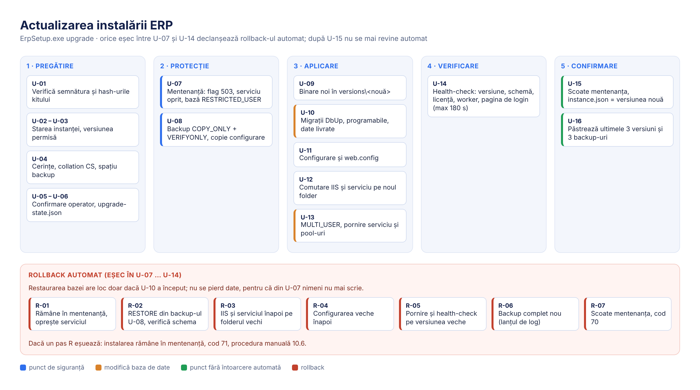

# ERP · 08 Instalare și actualizare (installer)

14 noiembrie 2026 · Aurelian · **Validat (14.11.2026)** · Documente legate: [Bune practici](../bune-practici/BUNE_PRACTICI.md), [02.01 Nucleu](../02-module-principale/01-nucleu/NUCLEU.md), [schița](../00-schita/ARHITECTURA_ERP.md)

Acest document descrie complet installer-ul ERP-ului: ce instalează, în ce ordine, cu ce comenzi SQL și Windows, cum actualizează o instalare existentă și cum revine automat la versiunea anterioară când ceva nu merge. E scris ca specificație de implementare: un agent de cod (GitHub Copilot, Claude Code) trebuie să poată construi installer-ul doar din acest document, fără alt context. Unde un document existent conține deja o regulă, regula e rezumată aici și referită prin identificator.

Decizii ale lui Aurelian (14.11.2026) încorporate aici și în documentele legate:

1. **Baza de date a clientului este case sensitive** (collation `Latin1_General_100_CS_AS_SC_UTF8`, secțiunea 9). Regulile noi sunt `SQL-21`–`SQL-25` în Bune practici.
2. **Instalarea creează un utilizator cu drepturi de Administrator** (secțiunea 8.8), cu care se face prima autentificare și asistentul de configurare.
3. **Autentificare simplă, fără server de identitate separat:** ASP.NET Core Identity cu cookie, direct în `Erp.Host` (secțiunea 8.7). Fără Duende IdentityServer (costuri de licență) și fără OpenIddict (nu e necesar pentru o singură aplicație web).

---

## 0. Cum folosește un agent de cod acest document

Citește tot documentul înainte de a scrie cod. Regulile de mai jos au prioritate față de orice obișnuință a agentului.

### 0.1 Reguli fixe (nu se schimbă fără acordul scris al lui Aurelian)

| # | Regulă |
| --- | --- |
| R1 | Installer-ul este o aplicație consolă .NET 10 (`ErpSetup.exe`), publicată self-contained, single-file, `win-x64`. **Nu** MSI, **nu** WiX, **nu** InstallShield, **nu** scripturi PowerShell ca logică principală. |
| R2 | Accesul la date: **Dapper + SQL parametrizat sau proceduri stocate**. **Fără Entity Framework Core sau alt ORM**, nici în installer, nici în autentificare (store-urile ASP.NET Core Identity se implementează cu Dapper, secțiunea 8.7). **Fără Duende IdentityServer, fără OpenIddict**, fără altă componentă cu licență plătită (deciziile lui Aurelian, 14.11.2026). |
| R3 | Migrațiile bazei: **DbUp**, scripturi `.sql` (regulile `MIG-01`–`MIG-07`). Fără migrații generate de cod. |
| R4 | Baza de date se creează cu collation **`Latin1_General_100_CS_AS_SC_UTF8`** (case sensitive, accent sensitive). Orice nume de obiect, coloană, parametru sau valoare de cod se scrie exact cu majusculele din declarație (`SQL-21`–`SQL-25`). |
| R5 | La instalarea nouă se creează **exact un** utilizator Administrator (secțiunea 8.8). La actualizare și reparare **nu** se creează și nu se modifică niciun utilizator. |
| R6 | Niciun secret (parole, chei, conținutul licenței, certificate) nu apare în jurnale, în fișiere necriptate, în argumentele din linia de comandă sau în mesajele de eroare (`SEC-02`, `NET-18`). Singura excepție controlată: parola temporară a administratorului, afișată o singură dată pe ecran (secțiunea 8.8). |
| R7 | Installer-ul nu șterge niciodată o bază de date și nu suprascrie o bază existentă la instalarea nouă. Dezinstalarea păstrează baza și backup-urile. |
| R8 | Orice pas este **idempotent**: rulat a doua oară, nu dublează nimic și nu strică nimic. |
| R9 | Textele pentru utilizator sunt în română; identificatorii din cod și din SQL sunt în engleză (`NET-19`). |
| R10 | Nimic din acest document nu se „simplifică” tăcut. Dacă un pas pare imposibil, agentul se oprește și întreabă, nu înlocuiește soluția. |

### 0.2 Ordinea de lucru recomandată

Implementarea se face pe sarcinile din secțiunea 15, în ordine, câte un pull request pe sarcină (`GIT-01`–`GIT-04`). Fiecare sarcină are criteriile ei de terminare și testele din secțiunea 14.

### 0.3 Text de pus în depozit pentru agenți

Regulile comune pentru agenți sunt menținute o singură dată în [AGENTS.md](../../../AGENTS.md). Fișierele [CLAUDE.md](../../../CLAUDE.md) și [copilot-instructions.md](../../../.github/copilot-instructions.md) trimit la acestea.

Pentru installer se folosesc [instrucțiunile dedicate](../../../.github/instructions/installer.instructions.md) și skill-ul [erp-installer](../../../.github/skills/erp-installer/SKILL.md); descoperirea și utilizarea sunt descrise în [ghidul configurărilor](../../../.github/README.md).

Încărcarea selectivă reduce consumul de tokeni, dar **nu înlocuiește citirea integrală a acestui document înainte de implementarea installer-ului**, cerută în secțiunea 0. Regulile R1–R10 și criteriile de acceptare rămân neschimbate.

---

## 1. Context minim (ca documentul să fie autonom)

**Produsul.** ERP românesc licențiat, vândut companiilor medii și mari, instalat **on-premise** pe serverul fiecărui client. O instalare servește un grup de firme și are **o singură bază SQL Server**; firmele sunt separate prin `CompanyId`. Echipa e mică (Aurelian + Claude), deci installer-ul trebuie să facă totul singur, fără pași manuali în SQL (principiul P9 din 01).

| Strat | Tehnologie |
| --- | --- |
| Server | Windows Server 2019, 2022 sau 2025, IIS 10 |
| Runtime | .NET 10 (LTS), ASP.NET Core Hosting Bundle 10.x |
| Aplicație | Monolit modular: un host ASP.NET Core (`Erp.Host`) cu API-ul și interfața React (fișiere statice în `wwwroot`) |
| Autentificare | **ASP.NET Core Identity** (gratuit, parte din .NET) cu **cookie**, în aceeași aplicație `Erp.Host` (paginile `/account/*`); chei API pentru conturile tehnice; autentificare Windows opțională pentru Active Directory; date în schema `ids` din aceeași bază |
| Lucru în fundal | Serviciu Windows (`Erp.Worker`): Hangfire (stocare în schema `hangfire`), procesatorul de outbox, joburile zilnice |
| Bază de date | SQL Server 2022 sau mai nou, Standard sau Enterprise (licența clientului); o schemă per modul |
| Acces date | Dapper + proceduri stocate, fără ORM |
| Migrații | DbUp, scripturi SQL versionate |
| Licență | Fișier semnat digital: modulele active, CUI-urile grupului, limitele, data de expirare; verificat local, fără internet |
| Backup | Joburi SQL Server Agent create de installer |

**Schemele bazei** (`SQL-01`): `core`, `ids`, `fin`, `sales`, `purch`, `inv`, `intg`, `wms`, `tms`, `mfg`, `hr`, `pos`, `cons`, `crm`, `rpt`, plus schema tehnică `hangfire`. Nimic în `dbo`.

**Cine rulează installer-ul:** echipa noastră de la distanță (VPN, TeamViewer) sau IT-ul clientului, după ghid. Persoana trebuie să fie administrator local pe serverul de aplicație și să aibă pe SQL Server drepturi de `sysadmin` (sau cel puțin `dbcreator` + `securityadmin`) **doar pe durata instalării sau actualizării**.

---

## 2. Perimetru

| Installer-ul face | Installer-ul NU face |
| --- | --- |
| Verifică serverul (cerințe, versiuni, spațiu, certificat, acces SQL) | Nu instalează Windows, IIS (doar activează rolurile, cu acordul operatorului) sau SQL Server |
| Instalează .NET Hosting Bundle din kit, dacă lipsește | Nu emite licențe (instrument intern separat) |
| Creează baza (case sensitive), schemele, loginurile, rolurile SQL | Nu configurează firmele, AD, SMTP, certificatul ANAF (le face asistentul din browser, 02.01 secțiunea 11.2) |
| Rulează migrațiile, obiectele programabile și datele livrate | Nu migrează date din alte ERP-uri |
| Creează utilizatorul Administrator inițial | Nu instalează casele POS (installer separat, secțiunea 13) |
| Creează site-ul IIS, pool-ul, serviciul Windows, regulile de firewall | Nu face backup în afara serverului (copierea externă e responsabilitatea clientului) |
| Încarcă licența | Nu deschide porturi spre internet |
| Creează joburile de backup și mentenanță SQL Agent, face primul backup | |
| Actualizează o instalare existentă, cu rollback automat | |
| Repară o instalare, resetează accesul administratorului, dezinstalează, produce pachet de diagnostic | |

---

## 3. Topologia pe serverul clientului

### 3.1 Componente

| Componentă | Ce este | Rulează ca | Unde |
| --- | --- | --- | --- |
| Site IIS `ERP-<Instanță>` | Legare HTTPS pe 443 (și HTTP 80 doar pentru redirect) | — | Serverul de aplicație |
| Aplicația rădăcină `/` | `Erp.Host` (API sub `/api`, interfața React, paginile de autentificare `/account/*`, `/health`) | Pool `ERP-<Instanță>-Host` | Idem |
| Serviciul `ErpWorker-<Instanță>` | `Erp.Worker`: Hangfire server, outbox, joburi | Cont virtual `NT SERVICE\ErpWorker-<Instanță>` | Idem |
| Baza `<NumeBază>` | Toate schemele | — | SQL Server (local sau alt server) |
| Joburi SQL Agent | Backup complet, backup log, curățare, verificare integritate, mentenanță indecși | Contul SQL Agent | SQL Server |

**Instanța** (`Instance`, implicit `PROD`) permite mai multe instalări pe același server (de exemplu `PROD` și `TEST`). Numele instanței: 2–10 caractere, `^[A-Z][A-Z0-9]{1,9}$`. Toate numele de mai jos îl conțin.

### 3.2 Căi pe disc

| Cale | Conținut | Drepturi NTFS |
| --- | --- | --- |
| `C:\Program Files\Erp\<Instanță>\versions\<Versiune>\host\` | Binarele `Erp.Host` | Citire: pool Host; scriere: Administrators, SYSTEM |
| `...\versions\<Versiune>\worker\` | Binarele `Erp.Worker` | Citire: contul serviciului |
| `C:\ProgramData\Erp\<Instanță>\instance.json` | Starea instalării (secțiunea 6.5) | Citire: pool-ul Host și serviciul; scriere: Administrators, SYSTEM |
| `C:\ProgramData\Erp\<Instanță>\config\appsettings.Installation.json` | Configurarea fără secrete | Citire: pool-ul Host și serviciul |
| `C:\ProgramData\Erp\<Instanță>\config\secrets.app.bin` | Secretele aplicației, criptate DPAPI | Citire: pool-ul Host și serviciul |
| `C:\ProgramData\Erp\<Instanță>\license\erp.lic` | Fișierul de licență | Citire: pool-ul Host și serviciul |
| `C:\ProgramData\Erp\<Instanță>\keys\` | Cheile ASP.NET Core Data Protection (criptate DPAPI) | Citire și scriere: pool-ul Host |
| `C:\ProgramData\Erp\<Instanță>\logs\{host,worker,setup}\` | Jurnale Serilog, rotite zilnic, păstrate 30 de zile | Scriere: identitatea componentei |
| `C:\ProgramData\Erp\<Instanță>\maintenance\maintenance.flag` | Existența fișierului pune aplicația în mentenanță (secțiunea 10.4) | Citire: pool-ul Host și serviciul |
| `C:\ProgramData\Erp\<Instanță>\upgrade\` | Jurnalul pașilor de actualizare (`upgrade-state.json`) | Administrators, SYSTEM |
| `<BackupRoot>\<NumeBază>\{FULL,LOG,UPGRADE}\` | Fișierele de backup | Scriere: contul serviciului SQL Server |

`InstallRoot` (`C:\Program Files\Erp`) și `DataRoot` (`C:\ProgramData\Erp`) sunt configurabile în fișierul de răspunsuri; `BackupRoot` e obligatoriu și e o cale **pe serverul SQL**.

Binarele stau în foldere pe versiune (`versions\2027.1.0\`), nu se suprascriu. Trecerea la o versiune nouă înseamnă schimbarea căii fizice în IIS și în serviciu; revenirea înseamnă schimbarea ei înapoi. Se păstrează ultimele **3** versiuni; cele mai vechi se șterg la finalul unei actualizări reușite.

### 3.3 Conturi și loginuri

| Cont | Tip | Drepturi | Folosit de |
| --- | --- | --- | --- |
| Operatorul care rulează installer-ul | Windows (administrator local) + SQL `sysadmin` sau `dbcreator`+`securityadmin` | Doar pe durata rulării; parola SQL (dacă e autentificare SQL) se cere interactiv și nu se salvează | Pașii de creare bază, loginuri, joburi |
| `erp_<instanță>_mig` (de ex. `erp_prod_mig`) | Login SQL, parolă nouă de 32 de caractere la fiecare rulare, nesalvată | `db_owner` doar pe baza ERP; fără drepturi pe server; **dezactivat** între rulările installer-ului (8.4) | Migrațiile DbUp la instalare și actualizare (`SP-19`) |
| `erp_<instanță>_app` | Login SQL, parolă generată de 32 de caractere | Membru în rolurile de bază `role_core`, `role_ids`, `role_fin`, …, `role_hangfire`; **fără** `db_owner` (`SP-19`) | Host, Identity, Worker |
| Pool-ul IIS | `IIS AppPool\ERP-<Instanță>-Host` | Drepturile NTFS din 3.2 | IIS |
| Serviciul | `NT SERVICE\ErpWorker-<Instanță>` | Drepturile NTFS din 3.2 | Worker |

Opțiune (`Sql.AppAuthentication = "Windows"`): în loc de loginul SQL `erp_<instanță>_app`, aplicația folosește un cont de domeniu sau un gMSA dat de client (`Sql.AppWindowsAccount`, de exemplu `CONTOSO\svc-erp$`). Atunci pool-urile și serviciul rulează sub acel cont, iar loginul SQL se creează `FROM WINDOWS`. Implicit e autentificarea SQL, pentru că merge identic la toți clienții.

### 3.4 Rețea

| Direcție | Port | Scop |
| --- | --- | --- |
| Utilizatori → server aplicație | 443 (HTTPS) | Aplicația și autentificarea |
| Utilizatori → server aplicație | 80 (opțional) | Doar redirect spre HTTPS |
| Server aplicație → SQL Server | 1433 (sau portul instanței) | Baza de date |
| Server aplicație → internet | 443 ieșire | ANAF (`api.anaf.ro`, `logincert.anaf.ro`, `webservicesp.anaf.ro`), BNR (`www.bnr.ro`) |
| Internet → server | **niciunul** | — |

Installer-ul creează regula de firewall Windows `ERP <Instanță> HTTPS` (intrare, TCP 443, profilurile Domain și Private) și, dacă e cerut redirectul, `ERP <Instanță> HTTP` pe 80.

---

## 4. Kitul de instalare

### 4.1 Conținut

Kitul e un fișier ZIP: `ERP-<Versiune>-kit.zip` (de exemplu `ERP-2027.1.0-kit.zip`), dezarhivat de operator într-un folder local.

```
ERP-2027.1.0-kit/
├── ErpSetup.exe                         installer-ul (self-contained, semnat Authenticode)
├── manifest.json                        versiunea, compatibilitatea, lista fișierelor cu SHA-256
├── manifest.sig                         semnătura manifestului
├── app/
│   ├── host/                            Erp.Host publicat (framework-dependent, net10.0, win-x64)
│   └── worker/                          Erp.Worker publicat
├── database/
│   ├── bootstrap/                       scripturi rulate înainte de DbUp (scheme, roluri) – secțiunea 8.5
│   ├── migrations/<modul>/              scripturi rulate o singură dată (MIG-01)
│   ├── programmability/<modul>/         proceduri, view-uri, funcții, rulate la fiecare instalare/actualizare (MIG-04)
│   └── seed/<modul>/                    date livrate, MERGE idempotent (MIG-06)
├── prerequisites/
│   └── dotnet-hosting-10.0.<x>-win.exe  ASP.NET Core Hosting Bundle (versiunea fixată la build)
├── templates/
│   ├── appsettings.Installation.json    șablonul configurării (secțiunea 8.10)
│   ├── maintenance.html                 pagina „Actualizare în curs”
│   └── answers.example.json             exemplu de fișier de răspunsuri
├── THIRD-PARTY-NOTICES.txt
└── CITESTE-MA.txt                       comenzile de bază, în română
```

### 4.2 `manifest.json`

```json
{
  "product": "ERP",
  "version": "2027.1.0",
  "releaseDate": "2027-01-20",
  "minUpgradeFrom": "2026.2.0",
  "minSqlServerMajorVersion": 16,
  "sqlCompatibilityLevel": 160,
  "databaseCollation": "Latin1_General_100_CS_AS_SC_UTF8",
  "hostingBundleVersion": "10.0.3",
  "lastMigration": "core/2027.01.004_Add_User_IsSystem.sql",
  "files": [
    { "path": "app/host/Erp.Host.dll", "sha256": "9f2c…", "size": 1048576 },
    { "path": "database/migrations/core/2026.11.001_Create_Company.sql", "sha256": "a17b…", "size": 4120 }
  ]
}
```

| Câmp | Folosire |
| --- | --- |
| `version` | Versiunea semantică a produsului `AAAA.L.patch` (`GIT-05`) |
| `minUpgradeFrom` | Cea mai veche versiune din care se poate actualiza direct (regula: versiunile din ultimele 12 luni). Calculat la build |
| `minSqlServerMajorVersion` | 16 = SQL Server 2022 |
| `databaseCollation` | Collation-ul cerut; verificat la instalare și la fiecare actualizare |
| `lastMigration` | Ultimul script de migrare din kit; aplicația îl compară la pornire cu `core.SchemaVersion` (secțiunea 10.5) |
| `files` | **Toate** fișierele kitului în afară de `manifest.json` și `manifest.sig`, cu SHA-256 (hex, litere mici) |

### 4.3 Semnare și verificare

1. La build, toate `.exe` și `.dll` proprii se semnează Authenticode cu certificatul de semnare a codului al produsului (cu marcaj de timp RFC 3161).
2. `manifest.sig` = semnătura **ECDSA P-256 cu SHA-256** peste octeții exacți ai `manifest.json`, cu cheia privată de semnare a kitului (ținută în afara depozitului, `SEC-02`). Cheia de semnare a kitului e **diferită** de cheia de semnare a licențelor. Fișierul conține Base64 al semnăturii în format IEEE P1363 (`r||s`, 64 de octeți).
3. `ErpSetup.exe` conține cheia publică a kitului (resursă încorporată). Înainte de orice altă acțiune:
   - verifică semnătura `manifest.sig`; la eșec → cod de ieșire 20, mesaj „Kitul nu este semnat de producător sau a fost modificat.”;
   - verifică SHA-256 pentru fiecare fișier din `files`; un fișier lipsă, în plus (în afara listei, cu excepția `ErpSetup.exe` care e verificat prin Authenticode) sau cu hash diferit → cod 21;
   - verifică semnătura Authenticode a propriului executabil (`WinVerifyTrust`); în build-urile de dezvoltare verificarea se poate sări doar cu `--dev-skip-signature`, opțiune compilată numai în configurația `Debug`.

---

## 5. Structura soluției în depozit

Totul stă în monorepo (`GIT-01`):

```
src/
├── Setup/
│   ├── Erp.Setup/                      Program.cs, comenzile CLI (System.CommandLine), interacțiunea cu operatorul
│   │   └── Kit/                        fișierele din rădăcina kitului: templates/, CITESTE-MA.txt, THIRD-PARTY-NOTICES.txt
│   ├── Erp.Setup.Core/                 pașii (IInstallStep), orchestratorul, verificările, starea
│   ├── Erp.Setup.Windows/              IIS (Microsoft.Web.Administration), servicii, firewall, ACL, DPAPI, certificate
│   ├── Erp.Setup.Sql/                  conexiuni, scripturile de bază/loginuri/joburi, runner-ul DbUp
│   │   └── Database/Bootstrap/         sursa pentru database/bootstrap/ din kit (8.3)
│   └── Erp.Setup.Tests/                teste unitare și de integrare (Testcontainers SQL Server)
├── Shared/
│   ├── Erp.Licensing/                  citirea și verificarea licenței (folosit de installer și de Erp.Host)
│   ├── Erp.Configuration/              citirea appsettings.Installation.json și a secretelor DPAPI (folosit de toate)
│   ├── Erp.Security.Passwords/         PasswordHasher compatibil ASP.NET Core Identity V3 (folosit de installer și Erp.Auth)
│   └── Erp.Hosting/                    health-check, mentenanță, protecția de versiune (folosit de Erp.Host și Erp.Worker)
├── Host/Erp.Host/
├── Auth/Erp.Auth/                      bibliotecă: store-uri Dapper Identity, paginile /account, chei API (folosită de Erp.Host)
│   └── Database/                       scripturile schemei ids (aceeași structură ca la module)
├── Worker/Erp.Worker/
│   └── Database/                       scripturile schemei hangfire (aceeași structură ca la module)
└── Modules/<Modul>/Erp.<Modul>.Infrastructure/Database/
    ├── Migrations/<AAAA.MM.NNN>_<Descriere>.sql
    ├── Programmability/{Functions,Views,Procedures}/<obiect>.sql
    └── Seed/<NN>_<Descriere>.sql
build/
├── package-kit.ps1                     compilează, publică, copiază scripturile, generează și semnează manifestul
├── KitBuilder.psm1                     verificările scripturilor, ordinea migrațiilor, manifestul (folosit de package-kit.ps1)
├── tests/                              teste Pester pentru KitBuilder.psm1
└── kit-signing/README.md               unde stă cheia de semnare (nu în Git)
```

Maparea folderului de modul spre folderul din kit (= schema, numele din jurnalul DbUp): `Core`→`core`, `Finance`→`fin`, `Sales`→`sales`, `Purchasing`→`purch`, `Inventory`→`inv`, `Integrations`→`intg`, `Wms`→`wms`, `Tms`→`tms`, `Manufacturing`→`mfg`, `Hr`→`hr`, `Pos`→`pos`, `Construction`→`cons`, `Crm`→`crm`, `Reporting`→`rpt`; `src/Auth/Erp.Auth/Database`→`ids`; `src/Worker/Erp.Worker/Database`→`hangfire`. Un folder `src/Modules/<Modul>` cu `Database/` fără mapare oprește build-ul kitului (decizie Aurelian, 15.11.2026).

Testele .NET rulează cu Microsoft.Testing.Platform (`global.json`): `dotnet test --solution Erp.slnx --filter-not-trait "Category=Integration"` pentru testele unitare; testele de integrare SQL (`[Trait("Category", "Integration")]`, Testcontainers, necesită Docker) cu `--filter-trait "Category=Integration"`. CI-ul (`.github/workflows/ci.yml`) compilează, rulează testele Pester, generează un kit de test (`package-kit.ps1 -TestKit`) și îl verifică cu verificatorul installer-ului pe Windows, iar testele de integrare SQL pe Ubuntu.

Pachete NuGet folosite de installer (versiuni fixate în `Directory.Packages.props`): `System.CommandLine`, `dbup-sqlserver`, `Microsoft.Data.SqlClient`, `Dapper`, `Microsoft.Web.Administration`, `Serilog` (+ `Serilog.Sinks.File`, `Serilog.Sinks.Console`), `System.Security.Cryptography.ProtectedData`. Interzis: `Microsoft.EntityFrameworkCore*`, `OpenIddict.EntityFrameworkCore*`, `Microsoft.AspNetCore.Identity.EntityFrameworkCore`, `Duende.*` (licență plătită), `OpenIddict.*` (nu e necesar, decizia din 14.11.2026).

`Erp.Setup.Core` definește:

```csharp
public interface IInstallStep
{
    string Id { get; }                       // de ex. "I-07"
    string Title { get; }                    // text în română, afișat operatorului
    Task<StepResult> ExecuteAsync(SetupContext context, CancellationToken ct);
    Task CompensateAsync(SetupContext context, CancellationToken ct);   // folosit doar la actualizare (secțiunea 10.3)
}

public sealed record StepResult(StepOutcome Outcome, string? Message = null);
public enum StepOutcome { Done = 1, Skipped = 2, Warning = 3, Failed = 4 }
```

Orchestratorul rulează pașii în ordine, scrie fiecare început și sfârșit de pas în jurnal și în `instance.json` / `upgrade-state.json`, și se oprește la primul `Failed`.

---

## 6. Interfața installer-ului

### 6.1 Comenzi

```
ErpSetup.exe check      --answers <fișier>                  verifică doar cerințele (nu modifică nimic)
ErpSetup.exe install    --answers <fișier> [--unattended]   instalare nouă
ErpSetup.exe upgrade    --instance <INSTANȚĂ> [--unattended] actualizare cu kitul curent
ErpSetup.exe repair     --instance <INSTANȚĂ>               refacere IIS, serviciu, configurare, drepturi, programabile
ErpSetup.exe reset-admin --instance <INSTANȚĂ> [--user <nume>]  acces de urgență pentru administrator
ErpSetup.exe rollback   --instance <INSTANȚĂ>               revenire manuală la o actualizare întreruptă
ErpSetup.exe uninstall  --instance <INSTANȚĂ>               elimină site, serviciu, binare; păstrează baza
ErpSetup.exe diagnose   --instance <INSTANȚĂ>               pachet ZIP de diagnostic, fără secrete
ErpSetup.exe status     --instance <INSTANȚĂ>               versiune, stare, ultimul backup, starea health-check
```

Opțiuni comune: `--log-level <Information|Debug>`, `--yes` (răspunde „da” la confirmările care nu sunt distructive), `--no-color`. Fără `--unattended`, installer-ul afișează rezumatul și cere confirmare înainte de primul pas care modifică ceva.

Installer-ul cere drepturi de administrator (manifestul aplicației are `requireAdministrator`). Rulează numai pe Windows; pe alt sistem iese cu codul 10.

### 6.2 Fișierul de răspunsuri

Fișierul nu conține **niciodată** parole. Parolele se cer interactiv (cu ecou ascuns) sau, în modul `--unattended`, se citesc din variabilele de mediu din 6.3.

```json
{
  "instance": "PROD",
  "installRoot": "C:\\Program Files\\Erp",
  "dataRoot": "C:\\ProgramData\\Erp",
  "site": {
    "hostName": "erp.grupulexemplu.local",
    "httpsPort": 443,
    "httpRedirect": true,
    "certificateThumbprint": "3F2A9C...E1",
    "allowSelfSignedCertificate": false
  },
  "sql": {
    "server": "SQL01\\ERP",
    "databaseName": "ERP_PROD",
    "operatorAuthentication": "Windows",
    "operatorSqlLogin": null,
    "appAuthentication": "Sql",
    "appWindowsAccount": null,
    "dataFilePath": "D:\\SQLData",
    "logFilePath": "L:\\SQLLog",
    "initialDataSizeMb": 1024,
    "initialLogSizeMb": 512,
    "encrypt": "Mandatory",
    "trustServerCertificate": false
  },
  "backup": {
    "backupRoot": "B:\\SQLBackup",
    "fullBackupTime": "01:00",
    "logBackupEveryMinutes": 15,
    "retentionDays": 14,
    "integrityCheckDay": "Sunday",
    "integrityCheckTime": "03:00"
  },
  "license": {
    "filePath": "C:\\Kit\\grupul-exemplu.lic"
  },
  "administrator": {
    "userName": "administrator",
    "displayName": "Administrator ERP",
    "email": "it@grupulexemplu.ro"
  },
  "prerequisites": {
    "installIisFeatures": true,
    "installHostingBundle": true
  }
}
```

| Câmp | Obligatoriu | Validare | Implicit |
| --- | --- | --- | --- |
| `instance` | Nu | `^[A-Z][A-Z0-9]{1,9}$` | `PROD` |
| `installRoot`, `dataRoot` | Nu | Cale absolută locală, nu UNC, nu rădăcina unui disc | `C:\Program Files\Erp`, `C:\ProgramData\Erp` |
| `site.hostName` | Da | Nume DNS valid; trebuie să apară în certificat (CN sau SAN) | — |
| `site.httpsPort` | Nu | 1–65535, liber sau folosit doar de acest site | 443 |
| `site.httpRedirect` | Nu | — | `true` |
| `site.certificateThumbprint` | Da, dacă `allowSelfSignedCertificate` e `false` | Certificat din `LocalMachine\My`, cu cheie privată, valabil cel puțin 30 de zile, EKU Server Authentication | — |
| `site.allowSelfSignedCertificate` | Nu | Dacă e `true` și nu există amprentă, installer-ul generează un certificat autosemnat valabil 1 an și afișează avertisment (doar pentru test) | `false` |
| `sql.server` | Da | `server`, `server\instanță` sau `server,port` | — |
| `sql.databaseName` | Nu | `^[A-Za-z][A-Za-z0-9_]{2,63}$` | `ERP_<instance>` |
| `sql.operatorAuthentication` | Nu | `Windows` sau `Sql` | `Windows` |
| `sql.operatorSqlLogin` | Da, dacă `operatorAuthentication = Sql` | — | — |
| `sql.appAuthentication` | Nu | `Sql` sau `Windows` | `Sql` |
| `sql.appWindowsAccount` | Da, dacă `appAuthentication = Windows` | `DOMENIU\cont` sau `DOMENIU\gmsa$` | — |
| `sql.dataFilePath`, `sql.logFilePath` | Nu | Căi pe serverul SQL | Căile implicite ale instanței (`SERVERPROPERTY('InstanceDefaultDataPath')`, `...LogPath`) |
| `sql.initialDataSizeMb`, `sql.initialLogSizeMb` | Nu | ≥ 256 | 1024, 512 |
| `sql.encrypt` | Nu | `Mandatory`, `Strict`, `Optional` | `Mandatory` |
| `sql.trustServerCertificate` | Nu | Dacă SQL Server nu are certificat de încredere, `true` e permis doar cu avertisment | `false` |
| `backup.backupRoot` | Da | Cale pe serverul SQL; de preferat alt disc decât datele (avertisment dacă e același) | — |
| `backup.fullBackupTime` | Nu | `HH:mm` | `01:00` |
| `backup.logBackupEveryMinutes` | Nu | 5–60 | 15 (RPO 15 min din 01) |
| `backup.retentionDays` | Nu | 3–90 | 14 |
| `backup.integrityCheckDay`, `integrityCheckTime` | Nu | zi a săptămânii, `HH:mm` | `Sunday`, `03:00` |
| `license.filePath` | Da | Fișier existent, semnătură validă (secțiunea 8.9) | — |
| `administrator.userName` | Nu | `^[a-z][a-z0-9._-]{2,49}$` (doar litere mici, secțiunea 9.3) | `administrator` |
| `administrator.displayName` | Nu | 1–200 caractere | `Administrator ERP` |
| `administrator.email` | Nu | Adresă de email validă; necesară pentru resetarea parolei prin email | `null` |
| `prerequisites.installIisFeatures` | Nu | Dacă e `false` și lipsesc roluri IIS → eroare | `true` |
| `prerequisites.installHostingBundle` | Nu | Idem pentru Hosting Bundle | `true` |

### 6.3 Variabile de mediu pentru modul `--unattended`

| Variabilă | Când e necesară |
| --- | --- |
| `ERP_SQL_OPERATOR_PASSWORD` | `operatorAuthentication = Sql` |
| `ERP_ADMIN_INITIAL_PASSWORD` | Opțional; dacă lipsește, parola se generează (secțiunea 8.8) |

Installer-ul citește variabila, o folosește și nu o scrie nicăieri. Recomandarea din `CITESTE-MA.txt`: variabila se setează doar în sesiunea curentă (`$env:ERP_SQL_OPERATOR_PASSWORD = Read-Host -AsSecureString ...`), nu la nivel de sistem.

### 6.4 Coduri de ieșire

| Cod | Sens |
| --- | --- |
| 0 | Reușit |
| 1 | Reușit cu avertismente (detaliate în jurnal și pe ecran) |
| 2 | Anulat de operator |
| 3 | Linie de comandă invalidă: comandă sau opțiune necunoscută, opțiune obligatorie lipsă, valoare invalidă (decizie Aurelian, 15.11.2026) |
| 10 | Sistem de operare nesuportat sau installer rulat fără drepturi de administrator |
| 11 | Fișier de răspunsuri invalid (lista erorilor pe câmp) |
| 12 | Cerințe neîndeplinite (lista din secțiunea 7) |
| 20 | Semnătura kitului invalidă |
| 21 | Fișiere din kit lipsă sau modificate |
| 30 | Eroare SQL la instalare (baza nu a fost creată sau e incompletă) |
| 31 | Baza există deja și nu e goală (instalare nouă refuzată, R7) |
| 32 | Collation greșit pe o bază existentă |
| 40 | Licență invalidă |
| 50 | Eroare IIS / serviciu / fișiere |
| 60 | Health-check eșuat după instalare |
| 70 | Actualizare eșuată, rollback reușit: instalarea a rămas pe versiunea anterioară, funcțională |
| 71 | Actualizare eșuată, **rollback eșuat**: instalarea e în mentenanță, intervenție manuală necesară (secțiunea 10.6) |
| 72 | Versiune nesuportată pentru actualizare (prea veche sau mai nouă decât kitul) |
| 73 | O actualizare anterioară e neterminată; rulați `rollback` sau reluați `upgrade` |

### 6.5 `instance.json`

Starea instalării, scrisă de installer după fiecare pas reușit, citită de `upgrade`, `repair`, `status`, `uninstall`.

```json
{
  "instance": "PROD",
  "product": "ERP",
  "currentVersion": "2027.1.0",
  "previousVersions": ["2026.4.2", "2026.3.1"],
  "state": "Installed",
  "installedAt": "2026-11-20T09:14:03Z",
  "lastUpgradeAt": "2027-01-25T19:02:41Z",
  "installRoot": "C:\\Program Files\\Erp",
  "dataRoot": "C:\\ProgramData\\Erp",
  "siteName": "ERP-PROD",
  "hostName": "erp.grupulexemplu.local",
  "httpsPort": 443,
  "serviceName": "ErpWorker-PROD",
  "sqlServer": "SQL01\\ERP",
  "databaseName": "ERP_PROD",
  "appAuthentication": "Sql",
  "appLogin": "erp_prod_app",
  "migratorLogin": "erp_prod_mig",
  "backupRoot": "B:\\SQLBackup",
  "completedSteps": ["I-01", "I-02", "I-03"]
}
```

`state` ia valorile: `Installing`, `Installed`, `Upgrading`, `RollingBack`, `Maintenance`, `Failed`. Fișierul nu conține secrete.

### 6.6 Afișare și jurnal

- Pe ecran: fiecare pas pe un rând `[I-07] Rulez migrațiile bazei de date... OK (42 scripturi, 18 s)`; avertismentele în galben, erorile în roșu, cu acțiunea recomandată.
- Jurnal: `C:\ProgramData\Erp\<Instanță>\logs\setup\setup-<AAAAMMZZ-HHmmss>.log` (Serilog, text, UTC), plus copie JSON (`.clef`) pentru `diagnose`. Înainte de a exista `DataRoot`, jurnalul se scrie în `%TEMP%\ErpSetup\` și se mută la final.
- Fiecare comandă SQL executată de installer se jurnalizează cu numele scriptului și durata, **fără** textul parolelor (comenzile `CREATE LOGIN` / `ALTER LOGIN` se jurnalizează doar ca „Creare login erp_prod_app”).

---

## 7. Verificarea cerințelor

Comanda `check` rulează doar aceste verificări; `install` și `upgrade` le rulează ca prim pas. Un rezultat **Blocant** oprește execuția (cod 12); un **Avertisment** se afișează și se cere confirmare (în `--unattended` se continuă și se raportează cod 1 la final).

| ID | Verificare | Cum se verifică | Nivel |
| --- | --- | --- | --- |
| C-01 | Rulează ca administrator | `WindowsPrincipal.IsInRole(WindowsBuiltInRole.Administrator)` | Blocant |
| C-02 | Windows Server 2019 (build 17763), 2022 (20348) sau 2025 (26100), 64 de biți | `RtlGetVersion` + `ProductType` din registru (`HKLM\SYSTEM\CurrentControlSet\Control\ProductOptions`) ≠ `WinNT` | Blocant |
| C-03 | Procesor și memorie | ≥ 4 nuclee logice, ≥ 16 GB RAM (8 GB = avertisment, sub 8 GB = blocant) | Blocant / Avertisment |
| C-04 | Spațiu pe disc pentru `InstallRoot` și `DataRoot` | ≥ 5 GB liberi (`DriveInfo.AvailableFreeSpace`) | Blocant |
| C-05 | Roluri IIS | Funcțiile `Web-Server`, `Web-WebServer`, `Web-Static-Content`, `Web-Default-Doc`, `Web-Http-Errors`, `Web-Http-Logging`, `Web-Stat-Compression`, `Web-Dyn-Compression`, `Web-Filtering`, `Web-Windows-Auth`, `Web-WebSockets`, `Web-Mgmt-Console` (interogare `Win32_ServerFeature` / `Get-WindowsFeature`). Dacă lipsesc și `installIisFeatures = true`: `Install-WindowsFeature` cu lista de mai sus, după confirmare. Dacă instalarea cere repornire → cod 12 cu mesaj „Reporniți serverul și rulați din nou.” | Blocant |
| C-06 | ASP.NET Core Hosting Bundle ≥ `hostingBundleVersion` din manifest | Existența `%ProgramFiles%\dotnet\shared\Microsoft.AspNetCore.App\10.0.*` cu versiune ≥ cerută și a modulului `%windir%\System32\inetsrv\aspnetcorev2.dll`. Dacă lipsește și `installHostingBundle = true`: rulează `prerequisites\dotnet-hosting-*.exe /install /quiet /norestart`, apoi `iisreset /restart` | Blocant |
| C-07 | Certificat HTTPS | Există în `LocalMachine\My`, are cheie privată, `NotAfter` > azi + 30 zile (între 0 și 30 de zile = avertisment), conține `hostName` în SAN sau CN, EKU 1.3.6.1.5.5.7.3.1 | Blocant |
| C-08 | Port HTTPS liber | Nicio legare IIS existentă pe `*:<port>` cu alt nume de gazdă decât cel cerut, care să nu aparțină acestei instanțe; `netsh http show sslcert` fără conflict | Blocant |
| C-09 | Conexiune SQL | Deschide conexiune la `master` cu credențialele operatorului, timeout 15 s, cu `Encrypt` din configurare | Blocant |
| C-10 | Versiune SQL Server | `SERVERPROPERTY('ProductMajorVersion')` ≥ `minSqlServerMajorVersion` (16) | Blocant |
| C-11 | Ediție SQL Server | `SERVERPROPERTY('EngineEdition')`: 2 (Standard) sau 3 (Enterprise / Developer) acceptate; 4 (Express) refuzat (fără SQL Agent); Developer (`SERVERPROPERTY('Edition')` conține „Developer”) → avertisment „doar pentru test” | Blocant |
| C-12 | Drepturile operatorului | `IS_SRVROLEMEMBER('sysadmin') = 1` sau (`dbcreator` și `securityadmin`) | Blocant |
| C-13 | SQL Server Agent pornit | `SELECT status_desc FROM sys.dm_server_services WHERE servicename LIKE N'SQL Server Agent%'` = `Running`; altfel blocant cu mesaj „Porniți SQL Server Agent și setați-l pe Automatic.” | Blocant |
| C-14 | Collation-ul serverului | `SERVERPROPERTY('Collation')`. Dacă nu e case sensitive (nu conține `_CS_`), avertisment informativ: baza va fi totuși `Latin1_General_100_CS_AS_SC_UTF8`; regula `SQL-23` (tabele temporare) devine critică | Avertisment |
| C-15 | Baza nu există (doar la `install`) | `DB_ID(@DatabaseName) IS NULL`. Dacă există și e goală (fără tabele utilizator), avertisment și se folosește după verificarea collation-ului (C-16); dacă are tabele → cod 31 | Blocant |
| C-16 | Collation-ul bazei existente (`upgrade`, `repair`, sau C-15 cu bază goală) | `DATABASEPROPERTYEX(@DatabaseName, 'Collation') = 'Latin1_General_100_CS_AS_SC_UTF8'`; altfel cod 32 | Blocant |
| C-17 | Căile SQL de date, log și backup | `EXEC master.dbo.xp_create_subdir @Path` pentru fiecare (creează folderul dacă lipsește, cu contul serviciului SQL) | Blocant |
| C-18 | Spațiu pe disc la SQL | `sys.dm_os_volume_stats` pe volumele căilor de date și backup: date ≥ 2 × `initialDataSizeMb`; la `upgrade`, backup ≥ 1,2 × dimensiunea bazei (`sys.master_files`) | Blocant |
| C-19 | Ceasul | Diferența dintre ora serverului de aplicație și `SYSUTCDATETIME()` de pe SQL < 2 minute (02.01, 4.6) | Avertisment |
| C-20 | Ieșire spre ANAF și BNR | `HEAD https://api.anaf.ro/` și `GET https://www.bnr.ro/nbrfxrates.xml`, timeout 10 s, prin proxy-ul sistemului | Avertisment |
| C-21 | TLS 1.2 activ | Registru `SCHANNEL\Protocols\TLS 1.2\Client` nu e dezactivat | Blocant |
| C-22 | Licența | Semnătura, produsul, data de expirare (secțiunea 8.9) | Blocant |
| C-23 | Nu există altă instanță cu același nume (doar `install`) | `C:\ProgramData\Erp\<Instanță>\instance.json` nu există; site-ul și serviciul cu acele nume nu există | Blocant |

Rezultatul se afișează ca tabel și se salvează în `logs\setup\check-<dată>.json` (dacă folderul instanței nu există încă, lângă jurnalul din `%TEMP%\ErpSetup\`).

**Detalii de implementare (T5, 15.11.2026):**

- Toate verificările rulează, ca operatorul să vadă lista completă; dacă C-09 eșuează, C-10…C-19 apar „nu s-a verificat”.
- Codul de ieșire îl decide primul eșec în ordinea ID-urilor: C-01 și C-02 → 10, C-15 (bază cu date) → 31, C-16 → 32, C-22 → 40, orice altă verificare → 12. Fără eșecuri: 1 dacă există avertismente, altfel 0.
- Comanda `check` nu modifică nimic: la C-05 și C-06, o lipsă care va fi instalată la I-04 (`installIisFeatures`/`installHostingBundle = true`) e avertisment; la C-17 se verifică existența folderelor cu `sys.dm_os_file_exists` (lipsă cu un părinte existent = avertisment „va fi creat”), iar `xp_create_subdir` se folosește doar la `install` și `upgrade`.
- C-08: conflict înseamnă alt site IIS cu aceeași pereche nume de gazdă + port (443 și, cu `httpRedirect`, 80) sau o legare SNI în http.sys pe `hostName:port` cu alt certificat, care nu aparține site-ului acestei instanțe. Site-uri cu alt nume de gazdă pe același port (de exemplu instanța `TEST`, IA-17) nu sunt conflict.
- C-05 interoghează `Get-WindowsFeature` (comandă fixă, lansată cu `ArgumentList`); C-23 la o instalare întreruptă (`state = Installing`) a aceleiași instanțe trece, pentru reluare (8.1), iar C-15 acceptă atunci baza cu `ErpInstallId` egal cu `installId`.

---

## 8. Instalarea nouă (`install`)

### 8.1 Pașii, în ordine

| Pas | Ce face | Rulează ca | Detalii |
| --- | --- | --- | --- |
| I-01 | Verifică semnătura și integritatea kitului | Operator | 4.3 |
| I-02 | Citește și validează fișierul de răspunsuri; cere parolele lipsă | Operator | 6.2, 6.3 |
| I-03 | Verifică cerințele C-01…C-23 | Operator | 7 |
| I-04 | Instalează rolurile IIS și Hosting Bundle, dacă lipsesc și e permis | Operator (Windows) | C-05, C-06 |
| I-05 | Creează folderele din `DataRoot`, scrie `instance.json` cu `state = Installing` și un `installId` nou (GUID) | Operator (Windows) | 3.2, 6.5 |
| I-06 | Creează baza de date, case sensitive, cu setările ei | Operator (SQL) | 8.2 |
| I-07 | Bootstrap: scheme și roluri de bază de date | Operator (SQL) | 8.3 |
| I-08 | Loginuri și utilizatori SQL (`_mig`, `_app`) | Operator (SQL) | 8.4 |
| I-09 | Migrații DbUp | `erp_<instanță>_mig` | 8.5 |
| I-10 | Obiecte programabile (`CREATE OR ALTER`) | `erp_<instanță>_mig` | 8.5 |
| I-11 | Date livrate (`MERGE` idempotent) | `erp_<instanță>_mig` | 8.6 |
| I-12 | Încărcarea licenței | `erp_<instanță>_mig` | 8.9 |
| I-13 | **Crearea utilizatorului Administrator** | `erp_<instanță>_mig` | 8.8 |
| I-14 | Dezactivarea loginului de migrare | Operator (SQL) | 8.4 |
| I-15 | Copierea binarelor în `versions\<Versiune>\` și verificarea hash-urilor după copiere | Operator (Windows) | 8.10 |
| I-16 | Configurarea și secretele (`appsettings.Installation.json`, `secrets.app.bin`, `web.config`) | Operator (Windows) | 8.10 |
| I-17 | Drepturile NTFS | Operator (Windows) | 3.2 |
| I-18 | Pool-uri și site IIS | Operator (Windows) | 8.11 |
| I-19 | Serviciul Windows | Operator (Windows) | 8.12 |
| I-20 | Regulile de firewall | Operator (Windows) | 3.4 |
| I-21 | Joburile SQL Agent | Operator (SQL) | 8.13 |
| I-22 | Primul backup complet (verifică și calea de backup) | Operator (SQL) | 8.13 |
| I-23 | Pornire și health-check | Operator | 8.14 |
| I-24 | Finalizare: `state = Installed`, rezumat pe ecran, datele administratorului | Operator | 8.15 |

**Reluarea unei instalări întrerupte.** Dacă `instance.json` are `state = Installing`, comanda `install` cu același fișier de răspunsuri reia instalarea: pașii din `completedSteps` se verifică rapid (fiecare pas e idempotent, R8) și se continuă de la primul pas neterminat. Baza existentă se acceptă doar dacă are proprietatea extinsă `ErpInstallId` egală cu `installId` din `instance.json` (adică a fost creată de această instalare); altfel se aplică C-15 (cod 31).

**Instalarea nu are rollback automat.** O instalare eșuată se reia (paragraful de mai sus) sau se curăță cu `uninstall`; baza creată rămâne (R7) și poate fi ștearsă manual de administratorul SQL dacă se dorește o reluare de la zero.

### 8.2 Crearea bazei de date (I-06)

Comenzile DDL nu acceptă parametri, deci textul se construiește în C# cu reguli stricte (abatere scrisă de la `SP-06`, secțiunea 17):

- numele bazei e validat cu `^[A-Za-z][A-Za-z0-9_]{2,63}$` și pus între paranteze drepte prin `QuoteName()` (dublează `]`);
- căile sunt validate (absolute, fără `'`, `;`, `--`, caractere de control) și puse ca literal Unicode prin `SqlLiteral()` (prefix `N`, apostroful dublat);
- numerele sunt formatate cu `CultureInfo.InvariantCulture`.

Scriptul rezultat, rulat pe `master` (exemplu pentru `ERP_PROD`):

```sql
CREATE DATABASE [ERP_PROD]
ON PRIMARY
(
    NAME = N'ERP_PROD_data',
    FILENAME = N'D:\SQLData\ERP_PROD.mdf',
    SIZE = 1024MB,
    FILEGROWTH = 512MB
)
LOG ON
(
    NAME = N'ERP_PROD_log',
    FILENAME = N'L:\SQLLog\ERP_PROD_log.ldf',
    SIZE = 512MB,
    FILEGROWTH = 512MB
)
COLLATE Latin1_General_100_CS_AS_SC_UTF8;          -- R4, SQL-21: case sensitive, accent sensitive
GO
ALTER DATABASE [ERP_PROD] SET RECOVERY FULL;                                   -- RPO 15 min prin backup de log
ALTER DATABASE [ERP_PROD] SET READ_COMMITTED_SNAPSHOT ON WITH ROLLBACK IMMEDIATE; -- SP-14
ALTER DATABASE [ERP_PROD] SET ALLOW_SNAPSHOT_ISOLATION OFF;
ALTER DATABASE [ERP_PROD] SET PAGE_VERIFY CHECKSUM;
ALTER DATABASE [ERP_PROD] SET AUTO_CLOSE OFF;
ALTER DATABASE [ERP_PROD] SET AUTO_SHRINK OFF;
ALTER DATABASE [ERP_PROD] SET AUTO_CREATE_STATISTICS ON;
ALTER DATABASE [ERP_PROD] SET AUTO_UPDATE_STATISTICS ON;
ALTER DATABASE [ERP_PROD] SET AUTO_UPDATE_STATISTICS_ASYNC ON;
ALTER DATABASE [ERP_PROD] SET COMPATIBILITY_LEVEL = 160;
ALTER DATABASE [ERP_PROD] SET TARGET_RECOVERY_TIME = 60 SECONDS;
ALTER DATABASE [ERP_PROD] SET QUERY_STORE = ON
    (OPERATION_MODE = READ_WRITE, QUERY_CAPTURE_MODE = AUTO, MAX_STORAGE_SIZE_MB = 2048);
GO
ALTER AUTHORIZATION ON DATABASE::[ERP_PROD] TO [sa];   -- se folosește SUSER_SNAME(0x01) dacă sa a fost redenumit
GO
USE [ERP_PROD];
EXEC sys.sp_addextendedproperty @name = N'ErpProduct',   @value = N'ERP';
EXEC sys.sp_addextendedproperty @name = N'ErpInstance',  @value = N'PROD';
EXEC sys.sp_addextendedproperty @name = N'ErpInstallId', @value = N'5b8e…';   -- installId din instance.json
```

Dacă fișierele `.mdf` / `.ldf` există deja pe disc (rămase de la o bază ștearsă), pasul eșuează cu mesaj clar; installer-ul nu le suprascrie.

Verificarea după creare (pasul eșuează dacă oricare valoare diferă):

```sql
SELECT d.collation_name,                 -- = N'Latin1_General_100_CS_AS_SC_UTF8'
       d.is_read_committed_snapshot_on,  -- = 1
       d.recovery_model_desc,            -- = N'FULL'
       d.compatibility_level,            -- = 160
       d.page_verify_option_desc         -- = N'CHECKSUM'
FROM sys.databases AS d
WHERE d.name = @DatabaseName;
```

**Atenție la majuscule** (R4): pe o bază case sensitive, vederile de sistem se scriu cu litere mici (`sys.databases`, `sys.objects`, `sys.schemas`), exact ca în documentație; `SYS.Databases` nu funcționează.

### 8.3 Bootstrap: scheme și roluri (I-07)

Rulat în noua bază, ca operator, din `database/bootstrap/` (fișierele se rulează la fiecare instalare, actualizare și reparare; sunt idempotente). Schemele se creează aici, nu în migrații, ca jurnalul DbUp (`core.SchemaVersion`) să aibă schema `core` deja existentă.

`database/bootstrap/001_Schemas.sql`:

```sql
SET NOCOUNT ON;
SET XACT_ABORT ON;

DECLARE @Schemas TABLE (Name sysname NOT NULL PRIMARY KEY);
INSERT INTO @Schemas (Name)
VALUES (N'core'), (N'ids'), (N'hangfire'), (N'intg'), (N'fin'), (N'inv'), (N'sales'), (N'purch'),
       (N'wms'), (N'tms'), (N'mfg'), (N'hr'), (N'pos'), (N'cons'), (N'crm'), (N'rpt');

DECLARE @Sql nvarchar(max) = N'';
SELECT @Sql += N'CREATE SCHEMA ' + QUOTENAME(s.Name) + N' AUTHORIZATION dbo;' + CHAR(10)
FROM @Schemas AS s
WHERE SCHEMA_ID(s.Name) IS NULL;

IF @Sql <> N''
    EXEC sys.sp_executesql @Sql;     -- CREATE SCHEMA trebuie să fie singur în lot; se rulează fiecare separat în implementare
```

În implementare, fiecare `CREATE SCHEMA` se execută într-un apel `sp_executesql` separat (o instrucțiune `CREATE SCHEMA` trebuie să fie prima din lotul ei).

`database/bootstrap/002_Roles.sql` creează câte un rol de bază de date per schemă și dă drepturi la nivel de schemă (drepturile pe schemă acoperă și obiectele create mai târziu):

```sql
-- pentru fiecare schemă X din lista de mai sus, rolul role_X:
IF DATABASE_PRINCIPAL_ID(N'role_core') IS NULL
    CREATE ROLE role_core AUTHORIZATION dbo;
GRANT SELECT, INSERT, UPDATE, DELETE, EXECUTE ON SCHEMA::core TO role_core;
-- ... identic pentru ids, hangfire, intg, fin, inv, sales, purch, wms, tms, mfg, hr, pos, cons, crm, rpt
```

Drepturile între module (de exemplu `SELECT` pe `core.v_*` și `EXECUTE` pe procedurile publice ale Nucleului pentru `role_sales`) nu stau în bootstrap: se dau în fișierul obiectului, în `Programmability/`, imediat după `CREATE OR ALTER` (02.01, secțiunea 7).

### 8.4 Loginuri și utilizatori SQL (I-08, I-14)

Parolele loginurilor se generează de installer: 32 de caractere din alfabetul `A–Z a–z 0–9 !#%*+-=?@_` (fără apostrof, ghilimele, punct și virgulă), cu `RandomNumberGenerator.GetInt32`, cel puțin câte 2 din fiecare categorie. Nu se afișează și nu se jurnalizează.

Pe `master` (numele loginurilor sunt cu litere mici, R4):

```sql
-- erp_prod_app: folosit de aplicație
IF SUSER_ID(N'erp_prod_app') IS NULL
    CREATE LOGIN [erp_prod_app] WITH PASSWORD = N'<parolă generată>',
        CHECK_POLICY = ON, CHECK_EXPIRATION = OFF,
        DEFAULT_DATABASE = [ERP_PROD], DEFAULT_LANGUAGE = [us_english];
ELSE
    ALTER LOGIN [erp_prod_app] WITH PASSWORD = N'<parolă generată>';   -- doar la install reluat sau repair --rotate-secrets

-- erp_prod_mig: folosit doar de installer pentru migrații
IF SUSER_ID(N'erp_prod_mig') IS NULL
    CREATE LOGIN [erp_prod_mig] WITH PASSWORD = N'<parolă nouă la fiecare rulare>',
        CHECK_POLICY = ON, CHECK_EXPIRATION = OFF,
        DEFAULT_DATABASE = [ERP_PROD], DEFAULT_LANGUAGE = [us_english];
ELSE
    ALTER LOGIN [erp_prod_mig] WITH PASSWORD = N'<parolă nouă la fiecare rulare>';
ALTER LOGIN [erp_prod_mig] ENABLE;
```

În baza ERP:

```sql
IF DATABASE_PRINCIPAL_ID(N'erp_app') IS NULL
    CREATE USER erp_app FOR LOGIN [erp_prod_app] WITH DEFAULT_SCHEMA = core;
-- membru în toate rolurile de modul (fără db_owner, SP-19)
ALTER ROLE role_core     ADD MEMBER erp_app;
ALTER ROLE role_ids      ADD MEMBER erp_app;
ALTER ROLE role_hangfire ADD MEMBER erp_app;
-- ... role_intg, role_fin, role_inv, role_sales, role_purch, role_wms, role_tms, role_mfg, role_hr, role_pos, role_cons, role_crm, role_rpt

IF DATABASE_PRINCIPAL_ID(N'erp_migrator') IS NULL
    CREATE USER erp_migrator FOR LOGIN [erp_prod_mig] WITH DEFAULT_SCHEMA = core;
ALTER ROLE db_owner ADD MEMBER erp_migrator;
```

În `msdb` (pentru ecranul „Ultimul backup” din aplicație):

```sql
USE msdb;
IF DATABASE_PRINCIPAL_ID(N'erp_prod_app') IS NULL
    CREATE USER [erp_prod_app] FOR LOGIN [erp_prod_app];
GRANT SELECT ON dbo.backupset TO [erp_prod_app];
```

**Loginul de migrare e activ doar cât rulează installer-ul.** La I-14 (și la sfârșitul oricărei comenzi `upgrade` sau `repair`, inclusiv la eșec, într-un bloc `finally`): `ALTER LOGIN [erp_prod_mig] DISABLE;`. La următoarea rulare, operatorul (care are drepturi pe server) îl reactivează cu o parolă nouă. Parola loginului de migrare nu se salvează nicăieri.

Varianta `appAuthentication = Windows`: în loc de `erp_prod_app` se creează `CREATE LOGIN [CONTOSO\svc-erp$] FROM WINDOWS WITH DEFAULT_DATABASE = [ERP_PROD];`, utilizatorul `erp_app` se leagă de acest login, iar `secrets.app.bin` nu mai conține parolă SQL.

**Detalii de implementare (T6, 15.11.2026):**

- Loginurile se termină cu `ALTER LOGIN ... ENABLE`: o instanță reinstalată după `uninstall` (care dezactivează loginul aplicației) redevine funcțională. Utilizatorii existenți se releagă de login (`ALTER USER ... WITH LOGIN`), de exemplu după restaurarea bazei pe alt server.
- Textul comenzilor SQL nu se jurnalizează niciodată, doar descrierea și durata („Creare login erp_prod_app: OK (12 ms)”).
- Loginul de migrare e folosit numai prin `LoginManager.RunAsMigratorAsync`, care îl activează cu o parolă nouă și îl dezactivează în `finally`. Dacă dezactivarea eșuează după un eșec al lucrului, se raportează eroarea inițială, iar jurnalul primește eroarea dezactivării și comanda manuală.
- I-06 (8.2) e idempotent: o bază cu `ErpInstallId` egal cu cel al instalării se reia (setările se reaplică), o bază goală cu collation-ul corect și fără `ErpInstallId` se preia (C-15 avertisment), iar orice altă bază existentă e refuzată (31 sau 32), fără modificări. Căile implicite vin din `SERVERPROPERTY('InstanceDefaultDataPath' / 'InstanceDefaultLogPath')`; fișierele `.mdf`/`.ldf` existente se detectează cu `sys.dm_os_file_exists`.

### 8.5 Migrații și obiecte programabile cu DbUp (I-09, I-10)

**Sursa scripturilor.** Scripturile sunt fișiere în kit (`database/migrations/<modul>/`, `database/programmability/<modul>/`, `database/seed/<modul>/`), verificate prin manifest (4.3). Build-ul (`package-kit.ps1`) le copiază din folderele `Database/` din secțiunea 5 (modulele, `Erp.Auth`, `Erp.Worker`), după maparea modul → schemă de acolo; `database/bootstrap/` vine din `src/Setup/Erp.Setup.Sql/Database/Bootstrap/`. Fișierele sunt UTF-8 fără BOM; textele românești din scripturi sunt literali `N'...'`. Loturile se despart cu `GO` pe rând separat.

**Toate modulele se instalează în bază, indiferent de licență.** Licența decide doar ce module pornesc în aplicație (02.01, fluxul 4.4). Așa, o licență extinsă mai târziu nu cere migrații, iar baza are aceeași structură la toți clienții.

**Ordinea migrațiilor.** Numele fișierului respectă `MIG-01`: `^\d{4}\.\d{2}\.\d{3}_[A-Za-z0-9_]+\.sql$` (de exemplu `2026.11.001_Create_Company.sql`). Numele în jurnal este `<modul>/<fișier>`. Ordinea de execuție:

1. după prefixul de versiune `AAAA.LL.NNN` (crescător);
2. la prefix egal, după ordinea fixă a modulelor: `core`, `ids`, `hangfire`, `intg`, `fin`, `inv`, `sales`, `purch`, `wms`, `tms`, `mfg`, `hr`, `pos`, `cons`, `crm`, `rpt` (lista e o constantă în `Erp.Setup.Sql/ModuleOrder.cs`, aceeași cu ordinea de dependență din 02);
3. două fișiere cu același prefix în același modul → build-ul kitului eșuează.

O migrare poate referi doar obiecte din schema modulului ei și din `core` (verificat în CI de un test care parcurge scripturile).

**Configurarea DbUp** (pachetul `dbup-sqlserver`):

```csharp
public sealed class MigrationRunner(ILogger<MigrationRunner> logger)
{
    public DatabaseUpgradeResult RunMigrations(string migratorConnectionString, KitScripts scripts)
    {
        var upgrader = DeployChanges.To
            .SqlDatabase(migratorConnectionString)
            .WithScripts(scripts.Migrations)                     // deja ordonate (vezi mai sus)
            .JournalToSqlTable("core", "SchemaVersion")          // exact așa scris: baza e case sensitive
            .WithTransactionPerScript()
            .WithExecutionTimeout(TimeSpan.FromMinutes(30))
            .WithVariablesDisabled()                             // fără înlocuiri $var$ în scripturi
            .LogTo(new SerilogUpgradeLog(logger))
            .Build();

        return upgrader.PerformUpgrade();
    }

    public DatabaseUpgradeResult RunAlways(string migratorConnectionString, IEnumerable<SqlScript> scripts)
    {
        var upgrader = DeployChanges.To
            .SqlDatabase(migratorConnectionString)
            .WithScripts(scripts)
            .JournalTo(new NullJournal())                        // rulate la fiecare instalare / actualizare
            .WithTransactionPerScript()
            .WithExecutionTimeout(TimeSpan.FromMinutes(10))
            .WithVariablesDisabled()
            .LogTo(new SerilogUpgradeLog(logger))
            .Build();

        return upgrader.PerformUpgrade();
    }
}
```

Dacă `PerformUpgrade()` întoarce `Successful = false`, pasul eșuează; mesajul afișat conține numele scriptului (`result.ErrorScript.Name`) și eroarea SQL (fără date din tabele).

**Obiectele programabile (I-10)** (`MIG-04`): fiecare fișier conține un singur obiect, scris `CREATE OR ALTER`, urmat opțional de instrucțiuni `GRANT` pentru alte roluri de modul. Ordinea: pe module (lista de mai sus), apoi `Functions/` → `Views/` → `Procedures/`, apoi alfabetic; un prefix `NN_` în numele fișierului forțează ordinea când un obiect depinde de altul din același folder. Tipurile tabelă (`CREATE TYPE ... AS TABLE`) nu au `CREATE OR ALTER`: stau în migrații. Eliminarea unui obiect retras se face printr-o migrare (`DROP PROCEDURE IF EXISTS sales.usp_Old;`).

**Verificări de build pentru scripturi** (în `package-kit.ps1` și ca test în CI):

- fiecare fișier din `Programmability/` începe (după comentarii) cu `CREATE OR ALTER`;
- nicio referință la `dbo.` în afara `msdb.dbo.` și `master.dbo.` (`SQL-01`);
- niciun script deja livrat nu s-a modificat față de tag-ul versiunii anterioare (`MIG-02`; comparație `git diff --name-status <tag-anterior> -- '**/Migrations/*.sql'` fără `M` sau `D`).

**Detalii de implementare (T7, 15.11.2026):**

- `KitScripts` (în `Erp.Setup.Sql`) încarcă `database/` din kit și dă ordinea; DbUp sortează altfel scripturile după nume, deci ordinea se transmite prin `SqlScriptOptions.RunGroupOrder`. Kitul e refuzat (cod 30) dacă are un modul necunoscut, un nume de migrare care nu respectă `MIG-01`, un prefix dublat în același modul, obiecte programabile în afara `Functions/`, `Views/`, `Procedures/` sau date livrate în subfoldere.
- Migrațiile inițiale: `ids/2026.11.001_Create_UserAccount.sql` (doar `ids.UserAccount`, exact ca în 8.7; celelalte tabele `ids` vin împreună cu store-urile din `Erp.Auth`) și `hangfire/2026.11.001_Hangfire_1_8_25_Install.sql`.
- Scriptul `hangfire` este resursa `Install.sql` din pachetul `Hangfire.SqlServer` cu versiunea fixată în `Directory.Packages.props`, cu variabila de schemă înlocuită prin `hangfire`, fără alte modificări. Tranzacția lui se încuibează în tranzacția DbUp. La o versiune nouă de Hangfire se adaugă o migrare nouă cu scriptul noii versiuni (scriptul e incremental, după `hangfire.[Schema]`); un test verifică potrivirea dintre versiunea pachetului și ultima migrare `hangfire`. Hangfire are licența LGPL-3.0 și trebuie menționat în `THIRD-PARTY-NOTICES.txt` (T16).

### 8.6 Date livrate (I-11)

Scripturile din `database/seed/<modul>/` rulează cu `RunAlways` (`NullJournal`), în ordinea modulelor și apoi alfabetic (`01_Currencies.sql`, `02_VatRates.sql` ...). Fiecare script folosește `MERGE` pe cheia naturală (`MIG-06`) și nu șterge rânduri create de client.

Datele livrate de Nucleu, relevante pentru installer:

| Date | Unde | Observații |
| --- | --- | --- |
| Utilizatorul tehnic `system` | `core.[User]`, `Id = 1` | Creat de o **migrare** (o singură dată), cu `SET IDENTITY_INSERT core.[User] ON`; `IsSystem = 1`, `IsActive = 0` (nu se poate autentifica). Folosit ca `CreatedBy` pentru datele livrate și pentru joburi. Nu are cont în `ids` |
| Rolurile de sistem | `core.Role` | Coduri fixe, cu majuscule exacte: `ADMIN` (Administrator), `NOMENCLATOARE` (Responsabil nomenclatoare), `AUDITOR`, `STANDARD` (Utilizator standard); `IsSystem = 1` |
| Valute, cote TVA, UM, țări, județe, localități | `core.*` | 02.01, secțiunea 3.5 |
| Setările implicite ale instalării | `core.Setting` | Inclusiv `Installation.SetupCompleted = false` (aplicația pornește în modul de configurare) |

Lista de permisiuni (`core.Permission`) **nu** se încarcă din seed: o generează aplicația la pornire din atributele `[RequiresPermission]` (02.01, 3.4), iar la aceeași pornire rolul `ADMIN` primește automat toate permisiunile existente. De aceea administratorul are drepturile efective după primul start al aplicației (I-23).

`core.[User]`: `User` e cuvânt rezervat în T-SQL, deci tabela se scrie mereu între paranteze drepte, exact `core.[User]`.

### 8.7 Autentificarea și schema `ids` (ASP.NET Core Identity cu cookie, fără EF Core)

**Deciziile lui Aurelian (14.11.2026):** fără Duende IdentityServer (costuri de licență) și fără OpenIddict. ERP-ul e o singură aplicație web, cu interfața React servită de pe aceeași adresă ca API-ul, deci nu are nevoie de un server OAuth/OpenID Connect: autentificarea se face cu **ASP.NET Core Identity și un cookie**, direct în `Erp.Host`. Toate componentele sunt gratuite, parte din .NET. Dacă vreodată e nevoie de SSO spre alte aplicații, un server OIDC se poate adăuga peste aceleași conturi, fără migrarea utilizatorilor.

**Componente** (biblioteca `Erp.Auth`, folosită de `Erp.Host`):

| Componentă | Rol |
| --- | --- |
| ASP.NET Core Identity (`Microsoft.Extensions.Identity.Core`, `Microsoft.AspNetCore.Identity`) | Conturi locale, hash de parole, politica de parole, blocare după încercări greșite, 2FA TOTP, coduri de rezervă, `SecurityStamp` |
| Cookie de autentificare (`Microsoft.AspNetCore.Authentication.Cookies`) | Sesiunea utilizatorului în browser |
| Autentificare Windows prin IIS (`IISServerDefaults.AuthenticationScheme`) | Login cu contul de domeniu (Active Directory), opțional, doar pe `/account/windows` |
| `ApiKeyAuthenticationHandler` (scris de noi) | Conturile tehnice (Power BI, integrări) și, mai târziu, casele POS |
| Pagini Razor `/account/*` | Login, logout, „Am uitat parola”, „Parolă nouă”, „Activare 2FA”, cod 2FA; aspectul din machetele 01, 09, 09b din 02.01 |

**Store-urile** ASP.NET Core Identity se implementează în `Erp.Auth` cu Dapper (R2), pe tabele din schema `ids` create prin migrații DbUp din `src/Auth/Erp.Auth/Database/Migrations/`:

| Interfață | Tabelă | Rol |
| --- | --- | --- |
| `IUserStore<UserAccount>`, `IUserPasswordStore`, `IUserEmailStore`, `IUserSecurityStampStore`, `IUserLockoutStore`, `IUserTwoFactorStore`, `IUserAuthenticatorKeyStore`, `IUserTwoFactorRecoveryCodeStore`, `IUserLoginStore` | `ids.UserAccount`, `ids.UserRecoveryCode`, `ids.UserExternalLogin`, `ids.PasswordHistory` | Conturile, parolele, 2FA, legătura cu contul Windows |
| `IUserSessionStore` (al nostru) | `ids.UserSession` | Sesiunile active (`SessionId`, `UserAccountId`, `CreatedAt`, `LastSeenAt`, `IpAddress`, `UserAgent`, `RevokedAt`), pentru lista „Sesiuni active” din Profilul meu și pentru închiderea lor de către administrator |
| `IApiKeyStore` (al nostru) | `ids.ApiKey` | Cheile API: `UserId` (contul tehnic din `core.[User]`), `Name`, `KeyPrefix` (primele 8 caractere, pentru identificare), `KeyHash` (SHA-256 al secretului), `ExpiresAt`, `LastUsedAt`, `RevokedAt` |

Nu se folosește `Microsoft.AspNetCore.Identity.EntityFrameworkCore` și nici `MapIdentityApi` (endpoint-uri cu tokenuri, nenecesare).

**Cookie-ul:**

- nume `__Host-erp-auth`, `HttpOnly`, `Secure`, `SameSite=Strict`, `Path=/`, fără `Domain`;
- expirare la inactivitate 30 de minute (glisantă), durată maximă 10 ore (`Auth:IdleTimeoutMinutes`, `Auth:AbsoluteTimeoutHours`, configurabile);
- conținutul e protejat cu cheile Data Protection (8.10); claim-urile: `sub` (`SubjectId`), numele, `sid` (`SessionId`), `SecurityStamp`;
- la fiecare cerere, cel mult o dată pe minut, `OnValidatePrincipal` verifică `SecurityStamp` și că sesiunea nu e revocată în `ids.UserSession`; altfel cookie-ul se respinge. Așa, dezactivarea unui utilizator, schimbarea parolei sau „Închide sesiunea” au efect în cel mult un minut (02.01, 3.4);
- pentru `/api/*` un utilizator neautentificat primește 401 (nu redirect); interfața React trimite atunci la `/account/login?returnUrl=...`. Pentru 403 la fel, fără redirect.

**Protecția CSRF:** antiforgery cu antet. La încărcarea interfeței, `GET /api/antiforgery` setează cookie-ul `XSRF-TOKEN` (citibil din JavaScript); interfața îl trimite în antetul `X-XSRF-TOKEN` la orice `POST`, `PUT`, `PATCH`, `DELETE`. Un filtru global validează antetul pentru cererile autentificate cu cookie; cererile cu cheie API nu au nevoie de el.

**Cheile API** (conturi tehnice și case POS): antetul `Authorization: ApiKey <prefix>.<secret>`, secretul de 32 de octeți aleatori în base64url. Cheia se afișează o singură dată la creare (din fișa utilizatorului tehnic, permisiunea `Core.User.Manage`); în bază rămâne doar hash-ul. Drepturile vin din rolurile contului tehnic, ca la orice utilizator; crearea, folosirea (`LastUsedAt`) și revocarea sunt auditate. Casele POS vor folosi același mecanism, cu o cheie per casă, detaliat în 02.10.

**Autentificarea Windows (AD):** IIS acceptă autentificarea Windows doar pe calea `/account/windows` (8.10, `web.config`); acolo `Erp.Auth` citește identitatea Windows, caută contul legat în `ids.UserExternalLogin` și emite același cookie. Dacă AD nu e activat în asistent, endpoint-ul răspunde 404. Pentru asta installer-ul instalează funcția IIS `Web-Windows-Auth` (C-05) și deblochează secțiunea `system.webServer/security/authentication/windowsAuthentication` pentru site (`OverrideMode = Allow`, prin `ServerManager`).

Structura minimă a contului, de care depinde pasul I-13 (tabela folosită de ASP.NET Core Identity prin store-ul Dapper; detaliile complete vin în secțiunea 06 Securitate):

```sql
CREATE TABLE ids.UserAccount (
    Id                        int IDENTITY(1,1) NOT NULL CONSTRAINT PK_UserAccount PRIMARY KEY,
    SubjectId                 uniqueidentifier  NOT NULL,
    UserName                  nvarchar(50)      NOT NULL,
    NormalizedUserName        nvarchar(50)      NOT NULL,     -- UPPER invariant; folosit la autentificare
    Email                     nvarchar(256)     NULL,
    NormalizedEmail           nvarchar(256)     NULL,
    EmailConfirmed            bit               NOT NULL CONSTRAINT DF_UserAccount_EmailConfirmed DEFAULT (0),
    PasswordHash              nvarchar(500)     NULL,
    PasswordChangedAt         datetime2(3)      NULL,
    MustChangePassword        bit               NOT NULL CONSTRAINT DF_UserAccount_MustChangePassword DEFAULT (0),
    SecurityStamp             nvarchar(64)      NOT NULL,
    ConcurrencyStamp          nvarchar(64)      NOT NULL,
    TwoFactorEnabled          bit               NOT NULL CONSTRAINT DF_UserAccount_TwoFactorEnabled DEFAULT (0),
    TwoFactorRequired         bit               NOT NULL CONSTRAINT DF_UserAccount_TwoFactorRequired DEFAULT (0),
    AuthenticatorKeyEncrypted varbinary(512)    NULL,
    LockoutEnabled            bit               NOT NULL CONSTRAINT DF_UserAccount_LockoutEnabled DEFAULT (1),
    LockoutEndAt              datetime2(3)      NULL,
    AccessFailedCount         int               NOT NULL CONSTRAINT DF_UserAccount_AccessFailedCount DEFAULT (0),
    IsActive                  bit               NOT NULL CONSTRAINT DF_UserAccount_IsActive DEFAULT (1),
    CreatedAt                 datetime2(3)      NOT NULL CONSTRAINT DF_UserAccount_CreatedAt DEFAULT (sysutcdatetime()),
    CreatedBy                 int               NOT NULL,
    ModifiedAt                datetime2(3)      NULL,
    ModifiedBy                int               NULL,
    RowVersion                rowversion        NOT NULL,
    CONSTRAINT UQ_UserAccount_SubjectId UNIQUE (SubjectId),
    CONSTRAINT UQ_UserAccount_NormalizedUserName UNIQUE (NormalizedUserName),
    CONSTRAINT CK_UserAccount_UserNameLower CHECK (UserName = LOWER(UserName)),          -- SQL-24: doar litere mici
    CONSTRAINT CK_UserAccount_Normalized CHECK (NormalizedUserName = UPPER(UserName))
);
CREATE UNIQUE INDEX UX_UserAccount_NormalizedEmail ON ids.UserAccount (NormalizedEmail) WHERE NormalizedEmail IS NOT NULL;
```

Pe o bază case sensitive, `UserName = LOWER(UserName)` compară exact, deci constrângerea refuză `Administrator`. Autentificarea caută după `NormalizedUserName`, deci utilizatorul se poate loga scriind `Administrator`, `ADMINISTRATOR` sau `administrator` (9.3).

Plaja de coduri de eroare SQL pentru schema `ids`: **64000–64999** (adăugată în Bune practici, 8.3); în API prefixul `IDS_`.

### 8.8 Utilizatorul Administrator inițial (I-13)

**Ce se creează.** Un singur cont, „administratorul integrat” al instalării:

| Atribut | Valoare |
| --- | --- |
| Nume de utilizator | `administrator.userName` din fișierul de răspunsuri (implicit `administrator`), doar litere mici |
| Nume afișat | `administrator.displayName` (implicit „Administrator ERP”) |
| Email | `administrator.email` (opțional, dar recomandat pentru resetarea parolei) |
| Tip | Cont de sistem: `core.[User].IsSystem = 1`, `IsEmployee = 0`, fără `EmployeeId`, fără câmpurile de extern (02.01, 3.4, actualizat) |
| Rol | `ADMIN` (Administrator), atribuit **la nivel de instalare**: `core.UserRoleAssignment.CompanyId = NULL` înseamnă „toate firmele, inclusiv cele create ulterior”. La instalare nu există încă nicio firmă; firmele se creează în asistent |
| Parolă | Temporară, `MustChangePassword = 1` |
| 2FA | `TwoFactorRequired = 1` (obligatoriu pentru Administrator, 02.01) |
| Protecție | Nu se poate șterge; se poate dezactiva doar dacă există alt Administrator activ (eroarea 50015, 02.01) |

**Parola temporară.**

1. Dacă există variabila `ERP_ADMIN_INITIAL_PASSWORD` (sau operatorul introduce una interactiv, cu confirmare), se validează: minimum 12 caractere, cel puțin o literă mare, una mică, o cifră și un simbol, nu conține numele de utilizator (comparație fără diferență de majuscule). Respinsă → se cere din nou (interactiv) sau cod 11 (`--unattended`).
2. Altfel se generează: 20 de caractere cu `RandomNumberGenerator`, din alfabetul fără caractere ușor de confundat (`ABCDEFGHJKLMNPQRSTUVWXYZ abcdefghijkmnpqrstuvwxyz 23456789 !#$%&*+-=?@_`), cel puțin 2 din fiecare categorie.
3. Hash-ul se calculează cu `PasswordHasher<TUser>` din pachetul `Microsoft.Extensions.Identity.Core` (formatul V3, același pe care îl verifică `Erp.Auth`), prin `Erp.Security.Passwords`. Parola în clar nu ajunge în SQL.
4. Se generează: `SubjectId = Guid.NewGuid()`, `SecurityStamp` (32 de octeți aleatori în Base32, ca în ASP.NET Core Identity), `ConcurrencyStamp = Guid.NewGuid().ToString()`.

**Scrierea în bază.** Installer-ul deschide o tranzacție pe conexiunea loginului de migrare și apelează, în ordine, două proceduri livrate în `Programmability/`:

```sql
CREATE OR ALTER PROCEDURE ids.usp_UserAccount_CreateInitialAdmin
    @SubjectId          uniqueidentifier,
    @UserName           nvarchar(50),
    @Email              nvarchar(256),
    @PasswordHash       nvarchar(500),
    @SecurityStamp      nvarchar(64),
    @ConcurrencyStamp   nvarchar(64)
AS
BEGIN
    SET NOCOUNT ON;
    SET XACT_ABORT ON;
    -- Tranzacția e deschisă de installer (SP-03)

    IF @UserName <> LOWER(@UserName)
        THROW 64001, N'Numele de utilizator trebuie scris cu litere mici.', 1;
    IF EXISTS (SELECT 1 FROM ids.UserAccount WHERE NormalizedUserName = UPPER(@UserName))
        THROW 64002, N'Există deja un cont cu acest nume de utilizator.', 1;

    INSERT INTO ids.UserAccount
        (SubjectId, UserName, NormalizedUserName, Email, NormalizedEmail, EmailConfirmed,
         PasswordHash, PasswordChangedAt, MustChangePassword, SecurityStamp, ConcurrencyStamp,
         TwoFactorEnabled, TwoFactorRequired, LockoutEnabled, AccessFailedCount, IsActive, CreatedBy)
    VALUES
        (@SubjectId, @UserName, UPPER(@UserName), @Email, UPPER(@Email), 0,
         @PasswordHash, SYSUTCDATETIME(), 1, @SecurityStamp, @ConcurrencyStamp,
         0, 1, 1, 0, 1, 1 /* system */);

    SELECT Id, SubjectId, UserName
    FROM ids.UserAccount
    WHERE SubjectId = @SubjectId;
END;
GO

CREATE OR ALTER PROCEDURE core.usp_User_CreateInitialAdmin
    @SubjectId      uniqueidentifier,
    @UserName       nvarchar(50),
    @DisplayName    nvarchar(200),
    @Email          nvarchar(256),
    @SetupVersion   nvarchar(20),
    @MachineName    nvarchar(128)
AS
BEGIN
    SET NOCOUNT ON;
    SET XACT_ABORT ON;
    -- Tranzacția e deschisă de installer (SP-03)

    DECLARE @AdminRoleId int, @UserId int;

    SELECT @AdminRoleId = Id
    FROM core.Role
    WHERE Code = N'ADMIN' AND IsSystem = 1;                 -- codul exact, cu majuscule (SQL-21)

    IF @AdminRoleId IS NULL
        THROW 50016, N'Rolul de sistem ADMIN lipsește; rulați din nou datele livrate.', 1;

    IF EXISTS (
        SELECT 1
        FROM core.UserRoleAssignment AS a
        JOIN core.[User] AS u ON u.Id = a.UserId
        WHERE a.RoleId = @AdminRoleId AND u.IsActive = 1)
        THROW 50014, N'Instalarea are deja un administrator activ.', 1;

    INSERT INTO core.[User]
        (SubjectId, UserName, DisplayName, Email, IsActive, IsEmployee, IsSystem, Language, CreatedBy)
    VALUES
        (@SubjectId, @UserName, @DisplayName, @Email, 1, 0, 1, N'ro', 1 /* system */);

    SET @UserId = SCOPE_IDENTITY();

    INSERT INTO core.UserRoleAssignment (UserId, RoleId, CompanyId, DimensionScope, CreatedBy)
    VALUES (@UserId, @AdminRoleId, NULL /* toată instalarea */, NULL, 1);

    INSERT INTO core.AuditEntry (OccurredAt, UserId, CompanyId, Action, EntityType, EntityId, Changes, IpAddress, CorrelationId)
    VALUES (SYSUTCDATETIME(), 1, NULL, N'Core.User.CreateInitialAdmin', N'Core.User', @UserId,
            (SELECT @UserName AS userName, @SetupVersion AS setupVersion, @MachineName AS machine
             FOR JSON PATH, WITHOUT_ARRAY_WRAPPER),
            NULL, NEWID());

    SELECT Id, UserName, DisplayName
    FROM core.[User]
    WHERE Id = @UserId;
END;
```

Coloanele exacte ale `core.[User]` și `core.AuditEntry` sunt cele din 02.01 (secțiunile 3.4, 3.5, 7); procedura se aliniază la ele dacă diferă.

**Idempotență (R5, R8).** Înainte de apel, installer-ul verifică dacă există deja un administrator activ (aceeași interogare ca în procedură). Dacă da, pasul se marchează `Skipped` cu mesajul „Administratorul există deja; nu se creează altul.” și nu afișează nicio parolă. Comenzile `upgrade` și `repair` nu rulează acest pas.

**Afișarea datelor de acces (I-24).** La finalul instalării, pe ecran:

```
==================================================================
 Instalarea s-a încheiat.
 Adresa aplicației:   https://erp.grupulexemplu.local/
 Utilizator:          administrator
 Parolă temporară:    Wq7#Hn2p+Kd9!mXa4Rt_   (afișată O SINGURĂ DATĂ)

 La prima autentificare vi se cere o parolă nouă și activarea 2FA,
 apoi porniți asistentul de configurare (firme, AD, SMTP, ANAF).
==================================================================
```

Parola nu se scrie în jurnal. În modul `--unattended`, dacă parola a fost **generată** (nu primită prin variabilă), se scrie și în `C:\ProgramData\Erp\<Instanță>\install\initial-admin.txt`, cu drepturi NTFS doar pentru `Administrators` și `SYSTEM` (plus dreptul **Delete** pentru pool-ul Host). `Erp.Host` șterge fișierul imediat după prima schimbare reușită a parolei administratorului; până atunci, comanda `status` afișează avertismentul „Fișierul cu parola inițială există încă”.

**Prima autentificare.** Pagina de login `/account/login` → „Parolă nouă” (ecranul 09 din 02.01) → „Activare 2FA” (ecranul 09b) → aplicația, care e în modul de configurare (`Installation.SetupCompleted = false`) și deschide asistentul (ecranul 10). Pasul „Administrator” din asistent completează profilul administratorului (nume, email, limbă) și recomandă crearea unui al doilea cont de administrator nominal, ca acesta să rămână cont de urgență.

**Detalii de implementare (T9, 15.11.2026):**

- Tabelele Nucleului de care depinde I-13 (`core.[User]`, `core.Role`, `core.UserRoleAssignment`, `core.AuditEntry` cu trigger-ul `SP-21`) sunt create de migrațiile `core/2026.11.002`–`003`, cu câmpurile din 02.01 (3.4, 3.5, 7). Cheile străine spre `core.Company`, `core.Employee`, `core.Partner` se adaugă de migrațiile care creează acele tabele. Rolurile de sistem vin din `seed/core/01_Roles.sql`.
- Utilizatorul `system` are `SubjectId = 00000000-0000-0000-0000-000000000001` (fix; nu are cont în `ids`).
- `SecurityStamp` = 32 de octeți aleatori în Base32 (RFC 4648, fără completare, 52 de caractere); hash-ul parolei se calculează cu `PasswordHasher<TUser>` cu opțiunile implicite (V3) din `Erp.Security.Passwords`.
- `initial-admin.txt` se creează direct cu ACL-ul restrâns (fără moștenire; `Administrators`, `SYSTEM`), ca fișierul să nu existe niciun moment cu drepturile moștenite; dreptul **Delete** pentru pool se adaugă după crearea pool-ului (I-18).
- Parola temporară există doar în memorie între I-13 și I-24. Dacă instalarea se întrerupe după I-13 (și, în modul interactiv, înainte de I-24), la reluare I-13 e sărit și parola nu mai poate fi afișată; accesul se reface cu `reset-admin` (11.2). Mesajul final indică acest lucru.

### 8.9 Licența (I-12)

Formatul fișierului `.lic` (definit în `Erp.Licensing`, folosit identic de installer și de `Erp.Host`):

```json
{
  "payload": "<base64url al JSON-ului de licență, octeții exacți semnați>",
  "signature": "<base64url, ECDSA P-256 / SHA-256 peste octeții payload-ului>",
  "keyId": "lic-2026-01"
}
```

JSON-ul din `payload`:

```json
{
  "licenseId": "LIC-2026-000123",
  "product": "ERP",
  "customerName": "Grupul Exemplu",
  "fiscalCodes": ["RO10000001", "RO12345678", "RO23456789", "RO34567890"],
  "modules": ["Core", "Finance", "Sales", "Purchasing", "Inventory", "Integrations", "Manufacturing", "Hr", "Pos", "Construction", "Reporting"],
  "limits": { "companies": 5, "users": 100, "payrollEmployees": 300, "posTerminals": 10 },
  "issuedAt": "2026-11-14",
  "validUntil": "2027-12-31"
}
```

Verificările installer-ului (C-22 și I-12): semnătura validă cu una din cheile publice încorporate (după `keyId`); `product = "ERP"` (comparație exactă); `validUntil` ≥ azi (o licență expirată nu se instalează, chiar dacă aplicația are perioadă de grație); fiecare cod din `modules` e cunoscut de versiunea kitului (un modul necunoscut → avertisment). CUI-urile se verifică abia când se creează firmele, în asistent (02.01, 4.4).

Semnătura e în format IEEE P1363 (`r||s`, 64 de octeți), ca la kit. Cheile publice se încorporează în `Erp.Licensing` din `src/Shared/Erp.Licensing/Keys/<keyId>.pem`; cheile private rămân la instrumentul de emitere a licențelor. Codurile de modul cunoscute: `Core`, `Finance`, `Sales`, `Purchasing`, `Inventory`, `Integrations`, `Wms`, `Tms`, `Manufacturing`, `Hr`, `Pos`, `Construction`, `Crm`, `Reporting`.

Pasul I-12: copiază fișierul în `license\erp.lic` (fișierul e sursa de adevăr la pornire) și apelează `core.usp_InstallationLicense_Save` cu câmpurile din payload și semnătura, pentru afișare și istoric (02.01, `InstallationLicense`).

Implementare (T8, 15.11.2026): `core.InstallationLicense` are coloanele `LicenseId`, `KeyId`, `CustomerName`, `FiscalCodes` și `Modules` (JSON, `SQL-12`), `LimitCompanies`, `LimitUsers`, `LimitPayrollEmployees`, `LimitPosTerminals`, `IssuedDate`, `ValidUntil`, `Signature`, `IsCurrent`, plus coloanele de audit. Licența curentă are `IsCurrent = 1` (index unic filtrat); salvarea aceleiași licențe nu are efect, iar o licență nouă devine curentă, iar cea veche rămâne pentru istoric. I-12 verifică din nou fișierul înainte de copiere (cod 40) și îl copiază atomic. Procedura rulează cu loginul de migrare, într-o tranzacție deschisă de installer, cu `CreatedBy = 1` (utilizatorul `system`).

### 8.10 Binare, configurare și secrete (I-15, I-16)

**Binarele.** `app\host`, `app\worker` se copiază în `<InstallRoot>\<Instanță>\versions\<Versiune>\{host,worker}`. După copiere se recalculează SHA-256 pentru fiecare fișier și se compară cu manifestul.

**`appsettings.Installation.json`** (comun pentru `Erp.Host` și `Erp.Worker`, fără secrete), generat din șablonul din kit:

```json
{
  "Erp": {
    "Instance": "PROD",
    "Version": "2027.1.0",
    "PublicOrigin": "https://erp.grupulexemplu.local",
    "DataRoot": "C:\\ProgramData\\Erp\\PROD",
    "LicensePath": "C:\\ProgramData\\Erp\\PROD\\license\\erp.lic",
    "MaintenanceFlagPath": "C:\\ProgramData\\Erp\\PROD\\maintenance\\maintenance.flag",
    "DataProtectionKeysPath": "C:\\ProgramData\\Erp\\PROD\\keys"
  },
  "Database": {
    "Server": "SQL01\\ERP",
    "Name": "ERP_PROD",
    "Authentication": "Sql",
    "UserId": "erp_prod_app",
    "Encrypt": "Mandatory",
    "TrustServerCertificate": false,
    "CommandTimeoutSeconds": 30
  },
  "Auth": { "IdleTimeoutMinutes": 30, "AbsoluteTimeoutHours": 10 },
  "Attachments": { "StorageKind": "Database" },
  "Logging": {
    "Path": "C:\\ProgramData\\Erp\\PROD\\logs",
    "RetainedDays": 30
  }
}
```

Șirul de conexiune se construiește în `Erp.Configuration` cu `SqlConnectionStringBuilder` (nu se scrie ca text în fișier): `Application Name = ERP-<Instanță>-<Componentă>` (de exemplu `ERP-PROD-Host`), ca sesiunile să se vadă în SQL Server.

**Secretele** (`NET-17`, `SEC-02`): `secrets.app.bin` = `ProtectedData.Protect(utf8Json, entropy, DataProtectionScope.LocalMachine)`, cu `entropy = UTF8("Erp.Secrets.v1|" + Instance)`. Conținutul JSON: `{ "Database:Password": "<parola erp_prod_app>" }`. `Erp.Configuration` are un `IConfigurationProvider` care îl decriptează la pornire. Alte secrete (parola SMTP, certificatul ANAF) le adaugă asistentul în `core.Setting`, criptate (02.01).

**Cum își găsesc componentele configurarea.** Variabila `ERP_INSTANCE_DIR = C:\ProgramData\Erp\<Instanță>`: în `web.config` pentru Host, ca argument `--instance-dir` pentru serviciu.

**`web.config`** pentru `Erp.Host`:

```xml
<?xml version="1.0" encoding="utf-8"?>
<configuration>
  <location path="." inheritInChildApplications="false">
    <system.webServer>
      <handlers>
        <add name="aspNetCore" path="*" verb="*" modules="AspNetCoreModuleV2" resourceType="Unspecified" />
      </handlers>
      <aspNetCore processPath=".\Erp.Host.exe" stdoutLogEnabled="false" hostingModel="inprocess">
        <environmentVariables>
          <environmentVariable name="ASPNETCORE_ENVIRONMENT" value="Production" />
          <environmentVariable name="ERP_INSTANCE_DIR" value="C:\ProgramData\Erp\PROD" />
        </environmentVariables>
      </aspNetCore>
      <security>
        <requestFiltering removeServerHeader="true">
          <requestLimits maxAllowedContentLength="52428800" />
        </requestFiltering>
      </security>
      <httpProtocol>
        <customHeaders>
          <remove name="X-Powered-By" />
        </customHeaders>
      </httpProtocol>
    </system.webServer>
  </location>
  <location path="account/windows">
    <system.webServer>
      <security>
        <authentication>
          <anonymousAuthentication enabled="false" />
          <windowsAuthentication enabled="true" />
        </authentication>
      </security>
    </system.webServer>
  </location>
</configuration>
```

`inheritInChildApplications="false"` previne moștenirea handler-ului dacă se adaugă vreodată o aplicație IIS copil. Al doilea bloc `location` activează autentificarea Windows doar pe `/account/windows`; restul site-ului rămâne cu acces anonim, iar autentificarea o face cookie-ul.

**Cheile Data Protection** (cookie-ul de autentificare `__Host-erp-auth`, antiforgery, 8.7): `PersistKeysToFileSystem(DataProtectionKeysPath)` + `ProtectKeysWithDpapi(protectToLocalMachine: true)`, `SetApplicationName("ERP-<Instanță>")`, în `Erp.Host`.

### 8.11 IIS (I-18)

Implementat cu `Microsoft.Web.Administration.ServerManager`; toate modificările într-un singur `CommitChanges()` per pas. Dacă un obiect există deja (reluare, `repair`), se actualizează, nu se recreează.

| Obiect | Setări |
| --- | --- |
| Pool `ERP-<Instanță>-Host` | `ManagedRuntimeVersion = ""` (No Managed Code), `ManagedPipelineMode = Integrated`, `Enable32BitAppOnWin64 = false`, `StartMode = AlwaysRunning`, `ProcessModel.IdentityType = ApplicationPoolIdentity` (sau `SpecificUser` cu gMSA în varianta Windows), `ProcessModel.IdleTimeout = 00:00:00`, `ProcessModel.LoadUserProfile = true`, `Recycling.PeriodicRestart.Time = 00:00:00` |
| Site `ERP-<Instanță>` | Cale fizică `...\versions\<Versiune>\host`, pool Host, `applicationDefaults.preloadEnabled = true`, `serverAutoStart = true` |
| Legare HTTPS | `*:<httpsPort>:<hostName>`, `SslFlags = Sni`, certificatul din `LocalMachine\My` după amprentă |
| Legare HTTP (dacă `httpRedirect`) | `*:80:<hostName>`; redirecționarea spre HTTPS o face aplicația (`UseHttpsRedirection`, plus HSTS 1 an) |
| Autentificare Windows | Secțiunea `windowsAuthentication` deblocată pentru site (`OverrideMode = Allow`); activată doar pe `/account/windows` prin `web.config` (8.7, 8.10) |

După commit, installer-ul verifică starea site-ului (`ObjectState.Started`) și a pool-ului.

### 8.12 Serviciul Windows (I-19)

```
sc.exe create ErpWorker-PROD binPath= "\"C:\Program Files\Erp\PROD\versions\2027.1.0\worker\Erp.Worker.exe\" --instance-dir \"C:\ProgramData\Erp\PROD\"" start= delayed-auto obj= "NT SERVICE\ErpWorker-PROD" DisplayName= "ERP Worker (PROD)"
sc.exe description ErpWorker-PROD "Procesare în fundal ERP: outbox, joburi Hangfire, sincronizări ANAF și BNR."
sc.exe failure ErpWorker-PROD reset= 86400 actions= restart/60000/restart/60000/restart/300000
sc.exe failureflag ErpWorker-PROD 1
```

Comenzile se lansează cu `Process.Start` și `ArgumentList` (fără concatenare de text, fără shell). Codul de ieșire ≠ 0 → pasul eșuează. La reluare sau `repair`, dacă serviciul există, se folosește `sc.exe config` cu aceleași valori. `Erp.Worker` folosește `UseWindowsService()`; Hangfire rulează cu `PrepareSchemaIfNecessary = false` și `SchemaName = "hangfire"` (tabelele lui vin din migrațiile `hangfire/`, scriptul oficial Hangfire fixat la versiunea pachetului).

**Detalii de implementare (T10, 15.11.2026, pentru 3.2, 3.4 și 8.10–8.12):**

- **Identități (I-17 înainte de I-18/I-19):** SID-urile conturilor virtuale se calculează din nume, ca drepturile NTFS să poată fi date înainte de crearea pool-ului și a serviciului: `NT SERVICE\<nume>` = `S-1-5-80-` + SHA-1 peste numele cu majuscule; `IIS AppPool\<nume>` = `S-1-5-82-` + SHA-1 peste numele cu litere mici (UTF-16LE, 5 × uint32 little-endian). Ambele sunt verificate în teste cu SID-uri reale de Windows. Varianta gMSA/cont de domeniu folosește SID-ul contului.
- **NTFS:** `DataRoot\<Instanță>` e protejat (fără moștenire), cu `Administrators` și `SYSTEM` control total. Pool-ul și serviciul primesc citire pe `config\`, `license\`, `maintenance\` și pe `instance.json`; pool-ul primește modificare pe `keys\` și `logs\host\`, serviciul pe `logs\worker\`. `logs\setup\`, `upgrade\` și `install\` rămân doar pentru `Administrators` și `SYSTEM`. Folderele de versiune moștenesc drepturile din `Program Files` și primesc citire pentru componenta lor. Reaplicarea nu dublează regulile.
- **I-15:** se copiază doar fișierele `app/host/` și `app/worker/` din manifest și se verifică SHA-256 după copiere; la reluare se recopiază doar fișierele care nu corespund; la U-09 folderul versiunii se șterge și se recopiază.
- **I-16:** `appsettings.Installation.json` = șablonul kitului, peste care se pun valorile existente (upgrade), apoi valorile installer-ului (căile, versiunea, baza). `web.config` se scrie în folderul `host` al versiunii. Scrierile sunt atomice.
- **IIS:** legăturile adăugate de client pe site se păstrează; installer-ul gestionează doar `*:<port>:<hostName>` (HTTPS, SNI) și `*:80:<hostName>`. Certificatul autosemnat (doar test): RSA 2048, SHA-256, CN și SAN = `hostName`, EKU Server Authentication, valabil 1 an, cheie persistentă în `LocalMachine\My`.
- **Firewall:** regula cu același nume se șterge și se recreează (`netsh advfirewall firewall`); fără `httpRedirect`, regula HTTP se șterge.
- Erorile de IIS, serviciu și fișiere au codul 50. Aplicarea efectivă în IIS, `sc.exe` și `netsh` se verifică numai pe VM-ul Windows dedicat (E2E).

### 8.13 Joburile SQL Agent și primul backup (I-21, I-22)

Joburile se creează cu procedurile din `msdb` (`sp_add_job`, `sp_add_jobstep`, `sp_add_schedule`, `sp_attach_schedule`, `sp_add_jobserver`), în categoria `ERP`, cu proprietarul `SUSER_SNAME(0x01)`, `@notify_level_eventlog = 2` (eșecurile ajung în Event Log). Descrierea fiecărui job conține `ERP-JOB v1` (versiunea definiției): la `repair` și `upgrade` jobul se recreează doar dacă versiunea definiției din kit e mai nouă; altfel se actualizează doar programarea din fișierul de răspunsuri.

| Job | Programare (implicit) | Pasul T-SQL |
| --- | --- | --- |
| `ERP <Bază> - Backup complet` | Zilnic la `fullBackupTime` (01:00) | Backup complet + verificare (mai jos) |
| `ERP <Bază> - Backup log` | La fiecare `logBackupEveryMinutes` (15), toată ziua | Backup de log + verificare |
| `ERP <Bază> - Curățare backup` | Zilnic la 05:00 | Șterge backup-urile mai vechi de `retentionDays` din `FULL` și `LOG` și istoricul din `msdb` |
| `ERP <Bază> - Verificare integritate` | Săptămânal, `integrityCheckDay` la `integrityCheckTime` | `DBCC CHECKDB` |
| `ERP <Bază> - Mentenanță indecși` | Săptămânal, duminică la 04:00 | `EXEC core.usp_Maintenance_IndexesAndStatistics` |

Pasul de backup complet (în `master`):

```sql
DECLARE @Db   sysname       = N'ERP_PROD';
DECLARE @Dir  nvarchar(400) = N'B:\SQLBackup\ERP_PROD\FULL\';
DECLARE @Now  datetime2(0)  = SYSUTCDATETIME();
DECLARE @File nvarchar(500) = @Dir + @Db + N'_FULL_'
    + CONVERT(nchar(8), @Now, 112) + N'_' + REPLACE(CONVERT(nchar(8), @Now, 108), N':', N'') + N'.bak';

BACKUP DATABASE @Db TO DISK = @File WITH CHECKSUM, COMPRESSION, INIT, STATS = 10;
RESTORE VERIFYONLY FROM DISK = @File WITH CHECKSUM;
```

Backup-ul de log e identic, cu `BACKUP LOG`, folderul `LOG\` și extensia `.trn`. Curățarea:

```sql
DECLARE @Cutoff datetime = DATEADD(DAY, -14, GETDATE());     -- retentionDays
EXEC master.dbo.xp_delete_file 0, N'B:\SQLBackup\ERP_PROD\FULL\', N'bak', @Cutoff, 0;
EXEC master.dbo.xp_delete_file 0, N'B:\SQLBackup\ERP_PROD\LOG\',  N'trn', @Cutoff, 0;
EXEC msdb.dbo.sp_delete_backuphistory @oldest_date = @Cutoff;
```

(`xp_delete_file` e procedura folosită de Maintenance Plans; șterge doar fișiere care sunt backup-uri SQL Server. Folderul `UPGRADE\` nu e atins de acest job; îl gestionează installer-ul, 10.2.)

Integritatea: `DBCC CHECKDB (N'ERP_PROD') WITH NO_INFOMSGS, ALL_ERRORMSGS;`.

`core.usp_Maintenance_IndexesAndStatistics` (în `Programmability/` din Nucleu, nu în installer): reorganizează indecșii cu fragmentare între 10% și 30% și reconstruiește peste 30%, doar pentru indecși cu peste 1.000 de pagini, cu `ONLINE = ON` doar pe ediția Enterprise; apoi actualizează statisticile modificate.

Toate textele SQL ale joburilor se generează de installer cu numele bazei și căile validate (8.2), nu se editează manual.

**Primul backup (I-22).** `EXEC msdb.dbo.sp_start_job @job_name = N'ERP ERP_PROD - Backup complet';`, apoi installer-ul urmărește `msdb.dbo.sysjobactivity` și `msdb.dbo.sysjobhistory` (la 5 s, maximum 30 de minute) până la terminare. Eșecul (de exemplu calea de backup fără drept de scriere pentru contul SQL Server) oprește instalarea cu mesajul din istoricul jobului. Acest backup pornește și lanțul de backup-uri de log.

**Detalii de implementare (T11, 15.11.2026):**

- I-21 creează întâi folderele `FULL\`, `LOG\` și `UPGRADE\` cu `xp_create_subdir` și categoria `ERP`. Fiecare job se creează într-o tranzacție (job, pas, programare, atașare, server). Programările: complet și curățare zilnic (`freq_type = 4`), log la N minute toată ziua (`freq_subday_type = 4`), integritate și indecși săptămânal (`freq_type = 8`, ziua ca mască: duminică = 1 … sâmbătă = 64).
- La rulare repetată, versiunea definiției se citește din descriere (`ERP-JOB v<N>`): versiune mai veche sau lipsă → jobul se șterge (cu programarea) și se recreează; altfel se actualizează doar programarea. Jobul își păstrează identitatea și istoricul.
- Rezultatul unui job se citește din rândul de istoric al rulării pornite de installer (sesiunea curentă a Agent-ului, `start_execution_date` după pornire); la eșec mesajul vine din pasul eșuat. Aceeași rutină servește la R-06.
- `core.usp_Maintenance_IndexesAndStatistics` folosește `ONLINE = ON` când `EngineEdition = 3` (Enterprise, Developer, Evaluation) și prelucrează indecșii unul câte unul (excepție `SP-08`, documentată în 02.01, secțiunea 7).
- **De clarificat (Aurelian):** C-12 acceptă un operator cu `dbcreator` + `securityadmin`, dar joburile cu proprietarul `SUSER_SNAME(0x01)` și `xp_create_subdir` cer `sysadmin`. Până la decizie, I-21 verifică `sysadmin` și oprește cu cod 12 și un mesaj clar.

### 8.14 Pornire și health-check (I-23)

1. Pornește serviciul (`ServiceController.Start`, așteaptă `Running` maximum 60 s) și pool-ul.
2. Cere `GET https://<hostName>:<httpsPort>/health/ready` la fiecare 5 s, maximum 180 s. Cererea se face de pe server, conectându-se la `127.0.0.1` dar cu SNI și antetul `Host` egale cu `hostName` (`SocketsHttpHandler.ConnectCallback`), ca să nu depindă de DNS. Certificatul se validează normal; dacă e autosemnat și permis, se acceptă doar amprenta lui.
3. Răspunsul așteptat (contract fix între installer și `Erp.Host`):

```json
{
  "status": "Healthy",
  "version": "2027.1.0",
  "schemaVersion": "core/2027.01.004_Add_User_IsSystem.sql",
  "checks": {
    "database": "Healthy",
    "schema": "Healthy",
    "license": "Healthy",
    "worker": "Healthy"
  }
}
```

| Verificare | Ce înseamnă `Healthy` |
| --- | --- |
| `database` | Conexiune deschisă și `SELECT 1` în sub 2 s |
| `schema` | Ultimul script din `core.SchemaVersion` = `lastMigration` încorporat în build (10.5) |
| `license` | Fișierul de licență e valid și încărcat |
| `worker` | Serverul Hangfire al serviciului are heartbeat în ultimele 60 s (`hangfire.Server`) |

4. Verifică și `GET /` (200, HTML) și `GET /account/login` (200, pagina de autentificare).
5. Health-check eșuat → cod 60; mesajul listează verificările care nu sunt `Healthy` și ultimele 50 de rânduri din jurnalele componentelor.

`/health/ready` răspunde detaliat doar cererilor de pe loopback; din rețea întoarce doar `status`. `/health/live` întoarce 200 cât timp procesul rulează.

### 8.15 Finalizare (I-24)

`instance.json`: `state = Installed`, `currentVersion`, `installedAt`, `lastMigration`. Pe ecran: rezumatul (8.8), calea jurnalului, pașii următori (autentificare, asistent, copierea backup-urilor în afara serverului). Codul de ieșire 0, sau 1 dacă au existat avertismente.

---

## 9. Baza de date case sensitive

### 9.1 Decizia

Decizia lui Aurelian (14.11.2026): baza de date a clientului este **case sensitive**, cu collation-ul **`Latin1_General_100_CS_AS_SC_UTF8`** (ales de Aurelian):

| Parte | Înseamnă | Consecință |
| --- | --- | --- |
| `Latin1_General_100` | Reguli de comparare și sortare generale, versiunea 100 | `ORDER BY` tratează ă, â, î, ș, ț ca variante ale lui a, i, s, t (nu exact ordinea alfabetului românesc); suficient pentru liste și rapoarte |
| `CS` | Case sensitive: `A` ≠ `a` | Decizia de mai sus |
| `AS` | Accent sensitive: `ș` ≠ `s` | Coduri și denumiri exacte; căutarea fără diacritice se face separat (`SQL-25`) |
| `SC` | Caractere suplimentare (UTF-16 complet) | Funcțiile de text tratează corect orice caracter Unicode |
| `UTF8` | Coloanele `varchar` stochează UTF-8 | Textul rămâne `nvarchar` (`SQL-09`, neschimbat); `varchar` rămâne pentru codurile ASCII. Diacriticele românești sunt corecte în ambele tipuri |

### 9.2 Ce face installer-ul

1. Creează baza cu `COLLATE Latin1_General_100_CS_AS_SC_UTF8` (8.2) și verifică după creare.
2. Refuză orice bază existentă cu alt collation (C-16, cod 32), la `install`, `upgrade` și `repair`. Nu rulează niciodată `ALTER DATABASE ... COLLATE` (schimbarea collation-ului unei baze cu date nu e suportată).
3. Raportează collation-ul serverului (C-14). Dacă serverul e case insensitive (cazul obișnuit, `SQL_Latin1_General_CP1_CI_AS`), `tempdb` are alt collation decât baza ERP; de aceea regula `SQL-23`.
4. Scrie toate numele (scheme, tabele, loginuri, joburi, coduri de rol) exact cum sunt declarate, ca în exemplele din acest document.

### 9.3 Ce înseamnă pentru cod (rezumat; regulile complete sunt în Bune practici)

| Regulă | Pe scurt |
| --- | --- |
| `SQL-21` | Baza are collation `Latin1_General_100_CS_AS_SC_UTF8` (ales de Aurelian), setat de installer. Coloanele nu primesc alt `COLLATE`, cu excepția coloanelor calculate de căutare (`SQL-25`) |
| `SQL-22` | Orice identificator se scrie exact ca în declarație: `core.Partner`, nu `core.partner`; `@InvoiceId`, nu `@invoiceId`; vederile de sistem cu litere mici (`sys.objects`). `core.[User]` între paranteze (cuvânt rezervat) |
| `SQL-23` | În tabelele temporare `#t`, coloanele text se declară `COLLATE DATABASE_DEFAULT`; altfel join-urile cu tabelele ERP dau eroarea „Cannot resolve the collation conflict” pe serverele case insensitive. Parametrii tabelă (`tt_*`) și variabilele tabelă nu au problema |
| `SQL-24` | Unicitatea codurilor introduse de utilizatori (cod partener, cod articol, cod gestiune, serie) nu ține cont de majuscule: coloana calculată persistată `CodeKey AS UPPER(Code) PERSISTED` cu index unic. Numele de utilizator se salvează doar cu litere mici (`CHECK`). CUI, IBAN, coduri ISO se normalizează la salvare (majuscule, fără spații). Codurile tehnice livrate (permisiuni, roluri, chei de setări, valori de enumerare) se compară exact |
| `SQL-25` | Căutarea după denumire în ecrane nu ține cont de majuscule și diacritice: coloana calculată persistată `NameSearch AS (Name COLLATE Latin1_General_100_CI_AI_SC_UTF8) PERSISTED`, indexată, folosită cu `LIKE @Term + N'%'` (SARGable, `SP-09`) |
| `NET-21` | În C#, codurile tehnice se compară cu `StringComparer.Ordinal`; codurile introduse de utilizatori cu `StringComparer.OrdinalIgnoreCase` după normalizare, la fel ca în bază |
| `TST-09` | Testele de integrare rulează pe o bază `Latin1_General_100_CS_AS_SC_UTF8` creată pe un server cu collation implicit `SQL_Latin1_General_CP1_CI_AS`, ca greșelile de majuscule și conflictele cu `tempdb` să apară în CI, nu la client |

Autentificarea: ASP.NET Core Identity caută contul după `NormalizedUserName` (majuscule), deci login-ul nu depinde de cum scrie utilizatorul numele. Hangfire: compatibilitatea scripturilor lui cu o bază case sensitive se verifică în CI (`TST-09`); orice problemă se rezolvă în scriptul de migrare `hangfire/`, nu prin schimbarea collation-ului.

---

## 10. Actualizarea (`upgrade`) cu rollback automat



### 10.1 Reguli

- Se actualizează doar spre o versiune mai nouă: `instance.currentVersion` < `manifest.version` și `instance.currentVersion` ≥ `manifest.minUpgradeFrom` (comparație semantică pe `AAAA.L.patch`). Altfel cod 72. Aceeași versiune → mesaj „Instalarea e deja la versiunea 2027.1.0; pentru refacere folosiți `repair`.”, cod 0.
- Actualizarea se face în afara programului de lucru; installer-ul estimează durata (durata ultimului backup complet din `msdb.dbo.backupset` + 5 minute) și o afișează înainte de confirmare.
- Nu se creează și nu se modifică utilizatori (R5).
- Migrațiile merg doar înainte (`MIG-03`); protecția e backup-ul dinaintea actualizării, nu scripturi de întoarcere.
- **Punctul fără întoarcere automată** e pasul U-15: după ce aplicația a fost redată utilizatorilor pe versiunea nouă, revenirea la versiunea veche ar pierde datele introduse între timp, deci nu se mai face automat (10.6).

### 10.2 Pașii

| Pas | Ce face | La eșec |
| --- | --- | --- |
| U-01 | Verifică kitul (4.3) | Oprire, nimic modificat |
| U-02 | Citește `instance.json`. `state` trebuie să fie `Installed`; dacă e `Upgrading` sau `RollingBack` → cod 73 | Oprire |
| U-03 | Compară versiunile (10.1) | Cod 72 |
| U-04 | Verificările C-01…C-22 aplicabile (inclusiv C-16 collation și C-18 spațiu pentru backup) | Cod 12 |
| U-05 | Cere credențialele SQL ale operatorului; afișează rezumatul și durata estimată; cere confirmare | Cod 2 |
| U-06 | Scrie `upgrade\upgrade-state.json` (`fromVersion`, `toVersion`, `fromLastMigration`, `startedAt`, pașii terminați); `instance.state = Upgrading` | Oprire |
| U-07 | **Mentenanță:** creează `maintenance.flag` (`Erp.Host` răspunde 503 cu `maintenance.html`), așteaptă 30 s cererile în curs, oprește serviciul (maximum 120 s), apoi `ALTER DATABASE [ERP_PROD] SET RESTRICTED_USER WITH ROLLBACK IMMEDIATE;` (loginul aplicației nu e `db_owner`, deci nu se mai poate conecta) | Rollback R |
| U-08 | **Backup de siguranță:** `BACKUP DATABASE [ERP_PROD] TO DISK = N'<BackupRoot>\ERP_PROD\UPGRADE\ERP_PROD_<from>_to_<to>_<AAAAMMZZ_HHmmss>.bak' WITH COPY_ONLY, CHECKSUM, COMPRESSION, INIT;` urmat de `RESTORE VERIFYONLY ... WITH CHECKSUM`. Copiază `config\`, `license\` și `instance.json` în `upgrade\<marcaj>\config-backup\`. Calea backup-ului se scrie în `upgrade-state.json` | Rollback R (fără restore, baza nu a fost atinsă) |
| U-09 | Copiază binarele noi în `versions\<versiune nouă>\` (dacă folderul există de la o încercare eșuată, se șterge și se recopiază) și verifică hash-urile | Rollback R |
| U-10 | Activează loginul de migrare cu parolă nouă; rulează bootstrap (8.3), migrațiile (8.5), obiectele programabile, datele livrate (8.6); dezactivează loginul (`finally`) | Rollback R **cu restore** |
| U-11 | Regenerează `appsettings.Installation.json` din șablonul nou, păstrând valorile existente (cheile noi primesc valorile implicite din șablon), și `web.config` | Rollback R cu restore |
| U-12 | **Comutare:** calea fizică a site-ului spre noul folder (`ServerManager`), calea serviciului (`sc.exe config ... binPath=`), drepturile NTFS pe noul folder | Rollback R cu restore |
| U-13 | `ALTER DATABASE [ERP_PROD] SET MULTI_USER;`, pornește serviciul, reciclează pool-ul | Rollback R cu restore |
| U-14 | Health-check (8.14) cu `version` = versiunea nouă și `schemaVersion` = `lastMigration` din manifestul nou; flag-ul de mentenanță rămâne (health-check-ul de pe loopback trece de el) | Rollback R cu restore |
| U-15 | **Confirmare:** șterge `maintenance.flag`; `instance.json`: `currentVersion` nou, versiunea veche în `previousVersions`, `lastMigration`, `lastUpgradeAt`, `state = Installed`; `upgrade-state.json` se arhivează ca `upgrade-<marcaj>.json` cu `result = Succeeded` | — |
| U-16 | Curățare: păstrează ultimele 3 foldere din `versions\` și ultimele 3 backup-uri din `UPGRADE\`; jobul de backup complet rulează la ora lui obișnuită | Doar avertisment |

### 10.3 Rollback-ul automat (R)

Se declanșează la orice eșec din U-07…U-14. Ce se întoarce depinde de pașii marcați terminați în `upgrade-state.json`.

| Pas | Ce face |
| --- | --- |
| R-01 | `instance.state = RollingBack`; flag-ul de mentenanță rămâne; oprește serviciul |
| R-02 | Dacă U-10 a început: restaurează baza din backup-ul de siguranță: <br>`ALTER DATABASE [ERP_PROD] SET SINGLE_USER WITH ROLLBACK IMMEDIATE;`<br>`RESTORE DATABASE [ERP_PROD] FROM DISK = N'<backup U-08>' WITH REPLACE, CHECKSUM, RECOVERY;`<br>`ALTER DATABASE [ERP_PROD] SET MULTI_USER;`<br>Verifică apoi collation-ul, `is_read_committed_snapshot_on = 1` și că ultimul script din `core.SchemaVersion` = `fromLastMigration`. Nu se pierd date: din U-07 nimeni nu a mai putut scrie |
| R-03 | Dacă U-12 a început: readuce căile din IIS și din serviciu la folderul versiunii vechi (care nu a fost atins) |
| R-04 | Restaurează `config\`, `license\` și `instance.json` din `config-backup\` |
| R-05 | Dacă baza e în `RESTRICTED_USER`: `ALTER DATABASE [ERP_PROD] SET MULTI_USER;`; pornește serviciul, reciclează pool-ul, health-check cu versiunea veche |
| R-06 | Dacă R-02 a avut loc: pornește imediat jobul `Backup complet` (`sp_start_job`), pentru că restaurarea a întrerupt lanțul backup-urilor de log |
| R-07 | Șterge `maintenance.flag`, `state = Installed` (versiunea veche), arhivează `upgrade-state.json` cu `result = RolledBack` și motivul; afișează eroarea inițială și calea jurnalului; cod 70 |

Folderul versiunii noi rămâne pe disc pentru analiză și se șterge la următoarea actualizare reușită.

**Eșec în timpul rollback-ului.** Dacă un pas R eșuează, installer-ul se oprește imediat: flag-ul de mentenanță rămâne (utilizatorii văd „Actualizare în curs”), `state = Maintenance`, cod 71, iar pe ecran și în jurnal apare procedura manuală din 10.6 cu valorile concrete (calea backup-ului, folderul versiunii vechi, numele site-ului și al serviciului).

**Întreruperea installer-ului** (cădere de curent, fereastră închisă): `upgrade-state.json` rămâne cu `state = Upgrading`. La următoarea rulare, `upgrade` refuză (cod 73) și recomandă `rollback`, care execută pașii R pe baza pașilor marcați terminați. Reluarea unei actualizări întrerupte nu e permisă: e mai sigur să se revină și să se pornească din nou.

### 10.4 Modul de mentenanță

`Erp.Host` are un middleware, primul în pipeline: dacă fișierul `MaintenanceFlagPath` există (verificat cel mult o dată la 2 s), orice cerere care **nu** este `/health/*` de pe loopback primește `503 Service Unavailable`, antetul `Retry-After: 300` și pagina `maintenance.html` („Aplicația se actualizează. Reveniți în câteva minute.”). Serviciul `Erp.Worker` nu pornește joburi noi cât timp fișierul există.

### 10.5 Protecția versiune binare ↔ versiune bază

La build se încorporează în fiecare componentă (`AssemblyMetadata("ErpLastMigration", "...")`) numele ultimei migrări. La pornire, `Erp.Host` și `Erp.Worker` citesc `SELECT TOP (1) ScriptName FROM core.SchemaVersion ORDER BY Id DESC;`. Dacă valoarea diferă de cea încorporată, componenta nu pornește partea de business: jurnalizează eroarea critică „Versiunea bazei de date nu corespunde aplicației”, iar `/health/ready` raportează `schema: Unhealthy`. Așa nu poate rula niciodată cod nou pe o bază veche sau invers.

**Detalii de implementare (T12, 15.11.2026, pentru 8.14, 10.4 și 10.5):**

- Logica comună stă în `src/Shared/Erp.Hosting` (configurarea instalării, health-check, mentenanță, protecția de versiune); `Erp.Host` și `Erp.Worker` doar o leagă. `package-kit.ps1` dă `-p:Version` și `-p:ErpLastMigration` (ultima migrare din kit) la publicare; un test verifică pe kitul generat că binarele au aceleași valori ca `manifest.json`.
- `/health/ready` răspunde 200 când toate verificările sunt `Healthy`, altfel 503; `schemaVersion` este valoarea citită din bază. Verificările rulează la fiecare cerere: `database` (deschidere + `SELECT 1` sub 2 s), `schema`, `license` (fișierul `LicensePath` verificat cu `Erp.Licensing`), `worker` (`hangfire.[Server].LastHeartbeat` în ultimele 60 s, UTC).
- „Partea de business” a `Erp.Host` = `/api/*`: cât timp versiunea nu corespunde, răspunde 503 ProblemDetails cu codul `CORE_SCHEMA_VERSION_MISMATCH`; health-check-ul și paginile rămân disponibile. Dacă baza nu răspunde la pornire, verificarea se reia la 30 s.
- `Erp.Worker` pornește serverul Hangfire doar cu baza compatibilă și fără `maintenance.flag` (starea se reevaluează la 5 s); cât timp fișierul există, serverul e oprit, deci nu pornesc joburi noi. `Hangfire.Core` cere `Newtonsoft.Json` ≥ 11.0.1 (vulnerabilitate cunoscută), deci versiunea e fixată la una corectată.
- `maintenance.html` este `templates/maintenance.html` din kit, încorporat în `Erp.Hosting`.
- Până la interfața React și `Erp.Auth`, `GET /` și `GET /account/login` întorc pagini HTML provizorii, ca health-check-ul installer-ului (8.14, pasul 4) să poată fi verificat cap-coadă.
- Health-check-ul installer-ului (`InstallerHealthCheck`, I-23 și U-14) se conectează la `127.0.0.1` cu SNI și `Host` = `hostName`; un certificat autosemnat permis se acceptă doar după amprentă. Este testat contra unui server HTTPS real pe loopback.

### 10.6 Procedura manuală după cod 71

Afișată de installer cu valorile reale; aici forma generală:

1. Nu porniți aplicația. Utilizatorii văd pagina de mentenanță.
2. Restaurați baza din backup-ul de siguranță: `RESTORE DATABASE [<Bază>] FROM DISK = N'<cale backup UPGRADE>' WITH REPLACE, CHECKSUM, RECOVERY;` (după `SET SINGLE_USER WITH ROLLBACK IMMEDIATE`), apoi `SET MULTI_USER`.
3. În IIS Manager, setați calea fizică a site-ului `ERP-<Instanță>` la `...\versions\<versiunea veche>\host`.
4. `sc.exe config ErpWorker-<Instanță> binPath= "...\versions\<versiunea veche>\worker\Erp.Worker.exe --instance-dir ..."`.
5. Copiați înapoi fișierele din `upgrade\<marcaj>\config-backup\`.
6. Rulați `ErpSetup.exe repair --instance <Instanță>` cu kitul **versiunii vechi**; el verifică totul, pornește și face health-check.
7. Trimiteți-ne pachetul `ErpSetup.exe diagnose --instance <Instanță>`.

---

## 11. Celelalte comenzi

### 11.1 `repair`

Cere un kit cu **aceeași versiune** ca instalarea. Rulează: verificarea kitului, verificările cerințelor, bootstrap, migrațiile (fără efect dacă baza e la zi), obiectele programabile, datele livrate, recopierea binarelor al căror hash nu corespunde, regenerarea configurării și a `web.config`, drepturile NTFS, IIS, serviciul, firewall-ul, joburile (8.13), health-check-ul. Opțiunea `--rotate-secrets` generează o parolă nouă pentru `erp_<instanță>_app` și rescrie `secrets.app.bin`. Nu atinge utilizatorii, licența (decât dacă se dă `--license <fișier>`) și datele.

### 11.2 `reset-admin` (acces de urgență)

Pentru situația în care niciun administrator nu se mai poate autentifica (parolă pierdută, telefon 2FA pierdut, cont blocat). Dovada autorității: operatorul e administrator local pe server **și** are drepturi `sysadmin` pe SQL Server.

1. Alege contul: `--user <nume>` sau, implicit, administratorul integrat (`IsSystem = 1` cu rolul `ADMIN`).
2. Generează o parolă temporară (8.8), calculează hash-ul.
3. Într-o tranzacție: `PasswordHash` nou, `MustChangePassword = 1`, `TwoFactorEnabled = 0`, `AuthenticatorKeyEncrypted = NULL`, codurile de rezervă șterse, `LockoutEndAt = NULL`, `AccessFailedCount = 0`, `IsActive = 1` (în `ids` și în `core`), `SecurityStamp` nou (închide toate sesiunile); dacă atribuirea `ADMIN` la nivel de instalare lipsește, o readaugă. Totul prin procedura `ids.usp_UserAccount_EmergencyReset` și `core.usp_User_EmergencyReset`.
4. Scrie în audit `Core.User.EmergencyReset` (cine a rulat, de pe ce mașină, fără parolă) și trimite notificare tuturor administratorilor activi.
5. Afișează parola o singură dată, ca în 8.8.

### 11.3 `rollback`

Execută pașii R din 10.3 pentru o actualizare întreruptă sau eșuată (`upgrade-state.json` cu `state = Upgrading` sau `RollingBack`). Fără o actualizare neterminată → mesaj „Nu există nicio actualizare de întors.”, cod 0.

### 11.4 `uninstall`

1. Cere confirmare prin tastarea numelui instanței (și cu `--unattended` cere `--confirm-instance <INSTANȚĂ>`).
2. Oprește și șterge serviciul; șterge site-ul și pool-ul; șterge regulile de firewall; șterge `versions\` și `InstallRoot\<Instanță>`; șterge din `DataRoot\<Instanță>` totul în afară de `logs\` și `license\`.
3. **Nu** șterge baza de date, backup-urile și joburile de backup (R7); joburile se șterg doar cu `--remove-jobs`. Loginul `erp_<instanță>_app` se dezactivează (`ALTER LOGIN ... DISABLE`), nu se șterge, decât cu `--remove-logins`.
4. Afișează ce a rămas (bază, backup-uri, joburi, loginuri) și cum se șterg manual dacă se dorește.

### 11.5 `diagnose`

Creează `erp-diagnose-<Instanță>-<AAAAMMZZ-HHmmss>.zip` în folderul curent, cu: rezultatul verificărilor C, `instance.json`, `appsettings.Installation.json` (nu are secrete), jurnalele ultimelor 7 zile (installer, Host, Worker), lista folderelor din `versions\`, configurarea IIS a site-ului (din `ServerManager`), starea serviciului, rezumatul licenței (fără `payload` și semnătură), iar din SQL: versiunea, ediția, collation-ul serverului și al bazei, proprietățile bazei, ultimele 20 de scripturi din `core.SchemaVersion`, ultimele 50 de rulări ale joburilor ERP, ultimele 20 de backup-uri din `msdb.dbo.backupset`, răspunsul `/health/ready`. **Exclus:** `secrets.app.bin`, `keys\`, `erp.lic`, `initial-admin.txt`, orice date de business.

### 11.6 `status`

Afișează: versiunea, starea, adresa, starea site-ului, a pool-ului și a serviciului, rezultatul `/health/ready`, data ultimului backup complet și de log reușit (avertisment dacă backup-ul complet e mai vechi de 26 de ore sau cel de log de 1 oră), zilele rămase până la expirarea licenței și a certificatului HTTPS, existența fișierului `initial-admin.txt`.

---

## 12. Securitate

| Temă | Regulă |
| --- | --- |
| Integritatea kitului | Manifest semnat ECDSA + hash pe fiecare fișier + Authenticode (4.3) |
| Privilegii minime | Aplicația fără `db_owner` (`SP-19`); loginul de migrare dezactivat între rulări; drepturile operatorului folosite doar pe durata comenzii |
| Secrete | DPAPI LocalMachine cu entropie per instanță, fișiere cu ACL restrâns; nimic în jurnale, linia de comandă, `instance.json` sau `diagnose` (`SEC-02`, `NET-17`, `NET-18`) |
| Parola administratorului | Generată criptografic, afișată o singură dată, schimbată obligatoriu la prima autentificare, 2FA obligatoriu; crearea și resetarea ei sunt auditate |
| Transport | Doar HTTPS cu certificat valid, HSTS, TLS 1.2+; conexiunea SQL cu `Encrypt = Mandatory` |
| Sesiuni | Cookie `__Host-erp-auth` `HttpOnly`, `Secure`, `SameSite=Strict`, antiforgery cu antet, revocare în cel mult un minut (8.7); chei API stocate doar ca hash |
| Rețea | Niciun port deschis spre internet; firewall doar pe profilurile Domain și Private |
| Procese externe | `sc.exe`, `netsh`, `Install-WindowsFeature`, Hosting Bundle: lansate cu `ArgumentList`, fără shell și fără text concatenat |
| SQL dinamic | Doar în installer, pentru DDL, cu valori validate și citate (17, abaterea de la `SP-06`) |
| Jurnale | Fără parole, șiruri de conexiune complete, conținutul licenței sau date personale |

---

## 13. Casele POS

Casele POS au **installer separat** (`ErpPosSetup.exe`), pentru clientul local cu SQLite și driverul AMEF, configurat cu adresa serverului ERP. Se specifică în documentul 02.10 Retail POS; nu face parte din acest installer. Installer-ul de server nu are nevoie de nimic pentru POS în afară de licența cu limita `posTerminals`.

---

## 14. Teste și criterii de acceptare

### 14.1 Criterii de acceptare

| # | Criteriu | Test |
| --- | --- | --- |
| IA-01 | O instalare curată pe Windows Server 2022 + SQL Server 2022 termină toți pașii fără intervenție manuală în SQL sau IIS, iar `/health/ready` e `Healthy` | E2E Windows (14.2) |
| IA-02 | Baza creată are collation `Latin1_General_100_CS_AS_SC_UTF8`, RCSI activ, recovery `FULL`, nivel de compatibilitate 160 | Integrare + E2E |
| IA-03 | O bază existentă cu alt collation e refuzată cu codul 32, iar o bază cu date la instalare nouă cu codul 31, fără nicio modificare | Integrare |
| IA-04 | După instalare există exact un administrator activ, cu rolul `ADMIN` la nivel de instalare, `MustChangePassword = 1`, `TwoFactorRequired = 1`, și o intrare de audit `Core.User.CreateInitialAdmin` | Integrare |
| IA-05 | Parola administratorului nu apare în niciun fișier de jurnal, în `instance.json`, în `diagnose` sau în textul vreunei comenzi SQL jurnalizate | Scanare automată a fișierelor după E2E |
| IA-06 | Administratorul se poate autentifica scriind numele cu orice combinație de majuscule; i se cere parolă nouă și 2FA, apoi intră în asistent | E2E Playwright pe instalarea din IA-01 |
| IA-07 | Rularea `install` a doua oară pe aceeași instalare reluată nu creează al doilea administrator și nu dublează date livrate | Integrare (idempotență) |
| IA-08 | Un `install` întrerupt (proces oprit forțat după I-10) se reia cu aceeași comandă și se termină corect | E2E Windows |
| IA-09 | Actualizarea de la N-1 la N și de la `minUpgradeFrom` la N reușește, iar datele de test se păstrează | E2E Windows + `MIG-07` |
| IA-10 | O migrare care eșuează intenționat duce la rollback: baza e identică cu cea dinainte (aceleași scripturi în `core.SchemaVersion`, aceleași rânduri în tabelele de test), site-ul și serviciul rulează pe versiunea veche, cod 70 | E2E Windows cu kit de test „defect” |
| IA-11 | Un health-check eșuat după comutare (U-14) duce la același rezultat ca IA-10 | E2E Windows |
| IA-12 | Un `upgrade` întrerupt forțat după U-10 e refuzat la rerulare (cod 73), iar `rollback` readuce instalarea pe versiunea veche, funcțională | E2E Windows |
| IA-13 | Un kit cu un fișier modificat (un octet) e refuzat cu codul 21; un manifest modificat cu codul 20 | Unitar + integrare |
| IA-14 | Loginul aplicației nu e `db_owner` și nu are drepturi pe server; loginul de migrare e dezactivat după fiecare comandă, inclusiv după eșec | Integrare |
| IA-15 | Joburile de backup există, primul backup complet a reușit, iar backup-ul de log rulează în 15 minute după instalare | E2E Windows |
| IA-16 | `reset-admin` deblochează un administrator blocat și cu 2FA pierdut, închide sesiunile și scrie în audit | Integrare + E2E |
| IA-17 | `uninstall` nu șterge baza, backup-urile și joburile; o instalare nouă cu altă instanță pe același server funcționează în paralel | E2E Windows |
| IA-18 | Aplicația refuză să pornească partea de business dacă `core.SchemaVersion` nu corespunde versiunii binarelor | Integrare |
| IA-19 | Toate migrațiile, procedurile și datele livrate rulează pe o bază `Latin1_General_100_CS_AS_SC_UTF8` creată pe un server `SQL_Latin1_General_CP1_CI_AS`, fără conflicte de collation | Integrare (`TST-09`) |
| IA-20 | Verificările C-01…C-23 dau rezultatul corect pe cazurile negative (SQL Express, Agent oprit, certificat expirat, port ocupat, fără drepturi) | Unitar (cu servicii simulate) + integrare |

### 14.2 Unde rulează testele

| Nivel | Unde | Ce |
| --- | --- | --- |
| Unitare | CI la fiecare pull request (Linux sau Windows) | Validarea fișierului de răspunsuri, generatorul de parole, compararea versiunilor, ordonarea scripturilor, `QuoteName`/`SqlLiteral`, verificarea manifestului, logica de rollback pe pași simulați |
| Integrare SQL | CI la fiecare pull request, Testcontainers cu `mcr.microsoft.com/mssql/server:2022-latest` (collation server implicit `SQL_Latin1_General_CP1_CI_AS`) | Crearea bazei, bootstrap, loginuri, migrații, programabile, seed, administratorul, idempotența, restaurarea din backup, IA-02…IA-04, IA-07, IA-14, IA-18, IA-19 |
| E2E Windows | Runner Windows Server 2022 dedicat (VM), noaptea și obligatoriu înainte de orice versiune livrată | Kitul real: `install`, `upgrade` (N-1 → N și `minUpgradeFrom` → N), rollback provocat, `reset-admin`, `uninstall`, `diagnose`; IA-01, IA-05, IA-06, IA-08…IA-12, IA-15…IA-17 |

Testele de integrare marcate cu criteriul lor: `[Trait("Criteriu", "08-IA-04")]` (`TST-01`).

---

## 15. Sarcini de implementare (pentru agentul de cod)

Fiecare sarcină = un pull request, cu testele ei; ordinea contează.

| # | Sarcină | Gata când |
| --- | --- | --- |
| T1 | Proiectele din secțiunea 5, `Directory.Packages.props`, `Erp.Setup` cu comenzile din 6.1 (doar parsare și ajutor în română), jurnalul Serilog (6.6), codurile de ieșire (6.4) | `ErpSetup.exe --help` afișează toate comenzile; teste unitare pe parsare |
| T2 | Fișierul de răspunsuri: model, validare completă (tabelul din 6.2), citirea parolelor (6.3), `instance.json` (6.5) | Teste unitare pe fiecare regulă de validare |
| T3 | `build/package-kit.ps1`: publicare, copierea scripturilor, verificările de build pentru scripturi (8.5), manifestul, semnarea (cu cheie de test în CI) | Kitul de test se generează în CI; verificările eșuează pe scripturi greșite |
| T4 | Verificarea kitului în installer (4.3) | IA-13 |
| T5 | Verificările C-01…C-23 (7) și comanda `check` | IA-20 |
| T6 | `Erp.Setup.Sql`: crearea bazei (8.2), bootstrap (8.3), loginuri (8.4), `QuoteName`/`SqlLiteral` | IA-02, IA-03, IA-14 |
| T7 | Runner-ul DbUp: ordonare, migrații, programabile, seed (8.5, 8.6); migrațiile inițiale `ids` (8.7) și `hangfire` | IA-19; rulare dublă fără efect |
| T8 | `Erp.Licensing` (8.9) și pasul I-12 | Teste pe licențe valide, expirate, cu semnătură greșită |
| T9 | Administratorul inițial: `Erp.Security.Passwords`, procedurile din 8.8, pasul I-13, afișarea | IA-04, IA-05, IA-07 |
| T10 | `Erp.Setup.Windows`: foldere, ACL, DPAPI, `web.config`, IIS (8.11), serviciu (8.12), firewall | Instalare pe runner-ul Windows până la I-20 |
| T11 | Joburile SQL Agent și primul backup (8.13); `core.usp_Maintenance_IndexesAndStatistics` | IA-15 |
| T12 | `/health/live`, `/health/ready` în `Erp.Host` (contractul din 8.14), middleware-ul de mentenanță (10.4), protecția de versiune (10.5) în `Erp.Host` și `Erp.Worker` | IA-18; health-check-ul installer-ului trece |
| T13 | Orchestratorul `install` complet, reluarea instalării întrerupte | IA-01, IA-06, IA-08 |
| T14 | `upgrade` + rollback + `rollback` (10) | IA-09…IA-12 |
| T15 | `repair`, `reset-admin`, `uninstall`, `diagnose`, `status` (11) | IA-16, IA-17 |
| T16 | `CITESTE-MA.txt` și ghidul scurt pentru operator, în română | Revizuit de Aurelian |

---

## 16. Decizii (validate de Aurelian pe 14.11.2026)

| # | Decizie | Alternativa respinsă |
| --- | --- | --- |
| D1 | Collation `Latin1_General_100_CS_AS_SC_UTF8` | **Decis de Aurelian (14.11.2026)** |
| D2 | Installer = aplicație consolă .NET self-contained, fără MSI | MSI cu WiX, care ar complica rollback-ul bazei |
| D3 | Aplicația se conectează implicit cu login SQL; Windows/gMSA opțional | Implicit Windows/gMSA (cere domeniu la toți clienții) |
| D4 | Administratorul integrat `administrator`, rol `ADMIN` la nivel de instalare (`CompanyId = NULL`), cont de sistem (`IsSystem = 1`) | Administratorul creat abia în asistent (contrazice cerința de a-l crea la instalare) |
| D5 | Parola inițială generată și afișată o dată (sau dată de operator) | Parolă fixă cunoscută, schimbată la prima autentificare (mai riscant) |
| D6 | Toate schemele modulelor se instalează indiferent de licență | Doar modulele licențiate (migrații la fiecare extindere de licență) |
| D7 | Atașamentele în baza de date implicit (backup și rollback consistente) | Pe disc, cu backup de fișiere în grija clientului |
| D8 | Backup complet zilnic 01:00, log la 15 min, păstrare 14 zile, CHECKDB săptămânal | Alte ore sau păstrare mai lungă |
| D9 | Codurile introduse de utilizatori sunt unice fără diferență de majuscule (`SQL-24`) | Unice exact cum sunt scrise (`ABC` și `abc` ar fi coduri diferite) |
| D10 | Autentificare cu ASP.NET Core Identity și cookie în `Erp.Host`, chei API pentru conturi tehnice și POS; fără server de identitate separat | **Decis de Aurelian (14.11.2026)**: respinse Duende (costuri de licență) și OpenIddict (complexitate inutilă pentru o singură aplicație web) |

---

## 17. Conformitate cu Bune practici

Installer-ul și scripturile lui respectă [Bune practici](../bune-practici/BUNE_PRACTICI.md): `SQL-01`–`SQL-25`, `SP-01`–`SP-21`, `MIG-01`–`MIG-07`, `NET-01`–`NET-21`, `SEC-01`–`SEC-05`, `TST-01`–`TST-09`, cu abaterile:

- Abatere de la `SP-06`: comenzile DDL ale installer-ului (`CREATE DATABASE`, `CREATE/ALTER LOGIN`, `BACKUP`/`RESTORE` cu căi, joburile SQL Agent) nu acceptă parametri, deci textul se construiește în C#. Numele trec prin `QuoteName`, valorile text prin `SqlLiteral` după validare cu expresii regulate și liste permise (8.2). Permanentă, doar în `Erp.Setup.Sql`.
- Abatere de la `SQL-02`, `SQL-04`, `SQL-19` pentru obiectele din schema `hangfire` (create de scriptul oficial Hangfire) și pentru jurnalul DbUp `core.SchemaVersion` (coloane `Id`, `ScriptName`, `Applied`, fără coloane de audit). Motiv: obiecte ale unor biblioteci terțe. Permanentă.
