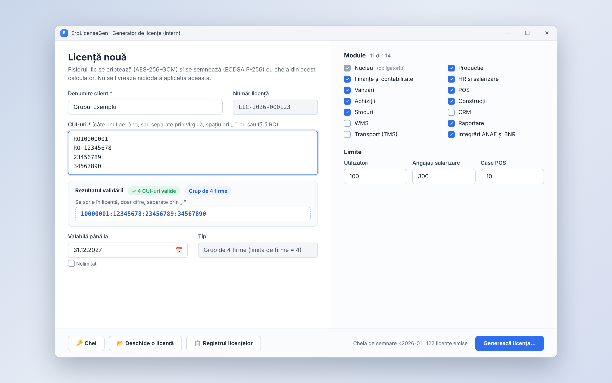
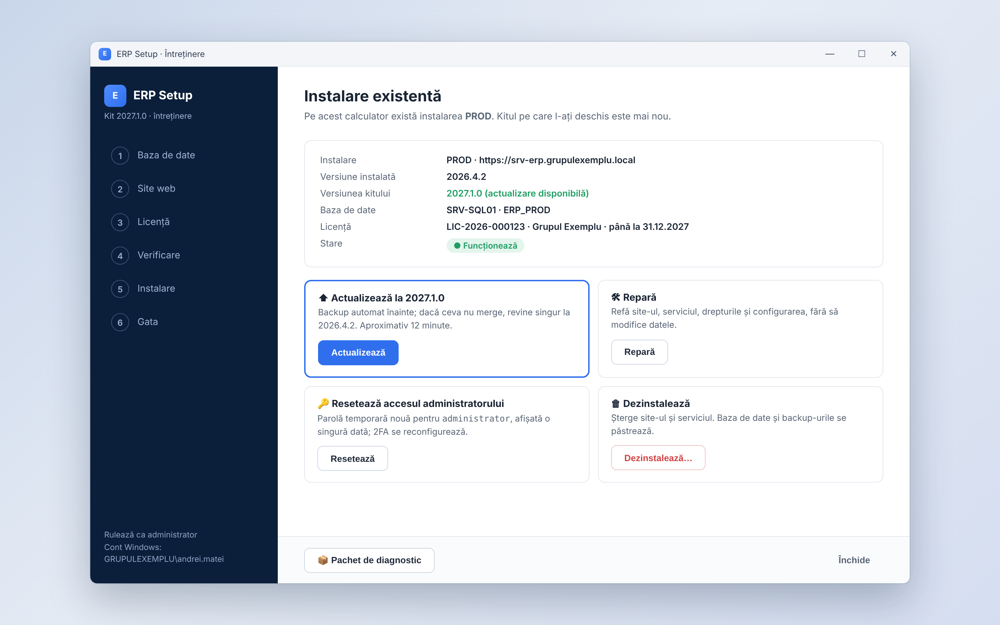
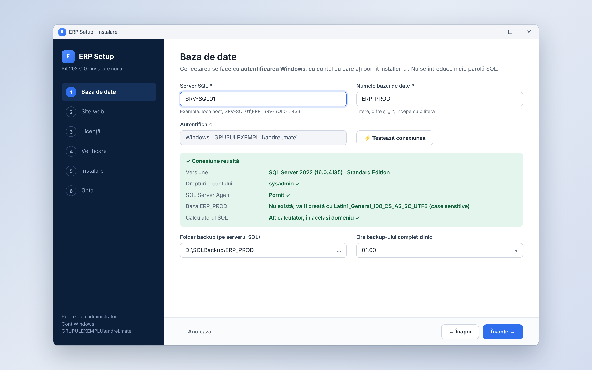
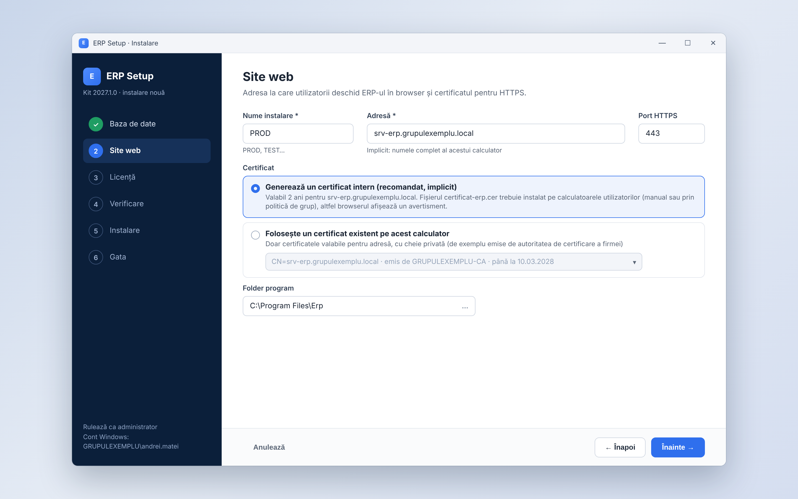
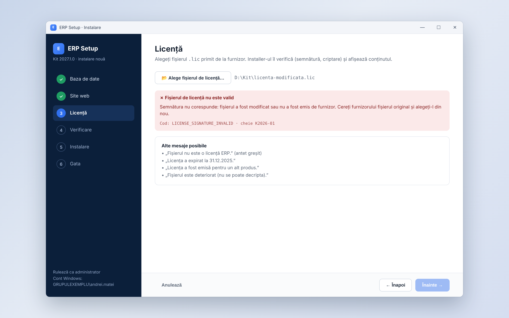
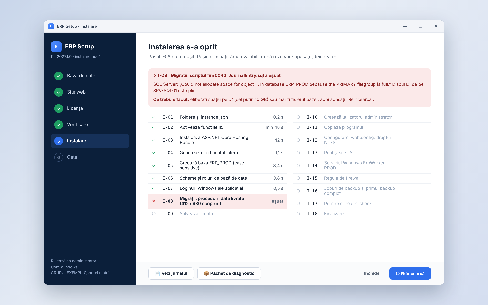
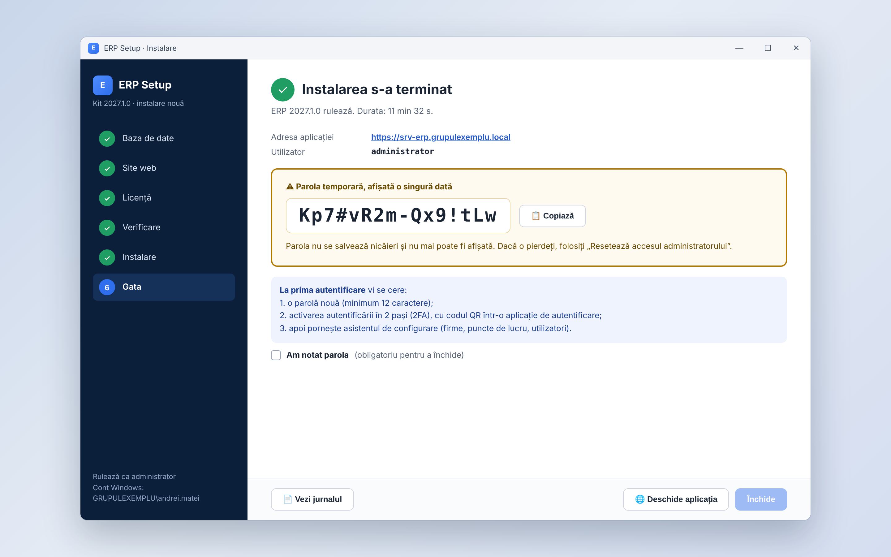

# ERP · 08 Instalare și actualizare

15 noiembrie 2026 · Aurelian · **De revizuit (versiunea simplificată, 15.11.2026)** · Documente legate: [Bune practici](../bune-practici/BUNE_PRACTICI.md), [02.01 Nucleu](../02-module-principale/01-nucleu/NUCLEU.md), [schița](../00-schita/ARHITECTURA_ERP.md)

Instalarea ERP-ului se face cu **două aplicații mici, cu ecrane simple**:

1. **Generatorul de licențe** (`ErpLicenseGen.exe`), folosit doar de noi: produce fișierul de licență al clientului, cu CUI-ul firmei sau lista CUI-urilor grupului, criptat și semnat.
2. **Installer-ul** (`ErpSetup.exe`), rulat la client pe Windows 10, Windows 11 sau Windows Server. Operatorul introduce serverul SQL și numele bazei (autentificare Windows), alege fișierul de licență și apasă „Instalează”. Installer-ul creează baza, site-ul IIS, serviciul și utilizatorul administrator, a cărui parolă se afișează o singură dată.

Documentul e scris ca specificație de implementare: un agent de cod (GitHub Copilot, Claude Code) trebuie să poată construi ambele aplicații doar din el.

Decizii ale lui Aurelian încorporate aici:

| Data | Decizie |
| --- | --- |
| 14.11.2026 | Baza de date este **case sensitive**, collation `Latin1_General_100_CS_AS_SC_UTF8` (secțiunea 8, regulile `SQL-21`–`SQL-25`) |
| 14.11.2026 | Instalarea creează un utilizator **Administrator**, cu parola afișată o singură dată, schimbare obligatorie și 2FA la prima autentificare (5.9) |
| 14.11.2026 | Autentificarea: **ASP.NET Core Identity cu cookie**, în aceeași aplicație; fără Duende (costuri de licență) și fără OpenIddict (secțiunea 7) |
| 15.11.2026 | Instalarea în **pași simpli**, cu două aplicații mici; licența conține CUI-urile **doar cu partea numerică, separate prin „:”**, criptate puternic; conexiunea SQL cu **Windows authentication**; installer-ul rulează și pe **Windows 10/11**; CUI-ul firmei se verifică în licență la adăugarea firmei sau a grupului (secțiunile 3–5) |

---

## 0. Cum folosește un agent de cod acest document

Citește tot documentul înainte de a scrie cod. Regulile de mai jos au prioritate față de orice obișnuință a agentului.

| # | Regulă |
| --- | --- |
| R1 | Ambele aplicații sunt aplicații desktop **WPF .NET 10** (`net10.0-windows`, `<UseWPF>true</UseWPF>`), cu modelul **MVVM** prin `CommunityToolkit.Mvvm` (licență MIT, gratuit) și doar controale WPF standard (**fără** biblioteci de controale cu plată: DevExpress, Telerik, Syncfusion etc.). Se publică self-contained, single-file (`PublishSingleFile`, `IncludeNativeLibrariesForSelfExtract = true`, fără trimming, pe care WPF nu îl suportă), `win-x64`, cu ecrane în română. Operațiile lungi rulează `async` și raportează progresul prin `IProgress<T>`, ca fereastra să nu se blocheze. `ErpSetup.exe` are în manifest `requireAdministrator`. **Nu** MSI, **nu** WiX, **nu** scripturi PowerShell ca logică principală. |
| R2 | Accesul la date: **Dapper + SQL parametrizat sau proceduri stocate**. **Fără Entity Framework Core sau alt ORM**, nicăieri. **Fără Duende, fără OpenIddict**, fără componente cu licență plătită. |
| R3 | Migrațiile bazei: **DbUp**, scripturi `.sql` (`MIG-01`–`MIG-07`). |
| R4 | Baza se creează cu collation **`Latin1_General_100_CS_AS_SC_UTF8`** (case sensitive). Orice nume de obiect, coloană, parametru sau cod se scrie exact cu majusculele din declarație (`SQL-21`–`SQL-25`). |
| R5 | Conexiunea SQL folosește **numai Windows authentication** (`Integrated Security = true`): installer-ul cu contul Windows al operatorului, aplicația cu identitatea pool-ului IIS și a serviciului. Nu există parole SQL și nici fișiere cu parole SQL. |
| R6 | La instalarea nouă se creează **exact un** utilizator Administrator (5.9). La actualizare **nu** se creează și nu se modifică niciun utilizator. |
| R7 | Licența conține CUI-urile doar ca cifre, separate prin `:` (de exemplu `10000001:12345678`), într-un fișier **criptat AES-256-GCM și semnat ECDSA P-256** (secțiunea 3). Cheia privată de semnare există doar în generator, niciodată în ERP sau în depozitul Git. |
| R8 | Niciun secret (parole, chei, conținutul decriptat al licenței) nu apare în jurnale sau în mesaje de eroare (`SEC-02`, `NET-18`). Singura excepție controlată: parola temporară a administratorului, afișată o singură dată pe ecran (5.9). |
| R9 | Installer-ul nu șterge niciodată o bază de date și nu scrie peste o bază existentă cu date. |
| R10 | Orice pas e **idempotent**: rulat a doua oară, nu dublează nimic și nu strică nimic. |
| R11 | Textele pentru utilizator sunt în română; identificatorii din cod și din SQL sunt în engleză (`NET-19`). |
| R12 | Nimic din acest document nu se „simplifică” tăcut. Dacă un pas pare imposibil, agentul se oprește și întreabă. |

Implementarea se face pe sarcinile din secțiunea 12, în ordine, câte un pull request pe sarcină (`GIT-01`–`GIT-04`).

Text de pus în `CLAUDE.md` (Claude Code) și `.github/copilot-instructions.md` (GitHub Copilot):

```markdown
## Instalare și licență
- Specificația: docs/arhitectura/08-instalare-actualizare/INSTALARE_ACTUALIZARE.md. Urmeaz-o exact.
- Reguli de cod: docs/arhitectura/bune-practici/BUNE_PRACTICI.md (SQL-, SP-, MIG-, NET-, SEC-, TST-).
- Două aplicații desktop WPF .NET 10 (MVVM, CommunityToolkit.Mvvm): ErpLicenseGen (intern) și ErpSetup (la client, Windows 10/11/Server).
- Licența: CUI-uri doar cifre, separate prin ":", criptate AES-256-GCM și semnate ECDSA P-256. Cheia privată doar în generator.
- SQL numai cu Windows authentication. Fără parole SQL.
- Baza este CASE SENSITIVE (Latin1_General_100_CS_AS_SC_UTF8): nume exacte; în #t coloanele text cu COLLATE DATABASE_DEFAULT.
- Fără EF Core / ORM, fără Duende, fără OpenIddict. Dapper + proceduri stocate. Migrații DbUp.
- Autentificare: ASP.NET Core Identity + cookie în Erp.Host; chei API pentru conturi tehnice.
- Installer-ul creează un singur Administrator la instalarea nouă; niciodată la actualizare.
```

---

## 1. Pe scurt: cum se instalează la un client

| Pas | Cine | Ce face | Durată |
| --- | --- | --- | --- |
| 1 | Noi | În **ErpLicenseGen**: scriem denumirea clientului, CUI-urile firmelor (doar cifre), modulele și data de expirare; salvăm fișierul `.lic` | 2 minute |
| 2 | Noi sau IT-ul clientului | Pe serverul clientului (sau pe un PC cu Windows 10/11), dezarhivăm kitul și pornim **ErpSetup.exe** ca administrator | — |
| 3 | Idem | Ecranul 1: serverul SQL și numele bazei, „Testează conexiunea”. Ecranul 2: adresa site-ului și certificatul. Ecranul 3: fișierul de licență, cu CUI-urile afișate | 3 minute |
| 4 | Idem | „Instalează”: installer-ul face singur restul și arată progresul pas cu pas | 5–15 minute |
| 5 | Idem | Ecranul final: adresa aplicației, utilizatorul `administrator` și **parola, afișată o singură dată**. La prima autentificare: parolă nouă, apoi activarea 2FA, apoi asistentul de configurare, unde se adaugă firmele (CUI-ul fiecăreia se verifică în licență) | — |

Actualizarea se face cu același `ErpSetup.exe` dintr-un kit nou: aplicația recunoaște instalarea existentă și oferă butonul „Actualizează” (secțiunea 9).

---

## 2. Context minim (ca documentul să fie autonom)

**Produsul.** ERP românesc licențiat, vândut companiilor medii și mari, instalat **on-premise** la fiecare client. O instalare servește un grup de firme și are **o singură bază SQL Server**; firmele sunt separate prin `CompanyId`. Echipa e mică (Aurelian + Claude), deci instalarea trebuie să fie simplă și fără pași manuali în SQL (principiul P9 din 01).

| Strat | Tehnologie |
| --- | --- |
| Sistem de operare | Windows Server 2019, 2022, 2025 (producție) sau Windows 10 22H2 / Windows 11 (firme mici, demonstrații, test) |
| Server web | IIS 10 (activat de installer dacă lipsește) |
| Runtime | .NET 10 (LTS), ASP.NET Core Hosting Bundle 10.x (inclus în kit) |
| Aplicație | `Erp.Host`: API, interfața React (fișiere statice) și paginile de autentificare `/account/*`, într-un singur site IIS |
| Autentificare | ASP.NET Core Identity cu cookie, în `Erp.Host`; chei API pentru conturi tehnice; autentificare Windows opțională pentru Active Directory; date în schema `ids` |
| Lucru în fundal | Serviciul Windows `Erp.Worker`: Hangfire (schema `hangfire`), outbox, joburi zilnice |
| Bază de date | SQL Server 2022 sau mai nou; Standard sau Enterprise în producție, Developer sau Express doar pentru test și demonstrații (5.1) |
| Acces date | Dapper + proceduri stocate, fără ORM; migrații DbUp |
| Licență | Fișier `.lic` criptat și semnat (secțiunea 3) |

**Schemele bazei** (`SQL-01`): `core`, `ids`, `fin`, `sales`, `purch`, `inv`, `intg`, `wms`, `tms`, `mfg`, `hr`, `pos`, `cons`, `crm`, `rpt`, plus schema tehnică `hangfire`. Nimic în `dbo`.

---

## 3. Aplicația 1: Generatorul de licențe (`ErpLicenseGen.exe`)

### 3.1 Rol

Aplicație internă, folosită doar de noi (pe calculatorul lui Aurelian). **Nu se livrează niciodată clienților**: conține cheia privată de semnare. Produce un fișier `.lic` pentru un client: o firmă (un CUI) sau un grup (o listă de CUI-uri).

### 3.2 Ecranul

O singură fereastră:

| Câmp | Tip | Regulă |
| --- | --- | --- |
| Denumire client | text, obligatoriu | 2–200 caractere; de exemplu „Grupul Exemplu” |
| CUI-uri | text pe mai multe rânduri, obligatoriu | Se acceptă CUI-uri separate prin rând nou, virgulă, spațiu sau `:`, cu sau fără prefixul `RO`. La „Validează” fiecare CUI se **normalizează la partea numerică** (se elimină `RO`, spațiile și orice altceva decât cifre), se verifică cifra de control CUI și dublurile. Lista normalizată se afișează sub câmp, de exemplu `10000001:12345678:23456789:34567890`. Un CUI invalid se marchează cu roșu și blochează generarea |
| Tip | afișat automat | „Firmă” dacă e un singur CUI, „Grup de N firme” dacă sunt mai multe |
| Module | casete de bifat | Lista modulelor (Nucleu bifat și blocat; Finanțe, Vânzări, Achiziții, Stocuri, WMS, Transport, Producție, HR, POS, Construcții, CRM, Raportare, Integrări) |
| Limite | numere | Utilizatori, angajați salarizare, case POS. Numărul de firme = numărul de CUI-uri |
| Valabilă până la | dată sau „Nelimitat” | Implicit: 1 an de azi |
| Număr licență | afișat automat | `LIC-<AAAA>-<NNNNNN>`, următorul număr din registrul local (3.6) |

Butoane: **„Generează licența”** (deschide dialogul de salvare cu numele propus `<Client>-<NumărLicență>.lic`), **„Deschide o licență”** (verifică și afișează conținutul unui `.lic` existent), **„Chei”** (prima configurare, 3.5).

Macheta (de validat): 

### 3.3 Conținutul licenței

Conținutul (înainte de criptare) e un JSON UTF-8. CUI-urile sunt **un singur șir, doar cifre, separate prin `:`**, cum a cerut Aurelian:

```json
{
  "licenseId": "LIC-2026-000123",
  "product": "ERP",
  "customerName": "Grupul Exemplu",
  "fiscalCodes": "10000001:12345678:23456789:34567890",
  "modules": ["Core", "Finance", "Sales", "Purchasing", "Inventory", "Integrations", "Manufacturing", "Hr", "Pos", "Construction", "Reporting"],
  "limits": { "users": 100, "payrollEmployees": 300, "posTerminals": 10 },
  "issuedAt": "2026-11-15",
  "validUntil": "2027-12-31"
}
```

`validUntil` e `null` pentru „Nelimitat”. Regula pentru `fiscalCodes`: `^[1-9][0-9]{1,9}(:[1-9][0-9]{1,9})*$`, fără duplicate.

### 3.4 Criptarea și semnarea

Licența e **criptată** (nimeni nu poate citi CUI-urile din fișier) și **semnată** (nimeni nu poate fabrica sau modifica o licență). Ambele sunt necesare: cheia de decriptare trebuie să existe în ERP ca să poată verifica CUI-urile, deci criptarea singură nu ar împiedica un atacator hotărât să facă o licență falsă; semnătura o împiedică, pentru că cheia privată există doar în generator.

| Element | Algoritm |
| --- | --- |
| Criptare | **AES-256-GCM** (`System.Security.Cryptography.AesGcm`), cheie de 256 de biți, nonce aleator de 12 octeți pentru fiecare licență, tag de 16 octeți; antetul fișierului e date autentificate (AAD) |
| Semnare | **ECDSA P-256 cu SHA-256** (`ECDsa`, format IEEE P1363, 64 de octeți), peste tot fișierul în afară de semnătură (criptează, apoi semnează) |

Formatul binar al fișierului `.lic`:

| Poziție | Lungime | Câmp |
| --- | --- | --- |
| 0 | 8 | Marcaj ASCII `ERPLIC01` |
| 8 | 1 | Versiunea formatului = `1` |
| 9 | 1 | `KeyId` = numărul perechii de chei folosite (1–255), pentru rotirea cheilor |
| 10 | 12 | Nonce AES-GCM |
| 22 | 4 | Lungimea textului criptat `n` (uint32, little-endian) |
| 26 | n | Textul criptat (JSON-ul din 3.3) |
| 26 + n | 16 | Tag-ul GCM |
| 42 + n | 64 | Semnătura ECDSA peste octeții `0 … 41 + n` |

AAD pentru GCM = octeții `0 … 25` (marcaj, versiune, KeyId, nonce, lungime). Orice octet modificat face fie semnătura, fie decriptarea să eșueze.

Codul de criptare, decriptare și verificare stă într-o singură bibliotecă, `Erp.Licensing`, folosită de generator, de installer și de `Erp.Host`. Generatorul are în plus clasa `LicenseWriter`, care nu se compilează în celelalte aplicații.

### 3.5 Cheile

| Cheie | Unde stă | Cine o are |
| --- | --- | --- |
| Cheia privată ECDSA (semnare) | Fișierul `%APPDATA%\ErpLicenseGen\keys\sign-<KeyId>.bin`, criptat DPAPI `CurrentUser` pe calculatorul lui Aurelian, plus o copie de siguranță exportată protejată cu parolă, păstrată offline | Doar generatorul |
| Cheia publică ECDSA | Constantă în `Erp.Licensing` (`LicenseKeys.cs`), pe `KeyId` | ERP, installer, generator |
| Cheia AES-256 | Constantă în `Erp.Licensing`, pe `KeyId`, stocată mascată (XOR cu o a doua constantă), ca să nu apară în clar ca șir în binar | ERP, installer, generator |

La prima pornire, butonul **„Chei”** generează perechea ECDSA și cheia AES pentru `KeyId = 1`, salvează cheia privată ca mai sus și afișează textul C# de lipit în `LicenseKeys.cs` (cheia publică și cheia AES mascată). Cheia privată nu intră niciodată în Git (`SEC-02`). La o eventuală compromitere se generează `KeyId = 2`; ERP-ul acceptă toate cheile publice listate în `LicenseKeys.cs`.

### 3.6 Registrul licențelor emise

Generatorul păstrează local `%APPDATA%\ErpLicenseGen\licente-emise.csv`: număr licență, data, client, CUI-uri, module, valabilitate, numele fișierului. Nu conține chei. Din el se calculează următorul număr de licență și se poate reface o licență pierdută.

---

## 4. Licența în ERP

### 4.1 Unde se încarcă

| Moment | Ce se întâmplă |
| --- | --- |
| Installer, ecranul 3 | Operatorul alege fișierul `.lic`. Installer-ul îl verifică (4.2) și afișează: clientul, lista CUI-urilor (cu prefixul `RO` doar la afișare), modulele, data de expirare. O licență invalidă sau expirată nu permite continuarea |
| Installer, pasul de instalare | Copiază fișierul **criptat** în `C:\ProgramData\Erp\<Instanță>\license\erp.lic` și salvează aceiași octeți în `core.InstallationLicense.LicenseFile` (`varbinary(max)`), ca licența să fie inclusă în backup-ul bazei |
| Aplicația, Administrare › Configurare › Licență | Încărcarea unei licențe noi (de exemplu pentru o firmă adăugată în grup), cu permisiunea `Core.License.Manage`; aceleași verificări; licența veche rămâne în istoric |

În clar, conținutul licenței există doar în memorie, niciodată pe disc sau în jurnale.

### 4.2 Verificarea fișierului

`ILicenseReader.Read(byte[] file)` din `Erp.Licensing`, în ordine; primul eșec oprește verificarea:

| # | Verificare | Mesaj la eșec |
| --- | --- | --- |
| 1 | Marcajul `ERPLIC01`, versiunea 1, lungimile corecte | „Fișierul nu este o licență ERP.” |
| 2 | `KeyId` cunoscut și semnătura ECDSA validă | „Licența nu este emisă de producător sau a fost modificată.” |
| 3 | Decriptarea AES-GCM reușește (tag valid) | „Licența este deteriorată.” |
| 4 | JSON valid, `product = "ERP"`, `fiscalCodes` respectă regula din 3.3 | „Licența este deteriorată.” |
| 5 | `validUntil` este `null` sau ≥ azi | „Licența a expirat la {dată}. Cereți furnizorului o licență nouă.” (în aplicație se aplică perioada de grație din 02.01, fluxul 4.4; la instalare, nu) |

### 4.3 Verificarea CUI-ului la adăugarea firmei sau a grupului

Cerința lui Aurelian: la adăugarea unei firme sau a unui grup, licența se decriptează și CUI-ul se verifică; dacă nu e în licență, se afișează un mesaj de eroare.

1. Comenzile `CreateCompany`, `UpdateCompany` (dacă se schimbă CUI-ul) și crearea unui grup cu firmele lui (asistentul de configurare, pasul „Firme”, și ecranul Firme și structură) apelează în handler `ILicenseService.EnsureFiscalCodeLicensed(fiscalCode)`, **înainte** de orice scriere.
2. `ILicenseService` citește `erp.lic`, îl verifică (4.2) și păstrează lista de CUI-uri în memorie; reîncarcă fișierul când se schimbă (`FileSystemWatcher`) sau când se încarcă o licență nouă.
3. CUI-ul introdus se **normalizează la partea numerică** (se elimină `RO`, spațiile; de exemplu `RO 12345678` → `12345678`) și se compară exact cu fiecare element din `fiscalCodes.Split(':')`.
4. Dacă nu se găsește, comanda se refuză cu `403` și codul `CORE_FISCAL_CODE_NOT_LICENSED`, cu mesajul afișat pe câmpul CUI:
   > „CUI-ul 12345678 nu figurează în licența acestei instalări. Pentru a adăuga firma, cereți furnizorului o licență care o include și încărcați-o din Administrare › Configurare › Licență.”
5. Pentru un grup, fiecare firmă se verifică separat; mesajul listează toate CUI-urile care lipsesc, iar grupul nu se salvează parțial.
6. Numărul de firme active nu poate depăși numărul de CUI-uri din licență (consecință directă a regulii de mai sus).
7. La pornire și zilnic, aplicația verifică și că toate firmele active au CUI-ul în licență (02.01, fluxul 4.4); o firmă al cărei CUI a dispărut dintr-o licență nouă intră în modul doar-citire, cu avertisment pentru administratori.

Testul de acceptare corespunzător este IA-07 (secțiunea 11).

---
## 5. Aplicația 2: Installer-ul (`ErpSetup.exe`)

### 5.1 Unde rulează și ce cere

| Cerință | Valoare |
| --- | --- |
| Sistem | Windows Server 2019/2022/2025 sau Windows 10 22H2 / Windows 11, 64 de biți |
| Drepturi Windows | Administrator local (manifestul aplicației cere `requireAdministrator`) |
| Drepturi SQL | Contul Windows al operatorului e `sysadmin` pe SQL Server, sau cel puțin `dbcreator` + `securityadmin` (doar pe durata instalării) |
| SQL Server | 2022 sau mai nou (versiunea majoră ≥ 16). **Standard / Enterprise**: recomandat pentru producție. **Developer**: acceptat cu avertisment „doar pentru test”. **Express**: acceptat cu avertisment „fără SQL Agent, deci fără backup automat; limită de 10 GB; doar pentru test și demonstrații” |
| SQL pe alt calculator | Ambele calculatoare în același domeniu Windows (aplicația se conectează cu contul calculatorului, 5.7). Fără domeniu, SQL Server trebuie să fie pe același calculator |
| Resurse | Minimum 4 nuclee și 8 GB RAM (16 GB recomandat în producție), 5 GB liberi pentru program |

### 5.2 Ecranele

Installer-ul e un asistent cu butoanele „Înapoi” / „Înainte” și pașii în stânga (stilul vizual al machetelor din 02.01: albastru `#2f6fed`, bleumarin, fontul Segoe UI).

| Ecran | Câmpuri și acțiuni |
| --- | --- |
| **0. Bun venit** | Detectează dacă pe calculator există deja o instalare (`C:\ProgramData\Erp\*\instance.json`). Fără instalare: butonul „Instalare nouă”. Cu instalare: versiunea instalată, versiunea kitului și butoanele „Actualizează” (9), „Repară”, „Resetează accesul administratorului”, „Dezinstalează” (10) |
| **1. Baza de date** | *Server SQL* (implicit `localhost`; acceptă `server`, `server\instanță`, `server,port`); *Numele bazei* (implicit `ERP_PROD`, regula `^[A-Za-z][A-Za-z0-9_]{2,63}$`); *Autentificare*: afișat, needitabil: „Windows, contul curent: DOMENIU\utilizator”; buton **„Testează conexiunea”**, care afișează versiunea, ediția, drepturile, starea SQL Agent și dacă baza există (nouă / goală / cu date = eroare); *Folder backup* (pe serverul SQL, implicit `<folderul implicit de backup al instanței>\ERP_PROD`); *Ora backup-ului complet* (implicit 01:00) |
| **2. Site web** | *Nume instalare* (implicit `PROD`, regula `^[A-Z][A-Z0-9]{1,9}$`, folosit în numele site-ului, serviciului, folderelor); *Adresă* (implicit numele complet al calculatorului, de exemplu `srv-erp.grupulexemplu.local`); *Port HTTPS* (implicit 443); *Certificat*: implicit **„Generează un certificat intern”** (5.10, decizia D9); alternativ, o listă cu certificatele din `LocalMachine\My` valabile pentru adresă (de exemplu emise de autoritatea de certificare internă a clientului, AD CS, sau pentru o adresă publică); *Folder program* (implicit `C:\Program Files\Erp`) |
| **3. Licență** | Buton „Alege fișierul de licență…”; după alegere afișează clientul, **lista CUI-urilor**, numărul de firme, modulele și data de expirare (4.1, 4.2). Licență invalidă = mesaj roșu, „Înainte” dezactivat |
| **4. Verificare** | Lista verificărilor din 5.3 cu ✓ / ⚠ / ✗ și rezumatul alegerilor. „Instalează” e activ doar fără ✗; avertismentele ⚠ cer o bifă „Am citit avertismentele” |
| **5. Instalare** | Lista pașilor din 5.4, fiecare cu starea (în așteptare, în curs, ✓, ✗) și durata; bara de progres; butonul „Vezi jurnalul”. La eroare: mesajul clar, pasul care a eșuat, ce trebuie făcut și butonul „Reîncearcă” (pașii sunt idempotenți, R10) |
| **6. Gata** | Adresa aplicației (link), utilizatorul `administrator`, **parola temporară afișată o singură dată**, cu font mare și butonul „Copiază”; caseta obligatorie „Am notat parola” înainte de „Închide”; textul „La prima autentificare vi se cere o parolă nouă și activarea autentificării în 2 pași (2FA), apoi porniți asistentul de configurare.”; butonul „Deschide aplicația” |

Toate valorile alese (fără parole) se salvează în `instance.json` (5.6) și se propun la o rulare ulterioară.

**Machetele ecranelor** (WPF, de validat; generate cu `_unelte/machete-instalare/gen.py`):

| Ecran | Machetă |
| --- | --- |
| 0. Bun venit, fără instalare |  |
| 0. Instalare existentă (Actualizează, Repară, Resetează, Dezinstalează) |  |
| 1. Baza de date |  |
| 2. Site web și certificat |  |
| 3. Licență validă |  |
| 3. Licență invalidă |  |
| 4. Verificare |  |
| 5. Instalare în curs |  |
| 5. Eroare la un pas |  |
| 6. Gata, parola afișată o singură dată |  |

### 5.3 Verificările (ecranul 4)

| ID | Verificare | Cum | Rezultat |
| --- | --- | --- | --- |
| C-01 | Rulează ca administrator | `WindowsPrincipal.IsInRole(Administrator)` | ✗ |
| C-02 | Windows suportat, 64 de biți | `RtlGetVersion`: Server build ≥ 17763, Windows 10 build ≥ 19045, Windows 11 | ✗ |
| C-03 | Memorie și procesor | ≥ 4 nuclee, ≥ 8 GB RAM (sub 16 GB pe Windows Server = ⚠) | ✗ / ⚠ |
| C-04 | Spațiu pe disc pentru program și date | ≥ 5 GB liberi | ✗ |
| C-05 | Kitul e întreg | SHA-256 pentru fiecare fișier comparat cu `manifest.json`; `ErpSetup.exe` semnat Authenticode (`WinVerifyTrust`) | ✗ |
| C-06 | IIS și funcțiile necesare | Lipsesc → se activează automat la instalare (5.4, I-02). Dacă activarea cere repornire, installer-ul cere repornirea și se redeschide singur la pornire (cheie `RunOnce`) | ⚠ (informativ) |
| C-07 | ASP.NET Core Hosting Bundle ≥ versiunea din manifest | Folderul `%ProgramFiles%\dotnet\shared\Microsoft.AspNetCore.App\10.*` și `%windir%\System32\inetsrv\aspnetcorev2.dll`; lipsește → se instalează din kit (I-05) | ⚠ (informativ) |
| C-08 | Certificatul | Cu cheie privată, valabil cel puțin 30 de zile, conține adresa în SAN | ✗ (sau ⚠ sub 30 de zile) |
| C-09 | Portul HTTPS liber | Nicio legare IIS pe același port și aceeași adresă care să aparțină altui site | ✗ |
| C-10 | Conexiunea SQL cu contul Windows curent | Conexiune la `master`, `Integrated Security = true`, `Encrypt = Mandatory` (cu `TrustServerCertificate = true` doar dacă serverul nu are certificat de încredere, cu ⚠) | ✗ |
| C-11 | Versiunea și ediția SQL | `SERVERPROPERTY('ProductMajorVersion')` ≥ 16; `EngineEdition` 2/3 = ✓, Developer = ⚠, 4 (Express) = ⚠ | ✗ / ⚠ |
| C-12 | Drepturile SQL ale operatorului | `IS_SRVROLEMEMBER('sysadmin') = 1` sau (`dbcreator` și `securityadmin`) | ✗ |
| C-13 | SQL Agent pornit (în afară de Express) | `sys.dm_server_services`; oprit → ✗ cu mesajul „Porniți SQL Server Agent și setați-l pe Automatic.” | ✗ |
| C-14 | Baza | Nu există → ✓ (se creează). Există și e goală → ✓ dacă are collation-ul corect. Există cu date → ✗ „Baza există deja și conține date; alegeți alt nume.” | ✗ |
| C-15 | SQL pe alt calculator | Dacă `SERVERPROPERTY('MachineName')` ≠ calculatorul curent: calculatorul trebuie să fie în domeniu (`Domain.GetComputerDomain()`), altfel ✗ cu mesajul din 5.1 | ✗ |
| C-16 | Folderul de backup | `EXEC master.dbo.xp_create_subdir @Path` (creat de contul serviciului SQL Server) | ✗ |
| C-17 | Licența | 4.2 | ✗ |
| C-18 | Ceasul | Diferența față de `SYSUTCDATETIME()` din SQL < 2 minute | ⚠ |
| C-19 | Ieșire spre ANAF și BNR | `HEAD https://api.anaf.ro/`, `GET https://www.bnr.ro/nbrfxrates.xml`, timeout 10 s | ⚠ |

### 5.4 Ce face „Instalează” (ecranul 5)

| Pas | Ce face | Detalii |
| --- | --- | --- |
| I-01 | Creează folderele din `C:\ProgramData\Erp\<Instanță>\` și `instance.json` cu `state = Installing` și un `installId` nou | 5.6 |
| I-02 | Activează funcțiile IIS lipsă | 5.10 |
| I-03 | Instalează Hosting Bundle din kit, dacă lipsește: `prerequisites\dotnet-hosting-10.0.<x>-win.exe /install /quiet /norestart`, apoi `iisreset /restart` | — |
| I-04 | Generează certificatul intern, dacă s-a ales | 5.10 |
| I-05 | Creează baza de date (case sensitive) | 5.5 |
| I-06 | Creează schemele și rolurile de bază de date | 5.5 |
| I-07 | Creează loginurile Windows ale aplicației și utilizatorii din bază | 5.7 |
| I-08 | Rulează migrațiile, obiectele programabile și datele livrate | 5.8 |
| I-09 | Salvează licența (fișier + bază) | 4.1 |
| I-10 | **Creează utilizatorul Administrator** | 5.9 |
| I-11 | Copiază programul în `versions\<Versiune>\` și verifică hash-urile | 5.10 |
| I-12 | Scrie configurarea și `web.config`; setează drepturile NTFS | 5.10 |
| I-13 | Creează pool-ul și site-ul IIS | 5.10 |
| I-14 | Creează serviciul Windows | 5.10 |
| I-15 | Creează regula de firewall (TCP pe portul HTTPS, profilurile Domain și Private) | — |
| I-16 | Creează joburile de backup și face primul backup complet (sărit pe Express, cu avertisment) | 5.11 |
| I-17 | Pornește totul și face health-check | 5.12 |
| I-18 | `state = Installed`, ecranul 6 | 5.9 |

Toți pașii SQL rulează cu contul Windows al operatorului (Windows authentication). Dacă instalarea e întreruptă, la redeschidere installer-ul vede `state = Installing` și oferă „Reia instalarea”: pașii terminați se verifică rapid și se continuă de la primul neterminat. Baza existentă se acceptă la reluare doar dacă are proprietatea extinsă `ErpInstallId` egală cu `installId` din `instance.json`.

### 5.5 Baza de date, schemele și rolurile (I-05, I-06)

Comenzile DDL nu acceptă parametri, deci textul se construiește în C# cu reguli stricte (abatere scrisă de la `SP-06`, secțiunea 14):

- numele bazei e validat cu `^[A-Za-z][A-Za-z0-9_]{2,63}$` și pus între paranteze drepte prin `QuoteName()` (dublează `]`);
- căile sunt validate (absolute, fără `'`, `;`, `--`, caractere de control) și puse ca literal Unicode prin `SqlLiteral()` (prefix `N`, apostroful dublat);
- numerele sunt formatate cu `CultureInfo.InvariantCulture`.

Scriptul rezultat, rulat pe `master` (exemplu pentru `ERP_PROD`):

```sql
CREATE DATABASE [ERP_PROD]
ON PRIMARY
(
    NAME = N'ERP_PROD_data',
    FILENAME = N'D:\SQLData\ERP_PROD.mdf',
    SIZE = 1024MB,
    FILEGROWTH = 512MB
)
LOG ON
(
    NAME = N'ERP_PROD_log',
    FILENAME = N'L:\SQLLog\ERP_PROD_log.ldf',
    SIZE = 512MB,
    FILEGROWTH = 512MB
)
COLLATE Latin1_General_100_CS_AS_SC_UTF8;          -- R4, SQL-21: case sensitive, accent sensitive
GO
ALTER DATABASE [ERP_PROD] SET RECOVERY FULL;                                   -- RPO 15 min prin backup de log
ALTER DATABASE [ERP_PROD] SET READ_COMMITTED_SNAPSHOT ON WITH ROLLBACK IMMEDIATE; -- SP-14
ALTER DATABASE [ERP_PROD] SET ALLOW_SNAPSHOT_ISOLATION OFF;
ALTER DATABASE [ERP_PROD] SET PAGE_VERIFY CHECKSUM;
ALTER DATABASE [ERP_PROD] SET AUTO_CLOSE OFF;
ALTER DATABASE [ERP_PROD] SET AUTO_SHRINK OFF;
ALTER DATABASE [ERP_PROD] SET AUTO_CREATE_STATISTICS ON;
ALTER DATABASE [ERP_PROD] SET AUTO_UPDATE_STATISTICS ON;
ALTER DATABASE [ERP_PROD] SET AUTO_UPDATE_STATISTICS_ASYNC ON;
ALTER DATABASE [ERP_PROD] SET COMPATIBILITY_LEVEL = 160;
ALTER DATABASE [ERP_PROD] SET TARGET_RECOVERY_TIME = 60 SECONDS;
ALTER DATABASE [ERP_PROD] SET QUERY_STORE = ON
    (OPERATION_MODE = READ_WRITE, QUERY_CAPTURE_MODE = AUTO, MAX_STORAGE_SIZE_MB = 2048);
GO
ALTER AUTHORIZATION ON DATABASE::[ERP_PROD] TO [sa];   -- se folosește SUSER_SNAME(0x01) dacă sa a fost redenumit
GO
USE [ERP_PROD];
EXEC sys.sp_addextendedproperty @name = N'ErpProduct',   @value = N'ERP';
EXEC sys.sp_addextendedproperty @name = N'ErpInstance',  @value = N'PROD';
EXEC sys.sp_addextendedproperty @name = N'ErpInstallId', @value = N'5b8e…';   -- installId din instance.json
```

Dacă fișierele `.mdf` / `.ldf` există deja pe disc (rămase de la o bază ștearsă), pasul eșuează cu mesaj clar; installer-ul nu le suprascrie.

Verificarea după creare (pasul eșuează dacă oricare valoare diferă):

```sql
SELECT d.collation_name,                 -- = N'Latin1_General_100_CS_AS_SC_UTF8'
       d.is_read_committed_snapshot_on,  -- = 1
       d.recovery_model_desc,            -- = N'FULL'
       d.compatibility_level,            -- = 160
       d.page_verify_option_desc         -- = N'CHECKSUM'
FROM sys.databases AS d
WHERE d.name = @DatabaseName;
```

**Atenție la majuscule** (R4): pe o bază case sensitive, vederile de sistem se scriu cu litere mici (`sys.databases`, `sys.objects`, `sys.schemas`), exact ca în documentație; `SYS.Databases` nu funcționează.

**Schemele și rolurile.**

Rulat în noua bază, ca operator, din `database/bootstrap/` (fișierele se rulează la fiecare instalare, actualizare și reparare; sunt idempotente). Schemele se creează aici, nu în migrații, ca jurnalul DbUp (`core.SchemaVersion`) să aibă schema `core` deja existentă.

`database/bootstrap/001_Schemas.sql`:

```sql
SET NOCOUNT ON;
SET XACT_ABORT ON;

DECLARE @Schemas TABLE (Name sysname NOT NULL PRIMARY KEY);
INSERT INTO @Schemas (Name)
VALUES (N'core'), (N'ids'), (N'hangfire'), (N'intg'), (N'fin'), (N'inv'), (N'sales'), (N'purch'),
       (N'wms'), (N'tms'), (N'mfg'), (N'hr'), (N'pos'), (N'cons'), (N'crm'), (N'rpt');

DECLARE @Sql nvarchar(max) = N'';
SELECT @Sql += N'CREATE SCHEMA ' + QUOTENAME(s.Name) + N' AUTHORIZATION dbo;' + CHAR(10)
FROM @Schemas AS s
WHERE SCHEMA_ID(s.Name) IS NULL;

IF @Sql <> N''
    EXEC sys.sp_executesql @Sql;     -- CREATE SCHEMA trebuie să fie singur în lot; se rulează fiecare separat în implementare
```

În implementare, fiecare `CREATE SCHEMA` se execută într-un apel `sp_executesql` separat (o instrucțiune `CREATE SCHEMA` trebuie să fie prima din lotul ei).

`database/bootstrap/002_Roles.sql` creează câte un rol de bază de date per schemă și dă drepturi la nivel de schemă (drepturile pe schemă acoperă și obiectele create mai târziu):

```sql
-- pentru fiecare schemă X din lista de mai sus, rolul role_X:
IF DATABASE_PRINCIPAL_ID(N'role_core') IS NULL
    CREATE ROLE role_core AUTHORIZATION dbo;
GRANT SELECT, INSERT, UPDATE, DELETE, EXECUTE ON SCHEMA::core TO role_core;
-- ... identic pentru ids, hangfire, intg, fin, inv, sales, purch, wms, tms, mfg, hr, pos, cons, crm, rpt
```

Drepturile între module (de exemplu `SELECT` pe `core.v_*` și `EXECUTE` pe procedurile publice ale Nucleului pentru `role_sales`) nu stau în bootstrap: se dau în fișierul obiectului, în `Programmability/`, imediat după `CREATE OR ALTER` (02.01, secțiunea 7).

### 5.6 Topologia pe calculator

| Ce | Nume / cale | Drepturi |
| --- | --- | --- |
| Site IIS | `ERP-<Instanță>`, legare HTTPS `*:<port>:<adresă>` (SNI) | — |
| Pool IIS | `ERP-<Instanță>`, identitate `ApplicationPoolIdentity` (`IIS AppPool\ERP-<Instanță>`) | — |
| Serviciu Windows | `ErpWorker-<Instanță>`, cont virtual `NT SERVICE\ErpWorker-<Instanță>`, pornire automată întârziată | — |
| Program | `C:\Program Files\Erp\<Instanță>\versions\<Versiune>\{host,worker}\` | Citire: pool și serviciu; scriere: Administrators, SYSTEM |
| Stare | `C:\ProgramData\Erp\<Instanță>\instance.json` | Citire: pool și serviciu |
| Configurare | `C:\ProgramData\Erp\<Instanță>\config\appsettings.Installation.json` (fără secrete) | Citire: pool și serviciu |
| Licență | `C:\ProgramData\Erp\<Instanță>\license\erp.lic` (criptată) | Citire: pool și serviciu |
| Chei Data Protection | `C:\ProgramData\Erp\<Instanță>\keys\` (criptate DPAPI) | Citire și scriere: pool |
| Jurnale | `C:\ProgramData\Erp\<Instanță>\logs\{host,worker,setup}\`, rotite zilnic, 30 de zile | Scriere: componenta respectivă |
| Mentenanță | `C:\ProgramData\Erp\<Instanță>\maintenance\maintenance.flag` (9.3) | Citire: pool și serviciu |
| Actualizări | `C:\ProgramData\Erp\<Instanță>\upgrade\` | Administrators, SYSTEM |
| Backup | `<Folder backup>\{FULL,LOG,UPGRADE}\` pe serverul SQL | Scriere: contul serviciului SQL Server |

`instance.json` (fără secrete):

```json
{
  "instance": "PROD",
  "currentVersion": "2027.1.0",
  "previousVersions": ["2026.4.2"],
  "state": "Installed",
  "installId": "5b8e…",
  "installedAt": "2026-11-20T09:14:03Z",
  "installRoot": "C:\\Program Files\\Erp",
  "siteName": "ERP-PROD",
  "hostName": "srv-erp.grupulexemplu.local",
  "httpsPort": 443,
  "certificateThumbprint": "3F2A9C…E1",
  "serviceName": "ErpWorker-PROD",
  "sqlServer": "SQL01",
  "databaseName": "ERP_PROD",
  "sqlIsRemote": true,
  "appSqlLogins": ["CONTOSO\\SRV-ERP$"],
  "backupFolder": "B:\\SQLBackup\\ERP_PROD",
  "fullBackupTime": "01:00",
  "lastMigration": "core/2027.01.004_Add_User_IsSystem.sql",
  "completedSteps": ["I-01", "I-02"]
}
```

`state`: `Installing`, `Installed`, `Upgrading`, `RollingBack`, `Maintenance`.

### 5.7 Loginurile SQL ale aplicației, cu Windows authentication (I-07)

Aplicația nu are parolă SQL: se conectează cu identitatea Windows a procesului. Installer-ul creează loginurile potrivite:

| Situație | Loginuri create |
| --- | --- |
| SQL Server pe **același** calculator | `[IIS APPPOOL\ERP-PROD]` (site-ul) și `[NT SERVICE\ErpWorker-PROD]` (serviciul) |
| SQL Server pe **alt** calculator, în domeniu | `[DOMENIU\CALCULATOR$]`: contul calculatorului pe care rulează ERP-ul (pool-ul și serviciul ies în rețea cu el) |

```sql
-- pe master (exemplul pentru SQL local); numele trec prin QuoteName (abaterea de la SP-06, secțiunea 14)
IF SUSER_ID(N'IIS APPPOOL\ERP-PROD') IS NULL
    CREATE LOGIN [IIS APPPOOL\ERP-PROD] FROM WINDOWS WITH DEFAULT_DATABASE = [ERP_PROD], DEFAULT_LANGUAGE = [us_english];
IF SUSER_ID(N'NT SERVICE\ErpWorker-PROD') IS NULL
    CREATE LOGIN [NT SERVICE\ErpWorker-PROD] FROM WINDOWS WITH DEFAULT_DATABASE = [ERP_PROD], DEFAULT_LANGUAGE = [us_english];
```

Pool-ul IIS și serviciul trebuie să existe înainte de `CREATE LOGIN` pentru conturile lor virtuale; de aceea, pe SQL local, installer-ul creează pool-ul și serviciul (oprite) la pasul I-07 și le configurează complet la I-13 și I-14.

În baza ERP, fiecare login primește un utilizator membru în toate rolurile de modul (**fără `db_owner`**, `SP-19`):

```sql
IF DATABASE_PRINCIPAL_ID(N'erp_web') IS NULL
    CREATE USER erp_web FOR LOGIN [IIS APPPOOL\ERP-PROD] WITH DEFAULT_SCHEMA = core;
IF DATABASE_PRINCIPAL_ID(N'erp_worker') IS NULL
    CREATE USER erp_worker FOR LOGIN [NT SERVICE\ErpWorker-PROD] WITH DEFAULT_SCHEMA = core;
-- pentru fiecare utilizator și fiecare rol de modul:
ALTER ROLE role_core     ADD MEMBER erp_web;
ALTER ROLE role_ids      ADD MEMBER erp_web;
ALTER ROLE role_hangfire ADD MEMBER erp_web;
-- ... role_intg, role_fin, role_inv, role_sales, role_purch, role_wms, role_tms, role_mfg, role_hr, role_pos, role_cons, role_crm, role_rpt
-- (identic pentru erp_worker; pe SQL la distanță există un singur utilizator, erp_app, pentru contul calculatorului)
```

În `msdb`, pentru ecranul „Ultimul backup” din aplicație: `CREATE USER` pentru același login și `GRANT SELECT ON dbo.backupset`.

Migrațiile nu folosesc un login separat: rulează cu contul Windows al operatorului, care are drepturi doar cât rulează installer-ul (`SP-19` e respectat: aplicația și migrațiile au identități diferite, iar aplicația nu e `db_owner`).

### 5.8 Migrații, obiecte programabile și date livrate (I-08)

**Sursa scripturilor.** Scripturile sunt fișiere în kit (`database/migrations/<modul>/`, `database/programmability/<modul>/`, `database/seed/<modul>/`), verificate prin manifest (C-05). Build-ul (`package-kit.ps1`) le copiază din `src/Modules/<Modul>/Erp.<Modul>.Infrastructure/Database/`. Fișierele sunt UTF-8 fără BOM; textele românești din scripturi sunt literali `N'...'`. Loturile se despart cu `GO` pe rând separat.

**Toate modulele se instalează în bază, indiferent de licență.** Licența decide doar ce module pornesc în aplicație (02.01, fluxul 4.4). Așa, o licență extinsă mai târziu nu cere migrații, iar baza are aceeași structură la toți clienții.

**Ordinea migrațiilor.** Numele fișierului respectă `MIG-01`: `^\d{4}\.\d{2}\.\d{3}_[A-Za-z0-9_]+\.sql$` (de exemplu `2026.11.001_Create_Company.sql`). Numele în jurnal este `<modul>/<fișier>`. Ordinea de execuție:

1. după prefixul de versiune `AAAA.LL.NNN` (crescător);
2. la prefix egal, după ordinea fixă a modulelor: `core`, `ids`, `hangfire`, `intg`, `fin`, `inv`, `sales`, `purch`, `wms`, `tms`, `mfg`, `hr`, `pos`, `cons`, `crm`, `rpt` (lista e o constantă în `Erp.Setup.Sql/ModuleOrder.cs`, aceeași cu ordinea de dependență din 02);
3. două fișiere cu același prefix în același modul → build-ul kitului eșuează.

O migrare poate referi doar obiecte din schema modulului ei și din `core` (verificat în CI de un test care parcurge scripturile).

**Configurarea DbUp** (pachetul `dbup-sqlserver`):

```csharp
public sealed class MigrationRunner(ILogger<MigrationRunner> logger)
{
    public DatabaseUpgradeResult RunMigrations(string setupConnectionString, KitScripts scripts)
    {
        var upgrader = DeployChanges.To
            .SqlDatabase(setupConnectionString)
            .WithScripts(scripts.Migrations)                     // deja ordonate (vezi mai sus)
            .JournalToSqlTable("core", "SchemaVersion")          // exact așa scris: baza e case sensitive
            .WithTransactionPerScript()
            .WithExecutionTimeout(TimeSpan.FromMinutes(30))
            .WithVariablesDisabled()                             // fără înlocuiri $var$ în scripturi
            .LogTo(new SerilogUpgradeLog(logger))
            .Build();

        return upgrader.PerformUpgrade();
    }

    public DatabaseUpgradeResult RunAlways(string setupConnectionString, IEnumerable<SqlScript> scripts)
    {
        var upgrader = DeployChanges.To
            .SqlDatabase(setupConnectionString)
            .WithScripts(scripts)
            .JournalTo(new NullJournal())                        // rulate la fiecare instalare / actualizare
            .WithTransactionPerScript()
            .WithExecutionTimeout(TimeSpan.FromMinutes(10))
            .WithVariablesDisabled()
            .LogTo(new SerilogUpgradeLog(logger))
            .Build();

        return upgrader.PerformUpgrade();
    }
}
```

Dacă `PerformUpgrade()` întoarce `Successful = false`, pasul eșuează; mesajul afișat conține numele scriptului (`result.ErrorScript.Name`) și eroarea SQL (fără date din tabele).

**Obiectele programabile (I-08)** (`MIG-04`): fiecare fișier conține un singur obiect, scris `CREATE OR ALTER`, urmat opțional de instrucțiuni `GRANT` pentru alte roluri de modul. Ordinea: pe module (lista de mai sus), apoi `Functions/` → `Views/` → `Procedures/`, apoi alfabetic; un prefix `NN_` în numele fișierului forțează ordinea când un obiect depinde de altul din același folder. Tipurile tabelă (`CREATE TYPE ... AS TABLE`) nu au `CREATE OR ALTER`: stau în migrații. Eliminarea unui obiect retras se face printr-o migrare (`DROP PROCEDURE IF EXISTS sales.usp_Old;`).

**Verificări de build pentru scripturi** (în `package-kit.ps1` și ca test în CI):

- fiecare fișier din `Programmability/` începe (după comentarii) cu `CREATE OR ALTER`;
- nicio referință la `dbo.` în afara `msdb.dbo.` și `master.dbo.` (`SQL-01`);
- niciun script deja livrat nu s-a modificat față de tag-ul versiunii anterioare (`MIG-02`; comparație `git diff --name-status <tag-anterior> -- '**/Migrations/*.sql'` fără `M` sau `D`).

**Date livrate.**

Scripturile din `database/seed/<modul>/` rulează cu `RunAlways` (`NullJournal`), în ordinea modulelor și apoi alfabetic (`01_Currencies.sql`, `02_VatRates.sql` ...). Fiecare script folosește `MERGE` pe cheia naturală (`MIG-06`) și nu șterge rânduri create de client.

Datele livrate de Nucleu, relevante pentru installer:

| Date | Unde | Observații |
| --- | --- | --- |
| Utilizatorul tehnic `system` | `core.[User]`, `Id = 1` | Creat de o **migrare** (o singură dată), cu `SET IDENTITY_INSERT core.[User] ON`; `IsSystem = 1`, `IsActive = 0` (nu se poate autentifica). Folosit ca `CreatedBy` pentru datele livrate și pentru joburi. Nu are cont în `ids` |
| Rolurile de sistem | `core.Role` | Coduri fixe, cu majuscule exacte: `ADMIN` (Administrator), `NOMENCLATOARE` (Responsabil nomenclatoare), `AUDITOR`, `STANDARD` (Utilizator standard); `IsSystem = 1` |
| Valute, cote TVA, UM, țări, județe, localități | `core.*` | 02.01, secțiunea 3.5 |
| Setările implicite ale instalării | `core.Setting` | Inclusiv `Installation.SetupCompleted = false` (aplicația pornește în modul de configurare) |

Lista de permisiuni (`core.Permission`) **nu** se încarcă din seed: o generează aplicația la pornire din atributele `[RequiresPermission]` (02.01, 3.4), iar la aceeași pornire rolul `ADMIN` primește automat toate permisiunile existente. De aceea administratorul are drepturile efective după primul start al aplicației (I-23).

`core.[User]`: `User` e cuvânt rezervat în T-SQL, deci tabela se scrie mereu între paranteze drepte, exact `core.[User]`.

### 5.9 Utilizatorul Administrator (I-10, I-18)

**Ce se creează.** Un singur cont, „administratorul integrat” al instalării:

| Atribut | Valoare |
| --- | --- |
| Nume de utilizator | `administrator` (doar litere mici) |
| Nume afișat | „Administrator ERP” (se schimbă în asistent) |
| Tip | Cont de sistem: `core.[User].IsSystem = 1`, fără angajat legat, fără câmpurile de extern (02.01, 3.4) |
| Rol | `ADMIN`, atribuit **la nivel de instalare** (`core.UserRoleAssignment.CompanyId = NULL`: toate firmele, inclusiv cele adăugate ulterior) |
| Parolă | Temporară, generată, `MustChangePassword = 1` |
| Autentificare în 2 pași | `TwoFactorRequired = 1`: la prima autentificare, după schimbarea parolei, activarea 2FA e obligatorie |
| Protecție | Nu se poate șterge; se poate dezactiva doar dacă există alt Administrator activ (02.01, eroarea 50015) |

**Parola temporară.** 20 de caractere generate cu `RandomNumberGenerator`, din alfabetul fără caractere ușor de confundat (`ABCDEFGHJKLMNPQRSTUVWXYZ abcdefghijkmnpqrstuvwxyz 23456789 !#$%&*+-=?@_`), cel puțin 2 din fiecare categorie. Hash-ul se calculează cu `PasswordHasher<TUser>` din `Microsoft.Extensions.Identity.Core` (formatul V3, cel verificat de `Erp.Auth`). Parola în clar nu ajunge în SQL, în jurnal sau pe disc; există doar în memorie până la închiderea ecranului 6. Se generează și `SubjectId = Guid.NewGuid()`, `SecurityStamp` (32 de octeți aleatori, Base32) și `ConcurrencyStamp`.

**Scrierea în bază.** Installer-ul deschide o tranzacție pe conexiunea lui (Windows authentication, contul operatorului) și apelează, în ordine, două proceduri livrate în `Programmability/`:

```sql
CREATE OR ALTER PROCEDURE ids.usp_UserAccount_CreateInitialAdmin
    @SubjectId          uniqueidentifier,
    @UserName           nvarchar(50),
    @Email              nvarchar(256),
    @PasswordHash       nvarchar(500),
    @SecurityStamp      nvarchar(64),
    @ConcurrencyStamp   nvarchar(64)
AS
BEGIN
    SET NOCOUNT ON;
    SET XACT_ABORT ON;
    -- Tranzacția e deschisă de installer (SP-03)

    IF @UserName <> LOWER(@UserName)
        THROW 64001, N'Numele de utilizator trebuie scris cu litere mici.', 1;
    IF EXISTS (SELECT 1 FROM ids.UserAccount WHERE NormalizedUserName = UPPER(@UserName))
        THROW 64002, N'Există deja un cont cu acest nume de utilizator.', 1;

    INSERT INTO ids.UserAccount
        (SubjectId, UserName, NormalizedUserName, Email, NormalizedEmail, EmailConfirmed,
         PasswordHash, PasswordChangedAt, MustChangePassword, SecurityStamp, ConcurrencyStamp,
         TwoFactorEnabled, TwoFactorRequired, LockoutEnabled, AccessFailedCount, IsActive, CreatedBy)
    VALUES
        (@SubjectId, @UserName, UPPER(@UserName), @Email, UPPER(@Email), 0,
         @PasswordHash, SYSUTCDATETIME(), 1, @SecurityStamp, @ConcurrencyStamp,
         0, 1, 1, 0, 1, 1 /* system */);

    SELECT Id, SubjectId, UserName
    FROM ids.UserAccount
    WHERE SubjectId = @SubjectId;
END;
GO

CREATE OR ALTER PROCEDURE core.usp_User_CreateInitialAdmin
    @SubjectId      uniqueidentifier,
    @UserName       nvarchar(50),
    @DisplayName    nvarchar(200),
    @Email          nvarchar(256),
    @SetupVersion   nvarchar(20),
    @MachineName    nvarchar(128)
AS
BEGIN
    SET NOCOUNT ON;
    SET XACT_ABORT ON;
    -- Tranzacția e deschisă de installer (SP-03)

    DECLARE @AdminRoleId int, @UserId int;

    SELECT @AdminRoleId = Id
    FROM core.Role
    WHERE Code = N'ADMIN' AND IsSystem = 1;                 -- codul exact, cu majuscule (SQL-21)

    IF @AdminRoleId IS NULL
        THROW 50016, N'Rolul de sistem ADMIN lipsește; rulați din nou datele livrate.', 1;

    IF EXISTS (
        SELECT 1
        FROM core.UserRoleAssignment AS a
        JOIN core.[User] AS u ON u.Id = a.UserId
        WHERE a.RoleId = @AdminRoleId AND u.IsActive = 1)
        THROW 50014, N'Instalarea are deja un administrator activ.', 1;

    INSERT INTO core.[User]
        (SubjectId, UserName, DisplayName, Email, IsActive, IsEmployee, IsSystem, Language, CreatedBy)
    VALUES
        (@SubjectId, @UserName, @DisplayName, @Email, 1, 0, 1, N'ro', 1 /* system */);

    SET @UserId = SCOPE_IDENTITY();

    INSERT INTO core.UserRoleAssignment (UserId, RoleId, CompanyId, DimensionScope, CreatedBy)
    VALUES (@UserId, @AdminRoleId, NULL /* toată instalarea */, NULL, 1);

    INSERT INTO core.AuditEntry (OccurredAt, UserId, CompanyId, Action, EntityType, EntityId, Changes, IpAddress, CorrelationId)
    VALUES (SYSUTCDATETIME(), 1, NULL, N'Core.User.CreateInitialAdmin', N'Core.User', @UserId,
            (SELECT @UserName AS userName, @SetupVersion AS setupVersion, @MachineName AS machine
             FOR JSON PATH, WITHOUT_ARRAY_WRAPPER),
            NULL, NEWID());

    SELECT Id, UserName, DisplayName
    FROM core.[User]
    WHERE Id = @UserId;
END;
```

Coloanele exacte ale `core.[User]` și `core.AuditEntry` sunt cele din 02.01 (secțiunile 3.4, 3.5, 7); procedura se aliniază la ele dacă diferă.

**Idempotență.** Dacă există deja un administrator activ, pasul I-10 se marchează „sărit” cu mesajul „Administratorul există deja; nu se creează altul.” și ecranul 6 nu afișează nicio parolă. Actualizarea și repararea nu rulează acest pas.

**Ecranul 6** afișează parola o singură dată (5.2). Dacă operatorul închide installer-ul fără să o fi notat, accesul se reface cu „Resetează accesul administratorului” (10.2).

**Prima autentificare.** `/account/login` cu `administrator` și parola temporară → „Parolă nouă” (ecranul 09 din 02.01) → „Activare 2FA” cu codul QR (ecranul 09b) → aplicația, aflată în modul de configurare, deschide asistentul (ecranul 10). Pasul „Administrator” din asistent completează profilul (nume, email, limbă) și recomandă un al doilea administrator nominal. Pasul „Firme” verifică fiecare CUI în licență (4.3).

### 5.10 Programul, configurarea, IIS și serviciul (I-02, I-04, I-11 … I-14)

**Funcțiile IIS (I-02).** Prin `dism.exe /Online /Enable-Feature /FeatureName:<nume> /All /NoRestart` (aceleași nume pe Windows 10/11 și pe Windows Server): `IIS-WebServerRole`, `IIS-WebServer`, `IIS-CommonHttpFeatures`, `IIS-DefaultDocument`, `IIS-StaticContent`, `IIS-HttpErrors`, `IIS-HealthAndDiagnostics`, `IIS-HttpLogging`, `IIS-Performance`, `IIS-HttpCompressionStatic`, `IIS-HttpCompressionDynamic`, `IIS-Security`, `IIS-RequestFiltering`, `IIS-WindowsAuthentication`, `IIS-ApplicationDevelopment`, `IIS-WebSockets`, `IIS-ManagementConsole`. Codul de ieșire 3010 înseamnă „repornire necesară”: installer-ul o cere (5.3, C-06). Procesele se lansează cu `Process.Start` și `ArgumentList`, fără shell.

**Certificatul intern (I-04, implicit, decizia D9).** `CertificateRequest` RSA 3072, SAN = adresa aleasă și numele scurt al calculatorului, valabil 2 ani, EKU Server Authentication, salvat în `LocalMachine\My` și copiat în `LocalMachine\Root` pe acest calculator. Partea publică se exportă în `C:\ProgramData\Erp\<Instanță>\certificat-erp.cer`; ecranul 6 explică faptul că trebuie instalată pe calculatoarele utilizatorilor (manual sau prin politică de grup), altfel browserul afișează un avertisment.

**Programul (I-11).** `app\host` și `app\worker` din kit se copiază în `C:\Program Files\Erp\<Instanță>\versions\<Versiune>\{host,worker}`, apoi hash-urile se verifică din nou. Versiunile vechi se păstrează (ultimele 3), pentru revenire la actualizare.

**Configurarea (I-12).** `appsettings.Installation.json`, comun pentru `Erp.Host` și `Erp.Worker`, fără secrete:

```json
{
  "Erp": {
    "Instance": "PROD",
    "Version": "2027.1.0",
    "PublicOrigin": "https://srv-erp.grupulexemplu.local",
    "DataRoot": "C:\\ProgramData\\Erp\\PROD",
    "LicensePath": "C:\\ProgramData\\Erp\\PROD\\license\\erp.lic",
    "MaintenanceFlagPath": "C:\\ProgramData\\Erp\\PROD\\maintenance\\maintenance.flag",
    "DataProtectionKeysPath": "C:\\ProgramData\\Erp\\PROD\\keys"
  },
  "Database": {
    "Server": "SQL01",
    "Name": "ERP_PROD",
    "Encrypt": "Mandatory",
    "TrustServerCertificate": false,
    "CommandTimeoutSeconds": 30
  },
  "Auth": { "IdleTimeoutMinutes": 30, "AbsoluteTimeoutHours": 10 },
  "Attachments": { "StorageKind": "Database" },
  "Logging": { "Path": "C:\\ProgramData\\Erp\\PROD\\logs", "RetainedDays": 30 }
}
```

Șirul de conexiune se construiește în `Erp.Configuration` cu `SqlConnectionStringBuilder`: `IntegratedSecurity = true`, `ApplicationName = ERP-<Instanță>-<Componentă>`. Nu există fișier de secrete pentru SQL. Alte secrete (parola SMTP, certificatul ANAF) le adaugă asistentul în `core.Setting`, criptate DPAPI (02.01).

**`web.config`** pentru `Erp.Host`:

```xml
<?xml version="1.0" encoding="utf-8"?>
<configuration>
  <location path="." inheritInChildApplications="false">
    <system.webServer>
      <handlers>
        <add name="aspNetCore" path="*" verb="*" modules="AspNetCoreModuleV2" resourceType="Unspecified" />
      </handlers>
      <aspNetCore processPath=".\Erp.Host.exe" stdoutLogEnabled="false" hostingModel="inprocess">
        <environmentVariables>
          <environmentVariable name="ASPNETCORE_ENVIRONMENT" value="Production" />
          <environmentVariable name="ERP_INSTANCE_DIR" value="C:\ProgramData\Erp\PROD" />
        </environmentVariables>
      </aspNetCore>
      <security>
        <requestFiltering removeServerHeader="true">
          <requestLimits maxAllowedContentLength="52428800" />
        </requestFiltering>
      </security>
      <httpProtocol>
        <customHeaders>
          <remove name="X-Powered-By" />
        </customHeaders>
      </httpProtocol>
    </system.webServer>
  </location>
  <location path="account/windows">
    <system.webServer>
      <security>
        <authentication>
          <anonymousAuthentication enabled="false" />
          <windowsAuthentication enabled="true" />
        </authentication>
      </security>
    </system.webServer>
  </location>
</configuration>
```

`inheritInChildApplications="false"` previne moștenirea handler-ului dacă se adaugă vreodată o aplicație IIS copil. Al doilea bloc `location` activează autentificarea Windows doar pe `/account/windows`; restul site-ului rămâne cu acces anonim, iar autentificarea o face cookie-ul.

**Cheile Data Protection** (cookie-ul de autentificare `__Host-erp-auth`, antiforgery, secțiunea 7): `PersistKeysToFileSystem(DataProtectionKeysPath)` + `ProtectKeysWithDpapi(protectToLocalMachine: true)`, `SetApplicationName("ERP-<Instanță>")`, în `Erp.Host`.

**IIS (I-13).**

Implementat cu `Microsoft.Web.Administration.ServerManager`; toate modificările într-un singur `CommitChanges()` per pas. Dacă un obiect există deja (reluare, „Repară”), se actualizează, nu se recreează.

| Obiect | Setări |
| --- | --- |
| Pool `ERP-<Instanță>` | `ManagedRuntimeVersion = ""` (No Managed Code), `ManagedPipelineMode = Integrated`, `Enable32BitAppOnWin64 = false`, `StartMode = AlwaysRunning`, `ProcessModel.IdentityType = ApplicationPoolIdentity` (sau `SpecificUser` cu gMSA în varianta Windows), `ProcessModel.IdleTimeout = 00:00:00`, `ProcessModel.LoadUserProfile = true`, `Recycling.PeriodicRestart.Time = 00:00:00` |
| Site `ERP-<Instanță>` | Cale fizică `...\versions\<Versiune>\host`, pool-ul `ERP-<Instanță>`, `applicationDefaults.preloadEnabled = true`, `serverAutoStart = true` |
| Legare HTTPS | `*:<httpsPort>:<hostName>`, `SslFlags = Sni`, certificatul din `LocalMachine\My` după amprentă |
| Legare HTTP (dacă `httpRedirect`) | `*:80:<hostName>`; redirecționarea spre HTTPS o face aplicația (`UseHttpsRedirection`, plus HSTS 1 an) |
| Autentificare Windows | Secțiunea `windowsAuthentication` deblocată pentru site (`OverrideMode = Allow`); activată doar pe `/account/windows` prin `web.config` (7, 5.10) |

După commit, installer-ul verifică starea site-ului (`ObjectState.Started`) și a pool-ului.

**Serviciul Windows (I-14).**

```
sc.exe create ErpWorker-PROD binPath= "\"C:\Program Files\Erp\PROD\versions\2027.1.0\worker\Erp.Worker.exe\" --instance-dir \"C:\ProgramData\Erp\PROD\"" start= delayed-auto obj= "NT SERVICE\ErpWorker-PROD" DisplayName= "ERP Worker (PROD)"
sc.exe description ErpWorker-PROD "Procesare în fundal ERP: outbox, joburi Hangfire, sincronizări ANAF și BNR."
sc.exe failure ErpWorker-PROD reset= 86400 actions= restart/60000/restart/60000/restart/300000
sc.exe failureflag ErpWorker-PROD 1
```

Comenzile se lansează cu `Process.Start` și `ArgumentList` (fără concatenare de text, fără shell). Codul de ieșire ≠ 0 → pasul eșuează. La reluare sau „Repară”, dacă serviciul există, se folosește `sc.exe config` cu aceleași valori. `Erp.Worker` folosește `UseWindowsService()`; Hangfire rulează cu `PrepareSchemaIfNecessary = false` și `SchemaName = "hangfire"` (tabelele lui vin din migrațiile `hangfire/`, scriptul oficial Hangfire fixat la versiunea pachetului).

### 5.11 Backup (I-16)

Joburile se creează cu procedurile din `msdb` (`sp_add_job`, `sp_add_jobstep`, `sp_add_schedule`, `sp_attach_schedule`, `sp_add_jobserver`), în categoria `ERP`, cu proprietarul `SUSER_SNAME(0x01)`, `@notify_level_eventlog = 2` (eșecurile ajung în Event Log). Descrierea fiecărui job conține `ERP-JOB v1` (versiunea definiției): la `repair` și `upgrade` jobul se recreează doar dacă versiunea definiției din kit e mai nouă; altfel se actualizează doar programarea din fișierul de răspunsuri.

| Job | Programare (implicit) | Pasul T-SQL |
| --- | --- | --- |
| `ERP <Bază> - Backup complet` | Zilnic la `fullBackupTime` (01:00) | Backup complet + verificare (mai jos) |
| `ERP <Bază> - Backup log` | La fiecare `logBackupEveryMinutes` (15), toată ziua | Backup de log + verificare |
| `ERP <Bază> - Curățare backup` | Zilnic la 05:00 | Șterge backup-urile mai vechi de `retentionDays` din `FULL` și `LOG` și istoricul din `msdb` |
| `ERP <Bază> - Verificare integritate` | Săptămânal, `integrityCheckDay` la `integrityCheckTime` | `DBCC CHECKDB` |
| `ERP <Bază> - Mentenanță indecși` | Săptămânal, duminică la 04:00 | `EXEC core.usp_Maintenance_IndexesAndStatistics` |

Pasul de backup complet (în `master`):

```sql
DECLARE @Db   sysname       = N'ERP_PROD';
DECLARE @Dir  nvarchar(400) = N'B:\SQLBackup\ERP_PROD\FULL\';
DECLARE @Now  datetime2(0)  = SYSUTCDATETIME();
DECLARE @File nvarchar(500) = @Dir + @Db + N'_FULL_'
    + CONVERT(nchar(8), @Now, 112) + N'_' + REPLACE(CONVERT(nchar(8), @Now, 108), N':', N'') + N'.bak';

BACKUP DATABASE @Db TO DISK = @File WITH CHECKSUM, COMPRESSION, INIT, STATS = 10;
RESTORE VERIFYONLY FROM DISK = @File WITH CHECKSUM;
```

Backup-ul de log e identic, cu `BACKUP LOG`, folderul `LOG\` și extensia `.trn`. Curățarea:

```sql
DECLARE @Cutoff datetime = DATEADD(DAY, -14, GETDATE());     -- retentionDays
EXEC master.dbo.xp_delete_file 0, N'B:\SQLBackup\ERP_PROD\FULL\', N'bak', @Cutoff, 0;
EXEC master.dbo.xp_delete_file 0, N'B:\SQLBackup\ERP_PROD\LOG\',  N'trn', @Cutoff, 0;
EXEC msdb.dbo.sp_delete_backuphistory @oldest_date = @Cutoff;
```

(`xp_delete_file` e procedura folosită de Maintenance Plans; șterge doar fișiere care sunt backup-uri SQL Server. Folderul `UPGRADE\` nu e atins de acest job; îl gestionează installer-ul, 10.2.)

Integritatea: `DBCC CHECKDB (N'ERP_PROD') WITH NO_INFOMSGS, ALL_ERRORMSGS;`.

`core.usp_Maintenance_IndexesAndStatistics` (în `Programmability/` din Nucleu, nu în installer): reorganizează indecșii cu fragmentare între 10% și 30% și reconstruiește peste 30%, doar pentru indecși cu peste 1.000 de pagini, cu `ONLINE = ON` doar pe ediția Enterprise; apoi actualizează statisticile modificate.

Toate textele SQL ale joburilor se generează de installer cu numele bazei și căile validate (5.5), nu se editează manual.

**Primul backup (I-16).** `EXEC msdb.dbo.sp_start_job @job_name = N'ERP ERP_PROD - Backup complet';`, apoi installer-ul urmărește `msdb.dbo.sysjobactivity` și `msdb.dbo.sysjobhistory` (la 5 s, maximum 30 de minute) până la terminare. Eșecul (de exemplu calea de backup fără drept de scriere pentru contul SQL Server) oprește instalarea cu mesajul din istoricul jobului. Acest backup pornește și lanțul de backup-uri de log.

Pe **SQL Express** (fără SQL Agent) pasul se sare; ecranul 6 și antetul aplicației afișează pentru administratori avertismentul „Instalarea nu are backup automat”.

### 5.12 Pornire și health-check (I-17)

1. Pornește serviciul (`ServiceController.Start`, așteaptă `Running` maximum 60 s) și pool-ul.
2. Cere `GET https://<hostName>:<httpsPort>/health/ready` la fiecare 5 s, maximum 180 s. Cererea se face de pe server, conectându-se la `127.0.0.1` dar cu SNI și antetul `Host` egale cu `hostName` (`SocketsHttpHandler.ConnectCallback`), ca să nu depindă de DNS. Certificatul se validează normal; dacă e autosemnat și permis, se acceptă doar amprenta lui.
3. Răspunsul așteptat (contract fix între installer și `Erp.Host`):

```json
{
  "status": "Healthy",
  "version": "2027.1.0",
  "schemaVersion": "core/2027.01.004_Add_User_IsSystem.sql",
  "checks": {
    "database": "Healthy",
    "schema": "Healthy",
    "license": "Healthy",
    "worker": "Healthy"
  }
}
```

| Verificare | Ce înseamnă `Healthy` |
| --- | --- |
| `database` | Conexiune deschisă și `SELECT 1` în sub 2 s |
| `schema` | Ultimul script din `core.SchemaVersion` = `lastMigration` încorporat în build (9.4) |
| `license` | Fișierul de licență e valid și încărcat |
| `worker` | Serverul Hangfire al serviciului are heartbeat în ultimele 60 s (`hangfire.Server`) |

4. Verifică și `GET /` (200, HTML) și `GET /account/login` (200, pagina de autentificare).
5. Health-check eșuat → pasul I-17 eșuează pe ecranul 5; mesajul listează verificările care nu sunt `Healthy` și ultimele 50 de rânduri din jurnalele componentelor.

`/health/ready` răspunde detaliat doar cererilor de pe loopback; din rețea întoarce doar `status`. `/health/live` întoarce 200 cât timp procesul rulează.

---

## 6. Kitul de instalare și structura soluției

Kitul e un ZIP, `ERP-<Versiune>-kit.zip`:

```
ERP-2027.1.0-kit/
├── ErpSetup.exe                         installer-ul (WPF, self-contained, semnat Authenticode)
├── manifest.json                        versiunea, versiunea minimă de la care se actualizează, ultima migrare, SHA-256 pe fiecare fișier
├── app/
│   ├── host/                            Erp.Host publicat (framework-dependent, net10.0, win-x64)
│   └── worker/                          Erp.Worker publicat
├── database/
│   ├── bootstrap/                       scheme și roluri (5.5)
│   ├── migrations/<modul>/              rulate o singură dată (MIG-01)
│   ├── programmability/<modul>/         CREATE OR ALTER, la fiecare instalare/actualizare (MIG-04)
│   └── seed/<modul>/                    MERGE idempotent (MIG-06)
├── prerequisites/
│   └── dotnet-hosting-10.0.<x>-win.exe  ASP.NET Core Hosting Bundle
├── templates/                           appsettings.Installation.json, maintenance.html
└── CITESTE-MA.txt
```

`manifest.json` conține: `version`, `minUpgradeFrom` (versiunile din ultimele 12 luni), `minSqlServerMajorVersion` (16), `databaseCollation` (`Latin1_General_100_CS_AS_SC_UTF8`), `hostingBundleVersion`, `lastMigration` și lista `files` cu SHA-256. Generatorul de licențe **nu** face parte din kit.

Structura în monorepo (`GIT-01`):

```
src/
├── Tools/
│   ├── Erp.LicenseGen/              aplicația 1 (WPF) – doar intern
│   └── Erp.Setup/                   aplicația 2 (WPF): ferestrele și ViewModel-urile
├── Setup/
│   ├── Erp.Setup.Core/              pașii (IInstallStep), verificările, starea, actualizarea și revenirea
│   ├── Erp.Setup.Windows/           IIS (Microsoft.Web.Administration), DISM, servicii, firewall, ACL, certificate
│   ├── Erp.Setup.Sql/               baza, loginurile, runner-ul DbUp, joburile
│   └── Erp.Setup.Tests/
├── Shared/
│   ├── Erp.Licensing/               citire, decriptare, verificare licență; LicenseKeys.cs (chei publice + AES mascat)
│   ├── Erp.Configuration/           appsettings.Installation.json, șirul de conexiune
│   └── Erp.Security.Passwords/      PasswordHasher compatibil ASP.NET Core Identity V3
├── Auth/Erp.Auth/                   store-uri Dapper Identity, paginile /account, chei API (folosit de Erp.Host)
├── Host/Erp.Host/
├── Worker/Erp.Worker/
└── Modules/<Modul>/Erp.<Modul>.Infrastructure/Database/{Migrations,Programmability,Seed}/
build/package-kit.ps1                 compilează, publică, copiază scripturile, generează manifestul, semnează
```

```csharp
public interface IInstallStep
{
    string Id { get; }                       // de ex. "I-07"
    string Title { get; }                    // text în română, afișat pe ecranul 5
    Task<StepResult> ExecuteAsync(SetupContext context, IProgress<string> progress, CancellationToken ct);
    Task CompensateAsync(SetupContext context, CancellationToken ct);   // doar la actualizare (9.2)
}
```

Logica stă în `Erp.Setup.Core` (testabilă fără interfață); ecranele WPF (View + ViewModel) doar colectează valori și afișează progresul; ViewModel-urile se testează unitar fără fereastră.

---
## 7. Autentificarea și schema `ids`

**Deciziile lui Aurelian (14.11.2026):** fără Duende IdentityServer (costuri de licență) și fără OpenIddict. ERP-ul e o singură aplicație web, cu interfața React servită de pe aceeași adresă ca API-ul, deci nu are nevoie de un server OAuth/OpenID Connect: autentificarea se face cu **ASP.NET Core Identity și un cookie**, direct în `Erp.Host`. Toate componentele sunt gratuite, parte din .NET. Dacă vreodată e nevoie de SSO spre alte aplicații, un server OIDC se poate adăuga peste aceleași conturi, fără migrarea utilizatorilor.

**Componente** (biblioteca `Erp.Auth`, folosită de `Erp.Host`):

| Componentă | Rol |
| --- | --- |
| ASP.NET Core Identity (`Microsoft.Extensions.Identity.Core`, `Microsoft.AspNetCore.Identity`) | Conturi locale, hash de parole, politica de parole, blocare după încercări greșite, 2FA TOTP, coduri de rezervă, `SecurityStamp` |
| Cookie de autentificare (`Microsoft.AspNetCore.Authentication.Cookies`) | Sesiunea utilizatorului în browser |
| Autentificare Windows prin IIS (`IISServerDefaults.AuthenticationScheme`) | Login cu contul de domeniu (Active Directory), opțional, doar pe `/account/windows` |
| `ApiKeyAuthenticationHandler` (scris de noi) | Conturile tehnice (Power BI, integrări) și, mai târziu, casele POS |
| Pagini Razor `/account/*` | Login, logout, „Am uitat parola”, „Parolă nouă”, „Activare 2FA”, cod 2FA; aspectul din machetele 01, 09, 09b din 02.01 |

**Store-urile** ASP.NET Core Identity se implementează în `Erp.Auth` cu Dapper (R2), pe tabele din schema `ids` create prin migrații DbUp din `src/Auth/Erp.Auth/Database/Migrations/`:

| Interfață | Tabelă | Rol |
| --- | --- | --- |
| `IUserStore<UserAccount>`, `IUserPasswordStore`, `IUserEmailStore`, `IUserSecurityStampStore`, `IUserLockoutStore`, `IUserTwoFactorStore`, `IUserAuthenticatorKeyStore`, `IUserTwoFactorRecoveryCodeStore`, `IUserLoginStore` | `ids.UserAccount`, `ids.UserRecoveryCode`, `ids.UserExternalLogin`, `ids.PasswordHistory` | Conturile, parolele, 2FA, legătura cu contul Windows |
| `IUserSessionStore` (al nostru) | `ids.UserSession` | Sesiunile active (`SessionId`, `UserAccountId`, `CreatedAt`, `LastSeenAt`, `IpAddress`, `UserAgent`, `RevokedAt`), pentru lista „Sesiuni active” din Profilul meu și pentru închiderea lor de către administrator |
| `IApiKeyStore` (al nostru) | `ids.ApiKey` | Cheile API: `UserId` (contul tehnic din `core.[User]`), `Name`, `KeyPrefix` (primele 8 caractere, pentru identificare), `KeyHash` (SHA-256 al secretului), `ExpiresAt`, `LastUsedAt`, `RevokedAt` |

Nu se folosește `Microsoft.AspNetCore.Identity.EntityFrameworkCore` și nici `MapIdentityApi` (endpoint-uri cu tokenuri, nenecesare).

**Cookie-ul:**

- nume `__Host-erp-auth`, `HttpOnly`, `Secure`, `SameSite=Strict`, `Path=/`, fără `Domain`;
- expirare la inactivitate 30 de minute (glisantă), durată maximă 10 ore (`Auth:IdleTimeoutMinutes`, `Auth:AbsoluteTimeoutHours`, configurabile);
- conținutul e protejat cu cheile Data Protection (5.10); claim-urile: `sub` (`SubjectId`), numele, `sid` (`SessionId`), `SecurityStamp`;
- la fiecare cerere, cel mult o dată pe minut, `OnValidatePrincipal` verifică `SecurityStamp` și că sesiunea nu e revocată în `ids.UserSession`; altfel cookie-ul se respinge. Așa, dezactivarea unui utilizator, schimbarea parolei sau „Închide sesiunea” au efect în cel mult un minut (02.01, 3.4);
- pentru `/api/*` un utilizator neautentificat primește 401 (nu redirect); interfața React trimite atunci la `/account/login?returnUrl=...`. Pentru 403 la fel, fără redirect.

**Protecția CSRF:** antiforgery cu antet. La încărcarea interfeței, `GET /api/antiforgery` setează cookie-ul `XSRF-TOKEN` (citibil din JavaScript); interfața îl trimite în antetul `X-XSRF-TOKEN` la orice `POST`, `PUT`, `PATCH`, `DELETE`. Un filtru global validează antetul pentru cererile autentificate cu cookie; cererile cu cheie API nu au nevoie de el.

**Cheile API** (conturi tehnice și case POS): antetul `Authorization: ApiKey <prefix>.<secret>`, secretul de 32 de octeți aleatori în base64url. Cheia se afișează o singură dată la creare (din fișa utilizatorului tehnic, permisiunea `Core.User.Manage`); în bază rămâne doar hash-ul. Drepturile vin din rolurile contului tehnic, ca la orice utilizator; crearea, folosirea (`LastUsedAt`) și revocarea sunt auditate. Casele POS vor folosi același mecanism, cu o cheie per casă, detaliat în 02.10.

**Autentificarea Windows (AD):** IIS acceptă autentificarea Windows doar pe calea `/account/windows` (5.10, `web.config`); acolo `Erp.Auth` citește identitatea Windows, caută contul legat în `ids.UserExternalLogin` și emite același cookie. Dacă AD nu e activat în asistent, endpoint-ul răspunde 404. Pentru asta installer-ul instalează funcția IIS `Web-Windows-Auth` (C-05) și deblochează secțiunea `system.webServer/security/authentication/windowsAuthentication` pentru site (`OverrideMode = Allow`, prin `ServerManager`).

Structura minimă a contului, de care depinde pasul I-10 (tabela folosită de ASP.NET Core Identity prin store-ul Dapper; detaliile complete vin în secțiunea 06 Securitate):

```sql
CREATE TABLE ids.UserAccount (
    Id                        int IDENTITY(1,1) NOT NULL CONSTRAINT PK_UserAccount PRIMARY KEY,
    SubjectId                 uniqueidentifier  NOT NULL,
    UserName                  nvarchar(50)      NOT NULL,
    NormalizedUserName        nvarchar(50)      NOT NULL,     -- UPPER invariant; folosit la autentificare
    Email                     nvarchar(256)     NULL,
    NormalizedEmail           nvarchar(256)     NULL,
    EmailConfirmed            bit               NOT NULL CONSTRAINT DF_UserAccount_EmailConfirmed DEFAULT (0),
    PasswordHash              nvarchar(500)     NULL,
    PasswordChangedAt         datetime2(3)      NULL,
    MustChangePassword        bit               NOT NULL CONSTRAINT DF_UserAccount_MustChangePassword DEFAULT (0),
    SecurityStamp             nvarchar(64)      NOT NULL,
    ConcurrencyStamp          nvarchar(64)      NOT NULL,
    TwoFactorEnabled          bit               NOT NULL CONSTRAINT DF_UserAccount_TwoFactorEnabled DEFAULT (0),
    TwoFactorRequired         bit               NOT NULL CONSTRAINT DF_UserAccount_TwoFactorRequired DEFAULT (0),
    AuthenticatorKeyEncrypted varbinary(512)    NULL,
    LockoutEnabled            bit               NOT NULL CONSTRAINT DF_UserAccount_LockoutEnabled DEFAULT (1),
    LockoutEndAt              datetime2(3)      NULL,
    AccessFailedCount         int               NOT NULL CONSTRAINT DF_UserAccount_AccessFailedCount DEFAULT (0),
    IsActive                  bit               NOT NULL CONSTRAINT DF_UserAccount_IsActive DEFAULT (1),
    CreatedAt                 datetime2(3)      NOT NULL CONSTRAINT DF_UserAccount_CreatedAt DEFAULT (sysutcdatetime()),
    CreatedBy                 int               NOT NULL,
    ModifiedAt                datetime2(3)      NULL,
    ModifiedBy                int               NULL,
    RowVersion                rowversion        NOT NULL,
    CONSTRAINT UQ_UserAccount_SubjectId UNIQUE (SubjectId),
    CONSTRAINT UQ_UserAccount_NormalizedUserName UNIQUE (NormalizedUserName),
    CONSTRAINT CK_UserAccount_UserNameLower CHECK (UserName = LOWER(UserName)),          -- SQL-24: doar litere mici
    CONSTRAINT CK_UserAccount_Normalized CHECK (NormalizedUserName = UPPER(UserName))
);
CREATE UNIQUE INDEX UX_UserAccount_NormalizedEmail ON ids.UserAccount (NormalizedEmail) WHERE NormalizedEmail IS NOT NULL;
```

Pe o bază case sensitive, `UserName = LOWER(UserName)` compară exact, deci constrângerea refuză `Administrator`. Autentificarea caută după `NormalizedUserName`, deci utilizatorul se poate loga scriind `Administrator`, `ADMINISTRATOR` sau `administrator` (9.3).

Plaja de coduri de eroare SQL pentru schema `ids`: **64000–64999** (adăugată în Bune practici, 8.3); în API prefixul `IDS_`.

---

## 8. Baza de date case sensitive

### 8.1 Decizia

Decizia lui Aurelian (14.11.2026): baza de date a clientului este **case sensitive**, cu collation-ul **`Latin1_General_100_CS_AS_SC_UTF8`** (ales de Aurelian):

| Parte | Înseamnă | Consecință |
| --- | --- | --- |
| `Latin1_General_100` | Reguli de comparare și sortare generale, versiunea 100 | `ORDER BY` tratează ă, â, î, ș, ț ca variante ale lui a, i, s, t (nu exact ordinea alfabetului românesc); suficient pentru liste și rapoarte |
| `CS` | Case sensitive: `A` ≠ `a` | Decizia de mai sus |
| `AS` | Accent sensitive: `ș` ≠ `s` | Coduri și denumiri exacte; căutarea fără diacritice se face separat (`SQL-25`) |
| `SC` | Caractere suplimentare (UTF-16 complet) | Funcțiile de text tratează corect orice caracter Unicode |
| `UTF8` | Coloanele `varchar` stochează UTF-8 | Textul rămâne `nvarchar` (`SQL-09`, neschimbat); `varchar` rămâne pentru codurile ASCII. Diacriticele românești sunt corecte în ambele tipuri |

### 8.2 Ce face installer-ul

1. Creează baza cu `COLLATE Latin1_General_100_CS_AS_SC_UTF8` (5.5) și verifică după creare.
2. Refuză orice bază existentă cu alt collation (C-14), la instalare, actualizare și reparare. Nu rulează niciodată `ALTER DATABASE ... COLLATE` (schimbarea collation-ului unei baze cu date nu e suportată).
3. Raportează collation-ul serverului (ecranul 1, „Testează conexiunea”). Dacă serverul e case insensitive (cazul obișnuit, `SQL_Latin1_General_CP1_CI_AS`), `tempdb` are alt collation decât baza ERP; de aceea regula `SQL-23`.
4. Scrie toate numele (scheme, tabele, loginuri, joburi, coduri de rol) exact cum sunt declarate, ca în exemplele din acest document.

### 8.3 Ce înseamnă pentru cod (rezumat; regulile complete sunt în Bune practici)

| Regulă | Pe scurt |
| --- | --- |
| `SQL-21` | Baza are collation `Latin1_General_100_CS_AS_SC_UTF8` (ales de Aurelian), setat de installer. Coloanele nu primesc alt `COLLATE`, cu excepția coloanelor calculate de căutare (`SQL-25`) |
| `SQL-22` | Orice identificator se scrie exact ca în declarație: `core.Partner`, nu `core.partner`; `@InvoiceId`, nu `@invoiceId`; vederile de sistem cu litere mici (`sys.objects`). `core.[User]` între paranteze (cuvânt rezervat) |
| `SQL-23` | În tabelele temporare `#t`, coloanele text se declară `COLLATE DATABASE_DEFAULT`; altfel join-urile cu tabelele ERP dau eroarea „Cannot resolve the collation conflict” pe serverele case insensitive. Parametrii tabelă (`tt_*`) și variabilele tabelă nu au problema |
| `SQL-24` | Unicitatea codurilor introduse de utilizatori (cod partener, cod articol, cod gestiune, serie) nu ține cont de majuscule: coloana calculată persistată `CodeKey AS UPPER(Code) PERSISTED` cu index unic. Numele de utilizator se salvează doar cu litere mici (`CHECK`). CUI, IBAN, coduri ISO se normalizează la salvare (majuscule, fără spații). Codurile tehnice livrate (permisiuni, roluri, chei de setări, valori de enumerare) se compară exact |
| `SQL-25` | Căutarea după denumire în ecrane nu ține cont de majuscule și diacritice: coloana calculată persistată `NameSearch AS (Name COLLATE Latin1_General_100_CI_AI_SC_UTF8) PERSISTED`, indexată, folosită cu `LIKE @Term + N'%'` (SARGable, `SP-09`) |
| `NET-21` | În C#, codurile tehnice se compară cu `StringComparer.Ordinal`; codurile introduse de utilizatori cu `StringComparer.OrdinalIgnoreCase` după normalizare, la fel ca în bază |
| `TST-09` | Testele de integrare rulează pe o bază `Latin1_General_100_CS_AS_SC_UTF8` creată pe un server cu collation implicit `SQL_Latin1_General_CP1_CI_AS`, ca greșelile de majuscule și conflictele cu `tempdb` să apară în CI, nu la client |

Autentificarea: ASP.NET Core Identity caută contul după `NormalizedUserName` (majuscule), deci login-ul nu depinde de cum scrie utilizatorul numele. Hangfire: compatibilitatea scripturilor lui cu o bază case sensitive se verifică în CI (`TST-09`); orice problemă se rezolvă în scriptul de migrare `hangfire/`, nu prin schimbarea collation-ului.

---

## 9. Actualizarea (butonul „Actualizează”)


### 9.1 Cum arată pentru operator

Operatorul pornește `ErpSetup.exe` din kitul nou. Ecranul 0 arată „Instalat: 2026.4.2 · Kit: 2027.1.0” și butonul **„Actualizează”**. Urmează ecranul de verificare (aceleași verificări, plus spațiul pentru backup), un text cu durata estimată („aproximativ 12 minute; utilizatorii vor vedea pagina «Actualizare în curs»”) și confirmarea. Ecranul de progres arată pașii din 9.2. La final: „Actualizare reușită” sau „Actualizarea nu a reușit; instalarea a revenit automat la versiunea 2026.4.2 și funcționează”, cu motivul.

Reguli: se actualizează doar spre o versiune mai nouă și doar de la `minUpgradeFrom` în sus; nu se creează și nu se modifică utilizatori; migrațiile merg doar înainte (`MIG-03`), iar protecția e backup-ul dinaintea actualizării.

### 9.2 Pașii și revenirea automată

| Pas | Ce face | La eșec |
| --- | --- | --- |
| U-01 | Verificările (5.3) și compararea versiunilor | Oprire, nimic modificat |
| U-02 | Scrie `upgrade\upgrade-state.json` (versiunea de la care pleacă, ultima migrare, pașii terminați); `state = Upgrading` | Oprire |
| U-03 | **Mentenanță:** creează `maintenance.flag` (aplicația răspunde cu pagina „Actualizare în curs”), oprește serviciul, apoi `ALTER DATABASE [ERP_PROD] SET RESTRICTED_USER WITH ROLLBACK IMMEDIATE;` (aplicația nu e `db_owner`, deci nu se mai conectează) | Revenire |
| U-04 | **Backup de siguranță:** `BACKUP DATABASE [ERP_PROD] TO DISK = N'<Folder backup>\UPGRADE\ERP_PROD_<de la>_la_<la>_<AAAAMMZZ_HHmmss>.bak' WITH COPY_ONLY, CHECKSUM, COMPRESSION, INIT;` + `RESTORE VERIFYONLY ... WITH CHECKSUM`; copie a folderelor `config\` și `license\` | Revenire (baza neatinsă) |
| U-05 | Copiază programul nou în `versions\<versiune nouă>\` și verifică hash-urile | Revenire |
| U-06 | Rulează bootstrap, migrațiile, obiectele programabile, datele livrate (5.5, 5.8) | Revenire **cu restaurarea bazei** |
| U-07 | Regenerează configurarea (păstrând valorile existente) și `web.config` | Revenire cu restaurare |
| U-08 | Comută calea site-ului și a serviciului pe folderul nou | Revenire cu restaurare |
| U-09 | `SET MULTI_USER`, pornește serviciul, reciclează pool-ul, health-check (5.12) cu versiunea nouă | Revenire cu restaurare |
| U-10 | Șterge `maintenance.flag`; `state = Installed`, versiunea nouă; păstrează ultimele 3 versiuni și ultimele 3 backup-uri `UPGRADE` | — |

**Revenirea automată** (la orice eșec din U-03 … U-09): rămâne în mentenanță; dacă U-06 a început, restaurează baza (`SET SINGLE_USER WITH ROLLBACK IMMEDIATE`, `RESTORE DATABASE ... WITH REPLACE, CHECKSUM, RECOVERY`, `SET MULTI_USER`) și verifică ultima migrare; readuce calea site-ului și a serviciului pe folderul vechi și configurarea din copie; pornește și face health-check pe versiunea veche; dacă baza a fost restaurată, pornește imediat jobul de backup complet (restaurarea întrerupe lanțul backup-urilor de log); scoate mentenanța. Nu se pierd date: din U-03 nimeni nu a mai putut scrie.

Dacă și revenirea eșuează, instalarea rămâne în mentenanță (`state = Maintenance`) și ecranul afișează pașii manuali cu valorile reale: restaurarea bazei din fișierul `UPGRADE`, calea veche pentru site și serviciu, apoi „Repară” din kitul versiunii vechi.

Dacă installer-ul e închis forțat în timpul actualizării, la redeschidere ecranul 0 arată „Actualizare întreruptă” și singura acțiune permisă e **„Revino la versiunea anterioară”**, care face pașii de revenire pe baza celor marcați în `upgrade-state.json`.

### 9.3 Modul de mentenanță

`Erp.Host` are un middleware, primul în pipeline: dacă fișierul `MaintenanceFlagPath` există (verificat cel mult o dată la 2 s), orice cerere care **nu** este `/health/*` de pe loopback primește `503`, antetul `Retry-After: 300` și pagina `maintenance.html` („Aplicația se actualizează. Reveniți în câteva minute.”). `Erp.Worker` nu pornește joburi noi cât timp fișierul există.

### 9.4 Protecția versiune program ↔ versiune bază

La build se încorporează în `Erp.Host` și `Erp.Worker` (`AssemblyMetadata("ErpLastMigration", "...")`) numele ultimei migrări. La pornire ambele citesc `SELECT TOP (1) ScriptName FROM core.SchemaVersion ORDER BY Id DESC;`. Dacă diferă, partea de business nu pornește, se jurnalizează „Versiunea bazei de date nu corespunde aplicației”, iar `/health/ready` raportează `schema: Unhealthy`.

---

## 10. Celelalte butoane ale installer-ului

### 10.1 „Repară”

Cere un kit cu aceeași versiune ca instalarea. Refă: verificările, funcțiile IIS, bootstrap-ul, migrațiile (fără efect dacă baza e la zi), obiectele programabile, datele livrate, fișierele programului al căror hash nu corespunde, configurarea, drepturile NTFS, loginurile Windows ale aplicației, site-ul, serviciul, firewall-ul, joburile de backup, health-check-ul. Nu atinge utilizatorii, licența și datele.

### 10.2 „Resetează accesul administratorului”

Pentru situația în care niciun administrator nu se mai poate autentifica (parolă pierdută, telefon 2FA pierdut, cont blocat). Dovada autorității: operatorul e administrator local și are drepturi `sysadmin` pe SQL Server (Windows authentication). Installer-ul generează o parolă temporară nouă pentru `administrator`, setează `MustChangePassword = 1`, dezactivează 2FA (se reactivează obligatoriu la autentificare), deblochează contul, închide toate sesiunile (`SecurityStamp` nou), readaugă rolul `ADMIN` la nivel de instalare dacă lipsește, scrie în audit `Core.User.EmergencyReset` și trimite notificare celorlalți administratori. Parola se afișează o singură dată, ca pe ecranul 6.

### 10.3 „Dezinstalează”

Confirmare prin tastarea numelui instalării. Oprește și șterge serviciul, site-ul, pool-ul, regula de firewall și programul; păstrează `licență` și `logs`. **Nu** șterge baza, backup-urile și joburile de backup (R9); loginurile Windows ale aplicației se dezactivează, nu se șterg. La final afișează ce a rămas și cum se șterge manual, dacă se dorește.

### 10.4 „Pachet de diagnostic”

Creează `erp-diagnostic-<Instanță>-<dată>.zip` pe Desktop: rezultatul verificărilor, `instance.json`, `appsettings.Installation.json`, jurnalele ultimelor 7 zile, configurarea IIS a site-ului, starea serviciului, rezumatul licenței (client, număr de CUI-uri, module, expirare; **fără** fișierul de licență), din SQL: versiune, ediție, collation, ultimele 20 de migrații, ultimele 50 de rulări ale joburilor ERP, ultimele 20 de backup-uri, răspunsul `/health/ready`. Exclus: cheile Data Protection, fișierul de licență, orice date de business.

---

## 11. Teste și criterii de acceptare

| # | Criteriu | Test |
| --- | --- | --- |
| IA-01 | Generatorul normalizează `RO10000001, ro 12345678` la `10000001:12345678`, refuză un CUI cu cifră de control greșită și dublurile | Unitar |
| IA-02 | O licență generată se citește corect de `Erp.Licensing`; un singur octet modificat oriunde în fișier duce la refuz (semnătură sau decriptare); o licență semnată cu altă cheie e refuzată; CUI-urile nu apar în clar în fișier | Unitar |
| IA-03 | O instalare curată pe Windows Server 2022 + SQL Server 2022 și pe Windows 11 + SQL Server 2022 Developer se termină fără pași manuali în SQL sau IIS, iar `/health/ready` e `Healthy` | E2E pe mașini virtuale |
| IA-04 | Baza creată are collation `Latin1_General_100_CS_AS_SC_UTF8`, RCSI activ, recovery `FULL`, nivel de compatibilitate 160 | Integrare |
| IA-05 | Aplicația se conectează la SQL fără nicio parolă (Windows authentication), atât cu SQL local, cât și cu SQL pe alt calculator din domeniu; loginurile aplicației nu sunt `db_owner` | E2E |
| IA-06 | După instalare există exact un administrator activ, cu `ADMIN` la nivel de instalare, `MustChangePassword = 1`, `TwoFactorRequired = 1` și intrarea de audit; parola nu apare în niciun fișier de pe disc | Integrare + scanare fișiere |
| IA-07 | Adăugarea unei firme cu un CUI din licență reușește (cu sau fără `RO` scris de utilizator); cu un CUI care nu e în licență e refuzată cu `CORE_FISCAL_CODE_NOT_LICENSED` și mesajul din 4.3; un grup cu o firmă nelicențiată nu se salvează deloc | Integrare + E2E Playwright |
| IA-08 | La prima autentificare a administratorului se cer parola nouă și activarea 2FA, apoi se deschide asistentul | E2E Playwright |
| IA-09 | Rularea a doua oară a instalării (reluare) nu creează al doilea administrator și nu dublează datele livrate | Integrare |
| IA-10 | Actualizarea N-1 → N reușește și păstrează datele; o migrare defectă intenționat duce la revenire automată, cu baza identică celei dinainte și aplicația funcțională pe versiunea veche | E2E |
| IA-11 | Toate migrațiile, procedurile și datele livrate rulează pe baza `Latin1_General_100_CS_AS_SC_UTF8` creată pe un server `SQL_Latin1_General_CP1_CI_AS` (`TST-09`) | Integrare (Testcontainers) |
| IA-12 | Pe SQL Express instalarea reușește cu avertisment, fără joburi de backup, iar aplicația afișează avertismentul pentru administratori | E2E |

Testele unitare și de integrare SQL rulează în CI la fiecare pull request (Testcontainers, `mcr.microsoft.com/mssql/server:2022-latest`). Testele E2E rulează pe mașini virtuale Windows (Server 2022 și Windows 11) înainte de fiecare versiune livrată. Fiecare test poartă criteriul: `[Trait("Criteriu", "08-IA-07")]` (`TST-01`).

---

## 12. Sarcini de implementare (pentru agentul de cod)

| # | Sarcină | Gata când |
| --- | --- | --- |
| T1 | `Erp.Licensing`: formatul din 3.4, `ILicenseReader` cu verificările din 4.2, normalizarea CUI, `LicenseKeys.cs` | IA-02 |
| T2 | `ErpLicenseGen` (WPF, MVVM): ecranul din 3.2, cheile (3.5), registrul (3.6), „Deschide o licență” | IA-01; o licență generată se deschide corect |
| T3 | `ILicenseService.EnsureFiscalCodeLicensed` în Nucleu, folosit de comenzile de firmă și grup; încărcarea licenței din Configurare | IA-07 |
| T4 | `Erp.Setup.Sql`: baza, scheme, roluri, loginuri Windows (5.5, 5.7), runner-ul DbUp (5.8) | IA-04, IA-11 |
| T5 | Administratorul inițial (5.9), procedurile lui | IA-06, IA-09 |
| T6 | `Erp.Setup.Windows`: DISM, Hosting Bundle, certificat intern, IIS, serviciu, firewall, ACL (5.10) | Instalare pe VM până la I-15 |
| T7 | Backup (5.11) și health-check (5.12); `/health/*`, mentenanța și protecția de versiune în `Erp.Host` și `Erp.Worker` (9.3, 9.4) | IA-12 |
| T8 | Ecranele `ErpSetup` (5.2), verificările (5.3), orchestratorul și reluarea (5.4) | IA-03, IA-05, IA-08 |
| T9 | Actualizarea și revenirea (9) | IA-10 |
| T10 | Repară, resetare administrator, dezinstalare, diagnostic (10) | Teste E2E pentru fiecare |
| T11 | `build/package-kit.ps1` și `CITESTE-MA.txt` | Kitul se generează în CI |

---

## 13. Decizii

| # | Decizie | Stare |
| --- | --- | --- |
| D1 | Collation `Latin1_General_100_CS_AS_SC_UTF8` | Decis de Aurelian, 14.11.2026 |
| D2 | Două aplicații desktop WPF mici (generator de licențe, installer cu ecrane), fără MSI și fără linie de comandă | Decis de Aurelian, 15.11.2026; WPF ales de Aurelian, 16.11.2026 |
| D3 | SQL numai cu Windows authentication; aplicația se conectează cu contul pool-ului și al serviciului (sau al calculatorului, pentru SQL la distanță) | Decis de Aurelian, 15.11.2026 |
| D4 | Licența: CUI-uri doar cifre, separate prin `:`, criptate AES-256-GCM și semnate ECDSA P-256 | Decis de Aurelian, 15.11.2026 (algoritmii sunt propunerea mea) |
| D5 | CUI-ul se verifică în licență la adăugarea firmei sau a grupului, cu mesaj de eroare | Decis de Aurelian, 15.11.2026 |
| D6 | Administratorul integrat `administrator`, parolă afișată o singură dată, schimbare obligatorie și 2FA | Decis de Aurelian, 14–15.11.2026 |
| D7 | Autentificare cu ASP.NET Core Identity și cookie; fără Duende, fără OpenIddict | Decis de Aurelian, 14.11.2026 |
| D8 | Installer-ul rulează și pe Windows 10/11; SQL Express și Developer acceptate doar cu avertisment (fără blocare) | Decis de Aurelian, 15.11.2026 |
| D9 | Certificatul intern generat de installer e **opțiunea implicită** pe ecranul 2; operatorul poate alege în schimb un certificat existent din `LocalMachine\My` (de exemplu emis de AD CS-ul clientului sau pentru o adresă publică) | Decis de Aurelian, 15.11.2026 |
| D10 | Toate schemele modulelor se instalează indiferent de licență; licența decide doar ce module pornesc | Validat 14.11.2026 |
| D11 | Backup complet zilnic, log la 15 minute, păstrare 14 zile, CHECKDB săptămânal | Validat 14.11.2026 |

---

## 14. Conformitate cu Bune practici

Aplicațiile și scripturile respectă [Bune practici](../bune-practici/BUNE_PRACTICI.md): `SQL-01`–`SQL-25`, `SP-01`–`SP-21`, `MIG-01`–`MIG-07`, `NET-01`–`NET-21`, `SEC-01`–`SEC-05`, `TST-01`–`TST-09`, cu abaterile:

- Abatere de la `SP-06`: comenzile DDL ale installer-ului (`CREATE DATABASE`, `CREATE LOGIN ... FROM WINDOWS`, `BACKUP`/`RESTORE` cu căi, joburile SQL Agent) nu acceptă parametri, deci textul se construiește în C#: numele prin `QuoteName`, valorile text prin `SqlLiteral` după validare cu expresii regulate și liste permise (5.5). Permanentă, doar în `Erp.Setup.Sql`.
- Abatere de la `SQL-02`, `SQL-04`, `SQL-19` pentru obiectele din schema `hangfire` (scriptul oficial Hangfire) și pentru jurnalul DbUp `core.SchemaVersion`. Motiv: obiecte ale unor biblioteci terțe. Permanentă.
- `SP-19` se respectă astfel: migrațiile rulează cu contul Windows al operatorului (doar pe durata instalării), aplicația cu identitățile ei Windows, fără `db_owner`. Nu mai există un login SQL separat pentru migrații.
