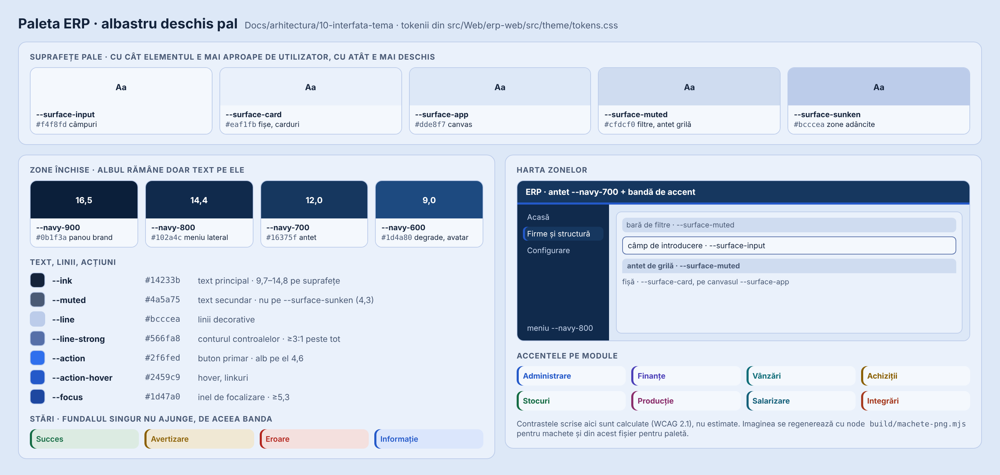

# ERP · 10 Interfață și temă vizuală

20 noiembrie 2026 · Aurelian · **Validat de Aurelian (20.11.2026)**, împreună cu machetele reculorate · Documente legate: [Bune practici](../bune-practici/BUNE_PRACTICI.md) (`UI-13`–`UI-17`), [07 Stack tehnologic](../07-stack-tehnologic/STACK_TEHNOLOGIC.md) (`ST4`, `ST5`), [02.01 Nucleu](../02-module-principale/01-nucleu/NUCLEU.md) (secțiunea 11, machetele de ecran)

Acest document stabilește tema vizuală a aplicației: paleta, unde se folosește fiecare culoare și ce
contraste sunt permise. Până acum tema nu era specificată nicăieri, iar culorile erau scrise de trei
ori (paginile de autentificare, aplicația React, machetele de ecran), toate pornind de la fundal alb.



## 1. Deciziile lui Aurelian (20.11.2026)

| # | Decizie | Consecință |
| --- | --- | --- |
| `T-01` | **Tema aplicației e albastru deschis pal.** Albastrul pal e culoarea de bază a suprafețelor, nu un accent | Toate ecranele, inclusiv `/account/*`, pornesc de la suprafețele din secțiunea 2 |
| `T-02` | **Nicio suprafață albă.** Fără `#fff`, `white`, `#fefefe`, `rgb(255,255,255)` pe fundaluri, carduri, câmpuri, grile, meniuri, ferestre de dialog sau pagini | Albul rămâne permis numai ca **text sau iconiță** pe zonele închise din secțiunea 3 (`UI-14`) |
| `T-03` | **Paleta se folosește întreagă**, ca zonele aplicației să se distingă vizual: antet, meniu, canvas, fișă, bară de filtre și fiecare modul au culoarea lor | Harta zonelor din secțiunea 4 și accentele pe module din secțiunea 5 |
| `T-04` | **Zonele închise rămân**: panoul de brand al autentificării și meniul lateral sunt bleumarin | Contrastul de zonă cel mai puternic din aplicație (14:1); restul e pal |

## 2. Suprafețele pale

Cinci trepte, de la cea mai deschisă la cea mai închisă. Regula de compunere: **cu cât un element e
mai „sus”, mai aproape de utilizator, cu atât e mai deschis** — câmpul în care scrii e cel mai
deschis, canvasul din spatele fișelor e mai închis.

| Token | Hex | Unde se folosește |
| --- | --- | --- |
| `--surface-input` | `#f4f8fd` | câmpuri de introducere, celule editabile de grilă, zone de cod și de chei |
| `--surface-card` | `#eaf1fb` | carduri, fișe, panouri, tab-ul activ, ferestre de dialog |
| `--surface-app` | `#dde8f7` | canvasul aplicației, în spatele cardurilor |
| `--surface-muted` | `#cfdcf0` | antetul grilelor, bara de filtre, tab-urile inactive, rândul alternant |
| `--surface-sunken` | `#bcccea` | separatoare pline, zone dezactivate, locul gol dintr-un indicator |

## 3. Zonele închise

| Token | Hex | Unde | Contrast cu alb |
| --- | --- | --- | --- |
| `--navy-900` | `#0b1f3a` | panoul de brand al paginilor `/account/*` | 16,5 |
| `--navy-800` | `#102a4c` | meniul lateral al aplicației | 14,4 |
| `--navy-700` | `#16375f` | antetul aplicației | 12,0 |
| `--navy-600` | `#1d4a80` | capătul deschis al degradeului de pe panoul de brand | 9,0 |

Pe ele: text alb pentru elementul activ și `--on-dark-muted` `#c8d6ee` pentru cel inactiv (9,8 pe
`--navy-800`). Culoarea `#9fb2d1`, folosită până acum, nu se mai pune ca text: pe `--navy-600`
coboară la 4,17.

## 4. Harta zonelor

```
┌───────────────────────────────────────────────────────────────┐
│ antet             --navy-700, text alb, bandă de accent 3 px  │
├────────────┬──────────────────────────────────────────────────┤
│ meniu      │ canvas                             --surface-app │
│ --navy-800 │  ┌────────────────────────────────────────────┐  │
│ text       │  │ fișă / card                  --surface-card│  │
│ #c8d6ee    │  │  bară de filtre             --surface-muted│  │
│ activ:     │  │  câmp de introducere        --surface-input│  │
│ alb pe     │  │  antet de grilă             --surface-muted│  │
│ --navy-700 │  └────────────────────────────────────────────┘  │
└────────────┴──────────────────────────────────────────────────┘
```

Reguli de separare:

- Între două suprafețe vecine e cel puțin o treaptă de diferență; niciodată aceeași treaptă lipită
  de ea însăși fără linie.
- Cardurile se delimitează cu `--line` (`#bcccea`), nu cu umbră; umbra rămâne doar pentru elementele
  care plutesc (popup, meniu derulant, toast).
- Antetul și meniul lateral nu au niciodată fundal pal: ele sunt reperul de orientare în aplicație.

## 5. Accentele pe module

Fiecare modul își poartă culoarea în banda de 3 px de sub antet, în pastila din meniu și în
iconițele ecranului. Modulele care încă nu există primesc accentul la implementare.

| Modul | Token | Hex | Pe `--surface-card` | Pe `--surface-app` | Alb pe el |
| --- | --- | --- | --- | --- | --- |
| Administrare (Nucleu) | `--accent-core` | `#2459c9` | 5,5 | 5,1 | 6,3 |
| Finanțe și contabilitate | `--accent-finance` | `#4b3fb8` | 6,8 | 6,3 | 7,8 |
| Vânzări | `--accent-sales` | `#0f6d78` | 5,3 | 4,9 | 6,0 |
| Achiziții | `--accent-purchasing` | `#8a5f00` | 5,0 | 4,6 | 5,7 |
| Stocuri (și WMS) | `--accent-stock` | `#146b43` | 5,8 | 5,3 | 6,5 |
| Producție (și Construcții) | `--accent-production` | `#8a2d6b` | 6,9 | 6,4 | 7,9 |
| HR și salarizare | `--accent-hr` | `#15607a` | 6,2 | 5,7 | 7,0 |
| Integrări ANAF/BNR | `--accent-integrations` | `#a63a1f` | 5,7 | 5,2 | 6,5 |

**Restricție verificată:** ca text, accentele se folosesc pe `--surface-card` și `--surface-app`. Pe
`--surface-muted` două dintre ele coboară sub 4,5 (Achiziții 4,07, Vânzări 4,35), deci acolo apar
numai ca bandă sau ca fundal plin cu text alb.

## 6. Text, linii, acțiuni, stări

| Token | Hex | Regulă și contrast verificat |
| --- | --- | --- |
| `--ink` | `#14233b` | text principal; 9,7–14,8 pe toate cele cinci suprafețe pale |
| `--muted` | `#4a5a75` | text secundar; permis până la `--surface-muted` (5,0). **Interzis pe `--surface-sunken`** (4,3) |
| `--on-dark` | `#ffffff` | text pe zonele închise |
| `--on-dark-muted` | `#c8d6ee` | text inactiv pe zonele închise (8,2–11,3) |
| `--ok-on-dark` | `#6fd3a3` | bifa de confirmare pe zonele închise (7,9 pe `--navy-800`) |
| `--warn-on-dark` | `#e0a21b` | marcajul de atenție pe zonele închise, de exemplu steluța din meniu (6,4 pe `--navy-800`) |
| `--line` | `#bcccea` | linii și contururi decorative, care nu fac parte dintr-un control |
| `--line-strong` | `#566fa8` | conturul controalelor (câmp, bifă, comutator); ≥3:1 pe **toate** suprafețele, inclusiv `--surface-sunken` (3,06) |
| `--action` | `#2f6fed` | butonul primar; alb pe el 4,6 |
| `--action-hover` | `#2459c9` | hover-ul butonului primar, linkurile; 5,1 pe `--surface-app` |
| `--focus` | `#1d47a0` | inelul de focalizare, 3 px; ≥5,3 pe orice suprafață |
| `--ok` | `#146b43` | succes; 5,3 pe `--surface-app` |
| `--warn` | `#8a5f00` | avertizare; 4,6 pe `--surface-app` |
| `--error` | `#b3261e` | eroare; 5,3 pe `--surface-app` |
| `--ok-bg` / `--warn-bg` / `--error-bg` | `#dcebe2` / `#f0e8d4` / `#f4e0de` | fundalul zonelor de stare |
| `--info` / `--info-bg` | `#2459c9` / `#dbe6fc` | informație, nodul selectat din arbore, pastila de firmă |
| `--surface-violet` | `#e6e2f7` | fundalul pastilei de grup (text `--accent-finance`, 6,1) |

**Regulă pentru stări (măsurată, nu presupusă):** fundalurile de stare au aproape aceeași luminanță
ca suprafețele pale (raport ≈1,0 față de `--surface-app`), deci se deosebesc doar prin nuanță. O
stare **nu se transmite niciodată numai prin fundal**: are obligatoriu o bandă de 3 px în culoarea
stării și un text sau o iconiță în aceeași culoare (`UI-16`, WCAG 1.4.1 și 1.4.11).

## 7. Unde stau culorile în cod

| Fișier | Rol |
| --- | --- |
| `src/Web/erp-web/src/theme/tokens.css` | **Sursa unică de adevăr.** Toți tokenii din acest document, și numai ei |
| `src/Web/erp-web/src/theme/syncfusion.css` | Suprascrie variabilele temei Syncfusion Tailwind 3 cu tokenii de mai sus |
| `src/Web/erp-web/src/styles.css` | Stilurile aplicației; folosește numai `var(--…)` |
| `src/Auth/Erp.Auth/wwwroot/tokens.css` | Același fișier, legat prin `Erp.Auth.csproj`; servit ca `_content/Erp.Auth/tokens.css` pentru paginile `/account/*` |

Componentele Syncfusion (`ST4`) se temizează numai în `syncfusion.css`, prin variabilele temei. În
ecrane nu se suprascriu clase `.e-*` și nu se folosește `!important` (`UI-17`). Selectorul de acolo e
`html:root`, nu `:root`: tema Syncfusion ajunge într-un fișier separat la construire, iar ordinea
fișierelor o decide împărțirea în bucăți din `vite.config.ts`; cu specificitate mai mare,
suprascrierea ține oricare ar fi ordinea.

Regulile `UI-13` și `UI-14` sunt verificate automat de `src/Web/erp-web/tests/tema.test.ts`: citește
foile de stil, pagina `index.html` și layout-ul Razor, și pică dacă apare o suprafață albă, o culoare
scrisă direct în `styles.css` sau dacă paginile `/account/*` pierd legătura cu `tokens.css`.

## 8. Machetele

Cele 27 de machete din [02.01 · ecrane](../02-module-principale/01-nucleu/ecrane) folosesc aceeași
paletă ca aplicația. PNG-urile se regenerează din HTML cu `build/machete-png.mjs` (Playwright,
1440×900 la `deviceScaleFactor: 2`), ca să nu se depărteze de HTML-ul lor.

Machetele fuseseră validate pe 14.11.2026 cu paleta veche, pe fundal alb. După reculorare au fost
**revalidate de Aurelian (20.11.2026)**.

## 9. Ce rămâne în afara temei

**Fereastra installer-ului** (`ErpSetup.exe`, `src/Setup/Erp.Setup/MainWindow.xaml`) rămâne pe fundal
alb: decizia lui Aurelian din 20.11.2026. `T-02` se aplică interfeței ERP — paginile web și ecranele
aplicației —, nu aplicației WPF de instalare, care rulează o singură dată, la administrator, înainte
ca ERP-ul să existe. Cine o restilizează mai târziu să o facă intenționat, nu „ca să respecte `UI-14`”.

Restul, de făcut separat:

| Sarcină | De ce nu e aici |
| --- | --- |
| Autentificarea cu contul Windows (Active Directory) | Macheta aprobată are butonul „Autentificare cu contul Windows”, dar nu există implementare. Cere Negotiate/Kerberos în `Erp.Host` și maparea contului AD pe `ids.UserAccount`; decizia lui Aurelian din 20.11.2026 e să se facă separat. Până atunci butonul nu apare, ca să nu fie un buton mort |
| Temă întunecată | Nu e cerută. Dacă se cere, se adaugă o a doua definiție de tokeni, nu culori noi în ecrane |
| Sigla clientului din baza de date | Azi sigla se citește ca fișier (`Branding:LogoPath`). `Company.LogoAttachmentId` așteaptă atașamentele (etapa 10 a Nucleului) |
